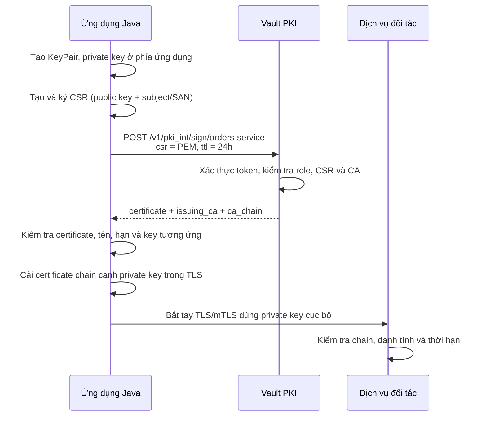

# Ký CSR để giữ việc tạo khóa ở phía ứng dụng

## 1. Vì sao chọn ký CSR thay vì để Vault tạo khóa?

Trong hệ thống Java dùng **Spring Vault** để tích hợp HashiCorp Vault, ứng dụng thường cần chứng thư X.509 cho HTTPS, mutual TLS (mTLS) hoặc xác thực giữa các dịch vụ. Vấn đề cốt lõi là **ai tạo và giữ private key**. Nếu ứng dụng yêu cầu Vault PKI phát hành cả khóa lẫn chứng thư, private key có thể đi qua phản hồi API và các thành phần trung gian. Với luồng **ký CSR (Certificate Signing Request)**, ứng dụng tạo cặp khóa của mình, chỉ gửi CSR chứa **public key** và thông tin đề nghị cấp chứng thư đến Vault. Vault ký và trả về chứng thư; private key vẫn ở phía ứng dụng.

Trong chương **Chứng thư PKI** của module **SPRING_VAULT**, đây là một thiết kế quan trọng khi phối hợp `VaultTemplate`/`VaultOperations`, phương thức xác thực theo workload, policy Vault và vòng đời chứng thư. Mục tiêu không đơn thuần là gọi được API ký CSR: cần giữ đúng ranh giới tin cậy, kiểm tra chứng thư được cấp và thay thế chứng thư an toàn khi hết hạn.

Sau bài học, bạn sẽ:

- Phân biệt `pki/issue/<role>` với `pki/sign/<role>` về vị trí tạo và lưu private key.
- Tạo private key và CSR ở phía ứng dụng, kèm Subject Alternative Name (SAN) phù hợp.
- Gửi CSR đến Vault PKI bằng CLI hoặc Spring Vault, đọc chứng thư/chuỗi CA trả về.
- Gắn chứng thư với private key ban đầu, kiểm tra danh tính và cấu hình TLS.
- Giới hạn quyền ký, xử lý lỗi, theo dõi hạn dùng và kiểm thử tích hợp.

## 2. CSR chứa gì, và điều gì không bao giờ được gửi?

CSR theo định dạng PKCS#10 thường bao gồm **subject**, **public key**, các extension được đề nghị (chẳng hạn DNS SAN) và **chữ ký tạo bởi private key tương ứng**. Chữ ký trên CSR cho phép CA kiểm tra bên yêu cầu có quyền sử dụng khóa riêng để ký CSR; nó **không** tự chứng minh ứng dụng được quyền sở hữu tên miền hay danh tính ghi trong CSR. Vault PKI phải kiểm soát điều đó bằng role/policy và quy trình cấp phát danh tính.

| Thành phần | Nơi tạo/giữ | Có gửi tới Vault khi ký CSR? |
| --- | --- | --- |
| Private key của dịch vụ | Ứng dụng, keystore hoặc thiết bị phần cứng | **Không** |
| Public key | Tạo từ cặp khóa tại ứng dụng | Có, bên trong CSR |
| Subject và SAN đề nghị | Ứng dụng tạo CSR | Có, để Vault xét theo role |
| Chữ ký của CSR | Ứng dụng ký bằng private key | Có, nằm trong CSR |
| Chứng thư X.509 đã được CA ký | Vault PKI phát hành | Vault trả về |
| Issuing CA, CA chain | Hạ tầng PKI của Vault | Vault có thể trả về để dựng chuỗi |

**Lưu ý về thuật ngữ:** “Ký CSR” ở đây nghĩa là **CA ký chứng thư dựa trên CSR**. Trước đó, ứng dụng đã tự ký *CSR* bằng private key để chứng minh quyền sử dụng khóa. Hai chữ ký này có vai trò khác nhau.



Ứng dụng có thể giữ khóa trong `KeyStore`, kho khóa của hệ điều hành hoặc HSM/PKCS#11. Ví dụ `KeyPairGenerator` trong JVM phù hợp để học cách tạo CSR, nhưng không tự bảo đảm private key không thể xuất ra khỏi bộ nhớ; muốn khóa **không thể xuất** cần chọn backend khóa và chính sách phù hợp.

## 3. Chọn đúng API PKI

Giả sử PKI secrets engine được mount tại `pki_int/` và hạ tầng đã cấu hình CA phát hành chứng thư hợp lệ.

| Endpoint | Cách hoạt động | Khi nào chọn |
| --- | --- | --- |
| `pki_int/issue/orders-service` | Vault tạo khóa và phát hành chứng thư; phản hồi có thể chứa private key theo lựa chọn cấu hình. | Khi chủ động để Vault tạo/trao khóa, có cơ chế vận chuyển và lưu khóa riêng. |
| `pki_int/sign/orders-service` | Vault kiểm tra CSR theo role rồi ký chứng thư, **không tạo private key cho dịch vụ**. | Khi ứng dụng phải tự giữ private key. |
| `pki_int/sign-verbatim` hoặc biến thể tương ứng | Cho phép xử lý CSR theo cơ chế khác, cần kiểm soát chặt các trường được giữ nguyên. | Chỉ khi có yêu cầu PKI chuyên biệt và được người quản trị phê duyệt. |

Bài này dùng **`pki_int/sign/orders-service`**. Tên mount `pki_int` và tên role `orders-service` chỉ là ví dụ; ứng dụng phải dùng đường dẫn thực tế của môi trường.

### 3.1. Vai trò của role và issuer

Role PKI quy định tên nào được cấp, giới hạn TTL, các quy tắc SAN, key usage và các điều kiện khác. Ví dụ, người quản trị có thể tạo role cho một nhóm dịch vụ nội bộ:

```bash
# Điều kiện: pki_int đã mount và có issuer/CA được cấu hình.
# Chạy bằng danh tính quản trị PKI, KHÔNG bằng token của ứng dụng.
vault write pki_int/roles/orders-service \
  allowed_domains="svc.example.internal" \
  allow_subdomains=true \
  max_ttl="72h" \
  server_flag=true \
  client_flag=true
```

Cấu hình trên cho phép cấp tên con của `svc.example.internal`, phục vụ minh họa cho dịch vụ `orders.svc.example.internal`. Trong sản xuất, giới hạn role hẹp hơn theo danh tính workload, chỉ bật `server_flag` hoặc `client_flag` theo nhu cầu TLS thực tế, và rà soát kỹ chính sách SAN. Tên miền được phép **không đồng nghĩa** mọi workload đều được cấp mọi tên trong miền: nên tách role/policy theo dịch vụ và môi trường để giảm rủi ro giả mạo danh tính.

CA/intermediate và issuer phải có sẵn trước khi ký; thao tác `sign` không tự khởi tạo CA. Nếu mount không có issuer phù hợp, cấu hình CA hết hiệu lực hoặc role không cho phép tên đề nghị, Vault sẽ từ chối yêu cầu.

### 3.2. Token và policy cấp quyền tối thiểu

Tại endpoint ký qua Vault API, ứng dụng cần quyền **`update`** trên đúng role:

```hcl
path "pki_int/sign/orders-service" {
  capabilities = ["update"]
}
```

Đây là policy của ứng dụng gọi ký CSR. Không cấp cho workload các đường dẫn `pki_int/root/*`, `pki_int/issuers/*`, `pki_int/roles/*` hay `pki_int/issue/*` nếu không cần. Đăng nhập Vault bằng phương thức tương ứng môi trường (ví dụ Kubernetes Auth, AppRole hoặc IAM Auth); quản lý token và gia hạn xác thực theo cơ chế hỗ trợ của Spring Vault. **Thời hạn Vault token và thời hạn chứng thư là hai vòng đời khác nhau.**

## 4. Thực hành với OpenSSL và Vault CLI

OpenSSL minh họa nhanh việc private key được tạo **ngoài Vault**. Các lệnh dưới đây chạy trong môi trường thử nghiệm do bạn kiểm soát; không đưa file khóa riêng vào repository, log hay image container.

### 4.1. Tạo private key tại ứng dụng

```bash
# Tạo private key RSA 3072 bit ngay trên máy/workload cần dùng.
openssl genpkey -algorithm RSA \
  -pkeyopt rsa_keygen_bits:3072 \
  -out orders.key.pem

# Trên hệ điều hành hỗ trợ chmod, giới hạn quyền đọc.
chmod 600 orders.key.pem
```

Có thể dùng EC/P-256 hoặc khóa do HSM quản lý nếu CA, role và bộ thư viện TLS hỗ trợ. Khi tạo CSR, thuật toán ký phải tương thích loại private key. Dù chọn loại nào, **chỉ public key được đưa vào CSR**.

### 4.2. Tạo CSR có DNS SAN

```bash
openssl req -new -sha256 \
  -key orders.key.pem \
  -out orders.csr.pem \
  -subj "/CN=orders.svc.example.internal" \
  -addext "subjectAltName=DNS:orders.svc.example.internal"

# Kiểm tra nội dung CSR và chữ ký CSR trước khi gửi.
openssl req -in orders.csr.pem -text -verify -noout
```

SAN mới là phần danh tính máy chủ thường được client TLS dùng để xác minh hostname. Không dựa vào `CN` một mình. Nếu cần nhiều DNS SAN hoặc URI SAN (ví dụ định danh service), phải khai báo đúng trong CSR, đồng thời bảo đảm role PKI cho phép các tên đó.

### 4.3. Ký CSR bằng Vault PKI

```bash
# Từ CLI, ký CSR bằng role đã cấu hình. @file bảo Vault CLI đọc nội dung file.
vault write -format=json pki_int/sign/orders-service \
  csr=@orders.csr.pem \
  ttl=24h \
  format=pem > signed-response.json

# Trích chứng thư và CA phát hành từ phản hồi, nếu có jq.
jq -r '.data.certificate' signed-response.json > orders.crt.pem
jq -r '.data.issuing_ca' signed-response.json > issuing-ca.crt.pem
```

Vault phản hồi thường chứa các trường như:

```json
{
  "data": {
    "certificate": "-----BEGIN CERTIFICATE-----\n...\n-----END CERTIFICATE-----\n",
    "issuing_ca": "-----BEGIN CERTIFICATE-----\n...\n-----END CERTIFICATE-----\n",
    "ca_chain": ["-----BEGIN CERTIFICATE-----\n...\n-----END CERTIFICATE-----\n"],
    "serial_number": "12:34:...",
    "expiration": 1780000000
  }
}
```

Các giá trị trong JSON trên chỉ để minh họa cấu trúc, **không phải chứng thư có thể dùng thực tế**. Đặc điểm cần nhớ: **không có private key của ứng dụng trong phản hồi ký CSR**.

Kiểm tra chứng thư nhận về:

```bash
openssl x509 -in orders.crt.pem -text -noout
```

Quan sát `Subject`, `Issuer`, `Subject Alternative Name`, `Key Usage`, `Extended Key Usage`, `Not Before` và `Not After`. Kiểm tra xem chứng thư có đúng danh tính và mục đích sử dụng mong muốn, không chỉ xem yêu cầu API thành công.

Muốn kiểm tra chuỗi tin cậy, dùng **root CA đã được quản trị/trao đổi qua kênh tin cậy**; không mặc định tin mọi CA được trả trong cùng phản hồi:

```bash
# trusted-ca.pem là CA đáng tin đã được cung cấp/kiểm tra độc lập.
# Khi có intermediate, cung cấp qua -untrusted hoặc trust chain tương ứng.
openssl verify -CAfile trusted-ca.pem \
  -untrusted issuing-ca.crt.pem orders.crt.pem
```

Với nhiều intermediate, cần cung cấp đủ chuỗi CA trung gian. Chữ ký hợp lệ về mặt mật mã không thay thế việc kiểm tra hostname, EKU, thời hạn và các chính sách tin cậy khác.

## 5. Java: tự tạo KeyPair và CSR

Trong ứng dụng dùng Spring Vault, có thể tạo CSR bằng Java và thư viện Bouncy Castle `bcprov` + `bcpkix` có phiên bản tương thích JDK. Spring Vault không yêu cầu Bouncy Castle cho chính thao tác HTTP gửi CSR; ở đây thư viện được dùng để xây dựng **PKCS#10 CSR**.

Đoạn dưới dùng Java hiện đại và minh họa tạo CSR kèm SAN. Trong sản xuất, thay `KeyPairGenerator` bằng keystore/HSM khi chính sách yêu cầu; không ghi private key ra log hoặc tự serialize vào JSON.

```java
import java.io.StringWriter;
import java.security.KeyPair;
import java.security.KeyPairGenerator;

import org.bouncycastle.asn1.pkcs.PKCSObjectIdentifiers;
import org.bouncycastle.asn1.x500.X500Name;
import org.bouncycastle.asn1.x509.Extension;
import org.bouncycastle.asn1.x509.ExtensionsGenerator;
import org.bouncycastle.asn1.x509.GeneralName;
import org.bouncycastle.asn1.x509.GeneralNames;
import org.bouncycastle.openssl.jcajce.JcaPEMWriter;
import org.bouncycastle.operator.ContentSigner;
import org.bouncycastle.operator.jcajce.JcaContentSignerBuilder;
import org.bouncycastle.pkcs.PKCS10CertificationRequest;
import org.bouncycastle.pkcs.jcajce.JcaPKCS10CertificationRequestBuilder;

public final class LocalCsrCreator {
    private LocalCsrCreator() {}

    public record CsrBundle(KeyPair keyPair, String csrPem) {}

    public static CsrBundle create(String dnsName) throws Exception {
        KeyPairGenerator generator = KeyPairGenerator.getInstance("RSA");
        generator.initialize(3072);
        KeyPair keyPair = generator.generateKeyPair();

        X500Name subject = new X500Name("CN=" + dnsName);
        var builder = new JcaPKCS10CertificationRequestBuilder(
                subject, keyPair.getPublic());

        ExtensionsGenerator extensions = new ExtensionsGenerator();
        extensions.addExtension(
                Extension.subjectAlternativeName,
                false,
                new GeneralNames(new GeneralName(GeneralName.dNSName, dnsName)));
        builder.addAttribute(
                PKCSObjectIdentifiers.pkcs_9_at_extensionRequest,
                extensions.generate());

        ContentSigner signer =
                new JcaContentSignerBuilder("SHA256withRSA")
                        .build(keyPair.getPrivate());
        PKCS10CertificationRequest csr = builder.build(signer);

        StringWriter text = new StringWriter();
        try (JcaPEMWriter writer = new JcaPEMWriter(text)) {
            writer.writeObject(csr);
        }
        return new CsrBundle(keyPair, text.toString());
    }
}
```

Giải thích:

1. `KeyPairGenerator` tạo public/private key **bên trong tiến trình Java**. Ví dụ giữ cặp khóa trong `CsrBundle` để dễ hiểu; production cần lưu và bảo vệ private key theo vòng đời ứng dụng.
2. CSR chứa `subject` và extension request cho DNS SAN. SAN trong CSR là **đề nghị cấp**, Vault vẫn quyết định nội dung chứng thư được cấp theo role và cấu hình.
3. `ContentSigner` dùng private key cục bộ để ký CSR. Kết quả PEM có dạng `-----BEGIN CERTIFICATE REQUEST-----`.
4. Chuỗi `csrPem` có thể gửi lên Vault, nhưng **`keyPair.getPrivate()` không được đưa vào request**.

Bài học dùng RSA để đơn giản hóa ví dụ. Nếu dùng EC, phải đổi `KeyPairGenerator`, cấu hình đường cong và `ContentSigner` cho phù hợp, chẳng hạn `SHA256withECDSA`. Tổ chức nên kiểm thử khả năng hỗ trợ khóa và profile chứng thư của CA trước khi đổi thuật toán.

## 6. Spring Vault: gửi CSR và nhận chứng thư

Ứng dụng có thể dùng `VaultOperations` (thường được cung cấp bởi `VaultTemplate`) để gọi endpoint PKI. Ví dụ Spring service dưới đây chỉ xử lý việc **gửi CSR và nhận chứng thư**. Giả định Spring Vault đã được cấu hình Vault URL, TLS trust và authentication của workload.

```java
import java.util.List;
import java.util.Map;

import org.springframework.stereotype.Service;
import org.springframework.vault.core.VaultOperations;
import org.springframework.vault.support.VaultResponse;

@Service
public class PkiCsrSigningService {
    private static final String SIGN_PATH = "pki_int/sign/orders-service";

    private final VaultOperations vault;

    public PkiCsrSigningService(VaultOperations vault) {
        this.vault = vault;
    }

    public record IssuedCertificate(
            String certificatePem,
            String issuingCaPem,
            List<String> caChainPem,
            String serialNumber) {}

    public IssuedCertificate signCsr(String csrPem) {
        if (csrPem == null || csrPem.isBlank()) {
            throw new IllegalArgumentException("CSR PEM khong duoc rong");
        }

        VaultResponse response = vault.write(
                SIGN_PATH,
                Map.of(
                    "csr", csrPem,
                    "ttl", "24h",
                    "format", "pem"
                )
        );

        if (response == null || response.getData() == null) {
            throw new IllegalStateException("Vault PKI khong tra du lieu");
        }

        Map<String, Object> data = response.getData();
        String certificate = requiredText(data, "certificate");
        String serial = requiredText(data, "serial_number");
        String issuingCa = data.get("issuing_ca") instanceof String ca
                ? ca : "";

        // API sign CSR không được chuyển private key của dịch vụ về ứng dụng.
        if (data.get("private_key") instanceof String key && !key.isBlank()) {
            throw new IllegalStateException(
                    "Phan hoi sign CSR chua private key bat thuong");
        }

        List<String> chain = data.get("ca_chain") instanceof List<?> raw
                ? raw.stream()
                     .filter(String.class::isInstance)
                     .map(String.class::cast)
                     .toList()
                : List.of();

        return new IssuedCertificate(certificate, issuingCa, chain, serial);
    }

    private static String requiredText(Map<String, Object> data, String field) {
        Object value = data.get(field);
        if (!(value instanceof String text) || text.isBlank()) {
            throw new IllegalStateException(
                    "Vault PKI thieu truong " + field);
        }
        return text;
    }
}
```

Sử dụng ở tầng ứng dụng:

```java
LocalCsrCreator.CsrBundle bundle =
        LocalCsrCreator.create("orders.svc.example.internal");

PkiCsrSigningService.IssuedCertificate issued =
        signingService.signCsr(bundle.csrPem());

// bundle.keyPair().getPrivate(): vẫn do ứng dụng kiểm soát.
// issued.certificatePem(): chứng thư CA đã ký.
// issued.caChainPem(): chuỗi CA, cần kiểm tra trước khi sử dụng.

// Bước tiếp theo: kiểm tra chứng thư, cấu hình TLS/KeyStore
// với certificate chain và private key cục bộ, rồi kích hoạt dịch vụ.
```

**Điểm thiết kế:** Không cố tìm `private_key` trong phản hồi `pki_int/sign/... `. Phần private key phải lấy từ nơi ứng dụng tạo và quản lý khóa lúc ban đầu. Ví dụ cũng không triển khai tự động ghi keystore; điều đó phụ thuộc vào TLS stack của dịch vụ (Spring Boot embedded server, Java `SSLContext`, Netty hoặc mTLS client) và chiến lược bảo vệ khóa.

Có thể triển khai một lớp kiểm tra kết quả phát hành trước khi cấu hình TLS:

- Phân tích PEM thành `X509Certificate`, kiểm tra thời điểm hiệu lực và danh tính SAN.
- So sánh public key trong chứng thư với public key của key pair đã tạo: `Arrays.equals(cert.getPublicKey().getEncoded(), keyPair.getPublic().getEncoded())` là cách kiểm tra trực tiếp trong ví dụ khi hai khóa được biểu diễn bằng cùng định dạng X.509 SubjectPublicKeyInfo.
- Xác minh chuỗi chứng thư tới **trust anchor đã được tin cậy**, theo chính sách PKIX; kiểm tra `keyUsage` và `extendedKeyUsage` tương ứng với server/client TLS.
- Chỉ thay thế chứng thư đang hoạt động sau khi **đã kiểm tra** sự phù hợp giữa chứng thư, private key và chuỗi CA. Với ứng dụng cần sẵn sàng liên tục, thay cấu hình TLS theo cơ chế reload/hot swap được kiểm soát.

## 7. Kiểm soát danh tính và giới hạn phạm vi CSR

Mặc dù CSR được ký hợp lệ bằng private key, người gửi vẫn có thể **đề nghị** các tên không thuộc quyền sở hữu. Ví dụ một workload bị xâm nhập có thể tạo CSR với `DNS:payments.svc.example.internal` thay vì `DNS:orders.svc.example.internal`. Vì vậy, chỉ dựa vào “CSR signature valid” là không đủ.

Các lớp kiểm soát nên phối hợp:

| Lớp | Cần bảo đảm |
| --- | --- |
| Xác thực Vault theo workload | Danh tính gọi `sign` gắn với đúng deployment/service account, không dùng token chung dài hạn. |
| Vault ACL | Workload chỉ gọi được role PKI dành cho nó. |
| Role PKI | Ràng buộc domain/SAN, TTL, key usage và mục đích chứng thư; tách môi trường dev/test/prod. |
| Luồng phê duyệt danh tính | Không cho workload ký tên của workload khác chỉ vì cùng thuộc một hậu tố domain. |
| Kiểm tra đầu ra | Dịch vụ xác nhận CN/SAN, public key, thời hạn, EKU và chuỗi tin cậy của chứng thư thực nhận. |

Một số tùy chọn role liên quan như `use_csr_common_name` và `use_csr_sans` quyết định cách Vault lấy thông tin tên từ CSR theo phiên bản/cấu hình PKI. Hãy xác định rõ những trường CSR nào được chấp nhận và role có quyền cấp những tên nào. Đối với yêu cầu SAN phức tạp, URI SAN hoặc tên có wildcard, phải kiểm tra chính sách tương ứng; không tự giả định Vault sẽ sao chép nguyên xi mọi extension từ CSR.

## 8. Quản lý private key và vòng đời chứng thư

### 8.1. Private key luôn ở phía ứng dụng

Có nhiều mức bảo vệ private key:

- **Đối với demo/test:** tạo `KeyPair` trong Java và giữ trong bộ nhớ test hoặc file được phân quyền hạn chế.
- **Đối với dịch vụ thực tế:** dùng Java `KeyStore`/PKCS#12 hoặc kho khóa được mã hóa, giới hạn truy cập theo tài khoản tiến trình và hạn chế sao lưu.
- **Đối với môi trường yêu cầu bảo vệ cao:** tạo và ký CSR trực tiếp qua HSM/PKCS#11 hoặc kho khóa không cho xuất private key. Dịch vụ chỉ nhận handle tham chiếu tới khóa để bắt tay TLS.

Điều kiện cốt lõi của quy trình CSR là **không chuyển private key qua Vault PKI**; tuy nhiên private key vẫn có thể rò rỉ ở chính ứng dụng nếu log, lưu trữ hoặc phân quyền sai. Vì vậy, cần quản lý khóa cục bộ nghiêm túc tương đương quản lý chứng thực của dịch vụ.

### 8.2. TTL chứng thư không phải token lease

Khi ký CSR, Vault có thể trả `expiration` (Unix timestamp) và chứng thư có trường `Not After`. Thời hạn thực tế phụ thuộc yêu cầu, role, issuer và cấu hình PKI. Hãy lấy **chứng thư phát hành thật** làm nguồn để theo dõi thời gian hết hạn.

- **Token Vault hết hạn:** ứng dụng cần xác thực/nhận token mới để tiếp tục gọi Vault theo workload auth.
- **Chứng thư X.509 hết hạn:** ứng dụng phải **xin cấp chứng thư mới** bằng CSR phù hợp và triển khai trước thời điểm hết hạn. Không nên xem việc gia hạn Vault token hay lease như một thao tác tự gia hạn thời hạn chứng thư.
- **Quay vòng khóa:** tùy chính sách, có thể dùng lại key pair với CSR mới trong thời gian cho phép hoặc sinh key pair mới. Khi thay khóa, phải triển khai certificate/private key tương ứng **một cách nhất quán**.

Nên đặt cảnh báo sớm trước hạn (ví dụ ở ngưỡng do tổ chức xác định), tính đến sai lệch đồng hồ, độ trễ của Vault và thời gian phát hành/cập nhật TLS. Đối với workload có nhiều replica, mỗi instance có thể có khóa riêng và quy trình tái cấp riêng, hoặc dùng hệ thống cấp phát chứng thư tập trung được kiểm soát; tránh chia sẻ private key giữa các service không cần thiết.

## 9. Lỗi thường gặp và cách chẩn đoán

| Hiện tượng | Nguyên nhân thường gặp | Hành động |
| --- | --- | --- |
| HTTP 400 khi `sign` | CSR không đúng PEM/PKCS#10, chữ ký CSR không hợp lệ, tên/SAN trái role, thuật toán khóa không được hỗ trợ. | Kiểm tra CSR với `openssl req -verify`, đối chiếu role, thuật toán và SAN. |
| HTTP 403 | Workload token không có quyền `update` trên đường dẫn role hoặc auth không còn hợp lệ. | Kiểm tra method auth, token policy và đường dẫn `pki_int/sign/orders-service`. |
| HTTP 404 | Sai PKI mount hoặc tên endpoint/role không tồn tại. | Kiểm tra path với người vận hành Vault. |
| Vault không có issuer phù hợp | CA/intermediate chưa cấu hình hoặc không phát hành được. | Kiểm tra issuer và cấu hình PKI bằng danh tính quản trị. |
| Nhận cert nhưng TLS báo `bad_certificate` | Chứng thư không khớp private key, thiếu chain, sai EKU/SAN hoặc truststore chưa tin CA. | Kiểm tra cặp khóa/chứng thư, trust anchor, client/server auth và hostname. |
| Chứng thư đã hết hạn hoặc chưa có hiệu lực | `Not After` đã qua, `Not Before` trong tương lai hoặc lệch đồng hồ. | Cấp lại đúng hạn, đồng bộ đồng hồ và cải thiện cảnh báo. |
| Lỗi mạng/5xx/timeout | Vault, proxy hoặc kết nối không sẵn sàng. | Retry có giới hạn, quan sát lỗi, giữ chứng thư đang dùng nếu vẫn hợp lệ và thiết kế phục hồi an toàn. |

Phân biệt lỗi cấp phát chứng thư với lỗi vận hành TLS ở phía sử dụng. Trường hợp Vault trả 200 nhưng chứng thư có danh tính hoặc mục đích dùng sai vẫn phải coi là **không đạt yêu cầu triển khai**. Không bỏ qua kiểm tra hostname, không tắt xác minh CA trong TLS để “sửa nhanh” lỗi chứng thư.

Trong log/metric, ghi mã lỗi, mount/role, serial number của chứng thư, hạn dùng và thời gian phản hồi (khi phù hợp). Không ghi private key, mật khẩu keystore, token Vault hoặc toàn bộ nội dung request nhạy cảm. CSR và chứng thư phần lớn chứa dữ liệu công khai nhưng subject/SAN vẫn có thể tiết lộ thông tin hạ tầng, nên áp dụng chính sách ghi log phù hợp.

## 10. Kiểm thử tích hợp và tình huống thực hành

Trong môi trường kiểm thử, dùng Vault thử nghiệm với PKI issuer và role riêng. Spring Vault dùng cấu hình auth dành cho test, không cần sử dụng private key/chứng thư production.

1. **Happy path:** tạo cặp khóa cục bộ, tạo CSR có SAN hợp lệ, gọi `pki_int/sign/orders-service`, nhận PEM và xác minh public key trong cert trùng với public key ban đầu.
2. **Giữ khóa ở ứng dụng:** phản hồi ký CSR không chứa private key, private key vẫn có thể dùng để bắt tay TLS cục bộ.
3. **Tên không được cấp phép:** yêu cầu CSR có SAN ngoài phạm vi role; Vault từ chối và ứng dụng không cài đặt cert.
4. **Thiếu quyền:** token chỉ có quyền đọc metadata (hoặc không có `update` ở role) không thể gọi `sign`.
5. **CSR lỗi:** sửa byte trong CSR hoặc dùng PEM không hợp lệ; ứng dụng phân loại lỗi đầu vào.
6. **Chuỗi CA hoặc danh tính sai:** chứng thư không đi tới trust anchor hoặc SAN không khớp hostname; kết nối TLS phải bị từ chối.
7. **Xoay chứng thư:** phát hành cert mới, xác minh key/chain rồi thay đúng cặp cert/key; phiên bản cũ chỉ ngừng dùng sau khi phiên bản mới hoạt động.
8. **Lỗi Vault:** token hết hạn, timeout hoặc PKI không sẵn sàng; ứng dụng báo lỗi rõ, không ghi đè chứng thư đang sử dụng bằng dữ liệu rỗng.

**Bài tập:** Giả sử dịch vụ `orders.svc.example.internal` có 3 replica chạy trên Kubernetes. Hãy thiết kế phương án dùng Kubernetes Auth, role chỉ cho phép tên dịch vụ phù hợp, key pair sinh cục bộ theo mỗi replica, lịch cấp lại chứng thư và quy trình TLS reload không gián đoạn. Sau đó mô phỏng hai cuộc gọi CSR: một yêu cầu đúng DNS SAN và một yêu cầu mạo danh `payments.svc.example.internal`. Kết quả kỳ vọng là yêu cầu hợp lệ được phát hành chứng thư, yêu cầu ngoài quyền danh tính bị từ chối bởi cấu hình role/policy phù hợp.

## 11. Checklist trước khi dùng trong sản xuất

- [ ] Private key được tạo và giữ ở workload/keystore/HSM theo chính sách, không xuất qua API ký CSR.
- [ ] CSR có chữ ký hợp lệ, SAN/subject và thuật toán phù hợp với danh tính và CA.
- [ ] Sử dụng `pki/sign/<role>` để ứng dụng tự giữ khóa, với policy `update` tối thiểu.
- [ ] Role PKI giới hạn đúng tên/SAN, TTL, EKU/Key Usage và phạm vi workload được cấp.
- [ ] Chứng thư trả về được kiểm tra public key, trust chain, SAN, EKU và thời hạn trước khi cài vào TLS.
- [ ] Có quy trình cấp lại chứng thư, thay cert/key an toàn, xử lý token hết hạn và giám sát `Not After`.
- [ ] Kiểm thử CSR sai, domain ngoài quyền, thiếu ACL, chứng thư không khớp khóa và lỗi Vault.

**Ghi nhớ:** `pki/sign/<role>` cho phép **ứng dụng sở hữu private key, Vault đóng vai trò CA ký chứng thư**. Sự tách biệt này phát huy tác dụng khi đi kèm role đúng danh tính, kiểm tra chứng thư đầu ra và quản lý vòng đời khóa/chứng thư riêng biệt với token Vault.
