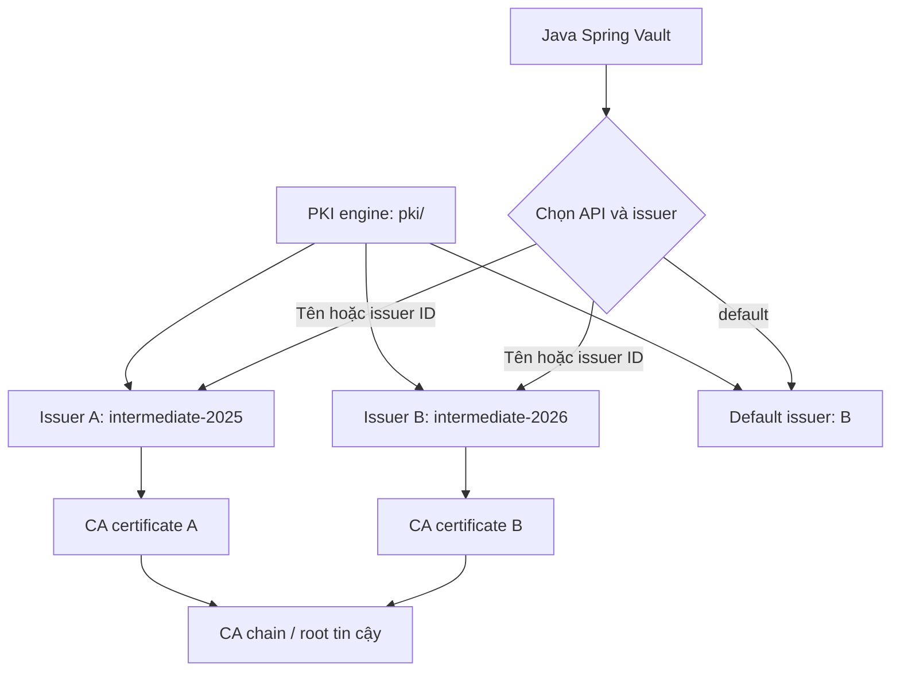
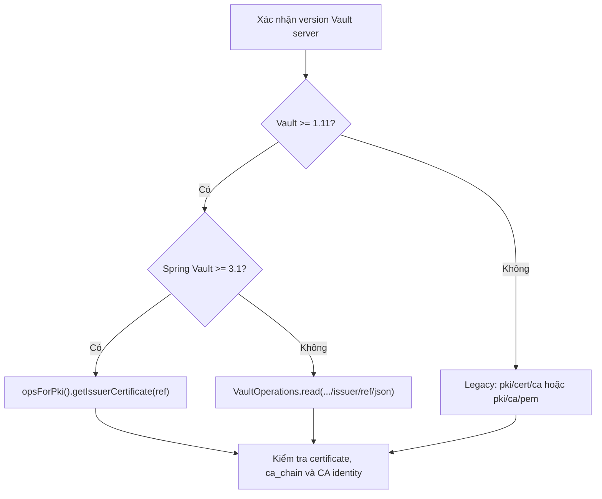

# Lấy chứng thư issuer theo API của phiên bản sử dụng

> **Spring Vault — Chứng thư PKI.** Khi ứng dụng Java dùng HashiCorp Vault làm hạ tầng PKI, điều quan trọng không chỉ là lấy được một PEM. Cần xác định **Vault server đang chạy phiên bản nào, Spring Vault đang dùng API nào, PKI engine được mount ở đâu và muốn đọc issuer nào**. Chọn sai endpoint dễ dẫn tới lấy nhầm CA mặc định, thiếu chuỗi chứng thư hoặc nhầm API đọc công khai với API quản trị cần quyền.

## 1. Mục tiêu và bối cảnh

Sau bài này, bạn có thể:

- Phân biệt **issuer certificate (CA certificate)** với chứng thư được Vault cấp cho ứng dụng (*leaf certificate*), khóa riêng và chuỗi tin cậy (*CA chain*).
- Chọn URL API đọc issuer phù hợp giữa Vault **trước 1.11** và **từ 1.11 trở lên**, bao gồm hệ thống có nhiều issuer trong một PKI mount.
- Sử dụng `VaultOperations.opsForPki(...)` và `VaultPkiOperations.getIssuerCertificate(...)` trong **Spring Vault từ 3.1**; biết cách dùng `VaultOperations.read(...)` khi thư viện Java cũ hơn.
- Nhận kết quả JSON, PEM hoặc DER; phân tích `X509Certificate` bằng Java và kiểm tra chứng thư/chain trước khi dùng.
- Xử lý lựa chọn issuer khi rotate CA, lỗi endpoint, lỗi phân quyền, sai mount và các vấn đề an toàn khi đưa CA vào truststore.

Ví dụ giả định Vault đã bật **PKI secrets engine tại mount `pki/`** và một issuer đã được tạo/import. Đây là bài **đọc chứng thư issuer hiện có**, không hướng dẫn tạo root CA, ký chứng thư mới hoặc lấy khóa riêng.

## 2. Hiểu đúng issuer và API đọc chứng thư

Trong Vault PKI, **issuer** là thực thể CA mà Vault quản lý để ký chứng thư, bao gồm chứng thư CA và tham chiếu tới key material phù hợp. Chứng thư X.509 công khai của issuer có thể được phân phối cho bên xác minh. **Private key của CA không được trả về từ endpoint đọc chứng thư**.

Ví dụ hệ thống có hai CA intermediate trong một mount:



Cần phân biệt:

| Khái niệm | Nội dung | Dùng khi nào |
|---|---|---|
| **Issuer certificate** | Chứng thư X.509 của CA mà Vault dùng ký chứng thư con | Xác định CA, kiểm tra chứng thư, xây dựng chuỗi |
| **Issuer reference** (`issuer_ref`) | Issuer ID, tên issuer đã đặt, hoặc `default` | Chỉ định CA cần đọc trong Vault 1.11+ |
| **CA chain** (`ca_chain`) | Danh sách chứng thư CA liên quan, có thể gồm issuer và các CA cha mà Vault biết | Xác minh đường dẫn chứng thực hoặc phân phối chain |
| **Default issuer** | Issuer được cấu hình mặc định cho mount | Ứng dụng chấp nhận việc CA được thay qua cấu hình |
| **Leaf certificate** | Chứng thư TLS/service được cấp theo role hoặc CSR | Dùng làm danh tính của workload; **không phải** chứng thư issuer |
| **Trust anchor** | CA được client tin cậy theo chính sách độc lập | Cấu hình truststore; **không tự tin cậy** chỉ vì tải từ Vault |

**Điểm cần nhớ:** GET issuer certificate chỉ giúp **đọc** CA certificate. Nó không chứng minh chain đáng tin và không thay thế quy trình phê duyệt trust anchor.

## 3. Bảng chọn API theo phiên bản: quyết định trước khi lập trình

Vault **từ 1.11.0** bổ sung khả năng quản lý **nhiều issuers trong một PKI mount**. Các endpoint mới chọn issuer theo `issuer_ref`; API cũ tiếp tục tồn tại để đọc issuer mặc định. Về phía Spring Vault, API `getIssuerCertificate(...)` được giới thiệu **từ Spring Vault 3.1**.

| Vault server | Spring Vault | Cách đọc phù hợp | Giới hạn cần nhớ |
|---|---|---|---|
| **Trước 1.11** | Bất kỳ phiên bản tương thích | `GET /v1/pki/cert/ca` (JSON), `/v1/pki/ca/pem` (PEM), `/v1/pki/ca` (DER) | Chỉ CA mặc định; không có `issuer_ref` của API multi-issuer |
| **1.11 trở lên** | **3.1 trở lên** | `vaultOperations.opsForPki("pki").getIssuerCertificate(ref)` hoặc overload `Encoding` | Lấy đúng issuer được chỉ định; kiểm tra ref và mount |
| **1.11 trở lên** | **Cũ hơn 3.1** | `VaultOperations.read("pki/issuer/<ref>/json")` hoặc HTTP GET endpoint PEM/DER | Có API phía Vault nhưng thư viện Spring chưa có method typed |
| **1.11 trở lên** | Bất kỳ | `GET /v1/pki/issuer/<ref>/json`, `.../pem`, `.../der` | JSON chứa `certificate` và `ca_chain`; PEM/DER là dạng chứng thư mã hóa |
| **1.11 trở lên** | Bất kỳ | `GET /v1/pki/cert/ca` hoặc `/v1/pki/ca/pem` | Đường dẫn tương thích cũ, luôn đọc **default issuer** |

`<ref>` trong bảng là **một path segment**, ví dụ `default`, `intermediate-2026` hoặc issuer UUID. Trong URL thật phải thay mount `pki` bằng vị trí Vault đã cấu hình, chẳng hạn `pki-int`. Không nhầm **Vault server version** với **phiên bản Spring Vault trong Java dependency**.

Sơ đồ chọn endpoint:



Không lấy kết luận chỉ từ tên artifact `spring-vault-core`: kiểm tra version thực trong dependency tree/build và phiên bản Vault thực trên server. API Javadoc được chọn phải là **Javadoc đúng major/minor đang dùng**.

## 4. Xác định mount và issuer trước khi gọi API

Với tài khoản quản trị trong **môi trường lab**, kiểm tra Vault đang chạy và mount PKI:

```bash
# VAULT_ADDR và xác thực đã được cấu hình cho môi trường thử nghiệm.
vault status
vault secrets list -detailed

# Với Vault 1.11+ có API nhiều issuer:
vault list pki/issuers
```

`vault status` hiển thị version **của server** và trạng thái sealed/HA. `vault secrets list -detailed` giúp xác nhận `pki/` thực sự là PKI engine. Với quyền/kiểu auth hạn chế, lệnh quản trị có thể bị từ chối; ứng dụng chỉ cần biết mount đã được đội vận hành cung cấp. **Không cấp policy quản trị chỉ để gọi GET chứng thư công khai.**

Vault 1.11+ cho phép tra danh sách issuer bằng HTTP:

```bash
export VAULT_ADDR="https://vault.example.internal"

# LIST là HTTP method được Vault hỗ trợ; không phải GET thông thường.
curl --silent --show-error --fail-with-body \
  --request LIST \
  "$VAULT_ADDR/v1/pki/issuers"
```

Response được rút gọn:

```json
{
  "data": {
    "keys": [
      "00000000-1111-2222-3333-444444444444",
      "55555555-6666-7777-8888-999999999999"
    ],
    "key_info": {
      "00000000-1111-2222-3333-444444444444": {
        "issuer_name": "intermediate-2025"
      },
      "55555555-6666-7777-8888-999999999999": {
        "issuer_name": "intermediate-2026"
      }
    }
  }
}
```

Các UUID và tên trên chỉ là **dữ liệu minh họa**. `issuer_ref` có ba lựa chọn:

1. **`default`:** lấy issuer hiện được Vault cấu hình làm mặc định. Phù hợp nếu ứng dụng chủ đích theo cấu hình rotation.
2. **Tên issuer:** dễ đọc, ví dụ `intermediate-2026`. Phải biết tên đó có tồn tại và chưa bị đổi.
3. **Issuer ID:** phân biệt chính xác một issuer cụ thể. Hữu ích khi cần kiểm tra hoặc đối chiếu chứng thư của một CA trong lịch sử rotation.

Nếu dùng `default`, không được giả định CA luôn cố định theo thời gian: operator có thể thay default trong cùng mount. Nếu cần ghim danh tính CA, quản lý thông tin ID/fingerprint bằng cấu hình và quy trình được duyệt, đồng thời lập kế hoạch rotate truststore.

## 5. Đọc issuer bằng HTTP API của Vault 1.11+

### 5.1. JSON: thích hợp khi cần chứng thư và chain

```bash
export VAULT_ADDR="https://vault.example.internal"
export PKI_MOUNT="pki"
export ISSUER_REF="intermediate-2026"

curl --silent --show-error --fail-with-body \
  "$VAULT_ADDR/v1/$PKI_MOUNT/issuer/$ISSUER_REF/json"
```

Dạng kết quả rút gọn:

```json
{
  "data": {
    "certificate": "-----BEGIN CERTIFICATE-----\nMIIB...-----END CERTIFICATE-----\n",
    "ca_chain": [
      "-----BEGIN CERTIFICATE-----\nMIIB...-----END CERTIFICATE-----\n",
      "-----BEGIN CERTIFICATE-----\nMIIC...-----END CERTIFICATE-----\n"
    ],
    "revocation_time": 0
  }
}
```

- `data.certificate` là chứng thư PEM của **issuer được chọn**.
- `data.ca_chain` là danh sách CA certificate tạo nên chain mà Vault biết về issuer. Với mô hình có intermediate/root, kiểm tra từng phần tử và thứ tự trước khi xuất cho client.
- `revocation_time` là thông tin trạng thái thu hồi liên quan; cần kết hợp kiểm tra thời hạn, dấu ký và chính sách tin cậy.
- Không coi một phần tử bất kỳ của `ca_chain` là trust anchor đã được tin cậy trên máy Java.

### 5.2. PEM: phù hợp với công cụ TLS và OpenSSL

```bash
curl --silent --show-error --fail-with-body \
  "$VAULT_ADDR/v1/$PKI_MOUNT/issuer/$ISSUER_REF/pem" \
  --output issuer.pem

openssl x509 -in issuer.pem -noout \
  -subject -issuer -serial -dates -fingerprint -sha256
```

PEM là text chứa block `-----BEGIN CERTIFICATE-----`, không phải khóa riêng. Không dùng `openssl rsa` hoặc parser private key để đọc endpoint này.

### 5.3. DER: phù hợp trực tiếp với Java X.509 parser

```bash
curl --silent --show-error --fail-with-body \
  "$VAULT_ADDR/v1/$PKI_MOUNT/issuer/$ISSUER_REF/der" \
  --output issuer.der

openssl x509 -inform DER -in issuer.der -noout \
  -subject -issuer -dates
```

DER là dữ liệu nhị phân. Không đọc `issuer.der` bằng UTF-8 text reader rồi kỳ vọng PEM. **Endpoint PEM/DER trả về chứng thư issuer ở định dạng yêu cầu; khi cần danh sách chain và metadata, ưu tiên JSON.**

### 5.4. API công khai khác API quản trị

| Endpoint (bỏ `/v1/` và tên mount) | Mục đích | Yêu cầu auth theo tài liệu Vault |
|---|---|---|
| `issuer/:issuer_ref/json` | Chứng thư issuer và chain dạng JSON | **Không** |
| `issuer/:issuer_ref/pem` | Chứng thư issuer dạng PEM | **Không** |
| `issuer/:issuer_ref/der` | Chứng thư issuer dạng DER | **Không** |
| `issuers` bằng `LIST` | Danh sách issuer ID và tên | **Không** |
| `issuer/:issuer_ref` (không có `/json`) | **Metadata quản trị**: ID, tên, tham chiếu khóa, usage, chain policy... | **Có** |
| `config/issuers` hoặc cập nhật `issuer/:issuer_ref` | Thay cấu hình default/quản lý issuer | **Có** |

Đừng sửa URL `.../issuer/team-ca/json` thành `.../issuer/team-ca` để đọc “chi tiết hơn” trong workload thường. Đó là **API khác**; ứng dụng sẽ có yêu cầu ACL khác và không cần quyền quản trị để chỉ lấy chứng thư công khai.

## 6. Vault trước 1.11: chỉ đọc chứng thư CA mặc định

Với Vault cũ chưa hỗ trợ multi-issuer, dùng các endpoint legacy:

```bash
export VAULT_ADDR="https://vault-legacy.example.internal"

# JSON: dữ liệu certificate của CA mặc định
curl --silent --show-error --fail-with-body \
  "$VAULT_ADDR/v1/pki/cert/ca"

# PEM: CA mặc định
curl --silent --show-error --fail-with-body \
  "$VAULT_ADDR/v1/pki/ca/pem" \
  --output ca.pem

# DER: CA mặc định
curl --silent --show-error --fail-with-body \
  "$VAULT_ADDR/v1/pki/ca" \
  --output ca.der

openssl x509 -in ca.pem -noout -subject -issuer -dates
```

**Không gọi** `/pki/issuer/:issuer_ref/json` trên Vault trước 1.11; endpoint này chưa được cung cấp và thường trả lỗi route/404. Nếu ứng dụng phải quản lý nhiều CA trên Vault cũ, cần cấu trúc nhiều PKI mounts hoặc nâng cấp Vault theo kế hoạch của đội vận hành.

Ở Vault 1.11+, các endpoint legacy vẫn hữu dụng để hỗ trợ client cũ, nhưng **luôn chọn default issuer**. Việc cần đúng issuer cũ khi rotate CA đòi hỏi chuyển sang endpoint theo `issuer_ref`.

## 7. Spring Vault 3.1 trở lên: dùng `VaultPkiOperations`

API typed từ Spring Vault **3.1** là cách rõ ràng nhất nếu cả thư viện và Vault server hỗ trợ.

```java
import java.security.cert.CertificateException;
import java.security.cert.X509Certificate;
import java.util.Objects;

import org.springframework.stereotype.Service;
import org.springframework.vault.core.VaultOperations;
import org.springframework.vault.core.VaultPkiOperations;
import org.springframework.vault.support.Certificate;
import org.springframework.vault.support.VaultIssuerCertificateRequestResponse;

@Service
public class IssuerCertificateReader {

    private final VaultPkiOperations pki;

    public IssuerCertificateReader(VaultOperations vaultOperations) {
        // Phải trùng với mount PKI thực tế, không phải tên role.
        this.pki = vaultOperations.opsForPki("pki");
    }

    public X509Certificate readIssuer(String issuerRef)
            throws CertificateException {

        // issuerRef nhận "default", tên issuer hoặc issuer ID.
        Objects.requireNonNull(issuerRef, "issuerRef");

        VaultIssuerCertificateRequestResponse response =
                pki.getIssuerCertificate(issuerRef);

        Certificate payload = response.getData();
        if (payload == null) {
            throw new CertificateException("Vault returned no issuer certificate");
        }

        // X.509 của issuer, không phải private key.
        X509Certificate x509 = payload.getX509Certificate();

        // Kiểm tra validity của bản thân chứng thư.
        x509.checkValidity();
        if (x509.getBasicConstraints() < 0) {
            throw new CertificateException("Returned certificate is not a CA");
        }

        return x509;
    }
}
```

`getIssuerCertificate(String)` truy cập API JSON theo issuer reference và ánh xạ thành `VaultIssuerCertificateRequestResponse`, có `Certificate` cùng dữ liệu CA chain. `payload.getCertificate()` lấy nội dung chứng thư; `payload.getCaChain()` (ở các bản API hỗ trợ) giúp xem chain.

Ví dụ nơi gọi:

```java
X509Certificate cert = issuerCertificateReader.readIssuer("default");

System.out.println("Subject: " + cert.getSubjectX500Principal());
System.out.println("Issuer : " + cert.getIssuerX500Principal());
System.out.println("NotAfter: " + cert.getNotAfter());
```

Đây là ví dụ **trích thông tin public certificate**. Không in token hoặc private key. Ngoài `checkValidity()` và `getBasicConstraints()`, ứng dụng kiểm định thực tế còn phải xây dựng đường dẫn chứng thực theo trust anchors được cấu hình, kiểm tra chữ ký, KeyUsage/BasicConstraints phù hợp và trạng thái thu hồi theo chính sách. **Không dùng hai assertion trên làm bằng chứng chain đã tin cậy.**

### 7.1. Khi cần DER thay vì response JSON

Overload thứ hai trả dữ liệu thô dưới dạng stream, phù hợp với `CertificateFactory`:

```java
import java.io.IOException;
import java.io.InputStream;
import java.security.cert.CertificateException;
import java.security.cert.CertificateFactory;
import java.security.cert.X509Certificate;

import org.springframework.vault.core.VaultPkiOperations;

public final class IssuerDerParser {

    private final VaultPkiOperations pki;

    public IssuerDerParser(VaultPkiOperations pki) {
        this.pki = pki;
    }

    public X509Certificate read(String issuerRef)
            throws IOException, CertificateException {

        try (InputStream der = pki.getIssuerCertificate(
                issuerRef, VaultPkiOperations.Encoding.DER)) {

            CertificateFactory factory =
                    CertificateFactory.getInstance("X.509");

            return (X509Certificate) factory.generateCertificate(der);
        }
    }
}
```

Cú pháp `getIssuerCertificate(String, Encoding)` cũng có từ **Spring Vault 3.1**. `InputStream` phải được đóng. Ví dụ này xử lý **một chứng thư issuer**; nếu muốn phân tích `ca_chain`, dùng response JSON và đọc từng phần tử trong danh sách.

### 7.2. Nếu mount PKI khác `pki`

```java
VaultPkiOperations intermediatePki =
        vaultOperations.opsForPki("pki-intermediate");

var issuer = intermediatePki.getIssuerCertificate("default");
```

Mount `pki-intermediate` là **tên đường dẫn secrets engine**; `default` là **issuer reference**. Không đưa `/v1/`, `/issuer/` hoặc `/json` vào `opsForPki(...)`: Spring Vault tự dựng request path dựa trên mount và operation.

## 8. Spring Vault cũ: dùng `VaultOperations.read` hoặc HTTP client

Nếu Spring Vault của dự án **chưa có** `getIssuerCertificate`, vẫn có thể đọc API JSON qua `VaultOperations`.

### 8.1. Vault 1.11+ cùng Spring Vault trước 3.1

```java
import java.util.Map;
import org.springframework.vault.core.VaultOperations;
import org.springframework.vault.support.VaultResponse;

public class LegacySpringIssuerReader {

    private final VaultOperations vault;

    public LegacySpringIssuerReader(VaultOperations vault) {
        this.vault = vault;
    }

    public String readIssuerPem(String issuerRef) {
        // issuerRef lấy từ cấu hình tin cậy, không nhận path tùy ý của client.
        String path = "pki/issuer/" + issuerRef + "/json";

        VaultResponse response = vault.read(path);
        if (response == null || response.getData() == null) {
            throw new IllegalStateException("Issuer certificate not found");
        }

        Map<String, Object> data = response.getData();
        Object pem = data.get("certificate");
        if (!(pem instanceof String certificatePem) ||
                !certificatePem.contains("BEGIN CERTIFICATE")) {
            throw new IllegalStateException("Invalid Vault issuer response");
        }
        return certificatePem;
    }
}
```

Ví dụ dùng Java 16+ cho pattern matching `instanceof`; nếu dự án chạy Java cũ, thay bằng `instanceof String` rồi ép kiểu. Phương án này sử dụng `VaultOperations.read(String)`, nên có thể dùng với nhiều phiên bản Spring Vault nhưng vẫn phụ thuộc **server thực sự hỗ trợ đường dẫn**.

Trong ứng dụng thật, hãy xác nhận `issuerRef` là một tên/ID hợp lệ do cấu hình tin cậy hoặc danh sách cho phép cung cấp; **không ghép trực tiếp input URL do người ngoài nhập**. Spring Vault tự dùng kênh Vault client/auth đã cấu hình.

### 8.2. Vault trước 1.11 cùng Spring Vault bất kỳ

```java
VaultResponse response = vaultOperations.read("pki/cert/ca");

if (response == null || response.getData() == null) {
    throw new IllegalStateException("Default CA certificate unavailable");
}

String pem = (String) response.getData().get("certificate");
```

Lúc này không có cách chọn một issuer khác theo ID trong cùng mount bằng API legacy. Nếu chỉ cần PEM công khai mà không cần client Vault có sẵn, có thể dùng HTTP client tiêu chuẩn GET `/v1/pki/ca/pem`; vẫn phải **xác thực TLS của chính máy chủ Vault**.

### 8.3. Quy tắc chọn API trong mã có nhiều phiên bản

Không nên “gọi thử endpoint mới, gặp lỗi thì fallback endpoint cũ” cho mọi exception. Một lỗi `403` do policy, `5xx` do Vault chưa khỏe, lỗi TLS hoặc issuer không tồn tại sẽ bị che khuất nếu fallback mù về `default`. Thay vào đó:

1. **Khi khởi động hoặc triển khai**, biết trước server version và mount được cấu hình.
2. **Chọn một chiến lược** `LEGACY_DEFAULT` hoặc `ISSUER_REFERENCE` từ cấu hình đã kiểm duyệt.
3. Nếu cần hỗ trợ cả hai, tách hai implementation đọc chứng thư và kiểm thử từng contract.
4. Log loại strategy, mount (đã kiểm tra) và issuer ID theo chuẩn log an toàn; không log token, key hoặc dữ liệu nhạy cảm.
5. Lỗi bất thường phải bộc lộ rõ; chỉ fallback khi chính sách tương thích **cho phép** và có bằng chứng server ở nhánh legacy.

## 9. Kiểm tra chất lượng chứng thư trước khi đưa vào truststore

Việc parse thành công `X509Certificate` chỉ chứng minh dữ liệu có định dạng hợp lệ. Ứng dụng còn phải xác minh ít nhất:

| Kiểm tra | Vì sao cần |
|---|---|
| **CA identity**: Subject, Issuer, serial, SHA-256 fingerprint | Đảm bảo bạn nhận đúng issuer dự kiến, nhất là khi `default` thay đổi |
| **NotBefore / NotAfter** | CA cert có thể chưa hiệu lực hoặc hết hạn |
| **BasicConstraints / KeyUsage** | Chứng thư dùng làm CA phải có khả năng ký chứng thư theo chính sách PKI |
| **CA chain** | Intermediate cần đường dẫn về trust anchor mà client tin cậy |
| **Chữ ký / trust anchor** | Chứng minh chain được một CA có thẩm quyền theo cấu hình tổ chức xác nhận |
| **Revocation policy** | Khi yêu cầu, kiểm tra CRL/OCSP hoặc phương án quản lý thu hồi CA thích hợp |
| **Rotation policy** | Issuer mới có thể hợp lệ nhưng chưa được rollout vào hệ thống tin cậy |

Ví dụ xem fingerprint để đối chiếu theo cấu hình:

```java
import java.security.MessageDigest;
import java.security.cert.X509Certificate;
import java.util.HexFormat;

public static String sha256Fingerprint(X509Certificate cert) throws Exception {
    byte[] digest = MessageDigest.getInstance("SHA-256")
            .digest(cert.getEncoded());
    return HexFormat.of().formatHex(digest);
}
```

`HexFormat` có từ Java 17. Với Java cũ, có thể dùng formatter hexadecimal tương đương. **Fingerprint dùng để so khớp**, nhưng chỉ tin cậy nếu giá trị kỳ vọng được phân phối qua kênh quản trị an toàn. Đọc một CA certificate từ endpoint công khai rồi tự thêm vào truststore sẽ biến kẻ kiểm soát đường truyền hoặc cấu hình mount thành bên cấp quyền tin cậy.

Đừng nhầm các dạng chứng thư:

- `certificate` của issuer: CA cert được chọn.
- `ca_chain`: các CA cert liên quan, không phải một private key bundle.
- Leaf certificate lấy qua `POST /pki/issue/<role>`: chứng thư workload, thường có key material được cấp theo yêu cầu.
- `GET /pki/issuer/:issuer_ref` (không suffix): metadata quản trị; không phải một truststore có thể import nguyên trạng.

## 10. Xử lý lỗi, quyền và giám sát

| Hiện tượng | Khả năng thường gặp | Hành động kiểm tra |
|---|---|---|
| `404` trên `/issuer/<ref>/json` | Server trước 1.11; issuer ref không tồn tại; mount sai | Kiểm tra version/mount, gọi `LIST /issuers` nếu phù hợp |
| `404` trên `/ca/pem` | Mount PKI sai hoặc CA mặc định chưa cấu hình | Xác nhận PKI mount và trạng thái CA/default |
| `403` khi GET `/issuer/<ref>` | Gọi API **quản trị** thay vì `/json` công khai; ACL không đủ | Đối chiếu chính xác route, capability `read` và nhu cầu thực sự |
| `403` khi đọc qua Vault client | Proxy/gateway, namespace, token hoặc route bị chặn | Kiểm tra path và lớp xác thực; không tự dùng root token để xử lý |
| `5xx`, timeout, reset kết nối | Vault bị sealed/unavailable, mạng, HA/failover | Retry có backoff giới hạn khi phù hợp; gắn metrics và cảnh báo |
| TLS handshake thất bại | JVM không tin cậy chứng thư TLS của **Vault server** | Sửa truststore TLS cho HTTP client; không tắt kiểm tra TLS |
| JSON thiếu `certificate` hoặc `ca_chain` | Chọn API cũ, issuer chưa có chain, dữ liệu sai | Phân biệt schema theo version; validate response |
| `CertificateException` trong Java | PEM/DER sai, dữ liệu bị cắt, định dạng không phải X.509 | Kiểm tra Content-Type/payload, xem lại endpoint và encoding |
| CA không đúng kỳ vọng | `default` đã rotate; nhầm mount hoặc tenant/namespace | Đối chiếu issuer ID/fingerprint và thay đổi đã được phê duyệt |

Một số API chứng thư công khai **không yêu cầu Vault token**, nhưng vẫn cần giới hạn **quyền truy cập mạng**, bảo vệ TLS và kiểm soát phân phối trust anchor. Các thao tác `POST /issue`, `POST /sign`, cấu hình issuer hay quản lý key là **luồng khác**, cần xác thực workload và policy phù hợp.

Với ứng dụng tải issuer theo định kỳ, nên đo **số lần lấy thành công/thất bại**, HTTP status, latency, thời hạn còn lại của CA, số lần fingerprint thay đổi và thời điểm hệ thống chấp nhận issuer mới. Cache có TTL thích hợp; với `default`, phải có quy trình invalidate/refresh khi rotation. Tránh tạo vòng polling quá dày và tránh đặt token vào URL/log.

## 11. Kiểm thử tích hợp với Vault thật

Nên có môi trường Vault thử nghiệm có PKI mount và ít nhất một issuer; không chạy bài test thay đổi CA trong sản xuất. Test nên đọc endpoint thật và xác nhận những điều mà mock không kiểm tra được: route, định dạng, version và identity.

Ví dụ JUnit 5 với Spring Boot test context đã cấu hình `VaultOperations`, Spring Vault 3.1+ và Vault 1.11+:

```java
import static org.junit.jupiter.api.Assertions.*;

import java.security.cert.X509Certificate;
import org.junit.jupiter.api.Test;
import org.springframework.beans.factory.annotation.Autowired;
import org.springframework.boot.test.context.SpringBootTest;
import org.springframework.vault.core.VaultOperations;
import org.springframework.vault.support.Certificate;

@SpringBootTest
class IssuerCertificateIT {

    @Autowired VaultOperations vaultOperations;

    @Test
    void readsDefaultIssuerAndParsesCaCertificate() throws Exception {
        var response = vaultOperations.opsForPki("pki")
                .getIssuerCertificate("default");

        assertNotNull(response);
        Certificate payload = response.getData();
        assertNotNull(payload);
        assertTrue(payload.getCertificate().contains("BEGIN CERTIFICATE"));

        X509Certificate x509 = payload.getX509Certificate();
        x509.checkValidity();
        assertTrue(x509.getBasicConstraints() >= 0);
        assertNotNull(x509.getSubjectX500Principal());

        // Nếu có nhiều issuer, kiểm thử thêm issuer ID/name cụ thể
        // và đối chiếu fingerprint kỳ vọng từ fixture của môi trường test.
    }
}
```

Bộ test cần mở rộng theo ma trận:

| Test | Setup | Assertion |
|---|---|---|
| **V01** — legacy | Vault trước 1.11 hoặc fixture API legacy | `/pki/cert/ca` hoặc `/pki/ca/pem` trả đúng default CA |
| **V02** — multi-issuer | Vault 1.11+ có hai issuer | Đọc bằng từng issuer ID cho ra đúng CA; `default` khớp cấu hình |
| **V03** — formats | Một issuer hợp lệ | JSON/PEM/DER cho cùng nội dung chứng thư sau khi decode |
| **V04** — CA chain | Issuer intermediate với CA cha | `ca_chain` đủ thành phần dự kiến; kiểm tra chain với trust anchor lab |
| **V05** — rotate | Có default A rồi chuyển sang B trong môi trường lab | `default` đổi, đọc bằng issuer ID A vẫn trả đúng A khi A còn tồn tại |
| **E01** — invalid ref | Issuer không có trong mount | Lỗi rõ, không tự fallback về CA khác |
| **E02** — old/new mismatch | Gọi endpoint multi-issuer trên Vault legacy | Fail theo contract hoặc strategy legacy được chọn trước |
| **E03** — wrong mount | `opsForPki` dùng mount không có PKI | Phân biệt 404/mount và lỗi parse certificate |
| **S01** — ACL | Tài khoản không có quyền quản trị | Public certificate API hoạt động theo network policy; API quản trị bị chặn |
| **S02** — trust | Fixture CA hợp lệ X.509 nhưng không được tổ chức tin cậy | Parse thành công, kiểm tra trust chain từ chối theo policy |

Không tự tạo root CA và đổi `default` trong các test chạy trên Vault dùng chung. Nếu cần test rotation, tạo Vault dev/test instance hoặc mount PKI chuyên dụng và dọn theo phạm vi fixture. Dữ liệu chứng thư CA có thể công khai, nhưng vẫn không đưa private key của CA vào source code hay output test.

## 12. Bài tập thực hành

**Tình huống:** Hệ thống chạy Vault 1.12, PKI mount `pki-intermediate`, có issuer `team-2025` và `team-2026`. Ứng dụng Java chạy Spring Vault 3.2 và cần đọc đúng issuer cũ để so sánh fingerprint trước khi hoàn thành rotation.

1. Viết endpoint HTTP API phù hợp để lấy **issuer `team-2025` dạng JSON**. Vì sao `/pki-intermediate/cert/ca` không đáp ứng đầy đủ yêu cầu?
2. Viết câu lệnh Java dùng `VaultOperations` và `getIssuerCertificate` cho issuer `team-2025`.
3. Trình bày cách đọc `data.certificate` và `data.ca_chain` mà không giả định certificate trong chain tự động đáng tin cậy.
4. Nếu `getIssuerCertificate("team-2025")` bị lỗi `404`, cần kiểm tra điều gì trước khi sửa code?
5. Ứng dụng cũ dùng Spring Vault 3.0 nhưng Vault server vẫn 1.12: chọn API thay thế nào? Có nên tự động fallback về default khi issuer cụ thể không tồn tại?

**Gợi ý:** (1) `GET /v1/pki-intermediate/issuer/team-2025/json`; legacy route chỉ trả default. (2) `vaultOperations.opsForPki("pki-intermediate").getIssuerCertificate("team-2025")`. (3) Parse từng X.509, kiểm tra validity/signatures và so khớp trust anchor đã duyệt. (4) Kiểm tra mount, issuer name/ID, server version và đường dẫn chính xác. (5) `VaultOperations.read("pki-intermediate/issuer/team-2025/json")`; không tự chuyển về default khi yêu cầu ban đầu là một issuer cụ thể.

## 13. Tài liệu chính thức để đối chiếu phiên bản

- [HashiCorp Vault PKI HTTP API — Notice about multi-issuer, List issuers, Read issuer certificate](https://developer.hashicorp.com/vault/api-docs/secret/pki): định nghĩa endpoint JSON/PEM/DER, `issuer_ref`, endpoint legacy và điểm khác nhau giữa đọc chứng thư công khai với đọc metadata quản trị.
- [HashiCorp Vault — PKI considerations](https://developer.hashicorp.com/vault/docs/secrets/pki/considerations): cách tổ chức CA, rotation, multi-issuer, chain và CRL.
- [Spring Vault — `VaultPkiOperations` Javadoc](https://docs.spring.io/spring-vault/reference/api/java/org/springframework/vault/core/VaultPkiOperations.html): các overload `getIssuerCertificate` (Since: 3.1) và kiểu trả về.
- [Spring Vault — `VaultTemplate` Javadoc](https://docs.spring.io/spring-vault/reference/api/java/org/springframework/vault/core/VaultTemplate.html): `opsForPki()`, `opsForPki(String)` và `read(String)`.
- [Spring Vault — `VaultIssuerCertificateRequestResponse` Javadoc](https://docs.spring.io/spring-vault/reference/api/java/org/springframework/vault/support/VaultIssuerCertificateRequestResponse.html): dữ liệu response typed.
- [Spring Vault — `Certificate` Javadoc](https://docs.spring.io/spring-vault/reference/api/java/org/springframework/vault/support/Certificate.html): PEM, `getX509Certificate()` và CA chain.

**Ghi nhớ:** xác nhận **hai phiên bản độc lập** (Vault server và Spring Vault), chọn đúng **PKI mount** và **issuer reference**, rồi mới chọn API. Với Vault 1.11+ và Spring Vault 3.1+, `getIssuerCertificate(ref)` là lối đọc typed; với môi trường cũ, endpoint default CA hoặc `VaultOperations.read(...)` cần được chọn có chủ đích.
