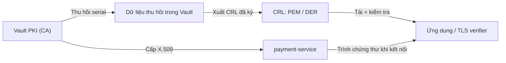

# Lấy CRL và biểu diễn PEM hoặc DER bằng Spring Vault

## 1. CRL dùng để làm gì trong hệ thống PKI?

**Certificate Revocation List (CRL)** là danh sách chứng thư số đã bị một **Certificate Authority (CA)** thu hồi trước khi chứng thư hết hạn. CRL tuân theo cấu trúc X.509 và được CA (hoặc bên được ủy quyền phát hành CRL theo quy tắc PKI) ký số để bên kiểm tra xác minh tính toàn vẹn và nguồn gốc.

Trong module **Spring Vault**, ứng dụng Java truy cập **HashiCorp Vault** qua `VaultTemplate` / `VaultOperations` để làm việc với PKI, Transit, KV secrets và các tính năng khác. Với PKI, Vault có thể cấp chứng thư, thu hồi chứng thư và công bố CRL. Khi một dịch vụ dùng mTLS hoặc xác thực dựa trên chứng thư, bên xác minh cần biết chứng thư đó còn hợp lệ và **chưa bị thu hồi**.

Ví dụ: CA cấp chứng thư cho `payment-service` có thời hạn 30 ngày. Ngày thứ năm, khóa riêng của dịch vụ bị lộ và quản trị viên thu hồi chứng thư. Chỉ kiểm tra ngày hết hạn và chữ ký chứng thư sẽ không phát hiện việc thu hồi. Bên kiểm tra cần dùng thông tin thu hồi phù hợp như CRL hoặc OCSP.



CRL cung cấp các thông tin cốt lõi:

- **Issuer**: tên CA phát hành CRL.
- **This Update (`thisUpdate`)**: thời điểm phát hành/cập nhật CRL.
- **Next Update (`nextUpdate`)**: thời điểm cần có CRL mới.
- **Revoked Certificates**: serial number, thời điểm thu hồi và có thể có lý do thu hồi.
- **Signature Algorithm và chữ ký**: dùng để kiểm tra CRL có đúng do CA hợp lệ phát hành, không bị sửa.
- **CRL Number** và các extension khác: giúp quản lý phiên bản CRL, delta CRL hoặc phân phạm vi thu hồi.

**Điểm phân biệt:** CRL là *dữ liệu về thu hồi*, không phải chứng thư CA, không phải khóa riêng và cũng không tự thiết lập niềm tin với CA. Việc xác thực CRL chỉ có ý nghĩa khi ứng dụng có **issuer certificate** phù hợp, kiểm tra chữ ký CRL và kiểm tra chuỗi chứng thư đến trust anchor đáng tin cậy.

## 2. PEM, DER và JSON khác nhau thế nào?

Một CRL X.509 có nội dung được mã hóa bằng ASN.1 DER. **PEM** chỉ là biểu diễn văn bản của dữ liệu DER bằng Base64, có phần đầu/cuối nhận dạng.

| Dạng | Biểu diễn | Cách dùng phổ biến | Có phải CRL khác về mặt nghiệp vụ? |
| --- | --- | --- | --- |
| **DER** | Bytes nhị phân ASN.1 DER | Thư viện X.509, tệp `.der`/`.crl`, endpoint phân phối CRL | Không, là dữ liệu CRL ở dạng nhị phân |
| **PEM** | Văn bản ASCII gồm header, Base64, footer | Tệp `.pem`, cấu hình đọc bằng người, công cụ OpenSSL | Không, giải mã Base64 trong PEM sẽ thu được bytes DER của cùng CRL |
| **Vault JSON** | Đối tượng API có trường chứa CRL PEM | Công cụ tích hợp HTTP cần metadata/JSON | Là lớp bọc dữ liệu, không phải định dạng ASN.1 thứ ba |

Ví dụ dạng PEM, với phần Base64 đã rút gọn:

```text
-----BEGIN X509 CRL-----
MIIB... (Base64 của dữ liệu DER, đã lược bỏ)
-----END X509 CRL-----
```

DER **không** phải chuỗi UTF-8. Không dùng `new String(derBytes, UTF_8)` để diễn giải DER, vì sẽ làm hỏng dữ liệu. Khi truyền CRL nhị phân qua HTTP, gửi nguyên bytes với kiểu nội dung phù hợp (thường là `application/pkix-crl`). Với PEM, có thể lưu dạng văn bản hoặc đưa trực tiếp cho công cụ hỗ trợ PEM.

Việc **chuyển đổi PEM ↔ DER không ký lại CRL** và không làm thay đổi danh sách thu hồi. Nhưng **hai lần tải CRL ở các thời điểm khác nhau** có thể khác dữ liệu nếu Vault đã tạo phiên bản CRL mới.

## 3. Những endpoint CRL của HashiCorp Vault

Các ví dụ giả định PKI secrets engine được mount tại `pki`. Nếu mount tại `pki-int`, thay `/v1/pki/` bằng `/v1/pki-int/`. Endpoint đã có tiền tố `/v1/` khi gọi HTTP trực tiếp vào Vault.

| HTTP endpoint | Phạm vi | Dạng phản hồi |
| --- | --- | --- |
| `GET /v1/pki/crl` | Complete CRL của default issuer, local | **DER nhị phân trực tiếp** |
| `GET /v1/pki/crl/pem` | Complete CRL của default issuer, local | **PEM trực tiếp** |
| `GET /v1/pki/cert/crl` | Complete CRL của default issuer, local | **Vault JSON**, trường `data.certificate` chứa PEM (API legacy) |
| `GET /v1/pki/issuer/{issuer_ref}/crl` | Complete CRL của issuer chỉ định, local | **Vault JSON**, trường `data.crl` chứa PEM |
| `GET /v1/pki/issuer/{issuer_ref}/crl/der` | Complete CRL của issuer chỉ định | **DER trực tiếp** |
| `GET /v1/pki/issuer/{issuer_ref}/crl/pem` | Complete CRL của issuer chỉ định | **PEM trực tiếp** |

`issuer_ref` có thể là ID issuer, tên issuer đã cấu hình hoặc `default`. **Chú ý tính bất đối xứng**: với default issuer, `/pki/crl` đã là DER, không cần thêm `/der`; với issuer cụ thể, dùng hậu tố `/crl/der`. Ngoài ra, endpoint JSON cũ dùng `data.certificate`, còn endpoint JSON theo issuer dùng `data.crl`.

Các endpoint đọc thông tin công khai về CA/CRL này được Vault cung cấp dưới dạng **unauthenticated** ở tầng PKI API. Điều đó không đảm bảo mọi client đều truy cập được: reverse proxy, firewall, TLS, cấu hình mạng và routing vẫn có thể giới hạn quyền truy cập. Không nên cấp root token chỉ để tải CRL.

### Full, delta và unified CRL

Vault còn cung cấp các biến thể tùy cấu hình và phiên bản:

- **Full/complete CRL**: chứa danh sách thu hồi đầy đủ trong phạm vi của CRL tại thời điểm tạo. Mặc định `/pki/crl` thuộc loại này.
- **Delta CRL**: chứa các thay đổi thu hồi kể từ full CRL cơ sở; ví dụ `GET /v1/pki/crl/delta` (DER), `GET /v1/pki/crl/delta/pem` (PEM). Client phải hỗ trợ hợp nhất delta với **full CRL đúng base**. Đọc riêng delta CRL **không đủ** để kết luận một chứng thư còn hợp lệ.
- **Unified CRL**: có thể phản ánh thu hồi qua nhiều cluster khi cấu hình và phiên bản Vault Enterprise/HCP thích hợp; ví dụ `/v1/pki/unified-crl` và `/v1/pki/unified-crl/pem`. Không mặc định loại này tồn tại trên Vault Community Edition.

Trong hệ thống có nhiều issuer, một mount PKI có thể phát hành **nhiều CRL khác nhau**. Phải lấy đúng CRL ứng với issuer đã cấp chứng thư, đồng thời tôn trọng CRL Distribution Points (CDP) được nhúng trong chứng thư. Tải `/pki/crl` của default issuer rồi dùng cho mọi chứng thư có thể đưa ra kết quả sai.

## 4. Thực hành lấy CRL qua HTTP và OpenSSL

Bắt đầu với một PKI mount có CA/issuer đã được cấu hình và có CRL được sinh. Các lệnh bên dưới dùng shell Bash trong môi trường học tập; thay địa chỉ bằng Vault của bạn.

### 4.1. Tải trực tiếp định dạng PEM và DER

```bash
export VAULT_ADDR="https://vault.example.test:8200"

# PEM là văn bản; curl ghi ra đúng dữ liệu phản hồi.
curl --fail --silent --show-error \
  "$VAULT_ADDR/v1/pki/crl/pem" \
  --output ca-revocations.pem

# DER là nhị phân; bắt buộc giữ bytes nguyên vẹn khi lưu.
curl --fail --silent --show-error \
  "$VAULT_ADDR/v1/pki/crl" \
  --output ca-revocations.der
```

Không thêm `| jq` vào hai lệnh này. Chúng trả **raw PEM/DER**, không phải JSON. Đặc biệt với DER, không dùng xử lý chuỗi, ghi log HTTP body, hoặc thao tác copy/paste như văn bản.

Nếu dùng issuer cụ thể, chẳng hạn alias `team-intermediate`:

```bash
curl --fail --silent --show-error \
  "$VAULT_ADDR/v1/pki/issuer/team-intermediate/crl/pem" \
  --output team-intermediate.crl.pem

curl --fail --silent --show-error \
  "$VAULT_ADDR/v1/pki/issuer/team-intermediate/crl/der" \
  --output team-intermediate.crl.der
```

Các ví dụ assume issuer alias tồn tại; nếu Vault trả `404`, kiểm tra mount, issuer và định dạng endpoint. Với Vault dùng CA riêng tư, curl phải tin cậy chứng thư TLS của máy chủ Vault (ví dụ cung cấp `--cacert vault-ca.pem`), không bỏ qua kiểm tra TLS bằng `-k` trong môi trường thật.

### 4.2. Đọc nội dung CRL bằng OpenSSL

```bash
# Đọc tệp PEM.
openssl crl -in ca-revocations.pem -inform PEM -noout -text

# Đọc tệp DER (phải khai báo -inform DER).
openssl crl -in ca-revocations.der -inform DER -noout -text

# Xem nhanh issuer và khoảng thời gian hiệu lực CRL.
openssl crl -in ca-revocations.pem -inform PEM \
  -noout -issuer -lastupdate -nextupdate
```

Các trường cần quan sát: `Issuer`, `Last Update`, `Next Update`, `CRL Number` (nếu có) và danh sách `Revoked Certificates`. CRL **trống danh sách chứng thư bị thu hồi** vẫn có thể là CRL hợp lệ; khác với trường hợp server trả HTTP `204 No Content` hoặc body lỗi.

### 4.3. Chuyển đổi giữa PEM và DER

```bash
# PEM -> DER.
openssl crl -in ca-revocations.pem -inform PEM \
  -outform DER -out ca-revocations.converted.der

# DER -> PEM.
openssl crl -in ca-revocations.der -inform DER \
  -outform PEM -out ca-revocations.converted.pem
```

Các chuyển đổi này giữ nguyên thông tin thu hồi và chữ ký bên trong CRL. Không dùng thao tác `base64 -d` trên tệp PEM hoàn chỉnh khi chưa bóc header/footer; OpenSSL đọc được cả cấu trúc PEM và xử lý chính xác định dạng.

### 4.4. Phân biệt JSON với raw CRL

Nếu một client cần JSON từ issuer cụ thể:

```bash
curl --fail --silent --show-error \
  "$VAULT_ADDR/v1/pki/issuer/team-intermediate/crl" \
  --output crl-response.json

# Response JSON sẽ có data.crl (chuỗi PEM); không phải bytes DER.
```

API cũ `/v1/pki/cert/crl` lưu chuỗi PEM trong `data.certificate`. Không coi mọi endpoint CRL là cùng một JSON schema và không dùng `VaultOperations.read("pki/crl")` để giả định nhận `VaultResponse` chuẩn: `/pki/crl` trả về **binary**, do đó nên dùng API chuyên biệt của Spring Vault.

## 5. Lấy PEM/DER trong ứng dụng Java bằng Spring Vault

Spring Vault cung cấp `VaultPkiOperations.getCrl(VaultPkiOperations.Encoding encoding)`. Giá trị trả về là **`InputStream`**, hoặc `null` nếu server trả HTTP `204 No Content`.

Giả sử Spring Boot đã tạo bean `VaultOperations` / `VaultTemplate`, cấu hình endpoint, TLS và xác thực phù hợp với workload (ví dụ Kubernetes auth hoặc AppRole cho các API yêu cầu token). Phần CRL chỉ cần quan tâm đến PKI mount.

### 5.1. Service tải CRL theo định dạng

```java
import java.io.IOException;
import java.io.InputStream;

import org.springframework.stereotype.Service;
import org.springframework.vault.core.VaultOperations;
import org.springframework.vault.core.VaultPkiOperations;

@Service
public class CrlDownloadService {

    private static final String PKI_MOUNT = "pki";
    private final VaultOperations vaultOperations;

    public CrlDownloadService(VaultOperations vaultOperations) {
        this.vaultOperations = vaultOperations;
    }

    public byte[] fetchCrl(VaultPkiOperations.Encoding encoding)
            throws IOException {

        // getCrl() trả raw CRL stream, có thể null nếu Vault trả 204.
        try (InputStream input =
                     vaultOperations.opsForPki(PKI_MOUNT).getCrl(encoding)) {

            if (input == null) {
                throw new IllegalStateException("Vault has no CRL content");
            }

            byte[] result = input.readAllBytes(); // Java 9+
            if (result.length == 0) {
                throw new IllegalStateException("Vault returned empty CRL");
            }

            return result;
        }
    }

    public byte[] fetchDer() throws IOException {
        return fetchCrl(VaultPkiOperations.Encoding.DER);
    }

    public byte[] fetchPem() throws IOException {
        return fetchCrl(VaultPkiOperations.Encoding.PEM);
    }
}
```

`opsForPki()` mặc định sử dụng mount `pki`. Dạng `opsForPki("pki-int")` sử dụng mount khác. Đoạn mã giữ nguyên byte stream từ Vault; phần DER không đi qua `String`, còn PEM có thể chuyển sang `String` sau khi chắc chắn đang xử lý PEM.

`InputStream` cần được đóng sau khi đọc. Với CRL rất lớn, thay `readAllBytes()` bằng sao chép stream có giới hạn kích thước đến file hoặc bộ đệm có kiểm soát, tránh dùng quá nhiều bộ nhớ. Spring Vault có thể phát sinh lỗi kết nối, lỗi xác thực hoặc lỗi Vault API; `IOException` trong ví dụ chỉ bao phủ lỗi đọc stream, không bao trùm mọi lỗi gọi HTTP.

### 5.2. Lưu file cho công cụ khác

```java
import java.nio.file.Files;
import java.nio.file.Path;
import org.springframework.vault.core.VaultPkiOperations;

// Ví dụ gọi từ một command/job đã inject CrlDownloadService:
byte[] der = crlDownloadService.fetchDer();
Files.write(Path.of("ca-revocations.der"), der);

byte[] pem = crlDownloadService.fetchPem();
Files.write(Path.of("ca-revocations.pem"), pem);
```

Sau khi lưu, kiểm tra bằng `openssl crl` như phần 4. Nếu ứng dụng phải trả CRL qua HTTP, đặt `Content-Type: application/pkix-crl` khi trả DER và chuyển **nguyên bytes**; không serialize DER thành JSON string hoặc JSON array rồi kỳ vọng client PKI tự hiểu.

### 5.3. Khi nào dùng API `getCrl()`, khi nào gọi endpoint issuer riêng?

`getCrl(Encoding)` là cách thuận tiện để lấy CRL của **default issuer** từ PKI mount đã cấu hình. Với hệ thống nhiều issuer, cần chọn endpoint `/pki/issuer/{issuer_ref}/crl/pem` hoặc `/der` (chẳng hạn qua HTTP client có cấu hình TLS, timeout và đường dẫn tin cậy). Đừng lắp tên issuer vào chuỗi trả về của `getCrl()`; API này không nhận tham số issuer.

Nếu ứng dụng đang làm nhiệm vụ phân phối CRL đến nhiều client TLS, cân nhắc để client đọc trực tiếp endpoint CDP/cache nội bộ phù hợp. Việc tạo thêm endpoint trung gian yêu cầu thiết kế rõ tính sẵn sàng, cache, cập nhật và bảo vệ khỏi phân phối CRL lỗi thời.

## 6. Phân tích và kiểm tra CRL bằng thư viện X.509 chuẩn của Java

JDK có `CertificateFactory.getInstance("X.509")` và lớp `X509CRL` để đọc CRL. Trình phân tích có thể đọc cả PEM lẫn DER nếu input tương ứng là dữ liệu hợp lệ. Mã sau minh họa cách **parse, đối chiếu issuer, xác thực chữ ký và kiểm tra thời gian CRL** trước khi xem trạng thái thu hồi của một chứng thư.

```java
import java.io.ByteArrayInputStream;
import java.security.GeneralSecurityException;
import java.security.cert.CertificateFactory;
import java.security.cert.X509CRL;
import java.security.cert.X509Certificate;
import java.util.Date;

public final class CrlVerifier {

    private CrlVerifier() {}

    public static boolean isRevoked(byte[] crlBytes,
                                    X509Certificate certificate,
                                    X509Certificate issuerCertificate)
            throws GeneralSecurityException {

        CertificateFactory factory = CertificateFactory.getInstance("X.509");

        X509CRL crl = (X509CRL) factory.generateCRL(
                new ByteArrayInputStream(crlBytes));

        // Tránh dùng CRL không đúng CA cấp chứng thư cần kiểm tra.
        if (!crl.getIssuerX500Principal().equals(
                issuerCertificate.getSubjectX500Principal())) {
            throw new GeneralSecurityException("Wrong CRL issuer");
        }
        if (!certificate.getIssuerX500Principal().equals(
                issuerCertificate.getSubjectX500Principal())) {
            throw new GeneralSecurityException("Certificate issuer mismatch");
        }

        // Kiểm tra chữ ký CRL bằng public key của issuer đã được tin cậy.
        crl.verify(issuerCertificate.getPublicKey());

        Date now = new Date();
        Date thisUpdate = crl.getThisUpdate();
        Date nextUpdate = crl.getNextUpdate();

        if (thisUpdate == null || thisUpdate.after(now)
                || nextUpdate == null || !now.before(nextUpdate)) {
            throw new GeneralSecurityException("CRL is not currently valid");
        }

        return crl.isRevoked(certificate);
    }
}
```

Ví dụ sử dụng:

```java
byte[] crlBytes = crlDownloadService.fetchDer();

// certificate: chứng thư dịch vụ đang được xác minh.
// issuerCertificate: chứng thư CA đúng issuer, đã được kiểm tra trust chain.
boolean revoked = CrlVerifier.isRevoked(
        crlBytes, certificate, issuerCertificate);

if (revoked) {
    throw new SecurityException("Certificate has been revoked");
}
```

**Giới hạn quan trọng của ví dụ:** đây là minh họa *kiểm tra CRL đơn lẻ*. Trong xác thực TLS/PKIX thực tế, còn phải xác nhận chuỗi chứng thư về trust anchor đáng tin cậy, `BasicConstraints`, `KeyUsage` (`cRLSign` trên CA ký CRL), issuer thực sự, tên định danh máy chủ, thời hạn chứng thư, policy và các extension CRL liên quan. Với chứng thư **indirect CRL**, delta CRL hoặc những kịch bản nhiều CA cùng subject, phép so sánh issuer và gọi `isRevoked()` đơn giản có thể không đủ; nên dùng bộ kiểm tra đường dẫn PKIX đầy đủ như `CertPathValidator` với cấu hình revocation thích hợp.

Cũng cần phân biệt hai câu:

- `isRevoked(...) == false` nghĩa là chứng thư **không xuất hiện trong CRL vừa kiểm tra**, trong phạm vi CRL đó.
- Điều này **không đủ** để kết luận chứng thư được tin cậy hoặc chưa từng bị thu hồi ở mọi nguồn; CRL có thể lỗi thời, không đúng scope, thiếu delta hoặc không thuộc issuer phù hợp.

Nếu CRL không tải được, không có chữ ký hợp lệ hoặc đã quá `nextUpdate`, phải áp dụng **chính sách lỗi** của hệ thống (thường ưu tiên từ chối trong luồng xác thực nhạy cảm), không tự động suy ra `revoked = false`.

## 7. CRL Distribution Points và thời điểm cập nhật

Chứng thư thường có extension **CRL Distribution Points (CDP)** chỉ ra URL để client tải CRL. Trên Vault, người vận hành cần cấu hình URL công bố CA và CRL. Ví dụ minh họa cho PKI mount với một issuer mặc định:

```bash
# Lệnh quản trị ví dụ; thực hiện trong môi trường có quyền cấu hình PKI.
vault write pki/config/urls \
  issuing_certificates="https://vault.example.test:8200/v1/pki/ca/pem" \
  crl_distribution_points="https://vault.example.test:8200/v1/pki/crl"
```

`/pki/crl` trả DER phù hợp cho nhiều trình PKI. Khi có **nhiều issuer**, HashiCorp khuyến nghị dùng cấu hình AIA/CDP riêng cho từng issuer để các chứng thư trỏ đúng CRL. Phải dùng URL mà các client thực tế truy cập được; địa chỉ `127.0.0.1` của Vault server thường không phù hợp cho client ở máy khác.

Các điểm vận hành cần hiểu:

1. **Thu hồi không đồng nghĩa mọi client biết ngay.** Nếu client đang cache CRL cũ thì đến lần cập nhật tiếp theo nó mới biết thêm serial đã bị thu hồi.
2. CRL có `thisUpdate` và `nextUpdate`; tránh cache vượt quá thời gian hiệu lực và không chấp nhận CRL đã quá hạn theo policy.
3. Vault hỗ trợ các cấu hình `expiry`, `auto_rebuild`, `enable_delta` trong `pki/config/crl`. Auto-rebuild có thể tạo CRL theo chu kỳ thay vì tạo ngay sau mỗi lần thu hồi.
4. Với yêu cầu trạng thái mới hơn CRL, cân nhắc **OCSP** hoặc delta CRL theo khả năng hỗ trợ của client và Vault. Không tự ghép delta bằng cách cộng chuỗi các bản PEM.
5. CRL cần có khả năng phân phối ổn định (ví dụ Vault HA, caching proxy có kiểm soát). Cache phải được làm mới an toàn và quản lý `nextUpdate`.

Một số endpoint CRL hỗ trợ `If-Modified-Since`/`304 Not Modified` nếu cấu hình mount cho phép passthrough header và response header tương ứng. Dùng cache có điều kiện có thể giảm băng thông, nhưng cần xác minh cấu hình header và vẫn kiểm soát hiệu lực CRL.

## 8. Xử lý lỗi trong Java và giám sát

| Trường hợp | Điều cần kiểm tra | Cách xử lý |
| --- | --- | --- |
| HTTP `204` hoặc `getCrl()` trả `null` | PKI chưa có CRL để trả ở endpoint đang gọi | Phân loại `NO_CONTENT`; không diễn giải là “không có chứng thư bị thu hồi” |
| HTTP `404` | Mount/issuer_ref/đường dẫn không tồn tại | Kiểm tra đúng endpoint raw/JSON, mount và issuer |
| HTTP `403` | Proxy/policy/mount cấu hình hạn chế hoặc đang gọi endpoint yêu cầu xác thực | Kiểm tra đường truy cập và role; không tự thêm root token |
| HTTP `5xx` hoặc timeout | Vault HA, backend hoặc mạng gặp sự cố | Retry hữu hạn có backoff, dùng cache còn hiệu lực theo policy, báo lỗi khi hết hạn |
| PEM thiếu header/footer | Đọc sai response hoặc dữ liệu bị cắt | Kiểm tra body và status; không coi lỗi parse là CRL trống |
| DER parse thất bại | Bytes bị thay đổi khi xử lý dạng text/JSON | Giữ raw binary, không chuyển UTF-8 tùy ý |
| Chữ ký CRL không xác thực | Sai issuer, sai public key hoặc dữ liệu lỗi | Từ chối sử dụng CRL; kiểm tra CA chain và nguồn |
| `nextUpdate` đã qua | CRL cũ hoặc auto-rebuild không chạy như dự kiến | Yêu cầu CRL mới, kiểm tra vận hành PKI; xử lý theo chính sách lỗi |
| Không thấy serial vừa revoke | CRL chưa rebuild, đang xem sai issuer/cluster, delta chưa được tính | Kiểm tra `thisUpdate`, issuer, local/unified, kế hoạch CRL/delta |
| Tải CRL rất lớn gây OOM | `readAllBytes()` không giới hạn | Dùng stream/file và giới hạn dung lượng ở HTTP client |

Nên thu thập các chỉ số: tỷ lệ tải CRL thành công, độ trễ tải, số lỗi parse/chữ ký, độ tuổi CRL, thời gian còn lại đến `nextUpdate`, tỷ lệ request dùng cache và kích thước CRL. Ghi thông tin `issuer_ref`, endpoint, mã trạng thái HTTP và mốc thời gian hữu ích; tránh ghi token, thông tin xác thực workload hoặc dữ liệu chứng thư nhạy cảm không cần thiết.

Đối với ứng dụng có yêu cầu an toàn cao, phải thống nhất rõ **fail-open hay fail-closed** nếu không lấy được CRL. Coi lỗi lấy CRL là “không bị thu hồi” sẽ khiến chứng thư đã revoke có thể lọt qua. Ngược lại, fail-closed có thể ảnh hưởng tính sẵn sàng nếu Vault/CDP gặp sự cố; cần thiết kế cache CRL hợp lệ, HA và giám sát từ trước.

## 9. Kịch bản kiểm thử tích hợp

Có thể chạy kiểm thử với Vault dev/test có PKI mount được cấu hình, issuer thử nghiệm và các chứng thư chỉ dùng trong môi trường kiểm thử. Tách thao tác quản trị cấp/thu hồi chứng thư với workload Java chỉ đọc CRL. Các tình huống trọng tâm:

| Trường hợp | Kết quả kỳ vọng |
| --- | --- |
| Tải CRL dưới dạng PEM | Body bắt đầu bằng `-----BEGIN X509 CRL-----` và có thể parse bằng OpenSSL/JDK |
| Tải CRL dưới dạng DER | File là bytes nhị phân và `openssl crl -inform DER` đọc được |
| Chuyển PEM → DER | CRL parse thành công; issuer, danh sách serial và chữ ký không thay đổi |
| CRL chưa có serial bị thu hồi | CRL vẫn có thể hợp lệ; danh sách revoke rỗng |
| Thu hồi chứng thư và cập nhật CRL | CRL mới chứa serial tương ứng; có thể cần rebuild/chờ theo cấu hình |
| Tải từ hai issuer khác nhau | CRL phản ánh đúng issuer, không trộn kết quả |
| Dùng sai issuer certificate để xác minh chữ ký | Kiểm tra thất bại |
| Tải CRL đã quá hạn hoặc không thể tải | Trình xác minh phát hiện lỗi và thực hiện policy đã cấu hình |
| `getCrl()` nhận HTTP 204 | Service xử lý `null` rõ ràng, không trả kết quả “an toàn” giả |
| Revoke phát sinh sau khi client cache | Bài test chứng minh sự khác biệt giữa CRL cũ và CRL đã refresh |

Đối với một kiểm thử end-to-end có ý nghĩa, hãy tạo một chứng thư thử nghiệm, lưu serial, đọc CRL ban đầu, thu hồi serial trong Vault bằng tài khoản quản trị và bảo đảm CRL được cập nhật theo cấu hình. Sau đó tải lại CRL bằng service Java, parse và xác minh chữ ký CRL, cuối cùng xác nhận `isRevoked(certificate)` phản ánh việc thu hồi. Không cần sử dụng private key thật của dịch vụ sản xuất.

## 10. Checklist thực hành

1. Xác định mount PKI và **issuer** đã cấp chứng thư cần kiểm tra.
2. Chọn endpoint **PEM** (`/crl/pem`) hoặc **DER** (`/crl` với default issuer; `/issuer/{issuer_ref}/crl/der` với issuer riêng).
3. Dùng `curl` hoặc `vaultOperations.opsForPki().getCrl(Encoding)` để lấy raw CRL; đóng stream và giữ nguyên bytes.
4. Dùng OpenSSL hoặc JDK `X509CRL` để parse; kiểm tra issuer, chữ ký, `thisUpdate` và `nextUpdate`.
5. Kiểm tra trạng thái thu hồi trong **đúng phạm vi CA/CRL**, đồng thời xác minh certificate path và các điều kiện TLS/PKIX khác.
6. Thiết lập CRL Distribution Points, cache, lịch cập nhật, giám sát và chính sách xử lý khi CRL không khả dụng.

## Tài liệu tham khảo

- [HashiCorp Vault — PKI Secrets Engine HTTP API](https://developer.hashicorp.com/vault/api-docs/secret/pki): endpoint CRL PEM/DER/JSON theo issuer, full/delta/unified, `config/crl`.
- [HashiCorp Vault — PKI Considerations](https://developer.hashicorp.com/vault/docs/secrets/pki/considerations): CRL Distribution Points, nhiều issuer, caching và rebuild.
- [Spring Vault — `VaultPkiOperations`](https://docs.spring.io/spring-vault/reference/api/java/org/springframework/vault/core/VaultPkiOperations.html): `getCrl(Encoding)`, kiểu trả về `InputStream`, tình huống `null`.
- [Spring Vault — `VaultOperations`](https://docs.spring.io/spring-vault/reference/api/java/org/springframework/vault/core/VaultOperations.html): `opsForPki()`, `opsForPki(String path)`.
- [RFC 5280 — Internet X.509 Public Key Infrastructure Certificate and CRL Profile](https://www.rfc-editor.org/rfc/rfc5280): cấu trúc X.509 CRL, kiểm tra hiệu lực và xử lý thu hồi.

**Ghi nhớ:** Spring Vault `getCrl(Encoding.PEM)` hoặc `getCrl(Encoding.DER)` giúp lấy CRL đúng định dạng. Khi sử dụng trong xác thực chứng thư, độ tin cậy phụ thuộc vào **đúng issuer, chữ ký hợp lệ, CRL còn hiệu lực và quy trình kiểm tra revocation đầy đủ**, không phụ thuộc riêng việc tải file thành công.
