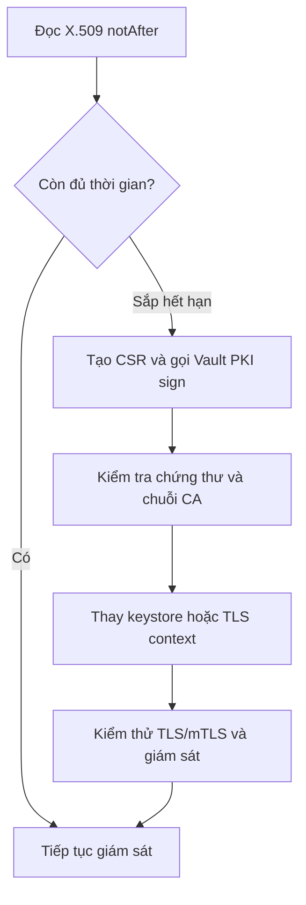

# Phân biệt thời hạn chứng thư với lease của một secret trong Spring Vault

## 1. Vì sao phải phân biệt hai vòng đời?

Trong hệ thống Java sử dụng **SPRING_VAULT** và HashiCorp Vault, ứng dụng có thể vừa xin chứng thư TLS từ **PKI secrets engine**, vừa lấy thông tin đăng nhập cơ sở dữ liệu từ **database secrets engine**. Cả hai đều có thể được yêu cầu với một khoảng thời gian sống (TTL), nhưng hai loại tài nguyên tuân theo những cơ chế khác nhau.

- **Chứng thư X.509** có khoảng hiệu lực được ghi *ngay trong chứng thư*, với các mốc **`notBefore`** và **`notAfter`**. Khi cần kéo dài thời gian sử dụng, thông thường phải **cấp một chứng thư mới**.
- **Dynamic secret có lease** là thông tin bí mật do Vault quản lý kèm **`lease_id`**, **`lease_duration`** và trạng thái **`renewable`**. Khi backend hỗ trợ, client có thể **renew lease** để giữ credential hiện có hoạt động thêm một thời gian; việc **revoke lease** yêu cầu Vault thu hồi tài nguyên tương ứng.
- **Vault token** dùng để xác thực các API call lại có TTL/vòng đời riêng. Gia hạn token không làm chứng thư X.509 đang cầm trên tay tự kéo dài thời hạn.

Đây là phần kiến thức nền để triển khai PKI, xác thực theo workload, phân quyền Vault, quản lý token và lease, xử lý lỗi, giám sát và kiểm thử tích hợp trong Spring Vault.

**Mục tiêu:** biết nhìn vào đúng trường dữ liệu để xác định một chứng thư còn hiệu lực hay không, một secret lease còn sống hay không, và khi nào phải thực hiện **renew**, **reissue**, **rotate** hoặc **revoke**.

## 2. Ba “đồng hồ” khác nhau

| Đối tượng | Mốc thời gian quyết định | Ai thực thi? | Cách duy trì |
| --- | --- | --- | --- |
| **Chứng thư X.509** | `notBefore` / `notAfter` nằm trong chứng thư, cộng với kiểm tra chuỗi tin cậy và trạng thái thu hồi | Bên xác minh TLS/mTLS hoặc ứng dụng kiểm tra chứng thư | **Reissue** / ký CSR mới rồi cài đặt chứng thư mới; không sửa ngày trên chứng thư đã ký |
| **Dynamic secret lease** | Thời điểm cấp + `lease_duration`, `renewable` và quy tắc/max TTL của secrets engine | Vault và hệ thống đích do secrets engine quản lý | **Renew lease** nếu được phép, hoặc xin credential mới; **revoke** khi cần |
| **Token Vault của workload** | TTL, khả năng renew, giới hạn của token/auth method | Vault khi xác thực request | Gia hạn hoặc đăng nhập lại theo cơ chế auth, chẳng hạn Kubernetes auth hay AppRole |

Một chứng thư có thể còn 20 giờ hiệu lực trong khi token Vault dùng để xin chứng thư đó đã hết hạn. Ngược lại, token có thể còn sống nhưng chứng thư được cài trên server đã hết hạn. Không nên dùng thời gian tồn tại của token hoặc lease để thay thế cho giá trị `notAfter`.

### 2.1. “Còn hạn” không đồng nghĩa “được chấp nhận”

Một chứng thư nằm trong khoảng `notBefore ≤ thời điểm hiện tại < notAfter` mới chỉ đáp ứng **điều kiện thời gian**. Bên kiểm tra TLS vẫn cần xác thực chữ ký và chuỗi CA đáng tin, hostname/SAN, key usage/EKU, chính sách thuật toán và, khi áp dụng, trạng thái thu hồi qua CRL/OCSP. Chứng thư chưa hết hạn nhưng bị thu hồi hoặc không được tin cậy vẫn có thể bị từ chối.

## 3. Thời hạn của chứng thư PKI được xác định ra sao?

Khi ứng dụng gửi CSR đến Vault qua `pki/sign/:role` hoặc yêu cầu Vault phát sinh khóa và chứng thư qua `pki/issue/:role`, PKI engine phát hành một chứng thư đã ký. Chứng thư có các trường X.509 quan trọng:

| Trường X.509 | Ý nghĩa | Ví dụ minh họa |
| --- | --- | --- |
| `notBefore` | Bắt đầu hiệu lực | 01/12/2026 00:00 UTC |
| `notAfter` | Kết thúc hiệu lực | 02/12/2026 00:00 UTC |
| `subject` và `subjectAltName` | Chủ thể và danh tính DNS/IP được chứng nhận | `api.internal.example` |
| `serialNumber` | Định danh chứng thư do issuer cấp, dùng trong nghiệp vụ revoke/tra cứu | Số serial của chứng thư |
| `issuer` | CA đã ký chứng thư | CA nội bộ |

Khi yêu cầu chứng thư, client có thể đề xuất `ttl`, ví dụ `24h`. Thời gian thực tế còn phụ thuộc cấu hình role PKI, giới hạn TTL của mount, thời hạn còn lại của CA/issuer và chính sách Vault hiện hành. **Không được giả định `ttl` yêu cầu chính là thời gian hiệu lực cuối cùng.** Hãy đọc `notBefore` và `notAfter` từ chứng thư đã nhận; response PKI cũng có thể cung cấp trường `expiration` để tiện vận hành.

Lưu ý: với các hệ thống hỗ trợ cấu hình thời gian bắt đầu hiệu lực hoặc độ lệch đồng hồ, `notBefore` có thể sớm hơn thời điểm cấp một chút. Do đó không lấy “thời điểm gọi API + TTL” làm nguồn chân lý tuyệt đối.

### 3.1. Các endpoint PKI thường gặp

| Endpoint Vault | Vai trò | Điểm cần nhớ |
| --- | --- | --- |
| `POST pki/issue/:role` | Vault tạo khóa riêng và chứng thư theo role | Response có thể chứa **private key**; phải bảo vệ tương đương credential có quyền cao |
| `POST pki/sign/:role` | Vault ký CSR do client tạo | Private key ở phía client; phù hợp khi không muốn xuất khóa riêng từ Vault |
| `POST pki/revoke` | Yêu cầu thu hồi chứng thư theo serial | Cần quyền quản trị/phạm vi thích hợp, cập nhật cơ chế phân phối trạng thái thu hồi |
| `GET pki/cert/:serial` | Truy xuất thông tin chứng thư được lưu bởi PKI engine khi áp dụng | Không phải thao tác gia hạn chứng thư |

Đường dẫn trên giả sử PKI engine được mount tại `pki/`. Nếu triển khai có nhiều mount/issuer, đường dẫn và role phải được cấu hình tương ứng.

## 4. Lease của một dynamic secret là gì?

Một **lease** thể hiện quyền sử dụng một secret/tài nguyên do Vault cấp trong thời gian giới hạn. Ví dụ: request `database/creds/reporting` có thể tạo tài khoản database ngắn hạn. Response thường có metadata như:

```json
{
  "lease_id": "database/creds/reporting/<LEASE_ID>",
  "lease_duration": 3600,
  "renewable": true,
  "data": {
    "username": "<DYNAMIC_USERNAME>",
    "password": "<REDACTED>"
  }
}
```

Ví dụ được minh họa với `lease_duration=3600` giây (1 giờ), không phải giá trị cố định cho mọi backend. Trong thực tế cần kiểm tra cả quyền của token, cấu hình backend và giới hạn thời gian tối đa:

- **Renew:** client gọi endpoint quản lý lease (hoặc dùng cơ chế quản lý lifecycle của Spring Vault) để xin kéo dài thời gian của *cùng credential*. Vault có thể từ chối renew nếu lease không renewable, token thiếu quyền, hoặc đã chạm TTL tối đa.
- **Revoke:** Vault yêu cầu backend vô hiệu hóa credential/tài nguyên tương ứng. Với dynamic database credential, điều này thường liên quan đến thu hồi/drop account do Vault tạo.
- **Expire:** khi lease hết hạn, Vault xử lý vòng đời tài nguyên theo cơ chế của backend; cách và thời điểm trạng thái được phản ánh ở hệ thống đích có thể phụ thuộc kết nối, retry và cấu hình.

Chỉ có metadata lease trong một API response không đủ để khẳng định **chứng thư PKI cũng sẽ được “gia hạn tại chỗ”**. Nếu API phiên bản cụ thể cung cấp lease cho certificate, đó vẫn là vòng đời tài nguyên được Vault quản lý; nó không thay đổi giá trị `notAfter` đã được CA ký vào bản thân chứng thư. Tính khả dụng của renew/revoke phải xác minh theo loại secrets engine và API được sử dụng.

### 4.1. Gia hạn lease khác với cấp lại secret

| Thao tác | Dynamic database secret | Chứng thư PKI |
| --- | --- | --- |
| **Renew** | Có thể gia hạn lease khi `renewable=true` và backend cho phép | Không kéo dài `notAfter` của chứng thư đã ký |
| **Reissue** | Xin credential mới nếu lease cũ không thể kéo dài | Xin chứng thư mới bằng CSR hoặc API issue; nhận serial, hiệu lực và chữ ký mới |
| **Revoke** | Thu hồi lease để vô hiệu hóa credential ở backend | Thu hồi **serial chứng thư** thông qua quy trình PKI và phân phối CRL/OCSP |
| **Rotation** | Thay credential/secret theo lịch | Đổi chứng thư định kỳ, có thể đổi luôn keypair và chain khi cần |

**Quan trọng:** Việc thu hồi hoặc hết hạn Vault token của ứng dụng không đồng nghĩa với việc thu hồi mọi chứng thư TLS mà ứng dụng đã nhận. Chứng thư là một đối tượng X.509 đã ký, có thể tiếp tục được bên kia chấp nhận cho đến khi hết hạn hoặc bị từ chối theo cơ chế tin cậy/thu hồi.

## 5. Ví dụ ba thời điểm độc lập

Giả sử tại 09:00 UTC một service Java:

1. Đăng nhập Vault và có token TTL **30 phút**.
2. Lấy một dynamic database credential với lease **60 phút**.
3. Dùng Vault PKI ký chứng thư mTLS có hiệu lực **24 giờ**.

<code>09:00</code> là mốc bắt đầu *ví dụ*, và giả sử không có renewal hay thu hồi sớm:

```text
09:00               09:30             10:00                         09:00 hôm sau
│                     │                 │                                      │
├── Token Vault ──────┤                 │                                      │
├──────── Lease DB ─────────────────────┤                                      │
├───────────────────── Chứng thư mTLS ────────────────────────────────────────┤
│                     │                 │                                      │
Xin cả ba            Token hết TTL     Lease hết TTL                         Cert notAfter
```

Tại **09:40**, token ban đầu đã hết hạn; ứng dụng cần cơ chế xác thực lại để gọi Vault. Lease database vẫn còn trong ví dụ, và chứng thư mTLS có thể vẫn được peer chấp nhận vì chưa đến `notAfter` nếu các kiểm tra TLS khác đạt.

Tại **10:10**, lease database đã hết hạn nếu không được renew; không được suy ra rằng chứng thư TLS cũng đã hết hạn. Ngược lại, nếu một chứng thư hết hạn lúc 09:00 ngày hôm sau, việc renew lease database hoặc renew Vault token không làm thay đổi kết quả kiểm tra X.509.

Vì vậy hệ thống phải lưu và theo dõi **ba trạng thái riêng biệt**. Không gộp chúng thành một trường `expiresAt` cho mọi loại tài nguyên.

## 6. Thực hành với Vault CLI: nhìn đúng trường dữ liệu

Giả sử quản trị viên đã bật và cấu hình engine `pki/`, role `web-server` cho phép ký tên `api.internal.example` và đã thiết lập CA/issuer hợp lệ. Tạo CSR và private key **ở ứng dụng hoặc máy quản lý khóa thích hợp**; sau đó gửi CSR cho Vault:

```bash
# Đây là thao tác phát hành chứng thư mới; role và CSR phải đã tồn tại.
vault write -format=json pki/sign/web-server \
  csr=@server.csr \
  ttl=24h
```

Response PKI thường chứa các trường thuộc `data` như `certificate`, `issuing_ca`, `serial_number` và `expiration`. Không nhầm `expiration` với metadata quản lý lease chung của Vault. Có thể lưu PEM vào tệp chỉ trong môi trường được bảo vệ, rồi quan sát trực tiếp các trường X.509:

```bash
openssl x509 -in server.crt -noout -dates -serial -subject -issuer
```

Lệnh OpenSSL sẽ in ngày bắt đầu/kết thúc của **chứng thư thực tế**. Điều kiện kiểm tra TLS phụ thuộc clock, trust store, chain và policy của bên nhận.

Với dynamic secret có lease, operator có thể tra thông tin lease qua Vault CLI và kiểm tra trường `renewable` trước khi quyết định renew:

```bash
# Chỉ là ví dụ cú pháp: dùng lease_id được cấp thực tế.
vault lease lookup "database/creds/reporting/<LEASE_ID>"

# Chỉ thực hiện nếu renewable, policy và thời gian tối đa cho phép.
vault lease renew "database/creds/reporting/<LEASE_ID>"
```

Các thao tác trên **không phải lệnh gia hạn chứng thư X.509**. Không chạy `vault lease renew` theo suy đoán chỉ vì đã nhận được chứng thư từ engine PKI.

## 7. Spring Vault: kiểm tra chính xác hạn chứng thư

Ứng dụng Java có thể dùng `VaultTemplate` gọi `pki/sign/:role` để ký CSR đã tạo từ một private key được lưu an toàn. Ví dụ với Java 17+ dưới đây lấy chứng thư PEM từ response rồi giải mã X.509 bằng API Java tiêu chuẩn.

```java
import java.io.ByteArrayInputStream;
import java.nio.charset.StandardCharsets;
import java.security.cert.CertificateException;
import java.security.cert.CertificateFactory;
import java.security.cert.X509Certificate;
import java.time.Clock;
import java.time.Duration;
import java.time.Instant;
import java.util.Map;

import org.springframework.beans.factory.annotation.Autowired;
import org.springframework.stereotype.Service;
import org.springframework.vault.core.VaultTemplate;
import org.springframework.vault.support.VaultResponse;

@Service
public class PkiCertificateService {
    private static final String SIGN_PATH = "pki/sign/web-server";
    private static final Duration RENEWAL_WINDOW = Duration.ofHours(6);

    private final VaultTemplate vaultTemplate;
    private final Clock clock;

    @Autowired
    public PkiCertificateService(VaultTemplate vaultTemplate) {
        this(vaultTemplate, Clock.systemUTC());
    }

    // Có thể truyền Clock.fixed(...) trong unit test.
    PkiCertificateService(VaultTemplate vaultTemplate, Clock clock) {
        this.vaultTemplate = vaultTemplate;
        this.clock = clock;
    }

    public record CertificateInfo(
            String certificatePem,
            String serialHex,
            Instant notBefore,
            Instant notAfter,
            boolean reissueSoon
    ) {}

    public CertificateInfo signCsr(String csrPem)
            throws CertificateException {
        VaultResponse response = vaultTemplate.write(
                SIGN_PATH,
                Map.of("csr", csrPem, "ttl", "24h")
        );
        if (response == null || response.getData() == null) {
            throw new IllegalStateException("Empty PKI response");
        }

        Object pemValue = response.getData().get("certificate");
        if (!(pemValue instanceof String pem) || pem.isBlank()) {
            throw new IllegalStateException("Missing PKI certificate");
        }

        CertificateFactory factory =
                CertificateFactory.getInstance("X.509");
        X509Certificate certificate = (X509Certificate)
                factory.generateCertificate(new ByteArrayInputStream(
                        pem.getBytes(StandardCharsets.US_ASCII)
                ));

        Instant notBefore = certificate.getNotBefore().toInstant();
        Instant notAfter = certificate.getNotAfter().toInstant();
        Instant now = clock.instant();
        boolean reissueSoon =
                !notAfter.isAfter(now.plus(RENEWAL_WINDOW));

        return new CertificateInfo(
                pem,
                certificate.getSerialNumber().toString(16),
                notBefore,
                notAfter,
                reissueSoon
        );
    }
}
```

Ở ví dụ này:

- `VaultTemplate.write(...)` gọi PKI engine. Vault thực thi phân quyền theo policy của workload khi ký CSR.
- `CertificateFactory` đọc **`notBefore` và `notAfter` từ certificate PEM**. Đây là dữ liệu cần dùng để lên lịch cấp lại, thay vì dựa vào `lease_duration` của response.
- `reissueSoon` là tín hiệu cần chuẩn bị cấp chứng thư mới trước `notAfter` ít nhất 6 giờ trong ví dụ; chọn buffer theo TTL thực tế, độ trễ phát hành, mức độ sẵn sàng của Vault và thời gian rollout.
- Đây là ví dụ chuyên về **kiểm tra hiệu lực theo thời gian**. Production cần thêm kiểm tra CSR/keypair, SAN, EKU, chain CA, trust store, policy và khả năng thay keystore/TLS context an toàn. Private key được tạo trước khi ký CSR phải được giữ bí mật; đoạn mã không quản lý nó.

Đối với một credential có lease, Spring Vault có cơ chế session/secret lifecycle hỗ trợ renew hoặc rotate theo loại tài nguyên; cấu hình cụ thể phải khớp secrets engine và phiên bản thư viện. Đối với chứng thư PKI, nên triển khai **lịch cấp lại và thay thế chứng thư** dựa trên `notAfter`, có cảnh báo trước khi quá hạn, thay vì giả định một listener gia hạn lease sẽ tự cập nhật chứng thư đã cài.

### 7.1. Cấp quyền tối thiểu cho PKI

Nếu workload chỉ cần **ký CSR theo role** `web-server`, policy HCL có thể giới hạn như sau:

```hcl
path "pki/sign/web-server" {
  capabilities = ["update"]
}
```

Không cần cấp thêm quyền quản trị `pki/roles/*`, `pki/config/*` hay `pki/revoke` cho service chỉ phục vụ luồng phát hành. Xác thực với Vault thông qua Kubernetes auth, AppRole hoặc phương thức theo workload; không nhúng token root vào code hay cấu hình được commit. Quản lý TTL/renewal của **Vault token** là quy trình độc lập với việc reissue chứng thư TLS.

## 8. Quy trình vận hành cấp lại và thu hồi

### 8.1. Khi chứng thư gần hết hạn: reissue và thay thế

1. Dựa vào `notAfter` đã lưu hoặc đọc từ keystore hiện tại để đo thời gian còn lại.
2. Trước ngưỡng cảnh báo, tạo **keypair và CSR mới** nếu chính sách yêu cầu rotation khóa riêng, hoặc tạo CSR hợp lệ theo chính sách hiện hành.
3. Workload xác thực với Vault và gọi `pki/sign/:role`. Kiểm tra tên trong SAN, issuer/chain, EKU, thuật toán và hiệu lực của chứng thư mới.
4. Gắn chứng thư mới với đúng private key trong keystore/TLS context; cập nhật theo cách an toàn, có khả năng rollback.
5. Reload TLS context hoặc rolling restart để endpoint mới sử dụng chứng thư mới. Xác thực mTLS end-to-end và quan sát lỗi handshake.
6. Giữ overlap phù hợp để kết nối đang hoạt động được chuyển đổi; hoàn tất thì loại bỏ chứng thư/khóa riêng cũ theo chính sách. Thu hồi chứng thư cũ khi có lý do/chiến lược revoke phù hợp.



Không có thao tác “sửa `notAfter`” hợp lệ đối với một chứng thư đã ký: thay trường này làm chữ ký số không còn khớp. Lịch cấp lại chứng thư là trách nhiệm vận hành riêng.

### 8.2. Khi nghi lộ private key: revoke

Nếu private key bị lộ, chỉ chờ `notAfter` là không đủ. Quản trị viên/đơn vị sở hữu PKI có thể revoke serial chứng thư qua Vault PKI, xuất bản CRL/OCSP theo cấu hình và bảo đảm các relying party **thực sự kiểm tra** trạng thái thu hồi. Việc cập nhật CRL/OCSP có độ trễ; một client không kiểm tra revocation có thể vẫn chấp nhận chứng thư bị thu hồi cho đến ngày hết hạn.

Nếu Vault token của workload bị lộ, cần xử lý token/session và quyền truy cập Vault. Nếu một database credential bị lộ, cần xử lý **lease/credential** của backend. Ba tình huống có thể xảy ra đồng thời nhưng không thể thay thế quy trình ứng phó cho nhau.

## 9. Lỗi thường gặp và giám sát

| Triệu chứng | Nguyên nhân hay gặp | Cách xử lý |
| --- | --- | --- |
| TLS handshake báo certificate expired | `notAfter` của chứng thư đã qua | Reissue, rollout chứng thư mới, kiểm tra đồng hồ hệ thống |
| Certificate not yet valid | `notBefore` nằm trong tương lai hoặc clock bị lệch | Kiểm tra thời gian/NTP và khoảng hiệu lực X.509 |
| Vault PKI trả 403 | Token hết hạn hoặc không có quyền trên role | Kiểm tra workload auth và policy `pki/sign/:role` |
| Vault PKI từ chối TTL/SAN | TTL vượt cấu hình hoặc tên không được role cho phép | Điều chỉnh request đúng policy; không tự nới quyền để bỏ qua kiểm soát |
| Database credential đột ngột mất hiệu lực | Lease hết hạn/bị revoke hoặc backend từ chối | Kiểm tra `lease_id`, renewal policy, thay credential và kết nối |
| Chứng thư vẫn dùng được sau khi token hết hạn | Token TTL độc lập với thời hạn chứng thư | Đây có thể là hành vi đúng; theo dõi riêng chứng thư và token |
| Chứng thư có `notAfter` tương lai nhưng bị từ chối | Chuỗi tin cậy, SAN/EKU hoặc revoke không đạt | Xác minh toàn bộ chuỗi và chính sách xác thực, không chỉ ngày hết hạn |
| Chứng thư bị revoke nhưng một số client vẫn kết nối | Client không kiểm tra hoặc chưa cập nhật CRL/OCSP | Rà soát cơ chế phân phối và kiểm tra revocation |

Nên theo dõi ít nhất:

- **`certificate_seconds_until_expiry`**: tính từ `notAfter` của từng chứng thư đang được ứng dụng thực sự sử dụng; cảnh báo theo nhiều ngưỡng và thời gian rollout.
- **Lease còn lại** và tỷ lệ renew thất bại: theo từng dynamic secrets engine và credential; tránh để lease hết hạn làm gián đoạn kết nối database.
- **Token TTL và lỗi auth**: phát hiện workload không thể xin chứng thư mới khi đến lịch reissue.
- **PKI issuance errors và TLS handshake failures**: tách lỗi policy, network, lỗi chain và lỗi certificate expiration.

Không ghi private key, Vault token, password, PEM bí mật của workload hoặc dữ liệu nhạy cảm vào log/metrics. Chứng thư public có thể được dùng để trích xuất ngày hết hạn, serial, issuer và fingerprint, nhưng metadata vẫn nên được kiểm soát nếu chứa danh tính hệ thống nội bộ.

## 10. Kiểm thử tích hợp và tình huống thực hành

Trong môi trường kiểm thử tách biệt, có thể dùng Vault dev/Testcontainers với PKI engine và role dành riêng cho test. Các trường hợp quan trọng:

1. **TTL thực tế:** yêu cầu `ttl=24h`, ký CSR và đọc `notBefore/notAfter` bằng `CertificateFactory`; kiểm tra thời hạn thực tế thay vì mặc định đúng 24 giờ.
2. **Token hết trước cert:** xin chứng thư bằng token ngắn hạn, để token hết hạn; xác nhận việc đọc/kiểm tra X.509 không phụ thuộc vào token. Kiểm tra request mới đến Vault cần xác thực lại.
3. **Lease hết trước cert:** cấp dynamic database credential có lease ngắn và chứng thư PKI dài hơn. Quan sát DB credential và X.509 theo hai bộ mốc riêng.
4. **Renew lease:** dùng loại secret có `renewable=true`, renew trước khi hết hạn rồi xác minh TTL được cập nhật; không kỳ vọng `notAfter` của chứng thư PKI thay đổi.
5. **Reissue:** dùng `Clock.fixed(...)` hoặc clock injection để mô phỏng thời điểm gần hết hạn, trigger xin chứng thư mới, cài đặt và xác minh handshake với trust store test.
6. **Revoke:** thử thu hồi một serial trong môi trường test, xác nhận trạng thái CRL/OCSP và hành vi của client có bật kiểm tra revocation; không mặc định mọi TLS client đều kiểm tra.
7. **Lỗi Vault:** mô phỏng token 403, PKI 5xx/timeout và CSR không hợp lệ. Ứng dụng phải giữ trạng thái an toàn, cảnh báo và thử lại có kiểm soát; không âm thầm bỏ qua xác thực TLS.

### Câu hỏi tự kiểm tra

**Tình huống A:** Vault cấp chứng thư có `notAfter` lúc 18:00. Lúc 17:00, ứng dụng renew lease của một database credential thêm 12 giờ. Chứng thư có còn hạn sau 18:00 không?

**Đáp án:** Không. Renew lease database không thay đổi chữ ký hay `notAfter` của chứng thư. Phải reissue và cài chứng thư mới trước khi hết hạn.

**Tình huống B:** Một chứng thư còn hạn hai ngày nhưng serial đã bị revoke. Có thể kết luận mọi TLS client sẽ từ chối ngay không?

**Đáp án:** Không. Từ chối phụ thuộc cơ chế kiểm tra thu hồi được client thực hiện và việc nhận trạng thái CRL/OCSP mới nhất. Cần cấu hình, kiểm thử và giám sát hành vi của relying party.

**Tình huống C:** Token Vault của service hết hạn ngay sau khi certificate được phát hành. Peer có thể vẫn chấp nhận certificate đó không?

**Đáp án:** Có, nếu chứng thư còn hiệu lực và vượt qua các kiểm tra TLS khác. Token hết hạn làm hạn chế **API call tiếp theo đến Vault**, không tự thay đổi X.509 đã phát hành.

## 11. Ghi nhớ

**Chứng thư PKI theo thời hạn X.509; dynamic secret theo lease; workload theo TTL của token.** Đây là ba cơ chế riêng và có thể hết hạn ở ba thời điểm khác nhau.

- Dùng **`notBefore/notAfter` trong chứng thư** để lập lịch **reissue/rotate** và giám sát TLS.
- Dùng **`lease_id/lease_duration/renewable`** để quản lý **renew/revoke** của dynamic secrets khi backend hỗ trợ.
- Dùng lifecycle của **Vault token** để bảo đảm ứng dụng Spring Vault vẫn có quyền gọi Vault khi cần phát hành chứng thư hoặc xin secret mới.
- Dùng **revocation PKI + kiểm tra CRL/OCSP** khi cần vô hiệu hóa chứng thư trước hạn, đồng thời nhận thức giới hạn của từng TLS client.
- Không suy luận tình trạng hợp lệ của một loại tài nguyên chỉ từ TTL hoặc lease của loại tài nguyên khác.
