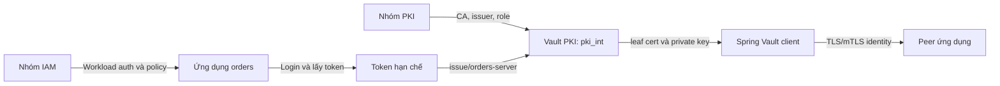
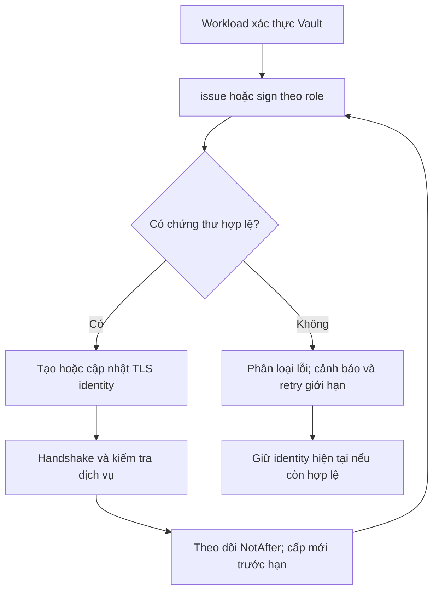

# Ranh giới cấu hình CA, role và thao tác của client ứng dụng

## Mục tiêu và bối cảnh

Trong module **Spring Vault**, ứng dụng Java sử dụng `VaultTemplate` để truy cập HashiCorp Vault, xác thực bằng danh tính workload và chỉ gọi các đường dẫn được Vault policy cho phép. Với **PKI (Public Key Infrastructure)**, quyền cấp chứng thư X.509 cần được kiểm soát đặc biệt: cấu hình sai có thể cho phép một dịch vụ nhận chứng thư giả danh dịch vụ khác.

Bài này nằm trong chương **Chứng thư PKI**. Tình huống xuyên suốt: workload `orders` cần chứng thư TLS ngắn hạn cho `orders.svc.example.test`, được phát hành bởi PKI mount `pki_int`. Các nhóm vận hành PKI, IAM/Vault và phát triển Java cùng tham gia nhưng nắm các quyền khác nhau.

Sau bài này, bạn có thể:

- Phân biệt ranh giới **CA/issuer**, **PKI role**, **Vault ACL policy** và **runtime client**.
- Cấu hình một role mẫu và policy tối thiểu mà không cấp quyền quản trị CA cho ứng dụng.
- Dùng `VaultPkiOperations` trong Spring Vault để `issue` hoặc `sign` chứng thư và xử lý private key an toàn.
- Thiết kế vòng đời TLS certificate, nhận diện lỗi auth, role, trust chain và kiểm thử tích hợp.

> `example.test` là miền dành cho minh họa; khi triển khai phải thay bằng miền DNS, Vault namespace, cấu hình CA và chuỗi tin cậy thực tế.

## 1. Bốn phạm vi trách nhiệm

| Lớp | Người quản lý | Quyết định gì? | Ứng dụng Java được làm gì? |
|---|---|---|---|
| **CA / issuer** | PKI operator | Khóa CA, root và intermediate, issuer, chain, CRL/OCSP, rotation | Nhận và sử dụng chứng thư do CA ký; không quản trị CA |
| **PKI role** | Role administrator | CN/SAN, miền DNS/IP/URI được phép, EKU, key type, TTL, issuer áp dụng | Chọn role được giao, gửi yêu cầu đáp ứng ràng buộc |
| **Vault ACL và auth** | Nhóm IAM/Vault | Workload nào được `update` endpoint `issue` hoặc `sign` cụ thể | Đăng nhập bằng workload identity, chỉ gọi API được cấp |
| **Ứng dụng/TLS** | Nhóm ứng dụng | Nơi giữ leaf private key, cài TLS, luân chuyển, theo dõi expiry | Xin chứng thư và dùng an toàn trong giới hạn role và policy |

Mỗi lớp kiểm soát một câu hỏi riêng:

1. **CA có quyền ký thay cho ai?** Quyền sở hữu khóa CA cần bị giới hạn ở nhóm PKI. Nếu workload đọc được hoặc thay đổi khóa CA, nó có thể giả mạo nhiều định danh.
2. **Role cho phép chứng thư có thông tin gì?** Role `orders-server` chỉ nên cấp DNS dưới `svc.example.test` và EKU dành cho TLS server. Gọi đúng API nhưng xin CN ngoài miền vẫn bị từ chối.
3. **ACL cho phép ai được gọi API đó?** Workload `orders` có `update` trên `pki_int/issue/orders-server` không tự động có quyền `pki_int/issue/payments-server` hoặc `pki_int/roles/orders-server`.
4. **Client dùng chứng thư như thế nào?** Phải giữ kín private key, kiểm tra chứng thư thực nhận, cài TLS identity và cấp chứng thư mới trước hạn.



### Token Vault và X.509 certificate là hai chứng thực khác nhau

**Vault token** thể hiện quyền gọi Vault API theo policy, có TTL và vòng đời phiên riêng. **Chứng thư X.509** dùng để phía TLS chứng minh danh tính trước peer, có thời hạn `NotBefore`/`NotAfter`. Token hết hạn không làm một chứng thư X.509 đã cấp tự hết hạn, còn gia hạn token không kéo dài `NotAfter` của chứng thư. Ứng dụng phải thiết kế quy trình cấp mới và thay chứng thư cho TLS/mTLS riêng.

## 2. Phạm vi CA/issuer: nhóm PKI chịu trách nhiệm

CA phát hành chứng thư bằng cách ký với khóa của mình. Mô hình vận hành thường dùng **root CA được bảo vệ riêng** và **intermediate CA** được đưa vào Vault để ký chứng thư leaf cho dịch vụ. Cách tách root/intermediate giúp thu hẹp phạm vi rủi ro và dễ luân chuyển CA cấp dịch vụ.

Những công việc chỉ dành cho PKI operator:

- Chọn kiến trúc root/intermediate và nơi lưu khóa CA; quản lý quy trình tạo/nhập khóa, CSR, ký intermediate, issuer mặc định và xoay khóa.
- Thiết lập mount PKI, giới hạn TTL mức mount, URL phân phối chứng thư CA và điểm CRL/OCSP; kiểm tra tính sẵn sàng từ nơi TLS peer chạy.
- Phân phối trust anchor, quản lý thu hồi, phân phối trạng thái revoke và lên kế hoạch chuyển issuer mà không làm gián đoạn TLS.
- Quản lý sự kiện audit, các quyền đặc biệt với CA/issuer, vai trò vận hành và vòng đời chứng thư đã cấp.

Ví dụ **chỉ operator** thực hiện thao tác khởi tạo mount:

```bash
vault secrets enable -path=pki_int pki
vault secrets tune -max-lease-ttl=43800h pki_int
```

Hai lệnh trên **chưa tạo CA có khả năng ký chứng thư**. Operator còn phải tạo/nhập intermediate key và certificate, gửi CSR cho root CA ký (nếu root ngoài Vault), nạp intermediate đã ký và kiểm tra issuer. `43800h` chỉ là giá trị minh họa cho giới hạn mount, không phải thời hạn phù hợp để cấp leaf certificate của workload.

Khi CA/issuer đã sẵn sàng, operator có thể cấu hình URL phân phối (ví dụ minh họa):

```bash
vault write pki_int/config/urls \
  issuing_certificates="https://vault.example.test/v1/pki_int/ca" \
  crl_distribution_points="https://vault.example.test/v1/pki_int/crl"
```

Các URL phải thực sự truy cập được từ nơi cần kiểm tra chain/revocation. Việc chuyển issuer hoặc root CA cần được phối hợp với hệ thống truststore: certificate được cấp từ CA mới không tự được mọi client tin cậy.

| Endpoint ví dụ | Ý nghĩa | Chủ thể thích hợp |
|---|---|---|
| `pki_int/root/generate/...`, `pki_int/intermediate/generate/...` | Sinh khóa/CSR CA | PKI operator |
| `pki_int/intermediate/set-signed`, `pki_int/config/issuers`, `pki_int/issuer/...` | Quản trị chứng thư CA và issuer | PKI operator |
| `pki_int/config/urls`, `pki_int/config/crl` | Quản trị đường dẫn CA và CRL | PKI operator |
| `pki_int/roles/orders-server` | Tạo hoặc sửa quy tắc phát hành | Role administrator |
| `pki_int/revoke`, `pki_int/tidy` | Thu hồi và quản trị dữ liệu PKI | Người quản trị vòng đời được giao quyền |
| `pki_int/issue/orders-server` | Xin leaf certificate đúng role | Workload đã được ACL cấp quyền |

Không cấp quyền đổi issuer, root, intermediate hay role cho ứng dụng chỉ cần một chứng thư TLS. Các endpoint `sign-verbatim` hoặc cho phép chọn issuer theo path cũng có tính đặc quyền và cần xem xét riêng.

## 3. Phạm vi PKI role: nội dung chứng thư được phép cấp

PKI role là **mẫu quy tắc phát hành** do Vault thực thi: CN/SAN, tên DNS/IP/URI, TTL, loại khóa, mục đích sử dụng và issuer. **Role không cấp quyền truy cập API cho token**; quyền truy cập nằm ở ACL policy.

Ví dụ tạo role cho **TLS server** sau khi mount/issuer đã hoạt động:

```bash
vault write pki_int/roles/orders-server \
  allowed_domains="svc.example.test" \
  allow_subdomains=true \
  allow_bare_domains=false \
  allow_any_name=false \
  allow_localhost=false \
  allow_wildcard_certificates=false \
  allow_ip_sans=false \
  enforce_hostnames=true \
  server_flag=true \
  client_flag=false \
  ttl=12h \
  max_ttl=24h
```

Role này cho phép xin `orders.svc.example.test` nhưng cấm `admin.example.test`, bare domain `svc.example.test`, chứng thư wildcard và IP SAN. `server_flag=true` / `client_flag=false` nhấn mạnh công dụng server TLS; đối với client mTLS nên cân nhắc role riêng nếu có định danh/EKU khác.

Thời hạn thật của chứng thư phụ thuộc yêu cầu, `ttl`/`max_ttl` của role, giới hạn mount và thời hạn CA/issuer. **Luôn đọc `NotAfter` của certificate nhận được**, không tự tính hạn từ `ttl` request. Đối với dịch vụ có yêu cầu đặc biệt, người quản trị cần kiểm tra cả `key_usage`, `ext_key_usage`, `issuer_ref`, chính sách wildcard, SAN và lưu trữ bản ghi chứng thư.

Role quá rộng, ví dụ `allow_any_name=true`, có thể cho phép một token chỉ dùng đúng **một** endpoint issue để xin chứng thư giả danh dịch vụ khác. Cần xem việc sửa role là hoạt động quản trị qua review/audit, không để ứng dụng ghi lại role mỗi lần khởi động.

## 4. Phạm vi auth/ACL: ai có quyền xin chứng thư?

Nhóm IAM/Vault liên kết policy vào **danh tính workload** qua phương thức xác thực phù hợp (Kubernetes Auth, AppRole hoặc hệ thống nhận dạng đã được phê duyệt). Với ứng dụng `orders` chỉ cần `issue`, policy tối thiểu có thể là:

```hcl
path "pki_int/issue/orders-server" {
  capabilities = ["update"]
}
```

Policy chỉ cho phép `POST /v1/pki_int/issue/orders-server`. Nó không cấp quyền gọi `pki_int/issue/payments-server`, sửa `pki_int/roles/orders-server`, quản trị issuer/CA, hay thu hồi bằng `pki_int/revoke`. Nếu ứng dụng sinh private key và CSR tại chỗ, có thể cấp `update` trên `pki_int/sign/orders-server` như một quyền riêng sau khi thống nhất phương thức bảo vệ khóa.

**Ví dụ đối chiếu:** Workload có token hợp lệ gọi `/issue/orders-server` để lấy `admin.example.test` sẽ bị role từ chối vì tên không thuộc miền. Cùng workload xin `orders.svc.example.test` từ `/issue/payments-server` sẽ bị ACL từ chối vì path chưa được cấp. Hai điều kiện độc lập và phải đều đúng để issue thành công.

Không cấp `pki_int/*` cho workload chỉ cần issue. Token root hoặc token admin không phải cách xử lý lỗi 403 của ứng dụng; cần sửa mapping auth/policy đúng phạm vi.

## 5. Phạm vi của client Java: xin chứng thư qua Spring Vault

Sau khi operator đã tạo CA/issuer/role và IAM gắn policy vào workload, client ứng dụng chỉ cần dùng `VaultTemplate` hoặc `VaultPkiOperations`. Spring Vault có API chuyên dụng `issueCertificate` và `signCertificateRequest`; việc cấu hình CA, role hoặc issuer thuộc phần quản trị riêng.

### Luồng issue: Vault sinh private key của leaf certificate

`POST /v1/pki_int/issue/orders-server` sinh một **cặp khóa leaf** và cấp chứng thư theo role. Phản hồi có thể gồm `certificate`, `private_key`, `issuing_ca`, `ca_chain`, `serial_number`. Với luồng này, private key mới được tạo và trả cho client; **Vault không lưu lại private key leaf để client truy xuất về sau**. Vì vậy ứng dụng phải bảo vệ private key ngay từ lúc nhận response.

Ví dụ Java 17+ với một bean `VaultTemplate` đã được cấu hình kết nối và auth:

```java
import java.security.KeyStore;
import java.security.cert.X509Certificate;
import java.time.Duration;
import java.time.Instant;
import java.util.List;

import org.springframework.stereotype.Service;
import org.springframework.vault.core.VaultPkiOperations;
import org.springframework.vault.core.VaultTemplate;
import org.springframework.vault.support.CertificateBundle;
import org.springframework.vault.support.VaultCertificateRequest;
import org.springframework.vault.support.VaultCertificateResponse;

@Service
public class OrdersTlsIdentityProvider {

    private static final String ROLE = "orders-server";
    private static final String DNS_NAME = "orders.svc.example.test";
    private final VaultPkiOperations pki;

    public OrdersTlsIdentityProvider(VaultTemplate vaultTemplate) {
        // pki_int đã được nhóm PKI tạo và cấu hình.
        this.pki = vaultTemplate.opsForPki("pki_int");
    }

    public record TlsIdentity(KeyStore keyStore,
                              String serialNumber,
                              Instant notAfter) {}

    public TlsIdentity issue() {
        VaultCertificateRequest request = VaultCertificateRequest.builder()
            .commonName(DNS_NAME)
            .altNames(List.of(DNS_NAME))
            .ttl(Duration.ofHours(12))
            .build();

        VaultCertificateResponse response =
            pki.issueCertificate(ROLE, request);
        CertificateBundle bundle = response.getRequiredData();
        X509Certificate certificate = bundle.getX509Certificate();

        // Dùng thời hạn trên chứng thư thực nhận.
        Instant notAfter = certificate.getNotAfter().toInstant();
        if (!notAfter.isAfter(Instant.now())) {
            throw new IllegalStateException("Chứng thư PKI đã hết hạn");
        }

        // Chỉ đưa identity vào thành phần cài đặt TLS đáng tin cậy.
        KeyStore keyStore = bundle.createKeyStore("orders-tls");
        return new TlsIdentity(
            keyStore, bundle.getSerialNumber(), notAfter);
    }
}
```

Các điểm cần hiểu trong ví dụ:

1. `opsForPki("pki_int")` chọn mount PKI, không tạo mount mới.
2. `VaultCertificateRequest` mô tả CN, SAN và TTL mong muốn; role có thể từ chối nếu yêu cầu vượt giới hạn.
3. `issueCertificate("orders-server", request)` vẫn chịu kiểm tra ACL đối với token đang dùng của `VaultTemplate`.
4. `getRequiredData()` trả về `CertificateBundle` chứa chứng thư và private key. `createKeyStore` tạo `KeyStore` Java để cung cấp cho TLS implementation.
5. Thời hạn `NotAfter` được đọc từ leaf certificate, phục vụ rotation và alerting. `serialNumber` giúp theo dõi certificate đã phát hành hoặc xử lý revocation theo quy trình.

Đoạn mã trên là **thành phần phát hành identity**, chưa tự động nạp `KeyStore` vào embedded server, database client hoặc HTTP client; việc này tùy bộ TLS và vòng đời ứng dụng. Bên sử dụng phải xác minh chứng thư phù hợp DNS/SAN, chain, EKU và key. Không coi một certificate nhận được từ endpoint có thể thay thế **trust anchor đã phê duyệt** trong truststore của peer.

`CertificateBundle` chứa **private key nhạy cảm**. Không log response hoặc serialize nó vào API, message queue, tracing và các record nghiệp vụ. Nếu phải ghi file, hạn chế quyền đọc và ưu tiên cơ chế quản lý khóa an toàn của nền tảng; tránh copy private key không cần thiết trong bộ nhớ.

### Luồng sign: ứng dụng giữ private key, Vault chỉ ký CSR

Với `POST /v1/pki_int/sign/orders-server`, phía client tự sinh private key và tạo **Certificate Signing Request (CSR)** chứa public key và định danh cần xin. Vault đọc CSR, áp dụng ràng buộc của role và trả chứng thư được ký cùng chain; **private key không đi qua Vault**.

Spring Vault có chữ ký API tương ứng:

```java
// pki: VaultPkiOperations của mount pki_int.
// csrPem: CSR đã tạo và ký bởi private key nằm tại workload/HSM.
var signed = pki.signCertificateRequest(
    "orders-server",
    csrPem,
    VaultCertificateRequest.create("orders.svc.example.test")
);
// Đọc chứng thư từ signed và ghép với private key đã dùng tạo CSR.
```

Đây là **mảnh mã tích hợp**: biến `pki` và `csrPem` được chuẩn bị trước bởi phần quản lý khóa/CSR. Ứng dụng cần kiểm tra chứng thư nhận được và đảm bảo public key của certificate khớp private key do mình giữ, sau đó gắn đúng chain vào TLS.

| Tiêu chí | `issue` | `sign` |
|---|---|---|
| Ai tạo private key leaf? | Vault | Workload hoặc HSM |
| Vault nhận private key leaf? | Có, Vault tạo và trả khóa cho client | Không, chỉ nhận CSR |
| Client nhận từ Vault | Certificate, private key, CA chain | Certificate, CA chain |
| ACL yêu cầu | `update pki_int/issue/orders-server` | `update pki_int/sign/orders-server` |
| Rủi ro chính | Lộ private key qua response, log hoặc lưu trữ | Bảo vệ khóa bên client và tạo CSR đúng định danh |

Không thay bằng `sign-verbatim` chỉ vì yêu cầu CSR bị role từ chối. Endpoint đó có khả năng ký trường của CSR mà không áp dụng đầy đủ các ràng buộc thông thường, vì vậy chỉ dành cho chủ thể đặc quyền được kiểm soát riêng.

### Thu hồi (revoke) là quyền khác với cấp chứng thư

`VaultPkiOperations` có phương thức `revoke(String serialNumber)` tương ứng API thu hồi của PKI. Tuy nhiên, việc API client hỗ trợ revoke không có nghĩa workload issue cần quyền `pki_int/revoke`. Có thể tách quy trình thu hồi cho dịch vụ quản trị vòng đời hoặc người vận hành, đặc biệt trong tình huống lộ khóa hoặc cần hủy chứng thư trước hạn.

## 6. Sau khi issue: vòng đời, trust và giám sát

Để chứng thư thực sự được dùng cho TLS/mTLS, ứng dụng phải cài **đúng bộ private key + certificate + chain**, đồng thời peer phải có CA tin cậy phù hợp. Cần lên lịch **cấp chứng thư mới** sớm hơn `NotAfter`, cài TLS identity mới và thực hiện thử nghiệm handshake trước khi bỏ identity cũ.

| Thời điểm | PKI/operator | Workload Java |
|---|---|---|
| Chuẩn bị | Intermediate/issuer hợp lệ, role đúng, URL chain/CRL sẵn sàng | Auth và policy hoạt động, DNS cần xin hợp lệ |
| Phát hành | Giám sát hoạt động issue/sign, audit | Lấy chứng thư và private key theo phương thức đã chọn |
| Cài vào TLS | Cung cấp chain và trust anchor phù hợp | Giữ kín khóa, nạp TLS identity, kiểm thử kết nối |
| Gần hết hạn | Duy trì dịch vụ PKI và issuer | Tạo chứng thư mới, thay identity, quan sát lỗi handshake |
| Thay issuer/root | Phân phối trust anchor, triển khai giai đoạn chuyển tiếp | Cập nhật truststore trước khi CA cũ ngừng được tin |
| Lộ khóa leaf | Điều phối revoke và trạng thái CRL/OCSP | Ngừng sử dụng khóa lộ, cấp/cài certificate mới |



Trong mTLS, ngoài private key của local endpoint, ứng dụng còn phải xác minh certificate chain của **peer** và danh tính mà peer trình bày. Không được tắt xác thực hostname hoặc tùy tiện tin cậy toàn bộ CA chain nhận từ một request không được xác thực.

**Gia hạn Vault token không gia hạn chứng thư X.509.** Client phải theo dõi đồng thời hạn token, hạn certificate và hạn issuer. Trong một số trường hợp PKI có thể dùng cơ chế lease hoặc metadata riêng, nhưng `NotAfter` của X.509 vẫn là cơ sở cần kiểm tra để quyết định thay chứng thư đang cài trong TLS.

Việc gọi `issue` nhiều lần có thể tạo **nhiều chứng thư khác nhau**. Nếu một request timeout sau khi Vault đã cấp chứng thư, retry thiếu kiểm soát có thể phát sinh chứng thư mới mà ứng dụng không sử dụng. Nên dùng retry có giới hạn, backoff và jitter, đối soát trạng thái identity đã cài và theo dõi serial/expiry; không coi `issue` là phép cấp phát idempotent theo tên CN.

Đối với giám sát, có thể theo dõi: số lần issue/sign thành công hoặc lỗi theo role/mount, tỷ lệ lỗi 403/validation/5xx, độ trễ phát hành, thời gian còn lại đến `NotAfter`, số lần thay TLS identity thành công và lỗi handshake. Không ghi private key, token hoặc response đầy đủ vào log/trace.

## 7. Phân loại lỗi theo ranh giới

| Triệu chứng | Lớp kiểm tra trước | Hướng xử lý |
|---|---|---|
| HTTP 403 khi `issue` | Token Vault / ACL | Kiểm tra auth mapping và quyền `update` đúng endpoint |
| CN/SAN ngoài `allowed_domains` bị từ chối | Role | Sửa request hoặc nhờ role administrator xét lại giới hạn |
| Dùng `sign` nhưng token chỉ có quyền `issue` | ACL | Xem có thực sự cần `sign` rồi cấp quyền đúng path |
| Không có role/issuer hoặc CA chưa sẵn sàng | PKI operator | Kiểm tra mount, role, issuer, CA chain và trạng thái Vault |
| Certificate được cấp nhưng peer không tin | CA / truststore | Kiểm tra CA chain, trust anchor, revocation và chuyển đổi issuer |
| TLS hostname mismatch | DNS name trong SAN / TLS | Xin chứng thư đúng tên và giữ hostname verification |
| Hết hạn chứng thư dù token vẫn hợp lệ | Vòng đời X.509 | Sửa lịch cấp và cài chứng thư mới dựa vào `NotAfter` |
| Timeout/429/5xx | Hạ tầng Vault/network | Backoff giới hạn, quan sát certificate đã cài, điều tra sự cố nếu kéo dài |
| Cần revoke nhưng bị 403 | Phân quyền quản trị vòng đời | Chuyển cho quy trình thu hồi đã được ủy quyền |

Khi Spring Vault ném `VaultException`, ứng dụng nên phân biệt lỗi xác thực, lỗi policy/role và lỗi kết nối. Không retry liên tục một yêu cầu CN/SAN bị cấm; không mở rộng quyền CA/role để xử lý lỗi phát hành. Nếu không chắc request trước đã được Vault xử lý, ghi nhận trạng thái chưa xác nhận và kiểm tra certificate hiện có trước khi xin thêm.

## 8. Kiểm thử tích hợp

Chạy trên Vault test/dev và CA **dành riêng cho môi trường thử nghiệm**; không dùng root CA hoặc token quản trị sản xuất.

| Kịch bản | Kết quả mong đợi |
|---|---|
| Workload `orders` gọi `issue/orders-server` với `orders.svc.example.test` | Trả chứng thư/khóa; `NotAfter` và tên hợp lệ; TLS handshake thành công |
| Cùng token xin `admin.example.test` qua role `orders-server` | Bị **role** từ chối vì domain |
| Cùng token xin `orders.svc.example.test` qua role `payments-server` | Bị **ACL** từ chối vì path |
| Cùng token ghi `pki_int/roles/orders-server` | Bị **ACL** từ chối; không đổi cấu hình role |
| Cùng token gọi `pki_int/sign/orders-server` khi chỉ được cấp issue | Bị ACL từ chối |
| Xin wildcard/IP SAN trái role | Bị role từ chối |
| Token Vault hết hạn | Yêu cầu Vault mới bị từ chối; certificate đã cài vẫn có expiry riêng |
| Chứng thư gần `NotAfter` trong lúc Vault tạm lỗi | Có cảnh báo và retry giới hạn; identity cũ tiếp tục dùng nếu còn hợp lệ |
| Đổi issuer trong môi trường test | Phân phối trust anchor mới trước khi bỏ CA cũ, TLS vẫn hoạt động |
| Revoke bằng chủ thể quản trị đã ủy quyền | Hệ thống kiểm tra revocation phản ánh trạng thái theo cấu hình |

**Tình huống phân tích:** Đội vận hành cấp cho `orders` policy `update pki_int/issue/*` và role `orders-server` được cấu hình `allow_any_name=true`. Rủi ro thứ nhất là token có thể gọi **role khác**; rủi ro thứ hai là **chính role orders-server** có thể cho phép xin tên ngoài phạm vi. Cần siết cả ACL theo endpoint cụ thể **và** giới hạn tên của role; chỉ sửa một phía vẫn để lại lỗ hổng ở phía còn lại.

## 9. Checklist trách nhiệm

1. **PKI operator:** root/intermediate/issuer và khóa CA được kiểm soát; chain, CRL/OCSP, TTL và rotation được vận hành tập trung.
2. **Role administrator:** role hạn chế CN/SAN/domain/EKU/TTL và issuer, tránh `allow_any_name`/wildcard/IP SAN nếu không cần.
3. **IAM/Vault administrator:** workload có auth riêng và policy hẹp theo `issue/<role>` hoặc `sign/<role>`; không cấp mặc định quyền đổi CA, role hoặc revoke.
4. **Ứng dụng Java:** gọi `VaultPkiOperations`, giữ kín private key, kiểm tra certificate/`NotAfter`, cài TLS identity, giám sát và cấp mới trước hạn.
5. **Bên xác minh TLS:** sử dụng CA được chấp thuận qua kênh tin cậy, kiểm tra chain, hostname, hạn hiệu lực và revocation theo yêu cầu vận hành.

CA định nghĩa **thẩm quyền ký**, role quy định **chứng thư được phát hành**, ACL xác định **workload nào được xin**, còn client Java chịu trách nhiệm **sử dụng và luân chuyển chứng thư an toàn**.

## Tài liệu tham khảo chính thức

1. [HashiCorp Vault — PKI secrets engine](https://developer.hashicorp.com/vault/docs/secrets/pki): tổng quan về PKI và chứng thư X.509 ngắn hạn.
2. [HashiCorp Vault — Set up and use the PKI secrets engine](https://developer.hashicorp.com/vault/docs/secrets/pki/setup): cấu hình mount, CA, role và issuance.
3. [HashiCorp Vault — PKI HTTP API](https://developer.hashicorp.com/vault/api-docs/secret/pki): `issue`, `sign`, `revoke`, role, issuer và các endpoint quản trị.
4. [HashiCorp Vault — PKI considerations](https://developer.hashicorp.com/vault/docs/secrets/pki/considerations): ranh giới CA, role, ACL, luân chuyển và bảo mật.
5. [Spring Vault — PKI secrets engine support](https://docs.spring.io/spring-vault/reference/vault/vault-secret-engines.html): ví dụ `opsForPki`, `VaultCertificateRequest`, `CertificateBundle`.
6. [Spring Vault — VaultPkiOperations API](https://docs.spring.io/spring-vault/reference/api/java/org/springframework/vault/core/VaultPkiOperations.html): `issueCertificate`, `signCertificateRequest`, `revoke` và API đọc CA/CRL.
