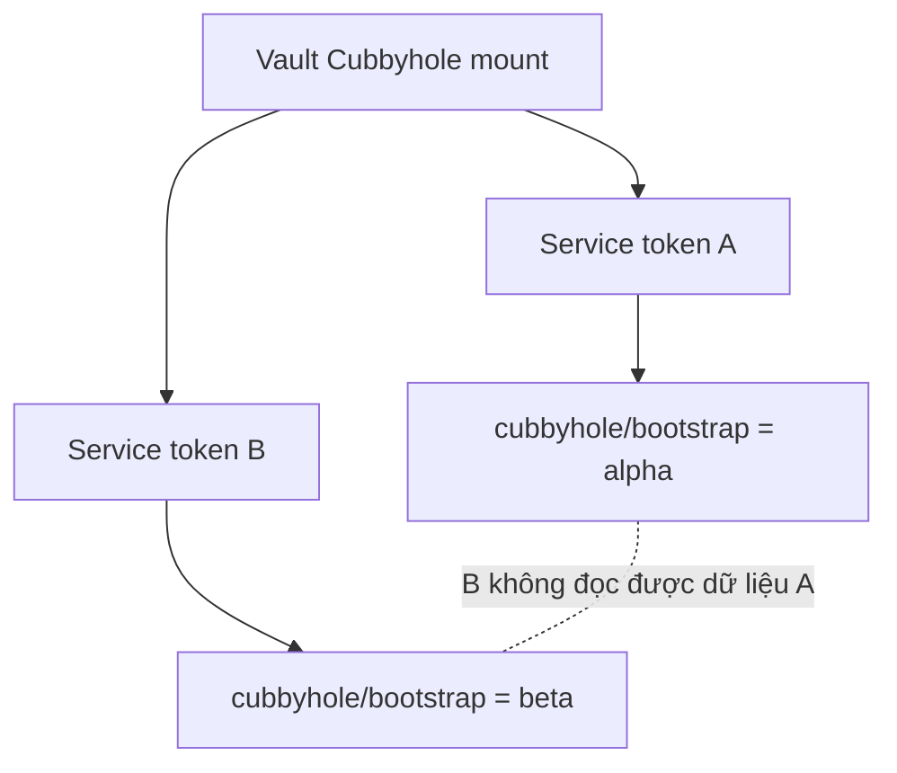
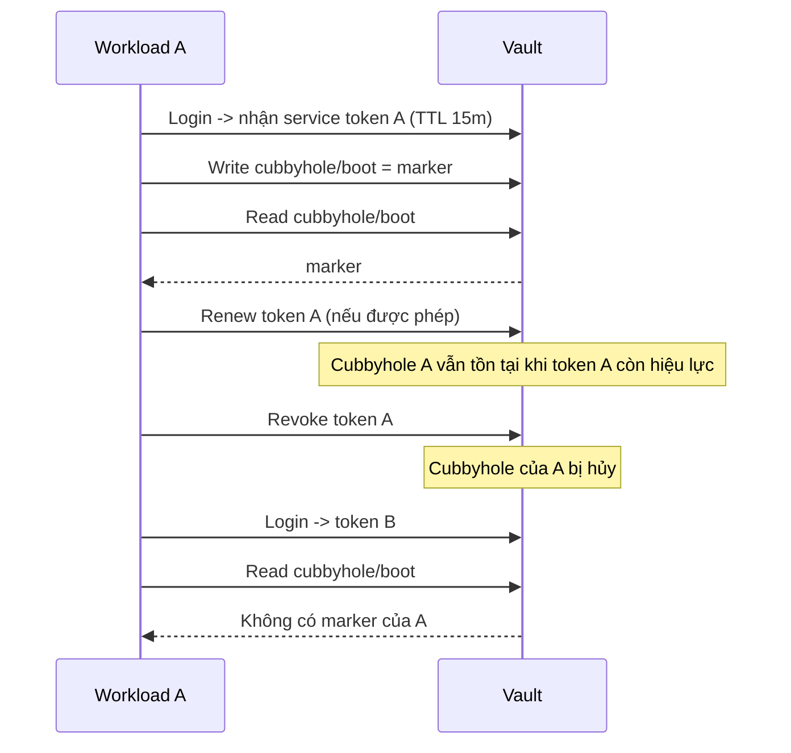
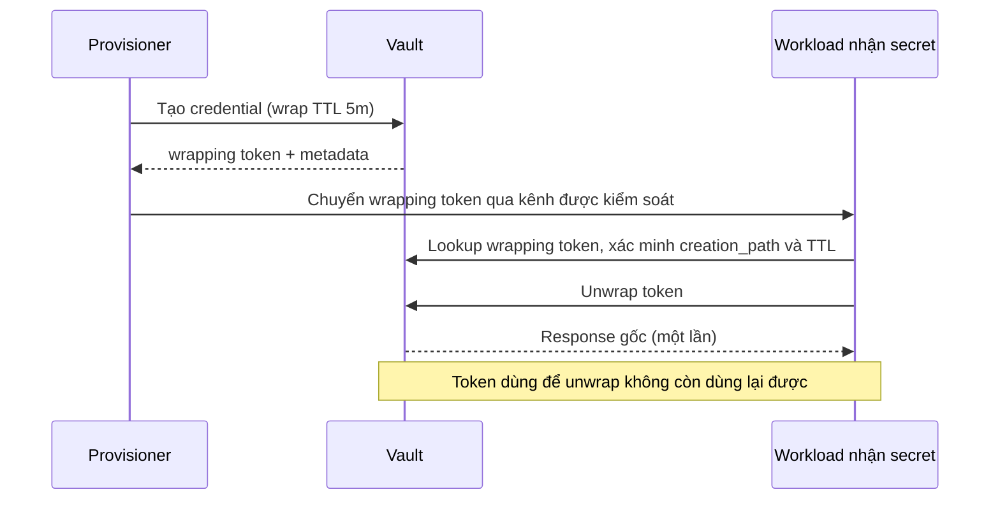

# Cubbyhole và dữ liệu gắn với token trong HashiCorp Vault

> **Chương:** Cubbyhole và wrapping  
> **Chủ đề:** Cubbyhole và dữ liệu gắn với token  
> **Ứng dụng:** Spring Vault giúp ứng dụng Java sử dụng Vault qua `VaultTemplate`, xác thực theo workload và policy. Bài này giải thích một vùng dữ liệu đặc biệt của Vault có vòng đời bám theo **token đang dùng để truy cập**.

## 1. Mục tiêu học tập

Sau khi học, bạn có thể:

1. Giải thích Cubbyhole secrets engine là gì, cách Vault cô lập dữ liệu theo **từng token** và hệ quả đối với workload Java.
2. Phân biệt Cubbyhole với KV v1/KV v2, lease của dynamic secret và response wrapping.
3. Thao tác tạo, đọc, liệt kê, ghi đè và xóa giá trị ở `cubbyhole/<path>` bằng Vault CLI, HTTP API và `VaultTemplate`.
4. Dự đoán điều gì xảy ra khi token được renew, hết hạn, bị revoke hoặc bị thay thế.
5. Thiết kế policy, quy trình xác thực và kiểm thử tích hợp bảo đảm dữ liệu của token A không bị đọc bởi token B.
6. Nhận ra các tình huống không nên sử dụng Cubbyhole để lưu dữ liệu cần tồn tại độc lập với token.

## 2. Cubbyhole là gì?

**Cubbyhole** là secrets engine có sẵn trong HashiCorp Vault để lưu những cặp dữ liệu tùy ý vào vùng lưu trữ của Vault, nhưng đường dẫn được **phân vùng theo service token**. Mỗi token có một không gian Cubbyhole riêng. Hai token khác nhau cùng gọi `cubbyhole/demo` sẽ truy cập **hai vùng dữ liệu khác nhau**.



Hình trên là mô hình **logic**: URL API vẫn là `cubbyhole/bootstrap`, Vault tự chọn vùng lưu trữ bằng token xác thực của request. Không tự tạo đường dẫn kiểu `cubbyhole/<token-id>/bootstrap` và không đưa token ID vào path.

Đặc điểm cốt lõi:

- Cubbyhole được **bật sẵn**, mặc định mount tại `cubbyhole/`; không thể disable, move hay enable nhiều lần.
- Dữ liệu được ghi vào physical storage đã cấu hình của Vault, nhưng được cô lập theo token. Token khác dù biết **cùng tên path** cũng không truy cập được dữ liệu của token đầu.
- **Không có TTL/lease độc lập cho từng giá trị** Cubbyhole. Vòng đời dữ liệu phụ thuộc vào vòng đời của token sở hữu.
- Việc ghi lại cùng path **thay thế toàn bộ** dữ liệu cũ ở path ấy; không có cơ chế merge tự động giống cập nhật từng field.
- Cubbyhole không phải một database dùng chung hay nơi lưu secret ứng dụng dài hạn giữa nhiều instance.
- Cơ chế **response wrapping** sử dụng Cubbyhole ở bên trong, nhưng việc ghi dữ liệu thủ công vào Cubbyhole không tự tạo ra một wrapping token một lần dùng.

Ví dụ: dịch vụ `invoice-worker` lưu một marker tạm trong `cubbyhole/init-state` khi đang xác thực bằng token A. Nếu pod khởi động lại và nhận token B mới, request `read` ở cùng path không thấy marker của token A. Điều này đúng ngay cả khi cả hai token có cùng policy và cùng tên workload.

## 3. Tại sao nói dữ liệu gắn với token?

### 3.1. Danh tính đọc dữ liệu là *token cụ thể*

Cách suy nghĩ đúng là:

```text
request = (Vault namespace, token, path, operation)
cubbyhole storage scope ~ token identity
```

Vault xác thực token, kiểm tra capability trên path và dùng token đó để chọn vùng Cubbyhole. Quyền ACL chỉ trả lời **được phép thực hiện thao tác hay không**; nó không cho phép token B đọc Cubbyhole của token A.

| Tình huống | Cùng đường dẫn `cubbyhole/boot` | Điều quan sát |
| --- | --- | --- |
| Cùng service token A, có quyền `read` | A ghi rồi A đọc | Đọc được dữ liệu A |
| Token B khác A, có quyền `read` | A đã ghi, B đọc | Không thấy dữ liệu A; B chỉ có vùng của B |
| Token B ghi cùng path | B ghi giá trị B, A đọc lại | A vẫn thấy giá trị A |
| Token A có quyền `write` nhưng không có `read` | A ghi rồi A đọc | Lần đọc bị policy từ chối |
| Token A hết hạn/bị revoke | Dữ liệu từng lưu dưới A | Vùng Cubbyhole của A bị hủy |
| Token A được renew hợp lệ | Token vẫn là A | Dữ liệu vẫn gắn với A khi token còn hiệu lực |

**Phân biệt token với người dùng:** cùng một người, cùng role Kubernetes hoặc cùng AppRole có thể đăng nhập nhiều lần và nhận **các token khác nhau**. Mỗi token có vùng Cubbyhole riêng. Việc nhận token mới sau khi token cũ bị revoke không chuyển dữ liệu sang Cubbyhole mới.

**Phân biệt token cha/con:** khi tạo child service token, child có vùng Cubbyhole riêng với parent. Child không thừa hưởng dữ liệu Cubbyhole của parent dù có policy liên quan. Nếu parent bị revoke, các child không phải orphan thường bị revoke theo, và các vùng Cubbyhole tương ứng cũng không còn.

### 3.2. Service token và batch token

Đây là ràng buộc kỹ thuật rất quan trọng khi triển khai workload:

| Loại token | Có Cubbyhole riêng? | Ghi chú |
| --- | --- | --- |
| **Service token** | **Có** | Token được Vault theo dõi, hỗ trợ renewal/revocation theo chính sách |
| **Batch token** | **Không** | Token nhẹ, không có accessor và không có Cubbyhole; không dùng cho workflow cần lưu vào Cubbyhole |
| **Response-wrapping token** | Dùng Cubbyhole nội bộ cho response được wrap | Token một lần dùng, TTL ngắn; xử lý bằng API wrapping |

Cần xác định auth method/role thực tế cấp loại token nào. Một policy chứa `cubbyhole/*` không biến batch token thành service token. Nếu workload dùng batch token, hãy chọn cơ chế khác hoặc điều chỉnh thiết kế xác thực phù hợp nhu cầu.

### 3.3. Dữ liệu tồn tại đến khi nào?

Mốc thời gian ví dụ:



- **Token TTL** là giới hạn thời gian của token. Giá trị trong Cubbyhole không có TTL riêng để renew.
- **Renew token** có thể kéo dài thời gian sống của cùng token theo giới hạn chính sách; vì vậy dữ liệu Cubbyhole vẫn còn khi token còn hiệu lực.
- **Revoke/expire token** khiến Cubbyhole tương ứng bị hủy; không nên đặt dữ liệu cần khôi phục sau thời điểm đó vào đây.
- **Đổi token** trong Spring Vault/SessionManager làm đổi vùng Cubbyhole đang được truy cập. Đây là hành vi đúng theo thiết kế, không phải lỗi cache.

Trong hệ thống Java chạy lâu dài, cần xác định rõ: token đang được **renew** hay ứng dụng đang **re-authenticate lấy token mới**? Hai trường hợp này có ý nghĩa khác nhau đối với dữ liệu Cubbyhole.

## 4. So sánh Cubbyhole, KV và response wrapping

| Đặc tính | Cubbyhole | KV v1 / KV v2 | Response wrapping |
| --- | --- | --- | --- |
| Mục đích | Dữ liệu tạm riêng của **một token** | Lưu secret theo đường dẫn và policy để nhiều workload phù hợp truy cập | Chuyển giao **một response** thông qua wrapping token |
| Phạm vi | Cô lập theo token | Theo mount/path, policy | Theo wrapping token được tạo cho response |
| Vòng đời | Theo token chủ sở hữu | Theo bản ghi, policy và cơ chế quản lý của KV; không tự mất chỉ vì token đọc hết hạn | Theo TTL riêng của wrapping token; được unwrap một lần |
| Quyền chia sẻ giữa token | Không chia sẻ cùng vùng Cubbyhole | Có thể cấp quyền theo path cho nhiều token | Người có wrapping token hợp lệ có thể unwrap |
| Phiên bản hóa | Không có versioning theo kiểu KV v2 | KV v2 hỗ trợ versioning | Không phải engine versioned storage |
| Ghi lại cùng key | Thay thế toàn bộ giá trị tại path | Tùy KV version/cách ghi | Không ghi trực tiếp qua cơ chế wrapping |
| Tình huống phù hợp | Marker/metadata tạm của một phiên xác thực | Cấu hình/secret ứng dụng phải tồn tại qua nhiều lần login | Bootstrap, gửi secret/credential qua khâu trung gian |

**Đừng dùng Cubbyhole như KV dùng chung:** nếu service A ghi và service B cần đọc, Cubbyhole không thỏa yêu cầu, ngay cả khi cả hai dùng policy giống nhau. Dùng KV hoặc backend thích hợp có phân quyền và vòng đời rõ ràng.

**Đừng coi Cubbyhole là lease:** KV có cấu trúc dữ liệu và metadata riêng; dynamic secrets (database credentials, cloud credentials...) có lease và API renew/revoke theo secrets engine. Cubbyhole value không có `lease_id`, thời gian thuê hay bộ đếm TTL độc lập để theo dõi.

## 5. Các thao tác Cubbyhole bằng Vault CLI và HTTP API

Ví dụ thực hành giả định Vault đã hoạt động, đã cấu hình HTTPS hoặc Vault dev server riêng để học, và người dùng có **service token** với quyền tương ứng trên Cubbyhole. Cubbyhole đã có sẵn; **không chạy** `vault secrets enable cubbyhole`.

### 5.1. Ghi, đọc, ghi đè, liệt kê và xóa

```bash
# Chạy bằng token A, dữ liệu chỉ là chuỗi giả lập:
vault write cubbyhole/workflow/boot step=started owner=invoice-worker

# Đọc giá trị ở đúng path trong cubbyhole của A:
vault read cubbyhole/workflow/boot

# Ghi lại cùng path: toàn bộ object cũ bị thay thế.
vault write cubbyhole/workflow/boot step=validated

# Đọc lại: không còn field owner cũ.
vault read cubbyhole/workflow/boot

# Liệt kê tên bên trong một folder, nếu ACL cho phép list:
vault list cubbyhole/workflow

# Xóa đúng path trong cubbyhole của A:
vault delete cubbyhole/workflow/boot
```

Khi `vault write` lần hai chỉ gửi `step`, field `owner` cũ không còn. Đây là ghi **replace**, không phải patch/merge. `vault list` chỉ trả tên key, không trả nội dung; tên secret có thể vẫn tiết lộ thông tin nếu đặt tùy tiện.

HTTP API tương ứng:

```http
POST /v1/cubbyhole/workflow/boot
X-Vault-Token: <service-token-A>
Content-Type: application/json

{"step":"started","owner":"invoice-worker"}
```

```http
GET /v1/cubbyhole/workflow/boot
X-Vault-Token: <service-token-A>
```

```http
DELETE /v1/cubbyhole/workflow/boot
X-Vault-Token: <service-token-A>
```

Tại endpoint `GET`, dữ liệu thường nằm trong `data` của response JSON. `LIST /v1/cubbyhole/workflow` dùng capability `list`, hoặc dùng lệnh `vault list`. Nếu muốn thao tác trên Cubbyhole của B, phải xác thực bằng **token B**; không có tham số API hợp lệ để tùy chọn Cubbyhole của A từ token B.

### 5.2. Thử nghiệm hai token để chứng minh cách ly

Thực hiện bằng Vault **dev/lab**, không dùng root token trong application thật. Dùng token quản trị lab để cài policy và cấp **hai service token khác nhau**:

```hcl
# File cubby-lab.hcl: quyền cho phép thao tác các path Cubbyhole.
path "cubbyhole/*" {
  capabilities = ["create", "read", "update", "delete", "list"]
}
```

```bash
# Lệnh dưới đây do tài khoản quản trị lab chạy:
vault policy write cubby-lab cubby-lab.hcl

vault token create -type=service -policy=cubby-lab -ttl=15m
vault token create -type=service -policy=cubby-lab -ttl=15m
```

Lưu hai token được trả về thành **token A** và **token B** trong môi trường thực hành được cách ly. Khi thao tác bằng CLI, đảm bảo mỗi terminal thực sự sử dụng token mong muốn, chẳng hạn cấp `VAULT_TOKEN` qua phương thức an toàn của môi trường lab. Đừng chép token thật vào Markdown hoặc commit lên Git.

| Bước | Terminal/token | Lệnh | Kết quả kỳ vọng |
| --- | --- | --- | --- |
| 1 | A | `vault write cubbyhole/demo value=from-A` | Thành công |
| 2 | A | `vault read cubbyhole/demo` | `value=from-A` |
| 3 | B | `vault read cubbyhole/demo` | Không tìm thấy dữ liệu A |
| 4 | B | `vault write cubbyhole/demo value=from-B` | Thành công trong vùng B |
| 5 | B | `vault read cubbyhole/demo` | `value=from-B` |
| 6 | A | `vault read cubbyhole/demo` | Vẫn là `value=from-A` |
| 7 | Quản trị lab | Revoke token A | Token A mất hiệu lực; vùng A bị hủy |
| 8 | B | `vault read cubbyhole/demo` | Vẫn là `value=from-B` nếu B còn hiệu lực |

**Phân biệt quan sát:** đọc một path không có dữ liệu và bị policy từ chối là hai trường hợp khác nhau. Thử nghiệm cần kiểm tra token thực tế, capability và mã lỗi để khẳng định đã kiểm thử được phân vùng. Nếu token B chưa ghi, lệnh B đọc path thường không có kết quả; nó **không đọc dữ liệu của A**.

Không cần tự chèn ID token vào path. Có thể kiểm tra thông tin token hiện tại bằng `vault token lookup`, nếu policy cho phép, và dùng `vault token revoke` trong môi trường lab với quyền phù hợp. Đảm bảo hủy token thử nghiệm sau khi hoàn tất.

## 6. ACL policy và quyền thực thi

Vault dùng policy HCL dựa trên đường dẫn/capability. **Mặc định** policy `default` thường cung cấp một số quyền với Cubbyhole, nhưng nội dung policy có thể bị người vận hành sửa; token cũng có thể được cấp mà không gắn `default`. Vì vậy không giả định tất cả token đều có quyền thao tác.

```bash
# Đọc policy mặc định bằng danh tính có quyền xem policy:
vault policy read default
```

Policy giới hạn quyền cho một path cụ thể:

```hcl
# Service chỉ được ghi/đọc marker tại path riêng trong Cubbyhole của nó.
path "cubbyhole/workflow/boot" {
  capabilities = ["create", "read", "update", "delete"]
}
```

Nếu cần liệt kê path trong folder:

```hcl
path "cubbyhole/workflow" {
  capabilities = ["list"]
}

path "cubbyhole/workflow/*" {
  capabilities = ["create", "read", "update", "delete", "list"]
}
```

**Hai lớp kiểm soát tồn tại đồng thời:**

1. **Token scope:** chỉ dữ liệu của token hiện tại mới được ánh xạ.
2. **ACL capability:** chính token đó có được phép `read`, `update`, `delete`, `list` trên path hay không.

Ví dụ một token có `read` nhưng thiếu `create/update` có thể đọc dữ liệu nó đã có quyền, nhưng không được tạo/ghi lại. Token khác được trao quyền rộng hơn trên cùng path **vẫn không thể đọc vùng token đầu**.

Nếu policy `default` vốn cấp quyền rộng cho Cubbyhole, việc chỉ **thêm** policy hẹp sẽ không thu hẹp quyền đã có; Vault hợp các capability từ nhiều policy. Muốn bảo đảm hạn chế, cần xem policy hiệu lực và thiết kế role/token tương ứng. Tránh vô tình dùng `root` policy trong kiểm thử phân quyền.

## 7. Tích hợp Java với `VaultTemplate`

Ví dụ dưới đây chỉ dùng `VaultTemplate` do Spring Vault đã cấu hình bằng HTTPS, `ClientAuthentication` và `SessionManager` phù hợp. Path không chứa token; Spring Vault tự gắn token xác thực cho request.

```java
import java.util.Map;
import java.util.Optional;

import org.springframework.stereotype.Service;
import org.springframework.vault.core.VaultTemplate;
import org.springframework.vault.support.VaultResponse;

@Service
public class CubbyholeMarkerService {

    private static final String PATH = "cubbyhole/workflow/boot";

    private final VaultTemplate vaultTemplate;

    public CubbyholeMarkerService(VaultTemplate vaultTemplate) {
        this.vaultTemplate = vaultTemplate;
    }

    public void markStarted(String jobId) {
        // Dùng dữ liệu minh họa, không ghi credential thật vào log.
        vaultTemplate.write(PATH, Map.of(
                "phase", "started",
                "jobId", jobId
        ));
    }

    public Optional<String> currentPhase() {
        VaultResponse response = vaultTemplate.read(PATH);
        if (response == null || response.getData() == null) {
            return Optional.empty();
        }
        Object phase = response.getData().get("phase");
        return phase instanceof String
                ? Optional.of((String) phase)
                : Optional.empty();
    }

    public void clearMarker() {
        vaultTemplate.delete(PATH);
    }
}
```

**Điều cần kiểm soát trong Java:**

- Một `VaultTemplate` dùng chung session/token sẽ đọc cùng một Cubbyhole cho tất cả request đi qua nó trong thời gian token đó còn hiệu lực. Đó là dữ liệu **theo Vault token**, không tự động là dữ liệu theo người dùng HTTP hoặc theo từng thread.
- Nếu ứng dụng đăng nhập lại và nhận token mới, lời gọi `read(PATH)` không còn thấy dữ liệu đã ghi qua token cũ. Đừng tạo logic nghiệp vụ phụ thuộc vào Cubbyhole tồn tại qua re-authentication.
- Nếu dùng **nhiều** `VaultTemplate`/session với token khác nhau để kiểm thử, mỗi instance phải dùng danh tính xác thực độc lập. Không dùng một singleton chứa token của nhiều tenant hoặc người dùng cuối.
- `VaultTemplate.write` trả dữ liệu hoặc ném exception theo phản hồi API. Đoạn mã phải được gọi trong luồng xử lý lỗi phù hợp; nếu Vault không truy cập được, không chuyển dữ liệu nhạy cảm sang logging hoặc file tạm để tự giải quyết.
- Đối với dữ liệu được truyền giữa các process/workload, dùng engine hoặc cơ chế khác thích hợp; Cubbyhole không tự động chuyển dữ liệu giữa token.

Spring Vault còn có **`CubbyholeAuthentication`** phục vụ một quy trình *bootstrap* khác: một token tạm có thể truy xuất Vault token đăng nhập thật từ Cubbyhole hoặc response đã được wrap. Đây là một cơ chế xác thực chuyên dụng; không nên nhầm với đoạn `VaultTemplate.read/write` dùng để lưu marker. Khi cấu hình bootstrap, không hardcode initial token vào source và phải xử lý token hết hạn/đã unwrap.

### 7.1. Phân biệt renewal với login mới trong ứng dụng

```text
Token A -> write cubbyhole/workflow/boot
       -> renew chính token A      -> read: vẫn trong vùng A
       -> token A hết hạn/revoked  -> vùng A bị hủy
       -> login lại nhận token B  -> read: vùng B, không thấy marker A
```

Nếu session manager tự động refresh token bằng cách login mới thay vì gia hạn cùng token, việc mất khả năng đọc marker cũ **là đúng ngữ nghĩa Cubbyhole**. Hãy theo dõi cơ chế authentication trong production và coi marker là dữ liệu dùng trong vòng đời **một token**.

## 8. Cubbyhole liên hệ thế nào với response wrapping?

Response wrapping tận dụng Cubbyhole để truyền một Vault response qua trung gian mà trung gian không cần nhìn thấy secret gốc. Khi client yêu cầu wrapping (ví dụ `-wrap-ttl=5m` hoặc header `X-Vault-Wrap-TTL: 5m`), Vault tạo một **wrapping token dùng một lần**, đặt response vào Cubbyhole của token đó và trả metadata của wrapping token.



Ví dụ minh họa với dữ liệu lab:

```bash
# Cấp phát bằng credential có quyền đọc path nguồn:
vault read -wrap-ttl=5m secret/demo

# Đầu nhận sử dụng token wrapping thực tế trả về, không dùng token ví dụ:
vault unwrap <wrapping-token>
```

Lệnh mẫu `secret/demo` phụ thuộc đường dẫn KV thật và phiên bản engine: với KV v2, API logic có thể là `secret/data/demo`. Quan trọng ở đây là tham số `-wrap-ttl`, không phải schema KV.

**Điểm khác biệt phải nhớ:** `vault write cubbyhole/demo key=value` là lưu dữ liệu trong **cubbyhole của token hiện tại**. Còn `vault read -wrap-ttl=...` là yêu cầu Vault tạo **token mới chỉ để trao response**; bên nhận dùng `sys/wrapping/unwrap` hoặc `vault unwrap` để lấy response. Không nên đọc thẳng `cubbyhole/response` làm workflow wrapping, vì API `unwrap` có thêm kiểm tra và ghi audit phù hợp.

Wrapping token cũng là một credential nhạy cảm: bất kỳ bên nào nắm token còn hiệu lực và chưa sử dụng có thể lấy response. Trước khi unwrap, kiểm tra creation path và thời điểm/TTL; nếu đã unwrap hoặc hết hạn bất ngờ thì điều tra sự cố. **TTL của wrapping token** khác với TTL/lease của secret gốc nằm trong response.

## 9. Xử lý lỗi, quan sát và thực hành an toàn

| Triệu chứng | Nguyên nhân thường gặp | Cách xác minh/xử lý |
| --- | --- | --- |
| `permission denied` / HTTP 403 | Token không hợp lệ, hết hạn hoặc thiếu ACL | Xem role/auth, token TTL, path và policy hiệu lực |
| Token B đọc `cubbyhole/demo` không thấy gì | B có vùng dữ liệu riêng; A đã ghi trong vùng A | Kiểm tra sử dụng đúng token; đây có thể là hành vi mong muốn |
| Ứng dụng chạy lại không thấy marker | Session tạo token mới, hoặc token cũ hết hạn/revoked | Không dùng Cubbyhole làm trạng thái bền vững; kiểm tra authentication strategy |
| Field cũ biến mất sau `write` | Lệnh ghi mới thay thế toàn bộ object tại path | Gửi đầy đủ dữ liệu cần giữ; không kỳ vọng partial update |
| `vault list` bị từ chối | Thiếu capability `list` ở path folder | Cấp đúng quyền tối thiểu, tránh wildcard quá rộng |
| Không truy cập được từ batch token | Batch token không có Cubbyhole | Dùng service token hoặc thiết kế khác |
| Truy cập Vault bị timeout/5xx | Mạng, TLS, backend hoặc Vault chưa sẵn sàng | Retry có giới hạn cho lỗi tạm thời, giám sát health và metric |
| Wrapping token không unwrap được | Đã dùng, hết hạn, bị revoke hoặc token sai | Kiểm tra metadata/audit, không retry mù, xem xét khả năng bị truy cập trước |

Cần theo dõi tỉ lệ lỗi Cubbyhole, 403/404, timeout, thời gian xác thực/renew token và số lần login lại. Không gắn giá trị secret, token thô hay payload nhạy cảm vào logs, traces, exception text hoặc metric label. Audit Vault hữu ích cho kiểm tra truy cập nhưng cần cấu hình và lưu giữ an toàn.

**Giới hạn bảo mật:** Cubbyhole bảo đảm cách ly theo token trong Vault, nhưng ứng dụng có thể tự làm lộ nội dung sau khi đọc. TLS, policy tối thiểu, kiểm soát quyền OS và bí mật credential vẫn là bắt buộc. Đừng coi việc tên path giống nhau là bằng chứng hai service đang dùng cùng dữ liệu.

## 10. Bài lab tự kiểm chứng

**Bối cảnh:** Hai Java worker xử lý job cùng loại nhưng đăng nhập Vault bằng hai token khác nhau. Mỗi worker cần một marker tạm để kiểm tra giai đoạn bootstrap.

1. Trong Vault dev/test, tạo policy Cubbyhole có `create`, `read`, `update`, `delete` đúng path.
2. Tạo **hai service token** A và B có policy đó, TTL ngắn để có thể quan sát vòng đời.
3. A ghi `cubbyhole/workflow/boot` với `phase=waiting-A`; B đọc cùng path. Ghi nhận B không thấy marker A.
4. B ghi `phase=waiting-B`; xác minh A vẫn đọc `waiting-A`, B đọc `waiting-B`.
5. A ghi lại path chỉ với `phase=ready-A`; kiểm tra dữ liệu cũ bị thay thế toàn bộ.
6. Renew token A nếu role cho phép; xác minh A vẫn đọc được marker. Dùng quản trị viên lab revoke A; xác minh A không dùng tiếp được.
7. Đăng nhập lại nhận token C cùng policy; xác minh C không thể đọc lại marker thuộc A.
8. Dùng `CubbyholeMarkerService` với cấu hình `VaultTemplate` riêng của A/B trong integration test, kiểm tra đúng cùng kết quả và lỗi 403 khi bỏ quyền đọc.
9. Thử riêng response wrapping với TTL ngắn; xác nhận unwrap thành công một lần và lần thứ hai thất bại.

**Tiêu chí đạt:** token khác nhau không chia sẻ Cubbyhole dù path/policy trùng; ghi mới thay toàn bộ object; token hết hạn/revoke không giữ dữ liệu; code Java phản ánh đúng vòng đời token; log không chứa credential.

Để kiểm thử tự động, dùng Vault dev/test instance hoặc Testcontainers Vault với cấu hình policy/role chuyên dụng. Kiểm thử hành vi theo API, không cần truy cập trực tiếp physical storage. Tách biệt rõ test token A và B; kiểm tra trạng thái token sau renew, revoke và re-authentication; dùng dữ liệu giả lập, thu hồi token thử nghiệm khi kết thúc.

## 11. Các nguyên tắc cần nhớ

- [ ] Cubbyhole luôn được hiểu là **private storage theo service token**, không phải dữ liệu global theo tên path.
- [ ] Cùng policy không đồng nghĩa cùng Cubbyhole; child token cũng có vùng riêng.
- [ ] Mỗi giá trị không có TTL hay lease độc lập; token sống thì vùng tồn tại, token hết hạn/revoke thì vùng bị hủy.
- [ ] Ghi lại cùng path làm mất toàn bộ các field không gửi lại.
- [ ] Batch token không hỗ trợ Cubbyhole; chọn đúng token type trước khi thiết kế workflow.
- [ ] Policy quyết định capability, token identity quyết định vùng dữ liệu; cần kiểm tra cả hai.
- [ ] Dữ liệu cần sống qua logout/restart/re-authentication nên dùng KV hay storage được thiết kế cho sự bền vững.
- [ ] Response wrapping sử dụng Cubbyhole nội bộ nhưng có API và vòng đời riêng; wrapping token là bí mật cần bảo vệ.
- [ ] Spring Vault phải quản lý token theo workload an toàn; kiểm thử cụ thể trường hợp renew và cấp token mới.

## Tài liệu tham khảo

1. [HashiCorp Vault — Cubbyhole secrets engine](https://developer.hashicorp.com/vault/docs/secrets/cubbyhole)
2. [HashiCorp Vault — Cubbyhole HTTP API](https://developer.hashicorp.com/vault/api-docs/secret/cubbyhole)
3. [HashiCorp Vault — Tokens: service vs batch](https://developer.hashicorp.com/vault/docs/concepts/tokens)
4. [HashiCorp Vault — Policies và default policy](https://developer.hashicorp.com/vault/docs/concepts/policies)
5. [HashiCorp Vault — Response wrapping](https://developer.hashicorp.com/vault/docs/concepts/response-wrapping)
6. [Spring Vault — Authentication methods, Cubbyhole authentication](https://docs.spring.io/spring-vault/reference/vault/authentication.html)
7. [Spring Vault — VaultTemplate](https://docs.spring.io/spring-vault/reference/vault/imperative-template.html)

