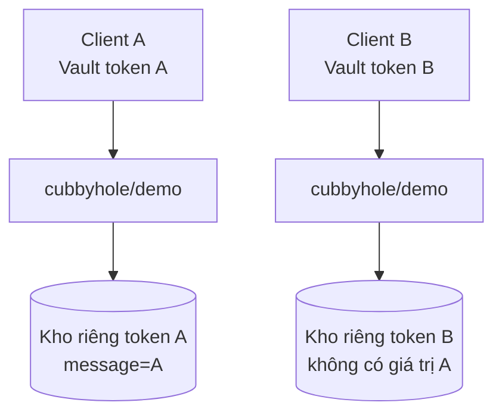
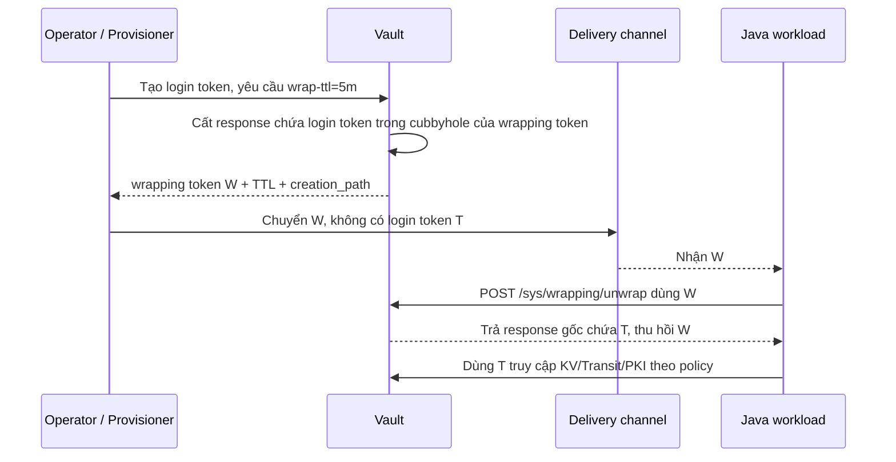
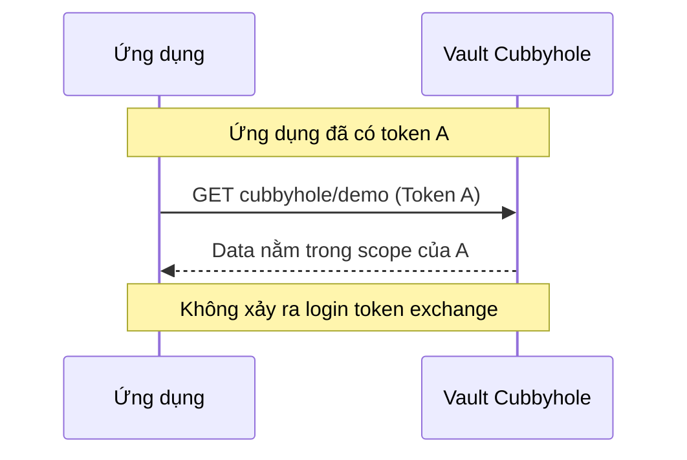
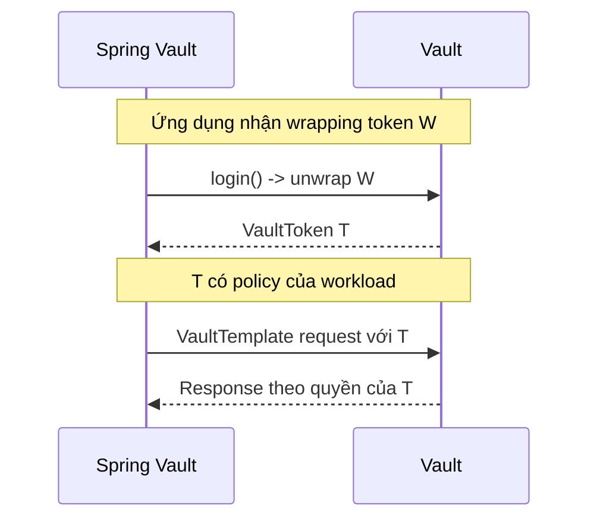

# Phân biệt Cubbyhole secrets engine với CubbyholeAuthentication

Trong HashiCorp Vault, từ **Cubbyhole** xuất hiện ở hai vị trí có liên quan nhưng không đồng nghĩa: **Cubbyhole secrets engine** là một vùng lưu trữ dữ liệu riêng cho từng Vault token; còn **`CubbyholeAuthentication`** là một triển khai `ClientAuthentication` của **Spring Vault**, dùng một token ban đầu để lấy về token đăng nhập mà ứng dụng Java sẽ sử dụng. Response wrapping thường kết nối hai khái niệm này.

Việc phân biệt đúng rất quan trọng khi thiết kế quy trình **đưa thông tin đăng nhập ban đầu vào một workload** (secure introduction), kiểm soát thời gian sống của token, xác thực ứng dụng qua `VaultTemplate` và ngăn lộ token lúc triển khai. Bài thuộc chương **Cubbyhole và wrapping** của module `SPRING_VAULT`, tập trung vào cách đọc sơ đồ luồng, thực hành Vault CLI, cấu hình Spring Vault và nhận diện lỗi vận hành.

## 1. Ba khái niệm thường bị gọi chung là Cubbyhole

| Khái niệm | Bản chất | Ai cung cấp? | Mục đích chính |
|---|---|---|---|
| **Cubbyhole secrets engine** | Secrets engine lưu dữ liệu theo namespace của **chính token gọi** | HashiCorp Vault server | Lưu/đọc dữ liệu tạm gắn với vòng đời token |
| **Response wrapping** | Cơ chế Vault bọc **phản hồi API** vào cubbyhole của một wrapping token dùng một lần | HashiCorp Vault server/API | Chuyển giao bí mật qua bên trung gian, có TTL và phát hiện unwrap sớm |
| **`CubbyholeAuthentication`** | Lớp triển khai `ClientAuthentication` để lấy **login token** từ wrapping token hoặc từ một cubbyhole path | Thư viện Spring Vault trong Java | Cung cấp `VaultToken` cho các request Vault tiếp theo |

**Không có một Vault authentication mount riêng tên `cubbyhole`.** Cubbyhole là **secrets engine**, trong khi `CubbyholeAuthentication` của Spring Vault dùng những Vault primitive có sẵn (chủ yếu là token và wrapping) để thực hiện bước lấy credentials ban đầu.

So sánh nhanh theo câu hỏi:

- **"Secret nằm ở đâu?"** → `cubbyhole/…` nói tới vùng lưu trữ do Vault quản lý, có scope theo token.
- **"Làm sao phát token mà bên trung gian không nhìn thấy token thật?"** → dùng response wrapping, trao wrapping token ngắn hạn cho người nhận.
- **"Đối tượng Java nào biến wrapping token thành token làm việc của `VaultTemplate`?"** → `CubbyholeAuthentication`, cùng với session manager được cấu hình cho Spring Vault.

## 2. Cubbyhole secrets engine hoạt động như thế nào?

### 2.1. Vùng riêng của từng Vault token

Vault mặc định mount Cubbyhole tại `cubbyhole/`. Engine này được bật sẵn, không cần (và không thể) tạo thêm mount thứ hai, di chuyển hoặc disable theo cách thông thường.

Xét hai token khác nhau:

```text
Token A:
  cubbyhole/demo = { "message": "chỉ token A đọc" }

Token B:
  cubbyhole/demo = (chưa có dữ liệu)
```

Dù cùng gọi API path `cubbyhole/demo`, Token B **không thấy** dữ liệu mà Token A đã ghi. Vault định tuyến dữ liệu Cubbyhole dựa trên **identity token hiện tại**, nên phân tách được giữ ngay ở secrets engine, độc lập với việc hai người dùng có biết cùng tên đường dẫn hay không.



Cubbyhole phù hợp với dữ liệu ngắn hạn gắn với token, không phải kho bí mật dùng chung giữa nhiều service như một KV mount thông thường. Một số thuộc tính cần nhớ:

1. **Token scoping:** một token không đọc được cubbyhole của token khác, kể cả cùng secret path.
2. **Vòng đời dữ liệu:** khi token hết hiệu lực do hết hạn hoặc bị thu hồi, cubbyhole của token đó bị hủy. Dữ liệu bên trong không có lease/TTL riêng để renew từng giá trị như dynamic secrets.
3. **Ghi đè:** ghi lại cùng path thay thế giá trị trước đó; không có lịch sử version kiểu KV v2.
4. **Quyền truy cập:** token vẫn cần các Vault ACL capability thích hợp trên path Cubbyhole để đọc hoặc ghi; token scoping không tự cấp thêm quyền.
5. **Không phải chia sẻ tự động:** tạo một token thứ hai, kể cả cùng policy hoặc cùng entity đăng nhập, không làm hai token chia sẻ cùng một cubbyhole.

Điều này dẫn đến một lỗi phổ biến: operator viết `cubbyhole/token` bằng token operator, sau đó đưa một token khác cho ứng dụng và kỳ vọng nó đọc được giá trị ấy. **Nội dung đã được ghi trong cubbyhole của token operator**, nên token ứng dụng không có dữ liệu đó.

### 2.2. Thực hành tối thiểu với hai token

Ví dụ chỉ chạy trên Vault thử nghiệm với hai token riêng có policy cho phép thao tác với cubbyhole. Trong CLI, hãy mở hai terminal riêng và xác thực bằng **hai token khác nhau**.

**Terminal A:**

```bash
# Đã xác thực với Token A, có quyền read/create/update cubbyhole/demo.
vault write cubbyhole/demo message=from-A
vault read cubbyhole/demo
```

**Terminal B:**

```bash
# Đã xác thực với Token B khác Token A.
vault read cubbyhole/demo
```

Kết quả mong đợi: A đọc thấy `from-A`; B không đọc thấy nội dung của A. B có thể nhận `404` vì path rỗng trong cubbyhole của B, hoặc `403` nếu ACL của B không cho đọc; hai lỗi này cần phân biệt. Nếu B ghi cùng tên path, B chỉ sửa dữ liệu bên cubbyhole của B.

Để kiểm tra quyền, có thể dùng policy chỉ giới hạn trên path thử nghiệm:

```hcl
path "cubbyhole/demo" {
  capabilities = ["create", "read", "update", "delete"]
}
```

Không dùng kết quả thử nghiệm trên đây để suy ra token có thể truy cập dữ liệu chung ở `secret/` hoặc `transit/`. Mỗi secrets engine có path và ACL riêng.

## 3. Response wrapping sử dụng Cubbyhole như thế nào?

Trong luồng thông thường, client gọi Vault API và nhận phản hồi chứa dữ liệu nhạy cảm. Với **response wrapping**, client yêu cầu Vault tạo một **wrapping token** có TTL ngắn; Vault cất phản hồi thật vào cubbyhole tương ứng với wrapping token và **chỉ trả wrapping token** cho phía gọi.



Có ba token hoặc vai trò token **khác nhau**:

| Ký hiệu | Nghĩa | Được phép làm gì? |
|---|---|---|
| `P` — provisioner token | Token operator gọi API tạo token | Chỉ dùng trong công cụ cấp phát; không chuyển cho workload |
| `W` — wrapping token | Token tạm, dùng một lần và có wrapping TTL | Chỉ dùng unwrap để nhận phản hồi đã được bọc |
| `T` — login token | Token thật nằm bên trong phản hồi gốc | Dùng cho các request nghiệp vụ Vault sau khi được unwrap |

`W` không phải tên khác của `T`. Thông thường, **TTL của W ngắn** để giới hạn thời gian chuyển giao, còn **TTL và policy của T** được quyết định riêng lúc tạo T. Ví dụ: W có hạn 5 phút, T có hạn 1 giờ; thời gian sống T tính theo thời điểm tạo T, không tự bắt đầu lại từ lúc unwrap.

### 3.1. Ví dụ cấp một token qua response wrapping

Trước tiên, operator đã tạo policy tên `profile-reader` theo nguyên tắc quyền tối thiểu. Trong môi trường lab, operator có quyền tạo token chạy:

```bash
# Bản Vault CLI hiện đại:
vault token create \
  -policy=profile-reader \
  -ttl=1h \
  -wrap-ttl=5m
```

Phản hồi chứa **wrapping token**, `wrapping_token_ttl`, thời điểm tạo và thông tin như `wrapped_accessor`. **Token nghiệp vụ T không được in ra trực tiếp** trong phản hồi đã bọc.

Chuyển wrapping token W cho workload qua kênh giới hạn người nhận, ví dụ cơ chế inject của orchestrator/secret delivery; không ghi W vào Git, application.yml đã commit, log, URL query parameter hay message queue không được bảo vệ.

Người nhận (hoặc `CubbyholeAuthentication` trong Java) sử dụng W để unwrap:

```bash
# Thực hiện duy nhất một lần trong lab, tại phía người nhận:
vault unwrap "<wrapping-token-W>"
```

Kết quả đầu ra của `vault unwrap` **chứa token thật**, nên việc chạy thủ công có thể làm lộ T qua màn hình, terminal log hoặc lịch sử capture. Trong môi trường thực tế, ứng dụng nên nhận và xử lý kết quả trong bộ nhớ theo cơ chế an toàn.

Ở API, unwrap chuẩn là:

```http
POST /v1/sys/wrapping/unwrap
X-Vault-Token: <wrapping-token-W>
```

**Không đồng thời gửi chính W làm header token và làm trường `token` trong body.** Đây là hai cách chỉ định token khác nhau; dùng cả hai cho cùng W có thể làm token bị tiêu thụ mà không lấy được phản hồi.

### 3.2. Vì sao wrapping giúp phát hiện chuyển giao sai?

**Wrapping token chỉ dùng để unwrap một lần.** Nếu bên trung gian hoặc kẻ tấn công unwrap trước, người nhận hợp lệ sẽ không unwrap lại được. Điều này là dấu hiệu quan trọng để điều tra, không được âm thầm coi là token hết hạn bình thường.

Người nhận có thể gọi `sys/wrapping/lookup` **trước** unwrap để kiểm tra metadata không tiết lộ nội dung như `creation_path` và TTL còn lại. Nếu mong đợi một phản hồi từ `auth/token/create`, hãy so sánh chính xác đường dẫn tạo theo contract; đừng chấp nhận bất kỳ wrapping token nào chỉ vì nó còn hạn.

Luồng an toàn mẫu:

1. Nhận W thông qua kênh chuyển giao đã được xác thực, kiểm tra nguồn gửi.
2. Lookup W và xác minh `creation_path`, thời điểm tạo, TTL và nguồn phát hành theo policy.
3. Nếu hợp lệ, unwrap **một lần** và dùng T theo policy ngắn gọn.
4. Nếu lookup/unwrap thất bại hoặc `creation_path` lạ, ngừng khởi tạo và báo sự cố chuyển giao; không thử token mặc định/quản trị.
5. Hủy bản sao W sau khi hoàn tất; không giữ W như tài khoản runtime.

Response wrapping **không tự chứng minh** rằng người đã gửi W là đúng danh tính nếu kênh gửi bị đánh tráo. Metadata lookup là một lớp kiểm tra thêm, không thay thế xác thực hệ thống chuyển giao.

## 4. CubbyholeAuthentication của Spring Vault thực sự làm gì?

`CubbyholeAuthentication` nằm trong package:

```java
org.springframework.vault.authentication.CubbyholeAuthentication
```

Nó triển khai `ClientAuthentication` (và `AuthenticationStepsFactory` trong các phiên bản Spring Vault hiện hành). Phương thức chính là `login()`, trả về một `VaultToken` dùng cho các request Vault tiếp theo. Nó **không cung cấp API CRUD của Cubbyhole secrets engine** và cũng **không tạo một auth mount mới trên Vault**.

Lớp này có **hai cách lấy login token**:

| Chế độ | `initialToken` là gì? | `CubbyholeAuthentication` đọc dữ liệu ở đâu? | Đặc điểm |
|---|---|---|---|
| **Wrapped response** | W, wrapping token được cấp bởi Vault | Unwrap phản hồi tại `sys/wrapping/unwrap` | Mặc định dùng một lần, TTL ngắn, phù hợp bootstrap |
| **Stored token** | Token A có quyền đọc cubbyhole của chính A | Path cấu hình, ví dụ `cubbyhole/token` | Đọc trường `token` trong dữ liệu lưu ở Cubbyhole của A |

Trong **wrapped response**, bạn không cần tự ghi `cubbyhole/response`: Vault response wrapping tự cất phản hồi vào cubbyhole của W. Trong **stored token**, một bước provisioning có chủ đích phải ghi T vào `cubbyhole/token` **bằng đúng initial token A** trước khi app đọc.

### 4.1. Chế độ wrapped: cách tích hợp điển hình

Đầu vào của ứng dụng chỉ là W. Spring Vault đọc W từ cấu hình bootstrap an toàn và lấy T từ Vault:

```java
import java.net.URI;

import org.springframework.context.annotation.Configuration;
import org.springframework.vault.authentication.ClientAuthentication;
import org.springframework.vault.authentication.CubbyholeAuthentication;
import org.springframework.vault.authentication.CubbyholeAuthenticationOptions;
import org.springframework.vault.client.VaultEndpoint;
import org.springframework.vault.config.AbstractVaultConfiguration;
import org.springframework.vault.support.VaultToken;

@Configuration
public class WrappedVaultConfiguration extends AbstractVaultConfiguration {

    @Override
    public VaultEndpoint vaultEndpoint() {
        // Ví dụ URL; production cần TLS và kiểm tra certificate.
        return VaultEndpoint.from(
            URI.create(requiredEnv("VAULT_ADDR")));
    }

    @Override
    public ClientAuthentication clientAuthentication() {
        // Wrapping token W được inject bằng kênh bootstrap riêng.
        String initialWrappingToken = requiredEnv("VAULT_WRAPPING_TOKEN");

        CubbyholeAuthenticationOptions options =
            CubbyholeAuthenticationOptions.builder()
                .initialToken(VaultToken.of(initialWrappingToken))
                .wrapped()
                .build();

        return new CubbyholeAuthentication(options, vaultClient());
    }

    private static String requiredEnv(String key) {
        String value = System.getenv(key);
        if (value == null || value.isBlank()) {
            throw new IllegalStateException("Missing " + key);
        }
        return value;
    }
}
```

Lớp `AbstractVaultConfiguration` cung cấp các bean Spring Vault thông thường như `VaultTemplate` và session manager; `clientAuthentication()` đưa logic lấy T vào chuỗi xác thực. Mẫu dùng `vaultClient()` đúng với tài liệu Spring Vault API mới; với phiên bản Spring Vault cũ, constructor dùng `RestOperations` là biến thể tương ứng. Khi đưa vào dự án, cần dùng đúng API theo phiên bản dependency đang chạy.

**Không hardcode wrapping token vào source code.** Đoạn `System.getenv` chỉ minh họa cách đọc bootstrap input, bản thân environment variables vẫn có nguy cơ lộ qua công cụ quản lý tiến trình hoặc cấu hình container; chọn phương thức inject theo threat model. Không ghi token ra log, exception message hay Actuator endpoint.

Sau xác thực, code sử dụng `VaultTemplate` như với các authentication method khác:

```java
import java.util.Map;

import org.springframework.stereotype.Service;
import org.springframework.vault.core.VaultOperations;
import org.springframework.vault.support.Versioned;

@Service
class RuntimeVaultReader {

    private final VaultOperations vault;

    RuntimeVaultReader(VaultOperations vault) {
        this.vault = vault;
    }

    Versioned<Map<String, Object>> readKvV2(String relativePath) {
        // Runtime sử dụng T theo policy của T.
        // relativePath là đường dẫn key trong mount KV v2, không kèm data/.
        return vault.opsForVersionedKeyValue("secret")
                    .get(relativePath);
    }
}
```

Token T quyết định service được phép gọi endpoint nào; `CubbyholeAuthentication` chỉ cung cấp T, không cấp thêm quyền đọc `secret/`, `transit/`, `pki/` hay `cubbyhole/`.

### 4.2. Chế độ stored token: đọc từ cubbyhole có sẵn

Giả sử operator đã tạo token T có policy dành cho ứng dụng, sau đó tạo initial token A và đặt T vào **cubbyhole của A**. Trong phiên shell đang xác thực với A:

```bash
# Để minh họa luồng; <login-token-T> là token của workload.
# Đây là thao tác provisioning, không phải bước chạy trong ứng dụng.
vault write cubbyhole/token token="<login-token-T>"
vault read cubbyhole/token
```

Nếu `vault write` được gọi dưới token operator P thay vì A, phía ứng dụng dùng A sẽ không thể đọc giá trị; đây là lỗi rất thường gặp do hiểu nhầm Cubbyhole là KV dùng chung.

Spring Vault cấu hình như sau (đoạn thay thế phần `clientAuthentication()` ở trên):

```java
@Override
public ClientAuthentication clientAuthentication() {
    // Token A có quyền đọc path trong chính cubbyhole của A.
    String initialToken = requiredEnv("VAULT_INITIAL_TOKEN");

    CubbyholeAuthenticationOptions options =
        CubbyholeAuthenticationOptions.builder()
            .initialToken(VaultToken.of(initialToken))
            .path("cubbyhole/token")
            .build();

    return new CubbyholeAuthentication(options, vaultClient());
}
```

Chế độ này **không tự tạo một wrapping token** và thao tác đọc `cubbyhole/token` thông thường **không có bảo đảm one-time unwrap**. Token T được lưu dưới field `token` và được trả về như một giá trị secret thông thường. Nếu muốn cơ chế dùng một lần, phải dùng response wrapping thay vì suy ra thuộc tính đó từ chính tên Cubbyhole.

## 5. Tách bạch hai luồng bằng sơ đồ

### Luồng A — đọc giá trị Cubbyhole thông thường



### Luồng B — `CubbyholeAuthentication` với wrapping



Sự khác biệt nằm ở **kết quả**: luồng A lấy dữ liệu từ một secrets engine bằng token hiện có; luồng B là quá trình lấy **token mới để Spring Vault tiếp tục thực hiện các request khác**.

## 6. Token, TTL, refresh và sự cố khởi động lại

Đây là phần dễ gây lỗi production nhất, vì vòng đời Cubbyhole và vòng đời token lấy ra có thể không trùng nhau.

### 6.1. Ba mốc thời gian cần theo dõi

| Giá trị | Được quản lý bởi | Tác động khi hết hạn |
|---|---|---|
| **TTL của wrapping token W** | Vault response wrapping | Không unwrap được phản hồi; dữ liệu bọc mất theo W |
| **TTL của login token T** | Vault token store / auth role | Request dùng T bị từ chối; cần renewal hoặc login mới |
| **Lifetime của Cubbyhole trên initial token A** | Vòng đời A | Dữ liệu lưu `cubbyhole/token` trong scope A bị mất khi A hết hiệu lực |

Ví dụ W có 5 phút, T có 1 giờ. Ứng dụng unwrap W sau 4 phút không có nghĩa T sẽ còn đủ 1 giờ: T có thể đã mất 4 phút TTL. Spring Vault có cơ chế `self lookup` để tìm TTL còn lại và renewability của token lấy được khi cần; các quyền/policy của token và cấu hình session manager quyết định liệu việc lookup/renew có thành công.

`LifecycleAwareSessionManager` của Spring Vault có thể quản lý token hiện tại và cố gắng renew trong giới hạn TTL/renewable. Tuy nhiên, **W đã unwrap không thể dùng để login lại**. Nếu JVM restart, session hết khả năng renew, hoặc login cần thực hiện lại sau khi token T không còn hiệu lực, phải có quy trình **cấp W mới hoặc phương thức xác thực khác**. Giữ lại chuỗi W cũ trong môi trường deployment không tạo ra bootstrap credential có thể tái sử dụng.

### 6.2. Không lẫn lộn token được renew với wrapping token

- **Renew T:** nếu token T cho phép renewal, Vault có thể kéo dài thời hạn T trong giới hạn quy định. Đây là hoạt động session runtime.
- **Unwrap W:** dùng W một lần để nhận T từ phản hồi. Không thể renew W như một cơ chế đăng nhập liên tục.
- **Revoke T:** làm T mất hiệu lực và ảnh hưởng tới các request đang dùng T.
- **Revoke/expire A:** khiến cubbyhole của A bị loại bỏ; không có nghĩa T nhất thiết bị revoke theo A nếu T được tạo độc lập. Quan hệ parent/child token, nếu có, được quản lý riêng bởi Vault token hierarchy.

Khi thiết kế bootstrap lâu dài trên Kubernetes/cloud, cân nhắc dùng Kubernetes, AppRole, JWT, AWS hoặc các authentication method hỗ trợ nhận diện workload trực tiếp. Response wrapping đặc biệt hữu ích khi cần phân phối **một secret/token ban đầu** qua một kênh giao nhận trung gian và kiểm soát được one-time use.

## 7. Tình huống chọn công cụ đúng

| Nhu cầu | Nên dùng | Vì sao |
|---|---|---|
| Một token cần lưu mẩu dữ liệu tạm chỉ chính nó đọc | Cubbyhole secrets engine | Scope theo token và bị hủy khi token hết hiệu lực |
| Hai service cần đọc chung cấu hình lâu dài | KV secrets engine với ACL | Cubbyhole của hai token không chia sẻ dữ liệu |
| Chuyển giao login token cho service mới mà không lộ token T cho bên chuyển tiếp | Vault response wrapping | Trả W có TTL và một lượt unwrap |
| Spring Vault cần nhận W rồi bootstrap token sử dụng cho `VaultTemplate` | `CubbyholeAuthentication` ở chế độ `wrapped()` | Tự thực hiện bước nhận T từ wrapping response |
| Spring Vault đã có A và T được lưu sẵn dưới `cubbyhole/token` của A | `CubbyholeAuthentication` ở chế độ `path(...)` | Lấy T từ cubbyhole của A |
| Service cần tự đăng nhập lại mỗi lần restart mà không được cung cấp W mới | Auth method theo workload phù hợp | Wrapping token W là credential dùng một lần |
| Cần xác minh quyền đọc một KV key | Policy của login token T | `CubbyholeAuthentication` không vượt được policy |

**Trường hợp sai điển hình:** dùng `CubbyholeAuthentication` chỉ vì ứng dụng muốn thao tác `cubbyhole/demo`. Nếu ứng dụng đã có token hợp lệ và chỉ cần CRUD Cubbyhole, có thể dùng Vault client cùng token đó. Không cần phải tạo luồng lấy login token thứ hai.

## 8. Lỗi phổ biến và cách xử lý

| Biểu hiện | Nguyên nhân khả dĩ | Cách điều tra/xử lý |
|---|---|---|
| `vault read cubbyhole/token` không thấy dữ liệu | Giá trị đã được ghi bằng token khác | Xác minh identity/token dùng khi write và read; ghi lại đúng với A nếu là lab |
| `403 permission denied` | Policy của A thiếu quyền cubbyhole hoặc T thiếu quyền nghiệp vụ | Kiểm tra effective policy và API path; không suy ra chỉ từ tên class |
| `404` ở `cubbyhole/token` | Chưa ghi key trong scope A hoặc A vừa thay đổi | So khớp provisioning token và initial token |
| `sys/wrapping/unwrap` thất bại | W đã hết TTL, đã bị unwrap hoặc không đúng token | Dừng bootstrap, kiểm tra lookup/audit và quy trình giao token |
| App restart không đăng nhập lại được | Vẫn dùng W đã tiêu thụ | Cấp W mới khi bootstrap hoặc đổi sang auth method phù hợp |
| Wrapper trả phản hồi không phải login token | Operator đã wrap nhầm API, ví dụ `kv get` | Xác minh `creation_path` và nội dung dự kiến khi provisioning |
| T có quyền root rộng ngoài ý muốn | Provisioner tạo T với policy quá mức | Tạo T từ role/policy hạn chế; kiểm tra effective policies |
| Token T vừa unwrap đã gần hết TTL | T được tạo từ trước; thời gian chuyển giao dài | Tối ưu thời gian cấp/giao, lookup TTL và điều chỉnh TTL theo chính sách |
| Log bị lộ token | CLI stdout, env dump, HTTP debug/trace hoặc exception body | Redact, ngăn log body, bảo vệ terminal/secret delivery; revoke token bị lộ |

**Không phân loại thất bại unwrap thành "sai password" rồi retry liên tục với cùng W.** Vì W chỉ có một lượt sử dụng, retry sau lỗi mạng không chắc an toàn: server có thể đã tiêu thụ W trước khi client nhận được phản hồi. Cần có cơ chế xác minh sự kiện và cấp lại W trong quy trình provisioning, cùng kiểm soát idempotency ở phía cấp phát.

### Giám sát và audit

Nên theo dõi: tỷ lệ login thành công/thất bại, nguyên nhân HTTP `403`/`404`, wrapping token hết hạn, thời gian bootstrap, token renewal failure và số lần unwrap bất thường. Audit log cần bảo vệ và lọc thông tin nhạy cảm; không ghi bản rõ W, T hoặc phản hồi token vào application log. Khi có token không unwrap được trong thời gian còn hạn, kiểm tra dấu hiệu đã bị dùng trước thay vì bỏ qua.

## 9. Bài kiểm thử tích hợp có thể lặp lại

Thực hiện trên Vault thử nghiệm với các token chỉ có quyền cần thiết. Không sử dụng root token hoặc token production làm dữ liệu bài lab. Với phần Spring Vault, tạo một ứng dụng thử nghiệm sử dụng `CubbyholeAuthentication` và một KV key giả.

1. **Cách ly Cubbyhole:** tạo token A và B khác nhau, ghi `cubbyhole/demo` bằng A; đọc bằng A thấy dữ liệu, đọc bằng B không thấy dữ liệu A.
2. **Tạo W:** provision token T có policy chỉ đọc KV key thử nghiệm và yêu cầu response wrapping TTL 5 phút; xác minh CLI chỉ trả W, không trả T.
3. **Kiểm tra trước unwrap:** gọi wrapping lookup (nếu có quyền) và so khớp `creation_path` với API tạo T, TTL còn hạn.
4. **Spring bootstrap:** cấp W cho cấu hình `.wrapped()`, khởi động service và kiểm tra `VaultTemplate` đọc được đúng key được phép bởi T.
5. **Quyền giới hạn:** cùng token T thử đọc một path KV khác không được cấp ACL; Vault phải từ chối.
6. **One-time use:** cố gắng unwrap W lần thứ hai; phải thất bại. Không đưa T vào log khi thực hiện bước này.
7. **TTL:** tạo W TTL ngắn trong môi trường kiểm thử, chờ token hết hạn, rồi xác minh bootstrap không thể dùng W cũ.
8. **Stored token:** viết trường `token` chứa T vào `cubbyhole/token` dưới token A, cấu hình `.path("cubbyhole/token")` và xác minh login lấy được T.
9. **Wrong token:** tạo A2, cấu hình A2 trong khi dữ liệu nằm trong cubbyhole của A; login phải thất bại vì không thể đọc dữ liệu của A.
10. **Restart:** sau khi W dùng xong, restart service chỉ với W cũ; ghi nhận không thể unwrap lại. Kiểm tra quy trình cấp W mới hoặc chuyển auth method cho restart.

Kết quả PASS phải xác minh **hai tầng**: (1) Cubbyhole phân tách theo token và wrapping hoạt động một lần; (2) login token T chỉ có quyền làm những việc mà policy cấp, kể cả khi `VaultTemplate` đã được khởi tạo thành công.

## 10. Câu hỏi tự kiểm tra

1. Vì sao hai token cùng gọi `cubbyhole/token` có thể nhận hai kết quả khác nhau, dù không có tenant id trong URL?
2. Cubbyhole secrets engine có tự cung cấp một phương thức login/auth mới trên Vault server không?
3. Khi operator tạo token T với `-wrap-ttl=5m`, điều gì được trả về cho operator? T hay W?
4. `CubbyholeAuthenticationOptions.builder().wrapped()` khác gì với `.path("cubbyhole/token")`?
5. Nếu một wrapping token bị unwrap trước khi đến ứng dụng hợp lệ, tín hiệu nào giúp phát hiện chuyển giao có thể đã bị can thiệp?
6. Khi `LifecycleAwareSessionManager` renew T thành công, điều đó có làm W đã sử dụng trở thành hợp lệ lại không?
7. Tại sao ứng dụng có thể bootstrap thành công nhưng vẫn bị `403` khi gọi Transit hoặc KV?
8. Trường hợp nào nên chọn auth method theo Kubernetes/AppRole thay vì sử dụng mãi một wrapping token ban đầu?

**Điểm cần nhớ:** **Cubbyhole secrets engine** giải quyết bài toán *vùng dữ liệu riêng theo token*; **response wrapping** giải quyết bài toán *chuyển giao một phản hồi bí mật có thời hạn và chỉ mở một lần*; **Spring Vault `CubbyholeAuthentication`** giải quyết bài toán *lấy login token từ một trong những cơ chế đó để ứng dụng truy cập Vault theo policy*. Hiểu đúng phạm vi và vòng đời của từng đối tượng sẽ tránh lỗi chia sẻ nhầm token, dùng lại wrapping token và vô tình cấp quyền quá rộng.

## Tài liệu chính thức để học thêm

- [HashiCorp Vault — Cubbyhole secrets engine](https://developer.hashicorp.com/vault/docs/secrets/cubbyhole)
- [HashiCorp Vault — Response wrapping](https://developer.hashicorp.com/vault/docs/concepts/response-wrapping)
- [HashiCorp Vault — Unwrap CLI command](https://developer.hashicorp.com/vault/docs/commands/unwrap)
- [HashiCorp Vault — Wrapping unwrap HTTP API](https://developer.hashicorp.com/vault/api-docs/system/wrapping-unwrap)
- [Spring Vault — Authentication methods (Cubbyhole authentication)](https://docs.spring.io/spring-vault/reference/vault/authentication.html)
- [Spring Vault — CubbyholeAuthentication API](https://docs.spring.io/spring-vault/reference/api/java/org/springframework/vault/authentication/CubbyholeAuthentication.html)
- [Spring Vault — CubbyholeAuthenticationOptions API](https://docs.spring.io/spring-vault/reference/api/java/org/springframework/vault/authentication/CubbyholeAuthenticationOptions.html)
- [Spring Vault — AbstractVaultConfiguration API](https://docs.spring.io/spring-vault/reference/api/java/org/springframework/vault/config/AbstractVaultConfiguration.html)
