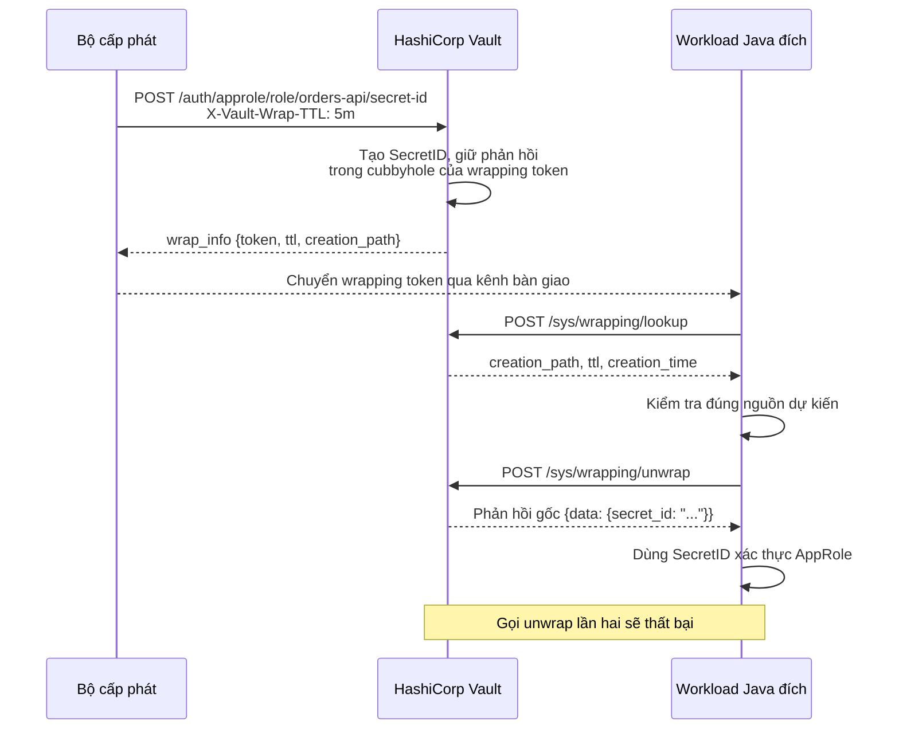
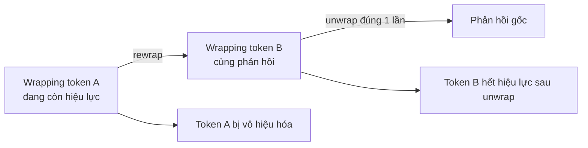

# Response wrapping và token dùng để nhận phản hồi

**Chương:** Cubbyhole và wrapping  
**Module:** SPRING_VAULT

## 1. Vì sao cần response wrapping?

Khi triển khai một ứng dụng Java sử dụng **Spring Vault**, khó khăn không chỉ là đọc secret từ **HashiCorp Vault** mà còn là **chuyển secret đến đúng workload lần đầu một cách an toàn**. Ví dụ, một hệ thống triển khai cần chuyển **AppRole SecretID** cho một instance ứng dụng mới. Nếu người cấp phát ghi SecretID trực tiếp vào CI log, file cấu hình dùng chung, hàng đợi hoặc tin nhắn, bên trung gian có thể đọc secret trước khi ứng dụng nhận.

**Response wrapping** giúp thay đổi cách bàn giao. Khi client yêu cầu Vault *wrap* một phản hồi, Vault giữ phản hồi gốc trong **cubbyhole của một wrapping token có thời hạn**, rồi trả về **wrapping token** cho bên yêu cầu. Người triển khai chuyển token này cho workload đích. Workload dùng token để **unwrap đúng một lần** và nhận phản hồi gốc.

Cơ chế này không tự thay thế TLS, chính sách ACL, quản lý vòng đời của secret hay xác thực workload. Nó cung cấp một lớp bảo vệ cho giai đoạn **bàn giao phản hồi**: secret không đi thẳng qua đường trung gian, token có TTL ngắn, và việc đã tiêu thụ token có thể được phát hiện khi kiểm tra.

Trong chương **Cubbyhole và wrapping**, bài học này tập trung vào **response wrapping và token dùng để nhận phản hồi**; các ví dụ đặt trong hệ sinh thái SPRING_VAULT, nơi ứng dụng Java truy cập Vault qua `VaultTemplate` / `VaultOperations`, dùng xác thực theo workload và policy để làm việc với KV secrets, token/lease, Transit encryption hoặc PKI.

**Mục tiêu học tập:**

1. Hiểu vì sao wrapping token là một **bearer token ngắn hạn, dùng một lần**, khác với token truy cập Vault thông thường.
2. Giải thích vai trò cubbyhole, `X-Vault-Wrap-TTL`, `wrap_info` và `creation_path`.
3. Sử dụng đúng `lookup`, `unwrap` và `rewrap` cùng giới hạn của từng thao tác.
4. Thực hành Vault CLI/HTTP và `VaultWrappingOperations` trong Spring Vault.
5. Thiết kế luồng giao AppRole SecretID, xác minh nguồn gốc và xử lý trường hợp token hết hạn hoặc bị tiêu thụ trước.

## 2. Ba thành phần của một phản hồi được wrap

| Thành phần | Là gì? | Ai nhìn thấy? | Vòng đời |
| --- | --- | --- | --- |
| **Phản hồi gốc** | Nội dung mà API Vault định trả, ví dụ `data.secret_id` hoặc `auth.client_token` | Ban đầu được Vault giữ trong cubbyhole của wrapping token; chỉ bên unwrap thành công nhận | Được trả lại sau unwrap; tuổi thọ *secret bên trong* có quy tắc riêng |
| **Wrapping token** | Token Vault đặc biệt, cho phép nhận đúng phản hồi đang được wrap | Bên yêu cầu và bên nhận token qua kênh bàn giao | Có TTL, dùng **một lần** để unwrap; sau đó không thể unwrap lại |
| **Thông tin `wrap_info`** | Metadata như token, TTL, thời điểm tạo, `creation_path` | Có trong phản hồi wrapping và có thể kiểm tra bằng lookup | Dùng để đối chiếu nguồn/tuổi token, không tiết lộ phản hồi gốc |

Vault hoạt động theo trình tự sau:

1. Client gọi một endpoint Vault hợp lệ và yêu cầu `X-Vault-Wrap-TTL`, ví dụ `5m`.
2. Vault xử lý thao tác gốc, tạo phản hồi như bình thường.
3. Vault tuần tự hóa phản hồi và lưu trong **cubbyhole riêng gắn với wrapping token mới**.
4. Vault chỉ gửi `wrap_info` chứa wrapping token và metadata thay cho secret gốc.
5. Người nhận cầm wrapping token, kiểm tra nguồn gốc/TTL rồi gọi `sys/wrapping/unwrap`.
6. Vault trả **phản hồi HTTP gốc** và làm token không thể sử dụng lại.



**Điểm cốt lõi:** wrapping không đơn thuần là Base64 hoặc mã hóa secret vào một token tự chứa. Vault giữ **nội dung gốc ở phía server**, còn wrapping token là năng lực truy cập vào dữ liệu đang được giữ. Người đánh cắp token hợp lệ có thể dùng nó trước người nhận; do đó vẫn cần TLS, kênh bàn giao an toàn, TTL ngắn và kiểm tra một lần.

## 3. Cubbyhole liên quan gì đến wrapping?

**Cubbyhole** là secrets engine đặc biệt cung cấp không gian lưu trữ riêng theo **Vault token**. Không gian của token A tách biệt với không gian của token B. Người dùng token B không thể chỉ dựa vào quyền đọc một path để nhìn thấy cubbyhole của token A.

Trong response wrapping, Vault sử dụng **cubbyhole của wrapping token** để giữ phản hồi đã serialize. Bạn không cần tự tạo một bản ghi ở `cubbyhole/response`. Cơ chế `sys/wrapping/unwrap` là cách chính thức để lấy và kiểm tra phản hồi.

> Đọc trực tiếp `cubbyhole/response` để “mở” wrapped response là cách cũ không nên dùng; endpoint unwrap thực hiện các bước kiểm tra bổ sung, trả đúng cấu trúc phản hồi gốc và hỗ trợ audit.

Vẫn cần phân biệt **cubbyhole của token thông thường** với **cubbyhole của wrapping token**. Cubbyhole của token Vault thông thường có thể dùng để lưu dữ liệu riêng của phiên token theo ACL; response wrapping sử dụng một wrapping token có mục đích hẹp để lấy phản hồi một lần.

## 4. Wrapping token khác token thông thường, SecretID và lease ra sao?

| Đối tượng | Mục đích chính | Có thể làm gì? | Không nên nhầm với |
| --- | --- | --- | --- |
| **Wrapping token** | Bàn giao một phản hồi đang bị wrap | Lookup metadata, unwrap một lần; rewrap theo quyền/cơ chế hợp lệ | Token đăng nhập Vault dùng thường xuyên |
| **Vault client token** | Xác thực phiên và cấp quyền theo policy | Gọi các endpoint phù hợp ACL; có thể renewable theo loại token | Wrapping token chỉ để nhận phản hồi |
| **AppRole SecretID** | Một yếu tố xác thực AppRole cùng RoleID | Dùng khi login AppRole theo giới hạn SecretID | Wrapping token chứa phản hồi cấp SecretID |
| **Vault lease** | Đại diện vòng đời của secret động theo secrets engine | Renew/revoke lease nếu secret/backend hỗ trợ | TTL của wrapping token |
| **Giá trị secret bên trong** | Ví dụ mật khẩu DB, cert/private key, SecretID | Sử dụng theo hợp đồng của secret sau unwrap | TTL còn lại của wrapping token |

Hai chiếc “đồng hồ” độc lập:

- **Wrapping TTL:** khoảng thời gian wrapping token còn hợp lệ để nhận phản hồi. Ví dụ `5m`.
- **Secret/token TTL hoặc hạn sử dụng bên trong:** do backend/auth method cấp và policy riêng chi phối. Unwrap **không tự gia hạn** thời hạn của token/secret gốc, và wrapping TTL không bảo đảm secret bên trong còn dùng được.

Ví dụ, wrapping token tồn tại tối đa 5 phút không có nghĩa AppRole SecretID có TTL 5 phút. SecretID có `secret_id_ttl` và `secret_id_num_uses` theo cấu hình AppRole; kiểm tra các giá trị đó khi thiết kế bootstrap. Tương tự, một token đăng nhập Vault được wrap vẫn có vòng đời của chính token đăng nhập sau khi được cấp.

## 5. Yêu cầu wrap một phản hồi qua HTTP và CLI

Response wrapping là **từng request**. Với HTTP API, client truyền header:

```http
X-Vault-Wrap-TTL: 5m
```

Vault chấp nhận số giây hoặc đơn vị thời lượng như `30s`, `5m`, `1h`; tổ chức có thể hạn chế TTL tối thiểu/tối đa qua policy và cấu hình.

### 5.1. Yêu cầu cấp AppRole SecretID dưới dạng wrapped response

Ví dụ này giả định AppRole `orders-api` đã tồn tại tại auth mount `approle` và token của bên cấp phát có quyền sinh SecretID.

```bash
vault write -wrap-ttl=5m -f auth/approle/role/orders-api/secret-id
```

Lệnh minh họa này cần Vault CLI được xác thực đúng. Bên cấp phát sẽ nhận thông tin tương tự:

```text
Key                              Value
---                              -----
wrapping_token:                  <WRAPPING_TOKEN>
wrapping_accessor:               <ACCESSOR>
wrapping_token_ttl:              5m
wrapping_token_creation_time:    <CREATION_TIME>
wrapping_token_creation_path:    auth/approle/role/orders-api/secret-id
```

`<WRAPPING_TOKEN>` là **placeholder**, không phải token thật. Phản hồi wrapping **không hiển thị SecretID gốc**. Giá trị thực của token phải được chuyển đến workload đích bằng kênh an toàn, có kiểm soát truy cập. Hạn chế tối đa số người hoặc hệ thống trung gian được nhìn thấy token đó.

### 5.2. HTTP request và `wrap_info`

```http
POST /v1/auth/approle/role/orders-api/secret-id HTTP/1.1
Host: vault.example.internal
X-Vault-Token: <ISSUER_VAULT_TOKEN>
X-Vault-Wrap-TTL: 5m
Content-Type: application/json

{}
```

Phản hồi rút gọn (đã thay token thật bằng placeholder):

```json
{
  "request_id": "example-request-id",
  "data": null,
  "wrap_info": {
    "token": "<WRAPPING_TOKEN>",
    "ttl": 300,
    "creation_time": "2026-11-25T09:00:00Z",
    "creation_path": "auth/approle/role/orders-api/secret-id"
  }
}
```

Một số response có thể có trường `wrapped_accessor` nếu đối tượng được wrap là một phản hồi **xác thực phát token**; không mặc định rằng mọi wrapped response đều có trường này. Giá trị `creation_path` quan trọng vì nó cho biết request nào đã tạo **phản hồi đang được wrap**, khác với path `sys/wrapping/unwrap` mà người nhận sẽ gọi sau.

Nếu `X-Vault-Wrap-TTL` không được chấp nhận, backend/endpoint không hỗ trợ hoặc request bị từ chối, không tiếp tục luồng với giả định rằng secret đã được wrap. Bên phát và bên nhận cần phát hiện tình trạng **mong đợi wrapping nhưng không có `wrap_info.token`**.

## 6. Lookup: kiểm tra token trước khi unwrap

**Lookup** đọc metadata của wrapping token nhưng **không mở secret** và **không tiêu thụ token**. Đây là bước giúp bên nhận phát hiện token hết hạn/đã bị dùng hoặc token được tạo từ API path không mong đợi.

Với HTTP:

```http
POST /v1/sys/wrapping/lookup HTTP/1.1
Host: vault.example.internal
X-Vault-Token: <WRAPPING_TOKEN>
Content-Type: application/json

{}
```

Phản hồi minh họa:

```json
{
  "data": {
    "creation_time": "2026-11-25T09:00:00Z",
    "creation_path": "auth/approle/role/orders-api/secret-id",
    "creation_ttl": 300,
    "ttl": 240
  }
}
```

Số liệu chỉ là ví dụ. Thời lượng còn lại giảm dần theo thời gian; không giả định `ttl` luôn bằng `creation_ttl`.

Khi nhận token để lấy SecretID, workload nên:

1. **Xác minh đã nhận token** qua kênh mong đợi và đường kết nối đến Vault đáng tin cậy.
2. **Lookup và kiểm tra token còn hợp lệ** (không phải `null`/lỗi) và chưa bị unwrap trước đó.
3. **Đối chiếu `creation_path` chính xác** với `auth/approle/role/orders-api/secret-id`, không chỉ so prefix `auth/approle`.
4. **Kiểm tra thời điểm tạo/TTL** với cửa sổ bootstrap mong đợi để tránh chấp nhận token cũ bất thường.
5. **Unwrap một lần**, xử lý phản hồi và bảo vệ secret sau unwrap.

Nếu token bất ngờ không tồn tại, không kết luận chắc chắn bị tấn công: cũng có thể đã hết TTL, bị thu hồi hoặc bị tiêu thụ bởi một luồng xử lý hợp lệ trước đó. Tuy nhiên, sự kiện này cần được **điều tra với Vault audit log** thay vì tự động ghi lại token, bỏ qua lỗi hay retry unwrap nhiều lần.

### Vì sao phải kiểm tra chính xác creation_path?

Nếu một bên trung gian tự **wrap** dữ liệu do họ tự dựng, token mới vẫn có thể lookup và unwrap hợp lệ nhưng **không chứng minh dữ liệu do endpoint mong đợi tạo ra**. Khi dùng endpoint `sys/wrapping/wrap`, `creation_path` thường là `sys/wrapping/wrap`, không phải `auth/approle/role/orders-api/secret-id`. Kiểm tra đường dẫn có tác dụng phát hiện dạng đánh tráo này.

Đây không phải chứng minh chữ ký số của payload theo nghĩa độc lập; cần bảo vệ kết nối TLS đến đúng Vault server và chính sách truy cập hệ thống phát hành.

## 7. Unwrap: dùng token để nhận phản hồi gốc đúng một lần

**Unwrap** thực hiện ở endpoint `POST /v1/sys/wrapping/unwrap`. Có hai cách gửi token, nhưng **chỉ chọn một cách cho mỗi request**.

### Cách A — Wrapping token trong header

```http
POST /v1/sys/wrapping/unwrap HTTP/1.1
Host: vault.example.internal
X-Vault-Token: <WRAPPING_TOKEN>
Content-Type: application/json

{}
```

Khi wrapping token được gửi ở `X-Vault-Token`, **không** đồng thời đưa chính token đó vào field `token` của JSON.

### Cách B — Client token khác, wrapping token trong body

Một client đang xác thực bằng Vault token khác có **quyền gọi endpoint unwrap** có thể truyền wrapping token trong body:

```http
POST /v1/sys/wrapping/unwrap HTTP/1.1
Host: vault.example.internal
X-Vault-Token: <AUTHENTICATED_CLIENT_TOKEN>
Content-Type: application/json

{
  "token": "<WRAPPING_TOKEN>"
}
```

**Tránh dùng cùng wrapping token ở cả header và JSON body:** Vault tài liệu hóa rằng điều này có thể khiến token bị thu hồi nhưng phản hồi gốc không được lấy ra vì đã bị sử dụng hai lần trong cùng request.

Với AppRole SecretID, phản hồi unwrap thành công có thể tương tự:

```json
{
  "request_id": "example-original-request",
  "data": {
    "secret_id": "<APPROLE_SECRET_ID>",
    "secret_id_accessor": "<SECRET_ID_ACCESSOR>",
    "secret_id_ttl": 3600,
    "secret_id_num_uses": 1
  }
}
```

Đây là **phản hồi của API tạo SecretID**, không phải một JSON chỉ chứa chuỗi SecretID. Field `secret_id_ttl` và `secret_id_num_uses` phụ thuộc cấu hình AppRole, không phải giá trị bắt buộc của mọi response. Khi thành công, wrapping token **đã bị tiêu thụ**: không thể gọi unwrap lần thứ hai để lấy lại secret.

### Vì sao không retry unwrap một cách mù quáng?

Nếu phía client gặp timeout sau khi Vault đã xử lý thành công, client có thể **không biết** token đã tiêu thụ hay chưa. Gọi lại không nhất thiết trả cùng dữ liệu; vì vậy, thiết kế cần có cơ chế điều phối/đánh dấu bootstrap, ghi nhận tình trạng nhận secret ở phía đích và cấp **wrapped response mới** khi cần phục hồi. Không lưu secret thô vào log để phục vụ retry.

## 8. Rewrap: cấp token mới mà không lộ nội dung

`POST /v1/sys/wrapping/rewrap` dùng **wrapping token cũ** làm đầu vào, tạo **wrapping token mới** mang cùng phản hồi mà không trả secret gốc cho client. Token cũ bị vô hiệu hóa.

```http
POST /v1/sys/wrapping/rewrap HTTP/1.1
Host: vault.example.internal
X-Vault-Token: <AUTHENTICATED_CLIENT_TOKEN>
Content-Type: application/json

{
  "token": "<OLD_WRAPPING_TOKEN>"
}
```

Sau khi rewrap thành công, `wrap_info.token` trong phản hồi là **token mới**. Tài liệu Vault nêu TTL của token mới sử dụng **creation TTL ban đầu**, nghĩa là rewrap có thể làm mới cửa sổ TTL, chứ không đơn thuần bảo toàn thời gian còn lại. Phải kiểm soát quyền và tần suất rewrap để không kéo dài việc phơi lộ khả năng nhận secret vượt quá mục tiêu vận hành.



**Lookup** không làm mất token. **Unwrap** làm lộ phản hồi cho người gọi và tiêu thụ token. **Rewrap** không lộ phản hồi nhưng thu hồi token cũ, tạo token mới. Sự khác biệt này quyết định việc bạn có thể hay không thể lặp thao tác khi xử lý lỗi.

## 9. Spring Vault: VaultWrappingOperations

Spring Vault cung cấp giao diện `org.springframework.vault.core.VaultWrappingOperations`, có từ Spring Vault 2.1 và có thể lấy qua `VaultOperations.opsForWrapping()`. Khi ứng dụng đã cấu hình `VaultTemplate`, xác thực workload và kết nối TLS đến Vault, ta có thể dùng trực tiếp các phương thức sau:

| Phương thức | Kết quả | Có tiêu thụ token cũ? |
| --- | --- | --- |
| `lookup(VaultToken token)` | `WrappedMetadata` hoặc `null` nếu token không hợp lệ/hết hạn | **Không** |
| `read(VaultToken token)` | `VaultResponse` hoặc `null`; thực hiện unwrap | **Có khi unwrap thành công** |
| `read(VaultToken token, Class<T> responseType)` | `VaultResponseSupport<T>` hoặc `null`; giải ánh xạ response theo kiểu | **Có khi unwrap thành công** |
| `rewrap(VaultToken token)` | `WrappedMetadata` của token mới | **Có: token cũ bị vô hiệu hóa** |
| `wrap(Object body, Duration ttl)` | `WrappedMetadata` của dữ liệu tự cung cấp | Tạo token mới, không có token cũ để tiêu thụ |

**Hai kiểu wrap cần phân biệt:**

- **Wrap phản hồi gốc của một endpoint Vault** bằng header `X-Vault-Wrap-TTL` trên chính request, ví dụ `POST auth/approle/role/orders-api/secret-id`. Khi đó `creation_path` phản ánh đúng API gốc.
- **`VaultWrappingOperations.wrap(body, ttl)`** gọi tiện ích wrapping của Vault để wrap **dữ liệu do client cung cấp**. Đây là lựa chọn hữu ích để thực hành nhưng path nguồn là `sys/wrapping/wrap`; **không tương đương việc chứng minh SecretID được Vault phát hành bởi endpoint AppRole**.

### 9.1. Ví dụ: wrap, lookup và unwrap dữ liệu demo

Đoạn mã dưới đây giả định ứng dụng đã có `VaultOperations` được cấu hình cho môi trường thử nghiệm. Dữ liệu ví dụ không chứa secret thật.

```java
import java.time.Duration;
import java.util.Map;
import java.util.Objects;

import org.springframework.stereotype.Service;
import org.springframework.vault.core.VaultOperations;
import org.springframework.vault.core.VaultWrappingOperations;
import org.springframework.vault.support.VaultResponse;
import org.springframework.vault.support.VaultToken;
import org.springframework.vault.support.WrappedMetadata;

@Service
public class WrappingDemoService {

    private final VaultWrappingOperations wrapping;

    public WrappingDemoService(VaultOperations vaultOperations) {
        this.wrapping = vaultOperations.opsForWrapping();
    }

    public Map<String, Object> roundTripDemo() {
        WrappedMetadata issued = wrapping.wrap(
            Map.of("purpose", "demo", "code", "example-only"),
            Duration.ofMinutes(5));

        VaultToken token = issued.getToken();
        // Không log token, không serialize token vào exception.

        WrappedMetadata metadata = wrapping.lookup(token);
        if (metadata == null) {
            throw new IllegalStateException(
                "Wrapped response expired or token invalid");
        }

        if (!Objects.equals("sys/wrapping/wrap", metadata.getPath())) {
            throw new SecurityException("Unexpected creation_path");
        }

        VaultResponse unwrapped = wrapping.read(token);
        if (unwrapped == null || unwrapped.getData() == null) {
            throw new IllegalStateException("Unable to unwrap response");
        }

        // Đây là dữ liệu demo được đưa trực tiếp vào wrap(body, ttl).
        return unwrapped.getData();
    }
}
```

**Các mốc kiểm soát:**

- `issued.getToken()` trả về `VaultToken` chứa wrapping token; bảo vệ nó như secret.
- `metadata.getPath()` là API của `WrappedMetadata` để kiểm tra `creation_path`. `getTtl()` cho biết TTL dưới dạng `Duration`, `getCreationTime()` là `Instant`.
- `wrapping.lookup(...)` chỉ đọc metadata; `wrapping.read(...)` **unwrap** và tiêu thụ token.
- Không gọi `wrapping.read(...)` lần hai trên cùng token; lần gọi sau phải thất bại hoặc không có dữ liệu.
- Trong luồng thực tế, gọi `read(...)` **sau khi đã xác thực đúng path kỳ vọng** để phát hiện token bị tráo.

Một lớp nghiệp vụ nhận token từ kênh bootstrap có thể chỉ thực hiện `lookup(token)` → so sánh đường dẫn → `read(token)` → trích xuất dữ liệu có kiểu. Nó không nhất thiết cần gọi `wrap(...)` nếu phản hồi được wrap từ bên phát bằng header `X-Vault-Wrap-TTL`.

### 9.2. Ví dụ: nhận SecretID đã được wrap

```java
import java.util.Map;
import java.util.Objects;

import org.springframework.vault.core.VaultOperations;
import org.springframework.vault.core.VaultWrappingOperations;
import org.springframework.vault.support.VaultResponse;
import org.springframework.vault.support.VaultToken;
import org.springframework.vault.support.WrappedMetadata;

public final class WrappedSecretIdReceiver {

    private final VaultWrappingOperations wrapping;

    public WrappedSecretIdReceiver(VaultOperations vaultOperations) {
        this.wrapping = vaultOperations.opsForWrapping();
    }

    public String receiveSecretId(String wrappedTokenValue) {
        VaultToken token = VaultToken.of(wrappedTokenValue);

        WrappedMetadata info = wrapping.lookup(token);
        String expected =
            "auth/approle/role/orders-api/secret-id";

        if (info == null || !Objects.equals(expected, info.getPath())) {
            throw new SecurityException(
                "Invalid wrapping token or unexpected origin");
        }

        VaultResponse response = wrapping.read(token);
        if (response == null || response.getData() == null) {
            throw new IllegalStateException("Cannot unwrap SecretID");
        }

        Object raw = response.getData().get("secret_id");
        if (!(raw instanceof String secretId) || secretId.isBlank()) {
            throw new IllegalStateException("Missing SecretID in response");
        }

        // Chuyển cho bước AppRole login qua kênh nội bộ an toàn;
        // không trả qua HTTP API công khai hoặc ghi log.
        return secretId;
    }
}
```

Mã trên minh họa trách nhiệm của **bên nhận**, trong trường hợp đã có một `VaultOperations` hoạt động bằng identity bootstrap độc lập. **Không được khởi tạo `VaultOperations` bằng chính AppRole SecretID mà ta đang cố unwrap:** điều đó tạo vòng phụ thuộc xác thực. Khi **wrapping token là credential duy nhất lúc khởi động**, hãy dùng khả năng `SecretId.wrapped(...)` của `AppRoleAuthentication` để thư viện unwrap trong bước đăng nhập, hoặc chuẩn bị một client bootstrap riêng có khả năng dùng wrapping token làm credential của request. Nếu chính sách yêu cầu kiểm tra `creation_path` trước unwrap, thực hiện kiểm tra tại client bootstrap này trước khi chuyển sang đăng nhập AppRole.

Cách lấy `wrappedTokenValue` từ môi trường triển khai cần bảo đảm token chỉ đến đúng instance, có TTL phù hợp và không bị commit vào repository. Mã ví dụ dùng Java hỗ trợ pattern matching cho `instanceof` (Java 16+); nếu chạy JDK cũ hơn thì viết kiểm tra/cast theo cú pháp tương thích.

### 9.3. Rewrap bằng Spring Vault

```java
import org.springframework.vault.core.VaultOperations;
import org.springframework.vault.support.VaultToken;
import org.springframework.vault.support.WrappedMetadata;

public WrappedMetadata rotateDeliveryToken(
        VaultOperations vaultOperations, String oldToken) {

    return vaultOperations.opsForWrapping()
        .rewrap(VaultToken.of(oldToken));
}
```

`WrappedMetadata.getToken()` cung cấp token mới. Sau rewrap, xóa tham chiếu đến token cũ trong cơ chế bàn giao, cập nhật token mới cho đúng người nhận và giám sát TTL mới. Không dùng rewrap để tự động gia hạn vô hạn mỗi khi sắp hết hạn; đây là một thao tác bảo mật có chủ đích cần được kiểm soát.

## 10. Kết hợp response wrapping với AppRole authentication

**AppRole** thường yêu cầu **RoleID** và **SecretID**. RoleID thường dùng để định danh role, còn SecretID cần được giữ bí mật theo mô hình cấu hình của tổ chức. Response wrapping rất thích hợp để cung cấp SecretID ban đầu khi workload chưa có thông tin xác thực để truy cập Vault.

Quy trình triển khai:

1. Bộ cấp phát có quyền giới hạn sinh SecretID theo path `auth/approle/role/orders-api/secret-id` và yêu cầu wrapping TTL ngắn.
2. Hệ thống triển khai chỉ nhận **wrapping token**, chuyển qua kênh bảo vệ tới đúng workload.
3. Workload kiểm tra token còn hợp lệ và `creation_path` chính xác.
4. Workload unwrap để lấy SecretID; sau đó kết hợp RoleID đăng nhập AppRole và nhận **Vault login token**.
5. Spring Vault dùng login token để đọc KV secret, thao tác Transit/PKI hoặc các endpoint được policy cấp. Token login được quản lý theo session/token lifecycle phù hợp.

Spring Vault có hỗ trợ **SecretID ở dạng wrapped** trong cấu hình xác thực AppRole:

```java
import org.springframework.vault.authentication.AppRoleAuthenticationOptions;
import org.springframework.vault.authentication.AppRoleAuthenticationOptions.RoleId;
import org.springframework.vault.authentication.AppRoleAuthenticationOptions.SecretId;
import org.springframework.vault.support.VaultToken;

public AppRoleAuthenticationOptions createOptions(
        String roleId, String responseWrappingToken) {

    return AppRoleAuthenticationOptions.builder()
        .roleId(RoleId.provided(roleId))
        .secretId(SecretId.wrapped(VaultToken.of(responseWrappingToken)))
        .build();
}
```

`SecretId.wrapped(...)` báo cho cơ chế `AppRoleAuthentication` của Spring Vault lấy SecretID bằng cách unwrap wrapping token trong quá trình đăng nhập. Nếu cần kiểm tra `creation_path` trước khi tiêu thụ token, thực hiện bước xác minh thích hợp ở luồng bootstrap hoặc sử dụng cơ chế nhận SecretID tùy biến; không để quá trình tự động unwrap đi trước bước kiểm tra nguồn gốc mà chính sách của bạn yêu cầu.

**Đặc biệt:** wrapping token **không phải** login token trả về sau `auth/approle/login`, cũng **không phải** chính giá trị SecretID. Nếu truyền wrapping token vào vị trí SecretID thường (`SecretId.provided(...)`), Vault sẽ nhận sai credential, trừ khi bạn đã thực sự unwrap để lấy SecretID.

## 11. Quyền và mối quan hệ với ACL

Tài khoản hoặc token **phát hành** cần quyền trên endpoint tạo dữ liệu gốc, ví dụ:

```hcl
# Cấp cho hệ thống phát hành SecretID, không cấp cho mọi workload.
path "auth/approle/role/orders-api/secret-id" {
  capabilities = ["update"]
}
```

Policy có thể thêm ràng buộc wrapping TTL theo cách Vault hỗ trợ, ví dụ cấu hình bắt buộc response wrapping ở các endpoint nhạy cảm. Kiểm tra policy thực tế vì Vault có thể áp minimum/maximum TTL và backend có giới hạn riêng. Token dùng để **nhận wrapped response** có scope hẹp hơn nhiều so với token phát hành: người cầm wrapping token có quyền xử lý thông tin wrap thích hợp mà **không tự động được đọc KV, ký Transit, cấp PKI hay tạo SecretID mới**.

Một bên dùng **client token khác** và muốn gửi wrapping token trong body của `/sys/wrapping/unwrap` phải có quyền phù hợp với endpoint đó. Tránh cấp quyền rộng cho các role chỉ cần nhận một phản hồi.

**Mô hình least privilege:** phân tách identity cấp phát, identity của workload và wrapping token. Nếu AppRole SecretID cho phép chỉ một lần login, kết hợp `secret_id_num_uses` thích hợp để giảm khả năng tái sử dụng sau bootstrap. Wrapping token chỉ kiểm soát cách **giao một phản hồi**; mọi quyền sử dụng secret sau khi unwrap vẫn do policy/token TTL/secret backend quy định.

## 12. Xử lý lỗi và vận hành an toàn

| Tình huống | Nguyên nhân có thể | Hành động phù hợp |
| --- | --- | --- |
| Bên nhận không có wrapping token | Token thất lạc, kênh bàn giao lỗi, phản hồi không được wrap | Dừng bootstrap; điều tra và yêu cầu phát hành mới qua kênh đã kiểm tra |
| `lookup` trả `null` hoặc lỗi token không hợp lệ | TTL hết, token bị revoke, đã unwrap hoặc gửi sai token | Không retry mù; xem audit/correlation ID, xử lý cấp token mới |
| `creation_path` khác kỳ vọng | Token được tạo từ endpoint khác, có thể bị tráo hoặc cấu hình thay đổi | Không unwrap; điều tra origin và cấu hình bên phát |
| `unwrap` trả `403`/`400` | Token/ACL không hợp lệ, bị dùng lại hoặc payload sai | Phân biệt nguồn lỗi qua response/audit; không log token/secret |
| Lookup thành công nhưng unwrap thất bại | Token hết hạn/đã bị tiêu thụ giữa hai bước, race condition | Thừa nhận race; cấp token mới có kiểm soát |
| Unwrap thành công nhưng mất phản hồi do timeout | Token có thể đã bị tiêu thụ ở phía Vault | Phát hiện trạng thái bootstrap mơ hồ; không giả định retry sẽ trả secret |
| SecretID được unwrap nhưng AppRole login thất bại | RoleID không đúng, SecretID hết hạn/đã dùng hết, giới hạn CIDR/policy | Kiểm tra cấu hình AppRole và quyền, phát lại SecretID nếu cần |
| Rewrap thành công nhưng bên nhận còn token cũ | Bàn giao token mới không đồng bộ | Thu hồi bản sao token cũ trong hệ thống giao, phát token mới đúng đích |
| Audit log có dấu hiệu unwrap từ nguồn lạ | Token bị lộ hoặc điều phối không đúng | Điều tra, cô lập credential bên trong và rotate/revoke theo loại secret |

### Phòng tránh rò rỉ token

- Bảo vệ wrapping token **như secret**: dùng TLS, không đưa vào URL/query string, log, telemetry attributes, exception message hoặc file cấu hình được commit.
- Kiểm tra **đường dẫn tạo wrap** để phát hiện thay thế và TTL ngắn hợp lý cho khoảng thời gian deploy.
- Không log toàn bộ `wrap_info`: field `token` nằm trong đó là credential. Có thể log `creation_path` sau khi kiểm soát và hash/correlation ID an toàn theo chính sách audit.
- Đảm bảo broker/queue/CI không giữ token trong thời gian vượt TTL; nếu message bị phát lại, unwrap lần hai phải thất bại và cần được xử lý.
- Dùng Vault audit logs và metrics quan sát **tỷ lệ wrap/unwrap, lỗi, timeout và cảnh báo token bị tiêu thụ**; không xuất nội dung secret.
- Khi token đã unwrap mà secret bên trong lộ, **revoke/rotate chính secret** nếu backend hỗ trợ. Wrapping đã hoàn tất không thể “thu hồi” lại các bản sao secret người nhận đã có.

### Lookup và unwrap không phải một giao dịch nguyên tử

Lookup trước unwrap là phương án nên dùng để kiểm tra nguồn, nhưng giữa hai request token có thể hết hạn hoặc bị người khác sử dụng. Luồng tiêu thụ phải xử lý tình huống này và coi unwrap thất bại là sự kiện bảo mật/vận hành cần điều tra, không tự động quay sang đọc raw secret từ một nguồn khác kém an toàn.

## 13. Thực hành kiểm thử tích hợp

Dùng Vault **dev/test cô lập**, backend và AppRole riêng, token ngắn hạn. Không sử dụng credential sản xuất hoặc gọi endpoint tạo SecretID cho hệ thống đang vận hành. Kiểm thử phần Java bằng `VaultWrappingOperations` thật nhằm xác minh hợp đồng response wrapping; mock chỉ kiểm tra nhánh xử lý Java, không xác minh hành vi dùng một lần của Vault.

Ví dụ JUnit 5, giả định môi trường test đã inject `VaultOperations` và chính sách cho `sys/wrapping/wrap`:

```java
import static org.junit.jupiter.api.Assertions.*;

import java.time.Duration;
import java.util.Map;
import org.junit.jupiter.api.Test;
import org.springframework.beans.factory.annotation.Autowired;
import org.springframework.boot.test.context.SpringBootTest;
import org.springframework.vault.core.VaultOperations;
import org.springframework.vault.core.VaultWrappingOperations;
import org.springframework.vault.support.VaultResponse;
import org.springframework.vault.support.VaultToken;
import org.springframework.vault.support.WrappedMetadata;

@SpringBootTest
class VaultResponseWrappingIntegrationTest {

    @Autowired
    VaultOperations vault;

    @Test
    void wrappingTokenCanBeUnwrappedOnlyOnce() {
        VaultWrappingOperations wrap = vault.opsForWrapping();

        WrappedMetadata issued = wrap.wrap(
            Map.of("test", "value"), Duration.ofMinutes(1));

        VaultToken token = issued.getToken();

        WrappedMetadata info = wrap.lookup(token);
        assertNotNull(info);
        assertEquals("sys/wrapping/wrap", info.getPath());

        VaultResponse opened = wrap.read(token);
        assertNotNull(opened);
        assertEquals("value", opened.getRequiredData().get("test"));

        // Tùy phiên bản Vault/Spring Vault, token đã dùng có thể
        // trả null hoặc ném VaultException; xác nhận nó không còn
        // mở được trong assertion chuyên biệt của dự án.
    }
}
```

Một bộ test đầy đủ nên kiểm tra các trường hợp: lookup không tiêu thụ token; unwrap thành công đúng một lần; token đã unwrap không còn hợp lệ; token hết hạn; creation_path khác; luồng rewrap làm token cũ mất hiệu lực; request không bật wrapping bị từ chối bởi quy tắc nghiệp vụ; AppRole SecretID được unwrap rồi login đúng quyền; người nhận không thể gọi KV/Transit/PKI ngoài policy.

Lưu ý test wrapper demo ở `sys/wrapping/wrap` chỉ kiểm tra kỹ thuật wrapper; nó chưa chứng minh luồng **origin path** của SecretID. Để kiểm thử path thực, tạo wrapped response ở `auth/approle/role/.../secret-id` qua API có `X-Vault-Wrap-TTL` và xác minh `creation_path` đúng như dự kiến.

## 14. Các hiểu lầm thường gặp

| Nhận định | Đánh giá chính xác |
| --- | --- |
| “Wrapping token là ciphertext, cứ Base64 decode sẽ thấy secret.” | Sai: Vault giữ nội dung phía server; token là quyền nhận phản hồi. |
| “Wrapping token đã chuyển giao thì không ai khác mở được.” | Sai: đó là bearer token, ai có token trước có thể unwrap. |
| “Lookup xong token bị tiêu thụ.” | Sai: lookup đọc metadata, unwrap mới tiêu thụ. |
| “Unwrap có thể chạy lại để lấy cùng secret nếu HTTP timeout.” | Sai: dùng một lần; retry phải tính đến trạng thái mơ hồ. |
| “Rewrap chỉ kéo dài thời gian mà giữ nguyên token.” | Sai: tạo **token mới** và vô hiệu token cũ. |
| “Wrapping TTL chính là thời hạn của secret bên trong.” | Sai: hai vòng đời độc lập. |
| “Có quyền lấy SecretID cũng có quyền gọi KV/Transit/PKI.” | Sai: quyền được quyết định bởi Vault ACL và token xác thực cụ thể. |
| “Dùng `wrap(body, ttl)` rồi kiểm tra path AppRole vẫn đúng.” | Sai: path sẽ phản ánh endpoint wrap dữ liệu tự cung cấp. |
| “Response wrapping tự đảm bảo mọi hệ thống downstream đã kiểm tra certificate revocation.” | Sai: wrapping chỉ hỗ trợ vận chuyển phản hồi; PKI và các cơ chế khác có vòng đời riêng. |

## 15. Câu hỏi tự đánh giá

1. Vì sao wrapping token cần được chuyển qua kênh an toàn dù nó không chứa plaintext trực tiếp?
2. Tại sao bên nhận cần kiểm tra `creation_path` chính xác trước khi unwrap?
3. Khác biệt về tác động giữa `lookup`, `unwrap/read` và `rewrap` là gì?
4. Tại sao không được truyền wrapping token đồng thời trong `X-Vault-Token` và JSON `token` của một request unwrap?
5. Nếu wrapping token hết hạn trước bootstrap, ứng dụng nên xử lý như thế nào?
6. Sự khác nhau giữa wrapping token TTL và AppRole `secret_id_ttl`/`secret_id_num_uses` là gì?
7. Vì sao `VaultWrappingOperations.wrap(body, ttl)` không thay thế request cấp SecretID kèm `X-Vault-Wrap-TTL`?
8. Khi AppRole SecretID đã unwrap thành công, token nào mới dùng để gọi KV hoặc Transit?
9. Trong Spring Vault, method nào dùng để kiểm tra metadata mà chưa tiêu thụ token?
10. Nếu unwrap thành công phía Vault nhưng phía ứng dụng timeout, điều gì khiến retry tự động nguy hiểm?

**Gợi ý:** (1) bearer token có thể bị dùng trước; (2) phát hiện token bị tráo từ endpoint khác; (3) kiểm tra metadata / tiêu thụ và lộ phản hồi / tạo token mới không lộ phản hồi; (4) có thể dẫn đến double-use và mất dữ liệu; (5) điều tra, yêu cầu wrapped response mới; (6) vòng đời khác nhau; (7) chỉ wrap dữ liệu client cung cấp, path khác; (8) Vault client token nhận sau AppRole login; (9) `lookup(VaultToken)`; (10) token có thể đã bị tiêu thụ, retry không idempotent.

## Tài liệu tham khảo

- [HashiCorp Vault — Response Wrapping](https://developer.hashicorp.com/vault/docs/concepts/response-wrapping): token một lần, cubbyhole, `X-Vault-Wrap-TTL`, kiểm tra nguồn và các tình huống bàn giao secret.
- [HashiCorp Vault — HTTP API: Wrapping Lookup](https://developer.hashicorp.com/vault/api-docs/system/wrapping-lookup): lấy metadata cho wrapping token.
- [HashiCorp Vault — HTTP API: Wrapping Unwrap](https://developer.hashicorp.com/vault/api-docs/system/wrapping-unwrap): hai cách cung cấp token và cảnh báo không dùng token ở cả header/body.
- [HashiCorp Vault — HTTP API: Wrapping Rewrap](https://developer.hashicorp.com/vault/api-docs/system/wrapping-rewrap): thay token, làm mới TTL và vô hiệu hóa token cũ.
- [Spring Vault — VaultWrappingOperations API](https://docs.spring.io/spring-vault/reference/api/java/org/springframework/vault/core/VaultWrappingOperations.html): `lookup`, `read`, `rewrap` và `wrap`.
- [Spring Vault — WrappedMetadata API](https://docs.spring.io/spring-vault/reference/api/java/org/springframework/vault/support/WrappedMetadata.html): `getToken`, `getPath`, `getTtl` và `getCreationTime`.
- [Spring Vault — Authentication Methods](https://docs.spring.io/spring-vault/reference/vault/authentication.html): AppRole với `SecretId.wrapped(...)` và cơ chế xác thực Cubbyhole.
