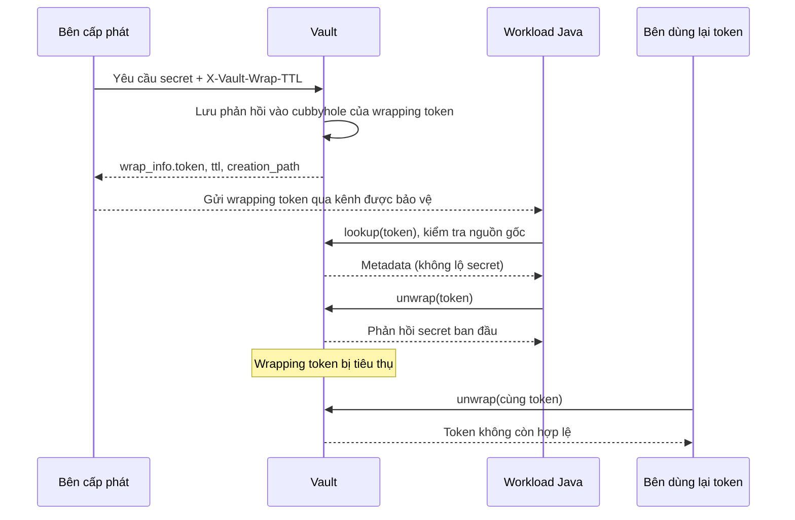
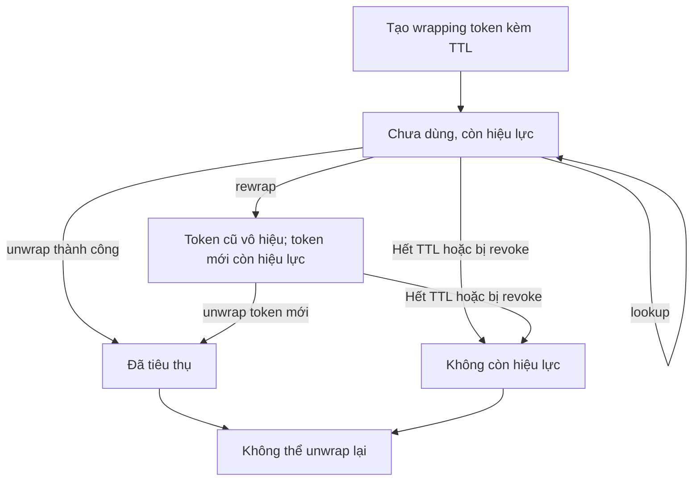

# Unwrap và ngữ nghĩa dùng một lần

Trong hệ thống Java sử dụng **Spring Vault**, có những bí mật cần được trao từ một thành phần cấp phát sang một workload khác: AppRole SecretID để khởi động ứng dụng, thông tin đăng nhập động, dữ liệu cấu hình nhạy cảm hoặc phản hồi từ PKI. Gửi trực tiếp những giá trị này qua thông điệp triển khai, biến môi trường hoặc hàng đợi làm tăng nguy cơ lộ bí mật. **HashiCorp Vault Response Wrapping** cho phép bên cấp phát chỉ chuyển giao một **wrapping token** có thời hạn ngắn; bên nhận dùng token đó để **unwrap** và nhận phản hồi gốc.

Bài này thuộc chương **Cubbyhole và wrapping** của module `SPRING_VAULT`. Trọng tâm là ý nghĩa **dùng một lần** (*single-use*), cách `lookup`, `unwrap`, `rewrap` khác nhau, cách kiểm chứng bằng Vault CLI và Java `VaultTemplate`, cùng các tình huống lỗi, giám sát và kiểm thử tích hợp.

## 1. Vì sao cần unwrap và vì sao chỉ một lần?

Giả sử dịch vụ triển khai cần chuyển một AppRole SecretID cho tiến trình Java trong Kubernetes. Bên cấp phát yêu cầu Vault tạo SecretID **với response wrapping**, rồi gửi cho tiến trình Java một wrapping token. Ứng dụng nhận token và gọi `sys/wrapping/unwrap` để lấy SecretID nằm trong phản hồi ban đầu.

Nếu người khác lấy trộm wrapping token và unwrap trước, lần unwrap tiếp theo của ứng dụng hợp lệ sẽ thất bại. Nếu ứng dụng hợp lệ unwrap trước, kẻ đánh cắp token sau đó không thể dùng lại token để nhận cùng phản hồi. Tính chất này giúp **phát hiện khả năng token đã bị sử dụng**; việc không unwrap được chưa đủ chứng minh có kẻ tấn công vì token cũng có thể hết hạn hoặc bị thu hồi.



**Single-use áp dụng cho wrapping token và phản hồi đang được bọc.** Nó không có nghĩa là bí mật được lấy ra chỉ dùng được một lần. Ví dụ, một mật khẩu KV hoặc SecretID được unwrap vẫn tuân theo vòng đời và chính sách riêng: thời hạn, số lần sử dụng, lease và thu hồi của chính bí mật đó.

## 2. Mối quan hệ giữa Cubbyhole và Response Wrapping

Cubbyhole là vùng dữ liệu gắn với **một Vault token**. Theo cơ chế response wrapping, Vault sử dụng cubbyhole của một wrapping token chuyên dụng để giữ phản hồi đã bọc. Bên nhận không cần biết hay đọc trực tiếp đường dẫn lưu trữ nội bộ.

Quy trình khái niệm:

1. Client gọi một Vault API bình thường, bổ sung header `X-Vault-Wrap-TTL: 2m` (hoặc CLI `-wrap-ttl=2m`).
2. Vault tạo wrapping token ngắn hạn, lưu **phản hồi nguyên gốc** trong cubbyhole gắn với token đó.
3. Client nhận `wrap_info` thay vì nhận secret ở `data`/`auth` như thao tác không wrapping.
4. Bên nhận dùng token để kiểm tra metadata, sau đó gọi `POST /v1/sys/wrapping/unwrap`.
5. Vault xác minh token, trả lại phản hồi ban đầu và vô hiệu hóa khả năng dùng lại wrapping token.

| Khái niệm | Ý nghĩa | Điều không nên nhầm |
| --- | --- | --- |
| Cubbyhole thông thường | Kho dữ liệu riêng gắn với token sở hữu | Không phải nơi ứng dụng tự lưu mọi bản ghi secret. |
| Response wrapping | Cách chuyển giao **một phản hồi Vault** qua token tạm | Không làm mất yêu cầu TLS hoặc bảo vệ token. |
| Wrapping token | Chứng cứ quyền lấy phản hồi đã bọc, có TTL ngắn | Không phải token workload dùng để gọi KV/Transit/PKI tùy ý. |
| `wrap_info` | Metadata gồm token, TTL, thời điểm tạo, đường dẫn tạo | Không chứa plaintext của phản hồi gốc. |
| `unwrap` | Nhận phản hồi gốc từ wrapping token | Sau khi tiêu thụ thành công, token không unwrap lần hai. |
| Secret/lease bên trong | Dữ liệu hoặc credential gốc của Vault | TTL của nó có thể **khác** TTL của wrapping token. |

Tuy cubbyhole tham gia vào triển khai, **nên dùng endpoint `sys/wrapping/unwrap`** vì có kiểm tra token, trả đúng định dạng phản hồi ban đầu và có audit; không tự đọc `cubbyhole/response` để thay thế cơ chế unwrap.

## 3. Vòng đời wrapping token: tạo, kiểm tra, tiêu thụ

Một wrapping token có thể đi qua các trạng thái sau:



| Thao tác | Có lộ phản hồi gốc? | Có tiêu thụ token đang xét? | Kết quả |
| --- | --- | --- | --- |
| `sys/wrapping/lookup` | Không | Không | Metadata để kiểm tra token, nguồn gốc và thời hạn tạo. |
| `sys/wrapping/unwrap` | Có, chỉ khi thành công | **Có** | Phản hồi ban đầu; token cũ không còn dùng được. |
| `sys/wrapping/rewrap` | Không | **Có, với token cũ** | Wrapping token mới cho cùng dữ liệu, cùng creation TTL và TTL mới bắt đầu từ lúc tạo. |
| Hết TTL/thu hồi | Không | Token mất hiệu lực | Không thể lấy phản hồi bằng token đó. |

`lookup` có thể được gọi nhiều lần trước unwrap vì không phải thao tác tiêu thụ. Tuy nhiên, **lookup thành công không đặt trước quyền unwrap**: token có thể hết hạn hoặc bị một bên khác tiêu thụ ngay sau lookup. Vì vậy ứng dụng phải xử lý thất bại ở **cả hai bước**.

Khi hai tiến trình cùng chạy `unwrap` trên **cùng wrapping token**, chỉ một bên có thể nhận phản hồi qua quá trình tiêu thụ hợp lệ. Bên còn lại sẽ thấy token không hợp lệ hoặc lỗi tương ứng. Đây là tính chất của token, không phải cơ chế khóa phân tán hay cơ chế đảm bảo một tác vụ nghiệp vụ chỉ chạy một lần.

## 4. Thực hành Vault CLI: unwrap thành công một lần

Ví dụ dùng môi trường Vault thử nghiệm, `vault` CLI, `jq` và shell Bash; danh tính thử nghiệm có quyền cấu hình KV và đọc dữ liệu test. Các chuỗi bí mật trong ví dụ đều là **dữ liệu giả**.

### Bước 1: Chuẩn bị KV v2 thử nghiệm

```bash
# Thực hiện ở Vault lab riêng; bỏ qua enable nếu mount đã tồn tại.
vault secrets enable -path=kv-wrap-lab -version=2 kv

vault kv put kv-wrap-lab/service/bootstrap \
  username=demo-user password=example-only

# Kiểm tra bằng danh tính có quyền đọc:
vault kv get kv-wrap-lab/service/bootstrap
```

Lưu ý: bước tạo và kiểm tra trước khi wrapping sẽ hiển thị dữ liệu giả trên terminal. Với dữ liệu thật, không in plaintext vào output hoặc CI logs.

### Bước 2: Yêu cầu phản hồi được wrap

```bash
# API path thực của KV v2 có đoạn /data/.
WRAP_JSON="$(vault read -format=json -wrap-ttl=2m \
  kv-wrap-lab/data/service/bootstrap)"

# Chỉ giữ token trong biến shell của phiên thử nghiệm.
WRAP_TOKEN="$(printf '%s' "$WRAP_JSON" | jq -er '.wrap_info.token')"

# Xem metadata không nhạy cảm; tránh xuất token ra màn hình.
printf '%s' "$WRAP_JSON" \
  | jq '{ttl: .wrap_info.ttl, creation_path: .wrap_info.creation_path}'
```

Phản hồi Vault ở dạng JSON có cấu trúc khái niệm:

```json
{
  "data": null,
  "wrap_info": {
    "token": "<wrapping-token>",
    "ttl": 120,
    "creation_time": "<thoi-diem-tao>",
    "creation_path": "kv-wrap-lab/data/service/bootstrap"
  }
}
```

Dữ liệu thật của KV chưa xuất hiện ở `data`; nó đang được bọc. Token **là bí mật**, không copy vào issue tracker, Git, log, URL query string hoặc thông điệp gửi công khai.

### Bước 3: Lookup mà không tiêu thụ

```bash
# Có thể thực hiện nhiều lần trước khi unwrap.
vault write -format=json sys/wrapping/lookup \
  token="$WRAP_TOKEN" \
  | jq '.data | {creation_path, creation_time, creation_ttl}'
```

Xác minh `creation_path` phải là **đúng** `kv-wrap-lab/data/service/bootstrap`. `creation_time` và `creation_ttl` hỗ trợ đánh giá thời gian cấp phát; thời gian hiệu lực thực tế vẫn do Vault kiểm soát. Với KV v2, **đừng so khớp nhầm** path CLI `kv-wrap-lab/service/bootstrap` với API path `kv-wrap-lab/data/service/bootstrap`.

Việc lookup không tạo ra “lượt unwrap mới”, cũng không gia hạn TTL token.

### Bước 4: Unwrap và xác nhận plaintext

```bash
# Không in phản hồi ra stdout. Chỉ so sánh bí mật giả trong lab.
UNWRAPPED_JSON="$(vault unwrap -format=json "$WRAP_TOKEN")"

printf '%s' "$UNWRAPPED_JSON" \
  | jq -e '.data.data.username == "demo-user"
           and .data.data.password == "example-only"'
# Kỳ vọng jq trả true với exit code 0.
```

Với KV v2, phản hồi gốc có lớp `data.data` chứa giá trị ứng dụng. Một phản hồi auth, PKI hay KV v1 sẽ có cấu trúc khác. **Unwrap trả lại đúng dạng phản hồi của API gốc**, không ép mọi secret vào một schema chung.

### Bước 5: Dùng lại token và nhận lỗi

```bash
if vault unwrap -format=json "$WRAP_TOKEN" >/dev/null 2>&1; then
  echo "FAIL: wrapping token da duoc dung lai"
  exit 1
else
  echo "PASS: wrapping token khong unwrap duoc lan thu hai"
fi
```

Điều kiện để kết luận **PASS** là bước 4 đã thực sự thành công trước đó. Nếu bước 4 thất bại vì hết TTL, thiếu quyền hoặc mất kết nối, bước 5 thất bại **không** chứng minh được single-use.

> Cách dùng `vault unwrap "$WRAP_TOKEN"` tránh thay `VAULT_TOKEN` toàn cục trong shell. Cần coi token và phản hồi unwrap là dữ liệu nhạy cảm dù chỉ tồn tại trong biến tiến trình.

## 5. Lookup, unwrap và rewrap: khi nào dùng?

### `lookup`: kiểm tra trước khi tiêu thụ

Bên nhận nên lookup khi vừa nhận wrapping token và đối chiếu với thông tin đã biết từ kênh điều phối:

- Có nhận được token khi dự kiến hay không.
- Token còn hợp lệ khi lookup hay đã hết hạn, đã bị thu hồi hoặc đã được dùng.
- `creation_path` có đúng API được phép cấp bí mật hay không.
- `creation_time`/thời hạn có phù hợp với cửa sổ bootstrap được thỏa thuận hay không.

Nếu dự kiến token do `auth/approle/role/order-service/secret-id` cấp, mà metadata lại cho biết `sys/wrapping/wrap` hoặc một path KV khác, **không unwrap** chỉ vì token lookup được. Một bên trung gian có thể tự wrap dữ liệu khác rồi đưa token mới cho ứng dụng.

Với hệ thống sử dụng `rewrap`, hãy lookup **token mới** và kiểm tra lại `creation_path` theo chính sách bàn giao; đừng dựa vào một giả định về việc metadata luôn thay đổi hoặc luôn giữ nguyên sau rewrap. Không tự nới lỏng so khớp path thành “path nào cũng được”.

### `unwrap`: tiêu thụ để nhận phản hồi

Vault hỗ trợ hai cách gọi chính:

```http
POST /v1/sys/wrapping/unwrap
X-Vault-Token: <wrapping-token>
```

Hoặc sử dụng **một token workload khác** có quyền với endpoint và truyền wrapping token trong request body:

```http
POST /v1/sys/wrapping/unwrap
X-Vault-Token: <workload-token-co-quyen-unwrap>
Content-Type: application/json

{"token":"<wrapping-token>"}
```

**Không truyền wrapping token đồng thời trong `X-Vault-Token` và field `token` của body.** Vault cảnh báo cách dùng kép có thể làm token bị thu hồi nhưng không lấy được dữ liệu đã bọc. Cách gọi của Spring Vault qua `VaultWrappingOperations.read(VaultToken)` giúp đóng gói thao tác endpoint, giảm việc tự lắp header/body.

### `rewrap`: thay token mà không xem secret

`POST /v1/sys/wrapping/rewrap` tạo wrapping token mới cho cùng phản hồi và làm token cũ mất hiệu lực; thao tác không trả nội dung secret:

```bash
# Dùng một token mới vừa tạo và CHƯA unwrap.
# vault write -format=json sys/wrapping/rewrap token="$WRAP_TOKEN"
# Kết quả có wrap_info.token mới; token cũ không còn unwrap được.
```

Giữ ví dụ dưới dạng mô tả để tránh vô tình gọi `rewrap` sau bước 4, vì token trong các bước đó đã bị tiêu thụ. Khi thật sự dùng rewrap, bên cấp phát phải chuyển giao **token mới** cho bên nhận. TTL sau rewrap được cấp theo *creation TTL* của token cũ và bắt đầu tại thời điểm rewrap mới; nó không làm bí mật nằm bên trong có TTL dài hơn.

## 6. Spring Vault: `VaultTemplate` và `VaultWrappingOperations`

Từ Spring Vault 2.1, `VaultOperations` (thường là bean `VaultTemplate`) có `opsForWrapping()` trả `VaultWrappingOperations`. Giao diện này cung cấp `lookup`, `read`, `rewrap` và `wrap`; `read(VaultToken)` chính là thao tác unwrap.

Ví dụ dịch vụ bên nhận **kiểm tra nguồn gốc rồi unwrap đúng một lần**:

```java
import org.springframework.stereotype.Service;
import org.springframework.vault.core.VaultOperations;
import org.springframework.vault.core.VaultWrappingOperations;
import org.springframework.vault.support.VaultResponse;
import org.springframework.vault.support.VaultToken;
import org.springframework.vault.support.WrappedMetadata;

@Service
public class WrappedBootstrapReceiver {

    private final VaultWrappingOperations wrapping;

    public WrappedBootstrapReceiver(VaultOperations vaultOperations) {
        this.wrapping = vaultOperations.opsForWrapping();
    }

    public VaultResponse receive(String rawWrappingToken, String expectedPath) {
        if (rawWrappingToken == null || rawWrappingToken.isBlank()) {
            throw new IllegalArgumentException("Missing wrapping token");
        }
        if (expectedPath == null || expectedPath.isBlank()) {
            throw new IllegalArgumentException("Missing expected path");
        }

        VaultToken token = VaultToken.of(rawWrappingToken);

        // Lookup là read-only đối với vòng đời của wrapping token.
        WrappedMetadata metadata = wrapping.lookup(token);
        if (metadata == null) {
            throw new IllegalStateException("Wrapping token unavailable");
        }

        // Path phải xuất phát từ nguồn tin cậy của ứng dụng,
        // không lấy expectedPath trực tiếp từ request của người dùng.
        if (!expectedPath.equals(metadata.getPath())) {
            throw new SecurityException("Unexpected wrapping origin");
        }

        // read(token) thực hiện unwrap; không gọi thêm lần thứ hai.
        VaultResponse original = wrapping.read(token);
        if (original == null) {
            throw new IllegalStateException("Wrapping token consumed or expired");
        }
        return original;
    }
}
```

Cách gọi ví dụ:

```java
VaultResponse response = receiver.receive(
        tokenDeliveredByProvisioner,
        "kv-wrap-lab/data/service/bootstrap");

if (response.getData() == null) {
    throw new IllegalStateException("Unwrapped response has no data");
}

// Phản hồi KV v2 có cấu trúc lồng data -> data/metadata.
// Cần ánh xạ theo loại API gốc và validate schema trước khi sử dụng.
```

**Lưu ý đối với code production:** kiểm tra/giới hạn đường dẫn tin cậy, schema, kích thước dữ liệu và loại phản hồi. Giảm thời gian giữ secret trong bộ nhớ, xóa/đóng tài nguyên có thể xóa, tuyệt đối không log `VaultResponse` hoặc token. Cơ chế xác thực workload như AppRole/Kubernetes/OIDC và TLS của `VaultTemplate` phải được cấu hình riêng; wrapping token không thay thế phiên đăng nhập ứng dụng.

Giao diện typed còn hỗ trợ tạo và chuyển wrapper:

```java
import java.time.Duration;
import java.util.Map;
import org.springframework.vault.support.WrappedMetadata;

// Chỉ dùng dữ liệu giả để minh họa:
WrappedMetadata created = vaultOperations.opsForWrapping()
        .wrap(Map.of("demo", "hello"), Duration.ofMinutes(2));

VaultToken oneUseToken = created.getToken();
WrappedMetadata checked = vaultOperations.opsForWrapping()
        .lookup(oneUseToken);

VaultResponse first = vaultOperations.opsForWrapping()
        .read(oneUseToken); // Tiêu thụ token; chỉ thực hiện một lần.
```

Trong trường hợp cần `rewrap`, dùng `VaultWrappingOperations.rewrap(token)` **trước** khi `read(token)`, lấy `getToken()` của metadata mới và gửi token mới đi. Không rewrap token đã bị tiêu thụ.

## 7. Phân quyền: ai được tạo wrapper, ai được unwrap?

Quyền đọc bí mật gốc thuộc **bên cấp phát**. Ví dụ với KV v2:

```hcl
# Bên cấp phát được đọc đúng secret cần bọc.
path "kv-wrap-lab/data/service/bootstrap" {
  capabilities = ["read"]
}
```

Bên nhận có thể dùng **chính wrapping token** để gọi `sys/wrapping/unwrap` như client token. Nếu một ứng dụng Spring Vault đã đăng nhập bằng **token workload riêng** và truyền wrapping token qua tham số, policy workload cần cho phép endpoint tương ứng:

```hcl
# Policy minh họa cho workload nhận dữ liệu đã bọc.
path "sys/wrapping/lookup" {
  capabilities = ["update"]
}

path "sys/wrapping/unwrap" {
  capabilities = ["update"]
}
```

Quyền lookup/unwrap không đồng nghĩa có quyền đọc `kv-wrap-lab/data/service/bootstrap` thông qua API KV. Bên nhận vẫn phải bảo vệ wrapping token vì **bất cứ ai có token phù hợp và khả năng gọi endpoint có thể tiêu thụ phản hồi**. Tùy mô hình, cần bó hẹp mạng, không cho token qua URL và chỉ cấp quyền endpoint khi thực sự cần.

Không cấp `sys/wrapping/rewrap` hoặc `sys/wrapping/wrap` cho mọi workload chỉ vì chúng sử dụng unwrap; định nghĩa quyền theo luồng phân phối cụ thể. Việc nhận SecretID thành công cũng không cấp quyền vô hạn: sau đăng nhập, token ứng dụng vẫn chịu TTL, policy và cơ chế revoke riêng.

## 8. Những điều single-use bảo đảm và không bảo đảm

| Tình huống | Kết quả mong đợi | Giải thích |
| --- | --- | --- |
| A lookup token ba lần rồi unwrap | Có thể unwrap một lần nếu còn TTL | `lookup` không tiêu thụ. |
| A unwrap, B unwrap tiếp cùng token | B bị từ chối | Token đã dùng không thể dùng lần hai. |
| A và B unwrap gần như đồng thời | Tối đa một bên lấy được phản hồi qua token | Cạnh tranh cùng quyền dùng một lần. |
| Token hết TTL khi chưa unwrap | Không ai lấy được phản hồi bằng token đó | Hết hạn không chứng minh token bị đánh cắp. |
| `rewrap` token cũ | Chỉ token mới còn được dùng | Phản hồi không lộ khi rewrap. |
| Unwrap lấy mật khẩu KV còn hiệu lực | Mật khẩu KV vẫn tồn tại theo chính sách KV | Single-use không tự xóa secret gốc. |
| Unwrap lấy credential động có lease | Credential còn phụ thuộc lease/TTL và revoke | TTL của lease độc lập với wrapping TTL. |
| Client timeout ngay sau khi gửi unwrap | Không chắc Vault đã tiêu thụ token hay chưa | Không được tự coi timeout là “chưa có gì xảy ra”. |
| Metadata `creation_path` sai dự kiến | Từ chối trước khi unwrap | Cần chứng minh nguồn gốc theo kênh tin cậy. |

Phân biệt thêm: single-use không phải **exactly-once delivery** của thông điệp. Một mạng có thể chuyển cùng wrapping token đến nhiều nơi, và một hệ thống retry có thể gửi lại request sau khi Vault đã xử lý. Tính chất Vault bảo vệ là **chỉ một lần mở thành công của phản hồi**, chứ không cung cấp transaction phân tán cho toàn bộ quy trình bootstrap.

## 9. Xử lý lỗi và bất định của mạng

| Triệu chứng | Nguyên nhân có thể có | Hành động phù hợp |
| --- | --- | --- |
| `lookup` không thấy token | Đã unwrap, đã rewrap, bị revoke, sai token hoặc hết TTL | Dừng; xem audit và lịch sử cấp phát, không suy đoán chắc chắn có đánh cắp. |
| `lookup` thành công nhưng `unwrap` thất bại | Token hết hạn/bị tiêu thụ giữa hai bước, race condition | Đánh dấu lần nhận thất bại, điều tra; cân nhắc cấp lại bằng quy trình tin cậy. |
| HTTP 403 | Thiếu policy endpoint hoặc token không hợp lệ | Kiểm tra danh tính workload, quyền ACL, cách truyền token. |
| HTTP 400 | Request unwrap sai định dạng hoặc dùng token trong cả header và body | Kiểm tra request và tách rõ wrapping token/workload token. |
| 429, 5xx hoặc timeout | Giới hạn lưu lượng, lỗi cluster, mạng, proxy | Ghi nhận kết quả chưa xác định, kiểm tra trạng thái/audit trước khi quyết định tiếp. |
| Unwrap thành công nhưng không parse được dữ liệu | Kỳ vọng sai loại phản hồi, schema thay đổi hoặc creation_path chưa được thẩm định | Từ chối sử dụng, kiểm tra schema theo API gốc. |
| Token được rewrap nhưng bên nhận cầm token cũ | Bàn giao chưa đồng bộ token mới | Cập nhật kênh phân phối và xác minh token mới; không dùng lại token cũ. |

**Lỗi timeout sau unwrap là tình huống cần thiết kế trước.** Có thể Vault đã tiêu thụ token và gửi response, nhưng client không nhận được. Gửi lại cùng token có thể nhận lỗi “invalid token”. Đây là dấu hiệu trạng thái chưa xác định của một bước nhạy cảm, không phải lý do để bỏ qua kiểm tra hoặc yêu cầu ứng dụng tự đọc bí mật gốc. Thường nên nhờ hệ thống cấp phát có quyền tạo **một wrapper mới từ nguồn gốc hợp lệ**, đồng thời xác minh và ghi nhận sự kiện cấp lại.

Nếu token không hợp lệ ngay khi bên nhận nhận được, cần kiểm tra hai giả thuyết: token hết hạn do chậm trễ hợp lệ, hoặc bị bên khác tiêu thụ. Hãy dùng Vault audit log, request ID và thời điểm cấp phát để điều tra, tránh công khai chi tiết token hay phản hồi.

## 10. Kiểm thử tích hợp tính dùng một lần

Bộ test cần dựa trên Vault thử nghiệm có phiên xác thực và quyền phù hợp. Dùng **dữ liệu giả**, mỗi testcase tạo wrapping token mới, không dùng chung token giữa các test chạy song song.

Ma trận đề xuất:

| Test | Thao tác | Kết quả mong đợi |
| --- | --- | --- |
| W01 | `wrap → lookup → lookup → unwrap` | Lookup hai lần đều thấy metadata; unwrap một lần thành công. |
| W02 | `wrap → unwrap → unwrap` | Lần đầu nhận phản hồi gốc; lần thứ hai bị từ chối hoặc không trả phản hồi. |
| W03 | `wrap → lookup`, kiểm tra `creation_path` sai | Ứng dụng dừng trước unwrap. |
| W04 | `wrap → rewrap`, kiểm tra token cũ | Token cũ không dùng được; token mới unwrap thành công. |
| W05 | Tạo wrapper TTL rất ngắn, để qua thời hạn rồi unwrap | Token hết hiệu lực, nhưng phân biệt hết TTL với replay. |
| W06 | Hai client cạnh tranh unwrap cùng token | Không cả hai cùng lấy được phản hồi. |
| W07 | Workload thiếu quyền endpoint hoặc cấu hình header/body sai | Thất bại do ACL/cấu hình, không báo sai “đã bị đánh cắp”. |
| W08 | Giả lập timeout sau khi Vault nhận request | Kết quả chưa xác định; hệ thống không tự lặp vô hạn. |

Ví dụ JUnit 5 ngắn kiểm tra hai thuộc tính cốt lõi qua `VaultWrappingOperations`:

```java
import static org.junit.jupiter.api.Assertions.*;

import java.time.Duration;
import java.util.Map;

import org.junit.jupiter.api.Test;
import org.springframework.vault.core.VaultOperations;
import org.springframework.vault.core.VaultWrappingOperations;
import org.springframework.vault.support.VaultResponse;
import org.springframework.vault.support.VaultToken;
import org.springframework.vault.support.WrappedMetadata;

class WrappingOneTimeIntegrationTest {

    private final VaultWrappingOperations wrapping;

    // Trong Spring Test, cung cấp VaultOperations được cấu hình
    // tới Vault test và workload token có quyền wrapping.
    WrappingOneTimeIntegrationTest(VaultOperations vault) {
        this.wrapping = vault.opsForWrapping();
    }

    @Test
    void lookupDoesNotConsumeButUnwrapDoes() {
        WrappedMetadata created =
                wrapping.wrap(Map.of("probe", "example-only"),
                              Duration.ofMinutes(2));
        VaultToken token = created.getToken();

        assertNotNull(wrapping.lookup(token));
        assertNotNull(wrapping.lookup(token));

        VaultResponse first = wrapping.read(token);
        assertNotNull(first);
        assertNotNull(first.getData());
        assertEquals("example-only", first.getData().get("probe"));

        // Spring Vault mô tả lookup invalid/expired token trả null.
        assertNull(wrapping.lookup(token));
    }

    @Test
    void rewrapInvalidatesOldToken() {
        WrappedMetadata original =
                wrapping.wrap(Map.of("probe", "demo"),
                              Duration.ofMinutes(2));
        VaultToken oldToken = original.getToken();

        WrappedMetadata renewed = wrapping.rewrap(oldToken);
        VaultToken newToken = renewed.getToken();

        assertNotEquals(oldToken, newToken);
        assertNull(wrapping.lookup(oldToken));
        assertNotNull(wrapping.lookup(newToken));

        VaultResponse result = wrapping.read(newToken);
        assertNotNull(result);
        assertEquals("demo", result.getData().get("probe"));
    }
}
```

Đoạn code minh họa **thân các ca kiểm thử**; để chạy cần cấu hình fixture Spring Test hoặc khởi tạo `VaultOperations` từ Vault test và cung cấp nó qua constructor đúng cách. Không chạy test trên Vault production. Ở một số kết hợp Vault/Spring Vault, token đã dùng có thể được báo bằng exception thay vì `null`; bộ test thực tế cần nhận diện **trạng thái invalid/consumed dự kiến** và loại trừ lỗi 403 do thiếu quyền, 429 hoặc 5xx do hạ tầng.

Kiểm thử timeout và race condition cần điều phối có kiểm soát (ví dụ hai luồng cùng chờ một barrier), ghi nhận **số lần unwrap thành công** thay vì so sánh chuỗi thông điệp lỗi. Tránh viết test phụ thuộc sleep cố định dài hoặc token TTL quá ngắn khiến CI chập chờn.

## 11. Vận hành và bảo vệ đường phân phối

Một quy trình bootstrap đáng tin cậy thường gồm các bước sau:

1. Bên cấp phát đã được xác thực và có quyền gọi API tạo dữ liệu gốc; yêu cầu Vault trả **wrapped response** với TTL đủ ngắn nhưng phù hợp độ trễ triển khai.
2. Chuyển wrapping token qua kênh có kiểm soát người nhận, bảo vệ TLS và quyền truy cập log/hàng đợi.
3. Workload Java xác thực bằng cơ chế phù hợp, nhận token, kiểm tra token tồn tại và `creation_path`/thời điểm cấp phát theo kỳ vọng.
4. Gọi unwrap **một lần**, ánh xạ phản hồi gốc theo đúng schema; nếu nhận SecretID, dùng nó để đăng nhập AppRole theo chính sách riêng.
5. Không đưa token hoặc phản hồi vào log; sau khi khởi tạo thành công, giới hạn quyền truy cập bí mật đã unwrap trong tiến trình.
6. Khi phát hiện token vô hiệu bất thường, đối chiếu Vault audit, thời gian cấp phát và log điều phối đã làm sạch; nếu cần, cấp lại một wrapper **mới** theo quy trình xác minh.

Giám sát nên theo dõi số wrapper được cấp, tỷ lệ unwrap thành công/thất bại, thời gian từ cấp phát đến nhận, token hết TTL, lỗi permission và số lần phải cấp lại. Không dùng token làm nhãn metrics; chỉ dùng correlation ID không nhạy cảm để liên hệ các bước.

Đặc biệt, một wrapper có TTL 2 phút **không có nghĩa** credential động được bọc bên trong chỉ có TTL 2 phút; cũng không kéo dài TTL credential khi rewrap. Việc gia hạn lease, thu hồi token đăng nhập và xoay bí mật gốc phải được quản lý bởi các cơ chế riêng của Vault/Spring Vault.

## 12. Câu hỏi tự kiểm tra

1. Tại sao `lookup` được thực hiện trước `unwrap`, và vì sao `lookup` thành công không bảo đảm `unwrap` sau đó cũng thành công?
2. Sau khi `unwrap` thành công, chính xác điều gì trở nên không sử dụng lại được? Điều gì vẫn có thể còn hiệu lực?
3. Vì sao phải so khớp `creation_path` của wrapper với API nguồn, nhất là khi sử dụng KV v2?
4. Khi hai worker cùng nhận một token, điều gì xảy ra nếu cả hai thử unwrap?
5. `rewrap` trả về secret hay token? Token cũ và TTL của secret gốc thay đổi ra sao?
6. Khi client timeout sau request unwrap, vì sao không được coi lần unwrap chắc chắn chưa xảy ra?
7. Sự khác biệt giữa wrapping token và token AppRole/Kubernetes của workload là gì?

**Tiêu chí nắm vững:** có thể mô tả và triển khai được `lookup → validate → unwrap` an toàn; chứng minh wrapper dùng một lần trong môi trường thử nghiệm; phân biệt timeout, hết TTL và token đã dùng; hiểu rằng single-use chỉ bảo vệ **việc mở phản hồi được bọc**, không thay đổi vòng đời của secret bên trong.

## Tài liệu tham khảo chính thức

- HashiCorp Vault — [Response Wrapping](https://developer.hashicorp.com/vault/docs/concepts/response-wrapping): cơ chế token, cubbyhole, TTL và kiểm tra nguồn gốc.
- HashiCorp Vault API — [`sys/wrapping/unwrap`](https://developer.hashicorp.com/vault/api-docs/system/wrapping-unwrap), [`lookup`](https://developer.hashicorp.com/vault/api-docs/system/wrapping-lookup) và [`rewrap`](https://developer.hashicorp.com/vault/api-docs/system/wrapping-rewrap).
- Spring Vault — [`VaultWrappingOperations`](https://docs.spring.io/spring-vault/reference/api/java/org/springframework/vault/core/VaultWrappingOperations.html) và [`VaultOperations`](https://docs.spring.io/spring-vault/reference/api/java/org/springframework/vault/core/VaultOperations.html).
