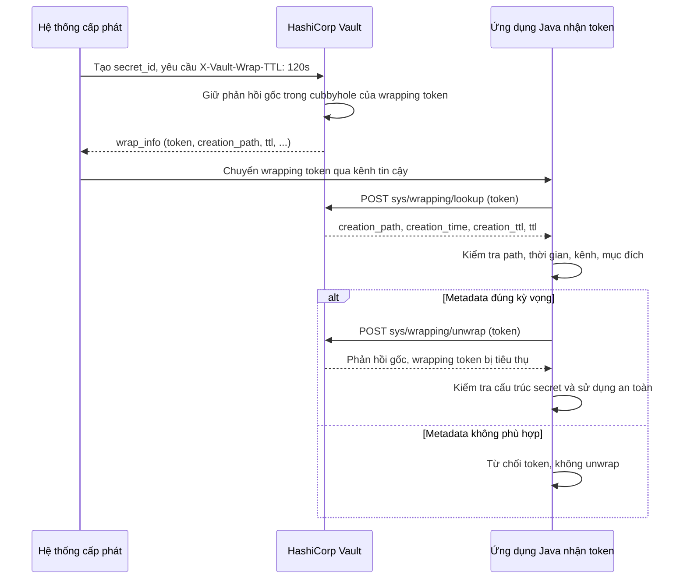

# Kiểm tra đường dẫn tạo cùng thông tin của wrapping token

## 1. Bối cảnh: vì sao phải kiểm tra wrapping token trước khi mở?

Trong hệ thống Java tích hợp **HashiCorp Vault** bằng **Spring Vault** (`VaultTemplate` hoặc `VaultOperations`), một dịch vụ có thể cần nhận bí mật khởi tạo như AppRole `secret_id`, thông tin cấu hình một lần hoặc dữ liệu nhạy cảm do hệ thống cấp phát. Gửi bí mật trực tiếp qua một kênh trung gian làm tăng nguy cơ lộ dữ liệu trong log, hàng đợi, email hoặc công cụ triển khai. **Response wrapping** cho phép Vault giữ phản hồi gốc trong **cubbyhole** gắn với một wrapping token có thời hạn ngắn; bên phát chỉ chuyển wrapping token cho bên nhận.

Tuy nhiên, chỉ vì token có thể `unwrap` không có nghĩa nội dung bên trong đến từ **đúng endpoint** mà ứng dụng mong đợi. Ví dụ, ứng dụng chỉ chấp nhận `secret_id` được tạo tại `auth/approle/role/orders-service/secret-id`. Nếu nhận một wrapping token được tạo bởi `sys/wrapping/wrap` hoặc một role khác, việc mở và sử dụng nội dung ngay có thể dẫn đến nhầm danh tính, bí mật hoặc môi trường.

Chủ đề **“Kiểm tra đường dẫn tạo cùng thông tin của wrapping token”** trong chương **Cubbyhole và wrapping** giải quyết vấn đề này: dùng metadata, đặc biệt là **`creation_path`**, để đưa ra quyết định **chấp nhận hay từ chối trước khi unwrap**. Đây là một kiểm tra quan trọng bên cạnh xác thực workload, policy Vault, vòng đời token/lease, giám sát và kiểm thử tích hợp của module **SPRING_VAULT**.

Sau bài học, bạn có thể:

- Phân biệt wrapping token với Vault client token thông thường, và hiểu mối liên hệ với cubbyhole.
- Đọc, giải thích `creation_path`, `creation_time`, `creation_ttl`, `ttl` và accessor.
- Dùng endpoint `sys/wrapping/lookup` để kiểm tra **mà không tiêu thụ** wrapping token.
- Áp chính sách kiểm tra đường dẫn, thời gian sống, nguồn kênh và danh tính trước `sys/wrapping/unwrap`.
- Tích hợp bước kiểm tra vào Java/Spring Vault và thiết kế ca kiểm thử lỗi, token đã dùng, token hết hạn.

## 2. Cách response wrapping hoạt động

Một wrapping token **không phải** bản sao trực tiếp của secret, cũng không phải access token cấp quyền đọc tùy ý cho mọi đường dẫn Vault. Nó là token được Vault tạo nhằm truy cập **một phản hồi đã bọc** trong cubbyhole tương ứng. Token này thường có TTL ngắn và được dự định **mở đúng một lần**. Sau thao tác unwrap thành công, token không được tái sử dụng để mở lại cùng phản hồi.



Các điểm cần phân biệt:

| Thành phần | Vai trò | Cần lưu ý |
| --- | --- | --- |
| **Dữ liệu được bọc** | Phản hồi gốc cần được truyền đến bên nhận. | Có thể chứa thông tin nhạy cảm như AppRole `secret_id`. |
| **Wrapping token** | “Vé” ngắn hạn để thực hiện lookup/unwrap phản hồi đã bọc. | Là bí mật có khả năng sử dụng; không ghi vào log hay chia sẻ rộng. |
| **Cubbyhole** | Vùng lưu trữ riêng gắn với token trong Vault. | Người sở hữu token có thể tiếp cận dữ liệu tương ứng theo cơ chế wrapping. |
| **`wrap_info`** | Metadata nhận ở thời điểm Vault trả phản hồi đã bọc. | Bên phát nhìn thấy token cùng TTL và đường dẫn tạo. |
| **`sys/wrapping/lookup`** | Kiểm tra thông tin wrapping token khi bên nhận đã có token. | Không trả secret đã bọc, không tiêu thụ token. |
| **`sys/wrapping/unwrap`** | Mở phản hồi gốc. | Tiêu thụ wrapping token; chỉ gọi sau khi các điều kiện được kiểm tra. |

Metadata giúp phát hiện token được tạo từ đường dẫn không mong đợi. Tuy nhiên, nó **không thay thế** bảo mật đường truyền, xác minh danh tính bên gửi, quy tắc nghiệp vụ hay việc kiểm tra dữ liệu sau unwrap.

## 3. `creation_path`: trường quan trọng nhất

**`creation_path`** là đường dẫn yêu cầu Vault đã tạo ra **phản hồi được wrapping**. Đây là thông tin về **nguồn của thao tác wrap**, không phải một đường dẫn mà ứng dụng có thể tùy ý ghi vào token sau khi tạo.

Giả sử hệ thống cấp phát yêu cầu tạo AppRole `secret_id` tại:

```text
auth/approle/role/orders-service/secret-id
```

Nếu Vault bọc trực tiếp phản hồi từ lệnh này, metadata kỳ vọng có:

```json
{
  "creation_path": "auth/approle/role/orders-service/secret-id"
}
```

Ứng dụng chỉ nên chấp nhận **đúng chuỗi đường dẫn đã cấu hình** (sau khi thống nhất quy tắc biểu diễn đường dẫn với hệ thống cấp phát). Nếu một token đến từ:

```text
auth/approle/role/payments-service/secret-id
```

thì phải từ chối cho luồng `orders-service`, kể cả token vẫn còn hạn và có thể unwrap.

Một trường hợp khác là dữ liệu được bọc bằng endpoint tổng quát:

```text
sys/wrapping/wrap
```

Đối với wrapping được tạo từ endpoint tổng quát này, `creation_path` phản ánh `sys/wrapping/wrap`, **không chứng minh** dữ liệu bên trong thật sự phát sinh từ `auth/approle/role/orders-service/secret-id`. Nếu chính sách của ứng dụng yêu cầu token đến trực tiếp từ endpoint cấp AppRole SecretID, token có `creation_path=sys/wrapping/wrap` phải bị từ chối.

### 3.1. Kiểm tra chính xác theo hợp đồng

Một kiểm tra tốt cần xác định **đường dẫn đầy đủ**, không chỉ kiểm tra `contains("secret-id")` hoặc hậu tố `/secret-id`. Cần xét:

- **Mount:** `auth/approle` có thể khác nếu doanh nghiệp mount AppRole tại một đường dẫn tùy chỉnh.
- **Role:** `orders-service` và `payments-service` là hai danh tính khác nhau.
- **Môi trường:** tên role/mount dành cho production và staging cần có ranh giới rõ ràng.
- **Loại thao tác:** endpoint tạo `secret-id`, endpoint đọc metadata và endpoint wrap tổng quát có ý nghĩa khác nhau.

**Không nhầm `creation_path` với ACL path của ứng dụng nhận.** Nó mô tả nơi phát sinh phản hồi đã bọc, nhưng không tự chứng minh ai đã đưa token tới ứng dụng, nội dung có phù hợp hợp đồng nghiệp vụ hay token được tạo bởi đúng quy trình cấp phát. Bảo vệ Vault TLS, kênh chuyển token và danh tính của từng bên vẫn là điều kiện bắt buộc.

## 4. Các metadata cần hiểu khi kiểm tra token

`sys/wrapping/lookup` trả thông tin về wrapping token còn hợp lệ; các trường thường gặp là:

| Trường | Ý nghĩa | Cách ứng dụng dùng |
| --- | --- | --- |
| `creation_path` | Endpoint tạo phản hồi được wrap. | So sánh chính xác với allowlist path đã cấu hình. |
| `creation_time` | Thời điểm wrapping token được tạo; thường ở định dạng thời gian RFC 3339. | So sánh với thời gian hiện tại, cho phép chênh lệch đồng hồ nhỏ và ngăn chấp nhận token quá cũ. |
| `creation_ttl` | TTL ban đầu khi tạo wrapping token, thường là số giây. | Kiểm tra giới hạn TTL được quy trình cấp phát cho phép. |
| `ttl` | Thời gian sống **còn lại** của wrapping token tại thời điểm lookup, thường là số giây. | Từ chối token không còn đủ thời gian cho bước unwrap/khởi tạo nếu chính sách yêu cầu. |
| `accessor` | Định danh tham chiếu token, có thể thấy trong `wrap_info` phía phát. | Phục vụ điều tra/thu hồi theo chính sách; không phải chuỗi dùng để unwrap. |

Ví dụ phản hồi lookup minh họa:

```json
{
  "data": {
    "creation_path": "auth/approle/role/orders-service/secret-id",
    "creation_time": "2026-11-25T07:00:00Z",
    "creation_ttl": 120,
    "ttl": 97
  }
}
```

Một ứng dụng có thể áp chính sách: `creation_path` phải khớp hẳn, `creation_ttl` không được vượt 120 giây, `ttl` phải lớn hơn một ngưỡng tối thiểu và `creation_time` phải nằm trong cửa sổ cho phép. **Giới hạn này là ví dụ chính sách ứng dụng**, không phải giá trị mặc định bắt buộc của Vault.

Giữa hai lần gọi, `ttl` sẽ giảm dần. Không giả định `ttl` phải bằng `creation_ttl`, hoặc lấy chênh lệch hai trường làm đồng hồ chính xác tuyệt đối do độ trễ và sai lệch thời gian. Nếu cần xác định một thời điểm hết hạn ước lượng, dùng `creation_time + creation_ttl` và đối chiếu trạng thái hợp lệ do Vault trả về. **Lookup thành công không bảo đảm unwrap sẽ thành công sau đó** nếu token hết hạn hoặc bị bên khác tiêu thụ trong khoảng thời gian hai thao tác.

### 4.1. Thông tin từ `wrap_info` và từ lookup khác nhau thế nào?

Khi Vault vừa tạo response wrapping, phản hồi cho bên cấp phát thường có `wrap_info`:

```json
{
  "wrap_info": {
    "token": "<WRAPPING_TOKEN>",
    "accessor": "<TOKEN_ACCESSOR>",
    "ttl": 120,
    "creation_time": "2026-11-25T07:00:00Z",
    "creation_path": "auth/approle/role/orders-service/secret-id"
  }
}
```

Ở phía nhận, **không nên chỉ tin metadata được bên gửi ghi kèm token**. Bên nhận cần gọi Vault `sys/wrapping/lookup` với token thực tế để lấy metadata mà Vault xác nhận. Có thể so sánh hai nguồn để phát hiện sai lệch trong luồng chuyển giao, nhưng **kết quả lookup được Vault trả qua kết nối TLS đáng tin** phải là cơ sở cho kiểm tra.

Lưu ý: các trường bổ sung trong `wrap_info`, ví dụ thông tin accessor của đối tượng được bọc, có thể thay đổi theo API/loại phản hồi. Không thiết kế ứng dụng dựa vào trường tùy chọn khi không có hợp đồng rõ ràng.

## 5. Thực hành với Vault CLI: tạo, lookup và unwrap

Giả sử:

1. Vault đã bật AppRole auth tại mount `auth/approle/`.
2. Role `orders-service` tồn tại.
3. Hệ thống cấp phát có quyền gọi endpoint tạo SecretID của role.
4. Bên nhận có wrapping token qua một kênh truyền bảo mật.

Các lệnh chỉ minh họa trên môi trường thử nghiệm. **Không đưa wrapping token thật vào tài liệu, ảnh chụp màn hình, shell history hay log.**

### 5.1. Tạo SecretID dưới dạng phản hồi được bọc

Bên cấp phát có thể dùng cờ `-wrap-ttl` của Vault CLI:

```bash
# Thực hiện bằng danh tính cấp phát được ủy quyền.
vault write -wrap-ttl=120s -f \
  auth/approle/role/orders-service/secret-id
```

Thay vì hiển thị `secret_id`, kết quả thường cung cấp các trường dạng:

```text
wrapping_token                  <WRAPPING_TOKEN>
wrapping_accessor               <TOKEN_ACCESSOR>
wrapping_token_ttl              2m
wrapping_token_creation_time    2026-11-25T07:00:00Z
wrapping_token_creation_path    auth/approle/role/orders-service/secret-id
```

Trên HTTP API, cơ chế tương đương sử dụng header **`X-Vault-Wrap-TTL: 120s`** trong yêu cầu cấp phát. Không đặt TTL quá dài vì wrapping token là thông tin có khả năng truy cập secret đã bọc.

### 5.2. Lookup trước khi unwrap

Đối với ví dụ trên, giả sử bên nhận đã lưu token an toàn vào biến tạm `WRAP_TOKEN`. Trong shell thử nghiệm:

```bash
vault write -format=json sys/wrapping/lookup \
  token="$WRAP_TOKEN"
```

Phản hồi thường có `data.creation_path`, `data.creation_time`, `data.creation_ttl` và `data.ttl`. Endpoint này **không trả SecretID**, nên ứng dụng có thể kiểm tra nơi tạo token mà chưa tiêu thụ token. Một số cách gọi API hỗ trợ dùng wrapping token làm client token của yêu cầu lookup thay vì gửi trường `token`; cách xác thực cần phù hợp với phiên bản Vault và thiết kế client.

Lệnh CLI nhận token qua tham số có thể để lộ token trong danh sách tiến trình hoặc bản ghi lệnh ở một số môi trường. Khi triển khai ứng dụng, gửi token qua kênh nội bộ đáng tin, hạn chế ghi log request body và tránh đặt token trực tiếp trong câu lệnh shell được lưu lịch sử.

Đặt tiêu chí kiểm tra ví dụ:

```text
creation_path == "auth/approle/role/orders-service/secret-id"
creation_ttl > 0
creation_ttl <= 120 giây
ttl > 0
creation_time gần thời điểm yêu cầu cấp phát, trong giới hạn sai lệch đồng hồ
```

Nếu token được tạo từ `sys/wrapping/wrap`, `auth/approle/role/payments-service/secret-id` hoặc bất kỳ path không được phép nào, **dừng trước khi unwrap**.

### 5.3. Chỉ unwrap sau khi metadata hợp lệ

```bash
vault unwrap -format=json "$WRAP_TOKEN"
```

Phản hồi gốc có thể chứa `data.secret_id` và `data.secret_id_accessor` nếu đó là yêu cầu tạo AppRole SecretID hợp lệ. **Đừng in phản hồi này ra log hoặc chia sẻ công khai.** Trong ứng dụng thật, lấy SecretID từ kết quả ngay trong bộ nhớ, xác minh hợp đồng dữ liệu rồi sử dụng vào luồng xác thực AppRole theo chính sách.

Sau một lần unwrap thành công, thử unwrap lại cùng wrapping token sẽ thất bại vì token không còn dùng được. Nếu unwrap thất bại, phải phân biệt nguyên nhân: token hết hạn, token đã được dùng, lỗi xác thực hoặc sự cố Vault; không tự động mở một token bất kỳ khác do kênh không đáng tin cung cấp.

## 6. Thực hành Java với Spring Vault

Spring Vault cung cấp `VaultOperations`/`VaultTemplate` để ứng dụng Java gọi Vault. Trong ví dụ này, Vault client đã được cấu hình URL, TLS và xác thực theo workload (Kubernetes Auth/AppRole/IAM theo môi trường). **Không hardcode Vault token** trong source code và không xuất wrapping token vào log.

Mẫu dưới đây đọc metadata qua API hệ thống, **kiểm tra fail-closed**, rồi mới cho phép unwrap. Các giá trị `EXPECTED_PATH`, `MAX_TTL_SECONDS` và `MIN_REMAINING_SECONDS` phải được điều chỉnh theo hợp đồng cấp phát thực tế.

```java
import java.time.Clock;
import java.time.Duration;
import java.time.Instant;
import java.time.OffsetDateTime;
import java.util.Map;

import org.springframework.stereotype.Service;
import org.springframework.vault.core.VaultOperations;
import org.springframework.vault.support.VaultResponse;

@Service
public class VerifiedWrappingService {
    private static final String EXPECTED_PATH =
            "auth/approle/role/orders-service/secret-id";

    private static final long MAX_TTL_SECONDS = 120;
    private static final long MIN_REMAINING_SECONDS = 5;
    private static final Duration CLOCK_SKEW = Duration.ofSeconds(30);

    private final VaultOperations vault;
    private final Clock clock;

    public VerifiedWrappingService(VaultOperations vault) {
        this.vault = vault;
        this.clock = Clock.systemUTC();
    }

    public record WrapMetadata(
            String creationPath,
            Instant creationTime,
            long creationTtlSeconds,
            long remainingTtlSeconds) {}

    public WrapMetadata lookupAndValidate(String wrappingToken) {
        if (wrappingToken == null || wrappingToken.isBlank()) {
            throw new IllegalArgumentException("Missing wrapping token");
        }

        VaultResponse response = vault.write(
                "sys/wrapping/lookup",
                Map.of("token", wrappingToken));

        if (response == null || response.getData() == null) {
            throw new IllegalStateException("No wrapping lookup data");
        }

        Map<String, Object> data = response.getData();
        String path = requiredText(data, "creation_path");
        String createdText = requiredText(data, "creation_time");
        long creationTtl = requiredSeconds(data, "creation_ttl");
        long remainingTtl = requiredSeconds(data, "ttl");
        Instant created = OffsetDateTime.parse(createdText).toInstant();

        if (!EXPECTED_PATH.equals(path)) {
            throw new SecurityException("Unexpected wrapping creation path");
        }
        if (creationTtl <= 0 || creationTtl > MAX_TTL_SECONDS) {
            throw new SecurityException("Unexpected wrapping creation TTL");
        }
        if (remainingTtl < MIN_REMAINING_SECONDS
                || remainingTtl > creationTtl) {
            throw new SecurityException("Wrapping token TTL is invalid");
        }

        Instant now = clock.instant();
        if (created.isAfter(now.plus(CLOCK_SKEW))
                || created.isBefore(now.minusSeconds(
                        MAX_TTL_SECONDS + CLOCK_SKEW.getSeconds()))) {
            throw new SecurityException("Wrapping creation time is invalid");
        }

        return new WrapMetadata(path, created, creationTtl, remainingTtl);
    }

    public VaultResponse unwrapAfterValidation(String wrappingToken) {
        lookupAndValidate(wrappingToken);
        VaultResponse unwrapped = vault.write(
                "sys/wrapping/unwrap",
                Map.of("token", wrappingToken));

        if (unwrapped == null) {
            throw new IllegalStateException("Vault returned no unwrap response");
        }
        return unwrapped;
    }

    private static String requiredText(
            Map<String, Object> data, String field) {
        Object value = data.get(field);
        if (!(value instanceof String text) || text.isBlank()) {
            throw new IllegalStateException(
                    "Wrapping metadata missing: " + field);
        }
        return text;
    }

    private static long requiredSeconds(
            Map<String, Object> data, String field) {
        Object value = data.get(field);
        if (value instanceof Number number) {
            return number.longValue();
        }
        if (value instanceof String text) {
            return Long.parseLong(text);
        }
        throw new IllegalStateException(
                "Wrapping TTL field missing: " + field);
    }
}
```

**Ý nghĩa của ví dụ:**

- `vault.write("sys/wrapping/lookup", ...)` gọi lookup **không tiêu thụ token**. Có thể cấu hình client dùng wrapping token làm client token nếu API/môi trường yêu cầu; ở đây dùng tham số `token` cho luồng minh họa.
- `EXPECTED_PATH.equals(path)` bảo đảm đúng endpoint nguồn, tránh chấp nhận mơ hồ bằng prefix hoặc suffix.
- Kiểm tra `creation_ttl`, `ttl` và `creation_time` loại bỏ token có tuổi đời hoặc TTL không khớp hợp đồng, với dung sai cho đồng hồ.
- `unwrapAfterValidation` chỉ mở sau khi metadata hợp lệ. **Không có giao dịch nguyên tử** giữa lookup và unwrap, nên token vẫn có thể hết hạn/bị dùng trong khoảng chờ; phải xử lý exception từ bước unwrap.
- Đối tượng `VaultResponse` của unwrap chứa **phản hồi gốc** có hình dạng phụ thuộc endpoint đã được wrap. Với AppRole SecretID, chỉ đọc các field được mong đợi sau khi kiểm tra cấu trúc, không dùng chung bộ giải mã cho mọi kiểu secret.
- Các exception nên được chuyển thành lỗi nghiệp vụ/hạ tầng riêng ở lớp gọi. Không ghi wrapping token vào exception message.

Để kiểm thử thuận tiện, ứng dụng thực tế có thể tiêm `Clock` thay cho `Clock.systemUTC()`. Nếu hệ thống sử dụng profile Java cũ chưa có `record`, pattern matching `instanceof` hoặc `Map.of`, chuyển mẫu code sang kiểu tương đương mà không đổi nguyên tắc kiểm tra.

### 6.1. Phản hồi metadata xấu phải được xử lý thế nào?

Mặc dù `creation_path` trông giống một đường dẫn Vault, **không dùng nó để tự động cấu tạo endpoint** như `vault.write(creationPath, ...)`. Đường dẫn mong đợi phải là cấu hình tin cậy, cố định theo service/môi trường. Với metadata thiếu field, type lạ, timestamp không phân tích được hoặc TTL ngoài giới hạn, hãy từ chối token và ghi nhận lỗi đã lọc dữ liệu nhạy cảm.

Nếu `lookup` lỗi timeout hoặc Vault không sẵn sàng, **không bỏ qua lookup** rồi gọi unwrap để tiếp tục. Cần báo trạng thái lỗi tạm thời, retry có giới hạn trước khi token hết hạn hoặc yêu cầu cấp phát lại qua kênh được xác thực.

## 7. Khi nào `creation_path` chưa đủ?

`creation_path` là một tín hiệu nguồn gốc do Vault xác nhận, nhưng không đủ chứng minh toàn bộ bối cảnh bảo mật:

1. **Cùng endpoint, khác yêu cầu:** Hai lần tạo AppRole SecretID có thể có cùng `creation_path`. Muốn ràng buộc với phiên deploy hay yêu cầu cụ thể, phải kiểm tra danh tính bên giao, ngữ cảnh chuyển giao và đặc tính secret sau unwrap.
2. **Kênh chuyển token bị chiếm quyền:** Ai có wrapping token trước khi nó được unwrap có thể tìm cách dùng token. TTL ngắn, TLS và kênh giao nhận xác thực giúp giảm nguy cơ nhưng không biến token thành dữ liệu công khai.
3. **Endpoint tổng quát:** Token tạo qua `sys/wrapping/wrap` có thể mang nội dung do bên gọi đưa vào. `creation_path=sys/wrapping/wrap` không chứng minh payload được một role hay engine nghiệp vụ cụ thể tạo.
4. **Lệch cấu hình mount:** `auth/approle` có thể được remount hoặc thay đổi giữa môi trường. Hợp đồng path phải được cập nhật có kiểm soát, không tự chấp nhận wildcard rộng.
5. **Metadata hợp lệ nhưng payload sai hợp đồng:** Sau unwrap vẫn cần kiểm tra JSON shape, trường bắt buộc, kiểu dữ liệu, role/môi trường và cách sử dụng bí mật.

Vì vậy, một quy trình an toàn thường có các lớp:

```text
Nhận token từ kênh xác thực
        ↓
Gọi Vault lookup qua TLS đáng tin
        ↓
So sánh creation_path với allowlist chính xác
        ↓
Kiểm tra creation_time, creation_ttl, ttl
        ↓
Unwrap một lần, xử lý lỗi riêng
        ↓
Xác minh schema và ngữ cảnh của secret
        ↓
Dùng secret đúng mục đích, hạn chế thời gian lưu giữ
```

Đối với ứng dụng cấp phát SecretID, nếu đường dẫn tạo không khớp, nên **từ chối và yêu cầu bên cấp phát tạo token mới theo quy trình đúng**. Không “thử unwrap xem có đúng không” vì làm như vậy phá vỡ mục đích của bước kiểm tra trước unwrap.

## 8. Phân quyền, vận hành và giám sát

### 8.1. Quyền tối thiểu

Bên cấp phát cần quyền tương ứng để gọi endpoint nguồn (ví dụ tạo `secret_id`), đồng thời sử dụng response wrapping qua yêu cầu có TTL. Bên nhận cần một cách gọi `sys/wrapping/lookup` và `sys/wrapping/unwrap` phù hợp cơ chế xác thực của Vault; wrapping token có quyền sử dụng đặc biệt dành cho hai endpoint này. Policy cho client thường phải tuân theo danh tính workload và phiên bản Vault thực tế.

Tách **danh tính cấp phát**, **danh tính bên nhận** và **quyền quản trị AppRole/PKI/Transit**. Đừng cấp cho workload đọc tùy ý toàn bộ cubbyhole hoặc bí mật của role khác chỉ để thực hiện một quy trình unwrap.

### 8.2. TTL và lifecycle

Wrapping token có vòng đời riêng với token đăng nhập ứng dụng và lease của secret bên trong:

| Đối tượng | TTL dùng để làm gì? | Hết hạn gây hậu quả gì? |
| --- | --- | --- |
| Wrapping token | Giới hạn thời gian được phép mở phản hồi đã bọc. | Không thể unwrap phản hồi qua token đã hết hạn. |
| Workload Vault token | Giới hạn phiên xác thực/quyền gọi API của ứng dụng. | Ứng dụng cần xác thực lại hoặc có cơ chế renewal phù hợp. |
| Secret/lease được wrap | Áp quy tắc sống, gia hạn/thu hồi của chính secret nếu có. | Secret có thể hết hiệu lực kể cả khi đã unwrap hợp lệ trước đó. |

**Không suy ra** rằng việc unwrap gia hạn tự động TTL của secret đã được cấp hay của Vault token khác. Đối với secret có lease, phải xử lý trạng thái lease bằng cơ chế tương ứng của Spring Vault và Vault.

### 8.3. Theo dõi sự cố

Theo dõi có chọn lọc số lượng lookup, unwrap thành công/thất bại, tỷ lệ path mismatch, TTL quá thấp, lỗi Vault và token đã bị tiêu thụ. Khi kiểm toán, ghi mã yêu cầu, workload, path dự kiến, loại lỗi và thời điểm; **không** ghi wrapping token hay nội dung secret.

Đặc biệt, nhiều lần `lookup` cho cùng một token trong thời gian ngắn có thể là dấu hiệu quy trình lặp hoặc hoạt động bất thường; chỉ kết luận sau khi đối chiếu ngữ cảnh ứng dụng. Đưa cảnh báo nếu hệ thống nhận token từ `sys/wrapping/wrap` trong khi luôn yêu cầu token đến từ endpoint tạo SecretID của một role cụ thể.

## 9. Xử lý lỗi và các tình huống dễ nhầm

| Hiện tượng | Khả năng xảy ra | Cách xử lý |
| --- | --- | --- |
| Lookup trả `creation_path` khác mong đợi | Sai role, sai mount, gửi nhầm loại token hoặc có nguy cơ thay thế token. | Từ chối **trước unwrap**; kiểm tra quy trình cấp phát. |
| Lookup lỗi hoặc không có metadata | Token không hợp lệ/hết hạn/đã dùng, auth sai, API lỗi hoặc Vault gián đoạn. | Không unwrap; phân loại lỗi, chỉ retry có kiểm soát khi phù hợp. |
| Lookup thành công nhưng unwrap thất bại | Token hết hạn hoặc bị bên khác dùng giữa hai thao tác; lỗi mạng/API. | Không tự giả định secret đã được nhận; yêu cầu cấp phát mới theo quy trình tin cậy nếu cần. |
| `creation_ttl` quá cao | Bên cấp phát đặt TTL vượt chính sách. | Từ chối và sửa cấu hình phát hành, giảm cửa sổ lộ token. |
| `ttl` còn rất ít | Token gần hết hạn. | Từ chối hoặc yêu cầu tạo lại khi không còn đủ thời gian xử lý an toàn. |
| Unwrap trả dữ liệu không khớp schema | Metadata nguồn đúng nhưng hợp đồng payload sai hoặc hệ thống cấp phát đổi. | Không sử dụng secret; ghi lỗi đã lọc và phối hợp sửa hợp đồng. |
| Lần unwrap thứ hai thất bại | Cơ chế dùng một lần hoạt động bình thường. | Không lặp lại thao tác chỉ vì muốn “kiểm tra lại”; lưu kết quả qua kênh bí mật được bảo vệ nếu cần. |

**Quy tắc quan trọng:** `lookup` không thay thế `unwrap`, và `unwrap` không thay thế kiểm tra dữ liệu nghiệp vụ. Hai thao tác có mục đích và tác động khác nhau.

## 10. Kịch bản kiểm thử tích hợp

Dùng Vault thử nghiệm và AppRole test riêng. Các bài kiểm thử nên tái hiện đúng API lookup/unwrap thực tế thay vì chỉ mock chuỗi JSON trong unit test:

1. **Đúng nguồn:** wrap phản hồi tạo SecretID qua `auth/approle/role/orders-service/secret-id`; lookup trả đúng `creation_path`, `creation_time` và TTL; sau đó unwrap lấy phản hồi hợp lệ.
2. **Khác role:** tạo wrapping token từ role khác; kiểm tra path mismatch và khẳng định **không có lời gọi unwrap**.
3. **Bọc tổng quát:** tạo token qua `sys/wrapping/wrap`; kiểm tra ứng dụng từ chối khi policy chỉ chấp nhận path tạo SecretID.
4. **Hết hạn:** tạo wrapping token TTL rất ngắn, đợi hết hạn trong test; lookup/unwrap phải báo lỗi phù hợp và ứng dụng không dùng secret.
5. **Đã sử dụng:** unwrap thành công một lần; lần thứ hai thất bại và không làm phát sinh lại secret.
6. **TTL không đúng:** tạo token TTL vượt cấu hình `MAX_TTL_SECONDS` (khi môi trường test cho phép); xác minh lớp kiểm tra chặn.
7. **Metadata lỗi/thiếu trường:** mô phỏng phản hồi thiếu `creation_path` hoặc `ttl` để kiểm tra việc từ chối.
8. **Lỗi mạng/Vault:** mô phỏng timeout, HTTP lỗi và client mất xác thực; kiểm tra ứng dụng không bỏ qua lookup.
9. **Secret không đúng hợp đồng:** phản hồi sau unwrap không có trường dự kiến; ứng dụng từ chối sử dụng dù `creation_path` khớp.

Bài tập thiết kế: một pipeline CI/CD chịu trách nhiệm tạo AppRole SecretID cho dịch vụ `orders-service`, chuyển wrapping token tới pod Java. Hãy mô tả policy Vault của pipeline, hợp đồng `creation_path`, TTL mong muốn, cách truyền token cho pod, kiểm tra lookup trong `VerifiedWrappingService` và hành động khi nhận token đến từ `payments-service`.

## 11. Checklist áp dụng

- [ ] Nhận wrapping token qua kênh có xác thực; không đưa token vào log hoặc commit.
- [ ] Biết chính xác endpoint tạo phản hồi cần nhận và cấu hình `creation_path` kỳ vọng.
- [ ] Gọi `sys/wrapping/lookup` để kiểm tra trước khi mở; đối chiếu với metadata do Vault trả về.
- [ ] Kiểm tra `creation_ttl`, `ttl`, `creation_time` với sai lệch đồng hồ và thời gian xử lý thực tế.
- [ ] Từ chối token có `creation_path` lạ, bao gồm `sys/wrapping/wrap` khi yêu cầu nguồn AppRole cụ thể.
- [ ] Chỉ gọi `sys/wrapping/unwrap` một lần sau kiểm tra; xử lý token hết hạn, bị tiêu thụ hoặc lỗi giữa hai thao tác.
- [ ] Xác minh cấu trúc và ngữ cảnh của secret sau unwrap, hạn chế thời gian lưu trong bộ nhớ.
- [ ] Tách quyền bên cấp phát/bên nhận, theo dõi lỗi và kiểm thử cả đường đi hợp lệ lẫn trường hợp sai nguồn.

**Ghi nhớ:** `creation_path` cho biết **đường dẫn Vault đã tạo phản hồi được wrapping**. Cùng với thời điểm tạo và TTL, trường này giúp Spring Vault client quyết định có nên unwrap token hay không. Chỉ unwrap khi metadata đến từ Vault khớp hợp đồng và kênh chuyển giao đã được xác thực.
