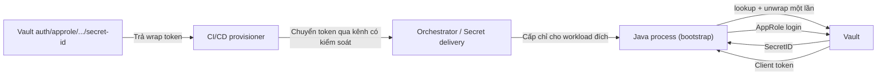

# Truyền thông tin khởi tạo qua ranh giới triển khai

> **Spring Vault — Cubbyhole và wrapping.** Một ứng dụng Java mới triển khai phải xác thực với HashiCorp Vault trước khi lấy secret, nhưng để xác thực đôi khi nó cần nhận một thông tin khởi tạo nhạy cảm (bootstrap credential). Bài này xây dựng cơ chế chuyển thông tin đó từ CI/CD hoặc hệ điều phối sang runtime bằng **Vault response wrapping**, kiểm tra token trước khi mở và tích hợp với Spring Vault. Mục tiêu là giảm việc chuyển **giá trị bí mật gốc** qua các hệ thống trung gian, giới hạn thời gian sử dụng và phát hiện trường hợp thông tin bị chặn đọc trước.

## 1. Bài toán ở ranh giới triển khai

Giả sử một dịch vụ `orders-api` được triển khai trong Kubernetes hoặc một VM mới. Dịch vụ cần đọc cấu hình từ KV, dùng Transit để mã hóa dữ liệu hoặc yêu cầu chứng thư từ PKI. Nó phải có một **Vault identity** phù hợp workload và policy tối thiểu.

Có ba vai trò trong luồng bootstrap:

| Vai trò | Có gì và có thể làm gì? | Điều không nên làm |
|---|---|---|
| **Issuer/provisioner**: CI/CD, deploy controller, operator | Có quyền tạo một thông tin khởi tạo cho đúng workload; có thể yêu cầu Vault wrap response | Đưa SecretID, Vault token lâu dài hay private key vào log/pipeline artifact |
| **Kênh bàn giao**: manifest, orchestrator, secret store tạm, runner, API deploy | Chuyển **wrapping token** đến đúng workload đích | Đọc hoặc giải mã secret bên trong; lưu token vô thời hạn |
| **Consumer**: `orders-api` khi khởi động | Nhận wrapping token, xác minh metadata, unwrap **một lần**, sử dụng credential để login Vault | Coi wrapping token là token ứng dụng dùng dài hạn; ghi credential vào log |

Trong ví dụ AppRole, `role_id` tương tự định danh vai trò và `secret_id` tương tự yếu tố xác thực bổ sung. `role_id` vẫn cần truyền qua kênh có kiểm soát; `secret_id` nên được bảo vệ mạnh hơn. Sau khi unwrap `secret_id`, ứng dụng kết hợp nó với `role_id` để login tại `auth/approle/login` và lấy **client token mới**, có policy/TTL riêng.

Khi đã có nền tảng hỗ trợ identity gốc như Kubernetes auth, JWT/OIDC hoặc cloud IAM, hãy đánh giá dùng trực tiếp identity đó để tránh bước phân phối SecretID. Response wrapping hữu ích nhất khi một thông tin bootstrap **phải** đi qua hệ thống trung gian; nó không thay thế thiết kế xác thực workload.

## 2. Cubbyhole, response wrapping và token ứng dụng khác nhau thế nào?

**Cubbyhole** là secrets engine luôn sẵn có của Vault. Dữ liệu ghi trong `cubbyhole/` được **phân tách theo token**: token A không truy cập cubbyhole của token B. Khi token hết hạn hoặc bị thu hồi, vùng cubbyhole gắn với nó không còn tồn tại. Dữ liệu cubbyhole không có TTL riêng trên từng key như một secret lease.

**Response wrapping** là cơ chế Vault dùng một *single-use wrapping token* với TTL ngắn để giữ toàn bộ phản hồi ban đầu. Vault lưu phản hồi được wrap vào cubbyhole riêng của token tạm và trả về **wrap_info**, thay vì trả plaintext secret cho provisioner. Consumer dùng token này để gọi `sys/wrapping/lookup`, sau đó `sys/wrapping/unwrap`.

So sánh ba kiểu dữ liệu dễ bị nhầm:

| Thành phần | Mục đích | Vòng đời | Có dùng để truy cập KV/Transit/PKI không? |
|---|---|---|---|
| **Wrapping token** | Chứng từ dùng **một lần** để mở phản hồi đã wrap | TTL riêng, hết hiệu lực sau unwrap hoặc hết hạn | **Không**: không dùng thay client token của ứng dụng |
| **Credential bên trong** (ví dụ AppRole SecretID) | Đầu vào của một cơ chế xác thực | Theo policy của AppRole: TTL, số lần sử dụng, các ràng buộc khác | **Không trực tiếp**: phải login để nhận client token |
| **Client token sau login** | Xác thực các yêu cầu Spring Vault theo workload | TTL/renewable/max TTL và policy do Vault quyết định | **Có**, trong giới hạn policy của workload |

**TTL của wrapping token khác TTL của credential và client token.** Ví dụ wrapping token sống 5 phút, SecretID sống 30 phút, và client token sống 1 giờ; các TTL này không tự động đồng bộ. Khi wrapping token hết hạn trước khi consumer khởi động, cần quy trình cấp một response wrap mới chứ không cố dùng lại.

## 3. Luồng chuẩn: tạo tại Vault, bàn giao qua CI/CD, mở ở runtime

```mermaid
sequenceDiagram
    participant P as Provisioner / CI
    participant V as Vault
    participant D as Delivery channel
    participant A as Java orders-api
    P->>V: Generate AppRole SecretID + X-Vault-Wrap-TTL: 5m
    V->>V: Serialize response, lưu vào cubbyhole token tạm
    V-->>P: wrap_info.token, ttl, creation_path
    P->>D: Chuyển wrapping token (secret handling)
    D->>A: Giao token tới workload đúng danh tính
    A->>V: sys/wrapping/lookup(wrapping token)
    V-->>A: creation_path, creation_time, ttl
    A->>A: Kiểm tra chính xác nguồn và thời gian
    A->>V: sys/wrapping/unwrap(wrapping token)
    V-->>A: data.secret_id; token wrap bị tiêu thụ
    A->>V: POST auth/approle/login(role_id, secret_id)
    V-->>A: client_token + lease/TTL/policies
    A->>V: VaultTemplate đọc KV/Transit/PKI theo policy
```

Cần tách các ranh giới:

1. **Quyền của provisioner:** tạo SecretID cho AppRole của đúng ứng dụng. Provisioner **không cần nhìn SecretID plaintext** nếu yêu cầu wrap ngay ở Vault.
2. **Quyền kênh bàn giao:** chuyển chuỗi wrapping token. Vì token này là **bearer credential**, người có token có thể chạy unwrap trước consumer; vì vậy vẫn phải bảo vệ đường truyền, đường lưu và danh tính người nhận.
3. **Quyền consumer trước login:** chỉ cần khả năng giao tiếp an toàn với Vault và wrapping token hợp lệ để unwrap. Chưa có quyền KV/Transit/PKI khi chưa login AppRole.
4. **Quyền consumer sau login:** Vault client token gắn policy ứng dụng tối thiểu; wrapper không tự cấp quyền tương đương.

Response wrapping tạo khả năng **phát hiện sử dụng trước**, không tự ngăn mọi hình thức đánh cắp. Nếu kẻ tấn công unwrap trước, token không mở được lần hai; consumer phải cảnh báo và xem audit log. Nó không bảo đảm dữ liệu an toàn trong trường hợp máy nhận bị chiếm quyền hoặc secret bị lộ sau unwrap.

## 4. Bước 1 — Provisioner tạo SecretID được response-wrap

Giả sử quản trị viên đã cấu hình AppRole `orders-api`, policy cho ứng dụng và cho phép provisioner tạo SecretID cho role đó. Lệnh dưới đây chạy trên **môi trường lab/CI được cấp quyền**, tại máy thuộc provisioner:

```bash
export VAULT_ADDR="https://vault.example.internal"

# VAULT_TOKEN của provisioner do workload identity / login riêng cung cấp.
# Chỉ yêu cầu quyền tạo SecretID cho role orders-api.
vault write -wrap-ttl=5m -force \
  auth/approle/role/orders-api/secret-id
```

Kết quả dạng minh họa:

```text
Key                              Value
---                              -----
wrapping_token                   [opaque-single-use-token]
wrapping_accessor                [accessor-for-audit]
wrapping_token_ttl               5m
wrapping_token_creation_time     2026-11-25T10:00:00Z
wrapping_token_creation_path     auth/approle/role/orders-api/secret-id
```

**Điều quan trọng:** output không chứa `secret_id` plaintext. Nếu lệnh tạo SecretID không yêu cầu `-wrap-ttl`, Vault có thể trả trực tiếp dữ liệu nhạy cảm cho provisioner. Thời điểm wrap là lúc Vault xử lý phản hồi: **wrap ngay tại nguồn** có ý nghĩa bảo mật khác việc đã lấy plaintext rồi gọi `sys/wrapping/wrap`.

Đối với HTTP API, provisioner gửi cùng yêu cầu tạo SecretID với header `X-Vault-Wrap-TTL: 5m`:

```http
POST /v1/auth/approle/role/orders-api/secret-id HTTP/1.1
Host: vault.example.internal
X-Vault-Token: <provisioner-token>
X-Vault-Wrap-TTL: 5m
Content-Type: application/json

{}
```

Phản hồi có cấu trúc bao ngoài:

```json
{
  "data": null,
  "wrap_info": {
    "token": "<opaque-single-use-token>",
    "ttl": 300,
    "creation_path": "auth/approle/role/orders-api/secret-id",
    "creation_time": "2026-11-25T10:00:00Z"
  }
}
```

Payload minh họa lược bỏ các trường HTTP response khác. Không ghi token thật trong log. Nếu cần audit/correlation, ưu tiên request ID và metadata không tiết lộ secret; đánh giá mức nhạy cảm của `wrapping_accessor` theo chính sách tổ chức.

### Có thể wrap dữ liệu tùy ý không?

Có. `POST /v1/sys/wrapping/wrap` kết hợp `X-Vault-Wrap-TTL` cho phép wrap một JSON do người gọi cung cấp, ví dụ:

```bash
curl --request POST \
  --header "X-Vault-Token: $PROVISIONER_TOKEN" \
  --header "X-Vault-Wrap-TTL: 2m" \
  --header "Content-Type: application/json" \
  --data '{"configRef":"orders-api/bootstrap/v2"}' \
  "$VAULT_ADDR/v1/sys/wrapping/wrap"
```

Cách này hữu ích với **dữ liệu đã có**, nhưng `creation_path` sẽ là `sys/wrapping/wrap`, không chứng minh secret được phát hành trực tiếp từ `auth/approle/role/orders-api/secret-id`. Khi yêu cầu chứng minh **nguồn gốc credential**, nên wrap **ngay phản hồi tạo credential** rồi kiểm tra exact creation path.

## 5. Bước 2 — Chuyển wrapping token qua kênh triển khai

Một luồng triển khai thường có dạng:



Các cách bàn giao có thể gồm orchestrator secret được mã hóa và phân quyền phù hợp, projected volume chỉ đọc cho Pod đích, kênh mTLS giữa provisioner và bootstrap agent, hoặc một Vault Agent setup có chức năng nhận wrapped SecretID. Tất cả các cách này cần kiểm tra quyền đọc, audit, thời gian tồn tại, và xóa dữ liệu sau khi tiêu thụ.

**Đừng xem wrapping token như dữ liệu không nhạy cảm:** với người có nó và còn trong TTL, đây là quyền mở secret. Tránh đặt token vào image Docker, Git, manifest kiểm soát phiên bản, URL query string, build logs hoặc command-line arguments hiển thị qua process listing. Nếu buộc dùng environment variable, cần kiểm soát quyền truy cập process/environment của host và cleanup sau khi bootstrap; mount file tạm với permission tối thiểu thường dễ quản trị vòng đời hơn.

Ví dụ hợp đồng bàn giao được CI gửi qua kênh bí mật tới runtime:

```json
{
  "target_workload": "orders-api",
  "expected_creation_path": "auth/approle/role/orders-api/secret-id",
  "delivery_expires_at": "2026-11-25T10:05:00Z",
  "wrapping_token": "<single-use-token>"
}
```

Dữ liệu trên là **mẫu hợp đồng ứng dụng**, không phải Vault API schema. `expected_creation_path` phải được triển khai/configuration xác lập **độc lập** với token do bên gửi cung cấp; nếu consumer tin cả token lẫn nguồn gốc do cùng một actor không tin cậy khai báo, phép so khớp sẽ không có giá trị.

Một nguyên tắc hay dùng là bàn giao `role_id` và wrapped `secret_id` qua **hai kênh khác nhau** hoặc hai bối cảnh có quyền truy cập khác nhau. Kênh giao `role_id` cũng phải được xác thực. Không đưa `role_id` cùng wrapping token vào một log dễ bị đọc.

## 6. Bước 3 — Consumer lookup, xác minh, rồi unwrap

### 6.1. Lookup không tiêu thụ wrapping token

Vault cung cấp:

| Operation | HTTP | Điều nhận được | Tiêu thụ token? |
|---|---|---|---|
| **Lookup** | `POST /v1/sys/wrapping/lookup` | `creation_path`, `creation_time`, `creation_ttl` | **Không** |
| **Unwrap** | `POST /v1/sys/wrapping/unwrap` | Phản hồi gốc chứa `secret_id` | **Có**, dùng một lần |
| **Rewrap** | `POST /v1/sys/wrapping/rewrap` | Wrapping token mới, giữ dữ liệu gốc | **Vô hiệu hóa** token cũ |
| **Wrap** | `POST /v1/sys/wrapping/wrap` | Token mới giữ JSON do caller đưa vào | Tạo token mới |

**Kiểm tra lookup trước khi unwrap**, ít nhất:

1. Token còn hợp lệ và chưa bị unwrap/revoke; nếu lookup không thấy, không tự cho phép bypass.
2. `creation_path` **khớp chính xác** `auth/approle/role/orders-api/secret-id` — không chỉ kiểm tra prefix `auth/approle/`.
3. Thời điểm tạo, TTL phát hành và thời gian đã trôi qua nằm trong cửa sổ bootstrap cho phép. Kiểm tra đồng hồ có đồng bộ NTP.
4. Có bản ghi deployment/nonce/correlation khớp với đúng workload đích theo hệ thống điều phối (thông tin này thuộc kênh kiểm soát riêng, không tự có trong wrapping token).
5. Kênh HTTPS/TLS trỏ đến Vault cluster, namespace, mount được cấu hình cho môi trường đó.

Ví dụ người vận hành thực hành có thể dùng CLI, nhưng **không in wrapping token thật ra shell history**:

```bash
# VAULT_ADDR đã trỏ tới Vault dev/test.
# WRAP_TOKEN được nạp qua input bí mật, không gõ nguyên token vào lệnh.
vault write -format=json sys/wrapping/lookup token="$WRAP_TOKEN"
```

Response giản lược:

```json
{
  "data": {
    "creation_path": "auth/approle/role/orders-api/secret-id",
    "creation_time": "2026-11-25T10:00:00Z",
    "creation_ttl": 300
  }
}
```

`lookup` là thao tác xem **metadata**, không trả SecretID. Khi lookup báo không hợp lệ, có nhiều khả năng: token hết hạn, đã được unwrap, bị revoke hoặc nhầm cluster/namespace. Đây là tín hiệu cần điều tra, **không phải bằng chứng chắc chắn đã bị đánh cắp**.

### 6.2. Unwrap phải đúng một cách truyền token

Hai cách gọi HTTP được Vault hỗ trợ:

**Cách A — token wrap ở header, không truyền lại trong body:**

```bash
curl --silent --show-error --fail-with-body \
  --header "X-Vault-Token: $WRAP_TOKEN" \
  --request POST \
  "$VAULT_ADDR/v1/sys/wrapping/unwrap"
```

**Cách B — một token truy cập Vault khác ở header; token wrap nằm trong body:**

```bash
curl --silent --show-error --fail-with-body \
  --header "X-Vault-Token: $AUTHORIZED_TOKEN" \
  --header "Content-Type: application/json" \
  --request POST \
  --data "{\"token\":\"$WRAP_TOKEN\"}" \
  "$VAULT_ADDR/v1/sys/wrapping/unwrap"
```

**Tuyệt đối không dùng cùng wrapping token ở cả header và body.** Vault cảnh báo trường hợp này có thể tiêu thụ token nhưng không trả lại payload. Với bootstrap chưa có client token, **cách A** thường trực quan nhất. Không cần root token để unwrap một phản hồi mà bạn có wrapping token hợp lệ.

Trong CLI, cách tương đương khi dùng token wrap làm token hiện tại:

```bash
VAULT_TOKEN="$WRAP_TOKEN" vault unwrap -format=json
```

Dùng biến `VAULT_TOKEN` chỉ cho đúng lệnh trong môi trường thử nghiệm; đừng đồng thời chỉ định `vault unwrap "$WRAP_TOKEN"` vì sẽ làm token xuất hiện cả trong thông tin xác thực và tham số.

Phản hồi gốc của thao tác tạo SecretID có dạng tương tự:

```json
{
  "data": {
    "secret_id": "<secret-id-for-orders-api>",
    "secret_id_accessor": "<accessor>",
    "secret_id_ttl": 1800,
    "secret_id_num_uses": 1
  }
}
```

Các TTL/use counts trên chỉ là **minh họa**; do cấu hình AppRole quyết định. `secret_id` là dữ liệu nhạy cảm, phải được quản lý trong bộ nhớ/thời gian ngắn nhất có thể. Sau unwrap thành công, wrapping token không còn giá trị để unwrap lại.

## 7. Tích hợp Spring Vault: đọc wrapping response trong Java

Spring Vault cung cấp `VaultOperations.opsForWrapping()` từ dòng **Spring Vault 2.1**, trả về `VaultWrappingOperations`. Các operation liên quan:

```java
VaultWrappingOperations wrapping = vaultOperations.opsForWrapping();

WrappedMetadata metadata = wrapping.lookup(VaultToken.of(wrappingToken));
VaultResponse result = wrapping.read(VaultToken.of(wrappingToken));
WrappedMetadata rotated = wrapping.rewrap(VaultToken.of(wrappingToken));
WrappedMetadata issued = wrapping.wrap(body, Duration.ofMinutes(2));
```

Các dòng trên mô tả **các thao tác riêng**, không nên gọi `rewrap` sau `read` trên cùng token — `read` đã unwrap và tiêu thụ nó. `wrap(body, Duration)` bọc payload mới qua `sys/wrapping/wrap`; để wrap ngay response phát hành SecretID, provisioner nên gọi endpoint AppRole có `X-Vault-Wrap-TTL`.

### 7.1. Ví dụ Java consumer xác minh nguồn trước khi unwrap

Ví dụ sau yêu cầu dự án đã tạo `VaultOperations` phù hợp để gọi wrapping API của cluster. **Đây là bước bootstrap**, không đòi hỏi client token ứng dụng đã được cấp trước đó; phải cấu hình bootstrap client để không cố đọc secret nghiệp vụ trước khi login.

```java
import java.time.Duration;
import java.time.Instant;
import java.util.Map;
import java.util.Objects;

import org.springframework.vault.core.VaultOperations;
import org.springframework.vault.core.VaultWrappingOperations;
import org.springframework.vault.support.VaultResponse;
import org.springframework.vault.support.VaultToken;
import org.springframework.vault.support.WrappedMetadata;

public final class WrappedSecretIdBootstrap {

    private static final String EXPECTED_PATH =
            "auth/approle/role/orders-api/secret-id";

    private final VaultWrappingOperations wrapping;

    public WrappedSecretIdBootstrap(VaultOperations vaultOperations) {
        this.wrapping = vaultOperations.opsForWrapping();
    }

    /**
     * Chỉ gọi một lần cho token đã nhận qua kênh bàn giao được bảo vệ.
     * Chuỗi trả về là secret thực sự: KHÔNG log/serialize.
     */
    public String unwrapSecretId(String wrappingToken) {
        Objects.requireNonNull(wrappingToken, "wrappingToken");
        VaultToken token = VaultToken.of(wrappingToken);

        // 1) Xem metadata, không tiêu thụ token.
        WrappedMetadata metadata = wrapping.lookup(token);
        if (metadata == null) {
            throw new IllegalStateException(
                    "Wrapping token invalid, expired or already used");
        }

        // 2) Bảo đảm provenance khớp contract của deployment.
        if (!EXPECTED_PATH.equals(metadata.getPath())) {
            throw new SecurityException(
                    "Unexpected wrapping creation path");
        }

        // 3) Kiểm tra thời gian tạo và TTL (5 phút theo chính sách).
        Duration maxAge = Duration.ofMinutes(5);
        Instant now = Instant.now();
        if (metadata.getTtl().compareTo(maxAge) > 0
                || metadata.getCreationTime().isAfter(now.plusSeconds(30))
                || !now.isBefore(
                        metadata.getCreationTime().plus(metadata.getTtl()))) {
            throw new SecurityException("Invalid wrapping lifetime");
        }

        // 4) Unwrap một lần, sau khi metadata được xác minh.
        VaultResponse response = wrapping.read(token);
        if (response == null || response.getData() == null) {
            throw new IllegalStateException("Unwrap returned no data");
        }

        Map<String, Object> data = response.getData();
        Object value = data.get("secret_id");
        if (!(value instanceof String) || ((String) value).isBlank()) {
            throw new SecurityException(
                    "Wrapped AppRole response has no SecretID");
        }

        return (String) value;
    }
}
```

**Giới hạn minh họa:** ở môi trường thật cần thêm chính sách lệch đồng hồ, thời gian tối đa tính từ thời điểm nhận token, gắn workload/deployment ID, và xử lý lỗi audit. Ngay cả khi lookup hợp lệ, token có thể bị tiêu thụ **giữa lookup và unwrap** bởi bên khác (*race condition*); phải coi unwrap thất bại là tín hiệu an ninh/vận hành. Đừng gọi lại unwrap mù quáng.

`getPath()`, `getTtl()`, `getCreationTime()` là metadata của token wrap. `getTtl()` phản ánh **TTL lúc tạo** trong response wrapping metadata, không nhất thiết là thời gian còn lại. Vì vậy mã kiểm tra `creationTime + ttl` theo đồng hồ tin cậy; thời gian còn lại và tính hợp lệ cuối cùng vẫn do Vault quyết định khi unwrap.

### 7.2. Login AppRole sau khi lấy SecretID

Sau khi lấy đúng SecretID, consumer gửi `role_id` và `secret_id` tới API AppRole:

```http
POST /v1/auth/approle/login HTTP/1.1
Host: vault.example.internal
Content-Type: application/json

{
  "role_id": "<role-id-provisioned-separately>",
  "secret_id": "<unwrapped-secret-id>"
}
```

Phản hồi chứa `auth.client_token`, `auth.lease_duration`, `auth.renewable` và policies. Trong Spring Vault có thể dùng **`AppRoleAuthentication`** và `AppRoleAuthenticationOptions` để quản lý đăng nhập; cân nhắc **`CubbyholeAuthentication`** hoặc Vault Agent auto-auth khi luồng bootstrap thực tế yêu cầu token wrap. Tên class và constructor phải đối chiếu tài liệu đúng phiên bản Spring Vault của dự án.

Sau login, ứng dụng dùng `VaultTemplate` với client token của workload để đọc KV, gọi Transit, PKI theo policy, và cấu hình `LifecycleAwareSessionManager` nếu cần gia hạn token. **Không đưa wrapping token vào session manager dùng dài hạn**, vì sau unwrap nó đã bị thu hồi.

### 7.3. Rewrap đúng tình huống

`rewrap` là cách đổi wrapping token khi dữ liệu chưa được unwrap:

```java
WrappedMetadata rotated = wrapping.rewrap(
        VaultToken.of(oldWrappedToken));

// Giao rotated.getToken() qua kênh an toàn,
// vô hiệu hóa oldWrappedToken ngay sau thao tác thành công.
```

Vault tạo token mới với **creation TTL giống token cũ**, đồng thời vô hiệu token cũ. Tránh coi rewrap là cơ chế gia hạn vô hạn cho bootstrap credential: TTL mới được thiết lập theo contract của rewrap, nhưng secret gốc vẫn có TTL/quy tắc riêng. Rewrap cần được phân quyền và ghi nhận trong audit; nếu đã unwrap, không còn token để rewrap.

## 8. Chính sách quyền truy cập và các bảo vệ ở hai phía

Không dùng một Vault root token cho CI, consumer và tác vụ kiểm thử. Phân quyền nên tách:

| Identity | Quyền dự kiến | Phạm vi |
|---|---|---|
| CI/provisioner | `update` hoặc quyền tối thiểu theo AppRole API ở `auth/approle/role/orders-api/secret-id` | Chỉ tạo SecretID cho **một role** |
| AppRole của `orders-api` | `read` các KV cần dùng, `update` Transit decrypt/encrypt cụ thể, `read` PKI nếu phù hợp | Chỉ paths của dịch vụ |
| Consumer trước login | Xác minh và unwrap token wrap đã nhận | `sys/wrapping/lookup` và `sys/wrapping/unwrap` theo hành vi token wrap |
| Operator bảo mật | Đọc audit và quản lý cấu hình AppRole/policy/rotation | Tách khỏi runtime của ứng dụng |

Policy minh họa cho provisioner phát hành SecretID:

```hcl
path "auth/approle/role/orders-api/secret-id" {
  capabilities = ["update"]
}
```

Còn policy của ứng dụng sau login phải do đội vận hành thiết kế theo **endpoint thực tế** (ví dụ KV v2 có `secret/data/orders-api/*`). Không cấp `sudo` hoặc quyền quản lý AppRole cho ứng dụng chỉ vì nó cần tự login.

Các ràng buộc hữu ích cho AppRole: `secret_id_ttl`, `secret_id_num_uses`, giới hạn CIDR nguồn nếu phù hợp topology, token policies và token TTL. Không đặt `num_uses=1` một cách máy móc nếu cơ chế tái xác thực/khởi động lại của ứng dụng cần SecretID còn hiệu lực; thay vào đó chọn phương án phát hành lại hoặc auth method khác. Với token ứng dụng, để Spring Vault quản lý renewal/reauthentication theo token lifecycle và giới hạn server.

Ngoài Vault ACL, cần bảo vệ:

- **TLS và server identity**: không tắt certificate verification để bootstrap.
- **Kênh CI/CD → runtime**: hạn chế chủ thể có quyền đọc wrapping token, mã hóa khi lưu tạm và hạn chế thời gian tồn tại.
- **Identity đích**: gắn token với deployment cụ thể theo metadata điều phối; `creation_path` chỉ chứng minh API nguồn của response, không xác thực người nhận.
- **Đường log/telemetry**: không log `wrap_info.token`, `secret_id`, `client_token`, body unwrap hay môi trường tiến trình.
- **Cleanup**: xóa file/biến lưu wrapper sau unwrap, không để trong artifact/backup/snapshot lâu dài.
- **Rotations và incident**: nếu token bị dùng trước, thu hồi credential có liên quan nếu đã được cấp, phát hành bootstrap mới qua kênh đã đánh giá.

## 9. Xử lý lỗi ở từng ranh giới

| Dấu hiệu | Khả năng | Phản ứng phù hợp |
|---|---|---|
| CI không nhận `wrap_info` | Thiếu header/`-wrap-ttl`, endpoint không hỗ trợ, policy wrap TTL chặn | Dừng deployment; không truyền response plaintext thay thế |
| Consumer không nhận wrapper đúng giờ | Kênh bàn giao lỗi/khởi động chậm | Cảnh báo, cấp token mới theo quy trình; không tăng TTL tùy tiện |
| `lookup` trả invalid/404 | Hết TTL, đã unwrap, bị revoke hoặc sai cluster/namespace | Ghi nhận sự kiện, xem Vault audit, điều tra trước khi cấp lại |
| `creation_path` sai | Bên gửi wrap lại dữ liệu, chọn sai role hoặc can thiệp vào nguồn | Từ chối unwrap; điều tra kênh cung cấp |
| `unwrap` thất bại sau lookup PASS | Race, hết hạn giữa hai lệnh, Vault/network failure | Không retry vô điều kiện; tra audit và trạng thái token |
| Unwrap thành công nhưng thiếu `secret_id` | Nhầm API nguồn hoặc response schema | Dừng login; phân loại lỗi dữ liệu |
| `auth/approle/login` trả 403 | RoleID/SecretID sai, SecretID hết TTL/đã dùng, bound CIDR không khớp | Không đoán token mới; kiểm tra cấu hình role và audit |
| Vault trả 5xx/timeout | Cluster chưa sẵn sàng, failover, mạng | Backoff giới hạn và giám sát; phân biệt timeout với token đã tiêu thụ |
| Login thành công nhưng đọc KV 403 | Policy workload sai đường dẫn hoặc thiếu capability | Sửa policy đúng path theo KV version, không tăng quyền bao trùm |
| Startup lặp lại sau thành công | Consumer giữ lại wrapper đã bị dùng | Thiết kế idempotency theo trạng thái bootstrap, cần identity/credential mới khi restart |

Một lỗi unwrap **không xác nhận** đã có kẻ đọc dữ liệu; token có thể đã hết hạn vì khởi động chậm. Tuy nhiên, để không bỏ sót replay/đánh cắp, nên cảnh báo theo severity, tra audit events và kiểm tra khớp request/deployment.

### Cảnh báo “double-use” đặc biệt quan trọng

Endpoint `sys/wrapping/unwrap` cho phép truyền wrapper trong **header** *hoặc* trong **body với token khác ở header**. Đừng truyền cùng wrapper ở cả hai vị trí. Vault ghi rõ thao tác double-use có thể khiến token bị revoke mà payload không được tra cứu đúng. Cách an toàn nhất cho bootstrap là một wrapper token ở `X-Vault-Token`, body rỗng.

## 10. Kiểm thử tích hợp Java và quy trình triển khai

Vì response wrapping là cơ chế **Vault server**, test mock repository hoặc chỉ kiểm tra chuỗi JSON không chứng minh được tính dùng một lần. Sử dụng Vault dev/test instance độc lập; tạo AppRole, policy, role và SecretID dành riêng cho test.

Ma trận tích hợp gợi ý:

| ID | Test | Assertion quan trọng |
|---|---|---|
| B01 | Provisioner wrap AppRole SecretID | Phản hồi chứa `wrap_info.token`, **không lộ** `data.secret_id` |
| B02 | Lookup wrapper còn sống | Trả đúng `creation_path`, không tiêu thụ token |
| B03 | Unwrap lần đầu | Nhận `data.secret_id` hợp lệ, tạo được login AppRole nếu policy phù hợp |
| B04 | Unwrap lần hai cùng token | Thất bại; không trả lại SecretID |
| B05 | Rewrap trước unwrap | Token cũ vô hiệu; token mới unwrap được một lần |
| B06 | Creation path không đúng | Consumer dừng **trước unwrap** |
| B07 | Token hết TTL | Lookup/unwrap không hợp lệ; không fallback về secret cũ |
| B08 | Sai cluster/namespace | Không chấp nhận metadata ngoài scope |
| B09 | AppRole thiếu quyền downstream | Login có thể được nhưng `VaultTemplate` truy cập sai KV/Transit bị 403 |
| B10 | Pod restart | Không tái sử dụng wrapper đã unwrap; nhận identity/credential mới có kiểm soát |
| B11 | Đồng thời hai consumer dùng một wrapper | Chỉ **tối đa một** unwrap thành công |
| B12 | Audit | Ghi lại request IDs/operation, không chứa wrapping token hoặc SecretID plaintext |

Ví dụ JUnit 5 giả định có một helper fixture **tự tạo token wrap mới cho mỗi test** trên Vault thử nghiệm và có một `VaultOperations` đã cấu hình:

```java
import static org.junit.jupiter.api.Assertions.*;

import org.junit.jupiter.api.Test;
import org.springframework.beans.factory.annotation.Autowired;
import org.springframework.boot.test.context.SpringBootTest;
import org.springframework.vault.core.VaultOperations;
import org.springframework.vault.core.VaultWrappingOperations;
import org.springframework.vault.support.VaultResponse;
import org.springframework.vault.support.VaultToken;
import org.springframework.vault.support.WrappedMetadata;

@SpringBootTest
class ResponseWrappingIT {

    @Autowired VaultOperations vaultOperations;

    @Test
    void wrappingTokenCanBeConsumedOnlyOnce() {
        VaultWrappingOperations wrapping =
                vaultOperations.opsForWrapping();

        // Trong test thực tế, fixture gọi Vault server để tạo wrapper mới.
        WrappedMetadata created = wrapping.wrap(
                java.util.Map.of("bootstrapRef", "fixture-only"),
                java.time.Duration.ofMinutes(2));

        VaultToken token = created.getToken();
        assertNotNull(wrapping.lookup(token));

        VaultResponse first = wrapping.read(token);
        assertNotNull(first);
        assertEquals("fixture-only",
                first.getData().get("bootstrapRef"));

        // Kết quả ở lần thứ hai là null hoặc Vault exception tùy
        // phiên bản và HTTP handling, nhưng không được trả secret.
        assertThrowsOrReturnsNoData(wrapping, token);
    }

    private void assertThrowsOrReturnsNoData(
            VaultWrappingOperations wrapping, VaultToken token) {

        try {
            VaultResponse second = wrapping.read(token);
            assertTrue(second == null || second.getData() == null,
                    "Wrapped payload must never be delivered twice");
        } catch (org.springframework.vault.VaultException expected) {
            // Token đã bị tiêu thụ: hành vi hợp lệ.
        }
    }
}
```

Kiểm thử `wrapping.wrap(...)` chứng minh tính **single-use** của wrapping server, nhưng `creation_path` ở đây là `sys/wrapping/wrap`. Để kiểm tra **nguồn SecretID thật**, fixture cần tạo wrapper bằng endpoint `auth/approle/role/orders-api/secret-id` với wrap TTL, rồi assert path chính xác và unwrap nhận `secret_id`.

Một test hữu ích khác là tạo **hai thread cùng unwrap một wrapping token thật**. Tối đa một thread được nhận payload; thread còn lại phải ghi nhận token invalid/consumed. Không được thiết kế cleanup bằng cách gọi `unwrap` “để chắc chắn” vì bản thân hành động này sẽ tiêu thụ token.

Trong CI, không cần chờ TTL thật nhiều phút: tạo TTL vài giây trong test riêng, hoặc kiểm chứng expiry theo fixture ngắn với retry có giới hạn. Các bài test concurrency/expiry nên chạy trong môi trường dành riêng để tránh ảnh hưởng đến secret khác. Nếu không có Vault trong CI, đánh dấu rõ integration tests không chạy, không coi mock tests thay thế được.

## 11. Quyết định thiết kế cho hệ thống Java thực tế

Nếu cần bàn giao một **SecretID lần đầu** từ pipeline sang VM, response-wrap trực tiếp trên endpoint AppRole SecretID là lựa chọn phù hợp khi có kênh nhận riêng và quy trình kiểm tra. Nếu ứng dụng chạy trên Kubernetes đã có service account token gắn đúng audience hoặc có cloud workload identity, hãy cân nhắc xác thực trực tiếp bằng **Kubernetes/JWT/IAM auth**: bỏ bước phân phối credential riêng có thể làm kiến trúc đơn giản hơn.

Khi dùng wrapping, hãy viết rõ một **hợp đồng triển khai** gồm:

1. **Ai tạo**: provisioner identity, đúng role/policy, đúng Vault cluster/namespace.
2. **Tạo cái gì**: API nguồn chính xác, `creation_path` phải khớp.
3. **Bàn giao cho ai**: workload identity/deployment ID; đường nhận chỉ đọc, TTL ngắn và được audit.
4. **Ai xác minh**: consumer phải lookup metadata và so khớp với cấu hình kỳ vọng độc lập.
5. **Khi nào unwrap**: sau khi TLS và provenance được xác thực, đúng một lần, tránh lộ response.
6. **Sau unwrap**: login Vault, cấp client token theo policy, hủy wrapper, quản lý token/lease và rotate.
7. **Khi thất bại**: dừng bootstrap, cảnh báo, tra audit, phát hành credential mới khi đã đánh giá nguyên nhân.

**Sơ đồ cần nhớ:** Provisioner yêu cầu **Vault wrap tại nguồn** → hệ thống triển khai chỉ chuyển **wrapping token** → consumer **lookup và kiểm tra nguồn** → **unwrap một lần** → dùng credential bên trong để **đăng nhập theo workload** → **VaultTemplate** dùng client token mới gọi KV/Transit/PKI.

## 12. Câu hỏi thực hành

1. Vì sao cùng là token của Vault nhưng wrapping token không nên dùng trong `VaultTemplate` để đọc KV sau khởi động? Nó khác client token đăng nhập như thế nào?
2. Nếu CI tạo `secret_id` plaintext rồi gọi `sys/wrapping/wrap`, phép kiểm tra `creation_path` trong consumer cho biết nguồn gốc nào? Vì sao khác wrap trực tiếp endpoint tạo SecretID?
3. Consumer nhận token có `creation_path = auth/approle/role/admin/secret-id` trong khi nó cần `orders-api`. Nó có nên unwrap để “xem bên trong” không?
4. Token lookup PASS nhưng unwrap thất bại. Hãy nêu ít nhất ba khả năng và cách điều tra.
5. Bạn có thể gửi wrapped SecretID và RoleID cùng một ConfigMap public trong cluster không? Vì sao?
6. Khi Pod restart sau lần unwrap thành công, nó có thể dùng lại wrapper cũ không? Thiết kế hồi phục nào phù hợp?
7. Hai ứng dụng cùng nhận một wrapper token. Có thể cả hai lấy cùng SecretID không? Thử nghiệm nào xác minh câu trả lời?
8. Vì sao không nên truyền cùng wrapper token trong cả `X-Vault-Token` và tham số `token` của `sys/wrapping/unwrap`?

**Gợi ý:** (1) wrapper chỉ được dùng một lần để lấy payload, token ứng dụng có TTL/policy để truy cập secrets engine; (2) `sys/wrapping/wrap` chỉ chứng minh payload đã được wrap do caller cung cấp, không chứng minh phát hành SecretID gốc; (3) từ chối trước unwrap; (4) hết TTL, bị dùng trước, revoke, race, lỗi mạng/cluster; (5) không, bearer token vẫn rất nhạy cảm; (6) cần credential mới hoặc identity method không lệ thuộc wrapper cũ; (7) tối đa một consumer thành công; (8) dễ gây double-use và mất payload.

## 13. Tài liệu chính thức

- [HashiCorp Vault — Response wrapping](https://developer.hashicorp.com/vault/docs/concepts/response-wrapping): mô hình single-use token, TTL độc lập, creation path, lookup/unwrap/rewrap, validation chống can thiệp.
- [HashiCorp Vault — Cubbyhole secrets engine](https://developer.hashicorp.com/vault/docs/secrets/cubbyhole): dữ liệu theo namespace của từng token, lifecycle của cubbyhole.
- [HashiCorp Vault API — Wrap](https://developer.hashicorp.com/vault/api-docs/system/wrapping-wrap): `POST /sys/wrapping/wrap`.
- [HashiCorp Vault API — Lookup](https://developer.hashicorp.com/vault/api-docs/system/wrapping-lookup): `POST /sys/wrapping/lookup`.
- [HashiCorp Vault API — Unwrap](https://developer.hashicorp.com/vault/api-docs/system/wrapping-unwrap): `POST /sys/wrapping/unwrap`; cảnh báo double-use.
- [HashiCorp Vault API — Rewrap](https://developer.hashicorp.com/vault/api-docs/system/wrapping-rewrap): rotate wrapper và vô hiệu token cũ.
- [HashiCorp Vault — AppRole best practices](https://developer.hashicorp.com/vault/docs/auth/approle/approle-pattern): phân phối SecretID qua response wrapping.
- [Spring Vault — VaultWrappingOperations Javadoc](https://docs.spring.io/spring-vault/reference/api/java/org/springframework/vault/core/VaultWrappingOperations.html): `lookup`, `read`, `rewrap`, `wrap` và contract Java, từ Spring Vault 2.1.
- [Spring Vault — Authentication methods](https://docs.spring.io/spring-vault/reference/vault/authentication.html): AppRole/Cubbyhole authentication, quản lý vòng đời token trong ứng dụng.

> **Điểm mấu chốt:** trong bước bootstrap, hệ thống triển khai **chỉ vận chuyển wrapper có TTL ngắn**; Java consumer kiểm tra `creation_path`, unwrap **đúng một lần** và sau đó đăng nhập Vault bằng workload identity/policy phù hợp. Một token đã tiêu thụ hoặc sai nguồn phải dẫn đến điều tra, không được tự động bỏ qua.
