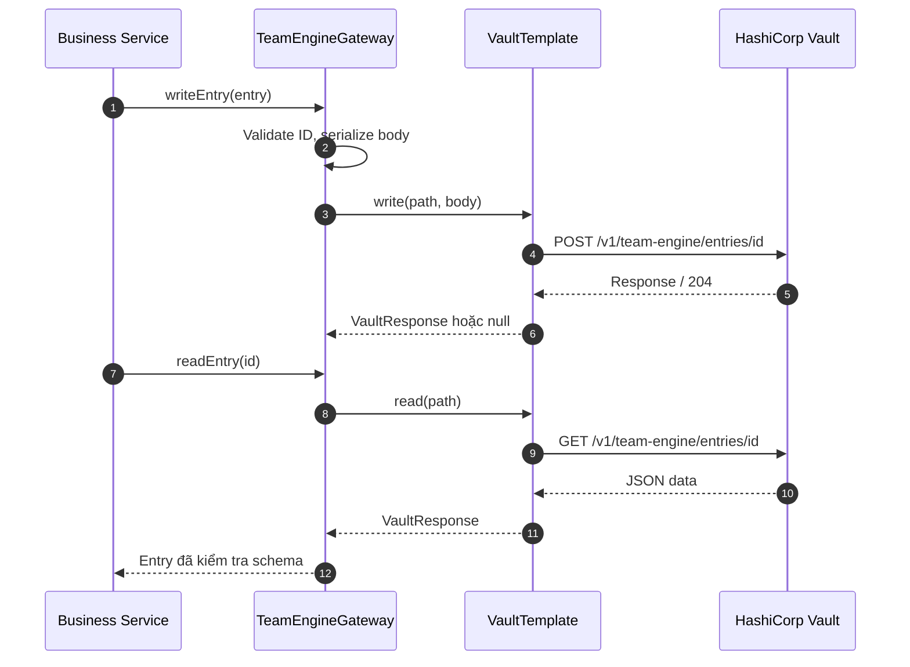

# Sử dụng read và write cho engine chưa có API chuyên biệt trong Spring Vault

## 1. Bài toán: Vault có nhiều engine hơn những API tiện ích sẵn có

Ứng dụng Java dùng **SPRING_VAULT** thường truy cập HashiCorp Vault qua `VaultTemplate` để lấy KV secrets, gọi Transit, làm việc với PKI hoặc quản lý xác thực theo workload. Spring Vault có các API chuyên biệt như `opsForKeyValue(...)`, `opsForTransit(...)` và `opsForPki(...)` để giảm lượng mã phải tự viết. Tuy nhiên, không phải secrets engine, plugin hoặc endpoint mới nào của Vault cũng có một lớp Java tương ứng trong phiên bản Spring Vault đang sử dụng.

Khi đó, ứng dụng vẫn có thể tương tác với API Vault bằng hai thao tác tổng quát:

- **`VaultTemplate.read(path)`**: gọi HTTP **GET** đến đường dẫn Vault và nhận `VaultResponse`; phù hợp với endpoint đọc không cần request body.
- **`VaultTemplate.write(path, body)`**: gọi HTTP **POST** đến đường dẫn Vault với body (thường là JSON) và nhận `VaultResponse` nếu có; phù hợp với endpoint được thiết kế để nhận POST.

Điểm quan trọng là **phải hiểu hợp đồng API của engine đích**: tên mount, endpoint, HTTP method, tham số, cấu trúc response, quyền truy cập và tác dụng phụ. `read`/`write` là cách gọi HTTP có xác thực, không tự biến một endpoint thành kho KV và không tự xử lý mọi loại secret hay lease.

Sau bài này, bạn có thể đọc tài liệu của một engine, ánh xạ endpoint của nó sang `VaultTemplate.read/write`, kiểm tra kết quả an toàn và biết khi nào cần dùng API chuyên biệt hoặc callback HTTP cấp thấp hơn.

## 2. Chọn đúng mức trừu tượng

| Nhu cầu | API nên ưu tiên | Lý do |
| --- | --- | --- |
| KV v1/KV v2 thông thường | `opsForKeyValue(mount, backend)` | Hiểu quy ước đường dẫn và cấu trúc phiên bản KV |
| Transit/PKI đã được Spring Vault hỗ trợ | `opsForTransit(...)` / `opsForPki(...)` | Có đối tượng và thao tác phản ánh nghiệp vụ |
| Engine hoặc plugin có endpoint GET/POST nhưng chưa có API chuyên biệt | `read(path)` / `write(path, body)` | Gọi trực tiếp hợp đồng HTTP, nhận dữ liệu tổng quát |
| Endpoint cần LIST, DELETE | `list(path)` / `delete(path)` nếu phù hợp | GET không tương đương LIST; POST không tương đương DELETE |
| Endpoint đòi PUT, PATCH, headers riêng hoặc xử lý response đặc biệt | Callback được xác thực như `doWithSession(...)` hoặc HTTP client Vault thích hợp | `write` luôn mang ý nghĩa POST; không tùy chỉnh HTTP method |

Trong code ứng dụng, có thể phụ thuộc vào giao diện `VaultOperations` để dễ kiểm thử. Lớp triển khai trung tâm là `VaultTemplate`, dùng thông tin kết nối và quản lý token phiên đăng nhập đã được cấu hình. Các path thông thường được cung cấp **tương đối** với endpoint Vault.

Không nên dựng một REST client không có xác thực riêng chỉ vì API chưa có wrapper: `VaultTemplate` giúp tái sử dụng cấu hình Vault endpoint, TLS, token và cơ chế xác thực/renewal phù hợp với workload.

## 3. Từ API Vault tới path Spring Vault

Ví dụ giả định tổ chức cài **một secrets engine/plugin riêng** tên `team-engine` tại mount `team-engine/`. Tài liệu plugin quy định:

| Hợp đồng plugin giả định | HTTP method | Request | Response |
| --- | --- | --- | --- |
| `/v1/team-engine/entries/{id}` | GET | Không có body | JSON chứa `data.owner`, `data.enabled` |
| `/v1/team-engine/entries/{id}` | POST | JSON `{"owner":"...","enabled":true}` | Có thể trả JSON hoặc 204 No Content |

**Đây là API minh họa cho một plugin giả định, không phải endpoint Vault có sẵn.** Muốn chạy nguyên ví dụ, môi trường phải có một plugin thực sự cung cấp đúng hai endpoint và contract ấy. Khi chuyển sang engine thật, thay mount/path/body theo tài liệu của engine đó.

Trong `VaultTemplate`, sử dụng:

```java
vaultTemplate.read("team-engine/entries/service-a");

vaultTemplate.write(
    "team-engine/entries/service-a",
    Map.of("owner", "platform-team", "enabled", true)
);
```

Không thêm `/v1/` vào đầu path; Spring Vault tự sử dụng API endpoint đã cấu hình. Không nối URL máy chủ vào path theo thói quen. Spring Vault cũng có thể xử lý URI tuyệt đối trong một số trường hợp; **không cho client quyết định một URI tuyệt đối** vì thông tin xác thực có thể bị gửi tới đích không mong muốn.

### 3.1. Mount, path và namespace là ba ý niệm riêng

- **Mount path**: nơi engine được gắn vào Vault, chẳng hạn `team-engine/` hoặc `company/data-tools/`. Tên mount do người quản trị chọn, có thể không giống tên loại engine.
- **Endpoint path**: phần đường dẫn do engine định nghĩa, ví dụ `entries/service-a`. Không giả định mỗi engine có thao tác `/data/`, `/metadata/` hay `/config/` như engine khác.
- **Vault Enterprise namespace** (nếu sử dụng): ngữ cảnh tenant/nhóm quản lý Vault. Namespace thường được cấu hình ở client hoặc header; không thể tùy tiện coi nó là phần của secret path.

Trong mọi trường hợp, hãy xác minh nơi mount và cấu trúc API. Nếu engine mount ở `team/secure-data/` thì request hợp lệ có thể bắt đầu từ `team/secure-data/...`; mã Java dùng sai mount sẽ nhận 404 hoặc lỗi quyền.

## 4. Đọc bằng VaultTemplate.read()

Phương thức tổng quát:

```java
VaultResponse response =
        vaultTemplate.read("team-engine/entries/service-a");
```

Đặc tính cần nhớ:

1. `read(path)` thực hiện GET, phù hợp với endpoint không cần body.
2. Giá trị trả về là `VaultResponse`; `response.getData()` là `Map<String, Object>` của trường **`data`** trong phản hồi Vault.
3. Nếu path không tồn tại, `read` có thể trả về `null` (như tài liệu API Spring Vault mô tả). Cần kiểm tra `null` trước khi gọi `getData()`.
4. JSON trong `data` có thể có object lồng nhau, list, số, boolean, string; không được ép kiểu mù.
5. Metadata Vault như `lease_id`, `lease_duration` và `renewable` nằm ở **ngoài** `data` trong response tiêu chuẩn và có thể được truy xuất từ `VaultResponse`.

Ví dụ response minh họa:

```json
{
  "request_id": "<REQUEST_ID>",
  "lease_id": "",
  "renewable": false,
  "lease_duration": 0,
  "data": {
    "owner": "platform-team",
    "enabled": true
  }
}
```

Nếu endpoint không tồn tại, quyền bị thiếu hoặc plugin trả lỗi, các trường hợp không nhất thiết cho cùng kết quả. **Không gộp lỗi quyền 403 thành “không có secret”** và cũng không mặc định mọi 404 đều có nghĩa ID bị xóa: mount hoặc route có thể sai.

### 4.1. Ví dụ đọc engine thực tế: dynamic database credential

Nếu quản trị viên đã cấu hình database secrets engine với role `reporting`, endpoint thực tế `database/creds/reporting` thường cho phép lấy thông tin đăng nhập động:

```java
VaultResponse response = vaultTemplate.read("database/creds/reporting");
if (response == null || response.getData() == null) {
    throw new IllegalStateException("Vault did not return database credentials");
}

Map<String, Object> data = response.getData();
String username = (String) data.get("username");
String password = (String) data.get("password");

String leaseId = response.getLeaseId();
long leaseDurationSeconds = response.getLeaseDuration();
boolean renewable = response.isRenewable();

// Chuyển username/password cho thành phần quản lý kết nối an toàn;
// không log ra giá trị credential.
```

**Lưu ý:** Đây là một **GET có tác dụng tạo credential mới** theo contract của database engine, dù phương thức Java mang tên `read`. Gọi lại nhiều lần có thể sinh các lease/account khác nhau. Không dùng retry vô hạn hoặc polling tần suất cao với endpoint này. Kiểm tra `username/password` null, loại dữ liệu, lease và chính sách của role trong mã production.

## 5. Ghi bằng VaultTemplate.write()

Phương thức tổng quát:

```java
VaultResponse response = vaultTemplate.write(
    "team-engine/entries/service-a",
    Map.of(
        "owner", "platform-team",
        "enabled", true
    )
);
```

`write(path, body)` gửi **HTTP POST** và chuyển đối tượng Java sang request body phù hợp cấu hình serializer. `Map` và POJO có thể được dùng để ánh xạ JSON. Spring Vault không tự biết plugin yêu cầu trường `owner` hay `enabled`; developer phải theo đúng API contract.

**Không yêu cầu response luôn khác `null`**: endpoint ghi có thể trả trạng thái thành công nhưng không có body. Nếu contract yêu cầu nhận ID, version hoặc metadata do server sinh, phải kiểm tra response và các field bắt buộc; nếu endpoint đơn giản trả 204 thì thành công được thể hiện bằng việc request hoàn tất không lỗi.

Hãy xem xét tác dụng phụ: với một số engine, POST có thể **tạo credential, ký chứng thư, rotate khóa hoặc xóa tài nguyên** chứ không phải thao tác “lưu một record” thông thường. Tên `write` biểu thị phương thức HTTP; nghiệp vụ cụ thể hoàn toàn phụ thuộc endpoint.

### 5.1. Khi nào write không phù hợp?

Nếu tài liệu engine ghi rõ endpoint chỉ chấp nhận PUT hoặc PATCH, `VaultTemplate.write` không thay được HTTP method. Nếu cần body với GET, query parameter đặc biệt, custom header hoặc response không theo khung Vault thông thường, phải sử dụng client/callback phù hợp và xác minh hợp đồng API của phiên bản Spring Vault đang chạy.

Đừng thay thế việc kiểm tra API bằng cách “thử POST trước, lỗi thì thử GET”: cách thử này có thể vô tình thực hiện thao tác có tác dụng phụ.

## 6. Ví dụ hoàn chỉnh: gateway cho một plugin giả định

Giả sử môi trường đã có plugin `team-engine` với hợp đồng GET/POST ở mục 3, và đã cấu hình sẵn bean `VaultTemplate` thông qua Spring Vault cùng workload authentication (Kubernetes auth, AppRole hoặc phương thức được tổ chức hỗ trợ).

Một gateway nhỏ dưới đây:

- Giấu cấu trúc endpoint khỏi các lớp nghiệp vụ.
- Giới hạn ID để không phát sinh path ngoài dự kiến.
- Kiểm tra response và kiểu dữ liệu thay vì ép kiểu thiếu kiểm soát.
- Phân biệt trường hợp GET không có dữ liệu với trường hợp write không có body.

```java
import java.util.Map;
import java.util.regex.Pattern;

import org.springframework.stereotype.Service;
import org.springframework.vault.core.VaultTemplate;
import org.springframework.vault.support.VaultResponse;

@Service
public class TeamEngineGateway {

    private static final String MOUNT = "team-engine";
    private static final Pattern SAFE_ID =
            Pattern.compile("[A-Za-z0-9_-]{1,64}");

    private final VaultTemplate vaultTemplate;

    public TeamEngineGateway(VaultTemplate vaultTemplate) {
        this.vaultTemplate = vaultTemplate;
    }

    public record Entry(String id, String owner, boolean enabled) {}

    public Entry readEntry(String entryId) {
        VaultResponse response = vaultTemplate.read(pathFor(entryId));
        if (response == null || response.getData() == null) {
            throw new IllegalStateException("Entry is missing");
        }

        Map<String, Object> data = response.getData();
        Object rawOwner = data.get("owner");
        Object rawEnabled = data.get("enabled");

        if (!(rawOwner instanceof String owner) || owner.isBlank()) {
            throw new IllegalStateException("Invalid owner in Vault response");
        }
        if (!(rawEnabled instanceof Boolean enabled)) {
            throw new IllegalStateException("Invalid enabled in Vault response");
        }
        return new Entry(entryId, owner, enabled);
    }

    public void writeEntry(Entry entry) {
        String path = pathFor(entry.id());
        if (entry.owner() == null || entry.owner().isBlank()) {
            throw new IllegalArgumentException("Owner is required");
        }

        Map<String, Object> body = Map.of(
                "owner", entry.owner(),
                "enabled", entry.enabled()
        );
        // POST do hợp đồng plugin định nghĩa.
        // Một response rỗng có thể là thành công hợp lệ.
        vaultTemplate.write(path, body);
    }

    private static String pathFor(String entryId) {
        if (entryId == null || !SAFE_ID.matcher(entryId).matches()) {
            throw new IllegalArgumentException("Invalid entry ID");
        }
        return MOUNT + "/entries/" + entryId;
    }
}
```

Ví dụ sử dụng:

```java
gateway.writeEntry(
    new TeamEngineGateway.Entry("service-a", "platform-team", true)
);

TeamEngineGateway.Entry entry = gateway.readEntry("service-a");
System.out.println(entry.enabled()); // true, nếu plugin hỗ trợ contract nêu trên
```

**Giới hạn của ví dụ:** Plugin và schema JSON được giả lập nhằm minh họa cách ánh xạ read/write. Không thể thực thi với Vault mặc định nếu không có plugin tương ứng. Trong ứng dụng thật, phân biệt rõ exception “record không tồn tại”, HTTP 403, schema response thay đổi và lỗi mạng; bổ sung timeout/retry có kiểm soát và ranh giới nghiệp vụ phù hợp.

### 6.1. Sơ đồ xử lý



## 7. Đọc đúng cấu trúc VaultResponse

`VaultResponse` bao bọc các thông tin phản hồi ở hai cấp:

```json
{
  "request_id": "<REQUEST_ID>",
  "lease_id": "<LEASE_ID_IF_PRESENT>",
  "lease_duration": 3600,
  "renewable": true,
  "data": {
    "result": {
      "owner": "platform-team",
      "enabled": true
    }
  }
}
```

Ở trường hợp này, `response.getData().get("owner")` là `null` bởi `owner` nằm trong `data.result`. Nếu cần đọc object lồng, hãy kiểm tra kiểu:

```java
VaultResponse response = vaultTemplate.read("some-engine/some-route");
if (response == null || response.getData() == null) {
    throw new IllegalStateException("Empty response");
}

Object rawResult = response.getData().get("result");
if (!(rawResult instanceof Map<?, ?> result)) {
    throw new IllegalStateException("Unexpected response format");
}
Object owner = result.get("owner");
if (!(owner instanceof String ownerName)) {
    throw new IllegalStateException("Missing owner");
}
```

Lưu ý riêng với **KV v2**, API cấp thấp có đường dẫn như `kv/data/<key>` và thường trả dữ liệu lồng trong `data.data` kèm metadata phiên bản. Do đó, `read("kv/my-key")` sẽ không tương đương `opsForKeyValue("kv", KeyValueBackend.KV_2).get("my-key")`. Nếu làm việc với KV v2, ưu tiên API chuyên biệt để xử lý versioning, CAS và cấu trúc response.

Đối với dynamic secret, trường `lease_id` và `lease_duration` ở cấp ngoài cần được giữ khi đưa vào cơ chế quản lý vòng đời; đừng chỉ lấy `data` rồi làm mất metadata phục vụ renew/revoke. Không phải endpoint nào cũng tạo lease, nên `lease_duration = 0` hoặc `lease_id` trống có thể là trường hợp bình thường.

## 8. Phân quyền và xác thực theo workload

Tuy dùng API tổng quát, Vault vẫn kiểm tra capability theo path của request. Với engine giả định, một policy HCL minh họa có thể là:

```hcl
# Workload được đọc và ghi đúng nhánh entries của engine giả định.
# Có cần create/update đồng thời hay không phụ thuộc hợp đồng engine.
path "team-engine/entries/*" {
  capabilities = ["create", "read", "update"]
}
```

Với workload chỉ lấy dynamic database credential từ role đã được cấu hình, policy riêng có thể thu hẹp:

```hcl
path "database/creds/reporting" {
  capabilities = ["read"]
}
```

Những policy này áp dụng cho request vào đúng path. Không cấp quyền rộng kiểu `path "*"` hoặc `sudo` để “sửa lỗi 403”. Cũng không để ứng dụng tự chọn tên mount hoặc endpoint bất kỳ từ input HTTP của người dùng: nếu client có thể truyền path tùy ý, nó có thể vượt khỏi phạm vi tài nguyên nghiệp vụ dù token Vault chỉ có các quyền được cấp.

**Khuyến nghị:** lưu mount/path dạng constant hoặc trong cấu hình triển khai đáng tin cậy, validate các đoạn path thay đổi theo tham số nghiệp vụ và thực thi kiểm tra quyền tenant ở application. Vault ACL path không thay thế authorization trên các record ứng dụng.

Với Spring Vault, xác thực nên gắn với workload thông qua Kubernetes auth, AppRole hoặc phương thức phù hợp. Quản lý token, TTL/renewal và lỗi Vault qua cấu hình Spring Vault/Spring Cloud Vault của ứng dụng. Không hard-code Vault token trong class, file test được commit hoặc log chẩn đoán.

## 9. Lỗi, retry và an toàn dữ liệu

| Tình huống | Nguyên nhân khả dĩ | Cách xử lý |
| --- | --- | --- |
| GET trả `null` | Path không tồn tại, 404 được Spring Vault ánh xạ thành kết quả rỗng | Kiểm tra mount, endpoint và ID; xử lý “not found” rõ ràng |
| HTTP 403 | Token/role thiếu capability hoặc token không hợp lệ | Rà soát workload auth, policy và path thực tế |
| HTTP 400/405 | Schema sai, method không được engine hỗ trợ | Đối chiếu API contract, không đổi GET/POST tùy tiện |
| HTTP 429/5xx | Throttling, Vault hoặc plugin có lỗi | Giới hạn retry, exponential backoff, metrics và cảnh báo |
| POST thành công nhưng `VaultResponse` null | Endpoint trả 204 hoặc body rỗng | Kiểm tra contract; không tự xem null là thất bại |
| `getData()` không có field mong đợi | Endpoint trả schema khác, map lồng, thay đổi phiên bản | Validate dữ liệu, phân biệt schema lỗi với “secret không có” |
| GET tạo credential mới nhiều lần | Endpoint cấp dynamic secret dù dùng HTTP GET | Giới hạn lần gọi, quản lý lease và vòng đời credential |
| POST được retry và tạo nhiều tài nguyên | Endpoint không bảo đảm idempotency | Dùng request ID/idempotency do API hỗ trợ hoặc đối soát kết quả |

Khi xử lý exception, có thể để Spring Vault truyền các lỗi từ client hoặc Vault rồi chuyển chúng thành lỗi ứng dụng phù hợp ở boundary: 403 thành từ chối truy cập Vault, không biến thành 404 của nghiệp vụ nếu cần giám sát; lỗi mạng/timeout thành “tạm thời không thể xử lý”. Không log response body nếu nó có secret, token, private key hoặc thông tin nhạy cảm.

**Bẫy retry:** không phải GET nào cũng thuần đọc, không phải POST nào cũng idempotent. Một endpoint GET cấp credential hoặc POST tạo token không nên được retry mù khi mất kết nối sau thời điểm server có thể đã thực hiện thành công. Cần hiểu tính chất endpoint, trạng thái giao dịch và chính sách cleanup/revoke.

Để giám sát, theo dõi latency p50/p95/p99 theo nhóm endpoint, HTTP status, retry count, lỗi parse/schema, số lease hết hạn và tỷ lệ fail của workload auth. Tránh đưa raw path chứa ID nhạy cảm hay payload secret vào label metrics.

## 10. Khi cần HTTP method khác hoặc API nâng cao

Nếu engine hỗ trợ PATCH hoặc một endpoint cần request header/query riêng, chỉ `read/write` có thể chưa đủ. Spring Vault có các callback như `doWithSession(...)` để truy cập HTTP client trong ngữ cảnh đã xác thực; API chi tiết phụ thuộc phiên bản Spring Vault.

Ví dụ **minh họa** cho endpoint PATCH của một plugin (chỉ thực hiện nếu engine thực sự hỗ trợ PATCH tại path ấy):

```java
import org.springframework.http.HttpEntity;
import org.springframework.http.HttpMethod;
import org.springframework.vault.support.VaultResponse;

VaultResponse response = vaultTemplate.doWithSession(rest ->
    rest.exchange(
        "team-engine/entries/service-a",
        HttpMethod.PATCH,
        new HttpEntity<>(Map.of("enabled", false)),
        VaultResponse.class
    ).getBody()
);
```

Phần callback thuộc API của Spring Vault; kiểm tra chữ ký hàm và cách tạo request trong đúng phiên bản dự án. Ưu tiên callback **có session** cho endpoint secrets cần token. Callback `doWithVault(...)` không tự động gắn session và chỉ phù hợp với một số hoạt động không cần đăng nhập; không nên dùng nó thay `doWithSession(...)` để truy cập secret.

Tương tự, với endpoint LIST hãy dùng `vaultTemplate.list(path)` khi contract hỗ trợ; LIST theo Vault có ngữ nghĩa riêng, không suy luận từ GET. Với endpoint DELETE, dùng `vaultTemplate.delete(path)` khi phù hợp và thẩm định tác động xóa. Các API đặc thù như token renewal, lease renewal, KV v2 CAS hay rotation nên ưu tiên abstraction tương ứng nếu thư viện cung cấp.

## 11. Kiểm thử tích hợp cho engine mở rộng

Không nên dừng ở unit test mock `VaultTemplate`, vì vấn đề chính là **hợp đồng HTTP thực tế** với engine. Trong môi trường test cô lập, cài engine/plugin phù hợp hoặc dùng một backend thử nghiệm mô phỏng chính xác Vault API và các status code:

1. **Đúng mount và path:** GET/POST tới path được phép; path sai cho kết quả lỗi mong đợi.
2. **Schema request:** POST gửi JSON đúng key/type, không vô tình lồng body sai cấp.
3. **Schema response:** đọc `data` ở vị trí đúng, xử lý missing field, boolean/string/số và response lồng nhau.
4. **Empty body:** POST trả 204 vẫn được coi là thành công theo contract; GET 404 được xử lý riêng.
5. **Least privilege:** token chỉ có `read` không gọi được POST; token có quyền ghi đúng một nhánh không truy cập nhánh khác.
6. **Auth lifecycle:** token hết TTL/đăng nhập lại qua workload auth, timeout Vault và lỗi 403 đều được báo/giám sát đúng.
7. **Side effects và lease:** với engine cấp dynamic credential, xác nhận mỗi GET có thể phát hành lease và có quy trình renewal/revoke/cleanup thích hợp.
8. **Retry:** mô phỏng timeout sau khi POST được server xử lý; xác nhận ứng dụng không tạo đối tượng trùng hoặc làm sai trạng thái.

Khi dùng HashiCorp Vault thật cho integration test, nên tạo engine/role/policy riêng trong môi trường test có thể dọn sạch. Không chạy ví dụ mutation trên mount production chỉ để kiểm tra kiến thức.

## 12. Checklist trước khi tích hợp một engine mới

Trước khi viết wrapper Java, hãy tự trả lời:

1. Engine đang mount ở đâu, version API nào và có namespace không?
2. Endpoint thực sự nhận GET, POST hay một method khác? Có request body/query/header gì?
3. Đây là thao tác đọc thuần túy hay có thể tạo credential, thay đổi khóa, cấp cert hoặc phát sinh lease?
4. Response có trường `data` kiểu gì; có lease metadata; có thể null/204/404 không?
5. Workload cần những capability nào trên **đúng** path và có giới hạn tenant nào ở ứng dụng?
6. Endpoint có idempotent không; retry/timeout/circuit breaker được phép ở mức nào?
7. Có API chuyên biệt trong Spring Vault cho engine này không, và phiên bản framework hiện tại hỗ trợ tới đâu?

Nếu những câu hỏi này đã có câu trả lời rõ ràng, một wrapper nhỏ trên `VaultTemplate.read/write` thường đủ để tích hợp thêm engine mà vẫn giữ cách xác thực, phân quyền và giám sát thống nhất.

## 13. Ghi nhớ

- **`read(path) = HTTP GET`**; **`write(path, body) = HTTP POST`**. Phương thức Java không quyết định ý nghĩa nghiệp vụ của endpoint.
- Với engine chưa có API tiện ích, phải làm theo **hợp đồng chính thức của mount/endpoint**: path, method, body, response và quyền.
- `VaultResponse.getData()` là dữ liệu tổng quát, có thể lồng nhiều cấp; `lease_id/lease_duration/renewable` có thể nằm ở cấp ngoài.
- Xử lý `null`/404, response ghi không body, exception, token expiry và retry theo từng endpoint; tránh log credentials hoặc secret.
- Dùng workload auth, ACL tối thiểu, đường dẫn allowlist và kiểm thử tích hợp. Với KV/PKI/Transit đã có hỗ trợ, vẫn nên ưu tiên API chuyên biệt.

### Tài liệu đối chiếu

- [Spring Vault – Introduction to VaultTemplate](https://docs.spring.io/spring-vault/reference/vault/imperative-template.html)
- [Spring Vault – VaultOperations API](https://docs.spring.io/spring-vault/reference/api/java/org/springframework/vault/core/VaultOperations.html)
- [HashiCorp Vault – HTTP API](https://developer.hashicorp.com/vault/api-docs)
