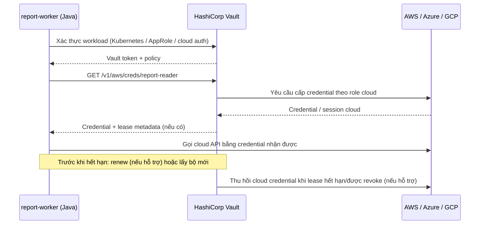

# Cloud secrets engine và thông tin xác thực được cấp có thời hạn trong Spring Vault

## 1. Vì sao ứng dụng Java cần cloud credentials ngắn hạn?

Một ứng dụng Java chạy trên Kubernetes có thể cần đọc một bucket trên AWS, gọi Google Cloud API hoặc truy cập một resource group Azure. Cách đơn giản nhưng rủi ro là tạo một access key/service principal secret tồn tại nhiều tháng rồi đặt trong `application.yml`, biến môi trường cố định hoặc CI/CD secret. Khi bí mật bị lộ, kẻ tấn công có thể sử dụng nó cho đến khi người vận hành tự phát hiện và thu hồi.

Trong module **SPRING_VAULT**, ứng dụng sử dụng **HashiCorp Vault** thông qua `VaultTemplate`/`VaultOperations`, xác thực bằng danh tính workload và tuân thủ Vault ACL. Những **cloud secrets engine** mở rộng khả năng Vault: ứng dụng yêu cầu một bộ credential từ Vault theo **role đã được cấu hình**, sử dụng credential đó để gọi cloud API trong một khoảng thời gian, rồi gia hạn hoặc thay mới theo quy tắc của từng loại credential.

Ví dụ: `report-worker` chỉ cần đọc báo cáo trên S3 trong khoảng một giờ. Thay vì cấp một AWS IAM access key tồn tại lâu dài, nền tảng có thể cấu hình Vault AWS secrets engine tạo AWS STS temporary credentials cho role đọc S3. Worker lấy credential qua Vault, dùng với AWS SDK, và nhận credential mới trước khi thời hạn của phiên làm việc hết.

### Kết quả học tập

Sau bài này, bạn có thể:

- Phân biệt **Vault authentication** với **cloud secrets engine**; nhận diện chỗ nào xác thực workload, chỗ nào tạo quyền truy cập AWS/Azure/GCP.
- Hiểu các loại cloud credentials phổ biến, TTL và cơ chế thu hồi thực tế.
- Sử dụng `VaultOperations.read(...)` để nhận secret động cùng metadata lease; phân biệt phản hồi **có lease** và **không có lease**.
- Thiết kế vòng đời credential trong ứng dụng Java: cấp phát, thay mới, gia hạn khi được phép, thu hồi và xử lý lỗi.
- Thiết lập quyền tối thiểu, giám sát và kiểm thử tích hợp có ý nghĩa.

## 2. Luồng cấp phát và hai danh tính độc lập



Trong luồng trên có **hai lớp xác thực**:

| Lớp | Vai trò | Ví dụ | Kết quả |
| --- | --- | --- | --- |
| Xác thực **vào Vault** | Chứng minh danh tính của ứng dụng Java | Kubernetes service account, AppRole, AWS IAM auth, Azure MSI auth, GCP auth | **Vault token**, gắn policy và thời hạn riêng |
| **Cloud secrets engine** | Cấp quyền truy cập dịch vụ cloud cho workload đã được Vault cho phép | `aws/creds/report-reader`, `azure/creds/report-reader`, `gcp/roleset/report-reader/token` | **Cloud credential**, có thời hạn do Vault hoặc cloud provider quản lý tùy loại |

Ví dụ một ứng dụng chạy trên AWS có thể đăng nhập vào Vault bằng AWS IAM auth, nhưng vẫn cần đọc AWS secrets engine để nhận credential *khác* cho nhiệm vụ đọc S3. Thành công khi xác thực vào Vault **không tự cấp** quyền S3 cho ứng dụng.

Vault policy kiểm soát workload **được gọi endpoint nào**. IAM/RBAC của cloud provider kiểm soát credential **làm được gì tại nhà cung cấp**. Cả hai lớp phải đủ chặt: Vault ACL giới hạn role có thể yêu cầu, cloud policy giới hạn hành động và tài nguyên được truy cập.

## 3. So sánh ba cloud secrets engine

| Engine | Credential điển hình | Endpoint đọc | Cách quản lý thời hạn/thu hồi |
| --- | --- | --- | --- |
| **AWS** | IAM user access key; AWS STS `assumed_role`, `federation_token`, `session_token` | `aws/creds/{role}` hoặc `aws/sts/{role}` | IAM user được Vault xóa khi revoke; STS có hạn dùng của session AWS, thường không gia hạn được |
| **Azure** | Dynamic service principal hoặc mật khẩu mới cho principal sẵn có | `azure/creds/{role}` | Lease: Vault xóa principal hoặc password liên quan khi revoke; credential thường có thể gia hạn trong giới hạn |
| **Google Cloud (GCP)** | OAuth2 access token hoặc service account key | `gcp/roleset/{name}/token`, `gcp/roleset/{name}/key` | **Token OAuth2 không có lease** và tự hết hạn; service account key có Vault lease, có thể bị Vault xóa khi revoke |

Tên mount trong bảng (`aws`, `azure`, `gcp`) là mặc định trong ví dụ. Một hệ thống có thể mount engine dưới tên khác như `aws-prod`. Khi đó đường dẫn phải thay tương ứng; không được dựa vào tên cloud để phỏng đoán mount thực tế.

### Dynamic khác gì static?

- **Dynamic role:** yêu cầu mới tạo một credential hoặc session mới, có vòng đời độc lập với lần yêu cầu trước. Ví dụ Vault tạo IAM user/key mới hoặc Azure service principal mới; STS tạo session mới có thời hạn.
- **Static role/account:** Vault quản lý credential của một danh tính cloud đã tồn tại, thường xoay vòng secret theo lịch. Ví dụ AWS static role dùng một IAM user cố định; Azure có cơ chế static role tùy phiên bản/edition.
- **GCP roleset:** thường tạo/quản lý service account khi cấu hình roleset rồi cấp **token hoặc key** từ service account đó. Không mặc định mỗi lần lấy secret sẽ tạo service account mới.

Việc lựa chọn phụ thuộc cloud API, RBAC, quota và khả năng thu hồi, không chỉ thuộc tính `ttl` trên Vault.

## 4. AWS secrets engine: IAM user và STS session

### 4.1. Các credential type

Vault AWS secrets engine có những loại chính:

| `credential_type` | Cách tạo | Dữ liệu trả về điển hình | Lưu ý |
| --- | --- | --- | --- |
| `iam_user` | Tạo IAM user và access key mới | `access_key`, `secret_key` | Có Vault lease; xóa IAM user/key khi revoke, phụ thuộc AWS IAM API |
| `assumed_role` | Gọi `sts:AssumeRole` | Access key, secret key, `session_token` | Session tự hết hạn theo AWS STS; phù hợp cross-account |
| `federation_token` | Gọi `sts:GetFederationToken` | Ba trường credential STS | Có ràng buộc về credential gốc của Vault và IAM policy |
| `session_token` | Gọi `sts:GetSessionToken` | Ba trường credential STS | Quyền kế thừa từ caller; cần xem kỹ quyền nền |

**Ưu tiên `assumed_role`** cho nhiều workload AWS vì không phải tạo IAM user/key dài hạn cho mỗi tác vụ. Dùng `iam_user` khi dịch vụ cụ thể cần access key của IAM user và phải có quy trình dọn dẹp đảm bảo.

Với AWS STS, credential có TTL theo **session tại AWS**. Một thao tác `vault lease revoke` không nên được xem như bằng chứng chắc chắn rằng mọi AWS STS session đã bị vô hiệu hóa ngay lập tức. Cần dựa trên loại STS, cơ chế AWS hỗ trợ và thời gian hết hạn thực tế; khi bị lộ, phải có playbook ứng phó tương ứng.

### 4.2. Ví dụ cấu hình cho quản trị viên

Giả sử quản trị viên đã thiết lập quyền IAM và trust policy để Vault có thể gọi `sts:AssumeRole` đối với role `ReportsReadOnly` trong AWS account được chỉ định:

```bash
# Thực hiện bởi quản trị viên, một lần khi triển khai.
vault secrets enable -path=aws aws

# Cấu hình region; cơ chế cấp credential nguồn cho Vault
# (IAM role/workload identity hoặc cách phù hợp) đã được chuẩn bị.
vault write aws/config/root region=ap-southeast-1

# Chỉ cho phép Vault role này nhận STS credentials
# với đúng AWS IAM role đã được duyệt.
vault write aws/roles/report-reader \
  credential_type=assumed_role \
  role_arns="arn:aws:iam::111122223333:role/ReportsReadOnly"
```

Địa chỉ ARN và account ID trong ví dụ là giả định, cần thay bằng tài nguyên thực tế. Quyền IAM gắn với `ReportsReadOnly` nên chỉ cho đọc bucket/prefix báo cáo cần thiết; IAM trust policy phải cho phép danh tính của Vault assume role. Không tạo role với quyền `AdministratorAccess` chỉ để tránh cấu hình RBAC.

Workload được cấp Vault policy phù hợp có thể yêu cầu:

```bash
vault read aws/creds/report-reader
```

Phản hồi gồm các trường như `access_key`, `secret_key`, `session_token` và metadata `lease_id`, `lease_duration`, `lease_renewable` tùy loại credential. Trong một ứng dụng thực, không in phản hồi này ra log, không lưu nó dưới dạng file văn bản hay đưa vào kết quả HTTP.

Có thể dùng `vault write aws/sts/report-reader ttl=20m` khi role/credential type hỗ trợ tham số `ttl` cho STS. TTL cuối cùng còn phụ thuộc AWS STS, Vault role và các giới hạn của IAM role; client cần quan sát TTL/expiry trả về, không tự coi yêu cầu `20m` là chắc chắn.

## 5. Azure secrets engine: service principal được tạo theo lease

Azure secrets engine có thể tạo **service principal mới** với role assignment được giới hạn ở một scope (subscription/resource group/resource). Một lựa chọn khác là quản lý mật khẩu cho một service principal đã có sẵn. Trong cả hai trường hợp, credential động được gắn với lease để Vault dọn dẹp.

### 5.1. Ví dụ role cho một resource group

Ví dụ minh họa dành cho quản trị viên (engine `azure` đã được kết nối tới Microsoft Entra ID, có quyền Graph/Azure RBAC cần thiết):

```bash
# Quản trị viên thiết lập role với phạm vi resource group được chọn.
# Ví dụ sử dụng role Reader để đọc metadata.
vault write azure/roles/report-reader \
  ttl=1h \
  azure_roles=-<<EOF
[
  {
    "role_name": "Reader",
    "scope": "/subscriptions/<subscription-id>/resourceGroups/Reports"
  }
]
EOF

# Workload đọc từ endpoint đã được cấp quyền.
vault read azure/creds/report-reader
```

Đoạn lệnh chỉ mô tả role và cách đọc; các bước kết nối Vault plugin với Azure, cấu hình quyền quản trị và tenant/subscription nằm trong phần triển khai hạ tầng. Giá trị `<subscription-id>` cần thay bằng subscription thực tế.

Phản hồi từ `azure/creds/report-reader` thường có:

```text
lease_id        azure/creds/report-reader/<lease-id>
lease_duration  1h
lease_renewable true
client_id       <generated-app-id>
client_secret   <generated-secret>
```

`client_id` và `client_secret` là **credential Azure**, không phải Vault token. Ứng dụng Java có thể đưa chúng vào Azure Identity SDK để lấy access token cho Azure API. Khi lease bị revoke hoặc hết hạn, Vault xóa service principal động hoặc mật khẩu do Vault tạo, tùy cấu hình role; cloud có thể có **độ trễ đồng bộ quyền**. Không nên giả định IAM/RBAC thay đổi tức thời trong mọi vùng Azure.

**Phân biệt:** các endpoint Azure static role và cấp OAuth token trực tiếp có thể phụ thuộc Vault version/edition. Không dùng nhầm vòng đời của **OAuth access token** (thường tự hết hạn và không có Vault lease) với vòng đời của **Azure dynamic service principal credential** có lease.

## 6. Google Cloud secrets engine: token và service account key khác nhau

GCP engine có thể quản lý **roleset**, **static account** hoặc **impersonated account**. Khi Vault role/roleset được thiết lập với scope và IAM bindings phù hợp, ứng dụng có thể lấy OAuth2 token hoặc private key của service account.

### 6.1. OAuth2 access token: hết hạn tự nhiên, không có lease

Với một roleset đã cấu hình `secret_type=access_token`, workload đọc:

```bash
vault read gcp/roleset/report-reader/token
```

Response `data` có các trường tương tự:

```json
{
  "token": "<short-lived-oauth2-token>",
  "expires_at_seconds": 1893459600,
  "token_ttl": 3599
}
```

Ví dụ `expires_at_seconds` là Unix timestamp minh họa, không phải cam kết giờ hết hạn của một lần cấp phát thực. **Access token GCP này không renewable, không revocable và không có Vault lease**, thông thường có thời gian sống tối đa khoảng một giờ theo chính sách GCP API. Ứng dụng cần thay token mới khi gần hết hạn. Không gọi `vault lease renew` hoặc `vault lease revoke` trên một `lease_id` tự dựng vì token response không chứa lease như key response.

Điểm quan trọng về bảo mật: thu hồi Vault token hoặc xóa quyền đọc endpoint **ngăn việc lấy token GCP mới**, nhưng không đảm bảo token OAuth2 đã phát hành lập tức mất hiệu lực. Rủi ro còn tồn tại cho tới khi token hết hạn hoặc bên cung cấp xử lý theo cơ chế của họ.

### 6.2. Service account key: Vault lease quản lý khóa cloud

Với roleset cấu hình `secret_type=service_account_key`, đọc:

```bash
vault read gcp/roleset/report-key/key
```

Response gồm `private_key_data` (chuỗi **Base64** của dữ liệu private key/service account JSON), `lease_id`, `lease_duration` và `renewable`. Khi lease hết hạn hoặc được revoke, Vault yêu cầu GCP **xóa service account key** liên quan.

Một service account có giới hạn số khóa được phép tạo; tạo liên tục key mới mà không thu hồi key cũ có thể dẫn tới quota error. Thông thường nên ưu tiên token ngắn hạn hoặc workload identity federation khi có thể, và chỉ dùng key nếu SDK/workflow thực sự yêu cầu. Nếu phải decode `private_key_data`, làm trong bộ nhớ và quản lý vòng đời an toàn; không ghi JSON private key vào filesystem dùng chung.

### 6.3. Chọn endpoint đúng loại credential

| Trường hợp | Endpoint | Dấu hiệu thời hạn |
| --- | --- | --- |
| GCP roleset cấp OAuth token | `gcp/roleset/{name}/token` | `token_ttl`, `expires_at_seconds`, **không có lease** |
| GCP static-account cấp OAuth token | `gcp/static-account/{name}/token` | Tương tự, không lease |
| GCP impersonated account cấp OAuth token | `gcp/impersonated-account/{name}/token` | Tương tự, không lease |
| GCP roleset cấp service account key | `gcp/roleset/{name}/key` | `lease_id`, `lease_duration`, `renewable` |
| GCP static-account cấp service account key | `gcp/static-account/{name}/key` | Có Vault lease |

Một số đường dẫn cũ như `gcp/token/{roleset}` và `gcp/key/{roleset}` là legacy/deprecated trong API hiện hành. Ưu tiên endpoint gắn rõ `roleset`, `static-account` hoặc `impersonated-account` để tránh nhầm lẫn.

## 7. Đọc credential bằng Spring Vault

Spring Vault có `VaultOperations.read(String path)`, được triển khai bởi `VaultTemplate`. Đây là cách tương tác phổ quát với các engine cloud khi không có API `opsForCloud()` chuyên biệt cho từng provider. Phản hồi `VaultResponse` cung cấp `data` và metadata lease.

Giả sử ứng dụng đã có bean `VaultOperations`, TLS, Vault namespace (nếu có), và cơ chế xác thực workload phù hợp. Mã sau dùng Java 17, minh họa lấy AWS STS credential và metadata mà không ghi secret vào log.

### 7.1. Service đọc AWS STS credentials

```java
import org.springframework.stereotype.Service;
import org.springframework.vault.core.VaultOperations;
import org.springframework.vault.support.VaultResponse;

import java.time.Duration;
import java.util.Map;

@Service
public class AwsReportCredentialsService {

    private static final String PATH = "aws/creds/report-reader";
    private final VaultOperations vaultOperations;

    public AwsReportCredentialsService(VaultOperations vaultOperations) {
        this.vaultOperations = vaultOperations;
    }

    public AwsCredentials fetch() {
        VaultResponse response = vaultOperations.read(PATH);
        if (response == null || response.getData() == null) {
            throw new IllegalStateException("Vault returned no AWS credentials");
        }

        Map<String, Object> data = response.getData();
        String accessKey = requiredString(data, "access_key");
        String secretKey = requiredString(data, "secret_key");
        String sessionToken = requiredString(data, "session_token");

        return new AwsCredentials(
                accessKey,
                secretKey,
                sessionToken,
                response.getLeaseId(),
                Duration.ofSeconds(response.getLeaseDuration()),
                response.isRenewable()
        );
    }

    private static String requiredString(Map<String, Object> data, String key) {
        Object value = data.get(key);
        if (!(value instanceof String) || ((String) value).isBlank()) {
            throw new IllegalStateException("Missing Vault field: " + key);
        }
        return (String) value;
    }

    public record AwsCredentials(
            String accessKey,
            String secretKey,
            String sessionToken,
            String leaseId,
            Duration leaseDuration,
            boolean renewable
    ) {
        // Tránh record.toString() mặc định làm lộ secret trong log.
        @Override
        public String toString() {
            return "AwsCredentials[redacted]";
        }
    }
}
```

Ở ví dụ này, role AWS **bắt buộc** được cấu hình là `assumed_role` hoặc một loại STS trả về `session_token`. Nếu chuyển sang `credential_type=iam_user`, thường **không có** session token và phải sử dụng một DTO khác; không tự điền chuỗi giả cho field đó.

`leaseId` là metadata để quản lý lease trong Vault, **không phải cloud access key** và cũng không phải Vault login token. `leaseDuration` là thời lượng lease tính từ lúc được cấp, không phải một ngày giờ tuyệt đối; ứng dụng phải trừ thời gian mạng, thời gian khởi tạo client và khoảng an toàn khi quyết định làm mới.

Ví dụ AWS SDK for Java v2 có thể tạo credential provider từ kết quả trên:

```java
import software.amazon.awssdk.auth.credentials.AwsSessionCredentials;
import software.amazon.awssdk.auth.credentials.StaticCredentialsProvider;

// credentials lấy từ AwsReportCredentialsService.fetch().
var aws = AwsSessionCredentials.create(
        credentials.accessKey(),
        credentials.secretKey(),
        credentials.sessionToken());

var provider = StaticCredentialsProvider.create(aws);

// Gắn provider với client AWS SDK. Khi credentials hết hạn,
// phải xây dựng/hoán đổi provider hoặc client theo chiến lược rotation.
```

**Chú ý:** `StaticCredentialsProvider` không tự đi lấy bộ credential mới từ Vault khi thời hạn hết. Đối với workload sống lâu, cần một provider có khả năng refresh an toàn, hoặc một vòng đời client có thể thay thế atomically. Tránh tạo lại credential mỗi request nghiệp vụ; mỗi lần `VaultOperations.read(PATH)` với endpoint động có thể tạo **một secret/lease mới**.

### 7.2. Đọc GCP access token không có lease

Trong GCP token response, dữ liệu về hạn dùng nằm ở `data.expires_at_seconds`, không ở `response.getLeaseId()`.

```java
import org.springframework.stereotype.Service;
import org.springframework.vault.core.VaultOperations;
import org.springframework.vault.support.VaultResponse;

import java.time.Instant;
import java.util.Map;

@Service
public class GcpAccessTokenService {

    private final VaultOperations vaultOperations;

    public GcpAccessTokenService(VaultOperations vaultOperations) {
        this.vaultOperations = vaultOperations;
    }

    public GcpToken fetch() {
        VaultResponse response = vaultOperations.read(
                "gcp/roleset/report-reader/token");

        if (response == null || response.getData() == null) {
            throw new IllegalStateException("Vault returned no GCP token");
        }

        Map<String, Object> data = response.getData();
        Object token = data.get("token");
        Object expiresAt = data.get("expires_at_seconds");

        if (!(token instanceof String) || ((String) token).isBlank()
                || !(expiresAt instanceof Number)) {
            throw new IllegalStateException("Invalid GCP token response");
        }

        return new GcpToken(
                (String) token,
                Instant.ofEpochSecond(((Number) expiresAt).longValue()));
    }

    public record GcpToken(String token, Instant expiresAt) {
        @Override
        public String toString() {
            return "GcpToken[redacted]";
        }
    }
}
```

Mã này **không tìm `lease_id`** vì endpoint access token không cấp Vault lease. Kiểm tra `expiresAt` trước mỗi giai đoạn công việc quan trọng; lấy token mới sớm một khoảng an toàn, ví dụ vài phút, thay vì đợi yêu cầu cloud API đầu tiên nhận `401`. Đồng hồ của máy chạy ứng dụng phải được đồng bộ.

### 7.3. Đọc Azure dynamic client secret

Với Azure, thao tác Spring Vault tương tự:

```java
VaultResponse response = vaultOperations.read("azure/creds/report-reader");

if (response == null || response.getData() == null) {
    throw new IllegalStateException("Azure credential response is empty");
}

Map<String, Object> data = response.getData();
String clientId = (String) data.get("client_id");
String clientSecret = (String) data.get("client_secret");

String leaseId = response.getLeaseId();
long leaseTtlSeconds = response.getLeaseDuration();
boolean renewable = response.isRenewable();

// Kiểm tra clientId/clientSecret trước khi cấp cho Azure Identity SDK.
// Quản lý lease và việc thay credential bằng vòng đời ứng dụng.
```

Ví dụ rút gọn để thấy schema; code sản xuất phải kiểm tra `clientId`/`clientSecret` không null/rỗng, xử lý lỗi cấu hình và thực hiện thay credential đồng bộ với client Azure. Azure Identity SDK còn có thể tạo **access token riêng** từ client secret: hạn dùng của access token này có thể khác hạn dùng lease của service principal credential, nên không được đánh đồng hai thời hạn.

## 8. TTL, lease, renew, revoke và rotation

### 8.1. Các trường quan trọng

Một dynamic secret có lease thường được Vault trả về dưới dạng:

```json
{
  "lease_id": "azure/creds/report-reader/<opaque-id>",
  "lease_duration": 3600,
  "renewable": true,
  "data": {
    "client_id": "<id>",
    "client_secret": "<secret>"
  }
}
```

- `lease_id`: định danh lease để quản lý, audit, renew/revoke khi có quyền.
- `lease_duration`: TTL **tính bằng giây** ở thời điểm trả về.
- `renewable`: liệu **Vault** cho phép xin gia hạn lease. Nó không bảo đảm luôn được gia hạn: còn phụ thuộc `max_ttl`, credential type, provider và trạng thái token.
- `data`: cloud credential cần bảo vệ như bí mật. Không suy ra có lease chỉ vì object `data` có token/key.

Ngoài lease, một ứng dụng có thể có **ít nhất ba hạn dùng** cần theo dõi: (1) Vault login token, (2) Vault secret lease, (3) cloud session/token do AWS/Azure/GCP quy định. Hạn dùng **ngắn nhất còn hiệu lực** thường giới hạn khả năng thực hiện nhiệm vụ.

### 8.2. Quan sát và quản lý lease bằng CLI

Các lệnh sau cần quyền tương ứng trên `sys/leases` và chỉ dùng trên **lease thuộc môi trường kiểm thử hoặc job mà bạn sở hữu**:

```bash
# Biết lease_id từ lần đọc secret, không tự tạo bằng chuỗi giả.
vault lease lookup "$LEASE_ID"

# Chỉ thử gia hạn khi response có renewable=true
# và loại credential hỗ trợ gia hạn.
vault lease renew "$LEASE_ID"

# Chủ động yêu cầu thu hồi secret trước hạn.
vault lease revoke "$LEASE_ID"
```

Với STS hoặc GCP OAuth2 token **không renewable**, cách đúng là **yêu cầu bộ credential mới** trước khi hết hạn. Với dynamic credential có lease renewable, việc gia hạn có thể giữ nguyên credential trong giới hạn đã đặt; khi hết `max_ttl` hoặc renewal thất bại, cần chuyển sang credential mới.

**Không dùng `vault lease revoke` như chứng nhận tuyệt đối rằng mọi cloud API từ chối credential ngay tại mili-giây đó.** Provider có thể có độ trễ cập nhật IAM, session/token tồn tại độc lập hoặc hạn chế thu hồi. Xác thực hành vi ở cloud theo loại credential.

### 8.3. Lịch refresh thực tế cho Java service

Một chu kỳ an toàn cho job chạy lâu:

1. **Cấp phát:** đọc secret qua Vault, ghi lại lúc nhận và thời hạn/lease metadata; kiểm tra schema và quyền truy cập thử nếu phù hợp.
2. **Sử dụng:** dựng cloud SDK client/provider từ credential **chỉ trong bộ nhớ**, giới hạn quyền cloud và không chia sẻ qua log.
3. **Làm mới sớm:** khi gần hết hạn, nếu renewable thì thử renew theo contract; nếu không thì **request credential mới**.
4. **Chuyển đổi:** xây cloud SDK client/provider mới, xác minh có thể gọi dịch vụ, rồi chuyển request mới sang client mới một cách an toàn.
5. **Dọn dẹp:** đóng hoặc ngừng sử dụng client cũ; revoke lease cũ khi phù hợp, hiểu rõ giới hạn revoke từ cloud provider.
6. **Ứng phó lỗi:** retry có giới hạn với backoff/jitter, không tạo hàng loạt lease mới trong vòng lặp; phát cảnh báo nếu không còn đủ thời gian trước hết hạn.

Để tránh nhiều thread cùng gọi Vault, đặt một nơi quản lý credential và dùng cơ chế single-flight/lock khi refresh. Thời điểm refresh cần tính đến **clock skew**, độ trễ cấp phát credential, IAM propagation và network jitter. Với ứng dụng dùng cơ chế lifecycle của Spring Vault, `SecretLeaseContainer` có thể giúp theo dõi và renew/rotate dynamic leased secrets theo cấu hình; phải kiểm tra backend và loại credential được hỗ trợ, và không áp dụng container giả định cho GCP OAuth token vốn không có lease.

Lưu ý `VaultTemplate.read()` là API đọc một lần. Chỉ gọi hàm này **không tự cấu hình lịch refresh**, không tự gia hạn cloud credential và không tự cập nhật AWS/Azure/GCP SDK provider.

### 8.4. Token Vault hết hạn ảnh hưởng thế nào?

Lease động thường gắn với session/token đã xin secret. Khi token cha bị thu hồi hoặc hết hạn, lease liên quan có thể bị Vault thu hồi theo quan hệ quản lý lease. **Cloud credential đã phát hành** vẫn có thể chịu cơ chế thu hồi riêng của provider; ví dụ token GCP không có lease tiếp tục sống đến khi hết hạn tự nhiên.

Hãy cấu hình Spring Vault session management (ví dụ đăng nhập lại Kubernetes auth/AppRole khi cần, TLS hợp lệ), thay vì đặt Vault root token tĩnh vào ứng dụng. Trong job tồn tại nhiều giờ, cần kiểm tra đồng thời cả thời hạn đăng nhập Vault và thời hạn cloud credential.

## 9. Phân quyền tối thiểu cho workload

Một policy Vault HCL chỉ cho Java report worker đọc role AWS, Azure và GCP **đã được quản trị viên cho phép**:

```hcl
path "aws/creds/report-reader" {
  capabilities = ["read"]
}

path "azure/creds/report-reader" {
  capabilities = ["read"]
}

path "gcp/roleset/report-reader/token" {
  capabilities = ["read"]
}
```

Trong sản xuất, chỉ giữ **những path thật sự được ứng dụng sử dụng**. Không cấp `list` hoặc `update` trên toàn `aws/*`, `azure/*` hay `gcp/*` chỉ vì cần một role. Tránh cấp cho workload quyền cấu hình engine như `aws/config/root`, `azure/config` hoặc `gcp/config`.

Một mô hình phân quyền hữu ích:

| Danh tính | Quyền Vault | Quyền cloud |
| --- | --- | --- |
| Quản trị nền tảng | Quản lý mount, role, cấu hình tích hợp cloud và policy | Quyền tạo/điều phối IAM/RBAC theo quy trình |
| `report-worker` | Chỉ đọc endpoint cấp credential của `report-reader` | Chỉ đọc resource báo cáo qua credential được cấp |
| Job vận hành lease | Chỉ renew/revoke những lease cần quản lý, nếu được phép | Không cần quyền admin cloud từ ứng dụng |
| Người làm QA | Role và cloud tài nguyên kiểm thử riêng | Không truy cập dữ liệu production |

Có thể dùng response wrapping để giảm việc phát tán credential trong các luồng giao nhận có trung gian, nếu kiến trúc cần. Dù dùng cơ chế nào, Vault token, AWS secret key, Azure client secret, GCP service account key và GCP OAuth token **đều phải được xem là thông tin nhạy cảm**. Không gửi các giá trị này vào log, trace, exception, URL query, metrics label, commit hay kết quả API công khai.

## 10. Xử lý lỗi và giám sát

| Biểu hiện | Nguyên nhân thường gặp | Hướng xử lý |
| --- | --- | --- |
| Vault `403 permission denied` | Sai Vault role/policy, workload auth token không có quyền path | Kiểm tra Vault identity/policy và endpoint; không thay bằng root token |
| Vault `404` hoặc dữ liệu trống | Sai mount, role chưa cấu hình hoặc endpoint dùng legacy path | Đối chiếu tên mount/role và loại secret |
| Vault `429`/`5xx` hoặc timeout | Rate limit, Vault HA/network hoặc cloud provider lỗi | Retry có giới hạn, backoff/jitter và cảnh báo |
| Vault trả được secret nhưng AWS `AccessDenied` | AWS IAM role policy, trust policy, bucket policy hoặc session constraint sai | Kiểm tra quyền cloud thực tế, không nâng quyền bừa bãi |
| AWS `ExpiredToken` / GCP `401` | Cloud credential hết hạn, đồng hồ lệch hoặc SDK giữ credential cũ | Cấp mới sớm, đổi provider/client, đồng bộ đồng hồ |
| Azure credential được cấp nhưng API vẫn từ chối | RBAC propagation chậm hoặc scope/role assignment không đúng | Kiểm tra scope; retry có giới hạn cho lỗi mới tạo role, không kéo dài vô hạn |
| GCP key issuance thất bại | Đạt quota số key hoặc thiếu quyền service account key admin | Thu hồi key không còn dùng; xem lại chọn token thay key |
| `lease renew` thất bại | Lease không renewable, đã hết hạn, vượt max TTL hoặc thiếu ACL | Không loop renew vô hạn; xin bộ credential mới nếu loại secret hỗ trợ |
| Cloud vẫn chấp nhận credential sau revoke | Cơ chế STS/OAuth không thu hồi ngay hoặc IAM propagation | Kiểm tra giới hạn revoke của cloud; dựa vào TTL và quy trình phản ứng sự cố |

Các metric nên theo dõi:

- Số lần đọc secret theo **engine và role** (không gắn access key/client secret).
- Tỷ lệ cấp phát thành công/thất bại, latency Vault và cloud, retry count.
- Thời gian còn lại đến khi token/lease hết hạn, số lần renew thành công, số lần rotation thất bại.
- Số credential/key chưa được dọn dẹp, quota cloud, các sự kiện revoke bị lỗi.
- Số lỗi `401`/`403` từ cloud API ngay sau khi cấp phát hoặc sau lần refresh.

Đặc biệt, một retry trên `aws/creds/report-reader` hoặc `azure/creds/report-reader` có thể **tạo thêm một dynamic credential mới**. Nếu request đầu đã thành công nhưng response bị mất do timeout, lần retry có thể tạo thêm một lease. Để tránh rò rỉ credential và quota exhaustion, hãy giới hạn số lần thử, theo dõi lease đã cấp, quản lý cleanup và dùng khoảng thời gian retry hợp lý.

## 11. Kiểm thử tích hợp với Vault và cloud sandbox

Nên kiểm thử ứng dụng Java với Vault thật trong môi trường cô lập và cloud sandbox/tài khoản thử nghiệm có tài nguyên giới hạn. Kết hợp kiểm thử contract Vault response với một phép gọi cloud API có quyền tối thiểu; chỉ mock `VaultOperations` thì chưa phát hiện được sai IAM trust, RBAC propagation hay thời hạn thực tế của token.

| Tình huống | Kết quả cần xác nhận |
| --- | --- |
| Workload hợp lệ đọc `aws/creds/report-reader` | Trả được ba trường AWS STS cần thiết và metadata lease; cloud SDK đọc được resource thử nghiệm |
| Workload dùng Vault role khác | Vault từ chối đọc endpoint được bảo vệ bằng ACL |
| Role AWS chỉ đọc S3 prefix `reports/` | Đọc được đối tượng cho phép; ghi/xóa hoặc đọc prefix ngoài phạm vi bị từ chối |
| Azure dynamic principal được tạo | `client_id`/`client_secret` dùng được trong scope, role ngoài scope bị từ chối |
| Azure lease được revoke trong sandbox | Cloud principal/password do Vault tạo được dọn theo contract; kiểm tra độ trễ thực tế |
| GCP access token | Có `expires_at_seconds`, **không có lease**, hệ thống chủ động lấy token mới trước hết hạn |
| GCP service account key | Có `lease_id`; sau revoke, key bị xóa và cloud API không còn chấp nhận theo cơ chế GCP |
| Clock gần TTL | Java service hoán đổi credential/provider trước khi request cloud hết hiệu lực |
| Lỗi mạng giữa lúc lấy credential | Ứng dụng retry hữu hạn, không tiết lộ secret trong error/log |
| Nhiều thread refresh cùng lúc | Không tạo thừa hàng loạt lease và không dùng credential đã hết hạn |

Một kiểm thử theo trình tự cho AWS có thể: (1) cấu hình một Vault role chỉ cho đọc một bucket thử nghiệm; (2) cấp credential STS và gọi S3 thành công; (3) xác minh thao tác ghi bị từ chối; (4) rút ngắn TTL thích hợp trong sandbox; (5) đợi credential cũ hết hiệu lực, sau đó cho service lấy mới và xác nhận đọc S3 lại thành công. Không chạy kiểm thử hết hạn bằng cách thay đồng hồ máy production.

Đối với GCP, hãy tạo **hai bài kiểm thử riêng**: token endpoint phải xử lý thời hạn `expires_at_seconds` mà không có lease; key endpoint phải xử lý `lease_id`, renew/revoke và quota key. Gộp hai trường hợp vào một nhánh `if (response.getLeaseId() != null)` duy nhất rất dễ bỏ sót ràng buộc của cloud provider.

## 12. Câu hỏi tự kiểm tra

1. Ứng dụng đăng nhập Vault thành công bằng Kubernetes auth. Vì sao điều đó chưa đủ để truy cập S3?
2. Khi dùng AWS `iam_user` và `assumed_role`, khác nhau thế nào về việc tạo IAM identity, session token và cơ chế thu hồi?
3. Vì sao GCP OAuth2 access token có thời hạn nhưng **không có Vault lease**? Ứng dụng phải refresh dựa trên trường nào?
4. Nếu một Azure dynamic secret có `renewable=true`, điều đó có bảo đảm credential sử dụng được vô hạn không?
5. Một client Java dùng `StaticCredentialsProvider` đã lấy AWS STS credential lần đầu. Điều gì xảy ra nếu không thay provider sau khi credential hết hạn?
6. Nếu một lời gọi Vault đã tạo secret nhưng HTTP response bị mất, vì sao retry không giới hạn có thể làm tăng số lease/key?

## Tài liệu tham khảo

- [HashiCorp Vault — AWS secrets engine](https://developer.hashicorp.com/vault/docs/secrets/aws): IAM user, AssumeRole/STS, static role và phân quyền AWS.
- [HashiCorp Vault — AWS Secrets Engine HTTP API](https://developer.hashicorp.com/vault/api-docs/secret/aws): endpoint `aws/creds`, `aws/sts` và tham số TTL.
- [HashiCorp Vault — Azure secrets engine](https://developer.hashicorp.com/vault/docs/secrets/azure): dynamic service principal, role assignment, lease và giới hạn.
- [HashiCorp Vault — Google Cloud secrets engine](https://developer.hashicorp.com/vault/docs/secrets/gcp): roleset, OAuth access token không lease và service account key có lease.
- [HashiCorp Vault — Lease, Renew and Revoke](https://developer.hashicorp.com/vault/docs/concepts/lease): vòng đời dynamic secrets và token.
- [Spring Vault — VaultOperations](https://docs.spring.io/spring-vault/reference/api/java/org/springframework/vault/core/VaultOperations.html): `read(String)` và `VaultTemplate`.
- [Spring Vault — VaultResponseSupport](https://docs.spring.io/spring-vault/reference/api/java/org/springframework/vault/support/VaultResponseSupport.html): `getData()`, `getLeaseId()`, `getLeaseDuration()`, `isRenewable()`.
- [Spring Vault — Credential Rotation](https://docs.spring.io/spring-vault/reference/vault/credential-rotation.html): `SecretLeaseContainer`, token/session lifecycle và quy tắc rotation.

**Ghi nhớ:** Cloud secrets engine giúp workload Java nhận quyền cloud **theo role và trong thời gian giới hạn**. Thiết kế đúng phải xem **Vault token**, **Vault lease** và **thời hạn cloud credential** là những vòng đời khác nhau, rồi chọn cách refresh/revoke theo **loại credential thực tế**.
