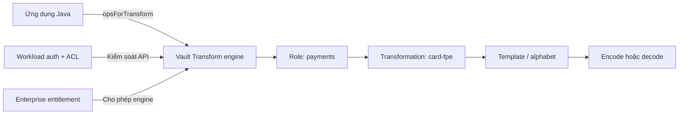
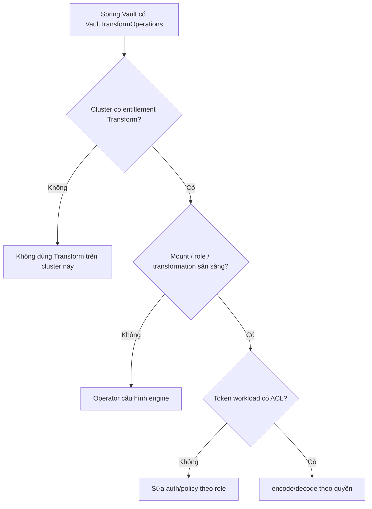

# VaultTransformOperations và yêu cầu tính năng Enterprise

## Mục tiêu bài học

Trong **Spring Vault**, ứng dụng Java sử dụng `VaultTemplate` để làm việc với HashiCorp Vault, xác thực theo danh tính workload và chịu kiểm soát của Vault ACL policy. Ngoài KV secrets, token/lease, Transit encryption và PKI, Spring Vault còn cung cấp `VaultTransformOperations` để gọi **Transform secrets engine**. Đây là engine mở rộng dành cho dữ liệu nhạy cảm cần giữ một dạng nhất định, chẳng hạn số thẻ thanh toán, mã nhận dạng hoặc trường hiển thị cho nhân viên hỗ trợ.

**Điều kiện tiên quyết:** Transform secrets engine là tính năng thương mại, yêu cầu **Vault Enterprise có quyền sử dụng Advanced Data Protection Transform (ADP-Transform)** hoặc môi trường **HCP Vault Dedicated** có entitlement phù hợp. Cài dependency Spring Vault **không tự cung cấp** engine hoặc giấy phép. Vault Community/OSS thông thường không chạy được lab Transform chỉ nhờ gọi `opsForTransform()`.

Sau bài này, bạn có thể:

- Giải thích `VaultTransformOperations`, phân biệt với `VaultTransitOperations`.
- Phân biệt **FPE**, **masking** và **tokenization**, đặc biệt khả năng khôi phục dữ liệu.
- Nắm cấu hình Transform **role**, **transformation**, **template**, **alphabet**, entitlement và policy.
- Sử dụng Spring Vault để `encode`, `decode`, chọn transformation và xử lý batch.
- Kiểm thử tích hợp, xử lý lỗi và quyết định phương án khi môi trường không có Transform.

## 1. Chọn đúng engine: Transform so với Transit

**Transit** chủ yếu cung cấp mã hóa/giải mã, chữ ký và HMAC tập trung. Ciphertext Transit thường có dạng `vault:vN:...`, không giữ nguyên định dạng đầu vào. **Transform** đáp ứng trường hợp dữ liệu bên ngoài cần giữ cấu trúc nhất định hoặc phải được thay bằng token.

| Tiêu chí | Transit | Transform |
|---|---|---|
| Mục tiêu | Encryption as a Service, chữ ký, HMAC | FPE, masking, tokenization |
| Dữ liệu trả về | Ciphertext theo định dạng Transit | FPE giữ cấu trúc đã cấu hình; masking che ký tự; tokenization trả token |
| Spring Vault API | `VaultTransitOperations` | `VaultTransformOperations` |
| Đường dẫn gọi | `transit/encrypt/<key>`, `transit/decrypt/<key>` | `transform/encode/<role>`, `transform/decode/<role>` |
| Cấu hình | Transit key và ACL | Role, transformation, template/alphabet, token store và ACL |
| Điều kiện sản phẩm | Có trong Vault OSS phù hợp | Cần quyền sử dụng Vault Enterprise ADP-Transform hoặc HCP Vault Dedicated phù hợp |

### Ba loại transformation

| Loại | Cơ chế | Phục hồi giá trị gốc? | Lưu ý |
|---|---|---|---|
| **FPE** (Format-Preserving Encryption) | Mã hóa có thể giữ độ dài và tập ký tự theo template; FF1 dùng cho transformation mới của Vault 2.2+ | **Có**, qua decode nếu còn key/tweak cần thiết | Giữ hình dạng không bảo đảm giữ checksum/Luhn hoặc toàn bộ quy tắc nghiệp vụ |
| **Masking** | Thay ký tự khớp bằng dấu che (`*`, `X`...) | **Không**, không có decode phục hồi | Phù hợp hiển thị, không phải mã hóa đảo ngược |
| **Tokenization** | Gán giá trị nhạy cảm với token không chứa trực tiếp dữ liệu gốc | **Có qua Vault decode** khi mapping còn hợp lệ và token có quyền | Có trạng thái; token có thể khác định dạng và độ dài ban đầu |

Nói “token không thể giải ngược từ chính chuỗi token” **không có nghĩa** Vault không thể detokenize: Vault duy trì trạng thái mapping cần thiết cho `decode`. Nếu mapping/token hết hạn hoặc bị mất, việc phục hồi có thể không thực hiện được.

Ví dụ số thử nghiệm `4111111111111111` có thể được FPE biến đổi thành chuỗi chữ số khác cùng độ dài, tokenization tạo token có kiểu khác, còn masking che phần lớn chữ số. Đây là các **khái niệm**, không phải kết quả đã chạy hay giá trị ciphertext xác định.



## 2. Điều kiện Enterprise và cấu hình bắt buộc

Để `VaultTransformOperations` hoạt động thực sự, cần **bốn điều kiện độc lập**:

1. **Entitlement sản phẩm:** server/cluster đã được cấp phép sử dụng Transform (Vault Enterprise ADP-Transform hoặc HCP Vault Dedicated phù hợp).
2. **Secrets engine mount:** operator đã bật engine ở đường dẫn dự kiến, ví dụ `transform/`. Có entitlement nhưng chưa mount vẫn không thể gọi `encode`.
3. **Cấu hình Transform:** role và transformation tương ứng đã tồn tại; FPE/masking có template/alphabet phù hợp, tokenization có kho lưu trạng thái thích hợp.
4. **Workload identity + ACL:** token ứng dụng được phép gọi đúng `encode/<role>` hoặc `decode/<role>`.



### Role không phải ACL policy

- **Transform role** (ví dụ `payments`) liệt kê transformation được sử dụng. Nếu role có nhiều transformation, client phải chọn rõ transformation tương ứng.
- **Transformation** (ví dụ `card-fpe`) xác định loại xử lý `fpe`, `masking` hoặc `tokenization`, template, nguồn tweak và `allowed_roles`.
- **Template** xác định cách nhận diện/phục hồi vùng dữ liệu; **alphabet** quy định tập ký tự đầu vào/đầu ra của FPE.
- **Vault ACL policy** giới hạn **token** được gọi `transform/encode/payments` hoặc `transform/decode/payments`.

Role tồn tại không cấp quyền API cho token. Token có quyền gọi endpoint cũng không được tự ý dùng transformation ngoài role hoặc ghi cấu hình quản trị nếu không có ACL riêng.

## 3. Chuẩn bị môi trường thực hành: dành cho operator

Ví dụ dưới đây dùng **Vault Enterprise/HCP có Transform**, với operator token thích hợp. Token của ứng dụng Java không được dùng để bật engine hoặc tạo role.

```bash
# Bật engine nếu chưa có mount transform
vault secrets enable -path=transform transform

# Role payments được chọn transformation card-fpe
vault write transform/role/payments transformations=card-fpe

# Tạo transformation dùng builtin template
vault write transform/transformations/fpe/card-fpe \
  template=builtin/creditcardnumber \
  tweak_source=internal \
  allowed_roles=payments

# Gửi một số thử nghiệm (không sử dụng PAN thật trong lab)
vault write transform/encode/payments value=4111111111111111
```

Đọc `encoded_value` thực tế từ phản hồi rồi gửi nó tới endpoint decode:

```bash
vault write transform/decode/payments value="<encoded_value_da_nhan>"
```

Đây là cấu hình tối giản để minh họa API. `tweak_source=internal` tiết kiệm việc truyền tweak, nhưng phải đánh giá khả năng liên kết các giá trị trùng lặp và rủi ro bảo mật theo đặc tính dữ liệu. Sản xuất có thể cần `supplied`/`generated` cùng quy trình quản lý tweak tương ứng.

**Đừng bỏ kiểm tra dữ liệu sau FPE:** giá trị được bảo toàn độ dài/tập ký tự vẫn có thể không hợp lệ theo checksum của một hệ thống ngoài. Trường hợp định dạng có quy tắc Luhn như số thẻ là ví dụ điển hình.

### ACL nhỏ nhất cho ứng dụng

Nếu ứng dụng chỉ ghi giá trị đã transform, cấp đúng quyền encode:

```hcl
path "transform/encode/payments" {
  capabilities = ["update"]
}
```

Chỉ bổ sung decode khi nghiệp vụ được phép xem lại giá trị gốc:

```hcl
path "transform/decode/payments" {
  capabilities = ["update"]
}
```

Không cấp cho workload thông thường quyền `transform/role/*`, `transform/transformations/*`, `transform/template/*`, `transform/alphabet/*` hoặc quyền quản trị token store. Workload nên xác thực bằng Kubernetes Auth, AppRole hoặc cơ chế được tổ chức phê duyệt, dùng token ngắn hạn và ACL tối thiểu.

### Giao thức HTTP có field value

Lời gọi Transform dùng giá trị văn bản trong trường `value`:

```http
POST /v1/transform/encode/payments HTTP/1.1
X-Vault-Token: <workload-token>
Content-Type: application/json

{"value":"4111111111111111"}
```

Phản hồi thành công có trường `data.encoded_value`; decode dùng `POST /v1/transform/decode/payments` với JSON `{"value":"<encoded_value>"}` và trả `data.decoded_value` nếu transformation hỗ trợ decode. Khác với Transit raw HTTP encrypt/decrypt, **không Base64 `value` theo thói quen của Transit**.

## 4. Tích hợp `VaultTransformOperations` trong Spring Vault

Spring Vault cung cấp `VaultTransformOperations` từ phiên bản **2.3**. Đối tượng `VaultTemplate`/`VaultOperations` có:

| Phương thức | Chức năng |
|---|---|
| `opsForTransform()` | Lấy API cho mount mặc định `transform` |
| `opsForTransform(String path)` | Lấy API nếu engine mount ở đường dẫn khác |
| `encode(String roleName, String plaintext)` | Encode một giá trị chuỗi theo role |
| `decode(String roleName, String ciphertext)` | Decode một giá trị nếu transformation hỗ trợ |
| `encode(String roleName, TransformPlaintext value)` | Encode với context, có thể chọn transformation/tweak |
| `decode(String roleName, TransformCiphertext value)` | Decode theo value object và context |
| `encode(String roleName, List<TransformPlaintext> items)` | Encode batch, trả `List<VaultTransformEncodeResult>` |
| `decode(String roleName, List<TransformCiphertext> items)` | Decode batch, trả `List<VaultTransformDecodeResult>` |

### Ví dụ Java: encode/decode FPE của một giá trị

Với role `payments` chỉ gắn `card-fpe` như đã cấu hình, ứng dụng có thể dùng API chuỗi ngắn gọn. Ví dụ Java 17+ và Spring Boot có `VaultTemplate` được Spring tạo sẵn:

```java
import org.springframework.stereotype.Service;
import org.springframework.vault.core.VaultTemplate;
import org.springframework.vault.core.VaultTransformOperations;

@Service
public class CardTransformService {

    private static final String ROLE = "payments";
    private final VaultTransformOperations transform;

    public CardTransformService(VaultTemplate vaultTemplate) {
        // Role và transformation do Vault operator tạo trước.
        this.transform = vaultTemplate.opsForTransform("transform");
    }

    public String encodeTestCard(String pan) {
        // Giới hạn 16 số chỉ phục vụ lab; sản xuất cần validation thật.
        if (pan == null || !pan.matches("[0-9]{16}")) {
            throw new IllegalArgumentException("Expected 16 digits");
        }
        return transform.encode(ROLE, pan);
    }

    public String decodeAuthorizedCard(String encoded) {
        // Chỉ gọi trong use case được cấp quyền đọc dữ liệu gốc.
        if (encoded == null || encoded.isBlank()) {
            throw new IllegalArgumentException("Missing encoded value");
        }
        return transform.decode(ROLE, encoded);
    }
}
```

Đoạn mã gọi Vault từ server, dựa trên **Vault token của workload** đã cấu hình ở tầng ứng dụng. Không tự tạo hoặc sửa role; không viết root token vào Java, file YAML hoặc log. Nếu workload chỉ có policy encode, `decodeAuthorizedCard()` phải bị Vault từ chối; đó là kết quả **đúng của nguyên tắc least privilege**.

Khi dùng `String`, Spring Vault xử lý chuyển payload để gọi API; với dữ liệu có ký tự đặc biệt hoặc nguồn byte, nên chọn value object cùng `StandardCharsets.UTF_8` rõ ràng.

### Chọn transformation bằng `VaultTransformContext`

Nếu role có nhiều transformation, gửi tên transformation cần dùng. Ví dụ role `payments` được operator cho phép `card-fpe` cùng một transformation khác, ứng dụng phải chọn `card-fpe` cho dữ liệu thẻ:

```java
import java.nio.charset.StandardCharsets;
import org.springframework.vault.support.TransformCiphertext;
import org.springframework.vault.support.TransformPlaintext;
import org.springframework.vault.support.VaultTransformContext;

VaultTransformContext ctx =
    VaultTransformContext.fromTransformation("card-fpe");

TransformPlaintext input =
    TransformPlaintext.of("4111111111111111", StandardCharsets.UTF_8)
                      .with(ctx);

TransformCiphertext encoded = transform.encode("payments", input);
String encodedText = encoded.getCiphertext();

TransformPlaintext recovered =
    transform.decode("payments", encoded.with(ctx));
String original = recovered.asString(StandardCharsets.UTF_8);
```

`transform` trong ví dụ được lấy từ `VaultTransformOperations` ở service phía trên. Đây là **mảnh mã**, cần đặt trong một phương thức, dùng biến đã được inject và xử lý exception đúng cách. `VaultTransformContext` của Spring Vault có các phương thức `builder()`, `fromTransformation(...)` và `fromTweak(...)`. Với FPE `tweak_source=supplied`, client còn phải cung cấp **cùng tweak** khi encode và decode. Dữ liệu tweak là tham số mật mã, không được tạo mới tùy ý mỗi lần decode.

Ví dụ xây context khi operator yêu cầu tweak do client cung cấp:

```java
byte[] tweak = "tenant1".getBytes(StandardCharsets.UTF_8);
VaultTransformContext ctxWithTweak = VaultTransformContext.builder()
    .transformation("card-fpe")
    .tweak(tweak)
    .build();
```

Độ dài tweak hợp lệ phụ thuộc thuật toán FPE và cấu hình Vault; ví dụ `tenant1` dài **7 byte**, phù hợp mô hình FF3-1 cũ, nhưng **không phải quy tắc chung cho FF1**. Với Vault 2.2+ các transformation FPE mới sử dụng FF1 và `max_tweak_len` điều khiển giới hạn; phải kiểm tra version và hợp đồng cấu hình của operator.

Nếu dùng `tweak_source=generated`, Vault sinh tweak và trả cùng kết quả encode. Để decode được, ứng dụng cần lưu tweak đi kèm bản ghi đã encode và truyền lại đúng giá trị; kiểm tra cách phiên bản Spring Vault hiện tại biểu diễn tweak trong kết quả, hoặc dùng HTTP API có kiểm soát khi cần truy cập metadata mà API cấp cao chưa đưa ra. Không cố decode mà bỏ qua tweak.

## 5. Xử lý batch và lỗi riêng từng phần tử

Spring Vault hỗ trợ batch `List<TransformPlaintext>` và `List<TransformCiphertext>`. Batch giúp giảm số round trip đến Vault, nhưng ứng dụng vẫn cần gắn **ID nghiệp vụ** vào từng phần tử, kiểm tra số lượng/thứ tự và phân biệt lỗi của từng giá trị với lỗi của cả HTTP request.

Ví dụ encode ba số thẻ thử nghiệm đã được hệ thống validation chấp nhận:

```java
import java.nio.charset.StandardCharsets;
import java.util.List;
import java.util.ArrayList;
import org.springframework.vault.VaultException;
import org.springframework.vault.support.TransformPlaintext;
import org.springframework.vault.support.VaultTransformContext;
import org.springframework.vault.support.VaultTransformEncodeResult;

record CardInput(String id, String testPan) {}
record CardOutput(String id, String encoded, String error) {}

List<CardInput> cards = List.of(
    new CardInput("card-101", "4111111111111111"),
    new CardInput("card-102", "5555555555554444"),
    new CardInput("card-103", "4000000000000002")
);

List<TransformPlaintext> request = cards.stream()
    .map(card -> TransformPlaintext.of(
            card.testPan(), StandardCharsets.UTF_8)
        .with(VaultTransformContext.builder()
            .transformation("card-fpe")
            .reference(card.id())
            .build()))
    .toList();

List<VaultTransformEncodeResult> results;
try {
    results = transform.encode("payments", request);
} catch (VaultException ex) {
    // Lỗi ở mức request: auth, policy, engine, network...
    // Đừng đánh dấu từng phần tử là thành công.
    throw new IllegalStateException("Transform batch is unavailable", ex);
}

if (results == null || results.size() != cards.size()) {
    throw new IllegalStateException("Unexpected Transform batch size");
}

List<CardOutput> output = new ArrayList<>();
for (int i = 0; i < cards.size(); i++) {
    String id = cards.get(i).id();
    VaultTransformEncodeResult item = results.get(i);
    if (item.isSuccessful()) {
        String encoded = item.get().getCiphertext();
        output.add(new CardOutput(id, encoded, null));
    } else {
        // Có thể đọc item.getCause() cho telemetry được làm sạch.
        output.add(new CardOutput(id, null, "TRANSFORM_ITEM_FAILED"));
    }
}
```

Đây là đoạn Java **mang tính tích hợp**, cần đặt trong service và chuẩn bị biến `transform` như ví dụ trước. `VaultTransformContext.builder().reference(...)` là khả năng Spring Vault từ dòng API mới (tham khảo Javadoc của phiên bản đang dùng); với phiên bản cũ có thể chỉ gắn ID ở tầng ứng dụng theo thứ tự phần tử.

Kết quả batch theo thứ tự input nên có thể đối chiếu bằng chỉ số **sau khi kiểm tra số phần tử**. `isSuccessful()` kiểm tra thành công của **một kết quả đã nhận**, `getCause()` có thể cung cấp nguyên nhân thất bại và `get()`/`getAsString()` có thể ném khi item lỗi. Nếu Vault trả HTTP error trước khi client phân tích body, ứng dụng có thể chỉ thấy ngoại lệ của cả request: không nên coi đó là bằng chứng mọi phần tử đều đã thất bại hoặc thành công.

Đối với batch decode, dùng `List<TransformCiphertext>` và nhận `List<VaultTransformDecodeResult>`; kiểm tra `isSuccessful()` trước `get().asString(StandardCharsets.UTF_8)`. Không trộn yêu cầu thuộc nhiều role riêng vào một batch; role là tham số chung của lời gọi. Khi dùng nhiều transformation thuộc cùng role, mỗi item cần context đúng.

### Retry khi request không có phản hồi tin cậy

Việc retry FPE với tweak `generated` có thể trả ciphertext/tweak khác, và tokenization không ở chế độ convergent có thể cấp một token mới. Do đó, cần lưu `itemId`, trạng thái xử lý và metadata cần thiết (ví dụ tweak/expiration/role/transformation), đồng thời đối soát trước khi retry. Không dựa vào việc ciphertext hay token chắc chắn lặp lại để thực hiện idempotency.

## 6. Những khác biệt vận hành giữa FPE, masking và tokenization

### FPE: cần hiểu tweak, key và định dạng

FPE cố gắng duy trì định dạng hình thức của dữ liệu trong phạm vi template/alphabet, vì vậy hữu ích khi một cột dữ liệu chỉ chứa chữ số có độ dài cố định. Tuy nhiên:

- Kích thước **miền đầu vào** phải đủ lớn để giảm rủi ro dò đoán. Mã PIN ngắn có thể không đạt giới hạn của thuật toán; việc giữ định dạng không biến một giá trị entropy thấp thành dữ liệu an toàn trong mọi tình huống.
- `tweak` tham gia vào phép biến đổi. Với `supplied` hoặc `generated`, thiếu/sai tweak có thể khiến decode thất bại hoặc không khôi phục được dữ liệu gốc.
- FPE **không phải** hệ thống bảo đảm Luhn checksum, tính duy nhất ở mức ứng dụng, ràng buộc khóa ngoại hay yêu cầu kiểu dữ liệu của hệ thống kế thừa.
- Nếu tổ chức nâng cấp Vault, kiểm tra thuật toán hiện hành và kế hoạch migration. Theo tài liệu Vault 2.2+, **FF3-1 bị ngừng tạo mới (deprecated)** và các transformation FPE mới sử dụng **FF1**; dữ liệu cũ cần kế hoạch tương thích/migration, có endpoint Transform `rewrap` chuyên dụng.

Nếu người thiết kế muốn FPE chỉ để “giữ được 16 chữ số”, cần đối chiếu thêm nguy cơ rò rỉ thông tin, giới hạn input và nhu cầu compliance. **FPE không tự bảo đảm tuân thủ PCI DSS hoặc loại bỏ mọi rủi ro dữ liệu thanh toán**; hệ thống phải có các biện pháp kiểm soát khác.

### Masking: không có con đường decode

Ví dụ operator tạo một transformation riêng để che dữ liệu cho hệ thống hỗ trợ khách hàng:

```bash
vault write transform/role/support-view transformations=card-mask
vault write transform/transformations/masking/card-mask \
  template=builtin/creditcardnumber \
  masking_character=X \
  allowed_roles=support-view

vault write transform/encode/support-view value=4111111111111111
```

Kết quả masking chứa các ký tự che theo template và cấu hình; không thể gọi `decode` để khôi phục số gốc. Nếu nghiệp vụ còn cần giá trị ban đầu, phải giữ giá trị đó ở nguồn dữ liệu được bảo vệ hoặc chọn cơ chế khác phù hợp. Dịch vụ chỉ hiển thị dữ liệu đã mask **không cần quyền decode**.

### Tokenization: stateful, token expiration và quyền khôi phục

Với tokenization, Vault tạo token thay thế dữ liệu; format output không nhất thiết giống input và phụ thuộc kiểu transform. Tokenization **phải lưu mapping/trạng thái** để thực hiện decode; state có thể nằm ở backend của Vault hoặc external store được hỗ trợ. Operator chịu trách nhiệm cấu hình thời hạn token, kho lưu, backup/khôi phục và phân quyền.

Ví dụ operator tạo role/tokenization transformation tách biệt:

```bash
vault write transform/role/customer-tokens transformations=customer-token
vault write transform/transformations/tokenization/customer-token \
  allowed_roles=customer-tokens

vault write transform/encode/customer-tokens value="customer-id-782"
```

Với token hợp lệ, `transform/decode/customer-tokens` có thể trả dữ liệu đầu vào. Chỉ cấp quyền decode cho workload có nhu cầu được kiểm soát; dịch vụ ghi token để đối chiếu thường chỉ cần encode. Đừng coi token là “ẩn danh tuyệt đối” nếu chủ thể có quyền decode, metadata khác có thể liên kết danh tính hoặc token vẫn là khóa tra cứu nhạy cảm.

Tokenization hỗ trợ cấu hình **convergent** trong những điều kiện nhất định: cùng plaintext và expiration có thể sinh cùng token. Chế độ này có đánh đổi bảo mật/tính riêng tư do giúp quan sát sự bằng nhau giữa các giá trị. Không mặc định bật convergent chỉ để giải quyết idempotency; nên dùng ID nghiệp vụ và chính sách dữ liệu rõ ràng.

### Spring Vault API bao phủ đến đâu?

`VaultTransformOperations` tập trung vào **encode/decode** của Transform engine, với kiểu chuỗi, value object và batch. Nó không thay thế API quản trị role/transformation, cũng không mặc định có các phương thức Java riêng tên `tokenize`, `detokenize` hoặc `mask`. Ứng dụng vẫn gọi `encode` và (khi hỗ trợ) `decode` với **role được cấu hình loại transformation tương ứng**. Các thao tác mở rộng như đọc token metadata, kiểm tra token tồn tại, rewrap/migration hoặc quản trị transformation có thể cần HTTP API chuyên biệt với `VaultTemplate`/HTTP client đã kiểm soát và policy riêng, sau khi kiểm tra phiên bản Vault.

## 7. Lỗi thường gặp và điều cần kết luận

| Biểu hiện | Nguyên nhân có thể | Cách xử lý |
|---|---|---|
| Cố `vault secrets enable transform` nhưng engine không khả dụng | Môi trường không có quyền sử dụng Transform, hoặc cấu hình/phiên bản không phù hợp | Operator kiểm tra license/entitlement và product capability; không giả định cài Spring Vault sẽ giải quyết |
| `404` hoặc “unsupported path” khi encode | Mount sai, engine chưa bật hoặc đường dẫn không tồn tại | Xác nhận mount từ operator, kiểm tra path trong `opsForTransform(...)` |
| `403` | Token thiếu ACL, auth mapping sai hoặc chính sách enterprise/namespace | Kiểm tra identity, namespace và policy đúng endpoint; không dùng root token |
| Role hoặc transformation không được tìm thấy | Cấu hình thiếu, role trỏ tên sai hoặc transformation không được phép dùng trong role | Operator đối chiếu `transform/role/*`, `allowed_roles` và config |
| HTTP 400 về input/tweak/template | Chuỗi không khớp template, vượt giới hạn FPE, sai tweak hoặc chọn transformation sai | Sửa input/context theo hợp đồng cấu hình, không retry mù quáng |
| Decode thành công với FPE nhưng downstream báo lỗi định dạng | FPE không duy trì checksum hoặc quy tắc nghiệp vụ ngoài template | Xác minh schema và check digit; cân nhắc thiết kế tokenization hoặc token reference |
| Decode giá trị masking | Masking không có cơ chế đảo ngược | Điều chỉnh kiến trúc, không xin thêm quyền để thử decode |
| Decode token thất bại | Token hết hạn, mapping không còn hoặc thiếu quyền | Phân loại lỗi, xem chính sách lưu state và expiration |
| `429`/`5xx`/timeout | Vault quá tải, mất kết nối, vấn đề hạ tầng | Retry có backoff và jitter trong giới hạn; bảo toàn trạng thái chưa xác nhận |
| Spring trả ngoại lệ trước khi có kết quả batch | Client không nhận được body hợp lệ hoặc Vault từ chối request | Không đánh dấu sai trạng thái từng item; điều tra cause và đối soát |

Đối với `403` và lỗi cấu hình, việc retry nhiều lần không giúp giải quyết nguyên nhân. Riêng timeout sau khi gửi request cần xét tính idempotent: nếu operation là tokenization, có thể đã tạo mapping mới dù client không nhận token. Phải lưu trạng thái `UNKNOWN`, đối soát hoặc xử lý theo chiến lược nghiệp vụ thay vì giả định request chưa chạy.

### Không có Vault Enterprise: chọn hướng phát triển phù hợp

Trên máy cá nhân hoặc CI chỉ có Vault OSS, không thể coi unit test chạy mock là bằng chứng Transform hoạt động thật. Có ba đường triển khai khác nhau:

1. **Nghiệp vụ bắt buộc FPE/tokenization:** xin môi trường test có entitlement Transform và tạo bộ cấu hình tối thiểu riêng, rồi chạy integration test thực tế trên đó. Khi không có engine, cấu hình khởi động nên báo thiếu capability rõ ràng.
2. **Nghiệp vụ chỉ cần mã hóa/giải mã:** cân nhắc `VaultTransitOperations` trên Vault OSS nếu ciphertext không cần cùng định dạng; kiểm tra tác động lên schema, tìm kiếm dữ liệu, migration và phân quyền decode.
3. **Nghiệp vụ chỉ cần che giá trị hiển thị:** có thể dùng cơ chế masking tại lớp ứng dụng sau khi xác thực/ủy quyền đúng. Masking không có tác dụng của FPE hoặc tokenization và không được áp dụng như một “bản thay thế tương đương” trong hệ thống lưu dữ liệu yêu cầu bảo vệ mật mã.

Tránh fallback tự động từ FPE sang Base64, hash tự phát, hoặc một thuật toán yếu chỉ để “ứng dụng vẫn chạy”. Việc chọn phương án thay thế là quyết định kiến trúc và quản trị dữ liệu, cần kiểm tra lại yêu cầu bảo mật/compliance.

## 8. Bảo mật, giám sát và vòng đời dữ liệu

**Encode không nhất thiết làm dữ liệu được ẩn khỏi mọi bên.** Ứng dụng vẫn có plaintext trước khi gửi; người dùng có quyền decode hoặc quản trị key/state có thể có khả năng khôi phục. Thiết kế phải phân biệt các quyền và luồng dữ liệu từ đầu.

Quy tắc vận hành gợi ý:

- **Phân quyền:** cấp `encode` cho dịch vụ ghi, `decode` cho ít dịch vụ thật sự cần đọc; tách operator tạo role/transformation, kiểm soát Vault namespace và workload auth.
- **Quản trị trạng thái:** với FPE có tweak do client/Vault sinh, lưu tweak cần thiết cùng dữ liệu bảo vệ theo cơ chế rõ ràng; với tokenization, chuẩn bị chính sách expiration, backup, restore và lộ trình thay đổi token store.
- **Giữ cấu hình tương thích:** thay key, xóa transformation, sửa template/alphabet hoặc chuyển thuật toán có thể khiến dữ liệu đã encode không decode được. Thử migration trên dữ liệu kiểm thử và giữ lộ trình rollback/restore trước khi thay đổi.
- **Không ghi dữ liệu nhạy cảm:** không log plaintext, token Vault, PAN gốc, tokenization token hoặc ciphertext đầy đủ trong metric/log/trace. Dùng `operation`, `roleAlias`, `errorCode` và correlation ID đã chuẩn hóa.
- **Đo hiệu năng:** theo dõi tỷ lệ encode/decode thành công, lỗi theo role và loại transformation, thời gian chờ p50/p95/p99, số phần tử batch và các lỗi auth/license/configuration tách biệt.
- **Giới hạn tải:** chia batch phù hợp, giới hạn đồng thời/timeout, thử khi Vault có độ trễ và áp dụng circuit breaker phù hợp. Không mở rộng quyền decode chỉ để quan sát hoặc gỡ lỗi.

## 9. Bài thực hành và kiểm thử tích hợp

Tạo test matrix trên **Vault có entitlement ADP-Transform**, mount `transform` và role test. Không dùng số thẻ thật hoặc dữ liệu cá nhân thật.

| Ca kiểm thử | Kết quả cần xác minh |
|---|---|
| FPE encode rồi decode một giá trị hợp lệ | Round-trip ra đúng chuỗi gốc; định dạng của encoded đúng template |
| Role có nhiều transformation nhưng request không chọn tên | Lỗi yêu cầu rõ ràng, sau đó chọn `VaultTransformContext.fromTransformation(...)` |
| Input không khớp template hoặc FPE quá ngắn | Bị từ chối/được xử lý theo hợp đồng; ứng dụng không lưu dữ liệu không hợp lệ |
| `tweak_source=supplied`: dùng đúng rồi đổi sai tweak | Chỉ context phù hợp mới phục hồi giá trị gốc theo hợp đồng thuật toán |
| Batch ba phần tử hợp lệ | Số kết quả khớp đầu vào, mapping ID và thứ tự đúng |
| Batch lẫn phần tử sai, request lỗi hoặc trả kết quả hỗn hợp | Không mất thông tin thành công đã xác nhận; lỗi item/request được xử lý riêng |
| Masking encode và thử decode | Encode tạo dữ liệu che; decode không được chấp nhận như thao tác phục hồi |
| Tokenization encode/decode và kiểm tra expiration | Token không lộ plaintext; decode phụ thuộc quyền và mapping còn hiệu lực |
| Token chỉ có `transform/encode/payments`, gọi decode | Vault trả lỗi quyền; không lộ plaintext |
| Token ứng dụng cố ghi role/transformation | ACL chặn, không sửa được engine |
| Thử từ máy/CI Vault OSS | Chạy được unit test cho code xử lý lỗi; integration test Transform được đánh dấu cần môi trường Enterprise |
| Timeout/429/503 trong lúc encode | Retry giới hạn; log không lộ dữ liệu; trạng thái chưa xác nhận được xử lý rõ ràng |

Nếu tổ chức chỉ có Vault OSS trong CI, có thể **mock `VaultTransformOperations`** để kiểm tra controller/service có phân quyền và phân loại lỗi đúng; nhưng bài test đó không xác minh thuật toán Transform, role/template, entitlement hay Vault ACL. Các nhánh đó cần kiểm thử end-to-end trên cluster được cấp phép.

### Câu hỏi tự kiểm tra

1. Vì sao một bean `VaultTransformOperations` được tạo thành công chưa chứng minh server hỗ trợ Transform?
   *Vì khả năng tạo Java object độc lập với license, mount, role và ACL trên Vault.*
2. Vì sao một dịch vụ chỉ cần lưu token không nên có quyền decode?
   *Vì decode cho phép lấy lại giá trị gốc từ token nếu mapping còn hợp lệ.*
3. Khi FPE đã bảo toàn 16 chữ số, liệu số thẻ sau encode có chắc hợp lệ theo Luhn?
   *Không. FPE đảm bảo đặc tính định dạng được cấu hình, không tự bảo toàn mọi checksum ngoài template.*
4. Vì sao chỉ có Vault OSS không thể chạy integration test Transform “giả lập” bằng `VaultTransitOperations`?
   *Hai secrets engine có API và đặc tính khác nhau, đặc biệt FPE/tokenization và điều kiện entitlement.*

## 10. Những điểm cần nhớ

- `VaultTransformOperations` của Spring Vault hỗ trợ `encode`, `decode` và batch thông qua Transform engine, **nhưng engine cần entitlement Enterprise/HCP tương ứng**.
- FPE có thể giải ngược và giữ khuôn dạng trong giới hạn; masking không giải ngược; tokenization có thể decode qua Vault khi mapping còn hiệu lực.
- Role/transformation/template/alphabet là cấu hình engine; ACL kiểm soát **ai** được gọi `encode`/`decode`. Ứng dụng Java chỉ nên tiêu thụ các role đã được quản trị.
- Tweak, quyền decode, token store và thay đổi cấu hình có thể quyết định khả năng phục hồi dữ liệu lâu dài; phải lên kế hoạch ngay từ đầu.
- Mock unit test không thay thế integration test trên Vault có Transform; khi không có entitlement, báo rõ capability thiếu và chọn phương án kiến trúc theo yêu cầu thực tế.

## Tài liệu tham khảo chính thức

1. [HashiCorp Vault — Transform secrets engine](https://developer.hashicorp.com/vault/docs/secrets/transform): entitlement Enterprise/ADP-Transform, mô hình FPE, masking, tokenization, role/template/alphabet.
2. [HashiCorp Vault — Transform HTTP API](https://developer.hashicorp.com/vault/api-docs/secret/transform): cấu hình role, transformation, `encode`, `decode`, batch và các endpoint nâng cao.
3. [Spring Vault — `VaultTransformOperations` Javadoc](https://docs.spring.io/spring-vault/reference/api/java/org/springframework/vault/core/VaultTransformOperations.html): chữ ký `encode`/`decode`, overload cho context và batch.
4. [Spring Vault — `VaultTransformContext` Javadoc](https://docs.spring.io/spring-vault/reference/api/java/org/springframework/vault/support/VaultTransformContext.html): chọn transformation, tweak, reference.
5. [Spring Vault — `TransformPlaintext`](https://docs.spring.io/spring-vault/reference/api/java/org/springframework/vault/support/TransformPlaintext.html) và [`TransformCiphertext`](https://docs.spring.io/spring-vault/reference/api/java/org/springframework/vault/support/TransformCiphertext.html): value object và encoding.
6. [Spring Vault — `VaultTransformEncodeResult`](https://docs.spring.io/spring-vault/reference/api/java/org/springframework/vault/support/VaultTransformEncodeResult.html) và [`VaultTransformDecodeResult`](https://docs.spring.io/spring-vault/reference/api/java/org/springframework/vault/support/VaultTransformDecodeResult.html): thành công/lỗi từng phần tử batch.
