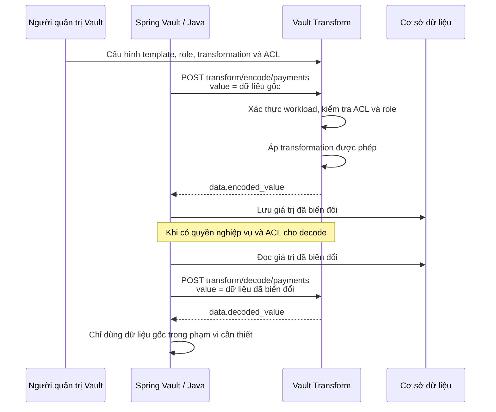
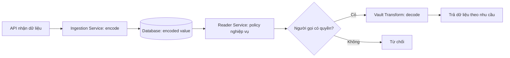

# Transform encode, decode và cấu hình role ở phía máy chủ

## 1. Bài toán: biến đổi dữ liệu nhạy cảm có kiểm soát từ Vault

Trong ứng dụng Java dùng **Spring Vault** để truy cập **HashiCorp Vault**, dữ liệu nhạy cảm không chỉ là password, API key hay chứng thư. Một số hệ thống còn xử lý các giá trị nghiệp vụ có định dạng cố định như mã khách hàng, số định danh, chuỗi có dấu phân tách hoặc giá trị dùng khi tích hợp với hệ thống cũ. Ứng dụng có thể cần lưu hoặc truyền **một dạng đã biến đổi**, và chỉ một dịch vụ được ủy quyền mới khôi phục giá trị ban đầu.

**Vault Transform secrets engine** cung cấp API `encode` và `decode` để thực hiện một số kiểu biến đổi dữ liệu ở phía Vault. Điểm then chốt là **role và transformation được cấu hình ở máy chủ**: ứng dụng chỉ gọi một role cho phép, trong khi Vault quyết định thuật toán, định dạng và khả năng truy cập phép biến đổi.

Ví dụ: dịch vụ tiếp nhận lưu một giá trị dạng `1111-2222-3333-4444` sau khi dùng **Format-Preserving Encryption (FPE)**. Kết quả vẫn có dạng bốn nhóm chữ số, giúp tương thích với một hệ thống lưu trữ có định dạng cố định. Một dịch vụ được cấp quyền `decode` có thể giải mã khi có nhu cầu nghiệp vụ hợp lệ.

> **Điều kiện triển khai:** Transform là tính năng có điều kiện cấp phép của HashiCorp Vault (Vault Enterprise với module Advanced Data Protection Transform, hoặc gói HCP Vault Dedicated có tính năng tương ứng). Vault Community hoặc Vault dev không có cấp phép này có thể không mount được `transform`. Hãy xác minh phiên bản và giấy phép trước khi chạy bài thực hành.

Trong chương **Engine mở rộng** thuộc module **SPRING_VAULT**, bài này kết nối Transform với cách gọi `VaultOperations`/`VaultTemplate`, xác thực theo workload, Vault ACL, xử lý lỗi, giám sát và kiểm thử tích hợp. KV secrets, token/lease, Transit encryption và PKI tiếp tục là các thành phần riêng trong kiến trúc Vault; không dùng Transform để thay thế mọi chức năng của chúng.

Sau khi học, bạn sẽ:

- Phân biệt **FPE**, **masking** và **tokenization**; biết kiểu nào có thể khôi phục dữ liệu.
- Hiểu mối liên hệ giữa **role**, **transformation**, **template** và **alphabet** được quản trị trên Vault.
- Cấu hình role ở phía máy chủ rồi gọi `transform/encode/<role>` và `transform/decode/<role>`.
- Tích hợp encode/decode vào Java qua Spring Vault, đọc và kiểm tra phản hồi API đúng kiểu.
- Thiết kế quyền hạn tách biệt cho dịch vụ chỉ encode và dịch vụ được decode, kiểm thử và quản lý vòng đời dữ liệu.

## 2. Transform xử lý dữ liệu như thế nào?

Một ứng dụng thường chỉ cần biết **tên role được cấp**, loại dữ liệu đầu vào và chính sách xử lý kết quả. Vault lưu cấu hình transformation, template, alphabet và các yếu tố mật mã tương ứng ở phía máy chủ.



Cần phân biệt `encode` trong Transform với Base64:

- **Transform `encode`** là lời gọi engine thực hiện phép biến đổi theo transformation được cấu hình, chẳng hạn FPE hoặc tokenization.
- **Base64 encoding** chỉ đổi biểu diễn byte; ai cũng có thể giải mã Base64, nên bản thân Base64 không bảo vệ bí mật.
- **Transit `encrypt`** nhận dữ liệu được Base64 hóa theo hợp đồng Transit và trả ciphertext có phiên bản dạng `vault:vN:...`. Transform `encode` thường nhận `value` là **chuỗi gốc theo định dạng transformation**, không tự yêu cầu ứng dụng Base64 toàn bộ `value` như Transit.

### 2.1. Ba kiểu biến đổi chính

| Kiểu | Ý nghĩa | Có thể khôi phục? | Đặc điểm đầu ra |
| --- | --- | --- | --- |
| **FPE** (Format-Preserving Encryption) | Mã hóa dữ liệu nhưng duy trì hình dạng theo template/alphabet đã chọn. | Có, khi Vault còn transformation phù hợp và có quyền decode. | Thường giữ độ dài/định dạng của phần được biến đổi; không bảo đảm giữ mọi quy tắc nghiệp vụ. |
| **Masking** | Thay các ký tự phù hợp bằng một ký tự che (ví dụ `*`). | **Không**; che mất thông tin gốc. | Hữu ích để hiển thị hoặc chia sẻ dữ liệu đã được ẩn. |
| **Tokenization** | Thay giá trị nhạy cảm bằng một token không có quan hệ trực tiếp về định dạng; Vault quản lý ánh xạ. | Có thể lấy lại bằng `decode` với quyền và trạng thái token hợp lệ. | Có trạng thái (stateful), thông thường token Base58 không giữ định dạng hay độ dài gốc. |

**Lưu ý:** Việc gọi chung cả ba loại là “mã hóa” dễ gây hiểu nhầm. Masking không có decode để lấy lại bản gốc. Tokenization phụ thuộc khả năng duy trì ánh xạ/token store. FPE là mã hóa có cấu trúc; việc giữ định dạng không bảo đảm dữ liệu vẫn vượt qua mọi quy tắc kiểm tra như checksum Luhn, số kiểm tra, khoảng giá trị hay quan hệ tham chiếu.

## 3. Cấu hình role ở phía máy chủ

Transform dùng bốn lớp khái niệm:

| Tài nguyên | Vai trò | Ví dụ |
| --- | --- | --- |
| **Role** | Tên cấp cao ứng dụng gọi trong đường dẫn `encode`/`decode`; gắn danh sách transformations. | `payments` |
| **Transformation** | Định nghĩa kiểu phép biến đổi, template được dùng, tweak và danh sách role được phép sử dụng. | `ccn-fpe` |
| **Template** | Quy tắc nhận diện và định dạng vùng dữ liệu cần biến đổi. | `ccn` có bốn nhóm 4 chữ số |
| **Alphabet** | Tập ký tự hợp lệ của phần dữ liệu được mã hóa bằng FPE. | `builtin/numeric` (chữ số 0–9) |

Hai quy tắc quan trọng:

1. **Role khai báo transformation nào có thể dùng.** Nếu role có nhiều transformations, ứng dụng cần chỉ rõ `transformation` trong request.
2. **Transformation khai báo `allowed_roles`.** Role phải được phép sử dụng transformation tương ứng; cấu hình một phía mà bỏ qua phía còn lại có thể khiến `encode`/`decode` bị từ chối.

Đây là **Transform role**, khác với role của **AppRole**, Kubernetes Auth hoặc các phương thức xác thực. Quyền Vault ACL dành cho endpoint API vẫn là một lớp kiểm soát độc lập.

### 3.1. Điều kiện chuẩn bị

Giả sử cụm Vault có tính năng Transform, người quản trị có token với quyền cấu hình engine và muốn mount tại `transform/`. Chạy các lệnh sau trong môi trường thử nghiệm có giấy phép phù hợp:

```bash
# Chỉ người quản trị hoặc pipeline cấu hình Vault được thực hiện.
vault secrets enable -path=transform transform
```

Nếu engine đã được mount, không chạy lại lệnh enable; kiểm tra mount/path hiện hữu và cập nhật đường dẫn trong các ví dụ bên dưới. Trong production, cấu hình nên được quản lý bằng IaC hoặc pipeline có review.

### 3.2. Khai báo template nhận diện dữ liệu số

Tạo template cho bốn nhóm bốn chữ số, có thể phân tách bằng dấu gạch ngang hoặc khoảng trắng:

```bash
vault write transform/template/ccn \
  type=regex \
  pattern='(\d{4})[- ](\d{4})[- ](\d{4})[- ](\d{4})' \
  encode_format='$1-$2-$3-$4' \
  alphabet=builtin/numeric
```

Giải thích:

- `type=regex`: sử dụng biểu thức chính quy để nhận diện phần dữ liệu.
- Các nhóm `(\d{4})`: chọn đúng những chữ số thuộc vùng sẽ biến đổi.
- Phần `[- ]` ngoài nhóm: mô tả dấu phân tách; template có thể giữ hoặc định dạng lại chúng.
- `encode_format='$1-$2-$3-$4'`: chuẩn hóa biểu diễn đầu ra thành dạng có dấu gạch ngang.
- `alphabet=builtin/numeric`: phần ký tự tham gia FPE thuộc bảng chữ số có sẵn của Vault.

Đây là **hình dạng của giá trị dùng cho demo**, không có ý định xác nhận đây là số thẻ thanh toán hợp lệ. Trong hệ thống thật, kiểm tra thêm ràng buộc nghiệp vụ và các quy định về dữ liệu nhạy cảm. Regex chỉ kiểm tra mẫu ký tự; một chuỗi khớp định dạng chưa chắc là một định danh hợp lệ.

### 3.3. Tạo role và transformation FPE

```bash
# Role mà ứng dụng sẽ gọi; danh sách transformations có thể mở rộng.
vault write transform/role/payments transformations=ccn-fpe

# Tạo transformation FPE và chỉ cho phép role payments dùng nó.
vault write transform/transformations/fpe/ccn-fpe \
  template=ccn \
  tweak_source=internal \
  allowed_roles=payments
```

Trong một số phiên bản, API xác thực các tham chiếu tài nguyên theo thứ tự cấu hình; khi dùng pipeline, chuẩn bị template trước và đọc lại trạng thái sau khi tạo từng loại tài nguyên. Lệnh trên dùng `tweak_source=internal` để bài thực hành encode/decode không phải mang thêm một tweak qua ứng dụng.

**Tweak là gì?** FPE dùng một tham số bổ sung gọi là *tweak* cùng với phép mã hóa. Tweak không phải mật khẩu, nhưng phải được xử lý nhất quán giữa encode và decode:

| `tweak_source` | Khi encode | Khi decode | Lưu ý |
| --- | --- | --- | --- |
| `internal` | Vault tự duy trì tweak nội bộ cho transformation. | Vault dùng tweak tương ứng. | Thuận tiện; việc biến đổi lặp cùng đầu vào/cấu hình có thể để lộ tính bằng nhau. |
| `generated` | Vault tạo và trả tweak cho yêu cầu encode. | Ứng dụng phải cung cấp tweak đã nhận. | Cần lưu **tweak cùng kết quả encode**, nếu mất tweak có thể không decode được. |
| `supplied` | Ứng dụng cung cấp tweak theo định dạng Vault yêu cầu. | Cung cấp lại **cùng tweak**. | Tweak trong API là chuỗi Base64 của byte tweak; kiểm tra độ dài/thuật toán theo phiên bản. |

Khi dùng `generated` hoặc `supplied`, thiết kế model dữ liệu gồm **encoded value, tên transformation, tweak và phiên bản/ngữ cảnh cấu hình cần thiết**. Mất một phần metadata có thể khiến dữ liệu về sau không thể khôi phục. Với `internal`, app không gửi tweak riêng nhưng vẫn phải quản lý vòng đời transformation.

### 3.4. Đọc lại cấu hình trên Vault

```bash
vault read transform/role/payments
vault read transform/transformation/ccn-fpe
vault read transform/template/ccn
```

Kiểm tra role có `ccn-fpe`, transformation thuộc loại `fpe`, tham chiếu template `ccn`, `allowed_roles` có `payments` và `tweak_source=internal`. Đường dẫn đọc transformation (`transform/transformation/<name>`) có thể khác đường dẫn tạo theo loại (`transform/transformations/fpe/<name>`); không tự suy luận một endpoint cho mọi thao tác quản trị.

Tài nguyên có thể có biến thể theo phiên bản Vault. Khi mở rộng sang nhiều transformation, rà soát API đúng phiên bản và cấu hình tối thiểu được tổ chức phê duyệt.

## 4. Thực hành encode và decode qua role

### 4.1. Encode giá trị gốc

Sau khi cấp quyền sử dụng cho danh tính gọi API:

```bash
vault write transform/encode/payments \
  value=1111-2222-3333-4444 \
  transformation=ccn-fpe
```

Ví dụ một phản hồi có dạng:

```text
Key              Value
---              -----
encoded_value    9300-3376-4943-8903
```

Giá trị trong ví dụ minh họa **không phải kết quả cố định**. Không viết unit test kỳ vọng ciphertext sẽ luôn bằng một chuỗi được chép từ tài liệu.

Trong yêu cầu HTTP, phần đường dẫn và request body có dạng:

```http
POST /v1/transform/encode/payments
Content-Type: application/json
X-Vault-Token: <WORKLOAD_TOKEN>

{
  "value": "1111-2222-3333-4444",
  "transformation": "ccn-fpe"
}
```

Phản hồi `data.encoded_value` là chuỗi đã biến đổi. Trường `transformation` có thể bỏ qua **nếu role chỉ gắn một transformation**; trong ví dụ, đặt rõ tên để hợp đồng nghiệp vụ dễ kiểm tra.

### 4.2. Decode bằng cùng role và transformation

Dùng **đúng giá trị `encoded_value` Vault trả về ở lần encode**, không tự chỉnh sửa và không sử dụng chuỗi minh họa như dữ liệu thực:

```bash
vault write transform/decode/payments \
  value='<ENCODED_VALUE_FROM_VAULT>' \
  transformation=ccn-fpe
```

Khi transformation và metadata phù hợp, kết quả sẽ có dạng:

```text
Key              Value
---              -----
decoded_value    1111-2222-3333-4444
```

Với một số template, Vault còn cho phép cấu hình **decode format** để chỉ trả một phần thông tin phù hợp với định dạng, ví dụ chỉ bốn chữ số cuối. Đường dẫn có dạng `transform/decode/<role>/<decode_format>`; format phải được định nghĩa trước trong template. Không nhầm giải mã một phần để hiển thị với việc bảo đảm người gọi không có quyền khôi phục toàn bộ dữ liệu: việc phân quyền decode cần được thiết kế ở lớp role/ACL và logic dịch vụ.

### 4.3. Nguyên tắc round-trip

```text
plaintext
   └── encode(role, transformation, tweak tương ứng)
            └── encoded_value
                     └── decode(cùng cấu hình cần thiết)
                              └── plaintext
```

Trường hợp `tweak_source=internal`, không phải chuyển tweak theo từng request. Với `generated` hoặc `supplied`, round-trip phải tái sử dụng đúng tweak. Không bảo đảm round-trip nếu transformation bị xóa, role thay đổi không còn quyền, thiếu tweak, hay dữ liệu đã bị sửa thành một giá trị không hợp lệ.

## 5. Phân quyền: encode và decode là hai khả năng khác nhau

Một cấu hình bảo mật phù hợp thường có hai workload:

- **Ingestion service**: nhận giá trị gốc, encode rồi lưu bản đã biến đổi; chỉ cần quyền encode.
- **Authorized reader**: chỉ khi nghiệp vụ có quyền xem dữ liệu gốc mới được decode; thường cần kiểm tra quyền người dùng cuối tại ứng dụng ngoài ACL Vault.

Ví dụ policy dành cho ứng dụng **chỉ encode**:

```hcl
path "transform/encode/payments" {
  capabilities = ["update"]
}
```

Policy dành cho dịch vụ **được phép decode**:

```hcl
path "transform/decode/payments" {
  capabilities = ["update"]
}
```

Nếu cùng một dịch vụ có cả hai nhiệm vụ, có thể cấp cả hai đường dẫn sau khi đánh giá rủi ro. Không cấp `transform/role/*`, `transform/transformations/*`, `transform/template/*` hoặc quyền quản trị engine cho ứng dụng xử lý dữ liệu hằng ngày. Danh tính ứng dụng nên lấy Vault token từ Kubernetes Auth, AppRole hoặc cơ chế workload auth tương ứng; Spring Vault cấu hình vòng đời token phù hợp mà không nhúng token vào source code.

**Hai lớp quyền phải đồng thời đúng:**

1. Token/workload có ACL phù hợp với endpoint `encode` hoặc `decode`.
2. Role Transform chứa transformation được gọi, và transformation cho phép role đó qua `allowed_roles`.

Việc không có quyền `decode` là yếu tố quan trọng trong mô hình bảo vệ dữ liệu. Các câu lệnh nghiệp vụ đọc dữ liệu đã lưu không nên tùy tiện gọi decode chỉ vì đã có quyền đọc database.

## 6. Tích hợp Spring Vault bằng VaultOperations

Spring Vault cung cấp API tổng quát `VaultOperations.write(...)` (qua `VaultTemplate` khi được cấu hình) để gọi đường dẫn của các engine. Đối với Transform, một lựa chọn rõ ràng là viết lớp service nhỏ, dùng tên role được quản trị và giữ response handling tập trung.

Ví dụ dưới đây dành cho Java hiện đại, đã cấu hình sẵn bean `VaultOperations` bằng thông tin Vault endpoint, CA TLS, xác thực workload và permission phù hợp:

```java
import java.util.Map;

import org.springframework.stereotype.Service;
import org.springframework.vault.core.VaultOperations;
import org.springframework.vault.support.VaultResponse;

@Service
public class VaultTransformService {
    private static final String ROLE = "payments";
    private static final String TRANSFORMATION = "ccn-fpe";
    private static final String ENCODE_PATH = "transform/encode/" + ROLE;
    private static final String DECODE_PATH = "transform/decode/" + ROLE;

    private final VaultOperations vault;

    public VaultTransformService(VaultOperations vault) {
        this.vault = vault;
    }

    public String encode(String plaintext) {
        return transform(ENCODE_PATH, "encoded_value", plaintext);
    }

    public String decode(String encodedValue) {
        return transform(DECODE_PATH, "decoded_value", encodedValue);
    }

    private String transform(
            String path, String responseField, String value) {
        if (value == null || value.isBlank()) {
            throw new IllegalArgumentException("Value must not be blank");
        }

        VaultResponse response = vault.write(path, Map.of(
                "value", value,
                "transformation", TRANSFORMATION));

        if (response == null || response.getData() == null) {
            throw new IllegalStateException(
                    "Vault Transform returned no response data");
        }

        Object result = response.getData().get(responseField);
        if (!(result instanceof String text) || text.isBlank()) {
            throw new IllegalStateException(
                    "Vault Transform response missing " + responseField);
        }

        return text;
    }
}
```

Sử dụng trong lớp nghiệp vụ:

```java
String input = "1111-2222-3333-4444";

String encoded = transformService.encode(input);
// Chỉ ghi encoded vào database theo chính sách bảo vệ dữ liệu.

String decoded = transformService.decode(encoded);

if (!input.equals(decoded)) {
    throw new IllegalStateException("Transform round-trip mismatch");
}
```

**Điểm cần ghi nhớ về API:**

- Request dùng `value`, và response của encode/decode được lấy lần lượt từ `data.encoded_value` và `data.decoded_value`.
- `Map.of` cùng các trường `value` và `transformation` là request body cho Vault, không chứa key bí mật hay cấu hình role.
- Đường dẫn `transform/encode/payments` và `transform/decode/payments` cần thay nếu engine được mount tại path khác.
- Không chuyển mọi lỗi của `vault.write` thành giá trị null hoặc dữ liệu gốc. Ngoại lệ xác thực, thiếu ACL, định dạng không hợp lệ hay Vault không sẵn sàng phải được xử lý riêng.
- Code trên dành cho `tweak_source=internal`. Nếu chuyển sang `generated`/`supplied`, phải đổi request/response để gửi, lưu và tái sử dụng **tweak**; không tái sử dụng nguyên mẫu này một cách máy móc.
- Với dữ liệu nhạy cảm, tránh in `plaintext`, `decoded` hoặc body request/response vào log. `String` trong Java khó xóa sạch khỏi bộ nhớ; khi chính sách yêu cầu bảo vệ cao, phải cân nhắc thiết kế xử lý dữ liệu và giới hạn tồn tại plaintext.

### 6.1. Tránh đặt quyền decode ở lớp không cần thiết

Ví dụ kiến trúc:



Người dùng cuối có quyền đọc bản ghi database chưa chắc được phép xem giá trị gốc. Kiểm tra quyền Vault ACL **không biết** người dùng cuối nếu dịch vụ dùng cùng một workload token; ứng dụng phải ràng buộc quyền decode với authorization và audit theo nghiệp vụ.

## 7. Các chi tiết kỹ thuật cần kiểm tra khi chọn FPE

### 7.1. Giữ định dạng khác với giữ hợp lệ nghiệp vụ

Một giá trị FPE vẫn trông như dữ liệu gốc vì sử dụng alphabet/template phù hợp. Tuy nhiên, đầu ra mã hóa không nhất thiết giữ:

- Chữ số kiểm tra/checksum (chẳng hạn Luhn).
- Ràng buộc thuộc một tập mã định danh đã cấp.
- Quan hệ thứ tự hoặc giá trị số học.
- Tính hợp lệ của một mã định danh theo quy tắc tổ chức ngoài regex.

Nếu một hệ thống bên ngoài kiểm tra checksum hoặc miền giá trị chính xác, hãy đánh giá trước khi lưu/truyền FPE output. Không dùng việc “giữ format” làm bằng chứng dữ liệu đã chuẩn hóa hoặc đã có thể dùng thay số thật trong mọi hệ thống.

### 7.2. Độ dài và alphabet

Đối với FPE, đầu vào phải đáp ứng điều kiện độ dài và kích thước miền của thuật toán. Với FF1, ngoài các giới hạn của API, miền đầu vào cần đủ lớn (ví dụ số phần tử miền ít nhất 1.000.000). Những chuỗi quá ngắn hoặc bảng chữ cái quá hẹp có thể không hợp lệ hay có độ an toàn không phù hợp.

Ví dụ template nhận bốn nhóm chữ số trong bài phù hợp hơn chuỗi một chữ số. Nếu dữ liệu là tiếng Việt, chuỗi chữ và số trộn lẫn hoặc identifier có ký tự đặc biệt, cần thiết kế **alphabet/template hợp lệ** và kiểm thử Unicode/normalization trong hệ thống mục tiêu.

### 7.3. Chọn thuật toán và phiên bản Vault

Vault Transform FPE có thuật toán phụ thuộc phiên bản. Tài liệu HashiCorp cho biết **FF3-1 bị deprecated từ Vault 2.2.0**, còn transformation FPE mới sử dụng **FF1**. Khi nâng cấp hoặc di chuyển dữ liệu đã mã hóa bằng thuật toán cũ, cân nhắc API `rewrap` của Transform theo phiên bản đang dùng để chuyển đổi giữa các transformation FPE được hỗ trợ mà không cần đưa plaintext ra ứng dụng.

Trước thay đổi cấu hình có ảnh hưởng dữ liệu đã lưu, lập kế hoạch migration, xác thực khả năng decode dữ liệu cũ, kiểm tra backup và triển khai có rollback. Không xóa transformation chứa khóa hay mapping còn cần thiết cho dữ liệu cũ.

## 8. Masking và tokenization có dùng encode/decode như FPE không?

**Masking:** Có thể dùng encode để che một phần hay toàn bộ thông tin theo template. Vì che ký tự là mất thông tin, không có quy trình `decode` để lấy lại giá trị gốc. Phù hợp trường hợp chỉ cần hiển thị thông tin đã ẩn, không cần khôi phục.

**Tokenization:** Một số trường hợp cần một token tách khỏi định dạng/độ dài của dữ liệu gốc. Vault duy trì ánh xạ có trạng thái, và việc decode phụ thuộc ánh xạ, quyền truy cập cùng thời hạn token nếu được cấu hình. Có thể dùng token làm tham chiếu thay cho giá trị gốc khi tích hợp nội bộ nhưng cần giám sát khả năng lưu trữ và quản lý vòng đời tokenized state.

| Tiêu chí | FPE | Masking | Tokenization |
| --- | --- | --- | --- |
| API encode | Có | Có | Có |
| API decode để khôi phục gốc | Có, theo điều kiện cấu hình | Không | Có, khi mapping/token còn hợp lệ |
| Phụ thuộc template và alphabet | Có | Thường dùng template | Không xử lý input theo template/alphabet |
| Giữ định dạng gốc | Có mục tiêu giữ format | Giá trị bị che | Thông thường không |
| Phụ thuộc lưu trạng thái mapping | Không theo kiểu token store | Không | Có |
| Tình huống phù hợp | Hệ thống cũ yêu cầu trường có định dạng cố định | Hiển thị che dữ liệu | Trao đổi tham chiếu/token thay giá trị thật |

Đừng coi FPE, masking và tokenization là ba cấu hình hoán đổi trực tiếp. Chọn kiểu theo yêu cầu khả năng đảo ngược, định dạng, khả năng lưu trữ và mô hình quyền truy cập.

## 9. Lỗi thường gặp và vận hành

| Hiện tượng | Nguyên nhân có thể | Hướng xử lý |
| --- | --- | --- |
| Không bật được Transform engine | Thiếu giấy phép/tính năng hoặc sai loại deployment. | Xác minh entitlement và khả năng cluster trước cấu hình. |
| HTTP 403 khi encode/decode | Vault token thiếu `update` trên endpoint, hoặc policy xác thực không phù hợp. | Kiểm tra workload identity, token policy và endpoint chính xác. |
| Role/transform không hợp lệ | Role không gắn transformation, `allowed_roles` thiếu role, sai tên hoặc mount. | Đọc lại role và transformation cấu hình phía máy chủ. |
| HTTP 400 do format | Input không khớp template/alphabet, thiếu transformation khi role có nhiều lựa chọn hoặc tweak sai. | Kiểm tra request/schema; không tự đổi dữ liệu đầu vào âm thầm. |
| Decode không ra dữ liệu gốc | Khác transformation, mất/sai tweak, dữ liệu đã đổi, tokenized mapping hết hiệu lực hoặc transformation không còn. | Kiểm tra metadata, nguồn dữ liệu và vòng đời theo từng loại. |
| HTTP 429/5xx hoặc timeout | Vault quá tải hoặc kết nối/hạ tầng gián đoạn. | Retry có giới hạn, backoff và đo độ trễ; không tiết lộ plaintext qua lỗi/log. |
| Kết quả FPE bị hệ thống khác từ chối | Checksum/domain nghiệp vụ không còn hợp lệ sau encode. | Đánh giá quy tắc dữ liệu trước khi dùng FPE làm định danh thay thế. |

Spring Vault có thể ném exception cho response 4xx/5xx; hãy phân biệt **không được phép** với **sai dữ liệu** và **sự cố tạm thời**. Không trả plaintext cho database hoặc người dùng khi encode thất bại chỉ để “tiếp tục nghiệp vụ”.

Trong vận hành, theo dõi:

- Số lời gọi và độ trễ `encode`/`decode` theo role và workload.
- Tỷ lệ từ chối quyền, lỗi định dạng, thiếu tweak, lỗi network và timeout.
- Tần suất decode bất thường so với nghiệp vụ; những sự kiện decode thường cần audit rõ hơn.
- Sự thay đổi role/transformation/template/allowed_roles qua hệ thống quản trị.
- Khả năng khôi phục dữ liệu đã lưu sau nâng cấp, migration hoặc cập nhật cấu hình.

Audit log nên có thông tin định danh workload, request/correlation ID, tên role, loại thao tác, mã lỗi và thời gian. **Không log plaintext, decoded value, token Vault hay toàn bộ payload nhạy cảm**; kiểm tra cấu hình ghi log HTTP của ứng dụng và gateway.

## 10. Kiểm thử tích hợp Spring Vault với Transform

Do Transform cần tính năng/cấp phép phù hợp, bài kiểm thử end-to-end phải chạy trên **Vault thực sự hỗ trợ Transform**. Không giả định Vault dev hoặc container Community có đủ engine. Unit test với mock `VaultOperations` chỉ chứng minh lớp Java đọc/gửi đúng field, không chứng minh Vault có thể encode/decode thực sự.

Một bộ kiểm thử tích hợp nên bao gồm:

1. **Đúng cấu hình:** role `payments` gắn `ccn-fpe`, transformation có `allowed_roles=payments`, template/alphabet phù hợp.
2. **Round-trip FPE:** encode chuỗi mẫu đúng định dạng, decode bằng cùng role/transformation, kết quả bằng chính xác input.
3. **Input sai template:** chuỗi sai ký tự hoặc số lượng chữ số bị từ chối theo hợp đồng của Vault.
4. **Encode-only:** workload có quyền `transform/encode/payments` encode được nhưng không thể gọi decode.
5. **Role sai:** dùng role khác không có transformation tương ứng hoặc bị thiếu `allowed_roles`; thao tác bị từ chối.
6. **Nhiều transformations:** gọi role có nhiều lựa chọn mà không khai báo `transformation` phải bị xử lý lỗi phù hợp.
7. **Tweak:** với cấu hình `generated` hoặc `supplied`, thử decode khi thiếu/sai tweak và khi sử dụng lại tweak đúng.
8. **Lỗi Vault:** mô phỏng token hết hạn, network timeout hoặc service 5xx; ứng dụng báo lỗi rõ, không ghi plaintext như encoded value.
9. **Schema phản hồi:** test `VaultResponse` null/thiếu `data.encoded_value` hoặc `data.decoded_value`, bảo đảm service từ chối.
10. **Thay đổi cấu hình:** thử ở môi trường staging với dữ liệu mã hóa trước khi cập nhật/migration, kiểm tra khả năng giải mã lịch sử.

Một bài tập nâng cao: thiết kế hai microservice `ingestion` và `authorized-reader` có Kubernetes Auth riêng. `ingestion` chỉ gọi encode; `authorized-reader` chỉ giải mã sau khi kiểm tra quyền người dùng ở tầng nghiệp vụ. Dựng test chứng minh dữ liệu lưu trữ chỉ là `encoded_value`, không có plaintext trong log, và thử đổi `allowed_roles` để thấy tác động của cấu hình server.

## 11. Checklist triển khai

- [ ] Xác nhận Vault hỗ trợ/licensed Transform và đúng mount path.
- [ ] Chọn FPE, masking hoặc tokenization theo yêu cầu khôi phục và định dạng.
- [ ] Cấu hình template/alphabet, transformation, role và `allowed_roles` trên Vault bằng danh tính quản trị.
- [ ] Đọc lại role/transformation; tránh cấp quyền quản trị cho ứng dụng.
- [ ] Tách ACL `encode` và `decode`, dùng xác thực Vault theo workload.
- [ ] Gửi `value` đúng định dạng, chỉ rõ `transformation` khi cần.
- [ ] Với FPE, quản lý tweak/metadata và đánh giá checksum, độ dài, tính hợp lệ nghiệp vụ.
- [ ] Kiểm tra phản hồi `encoded_value`/`decoded_value`, xử lý Vault lỗi theo fail-closed.
- [ ] Giám sát decode, bảo vệ dữ liệu nhạy cảm khỏi log, kiểm thử round-trip và quyền hạn.
- [ ] Có chiến lược migration/backup trước khi thay đổi hoặc xóa transformation có dữ liệu đang dùng.

**Ghi nhớ:** `transform/encode/<role>` và `transform/decode/<role>` là giao diện để ứng dụng sử dụng một phép biến đổi đã được quản trị phía máy chủ. **Role + transformation + template/alphabet + policy** cùng quyết định điều gì được phép và dữ liệu biến đổi ra sao. Với Spring Vault, ứng dụng chỉ nên biết role và request contract được cấp, giữ quyền decode ở nơi thực sự cần đến.

### Tài liệu tham khảo

- HashiCorp Vault — Transform secrets engine: https://developer.hashicorp.com/vault/docs/secrets/transform
- HashiCorp Vault — Transform HTTP API: https://developer.hashicorp.com/vault/api-docs/secret/transform
