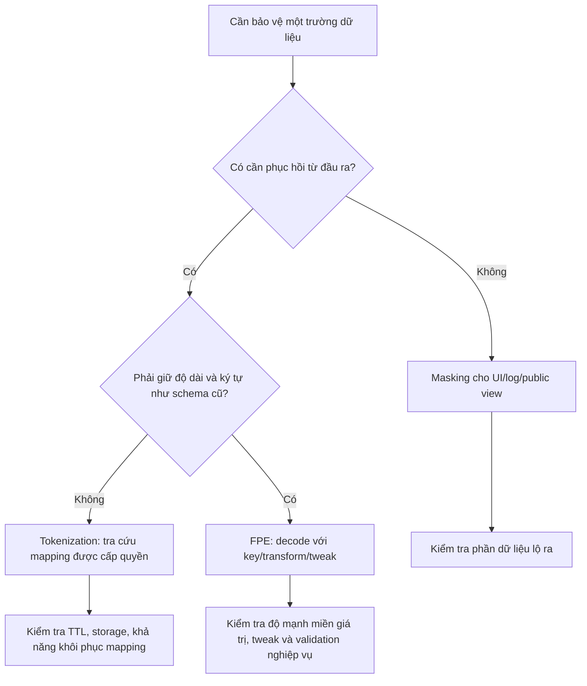
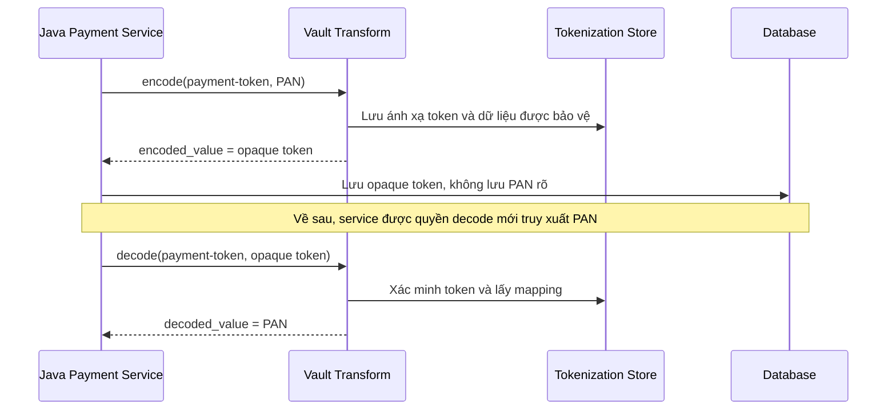
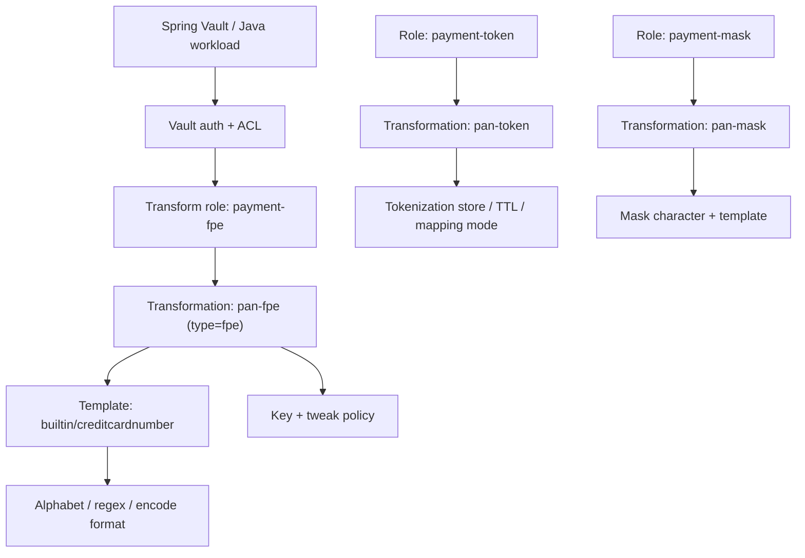

# Phân biệt tokenization, che dữ liệu và mã hóa giữ định dạng

> **Spring Vault — Engine mở rộng.** Khi phải bảo vệ số thẻ, mã định danh khách hàng, số điện thoại hoặc thông tin nhận dạng trong ứng dụng Java, ba cách xử lý thường bị gọi chung là “mã hóa”: **tokenization**, **data masking** và **format-preserving encryption (FPE)**. Chúng giải quyết những yêu cầu khác nhau về khôi phục dữ liệu, định dạng, lưu trạng thái, quyền truy cập và vận hành. Trong HashiCorp Vault, cả ba là các kiểu transformation của **Transform secrets engine**. Chọn đúng cơ chế trước khi viết mã Spring Vault giúp tránh mất dữ liệu, tạo chỉ mục sai hoặc vô tình công khai thông tin nhạy cảm.

## 1. Mục tiêu bài học và điều kiện sử dụng

Sau bài học, bạn có thể giải thích và thực hành:

1. Tokenization khác **Vault authentication token**, khác hashing, khác mã hóa thông thường như thế nào.
2. Che dữ liệu (*masking*) dành cho hiển thị có khác gì dữ liệu có thể khôi phục.
3. FPE giữ nguyên **độ dài, bảng ký tự và mẫu hiển thị** ra sao, và tại sao không đảm bảo mọi quy tắc kiểm tra nghiệp vụ như Luhn.
4. Cách chọn giữa ba cơ chế cho dữ liệu thanh toán, PII, hệ thống cũ có cột giới hạn độ dài và UI hỗ trợ khách hàng.
5. Vai trò của **Vault Transform role, transformation, template, alphabet và tweak**; cấu hình API theo phiên bản Vault.
6. Dùng **Spring Vault** để encode/decode qua `VaultOperations.opsForTransform()`, tách quyền encode và decode theo workload.
7. Thiết kế kiểm thử tích hợp có dữ liệu thử, kiểm tra quyền ACL, vòng đời tokenization và ảnh hưởng của key/algorithm migration.

**Điều kiện quan trọng:** HashiCorp Vault **Transform secrets engine cần Vault Enterprise với Advanced Data Protection Transform hoặc gói HCP Vault Dedicated phù hợp**. Vault Community Edition không thể giả định có sẵn engine này. Các lệnh `vault secrets enable transform` trong bài chỉ chạy trên cluster **lab có entitlement/licensing phù hợp**; test unit bằng mock không chứng minh môi trường có Transform.

Bài sử dụng thuật ngữ **Vault 2.x** khi nói về thay đổi thuật toán FPE mới và nhắc cách kiểm tra hệ thống cũ. Phiên bản Spring Vault là **thư viện Java**, độc lập với phiên bản Vault server.

## 2. So sánh ba phương pháp qua cùng một dữ liệu

Giả sử dữ liệu đầu vào minh họa là:

```text
4111-1111-1111-1111  (chỉ là chuỗi giả định cho ví dụ)
```

Ba kết quả có thể trông như sau:

| Cách xử lý | Đầu ra minh họa | Có thể khôi phục giá trị gốc? | Giữ mẫu 4-4-4-4? | Có cần trạng thái ánh xạ riêng theo mỗi giá trị? |
|---|---|---|---|---|
| **Tokenization** | `5Pq...Hk9` (opaque token) | **Có, nhưng qua dịch vụ tra cứu được cấp quyền** | **Không** trong Transform tokenization mặc định | **Có**: bản ghi ánh xạ token ↔ dữ liệu |
| **Masking** | `XXXX-XXXX-XXXX-1111` (mask hiển thị theo chính sách) | **Không** từ kết quả đã mask | Có thể giữ một phần dấu phân cách hoặc một phần ký tự | **Không** |
| **FPE** | `8302-4570-6129-7755` (ciphertext giả định) | **Có**, bằng decode đúng key, transformation và tweak khi cần | **Có** theo template/alphabet | **Không có mapping riêng theo mỗi giá trị**, nhưng phải giữ key/cấu hình |
| **Transit encrypt** (để đối chiếu) | `vault:v1:...` | **Có**, bằng Transit decrypt đúng key/policy | **Không** | Không cần mapping riêng theo từng plaintext |

**Các chuỗi trong bảng chỉ để hình dung, không phải kết quả tính được từ Vault.** Với Vault Transform, masking dựa trên template để chọn ký tự cần che; ví dụ giữ 4 số cuối là **một yêu cầu chính sách/thiết kế template hoặc xử lý UI**, không phải hành vi mặc định của mọi masking transformation.

### Ba câu hỏi giúp chọn phương pháp

- **Có cần lấy lại giá trị gốc không?** Nếu **không**, masking cho hiển thị là lựa chọn đơn giản. Nếu **có**, cân nhắc tokenization hoặc FPE với quyền decode tách biệt.
- **Đầu ra có bắt buộc đúng mẫu dữ liệu cũ không?** Nếu không, tokenization thường thích hợp để thay giá trị bằng một surrogate vô nghĩa. Nếu bắt buộc cùng chiều dài/bảng ký tự do schema cũ, FPE được thiết kế cho trường hợp đó.
- **Chấp nhận duy trì mapping state ở Vault không?** Tokenization yêu cầu lưu và quản lý trạng thái; FPE dùng biến đổi mật mã với key, transform config và tweak chứ không tạo mapping riêng cho từng giá trị.



## 3. Tokenization: thay dữ liệu nhạy cảm bằng một token độc lập

**Tokenization** lấy một giá trị nhạy cảm rồi thay bằng token không có quan hệ tính toán trực tiếp với giá trị gốc. Với Vault Transform, token là chuỗi ngẫu nhiên có cấu trúc được ký/kiểm tra bởi engine; tokenization mang tính **stateful**: Vault lưu bản ghi ánh xạ mật mã hóa trong tokenization store.

Ví dụ vòng đời:



Nói tokenization **“irreversible”** cần hiểu đúng: **không thể suy ra plaintext chỉ bằng bản thân token theo phép giải mã như ciphertext**. Tuy nhiên, chủ thể có quyền vẫn **detokenize** qua Vault bằng cách tra mapping. Đây là sự khác biệt giữa tính không thể đảo về mặt thuật toán và khả năng truy hồi nghiệp vụ qua một dịch vụ được kiểm soát.

### 3.1. Không nhầm với Vault token hoặc JWT

- **Vault authentication token**: xác thực requests tới Vault, có policy, TTL, có thể renew/revoke. Không dùng nó để làm surrogate cho PAN.
- **Tokenization token**: một **giá trị dữ liệu** thay thế PAN/PII trong database. Không tự cho phép truy cập Vault API.
- **JWT/access token**: mang hoặc tham chiếu claims để xác thực/ủy quyền trong luồng khác; không mặc định là một kho thay thế PII được quản lý bởi Vault Transform.
- **HMAC/digest**: tạo dấu vân tay để đối chiếu; không có thao tác detokenize lấy lại plaintext. Với dữ liệu miền nhỏ, hashing/HMAC có mô hình rủi ro khác.

Không gọi tokenization là “mã hóa PAN thành chuỗi ngắn”: cách giải mã phụ thuộc **mapping service/state**, không phải giải mã ngay từ token.

### 3.2. Tính ngẫu nhiên, hội tụ và khả năng liên kết

Theo mặc định, mã hóa cùng một plaintext nhiều lần tạo **các token khác nhau**. Điều này làm giảm liên kết dữ liệu qua các lần phát hành. Vault Transform có tùy chọn **convergent tokenization** để cùng plaintext và cùng thuộc tính thời hạn tạo cùng token theo quy tắc engine, nhưng đánh đổi khả năng nhìn ra các bản ghi giống nhau.

Ví dụ:

| Yêu cầu | Lựa chọn phù hợp |
|---|---|
| Mỗi giao dịch cần token độc lập, khó liên kết giữa hệ thống | Tokenization không convergent (mặc định) |
| Cần join hai sự kiện theo cùng một identifier dưới phạm vi kiểm soát | Cân nhắc convergent, đánh giá nguy cơ liên kết/thuộc tính lộ ra |
| Cần token ổn định và dùng làm primary key | Thiết kế rõ lifecycle, TTL, reissue và uniqueness; đừng suy luận từ tokenization mặc định |
| Cần trả lại dữ liệu cho hệ thống được phép | Tokenization decode với policy tách riêng |

Tokenization trả **opaque Base58 string**, **không giữ định dạng PAN**. Nếu cột database bị giới hạn `VARCHAR(19)` chỉ gồm số và dấu gạch, cần thay schema hoặc giải pháp tương ứng, không được ép tokenization giữ 16 chữ số.

### 3.3. Storage, TTL và quyền phục hồi

Vault có thể lưu trạng thái tokenization trong internal store hoặc cấu hình external store theo hỗ trợ sản phẩm. Mỗi token có thể có `ttl`/`expiration`; cần hoạch định retention và tidying. Nếu token hết hạn hoặc mapping bị xóa, việc detokenize có thể **không còn thực hiện được**.

- **`mapping_mode=default`** được HashiCorp khuyến nghị để tăng bảo vệ: kho mapping không chứa token có thể xuất trực tiếp để khôi phục hàng loạt plaintext.
- **`mapping_mode=exportable`** phục vụ trường hợp cần export decoded values theo quy trình khẩn cấp, làm tăng bề mặt tấn công; chỉ chọn nếu có yêu cầu đã phê duyệt.
- **`convergent=false`** là lựa chọn mặc định giảm khả năng liên kết. Cấu hình này không thể đổi tùy tiện sau khi tạo transformation.
- Tokenization store là một **phụ thuộc vận hành**: backup/restore, replication, độ trễ, dung lượng, tidy và mất quyền truy xuất phải nằm trong thiết kế DR.
- Tokenization trên dữ liệu rất nhạy cảm nên gắn lifecycle phù hợp dữ liệu gốc. Không tạo token không hạn chỉ vì API cho phép.

**Phạm vi rủi ro:** token bị đánh cắp vẫn là một dữ liệu cần bảo vệ; nó có thể đủ để gọi dịch vụ nội bộ nào đó vốn chấp nhận token thay identifier. Thiết kế ủy quyền downstream phải tránh coi “có token” đồng nghĩa “được quyền giải mã”.

## 4. Data masking: che dữ liệu khi hiển thị hoặc xuất bản

**Masking** thay những ký tự khớp template bằng ký tự che, chẳng hạn `X` hoặc `*`. Vault Transform masking **không có thao tác decode để khôi phục giá trị gốc**.

Ví dụ thiết kế UI hỗ trợ khách hàng:

```text
Nguồn nhạy cảm : 4111-1111-1111-1111
Hiển thị tối thiểu: XXXX-XXXX-XXXX-1111
Hoặc che toàn phần: XXXX-XXXX-XXXX-XXXX
```

Ở đây `XXXX-XXXX-XXXX-1111` là **mẫu hiển thị mong muốn**. Để đạt được trong hệ thống phải thiết kế chính xác phần giữ lại trong template/luồng ứng dụng. Mỗi cấu hình masking Vault có thể che **các nhóm được match** khác nhau; không nên suy diễn từ tên “masking” rằng nó luôn giữ 4 số cuối.

### Khi masking phù hợp

1. Trang giao dịch chỉ cần xác nhận người dùng đang nhìn đúng tài khoản thông qua vài ký tự cuối.
2. Dashboard support chỉ hiển thị số liên lạc ở mức cần thiết cho vai trò nhân viên.
3. Export cho bên thứ ba chỉ cần nhận dạng sơ bộ, không dùng đầy đủ PII.
4. Log hoặc audit payload cần **tối thiểu hóa** dữ liệu; trong thực tế tốt nhất tránh log trường nhạy cảm ngay từ đầu.

### Masking **không** phải mã hóa dữ liệu gốc

- Nếu database vẫn lưu PAN rõ và API chỉ mask khi trả về, masking **không bảo vệ** bản ghi khi database bị xâm phạm.
- Nếu thay **vĩnh viễn** dữ liệu gốc bằng masked string, không có cách “decode” để lấy lại nội dung bị mất.
- Masking có thể rò rỉ prefix/suffix, độ dài, cấu trúc hoặc pattern; đối với PII ít entropy, vài ký tự cuối kết hợp với metadata khác có thể đủ để tái nhận diện.
- Không sử dụng masked string làm input cho nghiệp vụ cần PAN gốc rồi hy vọng khôi phục được.

**Định hướng:** masking là **giới hạn dữ liệu lộ cho người xem**, còn tokenization và FPE là hai cách thay giá trị khi hệ thống cần lưu/truyền nó ở dạng được bảo vệ nhưng có lối khôi phục có kiểm soát.

## 5. FPE: ciphertext có định dạng giống dữ liệu gốc

**Format-preserving encryption** là mã hóa có thể đảo ngược, nhằm duy trì các thuộc tính định dạng được template xác định: **độ dài** và **bảng ký tự**; dấu phân cách, nhóm ký tự hoặc hình thức hiển thị có thể được giữ theo template. Không phải mọi phép mã hóa đều giữ định dạng: chẳng hạn mã hóa Transit thường tạo ciphertext có tiền tố `vault:v1:`.

Ví dụ:

```text
Input     : 1111-2222-3333-4444
FPE output: 9300-3376-4943-8903   # ví dụ từ tài liệu Vault
Decoded   : 1111-2222-3333-4444
```

Đầu ra cụ thể phụ thuộc key, thuật toán FPE, template, alphabet và **tweak**. Không hard-code output cụ thể trong test nếu không kiểm soát đầy đủ những yếu tố này.

### 5.1. Giữ format không bảo đảm hợp lệ nghiệp vụ

Một chuỗi có 16 chữ số và dấu `-` đúng vị trí **vẫn có thể không vượt qua Luhn checksum**, không thuộc BIN/IIN cần thiết và không phải một số thẻ được cấp thật. Vault lưu ý FPE output có thể không thỏa các quy tắc nghiệp vụ ngoài template.

Do đó cần phân biệt:

- **Đúng cấu trúc:** regex `^[0-9]{4}(-[0-9]{4}){3}$` có thể PASS.
- **Đúng checksum:** Luhn có thể FAIL.
- **Đúng semantics:** mã được cấp trong hệ thống, có permission hay không là một câu hỏi khác.
- **Đúng dữ liệu gốc:** chỉ được xác định sau `decode` với quyền và cấu hình phù hợp.

Nếu database có trigger/check constraint kiểm tra Luhn, FPE có thể bị từ chối mặc dù vẫn giữ 16 chữ số. Cần thiết kế chiến lược lưu trữ/validation trước khi chọn giải pháp.

### 5.2. Tweak và rủi ro liên kết dữ liệu

FPE dùng **tweak** (tham số không bí mật theo định nghĩa mật mã) bên cạnh key; tweak giúp phân biệt các phép biến đổi có cùng key.

| `tweak_source` | Hành vi | Lưu ý vận hành |
|---|---|---|
| `internal` | Vault giữ một tweak nội bộ gắn transformation và tái sử dụng | Đơn giản, nhưng cùng input dưới cùng key/tweak có thể tạo cùng ciphertext, lộ tương quan; cân nhắc mức độ duy nhất dữ liệu |
| `generated` | Vault sinh tweak khi encode và trả về để caller lưu | Phải lưu tweak cùng dữ liệu đã encode; truyền lại đúng tweak khi decode |
| `supplied` | Caller cung cấp tweak khi encode/decode | Bắt buộc quản lý/lưu/khôi phục tweak nhất quán; sai tweak làm decode sai hoặc thất bại |

Giá trị tweak truyền qua API được mã hóa base64 trong request HTTP; Spring Vault có helper chuyển từ `byte[]`. Đối với **FF3-1**, tweak dài **7 byte**; với **FF1**, yêu cầu độ dài theo `max_tweak_len` của transformation. Quy tắc này phụ thuộc **phiên bản server và algorithm**; không ép quy tắc 7 byte cho mọi FPE của Vault mới.

### 5.3. Phiên bản thuật toán FPE

HashiCorp đã công bố sự thay đổi quan trọng:

- **Vault trước 2.2.0:** các FPE transformation lịch sử có thể dùng **FF3-1**.
- **Từ Vault 2.2.0:** **FF3-1 bị deprecated; transformation FPE mới sử dụng FF1**. Một lý do là thay đổi khuyến nghị bảo mật theo NIST về tweak schedule của FF3-1.
- **Dữ liệu cũ:** vẫn cần khả năng giải mã với transformation cũ cho giai đoạn migration. Vault hỗ trợ endpoint **`/transform/rewrap/:role_name`** để chuyển ciphertext FF3-1 sang FF1 theo cấu hình được phép, tránh trả plaintext ra khỏi Vault.

Phải xác nhận **Vault server version** và cấu hình transformation thực tế trước khi chọn chiến lược; không tự gán mọi bản cài đặt đều dùng FF3-1 hoặc đều dùng FF1.

### 5.4. FPE có giới hạn an toàn theo miền dữ liệu

Miền quá nhỏ như PIN 4 chữ số, giới tính, mã chi nhánh vài giá trị hoặc giá trị boolean không thích hợp để suy diễn “mã hóa là đủ an toàn”. FPE phải tuân theo các giới hạn về kích thước alphabet và độ dài. Rủi ro phân tích tần suất và đoán giá trị có thể cao khi dữ liệu ít entropy.

**Quyết định thực tế:** nếu chỉ cần che thông tin UI, dùng masking; nếu cần thay bằng token nhưng không bắt buộc giữ định dạng, tokenization thường phù hợp hơn FPE cho các trường có miền giá trị nhỏ.

## 6. Những thành phần cốt lõi của Vault Transform engine

Đối với mô hình `transform/` mount:



| Cấu phần | Vai trò | Dễ nhầm |
|---|---|---|
| **Mount** | Nơi gắn Transform engine, thường `transform/` | Mount path khác với transformation name |
| **Role** | Tập transformations được phép sử dụng khi gọi encode/decode | Role không đồng nghĩa Vault auth role/AppRole |
| **Transformation** | Chọn loại `fpe`, `masking`, `tokenization` và key/cấu hình | Một role có thể có nhiều transformations |
| **Template** | Xác định phần input được chọn và định dạng kết quả cho FPE/masking | Không dùng để giữ format tokenization |
| **Alphabet** | Bộ ký tự hợp lệ cho FPE, như digits `0-9` | Không tự đảm bảo checksum/business validity |
| **Tweak** | Tham số bổ trợ FPE, độc lập với tokenization | Không phải API token hay private key |
| **Token store** | Giữ mapping của tokenization | Không được xem là stateless; phải backup/HA |

Nếu một role gắn **nhiều transformations**, yêu cầu encode/decode cần chỉ rõ `transformation`. Nếu role chỉ có một transformation, Vault có thể tự chọn nó.

Từ góc độ Spring Vault, module **SPRING_VAULT** truy cập engine qua `VaultTemplate` hoặc `VaultOperations`, sử dụng workload authentication và policy tối thiểu. Không dùng root token hoặc nhét thông tin thẻ thật vào cấu hình ứng dụng.

## 7. Cấu hình lab: ba transformations, ba roles

Các lệnh sau là **ví dụ chạy trên Vault Enterprise/HCP Dedicated đã được cấp phép**, nơi đã xác thực với identity quản trị và dùng **dữ liệu giả**. Không tự chạy trên Vault sản xuất. Mỗi role chứa một transformation để minh họa rõ behavior.

### 7.1. Bật engine và khai báo FPE

```bash
# Cần quyền operator phù hợp và gói Vault hỗ trợ Transform.
vault secrets enable -path=transform transform

vault write transform/role/payment-fpe \
  transformations=pan-fpe

vault write transform/transformations/fpe/pan-fpe \
  template=builtin/creditcardnumber \
  tweak_source=internal \
  allowed_roles=payment-fpe
```

`builtin/creditcardnumber` là template có sẵn; nếu input không khớp pattern của template, lệnh sẽ thất bại hoặc không biến đổi phần mong muốn. Trên Vault 2.2+, FPE transformation mới dùng FF1; trên bản cũ cần kiểm tra algorithm được tạo.

Thử:

```bash
vault write transform/encode/payment-fpe \
  value=1111-2222-3333-4444

# Thay <actual-encoded-value> bằng encoded_value thực sự trả về.
vault write transform/decode/payment-fpe \
  value="<actual-encoded-value>"
```

Kết quả decode phải bằng **input ban đầu**. Đầu ra encode mỗi môi trường có thể khác nhau; không cần chứa con số “9300…” được dùng để minh họa ở mục trước.

### 7.2. Cấu hình masking cho dữ liệu hiển thị

```bash
vault write transform/role/payment-mask \
  transformations=pan-mask

vault write transform/transformations/masking/pan-mask \
  template=builtin/creditcardnumber \
  masking_character=X \
  allowed_roles=payment-mask

vault write transform/encode/payment-mask \
  value=1111-2222-3333-4444
```

Response trả **`encoded_value` đã che các ký tự match theo template**. Không gọi `transform/decode/payment-mask`: masking không có đường khôi phục plaintext. Khi yêu cầu giữ 4 số cuối, cần thiết kế template riêng và xác minh output bằng test, tránh tự giả định built-in che theo kiểu partial mask.

### 7.3. Cấu hình tokenization có thời hạn

```bash
vault write transform/role/payment-token \
  transformations=pan-token

vault write transform/transformations/tokenization/pan-token \
  allowed_roles=payment-token \
  mapping_mode=default \
  convergent=false \
  max_ttl=24h

vault write transform/encode/payment-token \
  value=1111-2222-3333-4444 \
  ttl=1h
```

Kết quả là token opaque; đây là **tokenization output**, không phải Vault auth token. Với tokenization, `max_ttl` là giới hạn ở transformation, `ttl` có thể đưa vào khi encode. Nếu không cấu hình TTL/expiration, tokenization có thể tồn tại lâu dài theo chính sách mặc định; vì vậy cần xem lại retention và tidy.

```bash
# Token đã encode là giá trị trả về trong data.encoded_value.
vault write transform/decode/payment-token \
  value="<actual-tokenized-value>"

# Kiểm tra token còn hợp lệ:
vault write transform/validate/payment-token \
  value="<actual-tokenized-value>"
```

Không gọi `decode` nếu chỉ cần xác minh validity; `validate` phục vụ use case riêng và dễ cấp policy ít quyền hơn.

### 7.4. API HTTP chung cho encode/decode

Vault CLI `vault write` gửi POST. Nếu ứng dụng cần HTTP:

```http
POST /v1/transform/encode/payment-fpe HTTP/1.1
Host: vault.example.internal
X-Vault-Token: <workload-token>
Content-Type: application/json

{"value":"1111-2222-3333-4444"}
```

Phản hồi rút gọn:

```json
{"data":{"encoded_value":"<encoded-value-from-vault>"}}
```

Decode:

```http
POST /v1/transform/decode/payment-fpe HTTP/1.1
Host: vault.example.internal
X-Vault-Token: <authorized-decode-token>
Content-Type: application/json

{"value":"<encoded-value-from-vault>"}
```

Phản hồi:

```json
{"data":{"decoded_value":"1111-2222-3333-4444"}}
```

Không đưa số thẻ thật vào shell history, request logging hoặc dashboard telemetry. Mount có thể khác `transform`: khi đó thay đúng mount path trong request.

## 8. Gọi Transform từ Spring Vault

**Spring Vault 2.3+** cung cấp `VaultTransformOperations` và `VaultOperations.opsForTransform()` hoặc `opsForTransform("custom-mount")`. API này làm việc với **Transform roles** đã được operator cấu hình trên Vault; nó không tự tạo role/transformation.

### 8.1. Typed API đơn giản: encode/decode FPE

Giả định ứng dụng đã cấu hình `VaultOperations` với workload authentication và Vault có role `payment-fpe` ở mount `transform`:

```java
import org.springframework.stereotype.Service;
import org.springframework.vault.core.VaultOperations;
import org.springframework.vault.core.VaultTransformOperations;

@Service
public class PaymentProtectionService {

    private final VaultTransformOperations transform;

    public PaymentProtectionService(VaultOperations operations) {
        this.transform = operations.opsForTransform("transform");
    }

    public String protectForLegacySchema(String pan) {
        // Trước khi gọi: validate input và cân nhắc dữ liệu có nhạy cảm.
        return transform.encode("payment-fpe", pan);
    }

    public String recoverForAuthorizedUse(String encoded) {
        // Đường decode phải đặt sau kiểm tra authorization nghiệp vụ.
        return transform.decode("payment-fpe", encoded);
    }
}
```

Ví dụ `opsForTransform("transform")` nhận **mount path**, còn `payment-fpe` là **Transform role**. Đừng truyền `transform/encode/payment-fpe` vào `opsForTransform(...)`.

**Trách nhiệm ủy quyền:** Vault ACL của workload chỉ điều khiển nó có được phép gọi API hay không; ứng dụng vẫn phải kiểm tra **người dùng, hành động và mục đích nghiệp vụ** trước khi cho decode. Không exposing `recoverForAuthorizedUse` trực tiếp thành API REST public.

### 8.2. Một role chứa nhiều transformations

Nếu role `payments` gồm `pan-fpe` và `pan-mask`, dùng context để xác định loại:

```java
import org.springframework.vault.core.VaultOperations;
import org.springframework.vault.core.VaultTransformOperations;
import org.springframework.vault.support.TransformCiphertext;
import org.springframework.vault.support.TransformPlaintext;
import org.springframework.vault.support.VaultTransformContext;

public final class MultiTransformExample {

    private final VaultTransformOperations transform;

    public MultiTransformExample(VaultOperations operations) {
        this.transform = operations.opsForTransform();
    }

    public void runWithSyntheticValue() {
        String input = "1111-2222-3333-4444";

        VaultTransformContext fpeContext =
                VaultTransformContext.fromTransformation("pan-fpe");

        TransformCiphertext encoded = transform.encode(
                "payments",
                TransformPlaintext.of(input).with(fpeContext));

        TransformPlaintext decoded =
                transform.decode("payments", encoded);

        if (!input.equals(decoded.asString())) {
            throw new IllegalStateException("FPE round-trip failed");
        }

        VaultTransformContext maskContext =
                VaultTransformContext.fromTransformation("pan-mask");

        TransformCiphertext masked = transform.encode(
                "payments",
                TransformPlaintext.of(input).with(maskContext));

        // masked chứa kết quả phục vụ hiển thị.
        // Không gọi decode với transformation masking.
    }
}
```

Ví dụ này chỉ chạy khi operator đã tạo role `payments` **được phép sử dụng cả** `pan-fpe` và `pan-mask`; role lab ở mục 7 là các role riêng biệt nên **không dùng trực tiếp đoạn này với lab đó** nếu chưa thêm cấu hình role.

Khi FPE dùng `tweak_source=supplied` hoặc `generated`, phải chuyển `VaultTransformContext` mang **tweak phù hợp** qua decode, lưu context cần thiết cùng ciphertext và hiểu sự khác biệt giữa helper của thư viện với yêu cầu thuật toán ở server.

### 8.3. Gọi API đặc thù bằng `VaultOperations.write`

`VaultTransformOperations` bao phủ encode/decode thông dụng. Với endpoint riêng như `transform/validate/<role>` dành cho tokenization, dùng `VaultOperations.write(path, body)` để POST JSON:

```java
import java.util.Map;
import org.springframework.vault.core.VaultOperations;
import org.springframework.vault.support.VaultResponse;

public final class TokenValidityClient {

    private final VaultOperations vault;

    public TokenValidityClient(VaultOperations vault) {
        this.vault = vault;
    }

    public boolean isActiveToken(String opaqueToken) {
        VaultResponse response = vault.write(
                "transform/validate/payment-token",
                Map.of("value", opaqueToken));

        if (response == null || response.getData() == null) {
            throw new IllegalStateException("Vault returned empty response");
        }

        Object valid = response.getData().get("valid");
        if (!(valid instanceof Boolean)) {
            throw new IllegalStateException(
                    "Unexpected transform validation response");
        }

        return (Boolean) valid;
    }
}
```

Đối chiếu schema response `validate` với **Vault server version đang dùng**. Nếu server trả về cấu trúc khác hoặc permission thiếu, method phải báo lỗi thay vì mặc định `false`. Khi triển khai thực tế, tránh để tokenization token trong URL hoặc log dù nó không phải Vault auth token.

### 8.4. Transform khác Transit trong cùng ứng dụng

| Tình huống | API Spring Vault/engine phù hợp |
|---|---|
| Bảo vệ giá trị nhạy cảm, không cần giữ định dạng | `VaultOperations.opsForTransit(...)` nếu ciphertext dạng `vault:vN:...` được chấp nhận |
| Thay PAN bằng surrogate có store/TTL | `VaultOperations.opsForTransform(...)` với tokenization |
| Mã hóa dữ liệu trong schema `CHAR(16)`/mẫu cố định | Transform FPE, đồng thời đánh giá Luhn/validation |
| Chỉ che thông tin để xem | Transform masking hoặc tầng UI với policy tương đương |
| Lấy secrets và cấu hình ứng dụng | `VaultTemplate` KV operations, không dùng Transform để thay KV |
| Cấp chứng thư TLS workload | Vault PKI, không phải Transform |

**Một ứng dụng có thể dùng nhiều engine**, mỗi engine với mount, vai trò và policy riêng. Không dùng quyền encode như một cách mặc nhiên cấp quyền decode.

## 9. Policy: encode và decode là hai quyền nghiệp vụ khác nhau

Trong Vault ACL, cả encode và decode đều là HTTP POST, thường cần capability **`update`** trên path tương ứng. Điều quan trọng là chỉ cấp **đường dẫn thật sự cần thiết**:

```hcl
# Workload ghi dữ liệu đã bảo vệ, không được khôi phục PAN.
path "transform/encode/payment-fpe" {
  capabilities = ["update"]
}
path "transform/encode/payment-token" {
  capabilities = ["update"]
}

# Workload hiển thị dữ liệu đã che.
path "transform/encode/payment-mask" {
  capabilities = ["update"]
}
```

Workload giải mã được tách identity và policy:

```hcl
path "transform/decode/payment-fpe" {
  capabilities = ["update"]
}
path "transform/decode/payment-token" {
  capabilities = ["update"]
}
```

**Giới hạn của policy:** path `transform/encode/<role>` là theo **role**, không phải theo transformation. Nếu một role có cả FPE và masking, cấp quyền trên encode role đó đồng nghĩa ứng dụng có thể yêu cầu cả hai tùy cấu hình. Vì vậy **dùng role riêng** khi muốn tách quyền rõ ràng.

Các hành động quản trị như `transform/role/*`, `transform/transformations/*`, key rotation/rewrap và tokenization store management phải có identity quản trị khác. Với tokenization, nếu workload chỉ kiểm tra một token còn hợp lệ, chỉ cấp `transform/validate/payment-token` thay vì `decode` khi tính năng cho phép.

Ngoài ACL Vault, người vận hành cần quản lý:
- Auth theo workload (Kubernetes/JWT/AppRole/IAM), TTL token và renewal/reauthentication.
- TLS xác thực Vault server, network egress, namespace và mount isolation.
- Quy trình cấp quyền decode ít người/ít service nhất, audit ai yêu cầu plaintext và vì sao.
- Tuyệt đối không log `value`, `decoded_value`, các yếu tố tweak nhạy cảm theo chính sách, hoặc toàn body response.
- Quy tắc retention của tokenization mappings, disaster recovery, backup, rotation và khả năng phục hồi.

## 10. Chọn cơ chế cho bốn tình huống thực tế

| Tình huống | Mục tiêu | Đề xuất | Kiểm tra bổ sung |
|---|---|---|---|
| Payment service cần lưu PAN để đối soát, hệ thống mới chấp nhận token opaque | Giảm dữ liệu nhạy cảm trong DB chính | **Tokenization** | Store/TTL, quyền detokenize, thời gian lưu và PCI scope |
| Hệ thống cũ chỉ có cột 16 chữ số và nhiều tích hợp dựa vào format | Giữ schema trong giai đoạn chuyển đổi | **FPE** | Miền giá trị, Luhn, tweak, key rotation, migration |
| Nhân viên hỗ trợ chỉ xem 4 ký tự cuối số thẻ | Hiển thị tối thiểu PII/PAN | **Masking** | Chính sách phần dữ liệu giữ lại và kiểm thử view/log |
| Payload JSON nội bộ cần bảo mật trước khi lưu, schema mới có thể mở rộng | Bảo mật có thể giải mã mà không giữ format | **Transit encryption** | Key policy, context, ciphertext length, renewal |

### 10.1. Một thiết kế kết hợp hợp lý

Một tổ chức có thể lưu **tokenization token** trong DB giao dịch và chỉ cho back-office service detokenize với audit. API support không cần detokenize để lấy số thẻ: nếu cần hiện 4 số cuối, có thể lưu **last-four** như một thuộc tính hiển thị tách biệt theo chính sách và chỉ hiển thị đúng phạm vi.

Điều này giảm số lần gọi decode, giảm quyền của service frontend, và hạn chế nguy cơ lộ plaintext qua log. Nhưng last-four kết hợp các thuộc tính khác vẫn là dữ liệu cần đánh giá độ nhạy; không mặc định là vô hại.

### 10.2. Khi FPE không nên là mặc định

FPE rất hữu ích cho hệ thống cũ nhưng có đánh đổi: đầu ra giữ cấu trúc nên có thể lộ **loại dữ liệu, chiều dài, dấu phân cách**; với cấu hình tweak nội bộ hoặc dữ liệu lặp lại còn có thể lộ quan hệ bằng nhau. Tập giá trị ít entropy và validation ngoài format khiến bài toán khó hơn mã hóa thông thường.

Nếu hệ thống cho phép schema thay đổi, cân nhắc tokenization hoặc Transit trước khi chấp nhận các ràng buộc FPE.

## 11. Xử lý lỗi và quan sát vận hành

| Hiện tượng | Nguyên nhân khả dĩ | Cách kiểm tra |
|---|---|---|
| Engine không bật / `404` | Cluster dùng Community Edition, license không hỗ trợ, sai mount | Kiểm tra entitlement, `vault secrets list`, đúng namespace |
| `403 permission denied` | Workload có encode nhưng thiếu decode, sai role path, policy deny | So khớp HTTP path và capability `update`, không cấp root |
| `400` khi encode FPE | Input không khớp template/alphabet, độ dài không được hỗ trợ, thiếu tweak | Kiểm tra regex, alphabet, tweak_source và version server |
| Đầu ra FPE không qua Luhn | Format được giữ nhưng checksum nghiệp vụ không | Tách kiểm tra schema/format với validation nghiệp vụ |
| `decode` masking thất bại | Masking **không reversible** | Đừng gọi decode; cần dữ liệu gốc từ nguồn được bảo vệ nếu nghiệp vụ yêu cầu |
| Tokenization decode không tìm thấy | Token hết hạn, mapping bị xóa/tidy, sai store/role hoặc môi trường | Kiểm tra TTL, mapping backup/restore, role, audit |
| Tokenization cho cùng PAN tạo token khác | `convergent=false` mặc định | So sánh logic theo ý nghĩa, không giả định token stable |
| FPE decode không bằng input | Sai tweak, nhầm key/transformation, migration sai | Kiểm tra metadata lưu cùng ciphertext và thuật toán theo version |
| Độ trễ tăng đột biến | Vault HA/network, storage tokenization, batch size, throttling | Đo p95/p99, timeout, số request, lỗi theo role |
| Log xuất hiện plaintext/decoded_value | Logging HTTP debug, controller, tracing hoặc exception | Khử dữ liệu nhạy cảm tại tầng ghi log và audit config |

Đo các chỉ số: **tỷ lệ encode/decode thành công**, thời gian phản hồi, lỗi theo HTTP status và role, số lượng token hóa sắp hết hạn, tỷ lệ fail ở validation, tốc độ tiêu thụ storage và sự cố renewal token. Nếu workload retry encode tokenization sau timeout, có thể sinh **một token mới** cho cùng plaintext (mặc định không convergent). Thiết kế idempotency ở tầng nghiệp vụ để không làm tăng token rác hoặc tạo ánh xạ không mong muốn.

Không log tham số plaintext để “điều tra”; dùng request/correlation ID không nhạy cảm và những nhãn đo lường được phê duyệt.

## 12. Kiểm thử tích hợp với Vault thật

Unit tests có thể kiểm chứng chọn method, validation và xử lý exception. **Tính năng Transform phải được kiểm thử trên Vault Enterprise/HCP Dedicated test instance** đã có license, role, transformation, policy và mock PII được sinh cho test. Cần tách nhóm kiểm thử chạy trên Vault test khỏi unit test dùng mock.

### 12.1. JUnit 5 — vòng encode/decode FPE

Đoạn sau sử dụng Spring Boot test context đã cấu hình `VaultOperations` trỏ đến đúng môi trường lab; role `payment-fpe` đã được operator tạo theo mục 7:

```java
import static org.junit.jupiter.api.Assertions.*;

import org.junit.jupiter.api.Test;
import org.springframework.beans.factory.annotation.Autowired;
import org.springframework.boot.test.context.SpringBootTest;
import org.springframework.vault.core.VaultOperations;
import org.springframework.vault.core.VaultTransformOperations;

@SpringBootTest
class TransformFpeIT {

    @Autowired VaultOperations vaultOperations;

    @Test
    void fpePreservesShapeAndCanRecoverOriginal() {
        VaultTransformOperations transform =
                vaultOperations.opsForTransform("transform");

        String original = "1111-2222-3333-4444";
        String encoded = transform.encode("payment-fpe", original);
        String decoded = transform.decode("payment-fpe", encoded);

        assertNotNull(encoded);
        assertTrue(encoded.matches("[0-9]{4}(-[0-9]{4}){3}"));
        assertEquals(original.length(), encoded.length());
        assertEquals(original, decoded);

        // Không assert output cứng, vì phụ thuộc key/algorithm/tweak.
        // Không assert Luhn PASS: FPE chỉ bảo đảm format theo template.
    }
}
```

### 12.2. JUnit 5 — masking không thể khôi phục

```java
import static org.junit.jupiter.api.Assertions.*;

import org.junit.jupiter.api.Test;
import org.springframework.beans.factory.annotation.Autowired;
import org.springframework.boot.test.context.SpringBootTest;
import org.springframework.vault.core.VaultOperations;

@SpringBootTest
class TransformMaskIT {

    @Autowired VaultOperations vaultOperations;

    @Test
    void maskDoesNotExposeOriginalDigits() {
        String input = "1111-2222-3333-4444";
        String masked = vaultOperations.opsForTransform("transform")
                .encode("payment-mask", input);

        assertNotNull(masked);
        assertNotEquals(input, masked);
        assertTrue(masked.contains("X"),
                "Template/role should apply the configured mask");
    }
}
```

Test chỉ kiểm tra behavior encode và phần ký tự bị che. **Không cần gọi decode để chứng minh masking không reversible** trong production test; nếu muốn xác nhận hợp đồng lỗi, làm trong test riêng và chấp nhận HTTP error theo server version.

### 12.3. Ma trận test đầy đủ

| ID | Trường hợp | Assertion |
|---|---|---|
| T01 | Tokenization mặc định trên cùng plaintext gọi hai lần | Mỗi token khác nhau, cả hai có thể decode đúng plaintext khi chưa hết TTL |
| T02 | Tokenization hết hạn | `validate`/decode không còn chấp nhận sau TTL; không giả định còn mapping |
| T03 | Tokenization mapping bị xóa/tidy | Đường khôi phục thất bại theo chính sách, không fallback sang plaintext đã lưu lén |
| T04 | Convergent tokenization (fixture riêng) | Cùng plaintext/expiration cho cùng token theo hợp đồng |
| M01 | Masking theo template có xác định | Chỉ ký tự dự kiến bị che; không lộ dữ liệu thừa |
| M02 | Masking chuỗi không khớp template | Không được lặng lẽ trả nguyên PII ra API public; tầng ứng dụng phải fail closed |
| F01 | FPE round-trip | Đầu ra đúng format và decode trùng input |
| F02 | FPE tweak supplied/generated | Truyền lại đúng tweak, sai/mất tweak không được coi là thành công |
| F03 | FPE miền dữ liệu quá nhỏ | Server từ chối hoặc policy ứng dụng không cho đưa vào FPE |
| F04 | FPE checksum nghiệp vụ | Test format riêng, test Luhn riêng; tránh đồng nhất hai khái niệm |
| F05 | FF3-1 legacy → FF1 mới | Kiểm thử quy trình `rewrap` khi phiên bản Vault phù hợp |
| A01 | Workload chỉ được `encode` | `encode` PASS, `decode` bị `403` |
| A02 | Role có nhiều transformations | Cần chỉ định `transformation`; role sai bị từ chối |
| A03 | Sai mount/license | Lỗi rõ, không coi như dữ liệu rỗng |
| O01 | Timeout khi tokenization encode | Thiết kế retry/idempotency tránh nhân bản mapping ngoài ý muốn |

### 12.4. Tránh kiểm thử “xanh giả”

- Không mock `VaultTransformOperations` rồi khẳng định đã kiểm thử FPE encryption hoặc tokenization store.
- Không test quyền bằng Vault root token; root bỏ qua giới hạn mà workload thật phải chịu.
- Không chỉ assert `encoded != plaintext`: FPE còn cần đúng format, decode đúng; masking cần kiểm tra trường không được lộ; tokenization cần kiểm tra mapping/TTL.
- Không assert ciphertext là một giá trị cố định trừ khi fixture khóa chính xác key, algorithm, template, tweak và version.
- Không đưa PAN/PII thật vào fixture, báo cáo test, CI logs, mock HTTP recordings hoặc màn hình debug.
- Không xóa transformation/mapping trên cluster dùng chung để cleanup test. Dùng mount/namespace/roles test riêng và thủ tục teardown an toàn.
- Không xem kiểm thử các quy tắc PCI/GDPR là đủ để tuyên bố tuân thủ: phạm vi dữ liệu, kiểm soát truy cập, audit, retention và quy trình tổ chức vẫn cần đánh giá độc lập.

## 13. Bài tập quyết định kiến trúc

**Bối cảnh:** một hệ thống thanh toán Java đang chuyển một số trường nhạy cảm sang Vault Transform. Ba luồng cần xử lý: DB lưu giao dịch, trang hỗ trợ khách hàng và hệ thống báo cáo cũ có cột giới hạn 16 chữ số.

1. DB mới có thể lưu token dài bất kỳ; service thanh toán cần đôi khi lấy lại PAN. Bạn chọn cơ chế gì và tổ chức quyền decode ở đâu?
2. Trang hỗ trợ chỉ cần hiện 4 số cuối. Có cần detokenize mỗi lần để tạo `XXXX-XXXX-XXXX-1111` không? Nêu thiết kế giảm quyền.
3. Hệ thống báo cáo cũ có trường đúng 16 ký tự số, nhưng kiểm tra Luhn. Vì sao FPE vẫn có thể khiến bước INSERT fail?
4. Sau khi một client `encode` cùng PAN hai lần, hai token khác nhau. Tình huống này có phải lỗi của tokenization không?
5. FPE transformation dùng `tweak_source=generated`. Điều gì xảy ra nếu app chỉ lưu ciphertext mà không lưu tweak?
6. Nâng Vault lên 2.2+ khi đã có dữ liệu FF3-1. Nêu hướng chuyển sang FF1 mà không buộc plaintext đi qua ứng dụng.
7. Nêu sự khác biệt giữa **Vault token** trong `X-Vault-Token` và **tokenization token** trong `data.encoded_value`.
8. Một service chỉ cần gọi `transform/encode/payment-fpe`. Nếu policy còn cho `transform/decode/payment-fpe`, nguy cơ là gì?

**Gợi ý:** (1) tokenization + mapping state có TTL và detokenize service có quyền riêng; (2) thiết kế thông tin hiển thị tối thiểu theo chính sách, giảm nhu cầu decode; (3) FPE giữ định dạng, không bắt buộc checksum hợp lệ; (4) không, mặc định non-convergent; (5) không thể decode đúng theo contract; (6) `transform/rewrap` FF3-1 → FF1; (7) một bên xác thực requests, một bên là surrogate dữ liệu; (8) service bị chiếm quyền có thể phục hồi dữ liệu nhạy cảm.

## 14. Tài liệu chính thức và checklist vận dụng

Tài liệu cần đối chiếu với **Vault server version và Spring Vault version đang triển khai**:

- [HashiCorp Vault — Transform secrets engine](https://developer.hashicorp.com/vault/docs/secrets/transform): Enterprise/ADP, FPE, masking, tokenization, roles/templates/alphabets, tweak và thay đổi FF1.
- [HashiCorp Vault — Transform HTTP API](https://developer.hashicorp.com/vault/api-docs/secret/transform): `encode`, `decode`, `validate`, config transformation, tokenization store và `rewrap`.
- [HashiCorp Vault — Tokenization transform](https://developer.hashicorp.com/vault/docs/secrets/transform/tokenization): mapping modes, convergent tokenization, TTL, store và security trade-offs.
- [HashiCorp Vault — Transit and Transform comparison](https://developer.hashicorp.com/validated-designs/vault/user-guide/transit-and-transform): use cases lựa chọn Transit và Transform.
- [Spring Vault — VaultTransformOperations Javadoc](https://docs.spring.io/spring-vault/reference/api/java/org/springframework/vault/core/VaultTransformOperations.html): `encode`, `decode`, batch overloads (Since: 2.3).
- [Spring Vault — VaultTransformContext Javadoc](https://docs.spring.io/spring-vault/reference/api/java/org/springframework/vault/support/VaultTransformContext.html): chọn transformation và cung cấp tweak.
- [Spring Vault — VaultOperations Javadoc](https://docs.spring.io/spring-vault/reference/api/java/org/springframework/vault/core/VaultOperations.html): `opsForTransform()` và `write(String, Object)`.

Checklist trước khi đưa vào sản xuất: **có entitlement Transform**, workload auth và policy tối thiểu, xác minh template/alphabet/tweak, cách lưu metadata để decode, tokenization TTL và DR, giới hạn dữ liệu lộ trong masking, kiểm thử quyền encode/decode riêng, kế hoạch key/algorithm migration, log/metrics không chứa giá trị gốc và kiểm thử tích hợp trên Vault thực.

> **Ghi nhớ:** **tokenization** thay dữ liệu bằng **opaque token có mapping**; **masking** che dữ liệu để **không thể khôi phục từ bản đã che**; **FPE** mã hóa có thể đảo ngược nhưng **giữ hình dạng đã cấu hình**, không đảm bảo checksum hay ý nghĩa nghiệp vụ. Chọn giải pháp theo nhu cầu **phục hồi**, **định dạng** và **quản trị trạng thái/quyền truy cập**.

