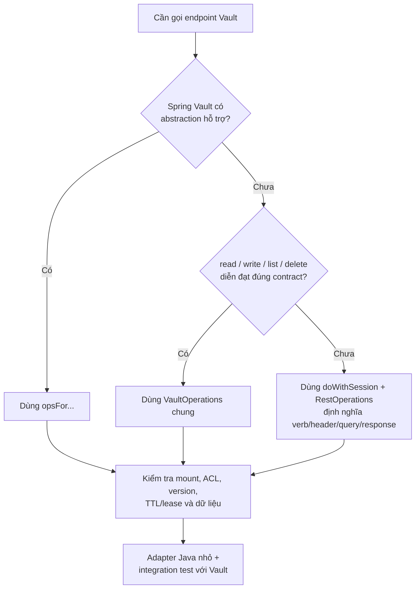

# Lựa chọn abstraction chuyên biệt hoặc yêu cầu HTTP có kiểm soát

**Chương:** Engine mở rộng  
**Module:** SPRING_VAULT

## 1. Bài toán: khi nào dùng API chuyên biệt của Spring Vault?

Một ứng dụng Java tích hợp HashiCorp Vault thường bắt đầu bằng `VaultTemplate` hoặc giao diện `VaultOperations`. Khi thao tác với **KV secrets**, **Transit encryption**, **PKI**, token, response wrapping hay một số engine khác, Spring Vault cung cấp các **abstraction chuyên biệt**: giao diện Java nắm được những khái niệm và cấu trúc dữ liệu của engine. Tuy nhiên, Vault có nhiều secrets engine và endpoint mới hơn khả năng bao phủ của phiên bản Spring Vault đang chạy. Khi đó, ứng dụng có thể cần gọi **HTTP API một cách có kiểm soát**.

Câu hỏi thiết kế không chỉ là *làm sao gửi được request đến Vault?* mà là:

- Làm sao bảo đảm đúng **mount path**, HTTP method, phiên bản API và cấu trúc request/response?
- Có thể tái sử dụng việc **xác thực workload**, quản lý token/session và TLS sẵn có trong Spring Vault không?
- Ai chịu trách nhiệm ánh xạ JSON, kiểm tra dữ liệu, xử lý lỗi và quản lý **lease**?
- Làm sao giữ quyền Vault ACL ở mức tối thiểu khi hỗ trợ thêm một engine hoặc endpoint?
- Làm sao kiểm thử phần tích hợp mà không phụ thuộc hoàn toàn vào một hệ Vault production?

Bài này giúp chọn và triển khai hợp lý giữa **abstraction chuyên biệt** và **yêu cầu HTTP có kiểm soát** trong chương *Engine mở rộng*, đồng thời liên hệ các chủ đề của SPRING_VAULT: truy cập `VaultTemplate`, xác thực theo workload, KV, token/lease, Transit, PKI, lỗi, giám sát và kiểm thử tích hợp.

**Sau bài học, bạn sẽ:**

1. Nhận biết nhóm API chuyên biệt Spring Vault đã cung cấp.
2. Đưa ra quyết định dựa trên khả năng API, phiên bản, quyền và yêu cầu vận hành.
3. Viết mã đọc secret qua `VaultKeyValueOperations` và qua `VaultOperations.read` đúng ngữ nghĩa.
4. Dùng `VaultOperations.doWithSession` khi phải điều khiển HTTP method/header hoặc endpoint đặc thù.
5. Xây dựng một adapter Java nhỏ, kiểm soát path/response, TTL, retry, log và quyền truy cập.

## 2. Ba cấp độ truy cập Vault trong ứng dụng Java

| Cấp độ | API chính | Phù hợp với | Điều ứng dụng phải kiểm soát |
| --- | --- | --- | --- |
| **Chuyên biệt theo engine** | `opsForKeyValue`, `opsForVersionedKeyValue`, `opsForTransit`, `opsForPki`, `opsForWrapping`... | Thao tác được thư viện mô hình hóa rõ ràng | Chọn đúng mount/phiên bản và xử lý giá trị nghiệp vụ |
| **VaultOperations tổng quát** | `read(path)`, `write(path, body)`, `list(path)`, `delete(path)` | Endpoint có HTTP contract khớp thao tác chung | Path chính xác, hình dạng JSON, dữ liệu/metadata, side effect |
| **HTTP callback được quản lý** | `doWithSession(callback)`, `doWithVault(callback)` + `RestOperations` | Cần verb, header, query, status hoặc kiểu response riêng | Toàn bộ HTTP contract, headers, auth context, URL, mapping, timeout và lỗi |

**Thứ tự lựa chọn thông dụng:** kiểm tra xem Spring Vault **đã có API phù hợp hay chưa**; nếu có, sử dụng nó. Nếu chưa, đánh giá `VaultOperations.read/write/list/delete`; nếu những phương thức này không thể biểu diễn đúng verb, header, query hoặc response, dùng `doWithSession` với `RestOperations`. Không nhất thiết phải tạo một `RestTemplate` riêng hoặc tự nhét Vault token vào header cho mọi trường hợp.



**Ranh giới cần nhớ:** Abstraction chuyên biệt giúp giảm những lỗi giao thức; nó không tự cấp Vault policy, không tự bật engine, không làm secret an toàn nếu ứng dụng ghi log dữ liệu nhạy cảm và không tự giải quyết toàn bộ vòng đời lease/certificate.

## 3. Những abstraction chuyên biệt thường dùng

Từ bean `VaultOperations` (thường được triển khai bằng `VaultTemplate`), các nhóm API tiêu biểu là:

| Nhu cầu | Giao diện/lời gọi | Ghi chú |
| --- | --- | --- |
| KV v1/v2, đọc và ghi secret theo path tương đối | `opsForKeyValue("secret", KeyValueBackend.KV_2)` | Tự xử lý những tiền tố nội bộ như `data/` hay `metadata/` theo API KV; phải chỉ đúng phiên bản engine |
| KV v2 cần version, CAS và quản lý phiên bản | `opsForVersionedKeyValue("secret")` | Hữu ích khi ghi đồng thời hoặc cần làm việc chính xác với version |
| Mã hóa/giải mã và thao tác khóa Transit | `opsForTransit("transit")` | Ánh xạ byte/plaintext, ciphertext và ngữ nghĩa Transit |
| Cấp/ký chứng thư PKI, đọc CRL, thu hồi cert | `opsForPki("pki")` | Các method cụ thể phụ thuộc phiên bản Spring Vault |
| Lookup, unwrap, rewrap | `opsForWrapping()` | Cơ chế wrapping token của Vault |
| Thao tác token Vault | `opsForToken()` | Phân biệt quyền token và vòng đời secret |
| Thao tác hệ thống/engine administration | `opsForSys()` | Nhiều thao tác cần đặc quyền operator |
| Transform secrets engine | `opsForTransform("transform")` | Phụ thuộc khả năng/phiên bản và giấy phép Vault được triển khai |

Tên hàm chính xác và phạm vi thao tác phải đối chiếu theo **phiên bản thư viện đã khóa trong dự án**. Ví dụ, `opsForKeyValue("secret", KV_2)` được hỗ trợ lâu dài; biến thể tự động nhận biết KV backend `opsForKeyValue("secret")` chỉ xuất hiện trong Spring Vault mới hơn. Không viết ví dụ dùng API của Spring Vault 4.1 rồi giả định tất cả dự án dùng Spring Vault 3.x đều biên dịch được.

**Không có một `opsFor...` chung cho mọi engine.** Chẳng hạn, khi dùng database credentials, AWS/GCP secrets, RabbitMQ, LDAP hoặc tính năng mới của PKI/identity chưa được mô hình hóa trong phiên bản Spring Vault hiện tại, ta thường cần `VaultOperations` tổng quát hoặc callback HTTP. Đó là điểm mở rộng có chủ đích.

## 4. Quy tắc quyết định: dựa trên contract, không chỉ dựa vào tên engine

Một quyết định nên xem xét ít nhất sáu chiều:

| Tiêu chí | Ưu tiên abstraction chuyên biệt khi... | Cân nhắc HTTP có kiểm soát khi... |
| --- | --- | --- |
| **Bao phủ tính năng** | Có method thể hiện đúng hành động và tham số | Endpoint mới/chuyên biệt chưa có method |
| **Kiểu dữ liệu** | Thư viện có value object như `CertificateBundle`, `Versioned` hoặc `VaultResponseSupport` phù hợp | Response đặc biệt, header, kiểu bytes, hoặc nested JSON cần custom mapping |
| **HTTP method** | Method thư viện đã hiểu verb và đường dẫn | Cần `PATCH`, custom verb/header/query, hoặc đọc status code cụ thể |
| **Phiên bản Vault/Spring Vault** | Hai phiên bản tương thích theo tài liệu | Vault mới hơn thư viện hoặc tính năng đang triển khai theo API mới |
| **Vận hành** | Cần cơ chế đã có của thư viện, ví dụ version/CAS, byte encoding, lease integration | Tính năng bổ sung nhưng có hợp đồng HTTP đủ ổn định để tự bảo trì |
| **Bảo trì và kiểm thử** | Ít mã hạ tầng hơn, ít nơi tạo lỗi serialization | Chấp nhận sở hữu adapter, kiểm thử contract và cập nhật khi API thay đổi |

Không nên quyết định rằng “engine mới → tạo HTTP client mới”. **`VaultOperations` vẫn có thể dùng chung Vault endpoint, session manager, hệ thống xác thực workload và cấu hình TLS**; nhờ đó tránh lặp logic xử lý token và các header nhạy cảm ở nhiều nơi.

Cũng không nên nhầm “dùng Spring Vault” với “không thể gọi HTTP trực tiếp”: `doWithSession` chính là cơ chế được Spring Vault cung cấp để sử dụng `RestOperations` trong session đã xác thực khi thực hiện thao tác chưa được abstraction mô hình hóa.

## 5. Ví dụ 1 — KV v2: dùng abstraction để tránh lỗi API path

Giả sử Vault có mount **`secret` là KV v2** và một secret tại đường dẫn logic `apps/orders`. Yêu cầu nghiệp vụ là lấy trường `api_key`. Sử dụng interface chuyên biệt:

```java
import java.util.Map;

import org.springframework.stereotype.Service;
import org.springframework.vault.core.VaultKeyValueOperations;
import org.springframework.vault.core.VaultOperations;
import org.springframework.vault.core.VaultKeyValueOperationsSupport.KeyValueBackend;
import org.springframework.vault.support.VaultResponse;

@Service
public class OrdersSecretReader {

    private final VaultKeyValueOperations kv;

    public OrdersSecretReader(VaultOperations vault) {
        this.kv = vault.opsForKeyValue("secret", KeyValueBackend.KV_2);
    }

    public String loadApiKey() {
        VaultResponse response = kv.get("apps/orders");

        if (response == null) {
            throw new IllegalStateException(
                "Required Vault secret is missing");
        }

        Map<String, Object> values = response.getRequiredData();
        Object key = values.get("api_key");

        if (!(key instanceof String) || ((String) key).isBlank()) {
            throw new IllegalStateException(
                "Vault secret does not contain api_key");
        }

        return (String) key;
    }
}
```

Điểm cần hiểu: đối với `VaultKeyValueOperations`, `"apps/orders"` là **đường dẫn tương đối bên trong mount `secret`**. Thư viện tự chọn API route phù hợp với KV v2, ví dụ `GET /v1/secret/data/apps/orders`. Ứng dụng không phải tự thêm `data/` hoặc tự gỡ lớp `data.data` của phản hồi JSON.

Nếu ứng dụng dùng trực tiếp `VaultOperations.read("secret/data/apps/orders")`, phản hồi HTTP KV v2 có dạng:

```json
{
  "data": {
    "data": {
      "api_key": "<secret-value>"
    },
    "metadata": {
      "version": 3,
      "created_time": "2026-11-20T08:00:00Z",
      "deletion_time": "",
      "destroyed": false
    }
  }
}
```

Do đó, với `VaultOperations.read` tổng quát, `response.getData()` chứa **map bao ngoài** có key `data` trỏ tới secret và key `metadata` trỏ tới metadata version. Nếu người viết mã lấy `getData().get("api_key")` thì kết quả sẽ là `null`. Đó là một lỗi thực tế mà abstraction chuyên biệt ngăn chặn.

So sánh đường dẫn nếu mount là `secret`:

| Ý định | Gọi qua abstraction KV | Gọi trực tiếp trên VaultOperations/HTTP |
| --- | --- | --- |
| Đọc KV v1 tại `apps/orders` | `opsForKeyValue("secret", KV_1).get("apps/orders")` | `GET secret/apps/orders` |
| Đọc KV v2 | `opsForKeyValue("secret", KV_2).get("apps/orders")` | `GET secret/data/apps/orders` |
| Ghi KV v2 | `kv.put("apps/orders", payload)` | `POST secret/data/apps/orders` với JSON có `data` |
| Liệt kê thư mục KV v2 | `kv.list("apps")` | `LIST secret/metadata/apps` |
| Đọc metadata KV v2 chi tiết | `opsForVersionedKeyValue(...)` nếu API cung cấp thao tác cần dùng | `GET secret/metadata/apps/orders` nếu endpoint chưa được abstraction phù hợp bao phủ |

**Không tự thêm `/v1`** vào tham số `path` của `VaultOperations` thông thường: Spring Vault đã dùng Vault endpoint với tiền tố API phù hợp. Cũng không dùng sai phiên bản: KV v1 và KV v2 có path, quyền và hình dạng JSON khác nhau.

Khi có yêu cầu **CAS (compare-and-set) khi ghi đồng thời**, sử dụng `VaultVersionedKeyValueOperations` thay vì tự chế thuật toán đọc version → ghi không có điều kiện. Cơ chế CAS của Vault giúp ngăn một bản ghi mới vô tình ghi đè dữ liệu do tác vụ khác cập nhật.

## 6. Ví dụ 2 — Engine chưa có abstraction phù hợp: đọc database credentials

Giả sử Vault đã có database secrets engine tại mount `database` và role `reporting-readonly` do operator cấu hình. API Vault thường cung cấp endpoint:

```http
GET /v1/database/creds/reporting-readonly
```

Mỗi lần gọi có thể **phát hành một bộ thông tin đăng nhập động mới**, kèm lease. Đây là một API GET nhưng **không phải thao tác đọc thuần túy, idempotent theo nghĩa nghiệp vụ**. Không retry vô hạn chỉ vì method HTTP là GET.

Với Spring Vault, `VaultOperations.read` đủ để gọi endpoint này:

```java
import java.util.Map;

import org.springframework.stereotype.Service;
import org.springframework.vault.core.VaultOperations;
import org.springframework.vault.support.VaultResponse;

@Service
public class DatabaseCredentialsGateway {

    private static final String CREDS_PATH =
        "database/creds/reporting-readonly";

    private final VaultOperations vault;

    public DatabaseCredentialsGateway(VaultOperations vault) {
        this.vault = vault;
    }

    public IssuedCredentials issueCredentials() {
        VaultResponse response = vault.read(CREDS_PATH);

        if (response == null) {
            throw new IllegalStateException(
                "Vault returned no database credentials");
        }

        Map<String, Object> data = response.getRequiredData();
        Object username = data.get("username");
        Object password = data.get("password");

        if (!(username instanceof String)
                || !(password instanceof String)
                || ((String) username).isBlank()
                || ((String) password).isBlank()) {
            throw new IllegalStateException(
                "Unexpected database credentials response");
        }

        return new IssuedCredentials(
            (String) username,
            (String) password,
            response.getLeaseId(),
            response.getLeaseDuration(),
            response.isRenewable());
    }

    // Dùng Java 17+; hạn chế để record bị serialize/log tự động.
    public record IssuedCredentials(
        String username,
        String password,
        String leaseId,
        long leaseDurationSeconds,
        boolean renewable
    ) {}
}
```

Phản hồi gốc của Vault có thể bao gồm:

```json
{
  "lease_id": "database/creds/reporting-readonly/<lease-id>",
  "lease_duration": 3600,
  "renewable": true,
  "data": {
    "username": "<generated-username>",
    "password": "<generated-password>"
  }
}
```

Ví dụ là **dữ liệu minh họa**; giá trị thật phụ thuộc plugin database và role. `VaultResponse.getData()` cho phép lấy `username`/`password`, còn `getLeaseId()`, `getLeaseDuration()` (đơn vị giây) và `isRenewable()` đọc **metadata lease** ở lớp ngoài JSON. Phản hồi không có lease hợp lệ cần được xử lý theo contract của backend, không tạo một `lease_id` giả.

**Hệ quả vận hành:** dữ liệu trả về từ `read` tổng quát không có nghĩa Spring Vault tự quản lý việc renew/rotate kết nối DB. Ứng dụng phải thiết kế vòng đời credential: lấy lúc cần, làm mới trước expiry, cập nhật pool an toàn, xử lý khi revoked; có thể tích hợp các thành phần lease của Spring Vault (ví dụ `SecretLeaseContainer`) khi phù hợp. Đừng cache credential động vô thời hạn hoặc tạo một bộ credential mới ở mỗi request HTTP vào ứng dụng.

### Kiểm soát ACL ở endpoint

Workload chỉ cần đọc credential của role được phép:

```hcl
path "database/creds/reporting-readonly" {
  capabilities = ["read"]
}
```

Token này không cần quyền trên `database/config/*`, `database/roles/*` hay `database/rotate-root/*`. Những endpoint cấu hình và thao tác quản trị database là việc của operator. Đọc được credential cũng không làm ứng dụng trở thành quản trị viên Vault.

## 7. Ví dụ 3 — Khi cần HTTP header cụ thể: doWithSession

Giả sử một dịch vụ **cấp phát AppRole SecretID** cần yêu cầu Vault **response wrapping** ngay trên request phát hành. Cần gửi header `X-Vault-Wrap-TTL: 5m` cùng `POST` đến:

```http
POST /v1/auth/approle/role/orders-api/secret-id
X-Vault-Wrap-TTL: 5m
```

Chỉ gọi `vault.write("auth/approle/role/orders-api/secret-id", ...)` không cho phép chỉ rõ header riêng trên từng request. Đây là trường hợp hợp lý để dùng **`doWithSession`**, đưa `RestOperations` thực hiện yêu cầu HTTP đã xác thực.

```java
import java.util.Map;

import org.springframework.stereotype.Service;
import org.springframework.http.HttpEntity;
import org.springframework.http.HttpHeaders;
import org.springframework.http.HttpMethod;
import org.springframework.http.MediaType;
import org.springframework.http.ResponseEntity;
import org.springframework.vault.core.VaultOperations;
import org.springframework.vault.support.VaultResponse;

@Service
public class WrappedSecretIdIssuer {

    private final VaultOperations vault;

    public WrappedSecretIdIssuer(VaultOperations vault) {
        this.vault = vault;
    }

    public String issueWrappedSecretId() {
        return vault.doWithSession(rest -> {
            HttpHeaders headers = new HttpHeaders();
            headers.setContentType(MediaType.APPLICATION_JSON);
            headers.set("X-Vault-Wrap-TTL", "5m");

            HttpEntity<Map<String, Object>> request =
                new HttpEntity<>(Map.of(), headers);

            ResponseEntity<VaultResponse> http = rest.exchange(
                "auth/approle/role/orders-api/secret-id",
                HttpMethod.POST,
                request,
                VaultResponse.class);

            VaultResponse body = http.getBody();
            if (body == null || body.getWrapInfo() == null) {
                throw new IllegalStateException(
                    "Vault did not return a wrapping token");
            }

            String token = body.getWrapInfo().get("token");
            if (token == null || token.isBlank()) {
                throw new IllegalStateException(
                    "Missing wrapping token in Vault response");
            }

            // Chỉ chuyển token qua kênh bootstrap được bảo vệ.
            // Không ghi log token, SecretID hoặc toàn bộ body.
            return token;
        });
    }
}
```

**Giải thích các điểm chính:**

- `doWithSession` sử dụng client `RestOperations` trong **session đã xác thực**, phù hợp cho endpoint yêu cầu token. Cấu hình xác thực phải tồn tại trước khi gọi; không tự thêm `X-Vault-Token` bằng chuỗi hardcode.
- Path `auth/approle/role/orders-api/secret-id` là **đường dẫn cố định**, tương đối với Vault API endpoint. Không ghép path từ input HTTP của người dùng.
- `X-Vault-Wrap-TTL` khiến phản hồi gốc được wrap theo cơ chế Vault nếu request thành công và được hỗ trợ. Bên phát chỉ nhận `wrap_info.token`; **SecretID thật** được người nhận unwrap đúng một lần.
- `getWrapInfo()` được kiểm tra bắt buộc. Nếu không có wrapping token, ứng dụng **không** tiếp tục như thể secret đã được bàn giao an toàn.
- Quyền phát hành SecretID và quyền unwrap là hai trách nhiệm khác nhau; người có wrapping token không tự động được quyền tạo SecretID mới hoặc đọc KV.
- Nếu client bị timeout sau khi Vault xử lý `POST`, không thể giả định retry là an toàn: lần gọi lại có thể tạo **SecretID mới** và bỏ lại bản cũ.

**Đây là ví dụ dùng HTTP callback để đáp ứng yêu cầu đặc biệt của endpoint, không phải hướng dẫn nhúng credential vào mã nguồn.** Bản triển khai phải xác minh chính sách auth, wrapping TTL, channel bàn giao, giới hạn request và hậu quả retry.

## 8. Các phương thức VaultOperations tổng quát có gì và thiếu gì?

API tổng quát có thể đáp ứng nhiều endpoint khác nhau:

| Lời gọi | Hành vi thường gặp | Điều cần kiểm tra |
| --- | --- | --- |
| `vault.read("path")` | GET; nhận `VaultResponse` hoặc `null` nếu không có dữ liệu | GET vẫn có thể sinh secret động; mapping `data` và lease tùy engine |
| `vault.write("path", body)` | POST với JSON body; có thể trả `null` | POST có thể thực hiện rotate, issue, revoke hoặc thao tác có side effect |
| `vault.list("path")` | LIST; trả danh sách hoặc `null` | Engine có thể dùng path list riêng và cần capability `list` |
| `vault.delete("path")` | DELETE | Ý nghĩa xóa phụ thuộc backend, đặc biệt KV v2 soft delete vs destroy |
| `vault.doWithSession(callback)` | Gọi REST trong session đã xác thực | Chủ động chọn verb, header, query, kiểu body và xử lý status |
| `vault.doWithVault(callback)` | Gọi REST **không dựa vào session xác thực** | Chỉ dùng cho endpoint cho phép, ví dụ public health theo cấu hình |

Những API như `read`/`write` không tự hiểu rằng `database/creds` cấp credential động, `pki/issue` trả certificate hoặc `transit/encrypt` nhận Base64 plaintext. Chúng chỉ điều phối request và ánh xạ phản hồi chung. Với engine có abstraction chuyên biệt, nên ưu tiên kiểu dữ liệu và phép biến đổi mà thư viện đã cài đặt.

**Một vài bẫy dễ gặp:**

1. **Đường dẫn lệch một cấp:** `secret/apps/a` là đường dẫn KV v1, trong khi KV v2 cần `secret/data/apps/a` để đọc/ghi dữ liệu và `secret/metadata/apps` khi list.
2. **JSON thiếu lớp lồng:** ghi KV v2 trực tiếp mà gửi `{"password":"..."}` thay vì `{"data":{"password":"..."}}` sẽ sai contract.
3. **Xóa không đúng ý nghĩa:** `DELETE secret/data/a` đánh dấu xóa phiên bản KV v2 theo semantics endpoint; `DELETE secret/metadata/a` có ý nghĩa xóa metadata và toàn bộ version. Không coi mọi `delete` là cùng một hành động.
4. **Trả `null`:** một số thao tác ghi/đọc không có body hoặc path không tồn tại. Kiểm tra contract trước khi coi `null` là lỗi hoặc là thành công.
5. **Tưởng GET luôn có thể retry:** `database/creds/:role` cấp credential động; mỗi retry có thể làm phát sinh thêm credential.
6. **Dùng token sai vai trò:** token ứng dụng đọc secret không đồng nghĩa với quyền cấu hình engine, tạo role, revoke lease của tác vụ khác hay rotate root password.
7. **Bỏ qua phiên bản SDK:** `readRequired` và `invoke` là tiện ích có ở Spring Vault mới hơn, không mặc định có ở tất cả phiên bản 3.x.

### Khi cần phiên bản, CAS hoặc ngữ nghĩa đặc thù

Với KV v2, `opsForVersionedKeyValue(...)` mô hình hóa version và compare-and-set tốt hơn `write` chung. Với Transit, `opsForTransit(...)` tránh phải tự encode/decode plaintext/ciphertext quanh HTTP. Với PKI, `opsForPki(...)` trả `CertificateBundle`/`Certificate` giúp phân biệt luồng nhận private key và ký CSR. Với wrapping, `opsForWrapping()` thể hiện rõ `lookup`, `unwrap` và `rewrap` để không nhầm token một lần với token đăng nhập thường.

Dùng API chuyên biệt là một cách để **đưa đúng mô hình nghiệp vụ vào chữ ký phương thức**, giảm việc các lớp khác vô tình phụ thuộc vào JSON thô của Vault.

## 9. Ranh giới của HTTP có kiểm soát: endpoint, auth và dữ liệu

Một HTTP callback được xem là **có kiểm soát** khi thỏa các yêu cầu tối thiểu sau.

### 9.1. Không cho đầu vào chưa tin cậy quyết định URL hoặc mount

Trong adapter Java, dùng **allowlist** mount, role và operation theo cấu hình đã được kiểm tra. Không cho người dùng API công khai truyền một đường dẫn tùy ý như `"sys/mounts"`, `"auth/token/create"` hoặc URL bên ngoài vào `vault.read(path)`/`rest.exchange(path, ...)`.

Ví dụ an toàn hơn cho lựa chọn role:

```java
public enum CredentialProfile {
    REPORTING_READONLY,
    EXPORT_JOB
}

public String credsPath(CredentialProfile profile) {
    return switch (profile) {
        case REPORTING_READONLY ->
            "database/creds/reporting-readonly";
        case EXPORT_JOB ->
            "database/creds/export-job";
    };
}
```

Tên role/mount vẫn phải được cấu hình đúng ở Vault và cấp quyền ACL tương ứng. Khi xử lý segment động thật sự cần thiết, validate định dạng tên hợp lệ và mã hóa URI đúng cách; không ghép nguyên input vào đường dẫn HTTP. Một số phiên bản client hỗ trợ URL đầy đủ ngay cả với session đã xác thực; điều đó có thể đưa header xác thực đến đích ngoài ý muốn nếu ứng dụng cho phép URL tùy ý.

### 9.2. Phân biệt thông tin xác thực của workload với tham số API

- **Authentication:** Vault token/AppRole/Kubernetes authentication được quản lý bởi Spring Vault `ClientAuthentication` và `SessionManager` (hoặc giải pháp tích hợp tương đương).
- **Authorization:** Vault ACL kiểm tra capability `read`/`update`/`list`/`delete` trên đúng **API path**.
- **Domain constraints:** Role của database, PKI hoặc một engine khác tiếp tục áp quy tắc của nó; ACL đúng chưa bảo đảm payload được chấp nhận.
- **Request data:** Tên key, TTL, input PEM/CSR, ciphertext, role-specific fields là dữ liệu nghiệp vụ; phải validate độc lập.

Không xây dựng `RestTemplate` toàn cục rồi thêm token tùy ý vào mỗi request. Nếu có callback `doWithSession`, cho Spring Vault quản lý session/token và giữ logic endpoint ở một adapter riêng. Nếu dùng `doWithVault` cho endpoint không cần session, đừng giả định nó sẽ tự có token hoặc quyền bảo vệ giống `doWithSession`.

### 9.3. Xác minh cả request và response

Một adapter HTTP phải định nghĩa **hợp đồng đầy đủ**:

| Thuộc tính | Điều nên định nghĩa rõ |
| --- | --- |
| Mount + path | Ví dụ `database/creds/reporting-readonly`, không trộn với path KV |
| HTTP verb | GET/POST/PATCH/DELETE/LIST đúng tài liệu |
| Header | Content-Type, `X-Vault-Wrap-TTL` hoặc header engine đặc thù |
| Body | Kiểu dữ liệu, trường bắt buộc, kiểu Base64/PEM/nested JSON |
| Response | Có `data` hay `auth`? Có `lease_id`, `wrap_info`, error array? |
| Success | HTTP code và điều kiện có payload thực sự, tránh xem `null` thành secret |
| Failure | 403, 404, 400, network timeout; trạng thái thao tác sau lỗi |
| Audit | Correlation/request ID, operation name, không đưa secret vào log |

Đặc biệt, **không log toàn bộ `VaultResponse`**: nó có thể chứa mật khẩu DB, private key, token, plaintext đã decrypt hoặc wrapped token. Một object DTO có `toString()` sinh tự động cũng có thể lộ password khi vô tình được log; ví dụ `record` phía trên cần được xử lý theo nguyên tắc này.

## 10. Sơ đồ quyền, mount path và HTTP contract

Giả sử có ba workload khác nhau:

| Workload | API cần dùng | Capability trên Vault policy | Điều không cần |
| --- | --- | --- | --- |
| `orders-service` | `secret/data/apps/orders` (KV v2) | `read` | Không cần quyền `secret/metadata/*` nếu không list |
| `reports-service` | `database/creds/reporting-readonly` | `read` | Không cần `database/config/*` hoặc rotate-root |
| `bootstrap-issuer` | `auth/approle/role/orders-api/secret-id` | `update` | Không cần quyền quản trị AppRole role hoặc `sys/mounts` |

Policy minh họa dành riêng cho `reports-service`:

```hcl
path "database/creds/reporting-readonly" {
  capabilities = ["read"]
}
```

Policy riêng cho `orders-service` nếu chỉ đọc KV v2:

```hcl
path "secret/data/apps/orders" {
  capabilities = ["read"]
}
```

Policy riêng cho `bootstrap-issuer`:

```hcl
path "auth/approle/role/orders-api/secret-id" {
  capabilities = ["update"]
}
```

Không gom tất cả quyền trên vào một token dùng chung nếu các workload có trách nhiệm khác nhau. Mọi request qua abstraction hay HTTP đều được Vault xét theo **token thực tế**, **mount path thực tế** và **capability** tương ứng. Việc chuyển từ `opsFor...` sang `doWithSession` **không vượt qua** ACL.

Đối với Vault Enterprise namespaces, cần bảo đảm namespace được cấu hình nhất quán ở client/transport và chính sách môi trường; không tự lắp header namespace từ đầu vào chưa tin cậy.

## 11. Xử lý lỗi và retry: HTTP đúng vẫn có thể sai nghiệp vụ

### 11.1. Phân loại lỗi

| Hiện tượng | Nguyên nhân cần kiểm tra | Hành động |
| --- | --- | --- |
| `403 permission denied` | Workload token thiếu quyền, token hết hạn, namespace/mount sai | Xác minh identity, policy, path; không tự mở rộng wildcard |
| `404 not found` | Role/secret không tồn tại, sai route KV v2, LIST rỗng | Kiểm tra API path, mount, mode engine; 404 không luôn là lỗi mạng |
| `400 bad request` | Body sai schema, tham số/TTL vượt giới hạn role | Validate JSON, tên trường, kiểu dữ liệu và policy engine |
| `405 method not allowed` | Sai HTTP method | Đối chiếu tài liệu endpoint; không đổi verb theo phỏng đoán |
| `429` hoặc lỗi quá tải | Vault/proxy đang giới hạn hoặc quá tải | Backoff có giới hạn, theo dõi rate và tránh tăng tải đột ngột |
| `5xx`/timeout | Vault cluster, network, proxy, TLS hoặc backend lỗi | Xác minh trạng thái thực và khả năng thao tác đã xảy ra trước retry |
| Body rỗng/thiếu `data` | Một số thao tác thành công không trả body; hoặc lỗi mapping | Đọc contract cho endpoint, kiểm tra response trước khi truy cập |
| Credential ngừng hoạt động dù read thành công | Lease hết, bị revoke, DB pool giữ credential cũ | Thiết kế refresh/rotate/reconnect, đo thời điểm lease |

**Không retry một cách mù quáng.** `GET /database/creds/:role` có thể tạo credential mới; `POST /pki/issue/:role` cấp chứng thư mới; `POST /auth/approle/role/.../secret-id` tạo SecretID mới; `POST /transit/encrypt/:key` có thể trả ciphertext khác nhau do tính ngẫu nhiên. HTTP timeout sau khi Vault đã thực hiện thành công làm trạng thái client trở nên **không xác định**. Cần xác định hướng khôi phục theo từng loại thao tác, không chỉ theo HTTP verb.

### 11.2. Trả lỗi ra tầng nghiệp vụ

Một adapter hợp lý không trả nguyên `HttpStatusCodeException`, URL/path nhạy cảm hay nguyên body lỗi chứa secret ra API public. Nó có thể ánh xạ các trường hợp sang mã lỗi nội bộ như `VAULT_PERMISSION_DENIED`, `SECRET_NOT_FOUND`, `INVALID_ENGINE_RESPONSE` hoặc `VAULT_UNAVAILABLE`, rồi chỉ công khai thông tin an toàn. Không nuốt lỗi 403 thành “giá trị không có”: hai trường hợp có ý nghĩa vận hành và bảo mật rất khác nhau.

Thêm timeouts trên Vault client, connection pooling có kiểm soát, backoff/circuit breaker theo loại yêu cầu và correlation ID. Các thông số này nên thống nhất trong cấu hình truy cập Vault của ứng dụng thay vì mỗi adapter tạo client riêng với chính sách khác nhau.

## 12. Tổ chức mã nguồn: adapter nhỏ, kiểu dữ liệu rõ

Một cấu trúc thực tế là đặt logic Vault trong các adapter riêng theo chức năng:

```text
application/
  ports/
    DatabaseCredentialsProvider.java
    AppSecretReader.java
infrastructure/
  vault/
    VaultDatabaseCredentialsAdapter.java
    VaultKvSecretAdapter.java
    VaultWrappedSecretIdIssuer.java
    VaultApiErrorMapper.java
```

Các tên file chỉ minh họa cách tổ chức, không yêu cầu dự án phải có đúng cấu trúc này. Tầng nghiệp vụ nhận kiểu dữ liệu như `IssuedCredentials`, không cần biết engine path hoặc JSON có bao nhiêu lớp. Adapter chịu trách nhiệm:

- Cố định endpoint và policy tương ứng với mục tiêu nghiệp vụ.
- Dùng abstraction có sẵn nếu có; chỉ dùng HTTP callback cho phần thật sự cần.
- Kiểm tra `null`, trường bắt buộc, schema và lease/wrapping metadata.
- Phân loại lỗi và thiết kế retry/timeout theo hành vi endpoint.
- Không đẩy secret vào log, metrics, exception hoặc serialized DTO không cần thiết.
- Đặt giới hạn rõ khi đổi mount, engine version hoặc nâng Spring Vault.

Ví dụ khi bổ sung engine mới, hãy tạo **một adapter có contract ổn định** thay vì rải các lời gọi `vault.read("engine/...")` trong controller, scheduler, listener và repository. Khi thư viện Spring Vault về sau có abstraction chuyên biệt cho engine đó, bạn chỉ cần thay phần adapter, kiểm thử lại contract và giữ nguyên API tầng nghiệp vụ.

## 13. Kiểm thử tích hợp: chứng minh đã chọn đúng phương án

Nên kiểm thử ở hai mức:

**Unit test của adapter Java** dùng mock `VaultOperations`/`VaultKeyValueOperations` để kiểm tra đường dẫn được xây dựng, mapping và trường hợp `null`/field sai. Tránh bài test chỉ xác nhận mock được gọi mà không kiểm tra ý nghĩa nghiệp vụ. Ví dụ: từ JSON `data.username/password` phải tạo `IssuedCredentials`, thiếu password phải bị từ chối, không log secret.

**Integration test với Vault riêng** (Vault dev, Testcontainers hoặc môi trường test do tổ chức quản lý) cần có engine, role, policy và auth thật. Kiểm tra path/version, quyền, response, lease và lỗi theo endpoint.

Ma trận test được gợi ý:

| Trường hợp | Kết quả mong đợi |
| --- | --- |
| `opsForKeyValue("secret", KV_2).get("apps/orders")` với mount KV v2 thật | Lấy đúng map secret, không còn lớp `data.data` |
| `vault.read("database/creds/reporting-readonly")` với role database test | Có username/password và lease metadata phù hợp |
| Token không có `read` trên `database/creds/...` | Vault từ chối truy cập; adapter không biến thành “secret chưa tạo” |
| Gọi sai route KV v2 `secret/apps/orders` | Có lỗi/missing; test giúp bắt lỗi path |
| Request wrap có `X-Vault-Wrap-TTL` | Trả `wrap_info.token`, không trả SecretID trực tiếp |
| Tắt header wrapping trong request khi bắt buộc | Adapter/policy phát hiện luồng không đáp ứng yêu cầu |
| Response không có `data.password` | Adapter báo lỗi schema, không trả credential thiếu dữ liệu |
| Hết lease hoặc credential bị revoke | Ứng dụng refresh và thay kết nối DB theo quy trình |
| Timeout sau lời gọi cấp credential | Không retry không giới hạn; xử lý trạng thái có thể đã cấp |
| Đổi cấu hình mount hoặc nâng Vault/Spring Vault | Regression test xác nhận đường dẫn, phương thức và DTO vẫn đúng |

### Ví dụ unit test có ý nghĩa

Giả sử tách logic ánh xạ riêng để kiểm tra không phụ thuộc vào Vault thật:

```java
import static org.junit.jupiter.api.Assertions.*;

import java.util.Map;
import org.junit.jupiter.api.Test;
import org.springframework.vault.support.VaultResponse;

class VaultCredentialMappingTest {

    @Test
    void requiresUsernameAndPassword() {
        VaultResponse response = new VaultResponse();
        response.setData(Map.of("username", "report-u"));
        response.setLeaseId("database/creds/reporting-readonly/test");
        response.setLeaseDuration(3600);

        Map<String, Object> data = response.getRequiredData();

        assertEquals("report-u", data.get("username"));
        assertFalse(data.get("password") instanceof String);
        // Adapter thực tế phải từ chối phản hồi thiếu password.
    }

    @Test
    void exposesLeaseMetadataSeparatelyFromData() {
        VaultResponse response = new VaultResponse();
        response.setData(
            Map.of("username", "report-u", "password", "dummy"));
        response.setLeaseDuration(120);
        response.setRenewable(true);

        assertEquals(120, response.getLeaseDuration());
        assertTrue(response.isRenewable());
    }
}
```

Các test trên chỉ minh họa **cấu trúc response và metadata**; test adapter thật cần gọi phương thức ánh xạ của adapter và assert ngoại lệ/DTO tương ứng. Sử dụng dummy password, không đưa secret thật vào code kiểm thử.

Không cần chạy các thao tác admin hoặc rotate trên Vault dùng chung để “thử cho biết”. Các bài test có tác động như issue cert, tạo SecretID, revoke hoặc rotate phải thực hiện trong môi trường test cô lập, có cleanup và quyền rõ ràng.

## 14. Tình huống quyết định và lời giải

### Tình huống A — Đọc dữ liệu ứng dụng từ KV v2

Yêu cầu: đọc `secret/apps/orders` từ Vault KV version 2, chỉ cần giá trị secret.  
**Chọn:** `opsForKeyValue("secret", KV_2).get("apps/orders")`.  
**Vì sao:** thư viện xử lý route `data/` và nested response; ít rủi ro sai schema.

### Tình huống B — Cập nhật KV v2 có bảo vệ ghi đồng thời

Yêu cầu: chỉ cập nhật nếu version chưa thay đổi.  
**Chọn:** `opsForVersionedKeyValue("secret")` và tính năng CAS được API phiên bản đang dùng hỗ trợ.  
**Vì sao:** không nên triển khai thủ công một vòng đọc version và ghi không có CAS.

### Tình huống C — Lấy database credentials động

Yêu cầu: lấy username/password do database engine phát hành theo role `reporting-readonly`.  
**Chọn:** `vault.read("database/creds/reporting-readonly")` trong adapter.  
**Vì sao:** endpoint GET và `VaultResponse` đủ biểu diễn contract; cần bổ sung xử lý lease.

### Tình huống D — Request phải có header X-Vault-Wrap-TTL

Yêu cầu: sinh AppRole SecretID nhưng trả wrapping token.  
**Chọn:** `vault.doWithSession(rest -> ...)` với `POST` và header `X-Vault-Wrap-TTL`.  
**Vì sao:** header theo request là phần thiết yếu của contract mà `write(path, body)` không diễn tả.

### Tình huống E — Mã hóa dữ liệu qua Transit

Yêu cầu: mã hóa byte và nhận ciphertext theo định dạng Vault.  
**Chọn:** `opsForTransit("transit")`.  
**Vì sao:** có abstraction về byte, Base64 theo HTTP API và ciphertext, hạn chế tự xử lý mã hóa biểu diễn.

### Tình huống F — Endpoint phiên bản Vault mới chưa có trong Spring Vault

Yêu cầu: gọi API đặc thù mới, ví dụ một operation của engine/issuer không xuất hiện ở interface hiện dùng.  
**Chọn:** xác nhận contract HTTP theo phiên bản Vault, thử `read/write` nếu đủ, nếu thiếu dùng `doWithSession`. Đặt trong adapter riêng, kiểm soát path/header/response và test tương thích.  
**Vì sao:** tránh mở rộng quyền hoặc tạo hạ tầng client trùng lặp chỉ để gọi một endpoint.

## 15. Những câu hỏi kiểm tra kiến thức

1. `opsForKeyValue("secret", KV_2).get("a")` khác `vault.read("secret/data/a")` về phần công việc ứng dụng phải tự xử lý như thế nào?
2. Tại sao không nên tạo một `RestTemplate` mới và hardcode token cho mỗi engine mở rộng?
3. `doWithSession` và `doWithVault` khác nhau ở ngữ cảnh xác thực ra sao?
4. Vì sao `vault.read("database/creds/role")` không luôn là thao tác idempotent dù được gửi bằng GET?
5. Khi nào cần `VaultVersionedKeyValueOperations` thay vì `VaultKeyValueOperations`?
6. Nếu một request cần `X-Vault-Wrap-TTL` nhưng phản hồi không có `wrap_info.token`, adapter phải làm gì?
7. Quyền `read` trên `secret/data/apps/a` có cho phép `list` tại `secret/metadata/apps` không?
8. Tại sao không đưa path trực tiếp từ tham số người dùng vào `doWithSession`?
9. Tại sao việc Vault trả `lease_id` không đồng nghĩa ứng dụng đã tự gia hạn credential?
10. Khi bị timeout sau lệnh tạo credential động, vì sao retry tự động có thể tạo nhiều credential?

**Gợi ý:** (1) abstraction KV xử lý route/JSON, raw đọc thêm lớp `data.data`; (2) dễ lộ token và cấu hình TLS/timeout phân tán; (3) callback authenticated so với callback không phụ thuộc session; (4) engine có thể cấp credential mới mỗi lần; (5) khi cần version/CAS; (6) từ chối luồng, không coi secret đã được wrap; (7) không, phải có capability `list` trên metadata path; (8) nguy cơ truy cập ngoài phạm vi, lộ token; (9) adapter phải quản lý vòng đời lease hoặc tích hợp lease manager; (10) request đầu có thể thành công trước khi client thấy timeout.

## Tài liệu tham khảo

- [Spring Vault — VaultOperations API](https://docs.spring.io/spring-vault/reference/api/java/org/springframework/vault/core/VaultOperations.html): `opsFor...`, `read`, `write`, `list`, `delete`, `doWithSession` và `doWithVault`; kiểm tra khác biệt theo phiên bản.
- [Spring Vault — VaultKeyValueOperations API](https://docs.spring.io/spring-vault/reference/api/java/org/springframework/vault/core/VaultKeyValueOperations.html): thao tác KV theo version và path tương đối.
- [Spring Vault — VaultVersionedKeyValueOperations API](https://docs.spring.io/spring-vault/reference/api/java/org/springframework/vault/core/VaultVersionedKeyValueOperations.html): thao tác KV v2 theo version/CAS.
- [Spring Vault — Introduction to VaultTemplate](https://docs.spring.io/spring-vault/reference/vault/imperative-template.html): callback API và cách dùng `RestOperations` cho endpoint chưa có method chuyên biệt.
- [Spring Vault — VaultResponse API](https://docs.spring.io/spring-vault/reference/api/java/org/springframework/vault/support/VaultResponse.html): `data`, `lease_id`, `lease_duration`, `renewable` và `wrap_info`.
- [HashiCorp Vault — HTTP API](https://developer.hashicorp.com/vault/api-docs): xác định đúng HTTP method, request, response và lỗi theo engine.
- [HashiCorp Vault — KV v2 API](https://developer.hashicorp.com/vault/api-docs/secret/kv/kv-v2): `data/`, `metadata/`, version/CAS và permission.
- [HashiCorp Vault — Database secrets engine API](https://developer.hashicorp.com/vault/api-docs/secret/databases): endpoint phát hành credential động và cấu hình role.
- [HashiCorp Vault — Response Wrapping](https://developer.hashicorp.com/vault/docs/concepts/response-wrapping): header `X-Vault-Wrap-TTL` và wrapping token.
