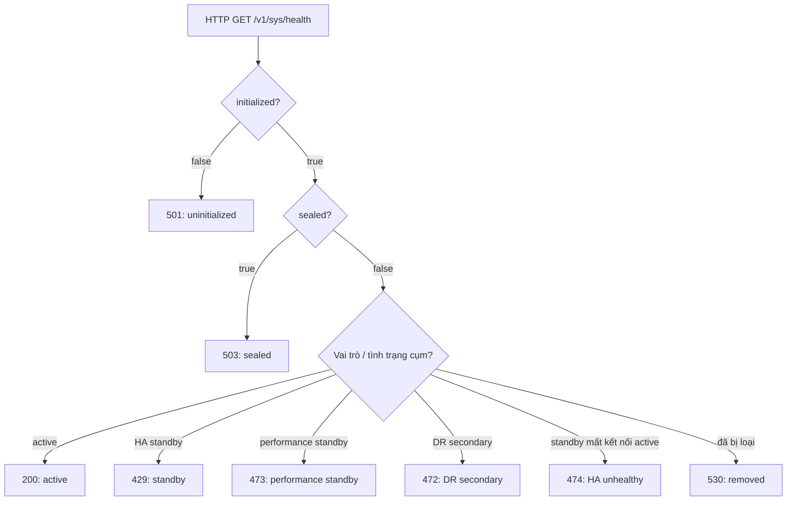
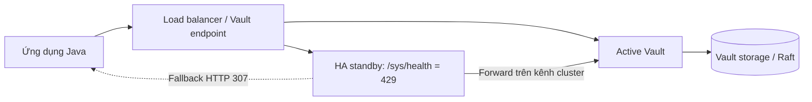

# Phân biệt active, standby và máy chủ chưa sẵn sàng trong Vault System API

Một ứng dụng Java kết nối **HashiCorp Vault** qua **Spring Vault** và `VaultTemplate` có thể gặp các tình huống rất khác nhau: node Vault đang xử lý request bình thường, node đang ở chế độ dự phòng (*standby*), hoặc node chưa thể phục vụ vì chưa được khởi tạo, đang sealed hay mất kết nối với active. Nếu gộp tất cả phản hồi HTTP khác `200` thành “Vault đã chết”, hệ thống dễ tạo cảnh báo giả, loại nhầm node dự phòng khỏi kiến trúc HA hoặc xử lý sai một sự cố thật.

Bài thuộc chương **API hệ thống** của module `SPRING_VAULT`, tập trung vào `GET/HEAD /v1/sys/health`, cách đọc trạng thái node, cấu hình health check cho load balancer/Kubernetes, cách quan sát trạng thái qua Spring Vault, và cách kiểm thử các tình huống chuyển đổi HA. Mục tiêu là **phân biệt vai trò của node với mức sẵn sàng phục vụ từng loại request**, thay vì chỉ đọc một mã HTTP.

## 1. Active, standby và chưa sẵn sàng là ba nhóm trạng thái khác nhau

Trong cụm Vault chạy **High Availability (HA)**, một node giữ vai trò **active** và các node HA còn lại thường là **standby**. Khi active gặp sự cố, một standby đủ điều kiện có thể được bầu làm active mới. Hai vai trò này thuộc **cơ chế điều phối cụm**.

Một node “chưa sẵn sàng” có thể gặp các tình huống độc lập với vai trò HA: chưa được initialize, đang sealed, mới khởi động, chưa kết nối được active, hoặc đã bị loại khỏi cụm. Những trạng thái này phải được điều tra theo nguyên nhân cụ thể.

| Trạng thái | Ý nghĩa thực tế | Có nên coi là lỗi ngay? |
| --- | --- | --- |
| **Active** | Node đã khởi tạo, unsealed, đang giữ vai trò active trong cụm HA hoặc là node đơn đang hoạt động | Không; đây là đường đi chính cho thao tác đọc/ghi. |
| **Standby thông thường** | Node đã khởi tạo, unsealed nhưng chưa giữ vai trò active | Không; là thành phần dự phòng bình thường nếu vẫn kết nối và forward/redirect được request. |
| **Performance standby** | Node Enterprise có thể phục vụ một phần request chỉ đọc tại chỗ; các request cần ghi được chuyển tới active | Không; tùy thiết kế cụm và đường đi request. |
| **DR secondary** | Cụm secondary trong Disaster Recovery replication, khác với active của cụm primary | Không mặc định là điểm phục vụ nghiệp vụ của primary. |
| **Uninitialized** | Vault chưa được khởi tạo | Chưa sẵn sàng phục vụ workload; cần quy trình bootstrap của quản trị viên. |
| **Sealed** | Vault không mở khóa dữ liệu để phục vụ request thông thường | Chưa sẵn sàng; cần kiểm tra cơ chế unseal/auto-unseal và nguyên nhân. |
| **HA unhealthy** | Standby không liên lạc được với active | Có vấn đề về khả năng tham gia cụm; cần điều tra kết nối HA. |
| **Removed from cluster** | Node đã bị loại khỏi HA cluster | Không nên nhận lưu lượng ứng dụng bình thường. |

**Hai câu hỏi cần đặt riêng:** “Node đang đóng vai trò gì?” và “Node này có thể phục vụ luồng nghiệp vụ đang quan sát hay không?”. Một standby có thể đáp ứng request nhờ chuyển tiếp đến active, nhưng vẫn báo HTTP `429` trên endpoint health mặc định.



Sơ đồ diễn đạt **cách đọc kết quả logic**, không mô tả chính xác thứ tự mọi nhánh xử lý nội bộ trong Vault. Các mã là giá trị mặc định; người vận hành có thể tùy chỉnh bằng query parameter.

## 2. Endpoint chuẩn: `GET` và `HEAD /v1/sys/health`

Vault System API cung cấp:

```http
GET /v1/sys/health HTTP/1.1
Host: vault.example.internal:8200
```

Và phiên bản chỉ cần mã trạng thái:

```http
HEAD /v1/sys/health HTTP/1.1
Host: vault.example.internal:8200
```

- **`GET`** trả HTTP status và JSON chứa các cờ như `initialized`, `sealed`, `standby`, `performance_standby` cùng dữ liệu phụ thuộc phiên bản và chế độ triển khai.
- **`HEAD`** có cùng mục đích phân loại HTTP status nhưng **không có response body**. Thích hợp cho probe chỉ cần kết quả trạng thái.
- Đây là endpoint **health của từng Vault node**. Khi gửi qua load balancer, bạn đang quan sát node được load balancer chọn, chưa chắc là một node cố định.
- Theo tài liệu Vault hiện hành, endpoint này được gọi từ **root namespace**. Với Vault Enterprise namespaces cần chú ý cấu hình namespace và đường đi request; không tự coi health của namespace con là health của cả cluster.

Thông thường không cần gửi một Vault client token chỉ để đọc health. Không đưa root token hoặc workload token vào các probe mà không có nhu cầu. Đồng thời vẫn giới hạn khả năng truy cập endpoint giám sát theo chính sách mạng của tổ chức, vì metadata có thể cung cấp thông tin về cụm.

### Các mã HTTP mặc định

| HTTP status | Trạng thái Vault | Cách diễn giải trong giám sát |
| --- | --- | --- |
| `200` | **Initialized, unsealed, active** | Node đang active và có thể nhận request; chưa chứng minh mọi nghiệp vụ đều thành công. |
| `429` | **Standby thông thường** | Trạng thái HA hợp lệ nếu node vẫn liên lạc active; không đồng nghĩa “server quá tải” tại endpoint này. |
| `472` | **DR secondary** | Không tự coi là endpoint thay thế trực tiếp cho primary; áp dụng chính sách DR riêng. |
| `473` | **Performance standby** | Node Enterprise có vai trò phục vụ một phần read locally; quyết định routing theo topology. |
| `474` | **HA unhealthy** | Standby/performance standby không kết nối được active; cần cảnh báo nếu kéo dài. |
| `501` | **Uninitialized** | Chưa initialize; phải hoàn tất bootstrap trước khi dùng secrets. |
| `503` | **Sealed** | Node sealed, chưa phục vụ yêu cầu ứng dụng thông thường. |
| `530` | **Removed** | Node đã bị loại khỏi HA cluster; không định tuyến workload đến node đó. |

Các mã trên là **ngữ nghĩa riêng của `/sys/health`**. Trên **API nghiệp vụ khác**, `429` còn có thể là rate limiting/quota; `503` cũng có thể liên quan quá tải hoặc sự cố dịch vụ. Không xây dựng một hàm “mọi HTTP 429 của Vault đều là standby”.

Đặc biệt, trong những khoảng thời gian cụm bất ổn, Vault có thể tạm trả `429` cho node vốn thuộc vai trò DR secondary/performance standby. Cần kết hợp JSON, topology và lịch sử thay đổi trạng thái thay vì suy diễn vĩnh viễn từ một lần đo.

## 3. Đọc trường JSON đúng thứ tự

Phản hồi minh họa từ active node:

```json
{
  "initialized": true,
  "sealed": false,
  "standby": false,
  "performance_standby": false,
  "replication_performance_mode": "disabled",
  "replication_dr_mode": "disabled",
  "server_time_utc": 1790000000,
  "version": "1.x.x",
  "cluster_name": "vault-lab"
}
```

Phản hồi minh họa từ standby thông thường:

```json
{
  "initialized": true,
  "sealed": false,
  "standby": true,
  "performance_standby": false,
  "version": "1.x.x"
}
```

Ví dụ trên chỉ chứa **những trường chọn lọc**; JSON thực tế và giá trị metadata phụ thuộc phiên bản Vault, chế độ HA/Enterprise và lúc node khởi động. Trường `server_time_utc` là timestamp mẫu, không có ý nghĩa trong việc khẳng định một node đang khỏe.

Cách đọc đáng tin cậy:

1. Nếu `initialized=false`, node **chưa được initialize**, không diễn giải tiếp thành active/standby khả dụng.
2. Nếu `sealed=true`, node **không phục vụ workload thông thường**, dù metadata có thể tồn tại.
3. Nếu `initialized=true` và `sealed=false`, mới phân biệt vai trò HA qua HTTP code và các cờ `standby`, `performance_standby`, replication mode.
4. Nếu mã HTTP là `474` hoặc `530`, ưu tiên xử lý tình trạng cụm bất thường, dù một số cờ đơn lẻ trông như trạng thái standby bình thường.
5. Nếu không có phản hồi vì timeout/TLS/DNS, trạng thái là **không xác định**, không gán cứng là `sealed` hay `standby`.

Không chỉ dựa vào `standby=false` để kết luận “active của primary”: node ở cụm DR secondary hoặc trạng thái chuyển đổi có thể yêu cầu phân tích riêng.

## 4. Kiểm tra bằng cURL và Vault CLI

Giả sử `VAULT_ADDR` trỏ **đúng node cần kiểm tra**, ví dụ `https://vault-a.example.internal:8200`, và `VAULT_CACERT` trỏ đến CA đáng tin cậy nếu tổ chức dùng CA riêng.

### Chỉ lấy mã HTTP

```bash
# Không dùng --fail: 429/472/503 là kết quả kiểm tra cần quan sát.
curl --silent --show-error \
  --cacert "$VAULT_CACERT" \
  --output /dev/null \
  --write-out 'HTTP %{http_code}\n' \
  "${VAULT_ADDR%/}/v1/sys/health"
```

Nếu chứng chỉ do hệ thống tin cậy, có thể bỏ `--cacert`. **Không dùng `-k`/`--insecure` trong quy trình giám sát chính thức** vì sẽ bỏ qua kiểm tra TLS.

Để xem JSON và status trong một lần:

```bash
curl --silent --show-error \
  --cacert "$VAULT_CACERT" \
  --include \
  "${VAULT_ADDR%/}/v1/sys/health"
```

Với node standby thông thường, kết quả có thể là `HTTP/1.1 429` cùng JSON `initialized=true`, `sealed=false`, `standby=true`. Đây là tình huống **standby hợp lệ**. Không nên dùng `curl --fail` làm bằng chứng rằng Vault không truy cập được: tùy chọn này coi HTTP 4xx/5xx là lỗi curl.

Với `HEAD`, chỉ có header mà không có JSON:

```bash
curl --silent --show-error --head \
  --cacert "$VAULT_CACERT" \
  "${VAULT_ADDR%/}/v1/sys/health"
```

### Đọc với `jq` và phân loại một cách tường minh

```bash
# In ra các trường quan trọng; giữ nguyên HTTP status bên ngoài.
curl --silent --show-error \
  --cacert "$VAULT_CACERT" \
  "${VAULT_ADDR%/}/v1/sys/health" \
  | jq '{initialized, sealed, standby, performance_standby,
         replication_dr_mode, replication_performance_mode}'
```

Ví dụ script giám sát chỉ in **mã trạng thái và nhãn không nhạy cảm**:

```bash
#!/usr/bin/env bash
set -u

endpoint="${VAULT_ADDR%/}/v1/sys/health"
code="$(curl --silent --show-error \
  --cacert "$VAULT_CACERT" \
  --output /dev/null \
  --write-out '%{http_code}' "$endpoint")" || {
  echo "UNKNOWN: transport/TLS/DNS/timeout"
  exit 2
}

case "$code" in
  200) echo "ACTIVE";;
  429) echo "STANDBY";;
  472) echo "DR_SECONDARY";;
  473) echo "PERFORMANCE_STANDBY";;
  474) echo "HA_UNHEALTHY";;
  501) echo "UNINITIALIZED";;
  503) echo "SEALED";;
  530) echo "REMOVED";;
  *)   echo "UNKNOWN_HTTP_$code";;
esac
```

Script này **chỉ là bộ phân loại mã mặc định**. Nếu health query đã tùy biến status code, nếu có proxy ở giữa hoặc nếu endpoint không phải `/sys/health`, không thể dùng bảng trên một cách máy móc. Trong môi trường thật phải có timeout, thu thập thời điểm đo, phân biệt node, retry có giới hạn và quản lý TLS đúng cách.

Lệnh `vault status` cũng hỗ trợ chẩn đoán thủ công (`Initialized`, `Sealed`, `HA Enabled`, `HA Mode`, địa chỉ active...). Nhưng đầu ra CLI có thể khác giữa phiên bản/triển khai; bộ cân bằng tải nên dùng API health có giao ước trạng thái rõ ràng.

## 5. Vì sao standby không mặc nhiên là lỗi

Trong cụm Vault HA tiêu chuẩn, active xử lý nghiệp vụ, còn standby giữ vị trí dự phòng. Khi request gửi đến standby:

- Nếu **request forwarding** khả dụng, standby có thể chuyển request đến active qua kênh giao tiếp cụm, nhận response rồi trả lại cho client.
- Nếu request forwarding bị tắt hoặc thất bại, standby có thể trả **HTTP `307` redirect** đến `api_addr` của active. Client phải có khả năng đi đến địa chỉ đó và xử lý redirect đúng cách.
- Nếu standby không kết nối được active, health có thể trả `474`; request forwarding hoặc redirection không còn đáng tin cậy.

Do đó, **mã `429` ở `/sys/health` và kết quả gọi KV/Transit của ứng dụng là hai chuyện khác nhau**: standby có thể chuyển tiếp request thành công dù health mặc định không phải `200`.



Sơ đồ chỉ ra hai hình thức xử lý request, không có nghĩa một request luôn vừa forward vừa redirect. Trên thực tế lựa chọn phụ thuộc trạng thái cụm, cấu hình và khả năng kết nối.

Với **performance standby** (Vault Enterprise), một số request không ghi storage có thể được xử lý tại node đó; request cần ghi được forward tới active. Nhưng ngay cả performance standby cũng không phải là quyền truy cập đọc/ghi không giới hạn: client vẫn cần token hợp lệ và Vault ACL đúng path.

Với **DR secondary**, các node thuộc topology replication khác. Không đưa cụm DR secondary vào cùng pool active của primary chỉ vì muốn thêm một máy dự phòng; quy trình promote/failover DR cần runbook riêng.

## 6. Health check cho load balancer: chọn đúng mục tiêu

Bạn cần xác định load balancer dùng health check để **chọn active duy nhất** hay **cho phép request vào cả standby khỏe mạnh**.

| Mục tiêu | Endpoint probe đề xuất | Mã `200` nói lên điều gì |
| --- | --- | --- |
| Chỉ định tuyến trực tiếp vào active | `/v1/sys/health` | Với mã mặc định, chỉ active healthy được xem là eligible. |
| Chấp nhận standby thông thường có khả năng forward/redirect | `/v1/sys/health?standbyok=true` | Active và standby thường có thể trả active code; phải bảo đảm HA forwarding/redirect hoạt động. |
| Chấp nhận performance standby | `/v1/sys/health?perfstandbyok=true` | Active và performance standby đủ điều kiện có thể trả active code; không tự bao gồm standby thường. |
| Chấp nhận cả standby thường và performance standby | `/v1/sys/health?standbyok=true&perfstandbyok=true` | Ba vai trò trên có thể trả active code, nếu không vướng trạng thái bất thường khác. |

`standbyok=true` đổi mã health của standby thông thường về **mã active đã cấu hình** (mặc định là `200`); nó **không biến standby thành active** và không áp dụng cho performance standby. `perfstandbyok=true` dành cho performance standby; các loại DR secondary, sealed, uninitialized, unhealthy hoặc removed không nên được xem là primary sẵn sàng nhờ hai tùy chọn này.

Có thể tùy chỉnh mã bằng các query parameter như `activecode`, `standbycode`, `performancestandbycode`, `drsecondarycode`, `haunhealthycode`, `sealedcode`, `uninitcode`, `removedcode`. Ví dụ:

```http
GET /v1/sys/health?standbyok=true
GET /v1/sys/health?perfstandbyok=true
GET /v1/sys/health?standbycode=204
```

**Cẩn trọng:** nếu đặt `sealedcode=200` hoặc `uninitcode=200`, bộ giám sát chỉ dựa vào HTTP `200` có thể đánh dấu một node không thể trả secret là ready. Một số quy trình khởi tạo trên Kubernetes cố ý dùng cấu hình “chấp nhận sealed/uninitialized” cho probe phục vụ bootstrap, nhưng đó là **mục tiêu khác** với việc xác nhận Vault sẵn sàng phục vụ ứng dụng.

Khi dùng load balancer, nên đo health trên **từng backend node**, lưu role theo node, không chỉ gọi một lần qua địa chỉ load balancer rồi kết luận toàn cụm đã active.

## 7. Kubernetes: phân biệt startup, liveness và readiness

Trong Kubernetes, ba câu hỏi vận hành khác nhau:

- **Startup:** tiến trình đã khởi động tới mức có thể tiếp tục kiểm tra chưa?
- **Liveness:** tiến trình còn hoạt động hay đã bị treo, cần khởi động lại?
- **Readiness:** có nên gửi request nghiệp vụ vào Pod này ngay lúc này?

Nếu sử dụng `/sys/health` cho readiness của các Vault Pod để load balancer cho phép standby nhận request, có thể cấu hình theo thiết kế cụm, ví dụ:

```yaml
# Đoạn trích cấu hình probe cho Pod/StatefulSet Vault;
# chỉ áp dụng khi TLS và network của môi trường đã cấu hình tương ứng.
readinessProbe:
  httpGet:
    path: /v1/sys/health?standbyok=true&perfstandbyok=true
    port: 8200
    scheme: HTTPS
  periodSeconds: 10
  timeoutSeconds: 3
  failureThreshold: 3
```

**Không sao chép đoạn này như một cấu hình “phù hợp cho mọi hệ thống”.** Nếu bạn chỉ muốn active vào pool, giữ endpoint mặc định. Nếu bạn muốn standby trong pool, phải kiểm chứng request forwarding/redirect, `api_addr`, `cluster_addr`, TLS và connectivity giữa các node. Một số triển khai có probe riêng cho bootstrap/unseal hoặc sử dụng TCP check cho liveness, tránh vòng restart vì sealed trong giai đoạn khởi tạo.

Đừng để readiness bắt một node sealed phải trả `200` chỉ để Pod hiện `Ready`, trừ khi mục tiêu rõ ràng là phục vụ một bước bootstrap thay vì phục vụ secret. Và **readiness của ứng dụng Spring Boot phụ thuộc Vault** là một kiểm tra khác readiness của Vault Pod: ứng dụng cần xác định nó có truy cập được đúng KV/Transit/PKI với token workload hay không.

## 8. Phân loại qua Spring Vault trong ứng dụng Java

Spring Vault cung cấp `VaultOperations.opsForSys().health()` trả `VaultHealth`. Giao diện `VaultHealth` cho phép đọc các cờ `isInitialized()`, `isSealed()`, `isStandby()`, `isPerformanceStandby()` và `isRecoveryReplicationSecondary()`.

Ví dụ thành phần **phân loại trạng thái node**:

```java
import org.springframework.stereotype.Component;
import org.springframework.vault.core.VaultOperations;
import org.springframework.vault.support.VaultHealth;

@Component
public class VaultNodeStateReader {

    private final VaultOperations vault;

    public VaultNodeStateReader(VaultOperations vault) {
        this.vault = vault;
    }

    public NodeState readState() {
        VaultHealth health = vault.opsForSys().health();

        if (!health.isInitialized()) {
            return NodeState.UNINITIALIZED;
        }
        if (health.isSealed()) {
            return NodeState.SEALED;
        }
        if (health.isRecoveryReplicationSecondary()) {
            return NodeState.DR_SECONDARY;
        }
        if (health.isPerformanceStandby()) {
            return NodeState.PERFORMANCE_STANDBY;
        }
        return health.isStandby() ? NodeState.STANDBY : NodeState.ACTIVE;
    }

    public enum NodeState {
        ACTIVE,
        STANDBY,
        PERFORMANCE_STANDBY,
        DR_SECONDARY,
        SEALED,
        UNINITIALIZED
    }
}
```

Những điểm cần lưu ý khi triển khai:

1. Đây là **phân loại từ đối tượng `VaultHealth` khi đọc được response**; nếu Spring Vault ném exception do HTTP, TLS, mạng hoặc 4xx/5xx, phải xử lý riêng. Không được tự chuyển mọi exception thành `SEALED`.
2. `VaultHealth` không cung cấp đủ mọi trạng thái chi tiết như `HA_UNHEALTHY=474` hay `REMOVED=530` qua các cờ trong ví dụ. Để giám sát đầy đủ, nên thu thập **raw HTTP status** từ `/sys/health` trên từng node.
3. Nếu `VaultOperations` kết nối qua load balancer, hai lần gọi có thể rơi vào hai node khác nhau; kết quả đó mô tả **node đã trả lời**, không phải toàn bộ cụm.
4. Đừng gọi health trên đường xử lý mỗi request nghiệp vụ nếu không cần. Dùng một thành phần giám sát có timeout, cache ngắn hoặc lịch kiểm tra phù hợp để tránh tự tạo tải cho Vault.
5. `opsForSys().health()` **không** là giấy phép cho ứng dụng tự gọi `initialize`, `seal` hay `unseal`: các thao tác quản trị phải có quyền và quy trình vận hành riêng.

Bên dưới là ví dụ ranh giới xử lý lỗi của tầng gọi:

```java
import org.springframework.vault.VaultException;

public final class VaultHealthBoundary {

    public static VaultNodeStateReader.NodeState inspectOrReportUnknown(
            VaultNodeStateReader reader) {
        try {
            return reader.readState();
        } catch (VaultException ex) {
            // Lỗi truy cập health khác với sealed/standby đã xác nhận.
            // Ghi nhận trạng thái UNKNOWN trong hệ thống giám sát.
            throw new IllegalStateException(
                    "Vault health cannot be determined", ex);
        }
    }
}
```

Trong ví dụ cuối, `UNKNOWN` là **nhãn giám sát đề xuất**, không phải một giá trị VaultHealth tự trả về. Khi ghi log exception, dùng lọc dữ liệu nhạy cảm để không lộ URI nội bộ, token hay payload từ request khác. Nếu muốn giám sát độc lập với lớp exception của Spring Vault, dùng HTTP client/probe riêng để nhận chính xác status code.

## 9. Trạng thái node không thay thế kiểm thử nghiệp vụ

Ngay cả khi `/sys/health` trả `200`, một ứng dụng vẫn có thể thất bại do:

- Workload token hết hạn, không thể renewal hoặc policy không cho đọc KV.
- Mount path sai, KV v1/v2 khác nhau, secret đã xóa hoặc không tồn tại.
- Transit key bị chặn phiên bản, context sai hoặc PKI role không cho cấp certificate.
- Đường đi giữa app và Vault load balancer có lỗi, dù node được đo trực tiếp vẫn healthy.
- Storage/cluster vừa chuyển active, làm request nghiệp vụ không hoàn tất dù health đã chuyển trạng thái.

Vì vậy nên có **hai tầng quan sát**:

| Tầng | Kiểm tra | Trả lời câu hỏi |
| --- | --- | --- |
| Node/cluster | `/sys/health`, role, trạng thái HA, connectivity | Node có initialized/unsealed và đang ở vai trò nào? |
| Workload transaction | Login, đọc một KV test theo policy, mã hóa/giải mã Transit test, thao tác PKI phù hợp nếu cần | Workload này có hoàn thành tác vụ thực tế với quyền của nó không? |

Transactional check nên dùng **quyền tối thiểu** và bí mật giả hoặc tài nguyên thử nghiệm có kiểm soát. Không chèn khóa thật, mật khẩu thật hoặc token vào log. Không cho health check sửa dữ liệu quan trọng hoặc cấp certificate không giới hạn chỉ vì muốn thăm dò tình trạng.

## 10. Kịch bản chẩn đoán thường gặp

### Trường hợp A: Một node trả `429`, ứng dụng vẫn đọc secret được

Đây thường là standby HA đang forward request sang active. Kiểm tra `initialized=true`, `sealed=false`, `standby=true`; kiểm tra `api_addr`/`cluster_addr` và quan sát khả năng forward. Chỉ báo `429` trên **health endpoint** không đủ để kết luận lỗi application.

### Trường hợp B: Load balancer chỉ coi `200` là healthy, hai standby bị loại

Nếu mục tiêu là **chỉ điều hướng tới active**, hành vi này có thể đúng. Nếu kiến trúc yêu cầu standby nhận request để forward, cân nhắc `standbyok=true` sau khi thử khả năng forwarding/redirect. Không sửa status code một cách mù quáng vì sẽ che mất các điều kiện bất thường.

### Trường hợp C: Node trả `503`, `sealed=true`

Tạm loại khỏi luồng nhận request nghiệp vụ. Kiểm tra auto-unseal, KMS/HSM, storage và sự kiện restart. Không tự gọi `unseal` bằng quyền root từ request Java thông thường.

### Trường hợp D: Node trả `501`, `initialized=false`

Cụm hoặc storage mới chưa được initialize, hoặc cấu hình backend trỏ tới không gian dữ liệu chưa có trạng thái Vault. Kiểm tra nguyên nhân và xác nhận topology trước khi chạy quy trình initialize. **Tuyệt đối không initialize lại một cluster đang vận hành chỉ vì một node trả `501`**.

### Trường hợp E: Node trả `474` kéo dài

Đây là dấu hiệu HA standby không kết nối được active. Kiểm tra cluster port (thường `8201`), TLS giữa các node, routing nội bộ, `cluster_addr` và tình trạng leader election. Không xem là standby khỏe chỉ vì node đã unsealed.

### Trường hợp F: Sau failover, health dao động `200 ↔ 429`

Trong một đợt bầu active, việc các node chuyển vai trò là bình thường ở mức nhất thời. Theo dõi chuỗi kết quả theo **node ID/thời gian**, so với lease/leader election và độ dài khoảng mất dịch vụ. Chỉ mở cảnh báo hoặc thay đổi probe sau khi hiểu ý nghĩa của các dao động.

## 11. Kế hoạch kiểm thử tích hợp

Một môi trường Vault dev một node thường chỉ có active, nên **không đủ để xác minh trạng thái standby và failover**. Đối với các ca HA thật, cần cụm test có ít nhất hai hoặc ba node và storage hỗ trợ HA; chỉ dùng các thao tác seal/unseal, dừng node hoặc bầu leader trên **môi trường thử nghiệm riêng**.

| Test | Điều kiện/Thao tác | Kỳ vọng |
| --- | --- | --- |
| H01 | Gọi GET health của node active | Mặc định `200`; `initialized=true`, `sealed=false`, vai trò active. |
| H02 | Gọi GET health của standby khỏe | Mặc định `429`; standby không bị coi là cluster outage. |
| H03 | Standby với `standbyok=true` | Trả active code theo cấu hình, nhưng cờ role không biến thành active. |
| H04 | Performance standby Enterprise | Mặc định `473`; có thể nhận active code nếu `perfstandbyok=true`. |
| H05 | Node Vault mới chưa initialize | Mặc định `501`; không được phục vụ workload. |
| H06 | Node trong lab bị sealed | Mặc định `503`; không được phục vụ workload. |
| H07 | Ngắt kết nối standby với active trong lab | Có thể thấy `474`; giám sát không gọi đó là standby khỏe. |
| H08 | Thực hiện failover có kiểm soát | Node active mới xuất hiện; routing được cập nhật; không mất dữ liệu kiểm chứng. |
| H09 | Tắt kết nối Vault của Java client | Nhận lỗi mạng/timeout, không đánh dấu `SEALED` khi chưa có HTTP response. |
| H10 | Active healthy nhưng workload thiếu policy KV | Health vẫn có thể `200`; nghiệp vụ báo thiếu quyền và xử lý riêng. |
| H11 | Load balancer có 1 active + 2 standby | Probe từng backend phân biệt node; request ứng dụng được chuyển/redirect đúng. |
| H12 | Tùy chỉnh `standbycode=204` | Test biết mã đã tùy biến, không còn phân loại theo mã mặc định. |

### Một kiểm thử shell đơn giản cho active

```bash
code="$(curl --silent --show-error \
  --cacert "$VAULT_CACERT" \
  --output /dev/null \
  --write-out '%{http_code}' \
  "${VAULT_ADDR%/}/v1/sys/health")" || exit 2

if [ "$code" = "200" ]; then
  echo "PASS: target node reports active health"
else
  echo "INFO: target reports HTTP $code; inspect role and topology"
fi
```

Không coi các ca thử buộc `501`, `503`, `474` thành công chỉ vì cURL báo lỗi. Cần chứng minh đã gửi request đến **node/thành phần mình chủ đích thay đổi**, quan sát đúng mã/status, rồi phục hồi topology và test lại luồng nghiệp vụ.

Đối với Java, unit test có thể mock `VaultHealth` để xác minh logic phân loại ở mục 8. Integration test nên dùng Vault thật để xác nhận việc parse health, forwarding, TLS và failover; mock không thay thế cho xác minh HA.

## 12. Checklist vận hành và bảo mật

- **Ghi nhận theo node:** địa chỉ node, vai trò, timestamp, HTTP code, `initialized/sealed/standby`, loại replication và thời gian trả lời.
- **Chọn đúng probe:** active-only hay standby-eligible là quyết định kiến trúc, không phải cấu hình mặc định cho mọi cụm.
- **Tách nguyên nhân lỗi:** sealed/uninitialized/HA-unhealthy/removed khác với standby bình thường, timeout mạng, thiếu quyền hoặc rate limit trên API nghiệp vụ.
- **Bảo vệ TLS:** dùng CA hợp lệ, timeout hợp lý, không tắt xác thực chứng chỉ để “sửa” health check.
- **Giữ quyền tối thiểu:** health check không cần root token; các API quản trị initialize/unseal/seal cần quy trình được kiểm soát.
- **Quan sát chuyển đổi HA:** có cảnh báo theo độ dài sự cố và khả năng xử lý request, tránh báo động trên mỗi lần role chuyển đổi ngắn.
- **Test từ góc nhìn workload:** sau health check, xác minh truy cập KV/Transit/PKI bằng tài nguyên test với danh tính workload thực tế.

**Điều cần nhớ:** `active` và `standby` là vai trò trong HA; `uninitialized`, `sealed`, mất liên kết HA và removed là những nguyên nhân không sẵn sàng khác nhau. `/sys/health` giúp phân loại node, còn “ứng dụng Java có sử dụng được secret hay không” cần thêm kiểm chứng luồng nghiệp vụ qua Spring Vault.

## Tài liệu tham khảo

- HashiCorp Vault — [System health API](https://developer.hashicorp.com/vault/api-docs/system/health): toàn bộ mã phản hồi, tham số `standbyok`/`perfstandbyok` và cấu trúc JSON.
- HashiCorp Vault — [High Availability](https://developer.hashicorp.com/vault/docs/concepts/ha): active/standby, forwarding, redirect và cấu hình HA.
- HashiCorp Vault — [Performance standby](https://developer.hashicorp.com/vault/docs/enterprise/performance-standby): read-local và write-forward trên Vault Enterprise.
- Spring Vault — [`VaultSysOperations`](https://docs.spring.io/spring-vault/reference/api/java/org/springframework/vault/core/VaultSysOperations.html) và [`VaultHealth`](https://docs.spring.io/spring-vault/reference/api/java/org/springframework/vault/support/VaultHealth.html).
- HashiCorp Vault — [Monitoring and observability](https://developer.hashicorp.com/validated-designs/vault/administration-guide/monitoring-and-observability): cách giám sát node, cluster và giao dịch thử nghiệm.
