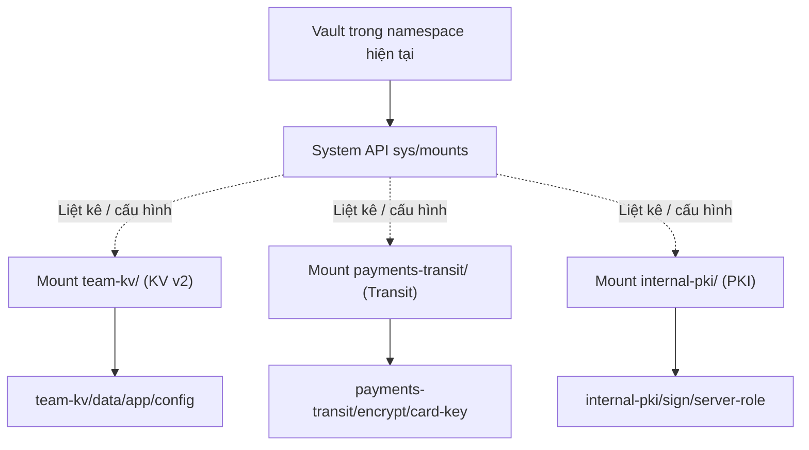
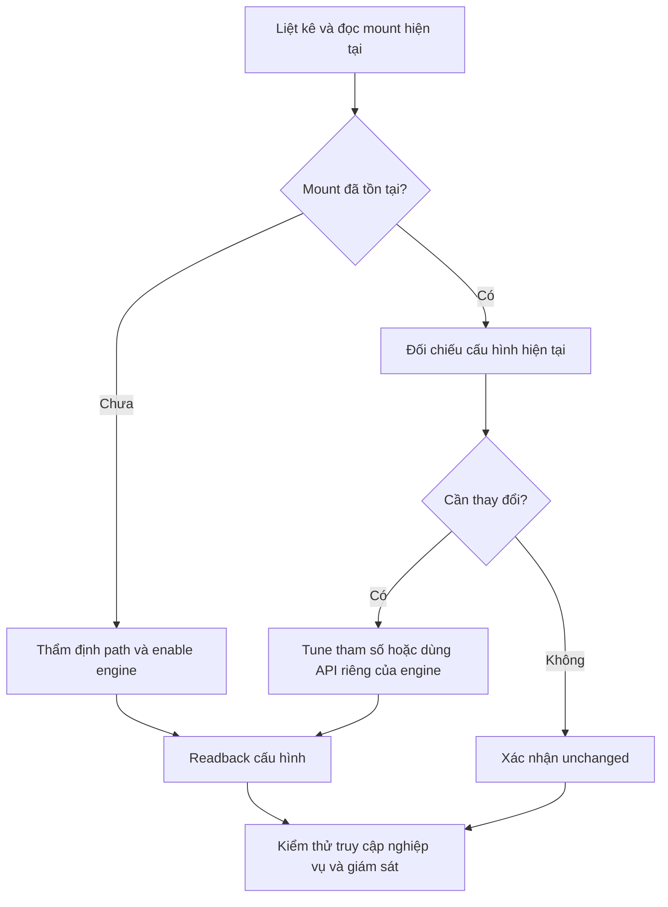

# Liệt kê và cấu hình mount của secrets engine bằng System API trong Spring Vault

## 1. Mount là gì và vì sao phải quản lý?

HashiCorp Vault cung cấp nhiều **secrets engine** như KV, Transit, PKI và Database. Để sử dụng một engine, quản trị viên **enable/mount** nó tại một đường dẫn trong Vault. Ví dụ, cùng loại KV có thể có hai mount `team-a/` và `team-b/`; các secret, chính sách và cấu hình liên quan được quản lý theo từng mount.

Với **SPRING_VAULT**, ứng dụng Java thường truy cập các mount đã được cấu hình thông qua `VaultTemplate` hoặc API chuyên biệt của Spring Vault. Khi cần xem danh sách mount, bật engine mới, thay đổi mô tả hoặc thời hạn mặc định, ta sử dụng **Vault System API**, chủ yếu là nhóm endpoint `sys/mounts`. Đây là công việc quản trị hạ tầng Vault, tách biệt với luồng ứng dụng đọc KV secret, mã hóa Transit, xin chứng thư PKI hay quản lý token/lease.

Sau bài này, bạn sẽ biết:

- Phân biệt **loại engine**, **mount path**, **đường dẫn secret** và **namespace**.
- Liệt kê và đọc cấu hình mount bằng Vault CLI, System API hoặc `VaultTemplate`.
- Tạo mount, chỉnh một số tham số bằng thao tác **tune** và xác minh hiệu lực của cấu hình.
- Hiểu quyền `sudo`, cách giới hạn quyền quản trị, tác động của TTL và nguy cơ mất dữ liệu khi unmount.
- Thiết kế thao tác quản lý mount có kiểm soát, quan sát được và kiểm thử được.

## 2. Phân biệt engine, mount và secret path

| Khái niệm | Ví dụ | Ý nghĩa |
| --- | --- | --- |
| **Loại engine** | `kv`, `database`, `transit`, `pki` | Kiểu tính năng được Vault triển khai |
| **Mount path** | `team-kv/` | Vị trí một instance engine được gắn vào Vault |
| **Đường dẫn API bên trong mount** | `team-kv/data/app/config` (KV v2) | Endpoint nghiệp vụ do engine định nghĩa |
| **Đường dẫn quản lý mount** | `sys/mounts/team-kv` | Endpoint System API để quản trị mount |
| **Namespace** | Namespace Vault Enterprise do tổ chức cấu hình | Phạm vi quản lý nơi mount và ACL được áp dụng |

Ví dụ, `team-kv/` là **mount path**, còn `team-kv/data/app/config` là đường dẫn để đọc một phiên bản secret KV v2. Không dùng `sys/mounts/team-kv` để đọc nội dung secret; endpoint này trả thông tin **cấu hình mount**, không trả giá trị KV.

Một engine có thể được mount nhiều lần, mỗi lần có đường dẫn và cấu hình riêng. Khi liệt kê, các khóa của response thường có dấu gạch chéo kết thúc, ví dụ `team-kv/`; khi gửi thao tác tạo/tune, có thể chỉ định `team-kv` hoặc `team-kv/` theo cú pháp tương ứng.



**Không nhầm System API với secrets engine:** `sys/` là đường dẫn hệ thống cung cấp các thao tác quản trị Vault; dữ liệu secret và nghiệp vụ mã hóa vẫn nằm ở API của engine tại mount đã bật.

## 3. Các endpoint của System API quản lý mount

Nhóm API sau là trọng tâm:

| HTTP | Endpoint | Mục đích | Tính chất |
| --- | --- | --- | --- |
| GET | `/v1/sys/mounts` | Liệt kê các mount secrets engine trong phạm vi được phép | Đọc thông tin quản trị |
| GET | `/v1/sys/mounts/:path` | Đọc chi tiết một mount | Đọc thông tin quản trị |
| POST | `/v1/sys/mounts/:path` | Enable secrets engine mới ở path chỉ định | Thay đổi hạ tầng, yêu cầu quyền cao |
| DELETE | `/v1/sys/mounts/:path` | Unmount/disable engine ở path chỉ định | **Có thể làm mất dữ liệu và thu hồi tài nguyên** |
| GET | `/v1/sys/mounts/:path/tune` | Đọc các cấu hình được phép tune | Đọc thông tin |
| POST | `/v1/sys/mounts/:path/tune` | Điều chỉnh cấu hình mount như description hoặc TTL | Thay đổi cấu hình engine |

Đường dẫn REST đầy đủ bắt đầu bằng `/v1/`; khi truyền cho `VaultTemplate`, sử dụng path tương đối như `sys/mounts` và `sys/mounts/team-kv/tune`, không tự ghép `/v1/`.

Một số thao tác `sys/mounts` là **protected endpoints** và yêu cầu capability `sudo` bên cạnh capability `read/create/update/delete` tương ứng. Dù System API có thể đọc qua `VaultTemplate`, việc enable/tune/disable phải do danh tính quản trị được cấp quyền tối thiểu thực hiện. Không dùng token ứng dụng đọc secret thông thường để quản trị mount.

### 3.1. Ví dụ thông tin trong danh sách mount

Response từ GET `sys/mounts` có thể chứa một tập bản ghi như sau (giản lược trường và giá trị):

```json
{
  "data": {
    "team-kv/": {
      "type": "kv",
      "description": "Secrets of team applications",
      "options": {
        "version": "2"
      },
      "config": {
        "default_lease_ttl": 0,
        "max_lease_ttl": 0,
        "force_no_cache": false
      }
    },
    "payments-transit/": {
      "type": "transit",
      "description": "Payment encryption keys"
    }
  }
}
```

Đây là **response minh họa**, không phải kết quả thực của một Vault đang chạy. Tập trường thay đổi theo phiên bản Vault, loại engine, tính năng Enterprise và quyền truy cập. Giá trị TTL bằng `0` trong cấu hình mount thường có nghĩa **kế thừa giá trị mặc định hệ thống**, không mặc định là secret sẽ hết hạn ngay hoặc sống vĩnh viễn. Một số engine không dùng TTL này cho từng dữ liệu, chẳng hạn KV lưu secret tĩnh.

Hệ thống có thể có những mount nội bộ như `sys/`, `identity/` và `cubbyhole/`. Không mặc định rằng mọi mục liệt kê được đều do người vận hành tạo hoặc có thể disable như engine nghiệp vụ.

## 4. Liệt kê mount với Vault CLI

Trong môi trường thực hành cô lập đã đăng nhập Vault với quyền phù hợp:

```bash
# Hiển thị các secrets engine được mount.
vault secrets list

# Hiển thị thêm kiểu engine, version, description, TTL, options...
vault secrets list -detailed

# Đọc một mount cụ thể qua System API.
vault read sys/mounts/team-kv

# Đọc các tham số cấu hình có thể tune.
vault read sys/mounts/team-kv/tune
```

Chỉ chạy các lệnh đọc này khi mount tồn tại và token có quyền. Nếu `team-kv/` chưa được enable, các request đọc cụ thể sẽ thất bại.

Từ kết quả, cần quan sát:

- `path`: mount được truy cập tại đâu, ví dụ `team-kv/`.
- `type`: loại secrets engine; với KV v2 vẫn thường có `type=kv`.
- `options.version`: với KV, chuỗi `"2"` chỉ định KV v2; không nên suy luận từ tên mount.
- `description`: mô tả mục đích/sở hữu của mount.
- `default_lease_ttl` và `max_lease_ttl`: cấu hình TTL áp dụng cho những lease mà engine có hỗ trợ, chịu giới hạn hệ thống và backend.

**Chú ý:** `vault secrets list -detailed` trả thông tin cấu hình mount, không hiển thị các giá trị secret đang lưu trong KV. Khi đã biết mount, API đọc/ghi secret phải theo loại engine và phiên bản tương ứng.

## 5. Enable một secrets engine mới

Giả sử nhóm vận hành muốn bật **KV v2** tại `team-kv/`. Lệnh CLI tham khảo:

```bash
# Chỉ thực hiện trên Vault dành cho thực hành hoặc khi thay đổi đã được phê duyệt.
vault secrets enable \
  -path=team-kv \
  -description="Secrets of team applications" \
  -version=2 \
  kv
```

Lệnh tương đương về nguyên lý với request:

```http
POST /v1/sys/mounts/team-kv
X-Vault-Token: <ADMIN_TOKEN>
Content-Type: application/json

{
  "type": "kv",
  "description": "Secrets of team applications",
  "options": {
    "version": "2"
  }
}
```

**Đây là ví dụ định dạng request**, không phải yêu cầu đưa token vào tài liệu hay source code. Trình quản lý token của Spring Vault hoặc Vault CLI sẽ cung cấp thông tin xác thực qua kênh an toàn.

Trước khi enable, cần kiểm tra mount path chưa được sử dụng và không xung đột với các đường dẫn hệ thống hay mount khác. Bật lại cùng path đang tồn tại sẽ không đơn giản cập nhật cấu hình; có thể bị từ chối vì path đã được mount.

Sau khi enable, xác minh:

```bash
vault secrets list -detailed
vault read sys/mounts/team-kv/tune
```

**Điểm khác biệt:** `type=kv` kết hợp `options.version=2` chọn KV v2 ngay từ đầu. KV v1 và KV v2 có hợp đồng API, versioning và metadata khác nhau; thay version của một mount đã có dữ liệu phải tuân thủ quy trình nâng cấp/migration được engine hỗ trợ, không tự sửa một trường `options.version` rồi giả định mọi bản ghi đã tương thích.

## 6. Tune cấu hình một mount đang hoạt động

Sau khi mount đã tồn tại, một số thuộc tính có thể điều chỉnh qua `sys/mounts/:path/tune`. Ví dụ:

```bash
# Thay mô tả của mount trong môi trường được phép.
vault secrets tune \
  -description="KV v2 for team application configuration" \
  team-kv/

# Ví dụ TTL cho một secrets engine có phát hành dynamic leases.
# Giả định mount database/ đã tồn tại và có cơ chế quản lý lease.
vault secrets tune \
  -default-lease-ttl=1h \
  -max-lease-ttl=24h \
  database/
```

Một request tune bằng HTTP có thể giống:

```http
POST /v1/sys/mounts/database/tune
X-Vault-Token: <ADMIN_TOKEN>
Content-Type: application/json

{
  "default_lease_ttl": "1h",
  "max_lease_ttl": "24h"
}
```

Các giá trị ở đây là minh họa. Phải kiểm tra cấu hình TTL toàn cục, role/backend và nhu cầu workload trước khi chọn. Thay đổi TTL của mount **không bảo đảm tự động thay TTL của lease đang tồn tại**. Lease thực tế có thể bị giới hạn bởi `max_ttl` riêng của role hoặc các ràng buộc khác.

### 6.1. Tune không phải cấu hình nghiệp vụ của engine

| Nhóm cấu hình | Đường dẫn ví dụ | Tác dụng |
| --- | --- | --- |
| **Cấu hình mount chung** | `sys/mounts/database/tune` | Mô tả, lease TTL mặc định/tối đa, một số thông số chung của mount |
| **Cấu hình riêng của KV v2** | `team-kv/config` | `max_versions`, `cas_required`, `delete_version_after` theo contract KV v2 |
| **Cấu hình role của Database** | `database/roles/reporting` | Quyền tạo credential, SQL tạo/xóa, TTL và chính sách role tùy backend |
| **Cấu hình role của PKI** | `pki/roles/server` | Allowed domains, max TTL, key usage và các ràng buộc cấp chứng thư |
| **Cấu hình khóa Transit** | `transit/keys/card-key` | Thuộc tính khóa, rotation và quyền mã hóa/giải mã |

Ví dụ, `max_versions` là chính sách giữ phiên bản dữ liệu **KV v2** và không phải `max_lease_ttl` của mount. Không cố tune các thuộc tính đặc thù bằng System API nếu engine định nghĩa endpoint quản lý riêng.

## 7. Đọc thông tin mount từ Java bằng VaultTemplate

Với ứng dụng Spring Vault, có thể dùng `VaultTemplate.read("sys/mounts")` để lấy dữ liệu quản trị. Ví dụ Java 17+ sau chỉ **đọc** và chuyển một số trường sang một đối tượng đơn giản. Nó giả định response Vault có `data` là map từ mount path đến metadata, đúng với hình dạng thông thường của endpoint:

```java
import java.util.LinkedHashMap;
import java.util.Map;

import org.springframework.stereotype.Service;
import org.springframework.vault.core.VaultTemplate;
import org.springframework.vault.support.VaultResponse;

@Service
public class VaultMountCatalog {

    private final VaultTemplate vaultTemplate;

    public VaultMountCatalog(VaultTemplate vaultTemplate) {
        this.vaultTemplate = vaultTemplate;
    }

    public record MountInfo(
            String path,
            String type,
            String description,
            String kvVersion
    ) {}

    public Map<String, MountInfo> listMounts() {
        VaultResponse response = vaultTemplate.read("sys/mounts");
        if (response == null || response.getData() == null) {
            throw new IllegalStateException("Vault returned no mount data");
        }

        Map<String, MountInfo> mounts = new LinkedHashMap<>();
        for (Map.Entry<String, Object> row : response.getData().entrySet()) {
            String mountPath = row.getKey();
            if (!(row.getValue() instanceof Map<?, ?> info)) {
                continue; // Bỏ qua phần tử không phải metadata của mount.
            }
            Object type = info.get("type");
            if (!(type instanceof String typeName)) {
                continue;
            }

            String description =
                    info.get("description") instanceof String value ? value : "";
            String kvVersion = "";
            if (info.get("options") instanceof Map<?, ?> options) {
                Object version = options.get("version");
                if (version instanceof String str) {
                    kvVersion = str;
                }
            }
            mounts.put(
                    mountPath,
                    new MountInfo(mountPath, typeName, description, kvVersion)
            );
        }
        return Map.copyOf(mounts);
    }
}
```

Khi đọc `sys/mounts`, cấp quyền cho **identity quản trị**. Tránh trả toàn bộ danh sách mount qua một endpoint HTTP công khai của ứng dụng; danh sách có thể bộc lộ cấu trúc secrets engine và tên hệ thống nội bộ.

Nếu một bản Spring Vault hoặc một phiên bản API Vault có cấu trúc response khác, cần đối chiếu dữ liệu thực tế và điều chỉnh mapping. Đừng sử dụng ép kiểu `Map<String, Map<String, String>>` vì metadata mount chứa các map lồng và kiểu `boolean`, số nguyên hoặc danh sách.

### 7.1. Ví dụ khi ứng dụng chỉ cần kiểm tra một mount

Trong nhiều ứng dụng, kiểm tra mount tại lúc khởi động hữu ích hơn việc liệt kê toàn bộ:

```java
VaultResponse response = vaultTemplate.read("sys/mounts/team-kv");
if (response == null || response.getData() == null) {
    throw new IllegalStateException("Mount team-kv is unavailable");
}

Object type = response.getData().get("type");
if (!"kv".equals(type)) {
    throw new IllegalStateException("Expected KV engine at team-kv");
}
```

Nhưng quyền đọc System API không phải điều kiện bắt buộc để ứng dụng truy cập KV secret. Nếu workload chỉ cần KV, có thể kiểm thử bằng một request dữ liệu được phép thay vì cấp thêm quyền `sys/mounts`. Tách chức năng kiểm tra hạ tầng và chức năng nghiệp vụ giúp giảm quyền cấp cho ứng dụng.

## 8. Tạo và tune mount bằng VaultTemplate.write()

`VaultTemplate.write(path, body)` gửi POST đến Vault với body Java được chuyển sang JSON. Nó có thể gọi System API khi được dùng trong **một công cụ quản trị có danh tính, ACL và quy trình thay đổi phù hợp**.

### 8.1. Enable KV v2

```java
import java.util.Map;

import org.springframework.vault.core.VaultTemplate;

public class VaultMountAdmin {
    private final VaultTemplate vaultTemplate;

    public VaultMountAdmin(VaultTemplate vaultTemplate) {
        this.vaultTemplate = vaultTemplate;
    }

    public void enableTeamKvV2() {
        Map<String, Object> body = Map.of(
                "type", "kv",
                "description", "Secrets of team applications",
                "options", Map.of("version", "2")
        );

        // POST /v1/sys/mounts/team-kv.
        // Chỉ sử dụng khi path chưa tồn tại và có thay đổi được phê duyệt.
        vaultTemplate.write("sys/mounts/team-kv", body);
    }

    public void tuneDatabaseTtl() {
        Map<String, Object> body = Map.of(
                "default_lease_ttl", "1h",
                "max_lease_ttl", "24h"
        );

        // POST /v1/sys/mounts/database/tune.
        // database/ phải tồn tại, và role/backend phải tương thích TTL.
        vaultTemplate.write("sys/mounts/database/tune", body);
    }
}
```

**Không gọi lặp enable ở mỗi lần khởi động ứng dụng.** Tạo mount là hoạt động provisioning, phù hợp với cấu hình hạ tầng/automation quản trị có kiểm tra trạng thái mong đợi. Gọi `write` vào endpoint admin theo mỗi startup dễ gây lỗi 400/403 hoặc tạo các thay đổi khó theo dõi.

Response của thao tác enable/tune có thể không chứa dữ liệu; `VaultTemplate.write(...)` có thể trả `null` khi Vault phản hồi không có body. Để xác minh, **đọc lại** `sys/mounts/:path` hoặc `sys/mounts/:path/tune` và đối chiếu những trường quan trọng. Không lấy `null` của response write làm bằng chứng chắc chắn rằng thao tác thất bại.

### 8.2. Nếu cần thao tác GET, POST, DELETE

| API của `VaultTemplate` | HTTP method thường dùng | Ví dụ System API |
| --- | --- | --- |
| `read(path)` | GET | `sys/mounts`, `sys/mounts/team-kv/tune` |
| `write(path, body)` | POST | `sys/mounts/team-kv`, `sys/mounts/database/tune` |
| `delete(path)` | DELETE | `sys/mounts/team-kv` |

Không gọi `delete("sys/mounts/team-kv")` chỉ để kiểm tra khả năng kết nối. Thao tác unmount có thể làm **không còn truy cập được secret tại mount đó, xóa dữ liệu engine và hủy các tài nguyên/lease liên quan theo khả năng backend**. Nếu cần chuyển mount path, tìm hiểu API **remount** và các điều kiện áp dụng; không thay đổi path bằng chuỗi disable → enable trên dữ liệu production.

## 9. Quyền quản trị System API

Quyền đọc/ghi secret nghiệp vụ khác với quyền quản trị engine. Một workload ứng dụng đọc KV v2 thường chỉ cần quyền trên `team-kv/data/...`. Nó không có lý do sử dụng `sys/mounts/*`.

Ví dụ chính sách HCL định hướng cho một **nhóm quản trị** được ủy quyền thao tác trên mount `team-kv` (phải kiểm tra capability chi tiết theo phiên bản Vault và thao tác thực tế):

```hcl
# Liệt kê mount: quyền đọc thuộc vai trò quản trị.
path "sys/mounts" {
  capabilities = ["read"]
}

# Quản trị đúng một mount theo path được phép.
# Những thao tác hệ thống đặc quyền còn đòi hỏi "sudo".
path "sys/mounts/team-kv" {
  capabilities = ["create", "read", "update", "sudo"]
}

path "sys/mounts/team-kv/tune" {
  capabilities = ["read", "update", "sudo"]
}
```

Policy này mang tính **minh họa**: cấp quyền phù hợp với yêu cầu quản trị cụ thể, thử với token test, kiểm tra audit log và mã lỗi quyền. Không cấp `delete` ở đây vì quy trình vận hành ví dụ không cần unmount. Không cấp rộng `sys/mounts/*` hoặc token root cho tất cả microservice.

Ứng dụng nghiệp vụ đọc KV v2 có policy riêng:

```hcl
path "team-kv/data/app/*" {
  capabilities = ["read"]
}
```

Với KV v2, đọc/list metadata có thể cần quyền trên `team-kv/metadata/...` tùy thao tác; quyền `read` cho `data` không tự cho phép LIST tại `metadata`. Spring Vault không bỏ qua ACL dù mã gọi `VaultTemplate`.

**Workload authentication** như Kubernetes auth/AppRole cấp token theo role/policy. Token ứng dụng hết TTL có thể được renew hoặc đăng nhập lại theo cấu hình, nhưng không nên nâng quyền của workload chỉ để cho phép tự động enable mount. Dùng tài khoản/danh tính quản trị riêng, có audit trail, cho hoạt động provisioning.

### 9.1. Namespace trong Vault Enterprise

Nếu triển khai nhiều namespace, `sys/mounts` sẽ hoạt động trong namespace mà request đang nhắm tới. Mount `team-kv/` trong hai namespace không nhất thiết là cùng một engine hay chung dữ liệu. Xác minh namespace từ cấu hình client/header `X-Vault-Namespace`, không giả định danh sách mount ở một namespace là danh sách toàn cụm.

## 10. TTL, lease và cấu hình mount

Các thuộc tính `default_lease_ttl` và `max_lease_ttl` thường khiến người học nhầm lẫn với hạn sống của dữ liệu ở mọi engine.

- **Dynamic secrets**: database credential hoặc secret động có thể phát hành lease với `lease_id` và `lease_duration`. TTL thực nhận chịu ảnh hưởng cấu hình mount, role, backend, request và max TTL của hệ thống.
- **Vault token**: có TTL, renewal và vòng đời riêng qua auth/token. Chỉnh TTL của mount database không kéo dài token của workload.
- **Transit key**: bản thân khóa Transit không tự hết hạn chỉ vì cấu hình `default_lease_ttl` của mount. Rotation và phiên bản khóa là một vòng đời khác.
- **PKI certificate**: chứng thư X.509 có `notBefore/notAfter` được CA ký; thay TTL cấu hình mount không sửa `notAfter` của chứng thư đã phát hành. Cần reissue chứng thư trước hạn.
- **KV v2 secret**: là dữ liệu tĩnh có version/metadata. TTL lease của mount không biến dữ liệu KV thành dynamic credential có lease; các thiết lập như `delete_version_after` thuộc API riêng của KV v2.

Ví dụ: thay `max_lease_ttl` của `database/` xuống 12 giờ có thể ảnh hưởng các lease **được cấp mới hoặc renew trong tương lai**, tùy giới hạn và cơ chế backend; cần kiểm tra với role thực tế. Không nên suy đoán rằng mọi lease đã cấp được cập nhật tức thì.

## 11. Quy trình thay đổi mount an toàn

Các thao tác quản trị có thể ảnh hưởng toàn bộ ứng dụng đang dùng mount. Một quy trình thực tế:

1. **Khảo sát:** liệt kê mount, kiểm tra loại engine, mount path, version KV, mô tả, TTL và namespace. Xác định workload/cấu hình nào đang sử dụng mount.
2. **Xác định trạng thái mong muốn:** bật engine mới, thay mô tả/TTL, hay điều chỉnh một cấu hình riêng của engine. Chọn API chính xác.
3. **Rà quyền:** dùng danh tính quản trị được cấp quyền trên path cần thiết; xác nhận audit logging phù hợp và token có thời hạn giới hạn.
4. **Đánh giá tác động:** kiểm tra xung đột path, lease đang tồn tại, policy ACL, backup và cơ chế rollback. Thay TTL có thể ảnh hưởng cấp secret mới; unmount có nguy cơ xóa dữ liệu.
5. **Thực hiện một thay đổi:** dùng Vault CLI hoặc `VaultTemplate.write(...)` theo quy trình được phê duyệt, ghi lại phiên bản/cấu hình mong muốn.
6. **Readback:** đọc `sys/mounts/:path` và `sys/mounts/:path/tune` để xác minh. Với KV v2, kiểm tra thêm cấu hình/endpoint đặc thù nếu có thay đổi version hoặc dữ liệu.
7. **Kiểm thử nghiệp vụ:** ứng dụng Java có thể đọc secret theo ACL, cấp lease, mã hóa Transit hoặc ký PKI đúng với mount mục tiêu; giám sát lỗi trong thời gian sau thay đổi.



**Đừng dùng thao tác unmount như một bước thử lỗi.** Nếu bắt buộc disable một engine, phải xác định dữ liệu và người sử dụng bị ảnh hưởng, chính sách backup/restore và kế hoạch khôi phục. Nếu chỉ cần đổi path, tìm hiểu remount thay vì tự xóa mount cũ rồi tạo lại.

## 12. Lỗi thường gặp và cách xử lý

| Hiện tượng | Khả năng xảy ra | Hướng xử lý |
| --- | --- | --- |
| `403 permission denied` khi gọi `sys/mounts` | Token thiếu `read` hoặc `sudo` mà endpoint yêu cầu | Kiểm tra ACL trên đúng path và loại danh tính quản trị; không dùng root token làm workaround lâu dài |
| `400/404` khi enable hoặc đọc mount | Path đã dùng, mount không tồn tại, path sai, loại engine không hỗ trợ | Kiểm tra danh sách mount, cú pháp endpoint và cấu hình plugin |
| Mount đã tạo nhưng ứng dụng đọc secret thất bại | Sai path KV v2, thiếu quyền trên `data/metadata`, cấu hình role chưa có | Kiểm tra hợp đồng engine, ACL và ứng dụng đang dùng mount nào |
| `write(...)` trả `null` | Endpoint quản trị trả thành công mà không có body | Đọc lại cấu hình mount thay vì suy luận thất bại |
| TTL tune được nhưng lease không đổi | Lease cũ hoặc role/backend có giới hạn khác | Kiểm tra lease mới/renew và thứ tự ưu tiên của TTL |
| Không thấy mount mong đợi | Đang ở namespace khác hoặc chưa được cấp quyền | Kiểm tra namespace, token và phạm vi quản trị |
| Mất secret sau disable | Unmount đã xóa/vô hiệu hóa engine và dữ liệu | Dừng thao tác tiếp, kích hoạt quy trình phục hồi theo backup và audit log |

Chú ý tới **timeout, retry và tính idempotent**. Gửi lặp POST enable khi response bị thất lạc có thể tạo tình huống “mount đã tồn tại” ở lần thử sau. Cách xử lý là **đọc lại trạng thái thực tế** rồi đối chiếu cấu hình, thay vì gọi lại không giới hạn. Tương tự, không retry DELETE unmount khi chưa xác định kết quả.

Giám sát nên tách các metric:

- Số lần thay đổi mount/tune và kết quả theo loại thao tác; sử dụng audit log của Vault.
- Lỗi System API 4xx/5xx và độ trễ; phân biệt lỗi quyền với lỗi backend.
- Lỗi ứng dụng đọc KV, tạo database credential, mã hóa Transit hay cấp chứng thư PKI sau thay đổi.
- Tình trạng token của danh tính quản trị và token/lease của workload tiêu thụ secret.

Không ghi token, payload secret hoặc private key vào log request/response. Danh sách mount có thể chứa tên nội bộ cần được kiểm soát khi xuất metrics hoặc dashboard.

## 13. Kiểm thử tích hợp

Trên **Vault test** tách biệt (có thể dùng Testcontainers hoặc Vault dev), một bộ kiểm thử có ý nghĩa nên bao gồm:

1. **List/read mount:** enable KV v2 tại `test-team-kv/`, xác minh `sys/mounts` hiển thị đúng `type=kv` và `options.version="2"`.
2. **Tune/readback:** thay `description` qua `sys/mounts/test-team-kv/tune` và đọc lại để đối chiếu chính xác.
3. **ACL âm tính:** token ứng dụng chỉ có quyền `test-team-kv/data/*` không thể gọi System API quản trị mount; danh tính quản trị chuyên biệt có quyền theo policy.
4. **Không trùng path:** thử enable cùng một mount path thêm lần nữa, xác nhận ứng dụng xử lý lỗi và đọc lại trạng thái thay vì tạo mount khác.
5. **API nghiệp vụ đúng version:** ghi/đọc KV v2 bằng API KV phù hợp; xác nhận mã dùng path KV v1 hoặc thiếu `data/` không bị âm thầm coi là thành công.
6. **TTL dynamic engine:** nếu có backend database test, cấu hình TTL, cấp lease rồi kiểm tra `lease_duration` và giới hạn renew thực tế. Không dùng KV như một phép kiểm TTL lease.
7. **Lỗi hệ thống:** mô phỏng token hết hạn, Vault không kết nối được, 403/404, response không có body; kiểm tra log, retry có giới hạn và readback.

Việc kiểm thử unmount nên chỉ diễn ra trên mount **dùng riêng cho test** với dữ liệu có thể hủy bỏ. Không dùng production mount làm đối tượng của test destructive.

## 14. Ghi nhớ và câu hỏi tự kiểm tra

- `sys/mounts` là **System API để liệt kê và quản trị secrets engine**, không phải endpoint đọc nội dung secret.
- Mount path quyết định đường dẫn của engine; `type` và `options` xác định loại/cách engine hoạt động, chẳng hạn KV v2.
- `read(...)` gọi GET để quan sát mount; `write(...)` gọi POST để enable hoặc tune khi đủ quyền. Sau một thay đổi phải **đọc lại cấu hình**.
- `sys/mounts/:path/tune` quản lý các thuộc tính chung; cấu hình KV/Transit/PKI/Database đặc thù có endpoint riêng.
- Cần quyền quản trị thích hợp, có thể bao gồm `sudo`. Token ứng dụng đọc secret không nên có quyền enable, tune hoặc disable mount.
- **Unmount có thể phá hủy dữ liệu và ảnh hưởng lease**. Mọi thay đổi mount cần có kiểm tra trạng thái, quyền, tác động và giám sát.

**Tình huống 1:** `team-kv/` có `type=kv` và `options.version="2"`. Ứng dụng Java gọi `VaultTemplate.read("team-kv/app/config")` và nhận 404. Bạn kiểm tra gì?

**Gợi ý:** Đây là KV v2. Phải dùng endpoint dữ liệu có `data/` hoặc `opsForKeyValue(..., KV_2)`, đồng thời xác minh ACL và secret có tồn tại.

**Tình huống 2:** Một quản trị viên thay `default_lease_ttl` của `database/` từ 1 giờ lên 2 giờ. Có thể kết luận mọi database credential hiện có tự được gia hạn thêm 1 giờ không?

**Đáp án:** Không. TTL thực tế phụ thuộc lease hiện tại, vai trò, backend, giới hạn tối đa và hành động renew/issue tiếp theo.

**Tình huống 3:** Ứng dụng có quyền `read` KV secret nhưng nhận 403 khi gọi `sys/mounts`. Điều đó có nhất thiết là lỗi triển khai không?

**Đáp án:** Không. Đó có thể là phân quyền đúng theo nguyên tắc tối thiểu: ứng dụng dùng secret không cần quyền liệt kê và cấu hình mount.

