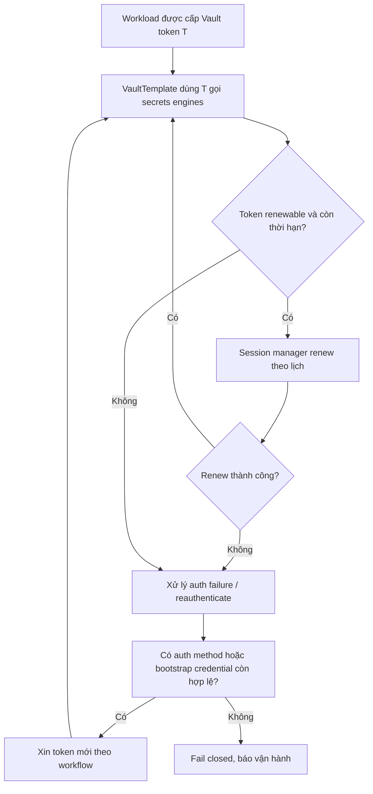
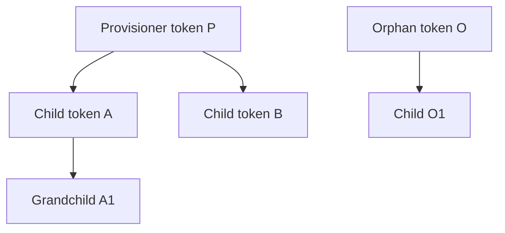

# VaultTokenOperations cho tạo, tra cứu, gia hạn và thu hồi token

Mỗi lần ứng dụng Java dùng **Spring Vault** gọi HashiCorp Vault, yêu cầu thường được xác thực bằng một **Vault token**. Token biểu thị danh tính và tập quyền của client; việc tạo, kiểm tra, gia hạn hoặc thu hồi token có thể quyết định ứng dụng có tiếp tục đọc được KV secrets, xin dynamic database credentials, dùng Transit encryption hoặc cấp chứng chỉ PKI hay không.

Trong chương **API hệ thống** của module `SPRING_VAULT`, bài này hướng dẫn thao tác với **`VaultTokenOperations`** qua `VaultTemplate`/`VaultOperations` và Token auth API của Vault. Trọng tâm là phân biệt những thao tác thư viện hỗ trợ sẵn với những endpoint phải gọi trực tiếp, giữ thông tin TTL và chính sách phân quyền, và tránh để việc quản lý token gây lộ bí mật hoặc vô tình thu hồi token của workload khác.

> **Lưu ý quan trọng về API:** `VaultTokenOperations` hiện có phương thức **`create`, `createOrphan`, `renew`, `revoke` và `revokeOrphan`**, nhưng **không cung cấp phương thức `lookup()`**. Muốn *tra cứu* token, dùng endpoint `auth/token/lookup-self`, `auth/token/lookup` hoặc `auth/token/lookup-accessor` thông qua `VaultOperations.read/write` hay HTTP client có Vault session. Không gọi một phương thức Java `tokenOperations.lookup(...)` không tồn tại.

## 1. Vault token là gì?

Vault token là giá trị bí mật dùng để xác thực các yêu cầu đến Vault, thường được gửi qua header `X-Vault-Token`. Vault gắn với token các thuộc tính như:

| Thuộc tính | Ý nghĩa | Hệ quả thực tế |
|---|---|---|
| Token value / client token | Credential thực để gọi Vault | **Không log, commit hoặc trả ra API response của ứng dụng** |
| Policies | Quyền đọc/ghi theo Vault path và capability | Không có policy phù hợp thì token hợp lệ vẫn nhận `403` |
| TTL | Thời gian còn hiệu lực của token | Khi hết hạn, token và các lease liên quan có thể bị thu hồi |
| Renewable | Vault có chấp nhận yêu cầu gia hạn token không | `renewable=true` không bảo đảm được gia hạn vô hạn |
| Accessor | Định danh quản trị token, không dùng làm credential gọi Vault | Có thể tra cứu/thu hồi/gia hạn qua API được cấp quyền |
| Parent / child | Quan hệ phân cấp giữa token | Thu hồi parent thường thu hồi toàn bộ cây token con |
| Orphan | Token không có parent trong token tree | Không tự bị thu hồi do một parent token thông thường hết hạn |
| Token type | Service hay batch | Khác nhau về lưu trữ, renewal, revocation và accessor |

Hai đặc điểm phải tách biệt: **token đang hợp lệ** không có nghĩa **token được phép thực hiện mọi yêu cầu**; và **ứng dụng sở hữu một token** không có nghĩa nó được tạo, đọc metadata hay thu hồi token của các ứng dụng khác.

### Service token và batch token

| Đặc tính | Service token | Batch token |
|---|---|---|
| Được Vault lưu và theo dõi | Có | Không theo dõi như service token |
| Có thể gia hạn | Có, nếu được cấu hình và còn giới hạn TTL | Không |
| Có thể thu hồi chủ động bằng token API | Có | Không theo cơ chế revoke token như service token |
| Có accessor | Có | Không |
| Có cubbyhole | Có | Không |
| Có thể tạo child token | Có, nếu ACL cho phép | Không |
| Phù hợp | Workload cần quản lý phiên/renew, token con, accessor | Workload số lượng lớn, thời hạn cố định, cần ít chi phí token store |

Các ví dụ `VaultTokenOperations.renew(...)` và `revoke(...)` dưới đây nhắm vào **service token**. Nếu hệ thống phát hành batch token, không giả định tất cả phép quản trị này đều khả dụng.

## 2. Bốn thao tác và vị trí API tương ứng

Trong Spring Vault, lấy API quản lý token bằng:

```java
import org.springframework.vault.core.VaultOperations;
import org.springframework.vault.core.VaultTokenOperations;

// VaultOperations được Spring cấu hình và xác thực theo workload.
VaultTokenOperations tokens = vaultOperations.opsForToken();
```

Bảng sau thể hiện ranh giới giữa wrapper Java và Token auth API của Vault:

| Nghiệp vụ | Spring Vault | HTTP Vault API | CLI để kiểm tra |
|---|---|---|---|
| Tạo token | `tokens.create(request)` | `POST /v1/auth/token/create` | `vault token create` |
| Tạo token qua role | `tokens.create(role, request)` | `POST /v1/auth/token/create/:role` | `vault token create -role=...` |
| Tạo token orphan | `tokens.createOrphan(request)` | `POST /v1/auth/token/create-orphan` | `vault token create -orphan` |
| Tra cứu **token hiện tại** | `vaultOperations.read("auth/token/lookup-self")` | `GET /v1/auth/token/lookup-self` | `vault token lookup` |
| Tra cứu token chỉ định | `vaultOperations.write("auth/token/lookup", body)` | `POST /v1/auth/token/lookup` | `vault token lookup TOKEN` |
| Tra cứu bằng accessor | `vaultOperations.write("auth/token/lookup-accessor", body)` | `POST /v1/auth/token/lookup-accessor` | `vault token lookup -accessor ACCESSOR` |
| Gia hạn token chỉ định | `tokens.renew(token)` | `POST /v1/auth/token/renew` | `vault token renew TOKEN` |
| Gia hạn token hiện tại | `vaultOperations.write("auth/token/renew-self", body)` | `POST /v1/auth/token/renew-self` | `vault token renew` |
| Thu hồi token và cây con | `tokens.revoke(token)` | `POST /v1/auth/token/revoke` | `vault token revoke TOKEN` |
| Tự thu hồi token hiện tại | `vaultOperations.write("auth/token/revoke-self", ...)` | `POST /v1/auth/token/revoke-self` | `vault token revoke -self` |
| Thu hồi theo accessor | `vaultOperations.write("auth/token/revoke-accessor", body)` | `POST /v1/auth/token/revoke-accessor` | `vault token revoke -accessor ACCESSOR` |
| Thu hồi token, giữ con thành orphan | `tokens.revokeOrphan(token)` | `POST /v1/auth/token/revoke-orphan` | `vault token revoke -mode=orphan TOKEN` |

`:role`, `TOKEN` và `ACCESSOR` là các vị trí tham số, **không** phải chuỗi thật để copy vào hệ thống. Các quyền có thể khác nhau giữa gọi quản lý **self** và quản lý **token khác**; ví dụ quyền lookup-self không cho phép lookup tất cả token trong Vault.

## 3. Tạo token có phạm vi cụ thể

### 3.1. Dùng token role thay vì cấp quyền tạo tùy ý

Giả sử một **provisioner** cần cấp token chỉ đọc cấu hình KV v2 cho ứng dụng báo cáo. Operator đã tạo trước:

- Policy `reports-read`, chỉ cho `read` tại `secret/data/apps/reports`.
- Token role `reports-reader` để giới hạn policy, TTL và các tùy chọn cấp phát.
- Identity của provisioner chỉ có quyền `update` đối với `auth/token/create/reports-reader`.

Code dưới đây chạy bên **provisioner có quyền cấp phát**, không chạy tùy tiện trong mọi service business:

```java
import java.time.Duration;
import java.util.Objects;

import org.springframework.vault.core.VaultOperations;
import org.springframework.vault.core.VaultTokenOperations;
import org.springframework.vault.support.VaultToken;
import org.springframework.vault.support.VaultTokenRequest;
import org.springframework.vault.support.VaultTokenResponse;

public final class ReportTokenProvisioner {

    private final VaultTokenOperations tokens;

    public ReportTokenProvisioner(VaultOperations vault) {
        this.tokens = vault.opsForToken();
    }

    // Đây là credential nhạy cảm: chỉ trả cho kênh phân phối bảo mật.
    public VaultToken issueForReportWorkload() {
        VaultTokenRequest request = VaultTokenRequest.builder()
                .withPolicy("reports-read")
                .displayName("reports-workload")
                .ttl(Duration.ofMinutes(30))
                .renewable()
                .build();

        VaultTokenResponse response = Objects.requireNonNull(
                tokens.create("reports-reader", request),
                "Vault returned no token response");

        // KHÔNG log response, token hoặc response.getToken().getToken().
        return Objects.requireNonNull(
                response.getToken(), "Vault returned no token");
    }
}
```

`VaultTokenRequest.builder()` còn có các tùy chọn như `policies(...)`, `noDefaultPolicy()`, `numUses(...)` và `explicitMaxTtl(...)`. Không nên dùng chúng như cơ chế vượt ràng buộc phía server: Vault token role và Vault system/mount TTL có thể giảm TTL hoặc giới hạn những policy được phép cấp.

**Việc yêu cầu `ttl=30m` không phải lời bảo đảm token tồn tại đúng 30 phút**. Hãy tra cứu lại token hoặc kiểm tra metadata trả về, bởi Vault có thể áp TTL ngắn hơn theo cấu hình. Ngược lại, `ttl` khởi tạo không tự đặt một hard maximum cho toàn bộ vòng đời token; `explicit_max_ttl`, giới hạn của role/auth mount và periodic token mới quyết định phần lớn khả năng renew về sau.

### 3.2. Tạo token không gắn role

```java
VaultTokenResponse created = tokens.create(
    VaultTokenRequest.builder()
        .withPolicy("reports-read")
        .ttl(Duration.ofMinutes(15))
        .build()
);
VaultToken createdToken = created.getToken();
```

Cách này gọi `auth/token/create`, phù hợp hơn với công cụ quản trị đã kiểm soát policy. Nếu actor tạo token không phải root, các policy yêu cầu thường phải nằm trong phạm vi được phép của actor hoặc của token role; không thể tùy ý tự nâng quyền bằng cách thêm `root` trong request.

Phần lớn token do token hiện tại tạo là **child token**, còn `tokens.createOrphan(...)` tạo token độc lập với cây parent. Chỉ dùng orphan khi quy trình vận hành thực sự cần tách vòng đời và đã phê duyệt quyền `auth/token/create-orphan`. Tạo orphan có thể khiến quy trình thu hồi toàn bộ bằng parent token không đạt hiệu quả mong muốn.

### 3.3. Lộ token thường xảy ra ở bước giao nhận

`VaultTokenResponse` có thể chứa **token gốc** trong cấu trúc `auth`. Vì vậy:

1. Không trả nguyên `VaultTokenResponse` từ REST controller nội bộ để người dùng tải JSON.
2. Không in `getToken().getToken()` ra stdout hay log; tránh đưa đối tượng chứa token vào thông báo lỗi.
3. Sử dụng quy trình phân phối bảo mật đã được xác thực (ví dụ response wrapping hoặc cơ chế cấp phát của orchestrator).
4. Chỉ giữ token tại nơi thật sự cần sử dụng; cấp TTL ngắn và policy hẹp.
5. Nếu phát hiện token đã lộ, thu hồi token và credential phát sinh từ nó khi cần, rồi thực hiện bootstrap lại.

## 4. Tra cứu token: điều `VaultTokenOperations` chưa bao bọc

Đây là phần dễ gây nhầm lẫn nhất của tiêu đề bài. Các phiên bản Spring Vault hiện hành có `VaultTokenOperations` chuyên biệt cho **create/renew/revoke**, nhưng không có `lookup(...)`. Phải dùng **`VaultOperations`** hoặc một HTTP client hiểu Vault authentication.

### 4.1. Tra cứu token của chính session

`GET /v1/auth/token/lookup-self` trả metadata về **token đang xác thực request**. Đây là token thuộc `VaultOperations`/`VaultTemplate` mà ứng dụng đang dùng; **không phải** một token child vừa tạo ở `create()`, trừ khi ứng dụng đã chuyển sang session của token child.

```java
import java.util.Map;
import java.util.Objects;

import org.springframework.vault.core.VaultOperations;
import org.springframework.vault.support.VaultResponse;

public final class CurrentSessionTokenInspector {

    private final VaultOperations vault;

    public CurrentSessionTokenInspector(VaultOperations vault) {
        this.vault = vault;
    }

    public TokenSnapshot lookupSelf() {
        VaultResponse response = Objects.requireNonNull(
                vault.read("auth/token/lookup-self"),
                "Token lookup did not return metadata");
        return TokenSnapshot.from(response.getData());
    }

    public record TokenSnapshot(
            String accessor, long ttlSeconds, boolean renewable,
            boolean orphan) {

        static TokenSnapshot from(Map<String, Object> data) {
            if (data == null) {
                throw new IllegalStateException("Missing token metadata");
            }
            Object accessor = data.get("accessor");
            Object ttl = data.get("ttl");
            Object renewable = data.get("renewable");
            Object orphan = data.get("orphan");

            if (!(accessor instanceof String a) || a.isBlank()
                    || !(ttl instanceof Number t)
                    || !(renewable instanceof Boolean r)
                    || !(orphan instanceof Boolean o)) {
                throw new IllegalStateException(
                    "Unexpected token metadata shape");
            }
            return new TokenSnapshot(a, t.longValue(), r, o);
        }
    }
}
```

Ví dụ chỉ trả một **view đã chọn lọc**, không trả tất cả field của Vault về API ứng dụng. Phản hồi lookup-self có thể bao gồm `id` chứa chính client token; nếu vô tình serialize `response.getData()` ra log hoặc response JSON, bạn đã làm lộ credential.

### 4.2. Các trường metadata quan trọng

Mẫu rút gọn của `data` trong một phản hồi lookup:

```json
{
  "accessor": "example-accessor",
  "policies": ["default", "reports-read"],
  "identity_policies": [],
  "ttl": 1234,
  "creation_ttl": 1800,
  "renewable": true,
  "orphan": false,
  "num_uses": 0,
  "expire_time": "2026-11-26T00:00:00Z"
}
```

Đây là dữ liệu giả. Các field thường cần lưu ý:

| Field | Cách hiểu |
|---|---|
| `ttl` | Số **giây còn lại** tại thời điểm tra cứu; không phải TTL ban đầu |
| `creation_ttl` | TTL được gắn tại thời điểm token được cấp |
| `expire_time` | Mốc hết hạn theo Vault; có thể dùng để đối chiếu đồng hồ |
| `renewable` | Có khả năng gửi yêu cầu renew, nhưng vẫn chịu các giới hạn thời gian |
| `policies` và `identity_policies` | Chính sách token trực tiếp và do identity gắn vào |
| `orphan` | Có parent token hay không |
| `num_uses` | Giới hạn sử dụng nếu được áp dụng; `0` thường biểu thị không giới hạn lượt dùng |
| `accessor` | Dùng để quản trị mà không phải lưu token secret |
| `id` | Giá trị token thật trong một số phản hồi; không ghi log |

Đừng nhầm `ttl` của **auth token** với `lease_duration` của **dynamic secret** trả từ `database/creds/...`. Một token hết hạn có thể kéo theo các dynamic leases mà nó tạo, nhưng hai đối tượng có lease ID, thời hạn và lifecycle khác nhau.

### 4.3. Tra cứu token khác bằng token value

Endpoint này nhận **POST** với body mang token đích:

```http
POST /v1/auth/token/lookup
X-Vault-Token: <authorized-management-token>
Content-Type: application/json

{"token": "<token-to-inspect>"}
```

Code Spring Vault minh họa:

```java
import java.util.Map;
import java.util.Objects;
import org.springframework.vault.support.VaultResponse;
import org.springframework.vault.support.VaultToken;

public Map<String, Object> lookupManagedToken(VaultToken target) {
    VaultResponse result = Objects.requireNonNull(
        vault.write("auth/token/lookup",
                Map.of("token", target.getToken())),
        "Token lookup returned no metadata");
    return Objects.requireNonNull(result.getData(), "No lookup data");
}
```

Ở hệ thống thật, thay raw `Map` trả về bằng DTO đã loại các field nhạy cảm. Điều kiện bắt buộc là **session đang gọi có capability cho phép trên `auth/token/lookup`**. Token đích không tự trao quyền quản lý chỉ vì bạn có chuỗi token đó; request vẫn dùng quyền của management token trong header.

### 4.4. Tra cứu bằng accessor, không đụng đến token secret

Đối với hệ thống có luồng **phát hành token cho job rồi cần quản lý job** về sau, nên lưu `accessor` thay vì token thật trong bảng quản trị:

```http
POST /v1/auth/token/lookup-accessor
X-Vault-Token: <authorized-management-token>
Content-Type: application/json

{"accessor": "example-accessor"}
```

```java
public Map<String, Object> lookupByAccessor(String accessor) {
    VaultResponse result = Objects.requireNonNull(
        vault.write("auth/token/lookup-accessor",
                    Map.of("accessor", accessor)),
        "No accessor lookup response");
    return Objects.requireNonNull(result.getData(), "Missing lookup data");
}
```

Kết quả `lookup-accessor` trả metadata token nhưng **không cung cấp token value để dùng đăng nhập**. Accessor vẫn nhạy cảm về mặt vận hành: ai có accessor **và quyền Vault quản trị accessor** có thể revoke token liên quan. Bảo vệ danh sách accessor và quyền cấp phát của provisioner.

## 5. Gia hạn token với `VaultTokenOperations.renew`

### 5.1. Yêu cầu renew một token có sẵn

`VaultTokenOperations.renew(VaultToken)` sử dụng `POST /auth/token/renew`. Ví dụ operator provisioner đã cấp và còn sở hữu tham chiếu đến child service token:

```java
import org.springframework.vault.core.VaultTokenOperations;
import org.springframework.vault.support.VaultToken;
import org.springframework.vault.support.VaultTokenResponse;

public void renewManagedChild(
        VaultTokenOperations tokenOperations, VaultToken child) {
    VaultTokenResponse renewed = tokenOperations.renew(child);
    // Không log renewed: có thể chứa thông tin xác thực.
    // Tra cứu metadata và TTL được Vault trả về để lập lịch tiếp theo.
}
```

Vault có thể từ chối hoặc giới hạn renewal khi token không renewable, đã hết hạn, bị revoke, hoặc đã đến giới hạn TTL. Request renew **không có nghĩa TTL chắc chắn tăng đúng khoảng mong muốn**. Ví dụ một token có `explicit_max_ttl=2h` không thể được gia hạn vượt quá mốc đó tính từ lúc tạo, dù ban đầu nhận `renewable=true`.

### 5.2. Tự gia hạn token của session

Endpoint `POST /auth/token/renew-self` dành cho client đang sử dụng token:

```http
POST /v1/auth/token/renew-self
X-Vault-Token: <current-session-token>
Content-Type: application/json

{"increment": "30m"}
```

```java
import java.util.Map;
import org.springframework.vault.support.VaultResponse;

VaultResponse renewedSession =
    vault.write("auth/token/renew-self", Map.of("increment", "30m"));
// Kiểm tra metadata TTL được trả về; không log auth/client_token.
```

Khác biệt giữa `renew(VaultToken child)` và `renew-self` nằm ở **token đích**. `renew-self` luôn nhắm vào token đang dùng để gọi; dù người gọi vừa cấp 10 child tokens, lệnh đó không renew cả 10 token con.

### 5.3. Nên để Spring Vault quản lý session runtime

Ứng dụng Spring Boot dùng `VaultTemplate` thường không cần một vòng lặp tự gọi `VaultTokenOperations.renew(...)` để giữ phiên của chính nó. `LifecycleAwareSessionManager` có thể theo dõi token nhận từ `ClientAuthentication` và thực hiện renewal dựa trên `LoginToken`, TTL và chính sách renew.



Không đặt hai bộ quản lý cùng renew một session token theo hai lịch độc lập nếu chưa thiết kế đồng bộ. Với JWT, Kubernetes, AppRole hoặc phương thức xác thực theo workload, ưu tiên cơ chế tái đăng nhập tương ứng thay vì giữ một token tĩnh lâu dài. Nếu bootstrap bằng wrapping token dùng một lần, phải có đường cấp wrapping token mới khi cần reauthenticate.

### 5.4. Các giới hạn TTL cần nhớ

| Khái niệm | Ý nghĩa |
|---|---|
| `ttl` được yêu cầu lúc create | Thời gian khởi tạo mong muốn; Vault có thể cap |
| `ttl` còn lại trong lookup | Thời gian token còn hiệu lực khi tra cứu |
| `renewable` | Cho biết token có cho phép gia hạn, chưa chắc còn nhiều TTL |
| `increment` của renew | TTL **yêu cầu tính từ lúc renew**, không cộng thêm nguyên giá trị vào TTL còn lại |
| `explicit_max_ttl` | Trần cứng tính từ khi tạo, renew không vượt qua |
| Periodic token | TTL được đặt lại về period sau mỗi lần renew hợp lệ; vẫn có thể bị chặn bởi explicit max TTL |

Khi đọc phản hồi renew, luôn lưu ý server trả bao nhiêu TTL thật và kiểm tra timeout, clock skew, scheduling jitter. Nếu còn rất ít TTL, hãy xử lý như vấn đề session cần phát hành lại credential, thay vì retry liên tục để chờ mốc hết hạn.

## 6. Thu hồi token đúng phạm vi

### 6.1. Thu hồi token được chỉ định

```java
import org.springframework.vault.core.VaultTokenOperations;
import org.springframework.vault.support.VaultToken;

public void revokeManagedChild(
        VaultTokenOperations tokenOperations, VaultToken child) {
    tokenOperations.revoke(child);
}
```

`revoke` gọi `POST /auth/token/revoke`. Với **service token**, Vault thu hồi token đích cùng **các token con theo cây parent** và những dynamic secret leases tương ứng. Thao tác này có thể làm ứng dụng đang dùng token bị `403` ngay sau đó; không xem nó như một cách "đăng xuất nhẹ" không có ảnh hưởng.

### 6.2. Parent-child và orphan: phạm vi thu hồi



Nếu thu hồi **P** theo cách thường, token A, B và A1 cũng bị thu hồi. Token O không có parent P nên không bị thu hồi theo cây này (nhưng vẫn chịu TTL và các cơ chế quản trị khác).

`tokens.revokeOrphan(P)` lại có **ngữ nghĩa khác**: thu hồi P nhưng để child tokens được **orphan hóa** thay vì thu hồi theo cây. Endpoint này có quyền cao và phải được hạn chế nghiêm ngặt; nếu vô tình gọi trong quy trình khẩn cấp, ứng dụng có thể tiếp tục sử dụng những token con mà operator tưởng đã dừng.

**Không nhầm:**

- `createOrphan`: tạo **token mới** không có parent.
- `revokeOrphan`: thu hồi **token hiện có** nhưng giữ lại các child bằng cách orphan hóa chúng.
- `revoke`: thu hồi token và cây con theo quan hệ parent.

### 6.3. Thu hồi bằng accessor

Đối với một job được provision token nhưng hệ thống quản lý chỉ lưu accessor, dùng:

```java
// Chạy dưới management token có quyền update auth/token/revoke-accessor.
vault.write(
    "auth/token/revoke-accessor",
    Map.of("accessor", jobTokenAccessor)
);
```

Đây là yêu cầu `POST /auth/token/revoke-accessor`, thu hồi token tương ứng và các token con của nó. Accessor **không** được dùng trực tiếp như credential trong header `X-Vault-Token`. Dùng accessor giúp hệ thống quản lý không phải lưu raw token sau khi đã hoàn tất phân phối token cho job.

### 6.4. Self revoke chỉ phù hợp khi thực sự muốn đóng phiên

```http
POST /v1/auth/token/revoke-self
X-Vault-Token: <token-being-revoked>
```

`revoke-self` vô hiệu **ngay token dùng để gọi** và cây token con. Nếu gọi bằng token đang được `VaultTemplate`/session manager chia sẻ, mọi request Vault tiếp theo qua session đó có thể thất bại. Vì vậy không đặt `revoke-self` vào một callback xử lý request nghiệp vụ bình thường hoặc một health check.

## 7. ACL và mô hình cấp quyền quản trị token

Để tránh mọi service đều có khả năng tạo/thu hồi token tùy ý, nên phân tách **workload thông thường** khỏi **token provisioner/administrator**:

| Vai trò | Quyền hợp lý | Không cần |
|---|---|---|
| Ứng dụng chỉ đọc KV v2 | `read secret/data/apps/reports`, lookup-self/renew-self theo nhu cầu | `auth/token/create`, `auth/token/revoke` toàn cục |
| Provisioner chuyên cấp token | `update auth/token/create/reports-reader` | `auth/token/create-orphan` và `root` nếu không thật sự cần |
| Token auditor | `read auth/token/lookup-self` của chính nó, endpoint lookup-accessor được cấp theo quy trình | Danh sách toàn bộ accessor và token value |
| Incident-response operator | Quyền revoke-accessor hoặc revoke token trong phạm vi được phê duyệt | Dùng chung credential root với ứng dụng |

Ví dụ một **policy runtime** chỉ phục vụ đọc secret cùng self lookup/renew:

```hcl
path "secret/data/apps/reports" {
  capabilities = ["read"]
}

path "auth/token/lookup-self" {
  capabilities = ["read"]
}

path "auth/token/renew-self" {
  capabilities = ["update"]
}
```

Ví dụ policy dành riêng cho **provisioner** được operator cấu hình giới hạn bằng token role:

```hcl
path "auth/token/create/reports-reader" {
  capabilities = ["update"]
}
```

Nếu cần công cụ quản trị lookup/revoke bằng accessor, cấp riêng cho management identity sau khi xem xét phạm vi vận hành:

```hcl
path "auth/token/lookup-accessor" {
  capabilities = ["update"]
}

path "auth/token/revoke-accessor" {
  capabilities = ["update"]
}
```

**Policy chỉ kiểm tra endpoint và capability**, không tự kiểm tra "accessor này thuộc job nào" theo một trường JSON tùy ý. Một actor có quyền revoke-accessor rộng có thể tác động tới token ngoài phạm vi job mà nó được phép quản lý. Ở tầng quản trị, cần kiểm tra ownership/job ID và giới hạn identity/namespace/policy trước khi gửi request. Với các thao tác `create`, token role giúp siết danh sách policy/TTL được cấp.

Tùy cách Vault cấu hình, policy `default` có thể chứa sẵn các self endpoints. Không dựa vào giả định rằng mọi token đều có policy default: token có thể được cấp với `no_default_policy`. Kiểm tra **effective policies thực tế** khi triển khai.

## 8. Quy trình đầy đủ: tạo, tra cứu, gia hạn, thu hồi

### 8.1. Ví dụ Java cho provisioner

Đoạn này kết nối những phương thức có sẵn. Nó giả định một môi trường lab, provisioner có quyền tạo token trong role `reports-reader`, renew/revoke child token theo policy và phương thức phân phối token được xử lý riêng.

```java
import java.time.Duration;
import java.util.Map;
import java.util.Objects;

import org.springframework.vault.core.VaultOperations;
import org.springframework.vault.core.VaultTokenOperations;
import org.springframework.vault.support.VaultResponse;
import org.springframework.vault.support.VaultToken;
import org.springframework.vault.support.VaultTokenRequest;
import org.springframework.vault.support.VaultTokenResponse;

public final class ManagedTokenWorkflow {

    private final VaultOperations vault;
    private final VaultTokenOperations tokens;

    public ManagedTokenWorkflow(VaultOperations vault) {
        this.vault = vault;
        this.tokens = vault.opsForToken();
    }

    public VaultToken issue() {
        VaultTokenRequest request = VaultTokenRequest.builder()
                .withPolicy("reports-read")
                .ttl(Duration.ofMinutes(20))
                .renewable()
                .build();

        VaultTokenResponse created = tokens.create("reports-reader", request);
        return Objects.requireNonNull(created.getToken());
    }

    public long remainingTtlSeconds(VaultToken child) {
        // lookup-self sẽ trả provisioner token, KHÔNG trả child.
        VaultResponse lookup = Objects.requireNonNull(
                vault.write("auth/token/lookup",
                        Map.of("token", child.getToken())));
        Map<String, Object> data =
                Objects.requireNonNull(lookup.getData());
        Object ttl = data.get("ttl");
        if (!(ttl instanceof Number seconds)) {
            throw new IllegalStateException("Token TTL missing");
        }
        return seconds.longValue();
    }

    public void renew(VaultToken child) {
        tokens.renew(child);
    }

    public void revoke(VaultToken child) {
        tokens.revoke(child);
    }
}
```

Trong production, nên dùng **accessor** để theo dõi token sau khi cấp; không giữ raw child token lâu dài trong service quản lý chỉ để gọi lookup/revoke. Nếu cần renew theo accessor, dùng `POST /auth/token/renew-accessor` với token quản trị có quyền thích hợp và kiểm tra TTL trả về.

### 8.2. Lab CLI tương đương

Chỉ chạy trên **Vault thử nghiệm**, với một token provisioner chuyên dụng và policy role đã được chuẩn bị. Không chạy lệnh tạo/thu hồi token trong Vault production bằng tài khoản root chỉ để học.

```bash
# 1. Token hiện tại là identity provisioner.
vault token lookup

# 2. Tạo một token mới với role đã được operator kiểm soát.
# Output sẽ chứa token mới: tránh ghi vào log công khai.
vault token create -role=reports-reader -ttl=20m

# 3. Tra cứu metadata của token mới bằng accessor đã ghi ở nơi an toàn.
vault token lookup -accessor "<test-token-accessor>"

# 4. Gia hạn token mới, nếu có quyền và token renewable.
vault token renew -accessor "<test-token-accessor>"

# 5. Thu hồi token mới khi kết thúc bài lab.
vault token revoke -accessor "<test-token-accessor>"

# 6. Lookup accessor cũ sau khi revoke phải không thành công.
vault token lookup -accessor "<test-token-accessor>"
```

Thực nghiệm cần đối chiếu TTL **trước và sau** renewal. Một yêu cầu renew thành công nhưng TTL ngắn hơn mong muốn không có nghĩa Vault lỗi; hệ thống có thể cap theo policy hoặc gần đến `explicit_max_ttl`.

### 8.3. Test parent-child trên token thử nghiệm

Chỉ để minh họa hành vi:

1. Cấp token A từ provisioner P; dùng A cấp child A1 nếu policy A cho phép.
2. Lookup metadata và xác minh cả hai đang hợp lệ, ghi lại accessor.
3. Revoke A bằng quyền hợp lệ của provisioner.
4. Xác minh A và A1 đều không dùng được nữa, trong khi P vẫn hợp lệ.
5. Thử tạo một token orphan **chỉ khi role của lab cho phép**, sau đó revoke P; quan sát orphan không thuộc cây của P.
6. Kết thúc lab, thu hồi những token còn lại và kiểm tra dynamic leases liên quan.

Không đưa raw token vào fixture của automated tests hay snapshot của CI; khi cần kiểm thử tích hợp, tạo token ở setup rồi revoke trong cleanup với cơ chế che thông tin.

## 9. Lỗi và tình huống vận hành thường gặp

| Hiện tượng | Nguyên nhân khả dĩ | Hướng xử lý |
|---|---|---|
| `403` khi `create(role, request)` | Provisioner thiếu `update`, role thiếu/không đúng, policy bị chặn | Đối chiếu `auth/token/create/<role>`, role và effective policies |
| `403` khi lookup-self | Thiếu capability hoặc token hiện tại không hợp lệ | Phân biệt policy denied với expired/revoked token qua audit |
| `403` khi tra cứu child | Token gọi thiếu quyền `auth/token/lookup` | Không tráo child token vào session của provisioner chỉ để né ACL |
| `renew(...)` báo lỗi | Không renewable, token hết hạn, không có quyền, đạt giới hạn | Kiểm tra `renewable`, TTL còn lại, explicit max TTL và policy |
| Renew thành công nhưng TTL không tăng như kỳ vọng | Vault giới hạn TTL/period | Dùng TTL thực trong response để lập lịch; dự phòng reauthenticate |
| Revoke parent làm nhiều service cùng lỗi | Token con trong cùng parent tree | Kiểm soát dependency trước khi revoke; dùng token role/lifecycle hợp lý |
| Lookup accessor không tìm thấy | Token đã hết hạn/revoked hoặc accessor sai | Đối chiếu job mapping, thời điểm cấp và audit |
| Dùng batch token để renew | Batch token không hỗ trợ cơ chế này | Chọn service token hoặc luồng cấp mới phù hợp |
| Thấy `400` khi gửi POST lookup | Sai tên field `token`/`accessor` hoặc sai payload | Kiểm tra contract HTTP, tránh retry sai schema |
| Lộ raw token do logging | Response `auth` hoặc `getToken()` bị serialize | Redact/khóa log, revoke token và đánh giá phạm vi ảnh hưởng |
| Token tạo được nhưng đọc KV thất bại | Token có policy chưa đủ `secret/data/...` | So capability trên đường dẫn KV v2 thực tế |

### Không log token value khi debug

Những trường sau có thể là bí mật: `X-Vault-Token`, `auth.client_token`, token value ở response lookup, `VaultToken.getToken()` và JSON request body của `auth/token/lookup` hoặc `auth/token/revoke` khi dùng token value.

Nên ghi lại **tên thao tác**, response code, Vault request ID, elapsed time, logical job ID và một định danh quản trị đã được chuẩn hóa. Accessor cũng phải được kiểm soát theo policy vì người có quyền `revoke-accessor` có thể gây gián đoạn hệ thống; tránh đưa accessor toàn cục vào log công khai.

### Không dùng `lookup-self` làm health check mặc định cho mọi request

Một request lookup-self có thêm round-trip Vault. Nếu ứng dụng sử dụng session manager để tự duy trì token, mỗi request business không cần đọc metadata token riêng. Dùng health indicator/auth error metric và kiểm tra định kỳ theo thiết kế, không tạo thêm tải lớn hoặc các failure mode mới chỉ để xác minh TTL tại mọi lần đọc KV.

## 10. Kiểm thử tích hợp cho ứng dụng Spring Vault

Tạo Vault thử nghiệm hoặc dev instance riêng cùng các token role và policy tối thiểu. Các bài test nên có **hai identity thật khác nhau**: provisioner dùng `VaultTokenOperations` và runtime workload dùng token con đã cấp. Mock `VaultTokenOperations` chỉ giúp test code branching, không chứng minh ACL hoặc lifecycle của Vault server.

| Kịch bản | Điều kiện | Kết quả mong đợi |
|---|---|---|
| Tạo token đúng role | Provisioner có `create/reports-reader` | Token được tạo, policy/TTL thực nằm trong giới hạn role |
| Tạo token ngoài policy | Cố yêu cầu policy không cho phép | Vault từ chối hoặc ràng buộc theo role; không được nâng quyền |
| Lookup-self | Runtime gọi bằng token con | Trả metadata **của runtime**, không phải của provisioner |
| Lookup token bằng accessor | Management token có capability | Trả metadata, không tiết lộ raw token |
| Lookup bị cấm | Runtime thiếu quyền tra cứu token khác | `403`; không lộ metadata của token khác |
| Renew còn hạn | Service token renewable còn trong giới hạn | Kiểm tra TTL thực được trả, không suy ra từ requested increment |
| Renew sau revoke | Token đã bị vô hiệu | Không renew thành công |
| Revoke token con | Revoke A có child A1 | A/A1 mất hiệu lực, parent P không bị revoke |
| Revoke theo accessor | Management token có quyền, accessor thuộc job test | Token đó không dùng được, không cần lưu raw token |
| Batch token | Token type=batch | Renew/revoke thao tác không được hỗ trợ như service token |
| Dynamic secret lease | Token cấp credential DB động rồi bị revoke | Kiểm tra tác động tới lease và đường reconnect của workload |
| Log redaction | Bật HTTP/JSON logging ở cấu hình test | Không có token value hay auth response trong log/tracing |

Đối với test tự động, nên xác minh cả hai phía: **API trả trạng thái đúng** và **request bằng token sau revoke thực sự không còn truy cập được secret**. Không tuyên bố thu hồi thành công chỉ vì không có exception trong Java; nếu tình huống yêu cầu chắc chắn về trạng thái, cần một readback phù hợp với quyền và số lần retry có giới hạn.

## 11. Những quyết định thiết kế nên cân nhắc

### 11.1. Khi nào cấp token thủ công bằng `VaultTokenOperations`?

API này hữu ích cho service **provisioning / job scheduler** cần phát token con có TTL, policy và thời gian sống riêng, hoặc công cụ vận hành cần thu hồi token của một job. Với ứng dụng Spring Boot thông thường chỉ cần **đọc KV hoặc dùng Transit**, nên xác thực trực tiếp bằng workload identity như Kubernetes, AppRole, JWT/OIDC hoặc cloud auth phù hợp. Nó giúp nhận token theo phiên mà không phải tự xây dịch vụ cấp phát token cho mọi request.

### 11.2. Vì sao chọn accessor cho hệ thống quản trị?

Ví dụ bảng job quản trị:

| Field | Ý nghĩa |
|---|---|
| `job_id` | Định danh tác vụ nội bộ |
| `token_accessor` | Tham chiếu phục vụ lookup/renew/revoke có kiểm soát |
| `issued_at` | Khi cấp token |
| `expected_expires_at` | Dự kiến để lập lịch kiểm tra, không thay thế TTL của Vault |
| `policy_profile` | Vai trò hoặc profile policy đã được duyệt |
| `revocation_status` | Trạng thái tác vụ quản trị đã đối chiếu Vault |

Không lưu cột raw `client_token` để thuận tiện tra cứu khi hệ thống quản lý không cần dùng token đó để gọi Vault. Accessor không tự authenticate nhưng vẫn có thể bị lạm dụng bởi chủ thể có quyền quản trị phù hợp; phân quyền database và API quản lý theo job ID.

### 11.3. Token lifecycle gắn với nghiệp vụ

Khi job chạy xong, hủy token trong cleanup. Khi ứng dụng restart, xác thực lại theo workload và làm mới session manager. Khi đổi policy, không mặc định token hiện có sẽ nhận mọi quyền mới như mong đợi; kiểm tra effective policies và tiến hành rotation/reauthenticate theo quy trình. Khi gặp sự cố bảo mật, cần hiểu parent tree trước khi thu hồi hàng loạt, vì token revocation có thể kéo theo dynamic secrets mà dịch vụ khác đang dùng.

## 12. Câu hỏi tự kiểm tra

1. `VaultTokenOperations` có phương thức Java `lookup()` không? Nếu không, bạn dùng endpoint và phương thức HTTP nào cho self lookup?
2. `vault.opsForToken().create("reports-reader", request)` sử dụng Vault path nào? Policy nào phải có trên path đó?
3. Vì sao `lookup-self` không tra cứu token child mới được tạo bởi cùng `VaultOperations`?
4. `ttl=30m` lúc tạo và `ttl=500` trong lookup khác nhau thế nào?
5. Accessor có thể thay thế `X-Vault-Token` để đọc một KV secret không? Nó có thể giúp làm gì?
6. `revoke(token)` khác `revokeOrphan(token)` thế nào đối với child tokens?
7. Vì sao batch token không dùng được cùng workflow renew/revoke như service token?
8. Session manager và một scheduled job riêng cùng renew một runtime token có thể gây ra khó khăn gì?
9. Vì sao response JSON chứa `auth.client_token` và `id` trong lookup phải được redact trước khi ghi log?
10. Nếu renew trả TTL thấp hơn mức yêu cầu, ứng dụng nên lấy giá trị nào để lập lịch và lúc nào nên reauthenticate?

**Ghi nhớ:** Spring Vault `VaultTokenOperations` giúp **tạo, gia hạn và thu hồi** service token; phần **tra cứu** dùng Vault Token auth endpoints thông qua `VaultOperations`. Những gì token được phép làm vẫn phụ thuộc ACL, token role và vòng đời của Vault, còn session runtime nên được điều phối bởi authentication/session manager theo workload.

## Tài liệu chính thức

- [Spring Vault — `VaultTokenOperations` Javadoc](https://docs.spring.io/spring-vault/reference/api/java/org/springframework/vault/core/VaultTokenOperations.html)
- [Spring Vault — `VaultOperations` Javadoc](https://docs.spring.io/spring-vault/reference/api/java/org/springframework/vault/core/VaultOperations.html)
- [Spring Vault — `VaultTokenRequest` Javadoc](https://docs.spring.io/spring-vault/reference/api/java/org/springframework/vault/support/VaultTokenRequest.html)
- [Spring Vault — Secrets Engines: Token](https://docs.spring.io/spring-vault/reference/vault/vault-secret-engines.html)
- [Spring Vault — Authentication, sessions và token renewal](https://docs.spring.io/spring-vault/reference/vault/authentication.html)
- [HashiCorp Vault — Token auth HTTP API](https://developer.hashicorp.com/vault/api-docs/auth/token)
- [HashiCorp Vault — Token concepts: types, TTL, accessor và hierarchy](https://developer.hashicorp.com/vault/docs/concepts/tokens)
- [HashiCorp Vault — Lease, renew và revoke](https://developer.hashicorp.com/vault/docs/concepts/lease)
- [HashiCorp Vault — Token CLI commands](https://developer.hashicorp.com/vault/docs/commands/token)
