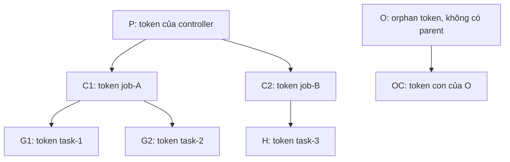

# Token con, orphan token và phạm vi thu hồi trong Vault System API

## 1. Bài toán: ai sống tiếp khi token cha bị thu hồi?

Giả sử một ứng dụng Java dùng **Spring Vault** để đăng nhập HashiCorp Vault rồi tạo token riêng cho từng công việc. `deployment-controller` tạo token `job-A`; `job-A` tạo tiếp token `task-1` để đọc secrets. Khi `deployment-controller` bị ngừng hoặc bị thu hồi quyền, điều gì xảy ra với các token đã được cấp cho những công việc bên dưới?

Trong Vault, **service token** tạo qua `auth/token/create` thường có quan hệ **cha → con**. Thu hồi token cha theo cách thông thường sẽ thu hồi **toàn bộ cây token con** và các **dynamic secret leases** thuộc cây đó. Cơ chế này ngăn một workload duy trì quyền truy cập chỉ bằng cách liên tục phát hành token con.

Vault cũng có **orphan token**: token **không có parent**, đứng đầu một cây độc lập. Thu hồi token từng tạo ra orphan **không** tự thu hồi orphan. Điều này hữu ích khi một workload có vòng đời dài hơn tiến trình phát hành token, nhưng phải dùng có chủ đích vì nó thay đổi phạm vi thu hồi hàng loạt.

Trong module **SPRING_VAULT**, ứng dụng Java tương tác Vault qua `VaultTemplate` và `VaultOperations`, dùng xác thực workload (Kubernetes, AppRole, v.v.), chính sách Vault, token/lease, KV, Transit, PKI và các engine động. Chủ đề này tập trung vào **API quản lý token trong auth backend `auth/token`**, đặc biệt là cách tạo token con, tạo orphan, thu hồi token và xác định những quyền/lease nào bị ảnh hưởng.

**Kết quả sau bài học:** đọc được cây token; phân biệt orphan với root token; tạo và thu hồi đúng phạm vi bằng Vault CLI, System API và Spring Vault; kiểm tra TTL, accessor, ACL; thiết kế bài kiểm thử xác nhận hành vi thu hồi trong thực tế.

## 2. Mô hình cây token và khái niệm orphan

### 2.1. Token con thông thường



Giả sử `P` tạo `C1` và `C2` qua `auth/token/create`; sau đó `C1` tạo `G1`, `G2`. Nếu quản trị viên thu hồi `P` bằng **revoke thông thường**:

- `P`, `C1`, `C2`, `G1`, `G2` và `H` đều bị thu hồi.
- Vault thu hồi những dynamic secret leases được cấp cho các token trong cây, theo khả năng thu hồi của từng backend.
- `O` và `OC` không thuộc nhánh `P`, nên không bị kéo theo bởi hành động thu hồi `P`.

Nếu chỉ thu hồi `C1` bình thường, nhánh `C1 → G1/G2` bị thu hồi, còn `P` và `C2 → H` vẫn hoạt động.

> **Phân biệt từ “root”:** *root của một cây token* nghĩa là token không có parent. Nó **không đồng nghĩa** với *Vault root token* có policy `root` và đặc quyền quản trị gần như toàn bộ Vault. Một orphan token có thể chỉ có policy `report-read`, TTL ngắn và quyền rất hạn chế.

### 2.2. Orphan token được tạo từ đâu?

Trong Vault, token có thể là orphan bởi các nguyên nhân thông dụng:

1. Người dùng có quyền thích hợp gọi `POST /v1/auth/token/create-orphan`.
2. Quản trị viên có quyền `root` hoặc `sudo` trên `auth/token/create` sử dụng tùy chọn `no_parent=true` (CLI `vault token create -orphan`).
3. Một **token role** được cấu hình `orphan=true` và người gọi có quyền phát hành qua role.
4. Token được tạo từ đăng nhập qua một auth method khác `token`, ví dụ Kubernetes, AppRole hoặc OIDC. Những token cấp từ lượt login như vậy thường là gốc của cây riêng.

Orphan **vẫn có TTL, policy, accessor, giới hạn renew và các lease của chính nó** như service token khác. Nó chỉ không có cạnh liên kết *parent token*, vì vậy không bị thu hồi do parent cũ hết hạn hoặc bị revoke.

### 2.3. Orphan không phải batch token

Vault có hai loại token quan trọng:

| Thuộc tính | Service token | Batch token |
| --- | --- | --- |
| Được Vault lưu/tracking | Có | Không theo cách service token |
| Tạo token con | Có, khi được ACL cho phép | **Không** |
| Có accessor | Có | Không |
| Gia hạn token | Có thể, tùy TTL/role | Không |
| Thu hồi trực tiếp bằng token/accessor | Có | Không theo cơ chế service token |
| Parent và orphan | Hỗ trợ mô hình cây và orphan | Có đặc điểm liên hệ parent khác; không dùng quy trình tạo/cắt cây service token |
| Dùng cho bài thực hành này | **Có** | Chỉ so sánh |

Các API `revoke` và `revoke-orphan` trong bài chủ yếu nói về **service token**. Không xây hệ thống quản trị cây token dựa trên giả định batch token có accessor, renew hoặc khả năng tạo token con tương tự.

## 3. Token được cấp quyền và TTL như thế nào?

### 3.1. Policy của token con

Khi tạo token con ở **cùng Vault namespace**, nếu không truyền danh sách policy, token mới theo quy tắc thông thường sẽ nhận các token policy của parent. Nếu chỉ định `policies`, một caller thường chỉ được yêu cầu **tập policy con nằm trong tập policy được phép của caller**. Token role và quyền quản trị có thể thay đổi một số ràng buộc này.

Ví dụ, parent có các policy `reader`, `issuer`; yêu cầu tạo child chỉ với `reader` sẽ tạo token có phạm vi hẹp hơn. Không nên dựa vào token con để “tự nâng quyền” cao hơn parent.

**Có ngoại lệ cần chú ý:** các **identity policies**, role policy và quy tắc khác namespace có cơ chế gán riêng. Do đó việc “child luôn là subset của parent” chỉ là quy tắc mặc định khi tạo bằng token auth trong cùng namespace, không phải một khẳng định cho mọi tổ hợp identity/role/Enterprise namespace. Sau khi cấp phát, hãy kiểm tra quyền thực tế bằng `vault token capabilities` hoặc endpoint capabilities với token thích hợp.

### 3.2. TTL, max TTL, periodic và quyền renew

Các trường thường gặp khi lookup:

| Trường | Ý nghĩa |
| --- | --- |
| `ttl` | Thời gian còn hiệu lực **hiện tại**, thường tính bằng giây |
| `creation_ttl` | TTL lúc cấp phát ban đầu |
| `renewable` | Token có thể yêu cầu gia hạn trong giới hạn không |
| `explicit_max_ttl` | Trần thời gian sống tuyệt đối kể từ lúc tạo, không được vượt bằng renew |
| `period` | Chu kỳ TTL với periodic token, nếu có |
| `orphan` | Có parent hay không |
| `accessor` | Định danh quản trị token, không phải token đăng nhập |
| `policies` / `identity_policies` | Quyền gắn trực tiếp và qua identity |
| `path` | Nguồn cấp token, hữu ích trong kiểm toán/thu hồi theo path |

TTL của token con không làm nó độc lập với parent. Dù token con có `renewable=true` và được cấp TTL dài, **nếu parent bị thu hồi hoặc hết hạn trước, con vẫn bị vô hiệu hóa theo cây**. Ngược lại, orphan không bị kéo theo parent cũ, nhưng vẫn tự hết hạn theo TTL và max TTL của nó.

Token hết TTL hoặc vượt giới hạn sẽ không còn được dùng để đọc secrets. Token được gia hạn chỉ khi backend, token type, policy và giới hạn thời gian cho phép; `renewable=true` không bảo đảm renew vô hạn. Periodic token phải renew đều đặn và vẫn chịu `explicit_max_ttl` khi có cấu hình này.

### 3.3. Mối liên hệ token và lease động

Một **dynamic secret** (ví dụ database credential, AWS IAM credential hoặc PKI certificate có lease theo backend) thường được cấp kèm `lease_id`. Vault quản lý lease phát sinh gắn với token đã yêu cầu nó. Khi token bị revoke:

- Bản thân token không còn được dùng gọi API.
- Lease của dynamic secrets được cấp dưới token đó cũng được Vault thu hồi.
- Khi revoke **cả cây**, lease của những token con trong nhánh cũng bị thu hồi.
- Vault yêu cầu backend dọn tài nguyên tương ứng; một số cloud/đích ngoài có độ trễ hoặc giới hạn thu hồi, nên không thể coi đây là bảo đảm “đã vô hiệu hóa trên mọi hệ thống ngay cùng mili-giây”.

**KV secrets khác:** dữ liệu tĩnh tại `kv/data/...` không bị xóa khỏi Vault chỉ vì một token đã dùng để đọc nó bị thu hồi. Việc revoke token chặn **quyền đọc tiếp theo**; nó không xóa những giá trị KV đã lưu và cũng không xóa bản copy plaintext ứng dụng đã lấy trước đó.

## 4. Ma trận hành vi thu hồi và phạm vi ảnh hưởng

Hai thuật ngữ dễ gây nhầm lẫn nhất là **orphan token** (token được tạo **không có parent**) và **revoke-orphan** (hành động **thu hồi một token và giữ con của nó sống**).

| Hành động | Endpoint của Vault | Token mục tiêu | Token con/nhánh dưới | Dynamic secret leases |
| --- | --- | --- | --- | --- |
| Revoke thông thường | `POST auth/token/revoke` | Thu hồi | **Thu hồi đệ quy toàn nhánh** | Thu hồi lease của mục tiêu và nhánh dưới |
| Tự thu hồi | `POST auth/token/revoke-self` | Thu hồi caller | **Thu hồi đệ quy** | Thu hồi tương ứng |
| Thu hồi theo accessor | `POST auth/token/revoke-accessor` | Thu hồi token được accessor tham chiếu | **Thu hồi đệ quy** | Thu hồi tương ứng |
| **Revoke-orphan** | `POST auth/token/revoke-orphan` | Thu hồi | **Giữ lại**; con trực tiếp trở thành orphan | Thu hồi lease của **token mục tiêu**; lease thuộc các token con còn sống không bị thu hồi chỉ vì thao tác này |
| Thu hồi một dynamic lease | `POST sys/leases/revoke` | Token thường giữ nguyên | Không tự động thu hồi cả cây token | Thu hồi lease cụ thể |
| Thu hồi theo prefix | API token/lease liên quan đến path | Nhiều token/lease có nguồn phát hành phù hợp | Có thể ảnh hưởng số lượng lớn nhánh | Theo tập token/lease bị chọn |

Điểm chính xác ở dòng `revoke-orphan`: Vault cắt quan hệ parent của **các con trực tiếp** và để nguyên những nhánh hậu duệ ở dưới chúng. Các dynamic secret leases **thuộc chính token mục tiêu** bị thu hồi như thường lệ; những lease gắn với token con được giữ lại theo vòng đời token con. Không nên dùng thao tác này khi mục tiêu thực sự là khóa toàn bộ công việc được phát hành dưới một token bị xâm nhập.

### 4.1. Minh họa bằng sơ đồ

Trước khi thao tác:

```text
P
├── C
│   ├── G1
│   └── G2
└── D

O  (orphan độc lập)
└── OG
```

Nếu gọi `revoke(P)`: nhánh `P, C, D, G1, G2` bị thu hồi; `O, OG` còn nguyên. Nếu gọi `revoke-orphan(C)`, trạng thái sau thao tác là:

```text
P
└── D

G1  (trở thành orphan, độc lập với P)
G2  (trở thành orphan, độc lập với P)

O
└── OG
```

Như vậy, `revoke-orphan` **không** có nghĩa “thu hồi tất cả các orphan token”. Đây là thao tác **giữ lại children** khi thu hồi một parent cụ thể.

## 5. Vault CLI: tạo và thu hồi cây token trong sandbox

**Chỉ thực hành trong Vault dev/test** với token quản trị được cấp cho phòng lab. Không chạy các lệnh revoke lên token làm việc thật vì chúng có thể cắt đứt nhiều workload và dynamic secrets đang hoạt động.

### 5.1. Tạo policy minh họa

Giả sử KV v2 đã được mount ở `secret`. Tạo hai policy: `lab-reader` cho việc đọc một nhánh KV; `lab-issuer` cho phép phát hành token con qua Token API.

```bash
# Thực hiện bằng tài khoản quản trị lab.
vault policy write lab-reader - <<'HCL'
path "secret/data/spring-vault/lab/*" {
  capabilities = ["read"]
}
HCL

vault policy write lab-issuer - <<'HCL'
path "auth/token/create" {
  capabilities = ["update"]
}
HCL
```

Trong môi trường thật, nên cấp token thông qua **token role có allowlist policy** thay vì mở quyền `auth/token/create` rộng cho nhiều workload. Ở ví dụ này, quy tắc subset policy được dùng để minh họa.

### 5.2. Tạo cây parent → child → grandchild

```bash
# Bash trên máy thử nghiệm đã đăng nhập Vault bằng tài khoản quản trị.
# Không dùng "set -x": nó có thể in thông tin nhạy cảm.
PARENT_TOKEN=$(vault token create -field=token \
  -policy=lab-reader -policy=lab-issuer -ttl=60m)

CHILD_TOKEN=$(VAULT_TOKEN="$PARENT_TOKEN" vault token create \
  -field=token -policy=lab-reader -policy=lab-issuer -ttl=20m)

GRANDCHILD_TOKEN=$(VAULT_TOKEN="$CHILD_TOKEN" vault token create \
  -field=token -policy=lab-reader -ttl=10m)

# Chỉ in metadata dùng trong lab, không in token ID.
vault token lookup -format=json "$CHILD_TOKEN" \
  | jq '{ttl: .data.ttl, orphan: .data.orphan,
          policies: .data.policies, path: .data.path}'
```

Theo quy tắc mặc định của service token, ba biến trên tạo cây `PARENT_TOKEN → CHILD_TOKEN → GRANDCHILD_TOKEN`. Lệnh `vault token lookup` cho phép xem `orphan=false` và TTL của child. Token mới có thể có thêm policy `default` theo cấu hình.

**Không copy token ID từ terminal vào ticket/log.** Các biến môi trường của lab chỉ dùng ngắn hạn trong shell cô lập; production nên sử dụng xác thực workload và hệ thống quản lý vòng đời credential có kiểm soát.

### 5.3. Thu hồi parent: con và cháu cũng mất quyền

```bash
# Quay về tài khoản quản trị lab có quyền revoke.
vault token revoke "$PARENT_TOKEN"

# Lệnh dưới đây được kỳ vọng không còn hoạt động (HTTP 403).
VAULT_TOKEN="$CHILD_TOKEN" vault token lookup

# Grandchild cũng bị thu hồi do nằm trong cùng cây.
VAULT_TOKEN="$GRANDCHILD_TOKEN" vault token lookup
```

Một response `403` có thể ghi `invalid token` hoặc `permission denied`; để phân biệt với token **còn hợp lệ nhưng thiếu policy**, có thể dùng admin lookup và xác minh token không còn tồn tại, đồng thời kiểm tra audit event. Đây là thay đổi trạng thái thật: khi parent đã revoke, đừng mong chạy tiếp các lệnh đọc bằng child.

### 5.4. Tạo orphan và quan sát tính độc lập

Có thể tạo orphan bằng một trong các cách sau:

```bash
# Cách 1: thao tác quản trị có quyền sudo/root.
ORPHAN_TOKEN=$(vault token create -field=token \
  -orphan -policy=lab-reader -ttl=30m)

# Chỉ xem trạng thái orphan qua metadata.
vault token lookup -format=json "$ORPHAN_TOKEN" \
  | jq '{orphan: .data.orphan, ttl: .data.ttl,
          policies: .data.policies}'
```

Cách 2 (phù hợp để cấp quyền hẹp): quản trị viên gắn policy `update` trên `auth/token/create-orphan` cho một issuer và yêu cầu issuer gọi endpoint đó. Đường dẫn này tạo token không parent mà **không yêu cầu caller là root**; quyền tạo orphan vẫn cần được kiểm soát rất chặt.

```hcl
# Policy dành cho một issuer được ủy quyền cụ thể.
path "auth/token/create-orphan" {
  capabilities = ["update"]
}
```

Nếu issuer có policy trên, yêu cầu HTTP bên dưới tạo orphan có TTL giới hạn; policy được yêu cầu phải hợp lệ theo quy tắc của caller/role:

```http
POST /v1/auth/token/create-orphan
X-Vault-Token: <issuer-token>
Content-Type: application/json

{
  "policies": ["lab-reader"],
  "ttl": "20m",
  "renewable": false,
  "display_name": "report-one-shot"
}
```

Response gồm `auth.client_token` và `auth.accessor`. **Không ghi response nguyên vẹn vào log** vì `auth.client_token` có thể đăng nhập vào Vault.

### 5.5. Revoke-orphan: chỉ cắt token đích, giữ token con

Một token quản trị có quyền phù hợp có thể chạy:

```bash
# Cần được cấp phép cho endpoint root-protected.
vault token revoke -mode=orphan "$SOME_PARENT_TOKEN"
```

Điều này thu hồi `SOME_PARENT_TOKEN` và lease của nó, đồng thời biến các child trực tiếp thành orphan. Các child đó vẫn còn quyền theo policy, TTL và lease riêng. Vì vậy đây **không phải chế độ dùng cho ứng cứu khi toàn bộ cây token bị lộ**.

### 5.6. Accessor: quản lý token khi không giữ token ID

Một service token có `accessor` riêng. Accessor **không thể dùng thay token để đăng nhập** và không trả ngược token ID từ lookup bằng accessor, nhưng người sở hữu quyền quản trị tương ứng có thể dùng nó để lookup, renew hoặc revoke token.

```bash
# ACCESSOR lấy từ metadata cấp phát đã lưu an toàn.
vault token lookup -accessor "$ACCESSOR"

# Revoke theo accessor: vẫn thu hồi token và toàn bộ cây con.
vault token revoke -accessor "$ACCESSOR"
```

Một hệ thống điều phối có thể lưu `job-id → token-accessor` để thu hồi khi job kết thúc mà không cần lưu token ID. Tuy nhiên, accessor vẫn là một **mã định danh quản trị có tác động bảo mật**, không nên phát tán không kiểm soát; danh sách *mọi accessor* (`auth/token/accessors`) yêu cầu `sudo` và rất nhạy cảm.

## 6. Các endpoint HTTP System API liên quan

Các đường dẫn trong bảng đều nằm dưới URL `/v1/` khi gọi Vault REST API. Trong code Spring Vault, path thường truyền **không có** tiền tố `/v1/`, ví dụ `auth/token/revoke`.

| Endpoint | Method | Dữ liệu quan trọng | Tác dụng |
| --- | --- | --- | --- |
| `auth/token/create` | `POST` | `policies`, `ttl`, `renewable`, `no_parent` | Tạo token con mặc định, hoặc orphan với quyền root/sudo và `no_parent=true` |
| `auth/token/create-orphan` | `POST` | `policies`, `ttl` | Tạo token không parent; cần `update` phù hợp |
| `auth/token/create/{role_name}` | `POST` | Thuộc tính token theo role | Cấp token có allowlist/cấu hình do role khống chế |
| `auth/token/lookup-self` | `GET` | Header `X-Vault-Token` | Đọc metadata token caller |
| `auth/token/lookup` | `POST` | `token` | Đọc metadata token chỉ định |
| `auth/token/lookup-accessor` | `POST` | `accessor` | Lookup metadata nhưng không tiết lộ token ID |
| `auth/token/renew-self` | `POST` | `increment` (không bắt buộc) | Gia hạn token caller khi đủ điều kiện |
| `auth/token/revoke-self` | `POST` | Token caller | Tự thu hồi, **kèm cả cây con** |
| `auth/token/revoke` | `POST` | `token` | Thu hồi token và toàn bộ cây con |
| `auth/token/revoke-accessor` | `POST` | `accessor` | Thu hồi token từ accessor, **kèm cây con** |
| `auth/token/revoke-orphan` | `POST` | `token` | Thu hồi token và **giữ con**, root-protected |
| `sys/leases/revoke` | `POST` | `lease_id` | Thu hồi một dynamic secret lease, **khác** thu hồi token tree |

### 6.1. Ví dụ HTTP revoke token bình thường

```http
POST /v1/auth/token/revoke
X-Vault-Token: <authorized-operator-token>
Content-Type: application/json

{
  "token": "<target-service-token>"
}
```

Caller phải được ACL cho phép quản lý token mục tiêu. Lệnh này không cần body chứa `parent_id`: Vault có thể tìm mối quan hệ parent/child trong token store và thu hồi đệ quy.

### 6.2. Ví dụ HTTP revoke-orphan

```http
POST /v1/auth/token/revoke-orphan
X-Vault-Token: <operator-token-with-required-privileges>
Content-Type: application/json

{
  "token": "<target-service-token>"
}
```

`revoke-orphan` là endpoint **root-protected**: thông thường đòi token root hoặc quyền `sudo` phù hợp, ngoài quyền thao tác cần thiết. Chỉ cấp cho quy trình đặc biệt được phê duyệt vì nhánh con vẫn tiếp tục tồn tại.

### 6.3. Thu hồi theo path/prefix không tương đương thu hồi một cây

Vault còn hỗ trợ thao tác hành chính theo **issuance path** hoặc **lease prefix**, ví dụ token được tạo bởi `auth/token/create/{role_name}` có nguồn phát hành giúp người vận hành thu hồi theo path. Đây là biện pháp tác động **nhiều token độc lập**, có thể đi qua nhiều cây, khác với bắt đầu ở một parent cụ thể.

Trước khi áp dụng thu hồi prefix, kiểm tra path, namespace, role, tenant và phạm vi bị tác động. Không đưa một lệnh `revoke-prefix` rộng vào workflow tự động của từng Java request; đây là nghiệp vụ quản trị và ứng cứu sự cố.

## 7. Quản lý token bằng Spring Vault trong Java

Spring Vault cung cấp `VaultOperations.opsForToken()`, trả về `VaultTokenOperations`. Các phương thức phù hợp với bài này:

- `create(VaultTokenRequest)`: tạo token theo mặc định của token auth backend, thường là child.
- `create(String role, VaultTokenRequest request)`: tạo token theo token store role.
- `createOrphan(VaultTokenRequest)`: tạo orphan nếu caller được phép.
- `revoke(VaultToken)`: revoke bình thường, **cascades**.
- `revokeOrphan(VaultToken)`: revoke token nhưng **giữ children**, cần quyền nâng cao.
- `renew(VaultToken)`: renew token khi được phép, không thay đổi quan hệ parent/child.

### 7.1. Service cấp child token với TTL và policy giới hạn

```java
import java.time.Duration;

import org.springframework.stereotype.Service;
import org.springframework.vault.core.VaultOperations;
import org.springframework.vault.support.VaultToken;
import org.springframework.vault.support.VaultTokenRequest;
import org.springframework.vault.support.VaultTokenResponse;

@Service
public class JobTokenService {

    private final VaultOperations vault;

    public JobTokenService(VaultOperations vault) {
        this.vault = vault;
    }

    // VaultOperations phải dùng danh tính issuer có quyền tạo token.
    public VaultToken createJobChildToken() {
        VaultTokenRequest request = VaultTokenRequest.builder()
                .displayName("report-job")
                .withPolicy("lab-reader")
                .ttl(Duration.ofMinutes(15))
                .explicitMaxTtl(Duration.ofMinutes(30))
                .renewable(false)
                .build();

        VaultTokenResponse response = vault.opsForToken().create(request);
        if (response == null || response.getToken() == null) {
            throw new IllegalStateException("Vault did not issue a token");
        }

        // Đây là credential có thể đăng nhập Vault.
        // Chỉ chuyển qua kênh bảo mật của job; tuyệt đối không log.
        return response.getToken();
    }

    // Kết thúc job: thu hồi chính token job cùng các token con của nó.
    public void revokeJobTree(VaultToken jobToken) {
        vault.opsForToken().revoke(jobToken);
    }
}
```

`VaultTokenRequest.builder().withPolicy(...)` không tự cấp policy hoặc quyền mới. Policy `lab-reader` phải có sẵn và caller phải được phép tạo token với policy đó. Trường `explicitMaxTtl` là giới hạn sống tuyệt đối của service token; nếu parent bị thu hồi sớm thì child vẫn bị thu hồi sớm.

**Không ghi `VaultToken` ra log**, kể cả khi vô tình gọi `toString()`. Trả về `VaultToken` chỉ để diễn tả hợp đồng trong ví dụ; trong dịch vụ production, nên gửi qua kênh cấp phát đã được bảo vệ (chẳng hạn response wrapping nếu thích hợp), đồng thời lưu **accessor** để job owner có thể revoke mà không phải lưu token ID lâu dài.

### 7.2. Dùng token role để giới hạn cách phát hành

Thay vì cho ứng dụng tùy ý gọi `auth/token/create`, quản trị viên tạo **token store role** giới hạn các policy được gán:

```bash
# Thiết lập role do quản trị viên thực hiện.
vault write auth/token/roles/report-job \
  allowed_policies="lab-reader" \
  orphan=false \
  renewable=false \
  token_type=service
```

Policy Vault cho issuer chỉ cần quyền phát hành qua role được chọn:

```hcl
path "auth/token/create/report-job" {
  capabilities = ["update"]
}
```

Java client gọi:

```java
VaultTokenRequest request = VaultTokenRequest.builder()
        .withPolicy("lab-reader")
        .ttl(Duration.ofMinutes(15))
        .build();

VaultTokenResponse created =
        vaultOperations.opsForToken().create("report-job", request);
VaultToken jobToken = created.getToken();
```

Token role có thể **ghi đè một số tham số yêu cầu**, do đó ứng dụng phải kiểm tra TTL/policy/renewability thực tế của token được cấp, không chỉ dựa vào giá trị đã gửi.

### 7.3. Tạo orphan và revoke-orphan bằng Spring Vault

Hai API đều tồn tại nhưng có ý nghĩa rất khác nhau:

```java
VaultTokenRequest request = VaultTokenRequest.builder()
        .displayName("independent-report-worker")
        .withPolicy("lab-reader")
        .ttl(Duration.ofMinutes(30))
        .renewable(false)
        .build();

// 1) Tạo một orphan mới, với issuer được cấp quyền create-orphan.
VaultToken orphan = vaultOperations.opsForToken()
        .createOrphan(request)
        .getToken();

// 2) Revoke một token nhưng giữ lại child tokens hiện có.
//    Đây là thao tác quản trị đặc quyền, không đặt trong flow bình thường.
vaultOperations.opsForToken().revokeOrphan(someParentToken);
```

Giữ riêng API `revokeOrphan()` trong một service quản trị được ACL bảo vệ; không expose một REST endpoint tùy ý cho người dùng gọi với token ID bất kỳ.

### 7.4. Thu hồi từ accessor bằng `VaultOperations.write`

`VaultTokenOperations` có API `revoke(VaultToken)` khi đã có token thực. Nếu hệ thống chỉ lưu **accessor** (không giữ token ID), có thể gọi endpoint phù hợp bằng `VaultOperations.write`:

```java
import java.util.Map;

public void revokeByAccessor(String accessor) {
    if (accessor == null || accessor.isBlank()) {
        throw new IllegalArgumentException("accessor is required");
    }

    // Vault ACL của session này phải cho phép revoke-accessor.
    vaultOperations.write(
            "auth/token/revoke-accessor",
            Map.of("accessor", accessor)
    );
}
```

Lệnh này cũng revoke **toàn bộ cây con** của token tham chiếu, không phải `revoke-orphan`. Accessor giúp quản trị mà không cần lưu token ID, nhưng cần ACL và audit để ngăn người có quyền sử dụng accessor tùy ý làm gián đoạn các job khác.

### 7.5. Tương tác với xác thực workload của ứng dụng

Ứng dụng Spring Boot thường đăng nhập Vault bằng **Kubernetes auth, AppRole hoặc JWT/OIDC** và nhận một Vault login token thông qua session manager. Token từ lượt đăng nhập đó thường là **orphan** trong cây token; khi ứng dụng dùng chính token này để `opsForToken().create(request)`, các token được tạo mới vẫn có thể là **children của login token**.

Hệ quả:

1. Khi login token hết hạn/bị thu hồi, cây child service token có thể mất hiệu lực.
2. Khi session manager **đăng nhập lại**, nó nhận login token mới; những token child của login token cũ **không tự được reparent** sang login token mới.
3. Mỗi job cần xác định chủ thể sở hữu token, TTL, accessor và kế hoạch thu hồi khi job kết thúc. Không dựa hoàn toàn vào việc application process còn sống.
4. Tạo orphan cho mọi job không giải quyết được bài toán vòng đời nếu thiếu cơ chế theo dõi và thu hồi những orphan còn sót.

## 8. Thiết kế phân quyền và phạm vi thu hồi

### 8.1. Tách quyền tạo, đọc và thu hồi

Một mô hình vận hành thường có ba nhóm identity:

| Identity | Việc được làm | Những việc cần tránh |
| --- | --- | --- |
| **App workload** | Đăng nhập qua auth method, đọc secrets đúng path nghiệp vụ | Quản lý token của hệ thống khác, dùng root token |
| **Token issuer / scheduler** | Tạo token theo role được kiểm soát, ghi nhận accessor, revoke token của job mình quản lý | Tạo tùy ý root/orphan, cấp policy vượt nhu cầu |
| **Security operator** | Tra cứu accessor, revoke theo token/prefix, quyết định revoke-orphan khi thật sự cần | Giao quyền `sudo`/admin hàng loạt cho mọi ứng dụng |

Ví dụ cấu hình ACL cho issuer chỉ được cấp token qua role:

```hcl
path "auth/token/create/report-job" {
  capabilities = ["update"]
}
```

Một operator cần revoke qua accessor có thể được cấp `update` trên `auth/token/revoke-accessor`, nhưng đây là quyền rộng: cần giới hạn bằng identity, quy trình và audit phù hợp; ACL path đơn giản **không tự giới hạn accessor thuộc đúng một job**.

### 8.2. Chọn loại token theo vòng đời công việc

| Bối cảnh | Cách thường phù hợp | Lý do |
| --- | --- | --- |
| Job ngắn do controller quản lý và hủy đồng thời | **Child service token** với TTL ngắn | Revoke controller có thể dọn cả cây, dễ kiểm soát |
| Dịch vụ login trực tiếp bằng Kubernetes/AppRole | Login token từ auth method | Auth method ràng buộc workload identity; token tự có vòng đời đăng nhập |
| Worker phải tiếp tục sau khi issuer/scheduler dừng | **Orphan service token** có TTL và owner rõ ràng, do role/issuer được kiểm soát | Không bị revoke do issuer hết hạn; yêu cầu quy trình cleanup riêng |
| Request cực ngắn với lưu lượng rất lớn, không cần child/renew/accessor | Batch token khi phù hợp tính năng | Nhẹ hơn nhưng quản lý cây khác service token |
| Thu hồi khi kết thúc một job | Revoke token theo accessor | Không cần giữ bản sao token ID, và revoke cả nhánh job |
| Ứng cứu khi scheduler bị xâm nhập | Revoke cây hoặc phạm vi liên quan theo kế hoạch | Ngăn các token con tiếp tục truy cập |
| Thay issuer nhưng cần giữ job đang chạy | Xem xét `revoke-orphan` theo quy trình quản trị | Giữ children sống tiếp; phải lập danh sách các token còn tồn tại |

Orphan token là **quyết định về tính độc lập của vòng đời**, không phải tùy chọn hiệu năng hoặc quyền truy cập mạnh hơn. Khi cần tồn tại dài, nên ưu tiên TTL ngắn có thể renew trong giới hạn, ràng buộc policy và có owner chịu trách nhiệm.

## 9. Các lỗi thường gặp và cách kiểm tra

| Dấu hiệu | Khả năng nguyên nhân | Cách xử lý |
| --- | --- | --- |
| `403 permission denied` khi `create` | Issuer thiếu `update` trên endpoint, policy con không hợp lệ | Kiểm tra ACL/role và danh sách policy yêu cầu |
| `403` khi `createOrphan` | Thiếu quyền `auth/token/create-orphan` hoặc chưa được ủy quyền | Cấp qua role/quy trình có kiểm soát; không tự dùng root token production |
| Child bỗng `invalid token` dù TTL chưa hết | Parent hết hạn hoặc bị revoke, hoặc toàn nhánh bị thu hồi theo accessor | Xem audit/issuer, kiểm tra lịch sử revoke và parent lifecycle |
| Token có `orphan=true` nhưng không đọc được secret | Không đủ policy, TTL hết, sai namespace hoặc auth khác | Lookup metadata, capabilities, path và token TTL |
| Revoke token mà secret KV vẫn tồn tại | KV static data không tự bị xóa khi revoke token | Phân biệt chặn quyền đọc với xóa dữ liệu KV |
| Revoke token nhưng cloud key chưa mất hiệu lực ngay | Backend revoke lỗi/độ trễ hoặc credential cloud có session độc lập | Kiểm tra trạng thái lease/backend và nhà cung cấp |
| `revoke-orphan` xong vẫn có job chạy | Con đã chuyển thành orphan theo thiết kế | Xác định owner và revoke child riêng nếu thật sự muốn dừng |
| Revoke theo accessor làm nhiều job mất kết nối | Accessor thuộc token ở cấp cao trong cây | Lookup metadata và đánh giá phạm vi trước khi thực hiện |
| Renew thành công nhưng child vẫn bị vô hiệu sau đó | Parent bị revoke hoặc explicit max TTL / auth lifecycle | Theo dõi đồng thời parent, child TTL và các sự kiện revoke |
| Spring Vault `opsForToken().create` trả lỗi | Session Vault không hợp lệ, sai role, policy/namespace hoặc kết nối TLS | Phân loại lỗi auth/ACL/network, không log token hoặc retry vô hạn |

Với ứng dụng Java, lỗi từ Vault có thể là `VaultException` hoặc exception liên quan HTTP/client. Tránh retry không giới hạn với `403` khi permission/role sai; retry network/5xx phải có giới hạn và bảo đảm không tạo hàng loạt token thừa.

**Đặc biệt với thao tác cấp token:** nếu Vault đã tạo token nhưng phản hồi bị mất do timeout, lần retry có thể tạo thêm **một token mới**. Vì vậy cần theo dõi issuance theo job, dùng cơ chế wrapping/claim nếu cần, và có quy trình dọn token/accessor tồn dư. Không tự in raw response để “debug” vì chứa `auth.client_token`.

## 10. Giám sát và kiểm toán

Một bộ chỉ số đáng theo dõi:

- Số token được tạo và revoke theo **role/issuer**, loại service/batch và `orphan`.
- Số lượng token có parent và orphan theo owner, thời gian còn lại đến hết TTL.
- Số lần revoke theo phương thức: direct token, accessor, `revoke-self`, `revoke-orphan` và prefix.
- Số lease dynamic secrets bị revoke liên quan các job và số lỗi backend cleanup.
- Tỷ lệ `403 invalid token` sau rolling restart / token renewal.
- Những orphan tồn tại lâu hoặc không còn owner theo ledger (job đã kết thúc nhưng accessor/token chưa được xử lý).

Gắn metadata không nhạy cảm như `job_id`, `service`, `environment` để đối chiếu sự kiện issuance/revocation. Không ghi token ID, auth header, giá trị secret hoặc plaintext vào log. Accessor có thể được dùng cho quản trị nên cũng cần bảo vệ, giới hạn người đọc và retention hợp lý.

Audit log giúp trả lời “ai cấp token?”, “token nào bị revoke?”, “path nào bị truy cập?”. Tuy nhiên, một bản ghi audit về `revoke-orphan` **không có nghĩa mọi token con đã bị dừng**. Trong quy trình thay issuer, phải đối chiếu danh sách orphan tiếp tục tồn tại và xác định lúc chúng sẽ được thu hồi.

## 11. Kịch bản kiểm thử tích hợp

Tạo một Vault dev/test riêng có các policy thử nghiệm và chạy các tình huống dưới đây bằng service token thực tế. Dùng Java test hoặc Vault CLI để kiểm tra đúng semantics, không chỉ mock API `opsForToken()`.

| Ca kiểm thử | Điều cần xác nhận |
| --- | --- |
| Issuer tạo child bằng `auth/token/create` | Child có `orphan=false`, policy đúng, TTL đúng giới hạn |
| Child tạo grandchild | Tồn tại cây ba mức; lookup/đọc secrets với đúng policy hoạt động |
| Revoke parent thông thường | Child, grandchild và dynamic secret leases thuộc nhánh đều bị revoke |
| Revoke một child | Parent và sibling khác vẫn hoạt động; nhánh của child bị thu hồi |
| Tạo orphan qua `create-orphan` | `orphan=true`, không có parent; vẫn giữ TTL/policy hẹp |
| Revoke issuer đã tạo orphan | Orphan tiếp tục hợp lệ cho đến TTL hoặc bị revoke trực tiếp |
| `revoke-orphan` trên parent có con | Parent và lease của nó bị revoke, child trở thành orphan và còn truy cập được |
| Revoke bằng accessor của token child | Child và hậu duệ bị revoke, parent/sibling không bị ảnh hưởng |
| Token issuer thiếu ACL | `create`/`createOrphan` bị từ chối, không tăng quyền tự động |
| Renew child trong giới hạn | TTL thay đổi theo phản hồi thực tế; không vượt explicit max TTL |
| Token hết hạn hoặc parent bị revoke trong khi Spring Vault đang dùng | Các request tiếp theo nhận lỗi auth thích hợp, session/job được xử lý lại |
| Token đọc KV rồi bị revoke | Token không đọc KV lần nữa; KV record trong Vault vẫn tồn tại |
| Token tạo dynamic database secret rồi bị revoke | Lease được Vault revoke; kiểm tra cơ chế dọn database credential trong sandbox |

Một test end-to-end dễ triển khai:

1. Tạo parent `P` với quyền đọc KV test và quyền tạo token con; tạo `C` từ `P`, tạo `G` từ `C`.
2. Dùng `C` và `G` gọi một endpoint KV test hợp lệ; ghi lại kết quả thành công và accessor tương ứng, **không log token**.
3. Revoke `P` bằng tài khoản vận hành; xác nhận cả `C` lẫn `G` đều nhận lỗi token không hợp lệ.
4. Với một cây mới, tạo orphan `O` bằng issuer được phép, revoke issuer; xác minh `O` còn hoạt động và hết hạn đúng TTL.
5. Với cây thứ ba, dùng `revoke-orphan(P3)`, kiểm tra child được giữ lại và được báo `orphan=true`.
6. Revoke trực tiếp orphan/child còn lại và xác nhận môi trường lab không để lại token hoặc lease chưa xử lý.

Chỉ thử các lệnh `revoke-orphan` và revoke rộng trong sandbox có quyền quản trị phù hợp. Trong hệ thống production, cần approval và đánh giá impact trước khi cắt/reparent cả một nhánh token.

## 12. Những điểm cần ghi nhớ

- **Child token** phụ thuộc vào cha trong cây thu hồi; revoke cha thường kéo theo con, cháu và leases của chúng.
- **Orphan token** không có parent; có thể được tạo trực tiếp, qua token role hoặc do auth method ngoài token cấp trong lúc login.
- **Revoke-orphan** thu hồi *một token*, sau đó giữ lại con trực tiếp dưới dạng orphan; khác hoàn toàn với tạo orphan và với revoke thông thường.
- **Token accessor** dùng để quản lý, lookup/renew/revoke token với quyền phù hợp, nhưng không dùng để đăng nhập; revoke theo accessor vẫn kéo theo cây con.
- **TTL và policy** luôn áp dụng cho orphan; orphan không phải Vault root token.
- **Vault-managed dynamic secret leases** bị ảnh hưởng khi token sở hữu lease bị thu hồi; giá trị KV tĩnh đã lưu không tự bị xóa.
- **Spring Vault** cung cấp `opsForToken()` với `create`, `createOrphan`, `revoke`, `revokeOrphan` và `renew`; quyền thực thi vẫn do Vault ACL quyết định.

## Tài liệu tham khảo

- [HashiCorp Vault — Tokens](https://developer.hashicorp.com/vault/docs/concepts/tokens): token hierarchy, orphan, accessor, TTL, service/batch.
- [HashiCorp Vault — Token auth method API](https://developer.hashicorp.com/vault/api-docs/auth/token): các endpoint `create`, `create-orphan`, `revoke`, `revoke-accessor`, `revoke-orphan`.
- [HashiCorp Vault — Token internals](https://developer.hashicorp.com/vault/docs/internals/token): mô hình cây và thu hồi theo nguồn phát hành.
- [HashiCorp Vault — Token revoke CLI](https://developer.hashicorp.com/vault/docs/commands/token/revoke): `-mode=orphan` và `-accessor`.
- [HashiCorp Vault — Policies](https://developer.hashicorp.com/vault/docs/concepts/policies): yêu cầu `sudo` đối với root-protected paths.
- [HashiCorp Vault — Lease, renew and revoke](https://developer.hashicorp.com/vault/docs/concepts/lease): ảnh hưởng đến dynamic secret leases.
- [Spring Vault — VaultTokenOperations](https://docs.spring.io/spring-vault/reference/api/java/org/springframework/vault/core/VaultTokenOperations.html): API quản lý token theo Spring Vault.
- [Spring Vault — VaultTokenRequest](https://docs.spring.io/spring-vault/reference/api/java/org/springframework/vault/support/VaultTokenRequest.html): cấu hình policy, TTL và `noParent` cho yêu cầu tạo token.
- [Spring Vault — VaultOperations](https://docs.spring.io/spring-vault/reference/api/java/org/springframework/vault/core/VaultOperations.html): `opsForToken()` và `VaultTemplate`.

**Kết luận kỹ thuật:** Khi thiết kế ứng dụng Java cấp token cho job, phải xác định **token nào là cha**, **token nào là orphan** và **hành động revoke nào được phép dùng**. Khác biệt giữa `revoke` và `revoke-orphan` quyết định liệu toàn bộ cây bị thu hồi hay các child vẫn có thể tiếp tục truy cập Vault.
