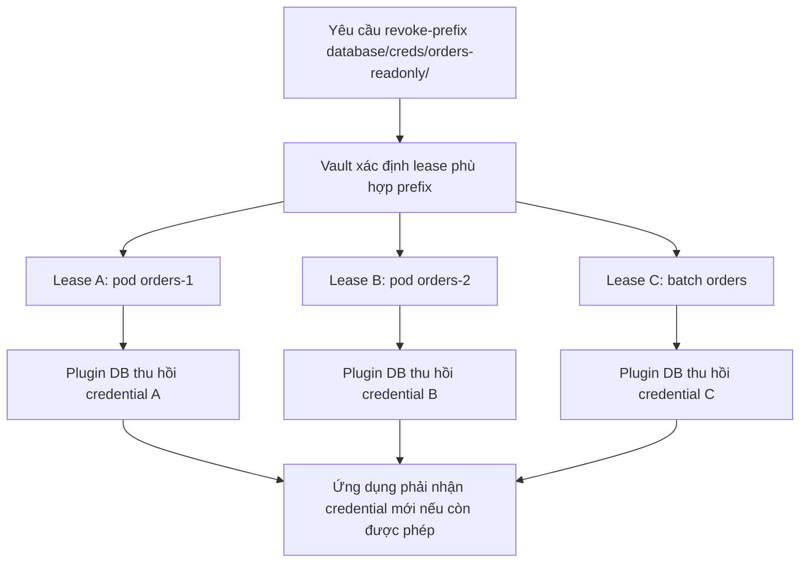

# Các API lease và tác động thu hồi theo đường dẫn

## 1. Vì sao lease là một phần của API hệ thống?

Trong một hệ thống Java sử dụng **Spring Vault** để gọi **HashiCorp Vault** qua `VaultTemplate` hoặc `VaultOperations`, thông tin đăng nhập động của database, cloud hoặc các secrets engine khác có thể tồn tại trong thời gian ngắn. Khi trả thông tin đăng nhập động, Vault thường kèm **lease** để mô tả thời hạn sử dụng và khả năng gia hạn. Khi lease hết hạn hoặc bị thu hồi, Vault thực hiện cơ chế thu hồi tương ứng của backend, chẳng hạn xóa/vô hiệu hóa tài khoản database đã cấp.

Thu hồi **một lease** thường tác động tới một credential; thu hồi **theo đường dẫn (prefix)** có thể tác động đến nhiều credential, nhiều ứng dụng đang sử dụng chúng hoặc cả token liên quan. Do đó, nhóm endpoint `sys/leases` trong chương **API hệ thống** cần được hiểu cả về **cú pháp API, phạm vi ảnh hưởng và an toàn vận hành**.

Bài học thuộc module **SPRING_VAULT**, kết nối việc quản lý lease với xác thực theo workload, Vault ACL, vòng đời token, KV secrets, Transit, PKI, xử lý lỗi, giám sát và kiểm thử tích hợp. Nội dung dành cho cả lập trình viên cần quản lý lease đơn lẻ và người vận hành chịu trách nhiệm các tác vụ thu hồi diện rộng.

Sau bài này, bạn có thể:

- Nhận biết `lease_id`, `lease_duration`, `renewable`, thời hạn và trạng thái của dynamic secret.
- Dùng `sys/leases/lookup`, `sys/leases/renew`, `sys/leases/revoke` để kiểm tra, gia hạn và thu hồi đúng một lease.
- Phân biệt **liệt kê lease theo prefix**, **revoke-prefix** và **revoke-force**.
- Xác định phạm vi thu hồi qua prefix của `lease_id`, phân tích tác động lên hệ thống đích và ứng dụng Java.
- Tách quyền vận hành và quyền workload trong Vault policy; xây dựng runbook kiểm tra và kiểm thử khôi phục.

## 2. Cơ chế lease và đường dẫn phát hành

Một phản hồi dynamic secret có thể có cấu trúc như sau (dữ liệu minh họa):

```json
{
  "lease_id": "database/creds/orders-readonly/Xh6mExampleLeaseId",
  "lease_duration": 3600,
  "renewable": true,
  "data": {
    "username": "v-orders-readonly-example",
    "password": "<SECRET_FROM_VAULT>"
  }
}
```

**Lease ID** là định danh được Vault cấp để quản lý secret động. Phần đầu của lease ID thường phản ánh **đường dẫn nơi secret được yêu cầu**; trong ví dụ là `database/creds/orders-readonly/`. Phần cuối định danh lease riêng biệt. Điều này khiến prefix vừa hữu ích để tìm một nhóm lease vừa tiềm ẩn nguy cơ thu hồi quá rộng.

| Trường/khái niệm | Ý nghĩa | Lưu ý khi triển khai |
| --- | --- | --- |
| `lease_id` | Định danh dùng cho lookup, renew và revoke một lease. | Giữ nguyên chính xác; không tự tạo hoặc tách lấy chỉ phần cuối để gửi API. |
| `lease_duration` | Thời gian sống mà Vault trả về, thường tính bằng giây. | Là thời hạn của lần phát hành/gia hạn hiện tại, không phải bảo đảm tồn tại vô hạn. |
| `renewable` | Có thể yêu cầu gia hạn lease hay không. | `true` vẫn chịu giới hạn TTL, chính sách và khả năng của secrets engine. |
| `ttl` từ lookup | Thời gian còn lại tại thời điểm kiểm tra. | Giảm dần; không mặc định bằng `lease_duration` ban đầu. |
| `issue_time`, `expire_time` | Thời điểm tạo và hết hạn trong metadata lease. | Hữu ích cho lập lịch, điều tra và kiểm tra đồng hồ. |
| Prefix | Tiền tố chuỗi trong lease ID hoặc đường dẫn cấp phát liên quan. | Một prefix rộng có thể bao gồm nhiều role, ứng dụng và môi trường. |

**Không phải tất cả secret đều có lease có thể thu hồi:** KV lưu dữ liệu tĩnh không tạo dynamic lease chỉ vì phản hồi có trường thời lượng. Với token đăng nhập, sử dụng các endpoint quản lý token phù hợp, chẳng hạn `auth/token/renew-self`, `auth/token/revoke-self` hoặc API token quản trị. Endpoint `sys/leases/renew` dành cho **secret lease**, không dùng để gia hạn auth token.

### 2.1. Minh họa phạm vi theo đường dẫn

Giả sử Vault có các lease:

```text
database/creds/orders-readonly/lease-A
database/creds/orders-readonly/lease-B
database/creds/orders-readwrite/lease-C
database/creds/payments-readonly/lease-D
aws/creds/exports/lease-E
```

Các cấp độ thu hồi:

| Phạm vi mục tiêu | Ví dụ | Các lease minh họa bị ảnh hưởng |
| --- | --- | --- |
| **Một lease** | `database/creds/orders-readonly/lease-A` | Chỉ `lease-A`. |
| **Prefix một role** | `database/creds/orders-readonly/` | `lease-A`, `lease-B`. |
| **Prefix nhiều role** | `database/creds/orders-` | `lease-A`, `lease-B`, `lease-C`. |
| **Prefix toàn nhóm credential** | `database/creds/` | `lease-A`, `lease-B`, `lease-C`, `lease-D`. |
| **Prefix mount rộng hơn** | `database/` | Có thể ảnh hưởng mọi lease tương ứng bên dưới mount `database`. |

Bảng chỉ minh họa cách **khớp prefix**; trong thực tế phạm vi chịu ảnh hưởng còn phụ thuộc namespace, mount, backend và các token có path tương ứng. **Không dùng `startsWith` mơ hồ để tự sinh một lệnh revoke-prefix trong ứng dụng.** Prefix cần được phê duyệt độc lập, xác minh và giới hạn đầy đủ đến role/môi trường mong muốn.

## 3. Tổng quan các endpoint `sys/leases`

| Tác vụ | HTTP method và endpoint | Đối tượng / ảnh hưởng |
| --- | --- | --- |
| Đọc metadata một lease | `POST /v1/sys/leases/lookup` | Trả trạng thái lease theo `lease_id`; không thay đổi lease. |
| Liệt kê lease theo đường dẫn | `LIST /v1/sys/leases/lookup/:prefix` | Liệt kê phần tử dưới prefix; **yêu cầu `sudo`**. |
| Gia hạn một lease | `POST /v1/sys/leases/renew` | Yêu cầu kéo dài thời hạn một lease còn hợp lệ, có thể gia hạn. |
| Thu hồi một lease | `POST /v1/sys/leases/revoke` | Thu hồi lease theo `lease_id` và kích hoạt cleanup của engine. |
| Thu hồi cả prefix | `POST /v1/sys/leases/revoke-prefix/:prefix` | Thu hồi mọi lease/đối tượng phù hợp prefix; **yêu cầu `sudo`**. |
| Thu hồi ép buộc | `POST /v1/sys/leases/revoke-force/:prefix` | Bỏ qua lỗi thu hồi từ backend, chỉ dùng khi xử lý sự cố; **yêu cầu `sudo`**. |

Đối với API HTTP, có thể thấy thao tác `POST`; Vault CLI đôi khi dùng `vault write` (yêu cầu cập nhật), hoặc các lệnh riêng `vault lease lookup/renew/revoke`. Không suy từ chữ “read/lookup” trong tên API rằng có thể dùng HTTP `GET` cho endpoint `sys/leases/lookup`.

### 3.1. Lease lookup

Request:

```http
POST /v1/sys/leases/lookup
Content-Type: application/json
X-Vault-Token: <AUTHORIZED_TOKEN>

{
  "lease_id": "database/creds/orders-readonly/lease-A"
}
```

Ví dụ phần `data` của phản hồi Vault (rút gọn):

```json
{
  "data": {
    "id": "database/creds/orders-readonly/lease-A",
    "issue_time": "2026-11-25T07:00:00Z",
    "expire_time": "2026-11-25T08:00:00Z",
    "renewable": true,
    "ttl": 3300
  }
}
```

`lookup` **không tự gia hạn** và không làm thời hạn của secret dài thêm. Dù API trả metadata, danh tính gọi vẫn cần policy cho phép; không cấp quyền đọc/tra cứu lease hàng loạt cho mọi workload. Các trường/kiểu dữ liệu cụ thể có thể thay đổi theo phiên bản Vault và backend.

### 3.2. Renew: `increment` là yêu cầu, không phải phép cộng thời gian

```http
POST /v1/sys/leases/renew
Content-Type: application/json
X-Vault-Token: <AUTHORIZED_TOKEN>

{
  "lease_id": "database/creds/orders-readonly/lease-A",
  "increment": 1800
}
```

`increment=1800` là đề nghị để TTL mới khoảng **1.800 giây tính từ lúc gia hạn**, không phải cộng thêm 1.800 giây vào `expire_time` cũ. Backend có thể điều chỉnh giá trị này theo TTL tối đa, quy tắc role và khả năng renew; ứng dụng phải đọc `lease_duration`/trạng thái sau gia hạn thay vì giả định request thành công có nghĩa TTL chính xác bằng giá trị gửi đi.

### 3.3. Revoke: một lease và `sync`

```http
POST /v1/sys/leases/revoke
Content-Type: application/json
X-Vault-Token: <AUTHORIZED_TOKEN>

{
  "lease_id": "database/creds/orders-readonly/lease-A",
  "sync": true
}
```

Thu hồi lease có nghĩa Vault yêu cầu backend vô hiệu hóa secret tương ứng, chẳng hạn chạy lệnh revoke/drop user với plugin database. `sync=true` yêu cầu Vault xử lý và chỉ phản hồi khi hoàn tất hoặc báo lỗi; **mặc định revoke có thể được đưa vào hàng đợi**. Vì thế, kết quả HTTP thành công khi dùng cơ chế mặc định chưa chắc chứng minh hệ thống đích đã dọn credential ngay tại thời điểm nhận phản hồi.

## 4. Thực hành CLI: quan sát lease trước khi thu hồi

Giả định môi trường lab có secrets engine database tại `database/`, role `orders-readonly` tồn tại và kết nối đến database thử nghiệm đã cấu hình. Các ví dụ dưới đây **không chứa credential thật** và không nhằm chạy trên môi trường production.

### 4.1. Nhận credential động và lưu lease ID

```bash
# Danh tính workload được cấp quyền đọc role database.
vault read database/creds/orders-readonly
```

Phản hồi có `lease_id`, `lease_duration`, `lease_renewable` và dữ liệu `username`/`password`. Khi thao tác tiếp, dùng **lease ID thực được Vault trả về**; các giá trị như `lease-A` trong bài chỉ để minh họa.

```bash
# Ví dụ: LEASE_ID được nhận qua kênh bảo mật, không in credential.
vault lease lookup "$LEASE_ID"
vault lease renew -increment=900 "$LEASE_ID"
vault lease lookup "$LEASE_ID"
```

Sau renew, đọc lại `ttl` và `renewable` để xác nhận giá trị thực. Một lease `renewable=false` không được xử lý như thể luôn có thể gia hạn; ứng dụng phải lập kế hoạch yêu cầu credential mới và chuyển kết nối sang credential mới trước khi bản cũ không còn hiệu lực.

### 4.2. Thu hồi riêng một credential

```bash
# Chỉ thử với lease sinh bởi môi trường test.
vault lease revoke "$LEASE_ID"
```

Nếu credential chưa hết hạn, sau thu hồi Vault sẽ yêu cầu backend hủy hiệu lực. Với database engine, quá trình này thường liên quan đến thu hồi/xóa user hoặc quyền tương ứng. **Kết nối đang mở** có thể có hành vi khác nhau tùy DBMS, quyền, phiên làm việc và cấu hình plugin; không giả định mọi connection lập tức bị cắt ngay. Hãy kiểm thử ở DBMS thực tế.

### 4.3. Liệt kê lease trong một role (quyền vận hành)

```bash
# Chỉ dùng identity vận hành có quyền LIST và sudo phù hợp.
vault list sys/leases/lookup/database/creds/orders-readonly/
```

Lệnh trả các **phần tên nằm dưới prefix**, không tự trả đầy đủ user/password. Từ kết quả, người vận hành có thể đối chiếu lease ID cần điều tra, thời điểm cấp và danh tính hệ thống đích. Việc gọi `LIST` ở đây không thu hồi lease.

**Không trao quyền liệt kê và revoke-prefix cho application token** chỉ để ứng dụng quản lý credential của chính nó. Spring Vault có cơ chế quản lý vòng đời secret phù hợp hơn cho workload thông thường.

## 5. Thu hồi theo prefix: một thao tác có phạm vi lớn

Khi cần thu hồi tất cả credentials đã phát hành bởi role `orders-readonly` (chẳng hạn do lộ quyền truy cập), quản trị viên có thể gọi:

```bash
# Ví dụ LAB: thu hồi toàn bộ lease dưới role đã chọn.
vault lease revoke -prefix database/creds/orders-readonly/
```

Hoặc gọi API HTTP:

```http
POST /v1/sys/leases/revoke-prefix/database/creds/orders-readonly/
X-Vault-Token: <ADMIN_OPERATOR_TOKEN>
Content-Type: application/json

{
  "sync": true
}
```

**Tác động:** tất cả secret có lease ID khớp prefix bị đưa vào phạm vi thu hồi. Với tiền tố lớn hơn, có thể ảnh hưởng **nhiều role và nhiều workload**; API cũng có thể thu hồi token dựa trên thuộc tính đường dẫn phát hành token theo quy tắc Vault. Những lời gọi đọc secret khác có thể tiếp tục cấp credential mới nếu role và quyền đọc vẫn còn hiệu lực. Revoke-prefix không mặc nhiên ngăn một ứng dụng xin lại credential ngay lập tức.



### 5.1. Tác động tới các hệ thống đang chạy

| Thành phần | Điều có thể xảy ra sau revoke-prefix | Hành động chuẩn bị |
| --- | --- | --- |
| **Database** | Các tài khoản/credential động bị xóa hoặc vô hiệu hóa bởi revocation statements. | Xác minh plugin/SQL revoke, rà soát connection pool và session hiện có. |
| **Microservice Java** | Kết nối mới thất bại khi sử dụng credential cũ; một số kết nối sẵn có vẫn tồn tại tạm thời. | Thiết kế cơ chế đổi credential, cấu hình pool và retry có kiểm soát. |
| **Batch/job** | Job đang chạy có thể lỗi giữa chừng nếu cần tạo kết nối mới. | Lập kế hoạch dừng, retry an toàn và khả năng thực hiện lại. |
| **Cloud credentials** | Key/token động bị thu hồi phía provider, tùy cơ chế plugin và độ trễ. | Rà soát thời gian hiệu lực ở provider, tránh giả định đồng bộ tức thì. |
| **Vault token** | Có thể bị tác động nếu prefix khớp đường dẫn tạo token; khi token cha bị revoke, cây token liên quan cũng có thể chịu ảnh hưởng. | Xác định rõ liệu mục tiêu là secret lease hay auth/session token. |
| **Giám sát/audit** | Có thể tăng 401/403, lỗi kết nối hoặc số lần cấp lại secret. | Theo dõi ngay sau lệnh và đối chiếu cả Vault lẫn backend. |

### 5.2. Những nhầm lẫn phổ biến về path

- `database/creds/orders-readonly/` là **prefix lease ID do endpoint cấp secret sinh ra**, không phải tên user database hay một thư mục vật lý.
- `database/creds/` rộng hơn một role; nó có thể thu hồi cả credential của ứng dụng khác sử dụng chung engine.
- `database/` rộng hơn nữa và có thể chạm đến nhiều tập lease của mount.
- `sys/leases/lookup/database/creds/orders-readonly/` là **đường dẫn để liệt kê**, không phải prefix cần truyền nguyên vẹn vào `revoke-prefix`.
- Việc sửa/xóa Vault policy hoặc ngắt quyền đọc role **không đồng nghĩa** với vô hiệu hóa ngay toàn bộ dynamic credentials đã được cấp. Khi có sự cố, phải chọn đúng thao tác ngăn phát hành mới và/hoặc thu hồi credential đã phát hành.

Người vận hành phải dùng prefix **được kiểm tra và cho phép theo runbook**, bảo đảm không nhầm mount, namespace hoặc môi trường production/staging. Trong hệ thống có namespace, endpoint cùng đường dẫn văn bản có thể thuộc các namespace khác nhau; xác thực cả Vault namespace trước thao tác.

## 6. Revoke-prefix khác gì revoke-force?

Hai endpoint có tên gần nhau nhưng hậu quả rất khác:

| Khía cạnh | `revoke-prefix` | `revoke-force` |
| --- | --- | --- |
| Mục tiêu | Thu hồi các secret/token có path phù hợp. | Cố gắng thu hồi cùng phạm vi prefix trong tình huống lỗi backend. |
| Xử lý lỗi backend | Ghi nhận và trả lỗi; lease thất bại có thể được giữ lại để tiếp tục xử lý. | **Bỏ qua lỗi thu hồi backend** và có thể xóa thông tin lease khỏi Vault. |
| Bảo đảm đã dọn credential tại hệ thống đích | Phải kiểm tra backend, nhất là khi xử lý theo hàng đợi. | **Không bảo đảm**: credential có thể vẫn hoạt động nếu backend từ chối/không liên lạc được. |
| Quyền | Cần `sudo` ở endpoint prefix. | Cần `sudo`; nên cấp cho ít người/danh tính khẩn cấp hơn. |
| Tình huống phù hợp | Thu hồi cả nhóm credential khi engine hoạt động bình thường. | Phục hồi sự cố khi không thể thu hồi đúng cách và đã có biện pháp xử lý thủ công tại backend. |

Ví dụ lệnh force (chỉ để **nhận diện**, không chạy trong quy trình ứng dụng thông thường):

```bash
# Ví dụ quản trị khẩn cấp; không thực thi tùy tiện.
vault lease revoke -force -prefix database/creds/orders-readonly/
```

Tại sao nguy hiểm? Giả sử Vault không kết nối được tới database để chạy lệnh `DROP ROLE`. Khi dùng force, Vault có thể **quên lease** trong khi user DB vẫn tồn tại và tiếp tục sử dụng được. Do đó, force không phải cách “thu hồi mạnh hơn” đối với credential tại DB. Nó chủ yếu là cách xử lý trạng thái lease bị lỗi/không thể revoke theo cơ chế thông thường; người vận hành phải xác minh hoặc thu hồi thủ công credential ở provider/DB.

**Không tự động fallback từ `revoke-prefix` sang `revoke-force` khi gặp timeout hay HTTP 500.** Lỗi revoke cần điều tra tình trạng backend và sử dụng cơ chế khôi phục phù hợp. Nếu xuất hiện *irrevocable leases*, tham khảo hướng dẫn xử lý của Vault và kiểm tra việc thu hồi ở hệ thống đích.

### 6.1. `sync` ảnh hưởng gì?

Với `sys/leases/revoke` và `sys/leases/revoke-prefix`, request có thể đặt `sync=true` để Vault xử lý đồng bộ và chờ kết quả; mặc định lệnh có thể đưa revocation vào hàng đợi. Ngay cả khi gọi đồng bộ thành công, vẫn cần quan sát **tình trạng thực tế của backend** và các kết nối ứng dụng. Không hiểu `sync=true` là cơ chế giao dịch phân tán bảo đảm mọi phiên kết nối bên ngoài đã đóng.

## 7. Phân quyền theo nguyên tắc tối thiểu

Một token ứng dụng chỉ cần đọc credential động và sử dụng cơ chế gia hạn được cho phép; một token người vận hành mới cần quyền liệt kê, thu hồi theo prefix. Không gộp các quyền này vào một policy rộng dùng chung cho mọi deployment.

Ví dụ minh họa policy **đọc credential động**:

```hcl
path "database/creds/orders-readonly" {
  capabilities = ["read"]
}
```

Nếu nghiệp vụ cần ứng dụng quản lý lease đơn lẻ qua system API, có thể cấp quyền tương ứng một cách có kiểm soát; **đánh giá phạm vi vì endpoint nhận `lease_id` động trong body**:

```hcl
# Ví dụ tham khảo cho danh tính chuyên quản lý lease,
# không áp dụng đại trà cho workload.
path "sys/leases/lookup" {
  capabilities = ["update"]
}

path "sys/leases/renew" {
  capabilities = ["update"]
}

path "sys/leases/revoke" {
  capabilities = ["update"]
}
```

Policy dành cho **đội vận hành chuyên trách** cần được quản trị riêng. Các endpoint liệt kê/revoke theo prefix đòi hỏi `sudo` và quyền phù hợp; ví dụ policy cho đúng nhánh role trong lab:

```hcl
# Chỉ dành cho danh tính operator theo phạm vi đã thẩm định.
path "sys/leases/lookup/database/creds/orders-readonly/*" {
  capabilities = ["list", "sudo"]
}

path "sys/leases/revoke-prefix/database/creds/orders-readonly/*" {
  capabilities = ["update", "sudo"]
}
```

Với Vault ACL, cần kiểm tra chính xác cách policy khớp cả đường dẫn gốc có hoặc không có dấu `/` cuối và những biến thể prefix được phép. Không mặc định policy mẫu này đã đủ chặt để hạn chế mọi đường dẫn ngoài phạm vi trên mọi phiên bản Vault. **Không cấp `sys/leases/revoke-force/*` cho workload thường ngày.** Force phải có chính sách và quy trình phân quyền khẩn cấp riêng.

Quyền `sudo` trong Vault ACL là đặc quyền bổ sung cho các endpoint cần khả năng này; không nhầm nó với lệnh `sudo` của hệ điều hành. Việc cấp `update` đơn thuần cho endpoint yêu cầu `sudo` có thể không đủ.

## 8. Java với Spring Vault: lookup, renew, revoke một lease

Ví dụ dưới đây minh họa một ứng dụng Java dùng `VaultOperations` thông qua bean đã được cấu hình TLS, Vault auth theo workload và ACL phù hợp. Nó **chỉ quản lý lease ID một cách tường minh**; thao tác revoke-prefix để riêng cho công cụ vận hành nhằm giảm nguy cơ thu hồi nhiều workload.

```java
import java.util.Map;

import org.springframework.stereotype.Service;
import org.springframework.vault.core.VaultOperations;
import org.springframework.vault.support.VaultResponse;

@Service
public class SingleLeaseAdminService {

    private static final String ROLE_LEASE_PREFIX =
            "database/creds/orders-readonly/";

    private final VaultOperations vault;

    public SingleLeaseAdminService(VaultOperations vault) {
        this.vault = vault;
    }

    public record LeaseMetadata(
            String id, long ttlSeconds, boolean renewable) {}

    public LeaseMetadata lookup(String leaseId) {
        requireExpectedLeaseId(leaseId);

        VaultResponse response = vault.write(
                "sys/leases/lookup",
                Map.of("lease_id", leaseId));

        Map<String, Object> data = requiredData(response);
        String id = requiredString(data, "id");
        long ttl = requiredLong(data, "ttl");
        Object renewableValue = data.get("renewable");
        if (!leaseId.equals(id)
                || !(renewableValue instanceof Boolean renewable)) {
            throw new IllegalStateException(
                    "Vault returned inconsistent lease metadata");
        }
        return new LeaseMetadata(id, ttl, (Boolean) renewableValue);
    }

    public VaultResponse renew(String leaseId, long incrementSeconds) {
        requireExpectedLeaseId(leaseId);
        if (incrementSeconds <= 0 || incrementSeconds > 3600) {
            throw new IllegalArgumentException("Invalid renewal increment");
        }

        VaultResponse response = vault.write(
                "sys/leases/renew",
                Map.of("lease_id", leaseId,
                       "increment", incrementSeconds));

        if (response == null) {
            throw new IllegalStateException("Vault returned no renew response");
        }
        // Đọc lease_duration và renewable thực tế của response,
        // hoặc lookup lại để lên lịch tiếp theo.
        return response;
    }

    public void revokeOne(String leaseId) {
        requireExpectedLeaseId(leaseId);

        // sync=true để yêu cầu chờ kết quả revoke từ Vault.
        vault.write("sys/leases/revoke",
                Map.of("lease_id", leaseId, "sync", true));
    }

    private static void requireExpectedLeaseId(String leaseId) {
        if (leaseId == null
                || !leaseId.startsWith(ROLE_LEASE_PREFIX)
                || leaseId.length() <= ROLE_LEASE_PREFIX.length()) {
            throw new IllegalArgumentException(
                    "Lease ID is outside expected role prefix");
        }
    }

    private static Map<String, Object> requiredData(VaultResponse response) {
        if (response == null || response.getData() == null) {
            throw new IllegalStateException("Vault returned no lease data");
        }
        return response.getData();
    }

    private static String requiredString(
            Map<String, Object> data, String field) {
        Object raw = data.get(field);
        if (!(raw instanceof String text) || text.isBlank()) {
            throw new IllegalStateException(
                    "Vault response missing " + field);
        }
        return text;
    }

    private static long requiredLong(
            Map<String, Object> data, String field) {
        Object raw = data.get(field);
        if (raw instanceof Number number) {
            return number.longValue();
        }
        throw new IllegalStateException(
                "Vault response missing numeric " + field);
    }
}
```

Code dùng Java 17+ để minh họa `record` và pattern matching của `instanceof`. Cần chú ý:

- `VaultOperations.write(...)` gửi request đến endpoint cập nhật của system backend; kết quả response có thể khác nhau giữa lookup/renew/revoke.
- `requiredData` chỉ áp dụng cho **lookup**; revoke thành công có thể không có trường `data`, nên không được dùng cùng một validator.
- `ROLE_LEASE_PREFIX` là phòng vệ bổ sung trong ứng dụng, **không thay thế policy Vault**. Với endpoint `sys/leases/revoke`, ACL trên path hệ thống không tự biểu diễn đầy đủ ràng buộc theo `lease_id` nằm trong request body.
- Không ghi `lease_id` hay credential vào log nếu quy trình bảo mật không cho phép. Lease ID là định danh nhạy cảm về vận hành và có thể tiết lộ tên mount, role hoặc môi trường.
- `renew` phải xử lý ngoại lệ khi lease hết hạn, không renewable, thiếu quyền hoặc backend lỗi; không trả lại credential đã hết hạn như thể nó vẫn hợp lệ.
- Nếu cần danh sách lease, Spring Vault có API `VaultOperations.list("sys/leases/lookup/<prefix>")`, nhưng endpoint **cần `sudo`** và nên nằm ở công cụ operator riêng.

### 8.1. Lấy `lease_id` từ secret phát hành ban đầu

```java
VaultResponse secret = vaultOperations.read(
        "database/creds/orders-readonly");

if (secret == null || secret.getLeaseId() == null
        || secret.getLeaseId().isBlank()) {
    throw new IllegalStateException("Dynamic secret has no lease ID");
}

String leaseId = secret.getLeaseId();
boolean renewable = secret.isRenewable();
// Sử dụng leaseId để theo dõi; không in secret.getData() vào log.
```

Mỗi lần gọi endpoint dynamic credentials có thể sinh **credential và lease mới**. Vì vậy không gọi `vaultOperations.read` chỉ để “lookup lease hiện có”; hãy dùng `sys/leases/lookup` với lease ID đã nhận.

## 9. Spring Vault: quản lý lease tự động với SecretLeaseContainer

Phần lớn ứng dụng Java không cần tự viết lịch `lookup`/`renew` theo từng giây. Spring Vault cung cấp **`SecretLeaseContainer`** giúp yêu cầu và theo dõi dynamic secrets, gia hạn lease phù hợp và phát ra các sự kiện vòng đời.

Ý tưởng dùng container:

```java
// Ví dụ ý tưởng, giả sử bean SecretLeaseContainer đã được
// Spring cấu hình vòng đời, TaskScheduler và VaultOperations.

secretLeaseContainer.requestRenewableSecret(
        "database/creds/orders-readonly");

// Hoặc dùng mode xoay credential để yêu cầu secret mới
// khi lease không thể gia hạn / đến ngưỡng hết hạn.
secretLeaseContainer.requestRotatingSecret(
        "database/creds/orders-readonly");
```

**Ý nghĩa hai mode:**

- **Renewable:** Container cố gắng gia hạn lease khi đủ điều kiện, nhưng cuối cùng lease vẫn có thể hết hạn.
- **Rotating:** Container theo dõi vòng đời và yêu cầu secret mới khi cần xoay credential; ứng dụng phải thực sự nhận sự kiện và thay thông tin trong connection pool, không giả định credential tự đổi ở mọi datasource chỉ vì container chạy.

Có thể cấu hình ngưỡng trước hạn, mức tối thiểu trước khi renew và listener để quan sát `SecretLeaseCreatedEvent`, `SecretLeaseRenewedEvent`, `SecretLeaseExpiredEvent` hoặc lỗi tương ứng. **Vault không đẩy sự kiện chủ động tới JVM**; container tính lịch từ TTL và đồng hồ, vì vậy ứng dụng vẫn cần xử lý mất mạng, JVM restart, token hết hạn, lease bị operator thu hồi ngoài luồng.

Dùng `SessionManager`/cơ chế xác thực tương ứng cho **workload token**. Vòng đời của Vault client token và dynamic secret lease có quan hệ nhưng không đồng nhất; một token session bị revoke có thể kéo theo việc thu hồi các secret leases đã tạo dưới token đó.

**Phân định trách nhiệm:** Code chạy trong JVM xử lý lease của ứng dụng; người vận hành dùng system API và quyền `sudo` khi phải thu hồi cả cây lease theo prefix trong sự cố.

## 10. Runbook thu hồi theo đường dẫn một cách an toàn

Với môi trường có nhiều dịch vụ cùng dùng Vault, thu hồi prefix là hành động vận hành có thể gây gián đoạn. Một quy trình đủ thông tin cần xác nhận tác động trước và sau thao tác:

1. **Xác định mục tiêu:** incident ID, dịch vụ/role bị ảnh hưởng, Vault cluster, namespace và mount chính xác.
2. **Khoanh phạm vi:** xác định prefix lease ID đầy đủ, ví dụ `database/creds/orders-readonly/`; kiểm tra prefix không chồng sang role tương tự.
3. **Điều tra trước:** dùng quyền operator `LIST sys/leases/lookup/:prefix`, lấy thông tin những lease liên quan và đối chiếu hệ thống đích.
4. **Lập kế hoạch khôi phục:** xác định ứng dụng, connection pool, job đang chạy và nguồn cấp credential thay thế; phối hợp với chủ sở hữu dịch vụ.
5. **Ngăn phát hành không mong muốn khi cần:** điều chỉnh policy/role hoặc đóng đường cấp theo runbook nếu sự cố yêu cầu; kiểm tra quyền trước khi thao tác.
6. **Thu hồi đúng phạm vi:** ưu tiên thu hồi từng lease khi đủ; dùng `revoke-prefix` nếu thực sự cần cả nhóm, `sync=true` nếu cần chờ kết quả.
7. **Xác minh sau:** kiểm tra lại danh sách lease, kết quả revoke, trạng thái user/credential tại backend và lỗi kết nối ở các ứng dụng.
8. **Khôi phục và giám sát:** cấp mới credential hợp lệ, cập nhật pool, quan sát lỗi/độ trễ, xử lý lease bất khả thu hồi nếu có.
9. **Báo cáo:** ghi rõ prefix, số lease ảnh hưởng, danh tính operator, thời điểm, kết quả Vault và xác minh tại backend; lọc bỏ dữ liệu nhạy cảm.

Không cung cấp một chức năng gọi `revoke-prefix` trực tiếp cho người dùng cuối qua endpoint API của microservice. Nếu phải tự động hóa trong hệ thống vận hành, dùng danh tính giới hạn và cơ chế phê duyệt/kiểm soát tương ứng với mức tác động.

## 11. Lỗi thường gặp và cách xử lý

| Hiện tượng | Ý nghĩa có thể | Xử lý phù hợp |
| --- | --- | --- |
| `lookup` trả 404/lease không tìm thấy | Lease đã hết hạn, đã revoke hoặc sai ID. | Không tiếp tục dùng credential cũ; yêu cầu secret mới khi được phép. |
| `renew` bị từ chối | Lease không `renewable`, vượt TTL tối đa, token thiếu quyền hoặc backend lỗi. | Xem `renewable`, TTL và quyền; dùng chiến lược rotate thay vì retry mãi. |
| `revoke` trả thành công nhưng DB user còn tồn tại tạm thời | Revoke bất đồng bộ, backend chậm hoặc kết nối hiện tại còn sống. | Kiểm tra job revoke, dùng sync khi phù hợp, xác minh trực tiếp DB. |
| `revoke-prefix` trả 403 | Chưa có quyền `sudo` hoặc scope policy không phù hợp. | Dùng danh tính operator đã được cấp đúng quyền; không nâng quyền của workload thường ngày. |
| `revoke-prefix` ảnh hưởng nhiều ứng dụng | Prefix quá rộng hoặc nhiều role cùng chung mount. | Khôi phục credential cho các ứng dụng bị ảnh hưởng, sửa runbook và giới hạn quyền. |
| Revoke lỗi do backend unreachable | Vault không thể dọn user/key tại backend. | Kiểm tra kết nối/config plugin, xử lý lỗi backend, tránh tự force. |
| `revoke-force` thành công nhưng provider credential vẫn hoạt động | Vault bỏ qua lỗi và quên lease dù tài nguyên chưa bị xóa. | Thu hồi thủ công ở provider, audit và đối chiếu dữ liệu còn sót. |
| Lease liên tục bị cấp mới sau revoke-prefix | Role và quyền đọc dynamic credential vẫn hoạt động. | Xem lại cơ chế phát hành mới, giải quyết nguyên nhân sự cố. |
| Hàng loạt ứng dụng lỗi sau token revoke | Secret lease gắn với session token có thể bị thu hồi theo. | Quan sát vòng đời session/token và khởi tạo lại dynamic credentials an toàn. |

Khi xử lý retry, phân biệt `429`/timeout/`5xx` với `400`/`403` hoặc lease đã hết hạn. Với `revoke`/`revoke-prefix`, một timeout có thể xảy ra **sau khi server đã nhận thao tác**, nên tuyệt đối không coi việc thử lại hàng loạt như thao tác không có tác dụng phụ. Theo dõi trạng thái thực tế trước khi quyết định bước tiếp.

## 12. Kiểm thử tích hợp và bài tập

Dùng Vault thử nghiệm cùng database giả lập/instance test mà secrets engine có quyền tạo và revoke user. Không nên kiểm thử tác động thu hồi diện rộng với Vault production.

Các ca kiểm thử cần có:

1. **Lease thực:** đọc `database/creds/orders-readonly`, nhận `lease_id` không rỗng, TTL và `renewable` đúng cấu hình.
2. **Lookup:** gọi `sys/leases/lookup` với ID thực, nhận cùng ID và metadata thời hạn; không tạo credential mới.
3. **Renew:** gia hạn lease renewable, kiểm tra `lease_duration` thực tế thay vì so với TTL cộng dồn.
4. **Revoke đơn:** thu hồi một lease, xác minh DB user/key tương ứng đã bị xóa hoặc vô hiệu hóa; lease khác vẫn tồn tại.
5. **Liệt kê prefix:** operator có `sudo` liệt kê những lease dưới `database/creds/orders-readonly/` mà không làm đổi số lượng.
6. **Revoke-prefix:** tạo hai lease cùng role và một lease khác role; thu hồi prefix role đầu, xác minh chỉ các lease đúng phạm vi bị ảnh hưởng.
7. **Prefix quá rộng:** ở lab, chứng minh `database/creds/` có phạm vi lớn hơn; test không tự kích hoạt lệnh rộng trong ứng dụng.
8. **Thiếu `sudo`:** workload token bị từ chối khi `LIST` hoặc `revoke-prefix` dù được đọc credential.
9. **Backend lỗi:** mô phỏng DB tạm không kết nối được để quan sát lỗi thu hồi; không tự chạy force trong test mặc định.
10. **Lease hết hạn:** xác minh ứng dụng không tiếp tục dùng credential quá hạn, listener/rotation hoạt động theo cấu hình.
11. **Session revoke:** kiểm tra các lease phụ thuộc session token và hành vi ứng dụng sau khi xác thực lại.
12. **Lỗi schema/network:** mock phản hồi rỗng/sai kiểu của lookup, timeout và HTTP error; ứng dụng báo lỗi có phân loại.

**Bài tập kiến trúc:** Một hệ thống có `orders-api`, `orders-worker` và `payments-api` sử dụng chung mount `database/` nhưng mỗi dịch vụ có role riêng. Hãy thiết kế một bảng chứa `lease_id`, role, workload, TTL, owner và trạng thái; một runbook chỉ thu hồi lease của `orders-worker`; và một phương án chứng minh `payments-api` vẫn kết nối được sau khi thao tác. Trình bày rõ trường hợp thu hồi theo prefix không thể hoàn tất do database không sẵn sàng.

## 13. Checklist trước khi vận hành

- [ ] Phân biệt dynamic secret lease, client token lease và KV static secret.
- [ ] Lưu `lease_id` chính xác; đọc `renewable`, TTL và kết quả renew thực tế.
- [ ] Dùng `lookup`, `renew`, `revoke` cho lease đơn theo quyền đã được cấp.
- [ ] Xác định chính xác prefix và namespace trước khi dùng `LIST`/`revoke-prefix`.
- [ ] Tách ACL workload và operator; các endpoint prefix yêu cầu `sudo`.
- [ ] Hiểu thu hồi mặc định có thể xếp hàng, `sync=true` chờ xử lý nhưng vẫn cần xác minh backend.
- [ ] Không tự gọi `revoke-force` để bỏ qua lỗi; kiểm tra credential tồn tại ở hệ thống đích.
- [ ] Chuẩn bị kết nối thay thế, rotation, xử lý session/token và monitor sau thu hồi.
- [ ] Kiểm thử phạm vi ảnh hưởng với nhiều role và nhiều replica trước khi tự động hóa.

**Ghi nhớ:** `sys/leases` giúp xem, gia hạn và thu hồi vòng đời secret động; còn **thu hồi theo prefix** là thao tác vận hành tác động đến *cả một nhóm* credential/token phù hợp. An toàn phụ thuộc vào việc chọn prefix chính xác, giới hạn quyền `sudo`, phối hợp với hệ thống đích và xác minh kết quả thu hồi thay vì chỉ tin một HTTP response.

### Tài liệu tham khảo

- HashiCorp Vault — System Leases HTTP API: https://developer.hashicorp.com/vault/api-docs/system/leases
- HashiCorp Vault — Lease, renew and revoke: https://developer.hashicorp.com/vault/docs/concepts/lease
- HashiCorp Vault — CLI lease revoke: https://developer.hashicorp.com/vault/docs/commands/lease/revoke
- Spring Vault — Credentials Rotation: https://docs.spring.io/spring-vault/reference/vault/credential-rotation.html
