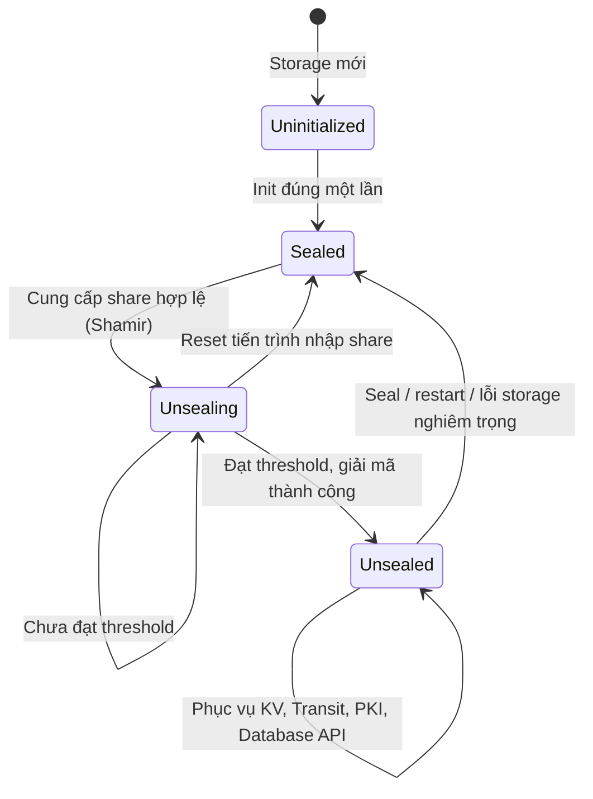
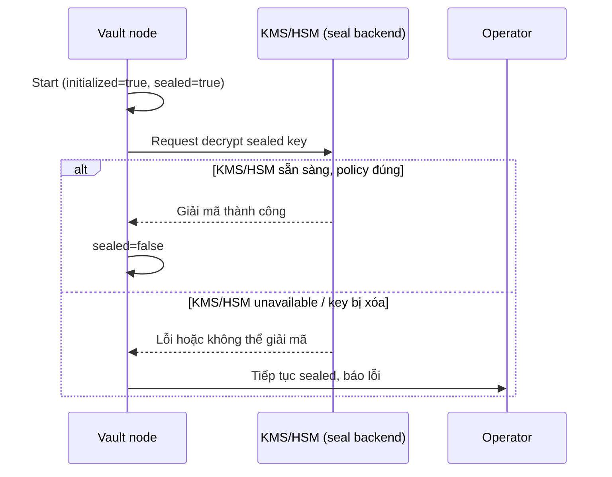

# Khởi tạo, seal và unseal Vault trong bài thực hành quản trị riêng

> **Chương:** API hệ thống  
> **Chủ đề:** Khởi tạo, seal, unseal trong bài thực hành quản trị riêng  
> **Bối cảnh:** Module **SPRING_VAULT** hướng dẫn ứng dụng Java dùng `VaultTemplate`, xác thực theo workload, chính sách phân quyền, KV secrets, token/lease, Transit và PKI. Bài này chuyển sang **vai trò người vận hành HashiCorp Vault**: nắm trạng thái máy chủ và các API hệ thống `/sys/init`, `/sys/seal-status`, `/sys/unseal`, `/sys/seal`. Đây là quy trình riêng của quản trị viên; ứng dụng Spring Vault bình thường chỉ tiêu thụ dịch vụ khi Vault sẵn sàng.

## 1. Kết quả cần đạt

Sau bài này, bạn có thể:

1. Phân biệt **chưa khởi tạo**, **đã khởi tạo nhưng sealed**, **đang unseal** và **unsealed**.
2. Giải thích vì sao Vault cần *initialization* một lần cho storage backend và cần *unseal* sau mỗi lần khởi động với Shamir seal.
3. Thực hành `vault operator init`, `vault operator unseal`, `vault operator seal` và quan sát chính xác state qua CLI/HTTP API.
4. Hiểu threshold/share của Shamir, sự khác biệt giữa **unseal key shares**, **recovery key shares** và **initial root token**.
5. Xác định quyền `sudo` trên `sys/seal`, giới hạn API quản trị khỏi token của Java workload và tránh đưa vật liệu khóa vào log.
6. Thiết kế kịch bản lab độc lập, kiểm thử lỗi, giám sát và đánh giá tác động của thao tác seal tới các dịch vụ dùng Spring Vault.

## 2. Vì sao Vault có trạng thái sealed?

Vault mã hóa dữ liệu trong storage bằng keyring. Keyring được bảo vệ bởi hệ thống khóa nhiều lớp; khi máy chủ mới khởi động, Vault chưa có đủ thông tin để mở khóa dữ liệu, nên ở trạng thái **sealed**. Ở trạng thái này các thao tác secret thông thường, xác thực ứng dụng và phần lớn API nghiệp vụ chưa hoạt động.



Trong cấu hình **auto-unseal**, có bước Vault gọi KMS/HSM hoặc cơ chế seal tin cậy để mở khóa tự động khi start; không cần thu thập các share Shamir mỗi lần máy chủ khởi động. *Initialization* và *unseal* là hai việc khác nhau:

- **Initialization:** chuẩn bị storage backend của **cluster Vault mới**, tạo khóa bảo vệ dữ liệu và thông tin khởi tạo; thực hiện **một lần** cho cùng storage/cluster.
- **Unseal:** làm cho **node đã initialized** có thể giải mã dữ liệu và phục vụ yêu cầu. Shamir seal yêu cầu một số key shares; auto-unseal dùng cơ chế seal bên ngoài.
- **Seal:** chủ động đưa node trở về sealed, loại bỏ vật liệu khóa dùng để mở dữ liệu khỏi bộ nhớ; gây gián đoạn tới workload phụ thuộc node.
- **Restart:** không xóa dữ liệu đã lưu trên storage bền vững, nhưng node dùng Shamir phải unseal lại; auto-unseal sẽ thử mở khóa bằng hệ thống KMS/HSM.

Một Vault server chạy được process và mở cổng TCP **không đồng nghĩa** Vault đã unsealed hoặc sẵn sàng phục vụ ứng dụng.

## 3. Phân biệt các trạng thái và mã phản hồi

| Trạng thái | `initialized` | `sealed` | Ý nghĩa với workload |
| --- | :---: | :---: | --- |
| Mới tạo storage | `false` | Thường `true` | Chưa thể bật KV/Auth/Transit; phải init |
| Đã init, chưa unseal | `true` | `true` | Chưa truy cập được secret và login thông thường |
| Đang nhập share, chưa đủ | `true` | `true` | `progress` tăng nhưng vẫn chưa phục vụ secret |
| Đã unseal thành công | `true` | `false` | Có thể phục vụ request, còn phụ thuộc HA/health/policy |
| Auto-unseal đang lỗi | `true` | `true` | Cần xử lý KMS/HSM hoặc cấu hình seal, không re-init |

Các endpoint chính:

| HTTP API (mặc định tiền tố `/v1/`) | HTTP method | Mục đích | Cần token Vault? |
| --- | --- | --- | --- |
| `sys/init` | `GET` | Kiểm tra đã khởi tạo chưa | Không |
| `sys/init` | `POST` | Khởi tạo storage Vault mới | Không; chỉ khi chưa init và trên root namespace |
| `sys/seal-status` | `GET` | Xem seal type, progress, threshold, trạng thái | Không |
| `sys/unseal` | `POST` | Nộp **một** share Shamir hoặc reset unseal progress | Không dùng ACL token; yêu cầu key share hợp lệ |
| `sys/seal` | `POST` | Đưa Vault đang mở về sealed | Token root hoặc token có quyền `sudo` trên path |
| `sys/health` | `GET` | Health/HA/standby trạng thái, HTTP status theo role | Thông thường không |

Các API init/unseal/seal thuộc phạm vi **root namespace** trong Vault Enterprise. Ở HA cluster dùng shared storage, **chỉ init một node cho storage backend chung**. Không init mỗi replica/pod riêng vì sẽ xung đột hoặc thất bại khi storage đã initialized.

### 3.1. Đọc seal status bằng CLI và HTTP

```bash
# VAULT_ADDR phải trỏ đúng Vault instance được phép kiểm tra.
vault status

# Endpoint không yêu cầu token:
curl --silent --show-error http://127.0.0.1:8200/v1/sys/init
curl --silent --show-error http://127.0.0.1:8200/v1/sys/seal-status
```

Ví dụ JSON của `sys/seal-status` sau init nhưng chưa unseal đủ share:

```json
{
  "type": "shamir",
  "initialized": true,
  "sealed": true,
  "n": 3,
  "t": 2,
  "progress": 1,
  "recovery_seal": false
}
```

Ý nghĩa: `n=3` là tổng số share, `t=2` là ngưỡng cần, `progress=1` nghĩa là đã nhập được một share cho lần unseal hiện tại; cần thêm share **khác** để hoàn tất. Sau khi unseal thành công, `sealed=false`, `progress` trở về `0`.

`vault status` có thể trả exit code khác `0` khi Vault sealed; đây là tín hiệu trạng thái cần phân loại chứ không đồng nghĩa CLI bị lỗi kết nối.

## 4. Vật liệu khóa và quyền: ba thứ không thể dùng thay nhau

| Thành phần | Có từ đâu? | Sử dụng đúng | Không được hiểu là |
| --- | --- | --- | --- |
| **Unseal key shares** (Shamir) | `vault operator init` khi dùng Shamir seal | Người giữ khóa nhập đủ `threshold` để unseal, hỗ trợ các thao tác quorum tương ứng | Vault token để truy cập KV hoặc đăng nhập |
| **Recovery key shares** (auto-unseal) | Init khi dùng auto-unseal | Quorum để cho phép một số thao tác khôi phục/rekey/generate-root | Phương án tự giải mã dữ liệu khi KMS/HSM hỏng |
| **Initial root token** | Init tạo ra khi cluster mới | Bootstrap cấu hình ACL, auth method, chính sách; sau đó thu hồi/giảm sử dụng | Unseal key, recovery key hoặc mật khẩu mặc định của Java app |

**Shamir Secret Sharing** chia bí mật thành nhiều phần. Ví dụ 3 shares, threshold 2: cần **hai share khác nhau** để unseal; nhập lặp một share không tạo thêm quyền. Thiết kế production phải phân phối shares cho các cá nhân/kênh cất giữ độc lập, tránh một người giữ toàn bộ.

Auto-unseal ủy thác khả năng giải mã khóa cho KMS/HSM; các recovery keys chỉ là **cơ chế xác thực quorum**. Nếu khóa KMS/HSM bị mất vĩnh viễn, recovery shares không tự thay thế được seal mechanism để đọc dữ liệu. Cần bảo vệ khóa và quyền truy cập seal backend như một phụ thuộc sống còn.

Cẩn thận với từ “root”: **root key trong kiến trúc mã hóa**, **initial root token** dùng ACL và **root namespace** của Vault là các khái niệm khác nhau.

## 5. Thiết lập lab quản trị độc lập

Bài này phải chạy trên **Vault instance mới dành riêng cho lab**, không dùng cluster production hay môi trường đang được các Java workload khác sử dụng. Khi gọi `seal`, mọi client phụ thuộc node bị seal có thể gặp lỗi. Dùng dữ liệu giả, backend cục bộ và kết nối loopback.

### 5.1. Vì sao không dùng `vault server -dev` để học init?

Vault `-dev` được thiết kế cho phát triển: server thường được tự init và tự unseal sẵn, có root token cho thử nghiệm, storage không bền vững. Vì vậy không phù hợp để thực hành **`init → unseal → seal → unseal`** giống vận hành thật.

Một lab Shamir đơn node có thể dùng **Integrated Storage (Raft)**. Ví dụ nội dung cấu hình `vault-lab.hcl` (đây là mẫu để người học tự chuẩn bị ở máy lab):

```hcl
ui = true
disable_mlock = true

storage "raft" {
  path = "/tmp/vault-system-api-lab/raft"
  node_id = "lab-node-1"
}

listener "tcp" {
  address = "127.0.0.1:8200"
  tls_disable = true  # CHỈ cho local lab qua loopback
}

api_addr = "http://127.0.0.1:8200"
cluster_addr = "http://127.0.0.1:8201"
```

Ví dụ trên dùng HTTP không mã hóa **chỉ tại `127.0.0.1` trong lab cô lập**. Production phải dùng listener HTTPS, xác thực chứng chỉ TLS và bảo vệ đường tới Vault. Không copy giá trị `tls_disable=true` sang môi trường chia sẻ.

Khởi động trên terminal riêng:

```bash
vault server -config=vault-lab.hcl
```

Trên terminal khác (ví dụ POSIX shell):

```bash
export VAULT_ADDR="http://127.0.0.1:8200"
vault status
```

Với Windows PowerShell, lệnh đặt biến môi trường tương đương là `$env:VAULT_ADDR = "http://127.0.0.1:8200"`. Ở lab mới, trạng thái kỳ vọng ban đầu là `Initialized: false`, `Sealed: true`.

**Điều kiện trước khi init:** xác minh đúng instance, đúng storage mới và chưa có workload phụ thuộc. Nếu `initialized=true`, dừng bước init và **không xóa thư mục storage để ép chạy lại**. Làm vậy có thể phá hủy toàn bộ secret/khóa đã lưu.

## 6. Khởi tạo Vault một lần

### 6.1. CLI: chọn tổng shares và threshold

Trong lab cô lập, chạy:

```bash
vault operator init -key-shares=3 -key-threshold=2
```

Vault tạo key shares và **initial root token**. Không chép giá trị đó vào tài liệu, log, ticket, shell history hoặc repository. Người học cần ghi giữ qua kênh bảo mật được kiểm soát, theo đúng quyền sở hữu từng share.

Giá trị minh họa sau **không phải khóa thật**:

```text
Unseal Key 1: <share-1-duoc-bao-ve>
Unseal Key 2: <share-2-duoc-bao-ve>
Unseal Key 3: <share-3-duoc-bao-ve>
Initial Root Token: <root-token-chuyen-giao-an-toan>
```

Với hệ thống thật, cần quy trình custody, threshold theo chính sách, xác minh PGP public keys và dùng tùy chọn bảo vệ output như `-pgp-keys`, `-root-token-pgp-key`. Tránh gửi tất cả shares cho một người hoặc ghi cả shares và root token trong cùng file không bảo vệ.

### 6.2. HTTP API: GET và POST `/sys/init`

```http
GET /v1/sys/init HTTP/1.1
Host: 127.0.0.1:8200
```

Trước khi init, response ví dụ:

```json
{"initialized": false}
```

Tương ứng với lệnh CLI, payload API init Shamir:

```http
POST /v1/sys/init HTTP/1.1
Host: 127.0.0.1:8200
Content-Type: application/json

{
  "secret_shares": 3,
  "secret_threshold": 2
}
```

**Chọn một cách thực hiện (CLI *hoặc* API)**. Nếu đã init bằng CLI thì không gọi POST init lần nữa. API yêu cầu `secret_threshold <= secret_shares` và chỉ hoạt động với storage chưa initialized. Kết quả API trả key shares (ví dụ `keys`, `keys_base64`) cùng `root_token` hoặc thông tin tương đương được mã hóa nếu dùng PGP; phải coi **toàn bộ response init là tối mật**.

Lỗi thường gặp khi POST init lần hai là “Vault is already initialized”. Đây không phải lỗi cần xóa storage để sửa. Hãy quay lại bước đọc status và tiếp tục unseal.

## 7. Unseal theo ngưỡng Shamir

Sau init Shamir, Vault vẫn `sealed=true`. Hai người giữ **hai share khác nhau** thực hiện unseal theo thứ tự bất kỳ. Nên dùng CLI tương tác để share **không xuất hiện trong command history**:

```bash
vault operator unseal
# CLI hỏi: Unseal Key (will be hidden): [người giữ share nhập kín]

vault status
# Kỳ vọng: Sealed: true, Unseal Progress: 1/2

vault operator unseal
# Người giữ share khác nhập share thứ hai.

vault status
# Kỳ vọng: Initialized: true, Sealed: false
```

Nếu threshold là 2/3, **không** nhập share thứ ba sau khi đã unseal thành công. `progress` không phải tổng số share từng tồn tại; đó là tiến độ của lần unseal hiện tại.

HTTP API tương đương cho **mỗi** share (dùng client quản trị không lưu payload bí mật trong shell history):

```http
POST /v1/sys/unseal HTTP/1.1
Host: 127.0.0.1:8200
Content-Type: application/json

{"key": "<mot-unseal-share-hop-le>"}
```

Response khi chưa đủ ngưỡng có thể gồm:

```json
{
  "sealed": true,
  "n": 3,
  "t": 2,
  "progress": 1
}
```

Sau khi đủ ngưỡng sẽ có `"sealed": false` và `progress=0`. Để **bỏ các share đã nhập trong tiến trình hiện tại** mà không làm lại initialization:

```http
POST /v1/sys/unseal HTTP/1.1
Host: 127.0.0.1:8200
Content-Type: application/json

{"reset": true}
```

CLI tương đương: `vault operator unseal -reset`. Reset unseal progress **không xóa dữ liệu, không thu hồi token và không đổi keys**. Không dùng tham số `migrate=true` trừ khi đang thực hiện quy trình migrate seal được hướng dẫn và đã đánh giá đầy đủ.

### 7.1. Cụm nhiều node

Với Shamir seal, các node dùng shared storage của cùng cluster được **init một lần**, nhưng mỗi node ở trạng thái sealed cần được **unseal riêng** theo ngưỡng. Vault không tự chia sẻ tiến độ unseal giữa các node. Trong HA cluster, việc standby/active còn phụ thuộc Raft quorum, leader election và cấu hình network/TLS; `sealed=false` một node chưa đủ để kết luận cả cluster sẵn sàng.

## 8. Seal có chủ đích trong lab quản trị

`seal` là thao tác đặc quyền làm Vault ngừng phục vụ hầu hết yêu cầu, buộc phải unseal lại. Trước khi thực hiện, bảo đảm đây là **lab riêng** và có đủ unseal shares; không dùng lệnh này làm một health check định kỳ.

```bash
# Dùng phiên xác thực của admin LAB có quyền seal:
vault operator seal

# Chỉ kiểm tra trạng thái, không cần quyền seal:
vault status
```

Kết quả kỳ vọng `Sealed: true`; các lời gọi KV, Transit, PKI hoặc database credentials từ workload không còn phục vụ được khi truy cập node sealed.

API tương ứng:

```http
POST /v1/sys/seal HTTP/1.1
Host: 127.0.0.1:8200
X-Vault-Token: <token-quan-tri-duoc-cap-quyen>
```

`POST sys/seal` yêu cầu **root token** hoặc token có capability **`sudo`** trên path, thường cùng capability `update` cho HTTP POST. Trường hợp HA, endpoint chỉ cho seal node active; quy trình với standby cần theo tài liệu vận hành cụ thể. `seal` khác `step-down`: step-down chuyển vai trò active trong HA, không có nghĩa chủ động seal node.

Sau seal, thực hiện lại hai lần `vault operator unseal` bằng hai share hợp lệ để đưa node Shamir lab về `Sealed: false`. **Không init lần thứ hai**.

## 9. ACL và ranh giới quyền admin/workload

Các thao tác ban đầu khi Vault chưa init/sealed có cơ chế kiểm soát khác với ACL thông thường: unseal dùng **quorum shares**, không dùng token workload. Khi Vault đã mở, `sys/seal` là endpoint đặc quyền.

Ví dụ policy **chỉ cho phép seal** trên một Vault đã unsealed, dành cho operator được quản lý chặt chẽ:

```hcl
path "sys/seal" {
  capabilities = ["update", "sudo"]
}
```

Đội vận hành có thể cài policy bằng một danh tính quản trị có quyền thay đổi policy:

```bash
vault policy write lab-seal-operator lab-seal-operator.hcl
```

`sudo` là quyền đặc biệt; không đưa policy này vào danh tính Kubernetes Auth/AppRole của ứng dụng Java chỉ dùng KV/Transit/PKI. Khi kết thúc bootstrap, chỉ để lại những admin identities thực sự cần; initial root token nên được thu hồi an toàn sau khi đã tạo đủ policy/auth và có phương án break-glass được kiểm thử.

| Vai trò | Đọc trạng thái `sys/seal-status` | `sys/init` | Nhập Shamir share `sys/unseal` | Seal `sys/seal` | Đọc KV/Transit/PKI |
| --- | --- | --- | --- | --- | --- |
| Workload Java | Có thể, không cần token | **Không thực hiện** | **Không thực hiện** | Không | Theo policy |
| Admin bootstrap | Có | Chỉ storage mới | Nếu là người giữ share | Nếu có quyền root/sudo | Theo nhiệm vụ |
| Key custodian | Có | Không tự init | Giữ và nhập một share của mình | Không mặc định | Không mặc định |
| Operator có `lab-seal-operator` | Có | Không mặc định | Không chỉ vì có policy seal | Có | Không mặc định |

Đây là **phân vai và quy trình đề xuất**. `sys/init` và `sys/unseal` không phải endpoint được bảo vệ bằng policy thông thường trước khi Vault sẵn sàng; cần bổ sung giới hạn network, mTLS nơi áp dụng, ACL phía hạ tầng, giữ shares phân tán và audit vận hành. Không nhầm “không cần Vault token” với “có thể phơi API ra Internet”.

## 10. Auto-unseal: trường hợp khác với lab Shamir

Với auto-unseal, Vault có cấu hình seal dùng **KMS/HSM** hoặc dịch vụ giải mã được tin cậy. Khi start, Vault tự liên lạc seal backend để mở dữ liệu. Kết quả init thường là **recovery shares** phục vụ các thao tác quorum; ứng dụng không bao giờ lấy các shares này.



Những lưu ý quan trọng:

- **Recovery keys không thay thế unseal mechanism.** Khi key của KMS/HSM bị xóa vĩnh viễn hoặc không truy cập lại được, recovery shares không thể đơn độc giải mã dữ liệu Vault.
- Khi operator **chủ động seal** một Vault auto-unseal, việc tự mở lại có quy tắc riêng: Vault có thể vẫn sealed cho tới khi restart hoặc thực hiện quy trình unseal/API phù hợp cấu hình. Không kết luận rằng nhấn seal sẽ lập tức tự unseal sau vài giây.
- Không chuyển bài lab Shamir thành auto-unseal bằng cách thêm cấu hình KMS tùy tiện. Migration seal có quy trình với các tham số `-migrate`, quorum và xác minh riêng.
- Cần giám sát tính sẵn sàng, chính sách IAM, khóa KMS, quyền encrypt/decrypt, audit và khả năng khôi phục seal backend trước khi thử migration/rotation.

Trong production nhiều node, auto-unseal giúp giảm thao tác cung cấp shares khi restart, nhưng khiến Vault phụ thuộc chặt chẽ vào seal service. Đó là trade-off vận hành, không phải cơ chế bỏ qua bảo mật.

## 11. Liên hệ với Spring Vault và workload Java

Các ứng dụng Spring Vault dùng `VaultTemplate` để lấy KV secrets, Transit encryption, PKI certificates hoặc database credentials. Chúng **không được** chạy `operator init/seal/unseal` trong `@PostConstruct`, startup hook, readiness probe, scheduled task hoặc controller HTTP.

Khi Vault sealed:

- Các request `VaultTemplate` yêu cầu auth/secret sẽ lỗi, thường ở tầng HTTP 503 hoặc lỗi kết nối/đăng nhập do node không phục vụ.
- Token và lease đang tồn tại không làm Vault tự unseal. Không thể đọc KV hay cấp dynamic secret trong lúc node sealed.
- Nếu có HA và routing, ứng dụng có thể vẫn được phục vụ qua node khỏe khác; vì vậy phải phân biệt tình trạng **node** với khả dụng **toàn cluster**.
- Sau khi unseal, ứng dụng có thể cần làm mới kết nối, token/session hoặc retry có giới hạn; không lưu plaintext nhạy cảm làm phương án dự phòng.

### 11.1. Chỉ đọc trạng thái bằng Java

Vì `sys/seal-status` là endpoint **không yêu cầu token**, có thể kiểm tra nó qua HTTP client độc lập. Ví dụ Spring dùng `RestTemplate`, Jackson `JsonNode` và URI HTTPS được cấu hình:

```java
import java.net.URI;

import com.fasterxml.jackson.databind.JsonNode;
import org.springframework.web.client.RestTemplate;

public final class VaultSealStatusProbe {

    public record Snapshot(
            boolean initialized, boolean sealed, int progress, int threshold) {}

    private final RestTemplate http;
    private final URI sealStatusUri;

    public VaultSealStatusProbe(RestTemplate http, URI vaultBaseUri) {
        this.http = http;
        this.sealStatusUri = vaultBaseUri.resolve("/v1/sys/seal-status");
    }

    public Snapshot read() {
        JsonNode data = http.getForObject(sealStatusUri, JsonNode.class);

        if (data == null
                || !data.has("initialized")
                || !data.has("sealed")) {
            throw new IllegalStateException(
                    "Vault returned an incomplete seal status");
        }

        return new Snapshot(
                data.path("initialized").asBoolean(false),
                data.path("sealed").asBoolean(true),
                data.path("progress").asInt(0),
                data.path("t").asInt(0)
        );
    }
}
```

Ví dụ sử dụng với URI `https://vault.example.internal` và `RestTemplate` tin cậy CA của Vault:

```java
VaultSealStatusProbe probe = new VaultSealStatusProbe(
        new RestTemplate(),
        URI.create("https://vault.example.internal")
);

VaultSealStatusProbe.Snapshot status = probe.read();
boolean canAttemptVaultWork =
        status.initialized() && !status.sealed();
```

`canAttemptVaultWork` chỉ là điều kiện sơ bộ. Nó **không** thay thế health check HA, connectivity/auth, kiểm tra TLS, chính sách ACL hoặc thử operation thực tế. Khi status request thất bại, đưa ra `UNKNOWN/NOT_READY` ở hệ thống giám sát; không mặc định là `sealed=false`. Trong nhiều hệ thống, endpoint `sys/health` cùng kết quả node/HA phù hợp là nguồn readiness tốt hơn.

**Vì sao không dùng `VaultTemplate` để quản lý seal?** `VaultTemplate` được cấu hình cho xác thực và các nghiệp vụ Vault của ứng dụng. Một instance đang sealed có thể không cung cấp luồng đăng nhập bình thường; gắn quyền operator vào `VaultTemplate` của workload vừa không đúng mục đích vừa mở rộng rủi ro.

### 11.2. Đọc health status phải hiểu HTTP code

Mặc định API `GET /v1/sys/health` có thể phân biệt:

| Trường hợp | HTTP code mặc định thường gặp |
| --- | --- |
| Active, initialized, unsealed | `200` |
| Standby node | `429` |
| DR secondary | `472` |
| Performance standby | `473` |
| Chưa initialized | `501` |
| Sealed | `503` |

Vault cho phép điều chỉnh một số status codes và tham số như `standbyok`, `perfstandbyok`; reverse proxy cũng có thể ảnh hưởng cách ứng dụng thấy kết quả. Vì vậy không kết luận mọi mã khác `200` đều đồng nghĩa cluster hỏng. Cấu hình probe theo mục đích node liveness, node readiness hay service-wide availability.

## 12. Kiểm thử bài lab: quan sát trước và sau seal

**Tình huống:** một môi trường Vault Shamir đơn node mới, các thao tác chỉ phục vụ học API hệ thống. Người học đóng vai operator; một ứng dụng giả đóng vai Java workload.

| Bước | Thao tác | Trạng thái/kết quả mong đợi |
| --- | --- | --- |
| 1 | Start Vault với storage mới, `vault status` | `initialized=false`, `sealed=true` |
| 2 | `GET /v1/sys/init` | `{"initialized":false}` |
| 3 | `vault operator init -key-shares=3 -key-threshold=2` | Tạo ba share và initial root token; lưu an toàn |
| 4 | `GET /v1/sys/seal-status` | `initialized=true`, `sealed=true`, `t=2`, `n=3`, `progress=0` |
| 5 | Một custodian nhập share 1 bằng `vault operator unseal` | `progress=1`, vẫn sealed |
| 6 | Custodian thứ hai nhập share khác | `sealed=false`, `progress=0` |
| 7 | Dùng admin lab bật KV test và workload đọc một giá trị giả | Thành công khi policy cấp quyền |
| 8 | Operator được quyền gọi `vault operator seal` | `sealed=true`; workload đọc KV lỗi |
| 9 | Lặp lại 2 share qua CLI tương tác | Node unsealed, workload có thể hoạt động lại |
| 10 | Gọi `POST /v1/sys/init` lần nữa | Bị từ chối vì đã initialized |
| 11 | Gọi seal bằng workload token thông thường | Bị từ chối do thiếu root/sudo |
| 12 | Xác minh `sys/seal-status`, audit/metrics và cleanup lab | Trạng thái đúng, không có share/token lộ ra log |

**Có thể thêm một KV secret giả cho bước 7:**

```bash
# Chỉ làm khi Vault đã unsealed; admin lab đã tạo auth/policy phù hợp.
vault secrets enable -path=kv -version=2 kv
vault kv put kv/lab marker=healthy
vault kv get kv/lab
```

Hai lần `vault kv get` trước và sau một lần seal/unseal trên **cùng storage bền vững** chứng minh dữ liệu vẫn còn khi unseal; seal không tương đương xóa dữ liệu. Tuy nhiên client workload chỉ được đọc `kv/data/lab` nếu policy cho phép, không dùng initial root token làm token chạy ứng dụng.

### 12.1. Tiêu chí hoàn thành

- **Đúng tính một lần:** đã init đúng storage/cluster, không tái init sau restart/seal.
- **Đúng threshold:** một share chưa đủ, hai share khác nhau unseal thành công trong lab 2/3.
- **Đúng quyền:** workload token không có khả năng seal, operator chỉ có quyền đã cấp; shares được giữ riêng.
- **Đúng dữ liệu:** secret giả còn nguyên sau seal/unseal với storage bền vững.
- **Đúng xử lý lỗi:** khi sealed, client gặp lỗi có thể quan sát và phục hồi sau unseal mà không rơi sang plaintext fallback.
- **Đúng vệ sinh bảo mật:** không đưa token/shares vào Git, log, screenshot, chat hoặc test report; chỉ lưu các bằng chứng trạng thái đã che dữ liệu.

## 13. Lỗi thường gặp và điều tra

| Biểu hiện | Nguyên nhân có thể | Cách xử lý an toàn |
| --- | --- | --- |
| `Vault is already initialized` | Storage đã được init | Chỉ đọc status, tiếp tục unseal hoặc cấu hình; **không xóa storage** |
| `vault operator init` lỗi | Chỉ nhầm instance, storage/quorum chưa sẵn sàng, hoặc config sai | Kiểm tra Vault address, storage backend và server logs; không chạy lại mù |
| Unseal progress không tăng | Share không hợp lệ, trùng hoặc nhập sai định dạng | Xác minh đúng bộ key shares của instance và từng custodian |
| Unseal progress bị reset | Operator gọi reset, node restart hoặc seal lại | Kiểm tra audit/process, nhập lại các share hợp lệ |
| `sealed=true` sau restart Shamir | Mặc định phải unseal lại | Thực hiện quy trình quorum share cho node tương ứng |
| `sealed=true` với auto-unseal | Không thể truy cập/giải mã qua KMS/HSM, IAM hoặc khóa bị thay đổi | Kiểm tra seal backend, quyền, network; không dùng recovery shares như unseal keys |
| `sys/seal` trả 403 | Token không có root/sudo | Kiểm tra operator identity và policy, tránh dùng workload token |
| KV/Transit trả 503 | Vault sealed hoặc đang gián đoạn | Kiểm tra status/health, retry giới hạn; không lưu plaintext |
| Node `sealed=false` nhưng app vẫn lỗi | HA/standby, login, ACL, TLS hoặc network | Đánh giá `sys/health`, auth và path riêng; không kết luận Vault hoạt động chỉ từ một cờ |
| Mất đủ số key shares Shamir | Không đạt threshold unseal | Kích hoạt quy trình khôi phục đã chuẩn bị, không tái init lên dữ liệu cũ |
| Auto-unseal mất KMS key vĩnh viễn | Seal backend không thể mở root key | Đây có thể là sự cố không thể phục hồi; bảo vệ vòng đời KMS/HSM bằng quy trình riêng |

## 14. Giám sát và bảo vệ thao tác quản trị

- Theo dõi trạng thái `initialized`, `sealed`, `progress`, `type`, health/HA role và thời gian hồi phục sau restart.
- Cảnh báo khi node sealed ngoài lịch bảo trì; phân biệt `seal` chủ động, restart và KMS/HSM outage.
- Giới hạn network path đến API quản trị và hệ thống lưu khóa; dùng HTTPS/mTLS hoặc kênh quản trị chuyên dụng khi phù hợp.
- Kiểm soát truy cập `sys/seal` bằng nhóm operator nhỏ, quy trình thay đổi có phê duyệt; `sudo` không được cấp cho workload Java.
- Quản lý root token như credential quyền tối cao; giảm phụ thuộc sau bootstrap và bảo vệ quy trình generate-root/rekey.
- Quản lý custodian/key shares theo chính sách tổ chức, cất độc lập, có phương án bàn giao và kiểm tra quy trình khôi phục.
- Audit hoạt động quản trị và lưu giữ sự kiện đúng quy định, không đưa shares, root token hoặc response init vào log/trace.
- Ở Spring Vault, theo dõi tỉ lệ 403/503, độ trễ, token renewal, secret lease, và ứng xử của ứng dụng khi Vault không sẵn sàng.

## 15. Câu hỏi tự ôn tập

1. Vì sao Vault chạy process thành công nhưng ứng dụng Java vẫn không thể đọc KV secret?
2. Trong Shamir 3/2, một operator có một share có thể tự unseal không? Tại sao?
3. Khởi tạo Vault lại có giúp khôi phục khi node bị seal không? Việc này có nguy cơ gì?
4. Root token có thể dùng thay cho unseal key hoặc recovery key không?
5. Vì sao token của Java workload không nên có `sudo` trên `sys/seal`?
6. Auto-unseal có giúp khôi phục được Vault nếu KMS key bị xóa vĩnh viễn không?
7. Trong HA, `sealed=false` ở một node có bảo đảm mọi workload đều truy cập được không?
8. Vì sao một health probe cần hiểu các HTTP code `429`, `501`, `503` thay vì chỉ kiểm tra `200`?
9. Nếu một unseal share nhập sai, việc reset progress có làm mất ciphertext trong storage không?
10. Thiết kế kiểm thử nào chứng minh seal không xóa KV secret nhưng khiến việc truy cập tạm thời thất bại?

## 16. Tài liệu tham khảo chính thức

- [HashiCorp Vault — Seal/Unseal concepts](https://developer.hashicorp.com/vault/docs/concepts/seal)
- [HashiCorp Vault — `/sys/init` HTTP API](https://developer.hashicorp.com/vault/api-docs/system/init)
- [HashiCorp Vault — `/sys/unseal` HTTP API](https://developer.hashicorp.com/vault/api-docs/system/unseal)
- [HashiCorp Vault — `/sys/seal` HTTP API](https://developer.hashicorp.com/vault/api-docs/system/seal)
- [HashiCorp Vault — `/sys/seal-status` HTTP API](https://developer.hashicorp.com/vault/api-docs/system/seal-status)
- [HashiCorp Vault — `/sys/health` HTTP API](https://developer.hashicorp.com/vault/api-docs/system/health)
- [HashiCorp Vault — Operator init command](https://developer.hashicorp.com/vault/docs/commands/operator/init)
- [HashiCorp Vault — Operator unseal command](https://developer.hashicorp.com/vault/docs/commands/operator/unseal)
- [HashiCorp Vault — Operator seal command](https://developer.hashicorp.com/vault/docs/commands/operator/seal)
- [Spring Vault — Reference Documentation](https://docs.spring.io/spring-vault/reference/)

