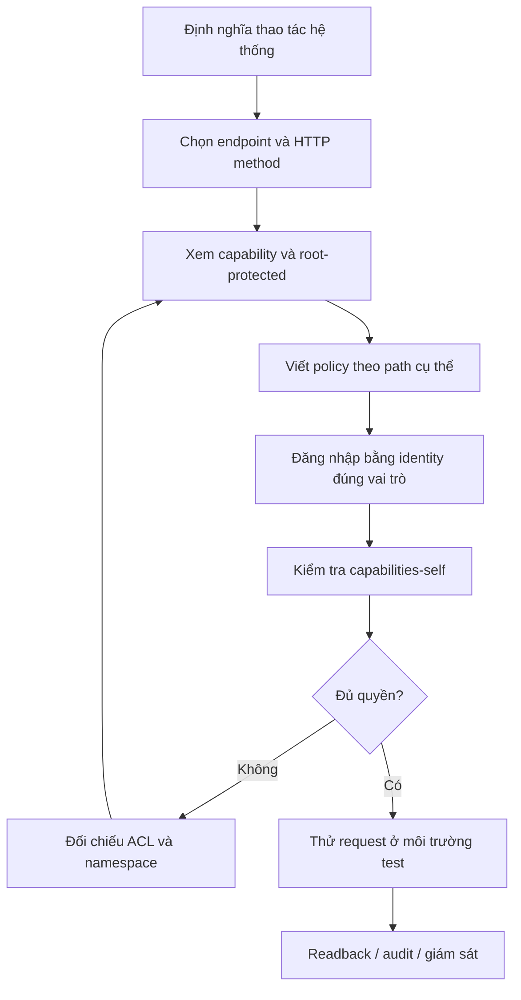

# Xác định quyền cần thiết cho từng thao tác hệ thống trong Spring Vault

## 1. Vì sao phải phân quyền riêng cho System API?

Ứng dụng Java sử dụng **SPRING_VAULT** có thể lấy KV secrets, phát hành dynamic credentials, mã hóa bằng Transit hoặc xin chứng thư PKI qua **HashiCorp Vault**. Các request nghiệp vụ này thường được cấp quyền trên đường dẫn của secrets engine, ví dụ `kv/data/app/config`, `transit/encrypt/customer-key` hay `pki/sign/web-server`.

Một số chức năng lại thuộc **System API** dưới đường dẫn `sys/`: liệt kê và bật secrets engine, cấu hình auth method, quản lý policy, audit device, lease và tình trạng hệ thống. Các chức năng này có thể ảnh hưởng nhiều workload hoặc toàn bộ Vault. Token chỉ có quyền đọc secret không nên tự động được phép bật mount, xóa policy hay tắt audit.

Để xác định đúng quyền, cần trả lời đồng thời **bốn câu hỏi**:

1. Request sẽ đến **đường dẫn Vault nào**, trong **namespace** nào?
2. Endpoint đó dùng **HTTP method/operation** nào và yêu cầu capability cơ bản gì?
3. Endpoint có thuộc nhóm **root-protected** cần thêm capability `sudo` hay không?
4. Danh tính nào nên sở hữu quyền ấy: **workload**, **automation quản trị** hay **operator**?

Mục tiêu bài học: xây dựng được policy HCL có phạm vi nhỏ, kiểm tra capability với Vault CLI/API, tích hợp đọc System API qua `VaultTemplate`, hiểu nguyên nhân lỗi 403 và kiểm thử phân quyền. Đây là nền tảng cho xác thực theo workload, quản lý token/lease, giám sát và vận hành các engine trong Spring Vault.

## 2. Capability của Vault: hiểu đúng trước khi viết policy

Vault dùng **ACL policy theo đường dẫn**. Mỗi khai báo `path "..."` cấp tập capability nhất định. Một số capability thường gặp:

| Capability | Mục đích | Ghi chú khi đối chiếu API |
| --- | --- | --- |
| `read` | Đọc dữ liệu hoặc cấu hình | Thường gắn với HTTP GET |
| `list` | Liệt kê key/tài nguyên | Gắn với thao tác Vault **LIST**; GET thông thường không mặc nhiên tương đương LIST |
| `create` | Tạo tài nguyên hoặc giá trị mới | Có thể liên quan POST/PUT tùy endpoint |
| `update` | Thay đổi hoặc thực hiện thao tác trên tài nguyên | Nhiều API POST dùng `update`, kể cả renew, rotate, tune |
| `patch` | Cập nhật một phần khi endpoint hỗ trợ HTTP PATCH | Không phải mọi engine hoặc phiên bản Vault đều hỗ trợ |
| `delete` | Xóa, vô hiệu hóa hoặc revoke tài nguyên | Tác động có thể không khôi phục được |
| `sudo` | Quyền đặc biệt cho endpoint **root-protected** | Phải kết hợp với capability thao tác cần thiết; `sudo` không tự cấp mọi quyền |
| `deny` | Từ chối rõ ràng | Ưu tiên hơn quyền cho phép khi policy được tổng hợp |

Một quy tắc quan trọng: **HTTP method là dấu hiệu để tìm capability, không phải bảng ánh xạ tuyệt đối**. Ví dụ, một POST có thể là thao tác `create`, `update` hoặc endpoint yêu cầu điều kiện riêng. Cần xem tài liệu của **đúng endpoint và phiên bản Vault** để xác nhận.

### 2.1. Vì sao `sudo` khác root token?

Capability `sudo` trong một policy cho phép danh tính đã được ủy quyền truy cập **những endpoint yêu cầu quyền đặc biệt**, với điều kiện danh tính đó cũng có capability hành động tương ứng. Nó không biến token thường thành root token toàn năng.

Ví dụ:

```hcl
path "sys/mounts/team-kv/tune" {
  capabilities = ["read", "update", "sudo"]
}
```

Ý nghĩa: cho phép những thao tác đọc/tune tương ứng trên đường dẫn cụ thể, kể cả khi endpoint yêu cầu `sudo`. Policy này **không** cấp `delete` trên `sys/mounts/team-kv` và **không** cấp quyền quản trị tất cả mount.

**Không dùng wildcard rộng** như `path "sys/*"` với nhiều capability hoặc cấp root token cho một microservice chỉ để vượt qua lỗi 403. Điều đó có thể cho phép tác động tới trạng thái toàn hệ thống.

### 2.2. Policy hợp nhất và phạm vi đường dẫn

- Một token có thể nhận nhiều policy thông qua auth method/role. Vault đánh giá các policy áp dụng để xác định capability hiệu lực.
- Quy tắc `deny` tường minh có thể phủ quyết các quyền cho phép ở policy khác.
- Đường dẫn trong policy là **đường dẫn logic của Vault**, không có tiền tố `/v1/`. Ví dụ `sys/mounts/team-kv`.
- Mẫu `*` và `+` trong cú pháp policy có ý nghĩa match khác nhau; tránh giả định các mẫu wildcard hoạt động như filesystem glob hoặc regex thông thường. Với đường dẫn quản trị nhạy cảm, nên liệt kê path cụ thể.
- Trong Vault Enterprise, **namespace** quyết định phạm vi đường dẫn và token. Một policy cấp trong namespace này không có nghĩa đã có quyền tương ứng ở namespace khác.

Để kiểm soát đúng, cần kiểm tra capability hiệu lực của **token thực sự được dùng để gọi API**, rồi thử request qua môi trường được phép.

## 3. Bảng xác định quyền theo nhóm System API

Bảng sau thể hiện **đường dẫn và capability khởi điểm thường gặp**. Các endpoint `sys/` có yêu cầu khác nhau theo chức năng và phiên bản. Cột `sudo` ghi rõ trường hợp cần đặc biệt rà soát; hãy đối chiếu tài liệu HTTP API của Vault đang chạy trước khi áp dụng trên production.

| Nhóm thao tác | Đường dẫn / HTTP method tiêu biểu | Capability khởi điểm | Yêu cầu quản trị |
| --- | --- | --- | --- |
| Kiểm tra health | GET `sys/health` | Thường cho phép truy cập health không cần token, tùy cấu hình mạng | Không cần cấp quyền quản trị để làm liveness |
| Kiểm tra trạng thái seal | GET `sys/seal-status` | Endpoint trạng thái có thể được truy cập không cần ACL token | Giới hạn truy cập mạng khi metadata nhạy cảm |
| Liệt kê secrets engine | GET `sys/mounts` | `read` | Kiểm tra yêu cầu `sudo` của endpoint root-protected |
| Đọc một mount | GET `sys/mounts/:path` | `read` | Thường thuộc phạm vi operator |
| Enable secrets engine | POST `sys/mounts/:path` | `create`/`update` theo API | Quyền quản trị đặc biệt; thường cần `sudo` |
| Tune mount | POST `sys/mounts/:path/tune` | `update` | Có thể cần `sudo`; giới hạn từng mount |
| Disable/unmount | DELETE `sys/mounts/:path` | `delete` | Đặc quyền cao, có thể mất dữ liệu |
| Liệt kê auth methods | GET `sys/auth` | `read` | Operator/security-admin; rà soát `sudo` |
| Enable auth method | POST `sys/auth/:path` | `create`/`update` theo API | Đặc quyền quản trị; có thể cần `sudo` |
| Disable auth method | DELETE `sys/auth/:path` | `delete` | Có thể làm đứt đường đăng nhập của workload |
| Đọc ACL policy | GET `sys/policies/acl/:name` | `read` | Cẩn trọng vì policy tiết lộ mô hình phân quyền |
| Ghi ACL policy | PUT/POST `sys/policies/acl/:name` | `create`/`update` | Chỉ security-admin/automation riêng |
| Xóa ACL policy | DELETE `sys/policies/acl/:name` | `delete` | Có thể khiến các vai trò mất quyền |
| Liệt kê audit devices | GET `sys/audit` | `read` | Operator bảo mật; rà soát `sudo` |
| Bật audit device | PUT/POST `sys/audit/:path` | `create`/`update` | Thao tác quản trị nhạy cảm |
| Tắt audit device | DELETE `sys/audit/:path` | `delete` | Có thể làm mất kênh ghi nhận sự kiện |
| Lookup lease | PUT/POST `sys/leases/lookup` | `update` | Phụ thuộc endpoint, quyền sở hữu/role và policy |
| Renew lease | PUT/POST `sys/leases/renew` | `update` | Giới hạn theo lease được phép quản lý |
| Revoke lease | PUT/POST `sys/leases/revoke` | `update` | Có thể ngắt credential/tài nguyên đang dùng |
| Liệt kê lease theo prefix | LIST `sys/leases/lookup/:prefix` | `list` | Endpoint đặc quyền; rà soát `sudo` và phạm vi |
| Kiểm tra quyền của token hiện tại | POST `sys/capabilities-self` | `update` theo endpoint | Chỉ kiểm tra quyền token hiện tại, không nâng quyền |

Không dùng bảng này làm policy áp dụng hàng loạt. **Bước quyết định là tra hợp đồng từng endpoint**: một số thao tác bảo trì khác như `sys/seal`, `sys/step-down` hoặc `sys/rotate` có yêu cầu đặc biệt và tác động vận hành riêng. Chúng phải được cấp quyền theo quy trình bảo trì cụ thể, không gộp vào vai trò kiểm tra mount/lease.

### 3.1. Phân biệt `sys/` với đường dẫn nghiệp vụ

Hai request có tên gần giống nhau có thể có ACL rất khác:

| Mục đích | Đường dẫn | Ai nên có quyền? |
| --- | --- | --- |
| Đọc dữ liệu KV v2 | `team-kv/data/app/config` | Workload được phép đọc cấu hình ứng dụng |
| Quản lý mount KV v2 | `sys/mounts/team-kv` | Nhóm quản trị hạ tầng |
| Xin certificate | `pki/sign/web-server` | Workload được cấp role PKI thích hợp |
| Cấu hình PKI engine | `sys/mounts/pki/tune` và API cấu hình PKI | Operator/PKI administrator |
| Mã hóa bằng Transit | `transit/encrypt/app-key` | Workload được phép mã hóa |
| Bật hoặc tắt Transit mount | `sys/mounts/transit` | Administrator |
| Dùng Vault token hiện có | Header Authorization/Vault token | Cơ chế xác thực request, không đồng nghĩa có quyền `sys/*` |

Quyền trên `sys/mounts/pki` **không tự động cho phép** `pki/sign/web-server`; và ngược lại. Vault xét **đúng đường dẫn** mà request gọi. Một dịch vụ chỉ cần sign CSR không có lý do được chỉnh TTL mount PKI.

## 4. Quy trình sáu bước xác định quyền chính xác

Khi xuất hiện một chức năng mới cần gọi Vault System API, thực hiện theo thứ tự:

1. **Xác định thao tác thật:** ví dụ “đọc danh sách mount”, “tune TTL”, “renew lease”, “xóa auth method” — tránh mô tả chung “quản lý Vault”.
2. **Tra đúng API endpoint:** lấy path, HTTP method, body và ghi chú về `root-protected` từ tài liệu phiên bản Vault được vận hành.
3. **Xác định capability:** đối chiếu GET/POST/PUT/PATCH/DELETE/LIST với yêu cầu cụ thể. Nếu endpoint root-protected, đưa `sudo` vào đúng path và chỉ cho danh tính quản trị.
4. **Giới hạn phạm vi:** chọn mount, role, policy name hoặc lease prefix chính xác; tách role chỉ đọc, role cấp phát và role bảo trì.
5. **Kiểm tra bằng token thật:** gọi `vault token capabilities -self <path>` hoặc `sys/capabilities-self`, sau đó thử một request phù hợp trong môi trường test.
6. **Readback và audit:** xác minh kết quả, đối chiếu trạng thái mong đợi, theo dõi audit log và xử lý trường hợp quyền bị thay đổi.



**Lưu ý:** `capabilities-self` phản ánh quyền ACL hiệu lực trên path; nó không đảm bảo request sẽ thành công nếu body sai, mount không tồn tại, thiếu cấu hình engine hoặc yêu cầu nghiệp vụ khác không được đáp ứng.

## 5. Ví dụ: quyền cần thiết để liệt kê và tune một mount

Giả sử đã có secrets engine KV v2 mount tại `team-kv/`. Một công cụ operator nội bộ cần xem mount và chỉnh mô tả, nhưng **không** được disable hay tạo các mount khác.

Yêu cầu nghiệp vụ:

- GET `sys/mounts` để kiểm tra danh sách, nếu tổ chức cho phép operator thấy toàn bộ.
- GET `sys/mounts/team-kv` và GET `sys/mounts/team-kv/tune` để đọc cấu hình.
- POST `sys/mounts/team-kv/tune` để đổi mô tả hoặc TTL phù hợp.
- Không có quyền DELETE `sys/mounts/team-kv` hoặc ghi vào `sys/mounts/other-mount`.

Ví dụ policy HCL cho danh tính operator, minh họa các capability thường cần khi endpoint được bảo vệ:

```hcl
# Chỉ cấp nếu operator thực sự cần xem toàn bộ danh sách mount.
path "sys/mounts" {
  capabilities = ["read", "sudo"]
}

# Chỉ đọc metadata của mount đã được giao.
path "sys/mounts/team-kv" {
  capabilities = ["read", "sudo"]
}

# Đọc và chỉnh cấu hình tune của đúng mount.
path "sys/mounts/team-kv/tune" {
  capabilities = ["read", "update", "sudo"]
}
```

Khi triển khai, đối chiếu tài liệu Vault về yêu cầu `sudo` trên từng endpoint. Tránh cấp thêm `create` hoặc `delete` chỉ để dự phòng; nếu cần enable mount mới, tạo một vai trò provisioning riêng.

### 5.1. Kiểm tra quyền bằng CLI

Giả sử CLI đã đăng nhập bằng **token operator cần kiểm thử**:

```bash
# Chỉ hiển thị các capability hiệu lực trên đường dẫn, không thực thi thay đổi.
vault token capabilities -self sys/mounts
vault token capabilities -self sys/mounts/team-kv
vault token capabilities -self sys/mounts/team-kv/tune
vault token capabilities -self sys/mounts/other-mount/tune

# Request đọc (chạy khi policy đã cho phép).
vault read sys/mounts/team-kv/tune
```

Kỳ vọng: path tune của `team-kv` có `read`, `update` và `sudo` nếu endpoint yêu cầu; path `other-mount/tune` không nhận quyền tùy tiện. Nếu trả `deny`, kiểm tra policy gắn với role, token đã dùng, namespace và các policy `deny` khác.

**Quy tắc kiểm tra:** kiểm tra trên **path thật** được Spring Vault gửi đi, không kiểm tra đường dẫn thiếu prefix hoặc tự thêm `/v1/` vào policy. Các endpoint LIST, GET và POST trên cùng họ API có thể phải kiểm tra những path khác nhau.

## 6. Phân tách vai trò theo nguyên tắc đặc quyền tối thiểu

Một cách tổ chức dễ kiểm soát là chia thành các vai trò rõ ràng:

| Vai trò | Ví dụ quyền | Những gì nên tránh |
| --- | --- | --- |
| **Java workload** | `read` tại `team-kv/data/app/*`, `update` tại `transit/encrypt/app-key` | Quyền quản trị `sys/mounts/*`, `sys/auth/*` |
| **Observer/monitoring** | Chỉ đọc endpoint health/metrics cần thiết và được phép | Quyền enable/unmount, tạo token, sửa policy |
| **Mount operator** | Đọc mount và tune một mount được giao | `delete` mount hoặc sửa tất cả auth methods |
| **Provisioning automation** | Enable/configure chính xác mount hoặc auth path theo quy trình | Root token lâu dài, policy wildcard toàn Vault |
| **Security administrator** | Quản lý ACL policy và audit theo thủ tục riêng | Dùng chung token admin cho mọi ứng dụng |
| **Lease operator** | Lookup/renew/revoke những lease có phạm vi đã xét duyệt | Revoke prefix không giới hạn |

Việc chia vai trò cũng giúp xử lý sự cố: API Java bị 403 khi truy cập `sys/mounts` có thể là **kết quả phân quyền đúng**, không nhất thiết là lỗi cần sửa. Nếu ứng dụng chỉ cần đọc KV, nên thay đổi thiết kế health check hoặc dùng cấu hình mount có sẵn thay vì nâng quyền workload.

### 6.1. Ví dụ policy cho Java workload sử dụng KV v2

```hcl
# Chỉ đọc giá trị secret trong nhánh cấu hình ứng dụng.
path "team-kv/data/app/*" {
  capabilities = ["read"]
}

# Chỉ thêm khi ứng dụng thật sự cần LIST metadata KV v2.
path "team-kv/metadata/app/*" {
  capabilities = ["list"]
}
```

Policy trên **không** có `sys/*`. Với KV v2, `data/` và `metadata/` có cấu trúc riêng; cấp `read` trên `data/` không đồng nghĩa có quyền `list` qua `metadata/`.

### 6.2. Ví dụ role chỉ theo dõi sức khỏe

`sys/health` cung cấp thông tin trạng thái active/standby/sealed theo hợp đồng HTTP API và thường được dùng cho readiness/liveness; cách áp dụng token và giới hạn mạng phụ thuộc cấu hình. Không nên cấp hàng loạt `sys/*` cho một ứng dụng chỉ cần health check.

Tách **trạng thái sẵn sàng** của Vault và **quyền đọc cấu hình**: một response health thành công không chứng minh workload có quyền đọc KV, Transit hoặc gọi System API quản trị.

## 7. Quyền trên auth method và policy: kiểm tra tác động dây chuyền

System API còn cung cấp quản lý auth methods qua `sys/auth`. Ví dụ:

```bash
# Lệnh đọc, cần quyền operator tương ứng.
vault auth list

# Ví dụ cấu hình quản trị, chỉ trong môi trường đã được cấp quyền.
vault auth enable -path=service-approle approle
```

Khi bật AppRole tại `service-approle/`, ứng dụng đăng nhập qua `auth/service-approle/login`, **khác path** với `sys/auth/service-approle` dùng để quản trị mount auth method.

Tương tự:

- `sys/policies/acl/my-policy` quản lý **định nghĩa policy**.
- `auth/token/create` phát hành token theo quyền token role, policy và ràng buộc của auth method.
- `sys/capabilities-self` đọc quyền **hiệu lực** của token đang dùng.

Một workload có quyền đăng nhập AppRole không được mặc nhiên chỉnh role, enable auth method mới hoặc sửa policy. Việc cho phép sửa ACL policy rộng có thể dẫn tới **leo thang đặc quyền**; chỉ cấp cho danh tính bảo mật độc lập, có log và kiểm soát thay đổi.

### 7.1. Audit devices

Audit device ghi dấu vết request tới Vault theo cấu hình. Các endpoint `sys/audit` và `sys/audit/:path` là nhóm quản trị nhạy cảm. Quyền tắt audit device cần được quản lý chặt hơn quyền xem danh sách, vì mất audit có thể ảnh hưởng khả năng điều tra sự cố.

Không gộp quyền `delete` trên `sys/audit/*` vào policy thao tác mount, lease hoặc certificate. Thử nghiệm bật/tắt audit nên diễn ra trên môi trường cô lập có phương án quan sát và phục hồi.

## 8. Phân biệt quyền thao tác lease với TTL của token

Một số ứng dụng Java có **dynamic secret lease**, ví dụ database credential phát hành từ `database/creds/reporting`. Vault trả `lease_id`, `lease_duration` và `renewable`. Các hành động kiểm tra, gia hạn hoặc thu hồi lease có thể đi qua `sys/leases/*`.

| Việc cần làm | Endpoint điển hình | Rủi ro nếu cấp quá rộng |
| --- | --- | --- |
| Tra cứu trạng thái lease | `sys/leases/lookup` | Tiết lộ thông tin về credential và hạ tầng |
| Renew lease | `sys/leases/renew` | Kéo dài tài nguyên ngoài thời gian dự định |
| Revoke lease | `sys/leases/revoke` | Ngắt tài khoản database hoặc tài nguyên đang dùng |
| Revoke theo prefix | `sys/leases/revoke-prefix/:prefix` | Thu hồi một loạt lease và gây gián đoạn diện rộng |

Với luồng thông thường, ưu tiên cơ chế quản lý lease phù hợp được **Spring Vault** hỗ trợ. Không cấp quyền revoke cả một prefix cho mọi workload; bản thân backend, role, token và các policy liên quan có thể giới hạn việc renew/revoke.

**Token TTL khác secret lease TTL.** Token dùng để gọi System API có vòng đời riêng. Gia hạn token không kéo dài một chứng thư X.509 đã ký hay tự renew mọi database credential; ngược lại, quyền `sys/leases/renew` không biến token thành admin.

### 8.1. Không lấy GET/POST làm kết luận về mức độ an toàn

Một request GET đến endpoint dynamic credential có thể **tạo credential mới** dù dùng `read(...)`. Một POST đến `sys/leases/revoke` có thể vô hiệu hóa tài nguyên; một POST đến `sys/capabilities-self` chỉ kiểm tra ACL. Để phân quyền và retry, cần hiểu **ý nghĩa nghiệp vụ từng endpoint**, thay vì coi mọi GET là vô hại hay mọi POST là một thao tác giống nhau.

## 9. Ví dụ Java: đọc System API với VaultTemplate

Trong Spring Vault, `VaultTemplate` sử dụng Vault endpoint, TLS, token và cơ chế xác thực đã cấu hình. API tổng quát có thể gọi System API mà không cần tự ghép một REST client riêng.

Ví dụ Java 17+ sau triển khai **chức năng đọc danh sách mount** dùng riêng cho operator:

```java
import java.util.Collections;
import java.util.LinkedHashMap;
import java.util.Map;

import org.springframework.stereotype.Service;
import org.springframework.vault.core.VaultTemplate;
import org.springframework.vault.support.VaultResponse;

@Service
public class VaultSystemMountReader {

    private final VaultTemplate vaultTemplate;

    public VaultSystemMountReader(VaultTemplate vaultTemplate) {
        this.vaultTemplate = vaultTemplate;
    }

    public record MountInfo(String type, String description) {}

    public Map<String, MountInfo> listMounts() {
        VaultResponse response = vaultTemplate.read("sys/mounts");
        if (response == null || response.getData() == null) {
            throw new IllegalStateException("No data from sys/mounts");
        }

        Map<String, MountInfo> result = new LinkedHashMap<>();
        for (Map.Entry<String, Object> entry
                : response.getData().entrySet()) {
            if (!(entry.getValue() instanceof Map<?, ?> fields)) {
                continue;
            }
            if (!(fields.get("type") instanceof String type)) {
                continue;
            }
            String description =
                    fields.get("description") instanceof String text
                            ? text : "";
            result.put(entry.getKey(), new MountInfo(type, description));
        }
        return Collections.unmodifiableMap(result);
    }
}
```

Đoạn mã **không tự cấp quyền**; token trong session của `VaultTemplate` phải được ACL cho phép thực hiện GET `sys/mounts`. Nếu Vault yêu cầu `sudo` tại endpoint này, role operator cũng phải có capability đó trên đúng đường dẫn. Nếu thiếu quyền, request sẽ thất bại và ứng dụng phải xử lý lỗi, không tự chuyển sang root token.

### 9.1. Tách mã quản trị khỏi ứng dụng nghiệp vụ

Nếu có chức năng tune mount, đặt nó trong **dịch vụ quản trị độc lập** dùng một Vault identity riêng:

```java
import java.util.Map;

import org.springframework.vault.core.VaultTemplate;
import org.springframework.vault.support.VaultResponse;

public class VaultMountTuner {

    private static final String TUNE_PATH =
            "sys/mounts/team-kv/tune";

    private final VaultTemplate adminVaultTemplate;

    public VaultMountTuner(VaultTemplate adminVaultTemplate) {
        this.adminVaultTemplate = adminVaultTemplate;
    }

    public void updateDescription(String description) {
        if (description == null || description.isBlank()) {
            throw new IllegalArgumentException("Description is required");
        }

        // POST yêu cầu policy update/sudo đúng path.
        // Giả định team-kv đã tồn tại.
        adminVaultTemplate.write(
                TUNE_PATH,
                Map.of("description", description)
        );

        // Một số endpoint trả body rỗng sau POST thành công;
        // xác minh bằng GET thay vì dựa vào response của write().
        VaultResponse after = adminVaultTemplate.read(TUNE_PATH);
        if (after == null || after.getData() == null
                || !description.equals(after.getData().get("description"))) {
            throw new IllegalStateException(
                    "Mount tune verification failed");
        }
    }
}
```

Mẫu này dùng một mount cố định thay vì nhận raw path từ request HTTP. Nếu nhận tên mount động, phải dùng **allowlist** từ cấu hình tin cậy và kiểm tra quyền operator ở lớp ứng dụng. Không đưa token quản trị vào bean của mọi service, không gọi tune ở mỗi lần application startup và không để người dùng cuối điều khiển trực tiếp endpoint `sys/*`.

### 9.2. Xử lý lỗi thay vì tự động nâng quyền

| Kết quả request | Chẩn đoán ban đầu | Bước tiếp theo |
| --- | --- | --- |
| HTTP 403 | Token thiếu capability, thiếu `sudo` hoặc policy `deny` | Kiểm tra token hiệu lực, role/policy, namespace và path |
| HTTP 404 | Endpoint/mount không tồn tại hoặc route sai | Kiểm tra mount/path và trạng thái engine |
| HTTP 400 | Thiếu trường hoặc body không hợp lệ | Đối chiếu contract API; không sửa ACL theo suy đoán |
| HTTP 429/5xx | Rate limit hoặc Vault gặp lỗi | Retry có giới hạn với thao tác được phép retry, cảnh báo |
| POST thành công nhưng `VaultResponse` null | Endpoint trả body rỗng | Readback để xác minh thay đổi |
| Capability đúng nhưng thao tác không thành công | Sai body, cấu hình, quota, trạng thái hệ thống hoặc policy bổ sung | Đọc thông điệp lỗi an toàn và đối chiếu API thực tế |

Không log token, private key, nội dung secret hoặc response nhạy cảm trong quá trình chẩn đoán. Gắn correlation/request ID an toàn để liên hệ với audit log theo chính sách của tổ chức.

## 10. Kiểm tra quyền qua sys/capabilities-self

Endpoint `sys/capabilities-self` kiểm tra ACL của **token đang gọi**, với input là các path cần xét. Nó giúp xác minh policy trước khi thử thay đổi thật.

Ví dụ CLI:

```bash
# Đăng nhập bằng token operator cần kiểm thử trước khi chạy.
vault token capabilities -self sys/mounts
vault token capabilities -self sys/mounts/team-kv/tune
vault token capabilities -self sys/auth
vault token capabilities -self sys/audit

# Kiểm tra path ngoài phạm vi được giao.
vault token capabilities -self sys/mounts/other-team/tune
```

Lệnh `vault token capabilities -self ...` không gửi giá trị secret vào output. Khi dùng API, request minh họa:

```http
POST /v1/sys/capabilities-self
X-Vault-Token: <OPERATOR_TOKEN>
Content-Type: application/json

{
  "paths": [
    "sys/mounts",
    "sys/mounts/team-kv/tune",
    "sys/mounts/other-team/tune"
  ]
}
```

Vault trả các capability hiệu lực theo path tương ứng (dạng JSON phụ thuộc việc truy vấn một hay nhiều path). Không nhầm endpoint này với `sys/capabilities` hoặc `sys/capabilities-accessor`: các API kiểm tra token khác có quyền quản trị/quyền truy cập và ràng buộc riêng.

Một mẫu phản hồi có thể cho biết:

```json
{
  "data": {
    "sys/mounts": ["read", "sudo"],
    "sys/mounts/team-kv/tune": ["read", "update", "sudo"],
    "sys/mounts/other-team/tune": ["deny"]
  }
}
```

Đây là **mẫu minh họa**, không phải output đã quan sát từ Vault. Mục đích là đối chiếu: path operator được giao phải có capability phù hợp; path ngoài phạm vi không được vô tình có `update/sudo/delete`.

### 10.1. Đừng coi phép kiểm ACL là bằng chứng request sẽ luôn thành công

`sys/capabilities-self` xác nhận **ACL policy** tại thời điểm hỏi. Thao tác sau đó vẫn có thể thất bại do token hết hạn, đổi policy, thay namespace, thiếu plugin/role, rate limit hoặc request body sai. Vì vậy, phép kiểm phải đi cùng kiểm thử endpoint thật và readback trạng thái.

## 11. Policy mẫu cho ba nhóm nhân sự

Thay vì một policy quản trị khổng lồ, có thể dùng các mảnh policy hẹp và gắn theo vai trò.

### 11.1. Người quan sát mount

```hcl
path "sys/mounts" {
  capabilities = ["read", "sudo"]
}

path "sys/mounts/team-kv" {
  capabilities = ["read", "sudo"]
}

path "sys/mounts/team-kv/tune" {
  capabilities = ["read", "sudo"]
}
```

Quyền list tất cả mount có thể tiết lộ metadata nội bộ; chỉ cấp `sys/mounts` nếu nhu cầu giám sát thực sự yêu cầu. Dù có `sudo`, policy không cho phép update hoặc delete.

### 11.2. Automation chỉ được tune một mount

```hcl
path "sys/mounts/team-kv/tune" {
  capabilities = ["read", "update", "sudo"]
}
```

Automation dùng một identity dành riêng cho thay đổi cấu hình. Nó không có quyền disable mount; nếu cần enable, khai báo quyền tạo riêng trên chính path cần provisioning và áp dụng quy trình thay đổi được phê duyệt.

### 11.3. Microservice chỉ đọc secret

```hcl
path "team-kv/data/app/config" {
  capabilities = ["read"]
}
```

Microservice này **không cần quyền System API**, ngay cả khi sử dụng `VaultTemplate`. Xác thực qua Kubernetes auth hoặc AppRole giúp role cấp token đúng policy. Quản lý token TTL và lease, Transit hoặc PKI chỉ bổ sung quyền nghiệp vụ thật sự cần dùng.

**Lưu ý về scope:** các ví dụ HCL là minh họa cách thiết kế quyền, không bảo đảm đáp ứng mọi phiên bản/triển khai Vault. Luôn kiểm tra phần *Capabilities* và *sudo/root-protected* trong tài liệu endpoint và chạy kiểm thử với identity cụ thể.

## 12. Những sai lầm thường gặp

**Sai lầm 1: “GET là read, POST là update, vậy chỉ cần map theo method.”**  
Không đủ. Vault có `list`, `create`, `patch`, `delete` và những endpoint `sudo`. Quyền phải xác định từ hợp đồng API, không chỉ từ HTTP method.

**Sai lầm 2: “Có sudo thì làm được mọi việc.”**  
Sai. `sudo` là bổ sung cho endpoint đặc quyền; token vẫn cần capability hành động và path tương ứng. ACL `deny` rõ ràng vẫn có thể chặn.

**Sai lầm 3: “Đọc được secret nghĩa là được kiểm tra/tune mount.”**  
Sai. `team-kv/data/...` và `sys/mounts/team-kv/tune` là hai nhánh quyền độc lập. 403 trên System API có thể chính là thiết kế an toàn.

**Sai lầm 4: “Cấp path sys/* cho tiện vận hành.”**  
Nguy hiểm. Nó có thể mở quyền cấu hình auth, policies, audit, mounts và các thao tác hệ thống khác. Hãy định danh từng path cần cấp quyền.

**Sai lầm 5: “Renew lease, token và certificate có cùng quyền.”**  
Sai. Dynamic secret lease, Vault token và chứng thư X.509 có vòng đời và API riêng. `sys/leases/renew` không làm chứng thư đã ký tự kéo dài `notAfter`.

**Sai lầm 6: “Trả về 403 là phải dùng root token.”**  
Sai. Cần xác định path, namespace, operation, policy thực tế và yếu tố `sudo`. Chỉ cấp phần quyền thiếu phù hợp với vai trò sau khi kiểm tra tác động.

## 13. Kiểm thử tích hợp và giám sát

Trong môi trường Vault test tách biệt với production, tạo các role/token kiểm thử khác nhau:

1. **Read-only workload:** quyền đọc một KV v2 secret. Xác nhận đọc được secret, nhưng GET `sys/mounts` và POST `sys/mounts/team-kv/tune` bị từ chối.
2. **Mount observer:** có quyền đọc đúng API System. Xác nhận GET được phép, POST tune/DELETE unmount bị từ chối.
3. **Mount tuner:** `read/update/sudo` tại `sys/mounts/test-kv/tune`. Thay mô tả test mount, đọc lại thành công; tune mount ngoài phạm vi phải bị từ chối.
4. **Thiếu sudo:** cấp `update` nhưng cố tình không có `sudo` với endpoint root-protected; kiểm tra kết quả và bổ sung đúng capability khi tài liệu yêu cầu.
5. **Policy deny:** gắn policy có `deny` vào một path test; xác nhận `capabilities-self` và request thực phản ánh kết quả từ chối.
6. **Token hết hạn:** cho token test TTL ngắn; xác nhận client Spring Vault xử lý xác thực lại hoặc báo lỗi phù hợp với phương thức auth đã cấu hình.
7. **Namespace và path:** nếu dùng Enterprise, thử cùng tên mount dưới hai namespace để xác nhận không lẫn policy hoặc dữ liệu.
8. **Readback và audit:** sau thay đổi thành công, kiểm tra cấu hình thực tế, log audit và hệ thống metric; không coi response POST rỗng là thất bại.

Không dùng thao tác disable/unmount thực trên mount production để kiểm thử quyền. Nếu cần kiểm thử `delete`, chỉ dùng mount test với dữ liệu có thể hủy bỏ và kiểm soát tác động.

Về giám sát, nên theo dõi tỷ lệ lỗi Vault 403/429/5xx theo nhóm endpoint, độ trễ System API, số lần thay đổi mount/policy/audit, tình trạng token hết hạn và tác động tới các service đọc KV, Transit, PKI hoặc dynamic secret. Không ghi token, private key hay nội dung secret vào log.

## 14. Bài tập tình huống

**Tình huống A — Policy thiếu `sudo`**

Một operator được cấp:

```hcl
path "sys/mounts/team-kv/tune" {
  capabilities = ["read", "update"]
}
```

Operator gọi POST `sys/mounts/team-kv/tune` nhưng nhận 403. Nên kiểm tra gì?

**Hướng giải:** Kiểm tra token/namespace, tài liệu xem endpoint có root-protected hay không, chạy `vault token capabilities -self sys/mounts/team-kv/tune`. Nếu endpoint yêu cầu `sudo` và operator đúng là danh tính quản trị được phép tune, cấp `sudo` **trên path cụ thể**, sau đó thử lại và readback; không cấp root token.

**Tình huống B — Ứng dụng bị từ chối liệt kê mount**

Một microservice đọc `team-kv/data/app/config` thành công, nhưng GET `sys/mounts` trả 403. Có cần cấp thêm quyền không?

**Hướng giải:** Không nhất thiết. Nếu service chỉ đọc secret, đó là phân quyền đúng. Một công cụ operator riêng có thể kiểm tra mount khi có nhu cầu vận hành.

**Tình huống C — Quyền cập nhật policy quá rộng**

Một automation có khả năng POST `sys/policies/acl/:name` cho mọi tên policy. Dù không trực tiếp có quyền `sys/mounts/*`, automation có thể tạo rủi ro gì?

**Hướng giải:** Quyền sửa policy có thể ảnh hưởng role và phân quyền của các identity khác, thậm chí tạo con đường leo thang đặc quyền tùy hệ thống. Cần bảo vệ như một chức năng quản trị an ninh, kiểm soát tên policy, danh tính caller, audit, quy trình xét duyệt và phạm vi thực thi.

**Tình huống D — POST thành công nhưng chương trình báo lỗi**

Automation gọi tune mount bằng `VaultTemplate.write(...)`, Vault xử lý thành công nhưng trả body rỗng. Mã Java thấy `null` và cho rằng thất bại, sau đó POST lại liên tục.

**Hướng giải:** `null` response không đồng nghĩa lỗi đối với endpoint ghi không có body. Phải đọc lại `sys/mounts/:path/tune` và so sánh giá trị mong đợi, retry có giới hạn khi thực sự cần.

## 15. Kết luận

Để **xác định quyền cho từng thao tác hệ thống**, hãy bắt đầu từ *endpoint thực tế*, *HTTP operation*, *capability cơ bản*, *yêu cầu `sudo`* và *identity đang sử dụng*. Áp dụng policy hẹp theo đường dẫn, kiểm tra quyền bằng `vault token capabilities -self` hoặc `sys/capabilities-self`, thử request ở môi trường phù hợp và readback sau thay đổi.

Trong Spring Vault, `VaultTemplate` cung cấp đường truy cập API đã xác thực, nhưng **không thay thế Vault ACL**. Phân chia quyền rõ ràng giữa ứng dụng dùng KV/Transit/PKI, operator theo dõi và công cụ quản trị System API giúp hạn chế rủi ro, vận hành minh bạch và kiểm thử được.

### Tài liệu tham khảo

- [HashiCorp Vault – ACL policies](https://developer.hashicorp.com/vault/docs/concepts/policies)
- [HashiCorp Vault – System backend HTTP API](https://developer.hashicorp.com/vault/api-docs/system)
- [HashiCorp Vault – Token capabilities](https://developer.hashicorp.com/vault/docs/commands/token/capabilities)
- [Spring Vault – VaultTemplate](https://docs.spring.io/spring-vault/reference/vault/imperative-template.html)
