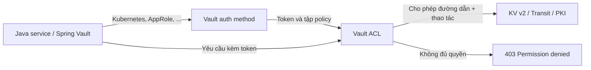

# Policy và nguyên tắc cấp quyền theo nhu cầu trong Spring Vault

Trong hệ thống Java dùng **Spring Vault** để gọi **HashiCorp Vault**, đăng nhập thành công mới giải quyết được câu hỏi *ứng dụng là ai*. Câu hỏi tiếp theo, quan trọng không kém, là *ứng dụng được phép làm gì với secret nào*. Vault trả lời bằng **policy**: tập quy tắc cấp quyền trên các đường dẫn API. Thiết kế policy theo nguyên tắc **quyền tối thiểu** (*principle of least privilege*) giúp một workload chỉ đọc, ghi hoặc sử dụng đúng tài nguyên cần thiết, trong đúng thời gian cần thiết.

Bài học thuộc chương **Phân quyền truy cập**, tập trung vào policy và cách cấp quyền theo nhu cầu thực tế. Các ví dụ kết nối quyền truy cập với `VaultTemplate`, KV secrets, xác thực theo workload, vòng đời token/lease, Transit encryption và PKI; đồng thời chỉ ra cách kiểm tra lỗi quyền và giám sát trong môi trường triển khai.

## 1. Kết quả cần đạt

Sau bài này, bạn có thể:

- Phân biệt **authentication** (xác thực workload) với **authorization** (quyết định quyền thao tác trên đường dẫn Vault).
- Đọc và viết policy ACL bằng HCL; chọn đúng `path` và `capabilities` theo yêu cầu sử dụng.
- Thiết kế policy riêng cho ứng dụng chạy thực tế, job xoay vòng secret và tác vụ quản trị.
- Giải thích vì sao quyền cho KV v2 phải nhắm đến các đường dẫn `data/`, `metadata/` và những endpoint quản lý phiên bản thích hợp.
- Ánh xạ thao tác của Spring Vault sang Vault API để xử lý lỗi `403`, `404` và kiểm thử phân quyền bằng đúng danh tính workload.
- Tránh cấp quyền quản trị Transit, PKI hoặc token chỉ vì ứng dụng cần gọi một vài thao tác nghiệp vụ.

## 2. Policy nằm ở đâu trong luồng truy cập?

Một Java service có thể đăng nhập vào Vault qua Kubernetes authentication, AppRole hoặc cơ chế phù hợp với hạ tầng. Phương thức xác thực kiểm tra bằng chứng của workload và dẫn tới token có policy tương ứng. Mỗi yêu cầu tiếp theo được Vault đối chiếu với các policy hiệu lực trước khi chuyển tới secrets engine.



Phân biệt ba thành phần:

| Thành phần | Trách nhiệm | Ví dụ |
| --- | --- | --- |
| **Auth method / role** | Xác minh workload và quy định cách cấp token, policy, TTL | Kubernetes role chỉ nhận ServiceAccount `invoice-api` thuộc namespace `production` |
| **Token và identity** | Mang danh tính và tập quyền hiệu lực khi gọi API | Token của `invoice-api` có policy `invoice-api-runtime` |
| **ACL policy** | Xác định thao tác hợp lệ trên từng đường dẫn API | Được `read` `secret/data/invoice-api/runtime`, không được `list` toàn bộ `secret/` |

**Mặc định từ chối:** nếu không có quy tắc phù hợp cho một đường dẫn và thao tác, Vault từ chối. Nhiều policy có thể cùng đóng góp quyền cho token; trường hợp có quy tắc `deny` phù hợp thì `deny` được ưu tiên. Do đó, chỉ gắn tên policy với token không đủ để khẳng định một request sẽ thành công: phải xét **đường dẫn thực**, **HTTP operation** và **toàn bộ policy hiệu lực**.

> **Lưu ý:** Policy Vault kiểm soát quyền gọi API; nó không thay thế phân quyền người dùng cuối trong chính ứng dụng Java. Nếu API `GET /invoices/{id}` chỉ cho chủ hóa đơn truy cập, ứng dụng vẫn phải tự kiểm tra quyền nghiệp vụ đó.

## 3. Ngôn ngữ policy ACL: đường dẫn và capability

Vault ACL thường viết bằng HCL, mỗi khối `path` xác định đường dẫn tương đối với API `/v1/` và các quyền được cấp:

```hcl
# Chỉ đọc một secret cụ thể trong KV v2 mount tại "secret".
path "secret/data/invoice-api/runtime" {
  capabilities = ["read"]
}
```

Các capability cần nắm:

| Capability | Ý nghĩa thường gặp | Tình huống sử dụng |
| --- | --- | --- |
| `create` | Tạo tài nguyên mới | Ghi secret ở đường dẫn chưa tồn tại |
| `read` | Đọc nội dung/metadata được endpoint cho phép | Đọc KV secret, xem thông tin token của chính mình |
| `update` | Sửa tài nguyên hoặc gọi thao tác qua request ghi | Gọi `transit/encrypt/...`, yêu cầu cấp chứng chỉ từ PKI |
| `patch` | Cập nhật một phần trên endpoint hỗ trợ PATCH | Chỉ dùng nếu workload thực sự cần thao tác PATCH |
| `delete` | Xóa theo ngữ nghĩa của endpoint | Xóa phiên bản secret theo API được cho phép |
| `list` | Liệt kê tên key hoặc mục con | Liệt kê tên secret dưới một prefix |
| `sudo` | Quyền bổ sung cho một số endpoint được Vault bảo vệ đặc biệt | Tác vụ quản trị được kiểm soát riêng |
| `deny` | Từ chối rõ ràng | Chặn một đường dẫn cần loại trừ dù có policy khác cấp quyền |

`create`/`update` không phải lúc nào cũng tương đương toàn bộ quyền ghi: endpoint và trạng thái tài nguyên quyết định request cần capability nào. Tương tự, thao tác nghiệp vụ có tên “mã hóa” vẫn dùng `update` vì Transit nhận dữ liệu qua request ghi; nó không yêu cầu quyền quản lý key.

### Cách khớp đường dẫn

- `path "secret/data/invoice-api/runtime"` khớp **chính xác** một đường dẫn.
- `path "secret/data/invoice-api/*"` khớp một tập đường dẫn có tiền tố đó; dùng khi các key trong phạm vi thật sự biến động.
- `+` có thể biểu diễn **một thành phần đường dẫn** trong mẫu phù hợp, ví dụ `secret/data/+/shared`.
- `*` và `+` **không phải biểu thức chính quy**. Tránh dựa vào suy đoán về thứ tự ưu tiên của các mẫu chồng lấp; kiểm tra policy hiệu lực trên từng đường dẫn nhạy cảm.

Không cấp quyền quá rộng kiểu sau cho service chỉ cần một secret:

```hcl
# PHẢN VÍ DỤ: cho phép rất nhiều thao tác dưới cả mount.
path "secret/*" {
  capabilities = ["create", "read", "update", "delete", "list"]
}
```

Ngoài phạm vi quá rộng, mẫu trên còn che khuất cấu trúc API KV v2. Policy nên mô tả đúng nhu cầu: **ai**, **dùng endpoint nào**, **để làm gì**, **đến mức nào**.

## 4. Bắt đầu từ danh mục thao tác thực tế

Giả sử một hệ thống phát hành hóa đơn có ba workload: `invoice-api` xử lý yêu cầu người dùng, `invoice-rotation-job` thay secret cấu hình, và `invoice-cert-job` cấp chứng chỉ mTLS. Nhóm vận hành không nên gắn cùng một policy cho cả ba.

| Workload | Nhu cầu bắt buộc | Quyền nên cấp | Không cần cấp |
| --- | --- | --- | --- |
| `invoice-api` | Đọc cấu hình bí mật để kết nối dịch vụ | `read` đúng `secret/data/invoice-api/runtime` | Ghi/xóa secret, `list` toàn mount |
| `invoice-api` | Mã hóa dữ liệu nhạy cảm bằng Transit | `update` `transit/encrypt/invoice-pii` | Tạo/xóa/xuất key Transit |
| `invoice-api` *(nếu thật sự cần giải mã)* | Giải mã dữ liệu do ứng dụng sở hữu | `update` `transit/decrypt/invoice-pii` | `transit/decrypt/*` cho mọi key |
| `invoice-rotation-job` | Thay nội dung một secret | `create`/`update` trên đúng đường dẫn `secret/data/...` | Đọc các secret không liên quan, quyền PKI |
| `invoice-cert-job` | Xin chứng chỉ theo PKI role được duyệt | `update` `pki_int/issue/invoice-client` | Tạo/sửa PKI role, thay CA, thu hồi toàn bộ chứng chỉ |

Quy trình thiết kế nên theo thứ tự: liệt kê request mà workload thực sự gọi → ghi chính xác đường dẫn API và phương thức → tạo policy hẹp nhất → gắn policy với danh tính workload → kiểm thử cả request hợp lệ lẫn request phải bị chặn. Khi chức năng thay đổi, cập nhật danh mục này trước khi mở rộng quyền.

## 5. KV v2: phân quyền theo API, không theo tên secret hiển thị

Đây là nguồn gây lỗi `403` phổ biến. Giả sử KV v2 được mount tại `secret/`. Người phát triển gọi:

```bash
vault kv get -mount=secret invoice-api/runtime
```

Vault CLI và `VaultKeyValueOperations` có thể che bớt chi tiết API. Ở tầng HTTP, thao tác đọc KV v2 truy cập **`GET /v1/secret/data/invoice-api/runtime`**. Vì vậy, policy cần `secret/data/invoice-api/runtime`, không phải chỉ `secret/invoice-api/runtime`.

| Nghiệp vụ KV v2 | Đường dẫn Vault API | Capability điển hình |
| --- | --- | --- |
| Đọc nội dung một secret | `secret/data/<path>` | `read` |
| Tạo/cập nhật nội dung secret | `secret/data/<path>` | `create` hoặc `update` tùy thao tác/trạng thái; thường cấp cả hai cho writer cần tạo lẫn sửa |
| Xóa mềm phiên bản mới nhất | `secret/data/<path>` qua DELETE | `delete` |
| Liệt kê tên secret trong một thư mục | `secret/metadata/<prefix>` qua LIST | `list` |
| Xem metadata của secret | `secret/metadata/<path>` qua GET | `read` |
| Xóa mềm các version chỉ định | `secret/delete/<path>` | `update` |
| Khôi phục version đã xóa mềm | `secret/undelete/<path>` | `update` |
| Hủy vĩnh viễn version chỉ định | `secret/destroy/<path>` | `update` |

Đường dẫn `metadata/` còn hỗ trợ các tác vụ quản lý metadata/xóa metadata tùy phương thức HTTP. Không cấp quyền cho chúng chỉ vì ứng dụng cần đọc giá trị secret.

### Policy chỉ đọc một secret

```hcl
# invoice-api-kv-read.hcl
path "secret/data/invoice-api/runtime" {
  capabilities = ["read"]
}
```

Policy này không cho phép liệt kê tên key, sửa, xóa hoặc đọc các đường dẫn khác. Đó là lựa chọn phù hợp nhất khi code biết trước secret cần đọc. Nếu thực sự cần duyệt thư mục, có thể **bổ sung riêng**:

```hcl
# Chỉ dùng khi ứng dụng có chức năng liệt kê secret.
path "secret/metadata/invoice-api" {
  capabilities = ["list"]
}

# Cho phép liệt kê ở các cấp con nếu thiết kế dữ liệu yêu cầu.
path "secret/metadata/invoice-api/*" {
  capabilities = ["list"]
}
```

`list` không trả về giá trị secret nhưng vẫn để lộ **tên** secret. Tên có thể cho biết dự án, môi trường hoặc hệ thống nội bộ; vì vậy, cũng phải coi việc liệt kê là quyền cần được phê duyệt.

### Tách quyền đọc và quyền xoay vòng

```hcl
# invoice-rotation-job.hcl
path "secret/data/invoice-api/runtime" {
  capabilities = ["create", "update"]
}
```

Một job chỉ có nhiệm vụ cập nhật secret không mặc nhiên cần `read`, `delete` hay `list`. Nếu quy trình xoay vòng buộc phải đọc giá trị cũ, cấp `read` **cho đúng key đó** rồi kiểm tra lại thiết kế. Với KV v2, khả năng CAS (*check-and-set*) còn giúp giảm nguy cơ ghi đè khi cập nhật đồng thời; CAS là cơ chế kiểm soát phiên bản, không thay thế policy.

**Phân biệt với lease:** KV v2 thường lưu static secrets có các **version**; secret KV v2 không tự trở thành dynamic credential có lease chỉ vì ứng dụng lấy nó từ Vault. TTL/renewal của token đăng nhập và lease của dynamic secrets là những vòng đời khác nhau.

## 6. Transit: cấp quyền thực hiện phép toán, không cấp quyền quản lý key

Transit hoạt động như dịch vụ mật mã: ứng dụng gửi dữ liệu cần xử lý cho Vault, còn khóa mã hóa nằm phía Vault. Đường dẫn nghiệp vụ phổ biến:

```hcl
# invoice-api-transit.hcl
path "transit/encrypt/invoice-pii" {
  capabilities = ["update"]
}

# Chỉ thêm khối này nếu application cần giải mã.
path "transit/decrypt/invoice-pii" {
  capabilities = ["update"]
}
```

Việc gọi `POST /v1/transit/encrypt/invoice-pii` thường cần `update`, mặc dù ứng dụng không chỉnh sửa cấu hình key. Ngược lại, các đường dẫn như `transit/keys/`, `transit/export/`, `transit/backup/`, `transit/restore/` hoặc `transit/rewrap/` phục vụ nhu cầu khác và phải được xem xét **từng quyền**. Đặc biệt, quyền xuất khóa và quản lý khóa không thuộc policy xử lý hóa đơn thông thường.

Thiết kế một chiều có thể còn hẹp hơn: nếu dịch vụ chỉ mã hóa trước khi gửi dữ liệu sang một hệ thống khác, **không cấp `decrypt`**. Dữ liệu vẫn phải được bảo vệ ở phía ứng dụng và trên đường truyền; Transit không tự kiểm tra chủ sở hữu bản ghi hay quyền nghiệp vụ của người gọi API Java.

## 7. PKI: chỉ cho phép cấp chứng chỉ qua role đã kiểm soát

Khi ứng dụng hoặc một job cần xin chứng chỉ mTLS, endpoint thích hợp có thể là `pki_int/issue/invoice-client`, trong đó `pki_int` là tên mount PKI và `invoice-client` là **PKI role** đã được quản trị viên cấu hình trước:

```hcl
# invoice-cert-job.hcl
path "pki_int/issue/invoice-client" {
  capabilities = ["update"]
}
```

Policy ACL chỉ cho phép gọi endpoint; **PKI role** tiếp tục giới hạn các thuộc tính được cấp như domain, SAN và TTL chứng chỉ. Hai lớp giới hạn này bổ sung cho nhau. Việc được issue chứng chỉ không có nghĩa là được quản lý `pki_int/roles/*`, sửa CA, ký tùy ý hoặc thu hồi chứng chỉ của workload khác.

Nếu ứng dụng phải dùng cơ chế tự động cấp/gia hạn chứng chỉ, xem xét quy trình cấp lại, lưu giữ private key và thời hạn chứng chỉ. Không mặc định đánh đồng **TTL của chứng chỉ** với **TTL của Vault token** hoặc lease của secret động.

## 8. Policy tổng hợp cho workload Spring Vault

Giả sử `invoice-api` cần đọc một secret cấu hình, mã hóa và giải mã dữ liệu PII. Một policy độc lập, gắn với riêng workload này, có thể là:

```hcl
# invoice-api-runtime.hcl

path "secret/data/invoice-api/runtime" {
  capabilities = ["read"]
}

path "transit/encrypt/invoice-pii" {
  capabilities = ["update"]
}

path "transit/decrypt/invoice-pii" {
  capabilities = ["update"]
}
```

Nếu `invoice-api` không cần giải mã, loại bỏ ngay khối `transit/decrypt/...`. Quyền PKI của `invoice-cert-job` được giữ ở policy và danh tính riêng. Như vậy, việc chiếm quyền điều khiển một workload chỉ mở ra tập endpoint hẹp gắn với nghiệp vụ của workload đó.

Một số auth method cấp token kèm policy mặc định tên `default`; policy này thường cho phép vài thao tác tự phục vụ như tra cứu/gia hạn token. Không mặc nhiên giả định mọi triển khai đều giữ policy mặc định: role hoặc cách cấp token có thể vô hiệu hóa nó. Nếu ứng dụng cần tự quản lý vòng đời token mà không có các quyền mặc định, hãy cấp **chính xác** endpoint tự phục vụ cần thiết, ví dụ:

```hcl
# Chỉ bổ sung khi cơ chế quản lý token của ứng dụng yêu cầu.
path "auth/token/lookup-self" {
  capabilities = ["read"]
}

path "auth/token/renew-self" {
  capabilities = ["update"]
}
```

`renew-self` không biến một token không renewable thành renewable và không thể vượt giới hạn `max_ttl` hay các quy tắc của auth method. Ứng dụng cần sẵn sàng đăng nhập lại khi token hết hạn hoặc bị thu hồi. Với **dynamic secrets**, lease có TTL riêng và chỉ có thể gia hạn khi backend/lease cho phép; không dùng một quyền `auth/token/*` rộng để cố giải quyết mọi bài toán lease.

## 9. Gắn policy với danh tính workload, không nhúng token cố định vào code

**Với Kubernetes:** cấu hình Kubernetes auth role ràng buộc ServiceAccount, namespace (và audience khi cấu hình yêu cầu), sau đó gắn `invoice-api-runtime` làm token policy. Chỉ Pod có identity phù hợp mới đăng nhập được bằng role đó. **Với AppRole:** phát hành `role_id`/`secret_id` qua kênh bảo mật, giới hạn thời gian/số lần sử dụng khi phù hợp và gắn token policy cho đúng AppRole. Trong cả hai trường hợp, policy có tác dụng **sau khi** danh tính đã được xác thực; policy không tự xác thực Pod hoặc job.

Các nguyên tắc triển khai:

1. Tạo danh tính và policy **riêng theo ứng dụng, môi trường, vai trò**. Ví dụ `invoice-api` production không nên tái sử dụng token của môi trường thử nghiệm.
2. Dùng token có TTL hợp lý, giới hạn tối đa và cơ chế renew/re-login phù hợp. Không dùng root token làm thông tin xác thực của ứng dụng.
3. Không lưu token, SecretID hay khóa bí mật vào Git, cấu hình plaintext đã commit hoặc log. Giữ secret ở phạm vi tiến trình cần dùng và bảo vệ kênh TLS.
4. Phân biệt quyền **cấp phát token** (cấu hình auth role) với quyền **sử dụng token** (gọi KV/Transit/PKI). Workload thông thường không cần quyền tạo role hoặc sửa policy.
5. Khi một service cần quyền lớn hơn cho một thao tác hiếm gặp, cân nhắc tách thành job/service chuyên trách có danh tính và vòng đời riêng.

Trong tổ chức có nhiều nhóm, có thể sử dụng **Vault Identity** và policy templating để tránh tạo policy thủ công cho từng entity. Ví dụ một policy chỉ đọc secret dưới nhánh đội được xác thực:

```hcl
# Chỉ dùng khi metadata 'team' được quản trị tin cậy.
path "secret/data/teams/{{identity.entity.metadata.team}}/*" {
  capabilities = ["read"]
}
```

Giá trị `team` cần được hệ thống quản lý danh tính gán và bảo vệ; không nên lấy trực tiếp từ tham số người dùng tự khai báo. Với triển khai nhỏ, policy đường dẫn tĩnh dễ kiểm tra và thường là lựa chọn khởi đầu an toàn hơn.

## 10. Liên hệ với `VaultTemplate` trong Java

Ví dụ Spring Vault sau sử dụng API KV v2. Giả định ứng dụng đã cấu hình `VaultTemplate` cùng `ClientAuthentication`/cơ chế quản lý session phù hợp với workload.

```java
import java.util.Map;

import org.springframework.stereotype.Service;
import org.springframework.vault.core.VaultKeyValueOperations;
import org.springframework.vault.core.VaultKeyValueOperationsSupport.KeyValueBackend;
import org.springframework.vault.core.VaultTemplate;
import org.springframework.vault.support.VaultResponse;

@Service
public class InvoiceSecretService {

    private final VaultKeyValueOperations kv;

    public InvoiceSecretService(VaultTemplate vaultTemplate) {
        this.kv = vaultTemplate.opsForKeyValue("secret", KeyValueBackend.KV_2);
    }

    public Map<String, Object> loadRuntimeConfig() {
        VaultResponse response = kv.get("invoice-api/runtime");
        if (response == null || response.getData() == null) {
            throw new IllegalStateException("Không tìm thấy cấu hình invoice-api/runtime");
        }
        return response.getData();
    }
}
```

Ở đây, tên `invoice-api/runtime` là đường dẫn **tương đối trong mount**. `VaultKeyValueOperations` biết backend `KV_2` nên gửi yêu cầu đến `secret/data/invoice-api/runtime`. Nó không tự nâng quyền: nếu token không được `read` đường dẫn đó, Vault vẫn từ chối.

Trong code thực tế, không ghi `response.getData()` ra log, không trả nguyên cấu hình bí mật qua REST response và không mặc định biến mọi lỗi Vault thành “secret không tồn tại”. Với secret quan trọng, dùng kiểu dữ liệu có schema rõ ràng và kiểm tra các field bắt buộc trước khi sử dụng.

### Quyền lỗi không nhất thiết là lỗi dữ liệu

| Hiện tượng | Khả năng cần kiểm tra | Hướng xử lý |
| --- | --- | --- |
| `403 permission denied` | Token thiếu capability; policy nhắm nhầm `secret/...` thay vì `secret/data/...`; role cấp nhầm policy | Đối chiếu request API thực tế, token workload và policy hiệu lực |
| `404` hoặc kết quả đọc rỗng | Sai mount/path; secret hoặc version không tồn tại; version đã bị xóa | Kiểm tra mount và đường dẫn, không mở rộng policy theo phỏng đoán |
| Thành công khi dùng root token nhưng thất bại ở ứng dụng | Môi trường thử nghiệm dùng identity có quyền rộng hơn workload thực | Kiểm thử bằng chính cơ chế đăng nhập và token của workload |
| Đọc secret được nhưng `list` thất bại | `read` trên `data/` không bao gồm `list` trên `metadata/` | Chỉ thêm quyền `list` nếu có nghiệp vụ cần liệt kê |
| Lệnh Transit thất bại dù key tồn tại | Thiếu `update` đúng `transit/encrypt/<key>` hoặc `decrypt/<key>` | Kiểm tra operation cụ thể thay vì cấp `transit/*` |
| Dịch vụ ngừng gọi Vault sau một thời gian | Token hết TTL/hết max TTL, lease hết hạn hoặc xác thực lại lỗi | Kiểm tra session management, TTL, renewal và đường đăng nhập lại |

## 11. Kiểm thử policy theo hành vi được phép và bị cấm

Người quản trị có thể nạp policy sau khi review:

```bash
# Thao tác quản trị: dùng danh tính có quyền quản lý policy.
vault policy write invoice-api-runtime invoice-api-runtime.hcl

# Xem nội dung đã lưu để phát hiện sai mount/path.
vault policy read invoice-api-runtime
```

Sau khi gắn policy vào auth role, hãy đăng nhập bằng **danh tính kiểm thử tương đương workload** rồi kiểm tra token và từng đường dẫn. `VAULT_TOKEN` bên dưới là token kiểm thử tạm thời; không đưa giá trị thật vào repository hoặc log CI:

```bash
export VAULT_TOKEN="REPLACE_WITH_TEST_WORKLOAD_TOKEN"

# Mong đợi: read
vault token capabilities secret/data/invoice-api/runtime

# Mong đợi: update
vault token capabilities transit/encrypt/invoice-pii

# Mong đợi: deny khi không được liệt kê thư mục.
vault token capabilities secret/metadata/invoice-api

# Mong đợi: deny khi cố thay đổi secret.
vault token capabilities secret/delete/invoice-api/runtime

# Mong đợi: deny đối với secret của workload khác.
vault token capabilities secret/data/payroll/runtime
```

`vault token capabilities` giúp kiểm tra capability hiệu lực, nhưng bài kiểm thử tốt còn **gọi request thật**. Có thể dùng `vault kv get -mount=secret invoice-api/runtime` để xác minh đường đọc được cấp, `vault kv list -mount=secret invoice-api` để xác minh quyền liệt kê bị từ chối, và thử thao tác ghi **trên dữ liệu kiểm thử riêng**. Môi trường thử nghiệm phải chuẩn bị mount/secret/key và role tương ứng; một request thất bại do tài nguyên không tồn tại không chứng minh policy đã chặn đúng.

Gợi ý bộ kiểm thử tích hợp cho Java:

| Kịch bản | Kỳ vọng | Điều cần khẳng định |
| --- | --- | --- |
| Token `invoice-api` đọc `invoice-api/runtime` | Thành công | Spring Vault truy cập KV v2 bằng token được cấp đúng policy |
| Token `invoice-api` đọc `payroll/runtime` | Bị từ chối | Không vượt ranh giới giữa workload |
| Token `invoice-api` ghi/xóa `invoice-api/runtime` | Bị từ chối | Không có quyền cập nhật hoặc xóa do vô tình cấp rộng |
| Token `invoice-api` mã hóa bằng `invoice-pii` | Thành công | Có đúng `update` trên endpoint Transit cần dùng |
| Token `invoice-api` quản lý/xuất key Transit | Bị từ chối | Quyền dùng phép toán không kéo theo quyền quản trị khóa |
| Token của `invoice-cert-job` xin chứng chỉ theo role đã duyệt | Thành công | Policy ACL và ràng buộc PKI role cùng có hiệu lực |
| Token hết hạn/bị thu hồi | Ứng dụng xử lý xác thực lại hoặc báo lỗi có kiểm soát | Không log token, không lặp retry vô hạn, không âm thầm bỏ qua lỗi |

Nếu dùng Vault chạy trong môi trường tích hợp, hãy tạo dữ liệu thử và các policy/role độc lập, dùng token ngắn hạn và thu hồi sau khi kiểm thử. Đừng chạy bài kiểm tra có thao tác ghi/xóa trên secret production.

## 12. Theo dõi và vận hành quyền truy cập

Policy cần được quản lý như mã nguồn cấu hình có review, lịch sử thay đổi và kiểm thử. Khi một service gặp `403`, thay vì mở rộng `path "*"`, hãy xác định chính xác: token nào đang gọi, auth role nào cấp token, API path nào bị từ chối và operation nào cần thiết.

- **Audit:** bật audit device phù hợp tại Vault để truy vết hoạt động. Log/audit event cần được bảo vệ, giới hạn truy cập và có thời hạn lưu giữ; tránh tự log request body chứa secret ở ứng dụng.
- **Chỉ số vận hành:** theo dõi lỗi xác thực/ủy quyền, độ trễ gọi Vault, lỗi renew/re-login, token/lease gần hết hạn và số lần bị từ chối bất thường theo workload.
- **Thay đổi policy:** review chênh lệch HCL, kiểm tra ảnh hưởng trên các token đang sử dụng, thử nghiệm trong môi trường tương đương trước khi triển khai. Sửa policy có thể thay đổi quyền hiệu lực của workload đang chạy.
- **Giảm phạm vi sự cố:** tách token và policy giữa các service/môi trường; có kế hoạch thu hồi danh tính/token và xoay vòng secret khi có nghi ngờ lộ lọt.
- **Rà soát định kỳ:** loại bỏ endpoint không còn được gọi, đặc biệt `list`, `delete`, `destroy`, quyền cấp token, `sudo` và quyền quản lý khóa PKI/Transit.

### Những sai lầm thường gặp

1. **Gắn policy admin cho mọi service để hết `403`:** che mất sai cấu hình, tạo diện tấn công lớn.
2. **Dùng sai đường dẫn KV v2:** cấp `secret/foo` trong khi code thực gọi `secret/data/foo`.
3. **Coi `list` là quyền đọc vô hại:** tên secret vẫn tiết lộ thông tin.
4. **Dùng chung một auth role cho API, batch job và CI:** rất khó xác định workload nào thực sự cần quyền nào.
5. **Cấp `transit/keys/*` cho service chỉ mã hóa:** nhầm quyền sử dụng với quyền quản lý khóa.
6. **Kiểm thử bằng root token:** kết quả không phản ánh hành vi của ứng dụng triển khai.
7. **Đồng nhất token TTL, dynamic-secret lease và TTL chứng chỉ PKI:** dẫn đến cách gia hạn/khôi phục sai.

## 13. Bài thực hành tự kiểm tra

**Bài 1 – Chỉ đọc một KV v2 secret.** Service `report-api` được phép đọc `secret/data/report-api/runtime`, nhưng không được liệt kê key hay thay nội dung. Hãy viết policy và xác định hai request kiểm tra âm tính.

<details>
<summary>Đáp án gợi ý</summary>

```hcl
path "secret/data/report-api/runtime" {
  capabilities = ["read"]
}
```

Kiểm tra âm tính: `LIST secret/metadata/report-api` và `POST secret/data/report-api/runtime` phải bị từ chối khi dùng token `report-api`.

</details>

**Bài 2 – Tách quyền Transit.** Một service chỉ gửi dữ liệu đi mã hóa bằng key `order-pii` và không bao giờ giải mã. Có nên cấp `transit/decrypt/order-pii` hoặc `transit/keys/order-pii`?

<details>
<summary>Đáp án gợi ý</summary>

Không. Chỉ cấp `update` trên `transit/encrypt/order-pii`. Quyền decrypt và quản lý key là các khả năng độc lập, cần có yêu cầu nghiệp vụ riêng.

</details>

**Bài 3 – Chẩn đoán `403` với Spring Vault.** `vaultTemplate.opsForKeyValue("secret", KV_2).get("invoice-api/runtime")` thất bại, nhưng policy hiện có là `path "secret/invoice-api/*"`. Cần kiểm tra gì đầu tiên?

<details>
<summary>Đáp án gợi ý</summary>

Xác minh token workload và capability `read` trên **`secret/data/invoice-api/runtime`**. Với KV v2, đường dẫn từ SDK/CLI được ánh xạ thành API path có đoạn `data/`; policy ban đầu không nhắm đúng endpoint.

</details>

## 14. Checklist khi duyệt một policy

Trước khi gắn policy vào workload thực tế, hãy tự trả lời: *Tên workload và môi trường có rõ ràng không? Mỗi `path` có gắn với request thật không? Mỗi capability có lý do nghiệp vụ không? Các endpoint quản trị và quyền liệt kê có bị loại bỏ khi không cần không? KV v2 đã dùng đúng `data/`/`metadata/` chưa? Token/lease được xử lý đúng vòng đời chưa? Đã thử cả trường hợp được phép và bị từ chối bằng chính identity của workload chưa? Có audit và cơ chế rà soát sau triển khai không?*

Một policy tốt đủ hẹp để giới hạn thiệt hại khi một Java workload bị xâm nhập, đồng thời đủ rõ để đội phát triển hiểu vì sao một lệnh `VaultTemplate` được phép hoặc bị từ chối. Đó là cách áp dụng thực tế nguyên tắc **cấp quyền theo nhu cầu** khi tích hợp Spring Vault với HashiCorp Vault.
