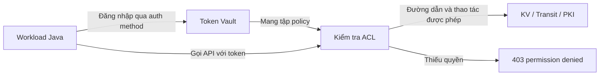

# Quyền `create`, `read`, `update`, `delete`, `list` và các quyền đặc biệt trong Spring Vault

Khi ứng dụng Java gọi **HashiCorp Vault** qua **Spring Vault** (`VaultTemplate`), một token đăng nhập hợp lệ chưa có nghĩa là mọi thao tác đều được phép. Vault dùng **ACL policy** để xét token có được thực hiện thao tác cụ thể trên một đường dẫn API hay không. Nắm đúng ý nghĩa từng *capability* giúp ứng dụng đọc KV secrets, mã hóa bằng Transit, xin chứng chỉ từ PKI và quản lý token/lease mà không cần quyền vượt quá chức năng của mình.

Bài này thuộc chương **Phân quyền truy cập**, đi sâu vào năm quyền phổ biến `create`, `read`, `update`, `delete`, `list`, đồng thời giải thích các quyền đặc biệt `patch`, `sudo`, `deny` và những giới hạn bổ sung trong policy. Trọng tâm là cách từ một thao tác Java suy ra đúng quyền Vault, cách tránh nhầm lẫn khi dùng **KV v2**, và cách kiểm chứng bằng danh tính thật của workload.

## 1. Mô hình ra quyết định của Vault

Luồng cơ bản gồm bốn bước:



- **Authentication** xác nhận workload là ai: chẳng hạn Kubernetes ServiceAccount, AppRole hoặc phương thức phù hợp với môi trường.
- **Authorization** quyết định token có quyền gì trên **đường dẫn API cụ thể** thông qua policy. Đây là phần `capabilities` kiểm soát.
- **Secrets engine** thực hiện nghiệp vụ cuối cùng sau khi ACL cho phép. Một request được phép qua ACL vẫn có thể thất bại vì payload không hợp lệ, secret không tồn tại, PKI role giới hạn tên miền hoặc yêu cầu CAS không thỏa mãn.

Policy được biểu diễn dưới dạng HCL:

```hcl
# KV v2 mount tại "secret"; chỉ cấp quyền đọc một key.
path "secret/data/billing-api/runtime" {
  capabilities = ["read"]
}
```

Trong `path`, **không viết** tiền tố `/v1/`. Vault xử lý đường dẫn API như `secret/data/billing-api/runtime`, còn `capabilities` quy định các thao tác được cấp tại đường dẫn đó. Nếu không có quyền phù hợp thì mặc định bị từ chối.

## 2. Năm capability chính: hiểu theo hành vi API

| Capability | Quyền được biểu đạt | HTTP/API thường gặp | Ví dụ |
| --- | --- | --- | --- |
| `create` | Tạo tài nguyên/giá trị mới | POST hoặc PUT tùy endpoint và ngữ nghĩa tạo mới | Tạo một secret KV chưa tồn tại |
| `read` | Lấy dữ liệu hiện có | GET | Đọc secret, đọc metadata được cho phép |
| `update` | Sửa hoặc thực hiện thao tác ghi theo API | POST/PUT tùy endpoint | Cập nhật secret; gọi Transit encrypt; PKI issue |
| `delete` | Xóa tài nguyên theo ngữ nghĩa endpoint | DELETE | Xóa mềm phiên bản KV v2 hiện tại |
| `list` | Liệt kê tên mục con | LIST, hoặc cách biểu diễn tương đương do client dùng | Liệt kê tên secret dưới một prefix |

**Không nên suy ra capability chỉ từ tên hàm Java hay động từ nghiệp vụ.** Ví dụ hàm `encrypt()` “chỉ mã hóa” nhưng API Transit dùng request ghi nên thường cần `update`; hàm liệt kê key cần `list` trên đường dẫn **metadata** KV v2, chứ không cần `read` trên `data/`.

### `create`: chỉ cho phép tạo khi cần thiết

```hcl
path "secret/data/billing-api/new-config" {
  capabilities = ["create"]
}
```

Với KV v2, `create` có thể đủ cho luồng tạo secret mới nếu backend xác định đây là thao tác tạo. Nhưng `create` **không thay cho `update`** khi quy trình cần chỉnh sửa giá trị đã có. Một số endpoint dùng POST để thực thi hành động, không dựa đơn giản vào quy tắc “POST thì luôn là create”. Vì vậy, phải kiểm tra tài liệu endpoint và thử bằng token có quyền thực tế.

### `read`: đọc nội dung, không hàm ý liệt kê

```hcl
path "secret/data/billing-api/runtime" {
  capabilities = ["read"]
}
```

Capability này phù hợp với service chỉ lấy trước một secret được định danh chính xác. Nó không tự cấp quyền xem secret khác và không tự cấp `list` cho thư mục cha. Cũng đừng nhầm việc API trả về metadata gắn cùng giá trị đọc với quyền `read` trên **endpoint metadata riêng**.

### `update`: cập nhật dữ liệu *hoặc* thực thi tác vụ

```hcl
# Writer cần cập nhật secret đã có.
path "secret/data/billing-api/runtime" {
  capabilities = ["update"]
}

# Mã hóa bằng key Transit; không cho phép quản lý key.
path "transit/encrypt/billing-pii" {
  capabilities = ["update"]
}

# Xin chứng chỉ từ PKI role cho phép; không cho phép sửa PKI role.
path "pki_int/issue/billing-client" {
  capabilities = ["update"]
}
```

Đây là một khác biệt quan trọng: `update` trong Vault không chỉ có nghĩa là “ghi đè một bản ghi”. Nhiều API nhận POST để tạo kết quả nghiệp vụ như ciphertext hoặc chứng chỉ mới. Quyền `update` trên `transit/encrypt/billing-pii` **không** đồng nghĩa với quyền thay cấu hình `transit/keys/billing-pii`.

### `delete`: phải xác định “xóa” nghĩa là gì

```hcl
path "secret/data/billing-api/temp" {
  capabilities = ["delete"]
}
```

Ví dụ này cho phép DELETE tại đường dẫn `data/` của KV v2, thường là xóa mềm version mới nhất. Nó **không** mặc nhiên cho phép hủy vĩnh viễn mọi phiên bản. Quyền xóa cần được giới hạn theo đúng endpoint và mô hình lưu trữ phiên bản.

### `list`: chỉ nhìn thấy tên, nhưng tên cũng là thông tin

```hcl
# Liệt kê các mục dưới prefix billing-api.
path "secret/metadata/billing-api" {
  capabilities = ["list"]
}
```

Với KV v2, liệt kê thường thực hiện qua `secret/metadata/<prefix>`. Token có `list` chỉ biết tên đường dẫn trả về, chưa chắc đọc được giá trị từng secret. Dẫu vậy, tên key như `prod-payment-credentials` có thể tiết lộ cấu trúc hạ tầng hoặc nghiệp vụ, vì thế `list` vẫn cần lý do cấp quyền rõ ràng. Quyền `read` trên một secret không kéo theo quyền liệt kê cả thư mục của nó.

## 3. `create` và `update` khác nhau trong thực hành ra sao?

Điểm dễ nhầm nhất là câu “ứng dụng ghi secret thì phải cấp `write`”. ACL policy chuẩn của Vault **không dùng capability chung tên `write`**; thay vào đó phân biệt `create`, `update` và trong các phiên bản/endpoint hỗ trợ, `patch`.

| Tình huống | Quyền cần cân nhắc | Ghi chú |
| --- | --- | --- |
| Khởi tạo secret KV v2 tại key chưa có dữ liệu | `create` | Kiểm tra endpoint xử lý trường hợp tạo mới |
| Thay đổi giá trị của secret KV v2 đã tồn tại | `update` | Không giả định `create` sẽ cho sửa |
| Một job phải xử lý cả tạo mới lẫn cập nhật | `create`, `update` | Mở rộng **hai capability**, nhưng chỉ tại key được quản lý |
| Chỉ đọc config trong runtime | `read` | Không cần bất kỳ quyền ghi nào |
| Gọi Transit encrypt/decrypt, PKI issue | Thường là `update` trên endpoint tác vụ | Không cấp quyền quản trị của secrets engine |

Ví dụ job cập nhật cấu hình một ứng dụng phải chạy được cả ở lần triển khai đầu tiên và các lần tiếp theo:

```hcl
# Job quản lý đúng một key, không có quyền đọc/list/delete.
path "secret/data/billing-api/runtime" {
  capabilities = ["create", "update"]
}
```

Tại sao không cấp thêm `read`? Nếu job nhận giá trị mới từ một nguồn tin cậy và chỉ cần ghi, khả năng đọc ngược dữ liệu cũ có thể không nằm trong nhu cầu. Nếu job triển khai dựa trên so sánh phiên bản hoặc điều phối phức tạp hơn thì cần xem xét bổ sung đúng các quyền phát sinh; không mở rộng theo thói quen.

## 4. KV v2: cùng tên secret nhưng khác đường dẫn quyền

Spring Vault cung cấp `VaultKeyValueOperations` để thao tác KV v2 theo tên key gọn. Tuy nhiên, quyền của Vault được kiểm tra trên **đường dẫn HTTP sau khi SDK đã ánh xạ**. Nếu mount KV v2 tên `secret` và key là `billing-api/runtime`, các thao tác thường có dạng:

| Nhu cầu | API path (`/v1/` được lược) | HTTP thường dùng | Capability |
| --- | --- | --- | --- |
| Lấy giá trị/phiên bản | `secret/data/billing-api/runtime` | GET | `read` |
| Tạo hoặc cập nhật nội dung | `secret/data/billing-api/runtime` | POST | `create`/`update` theo ngữ nghĩa thao tác |
| Xóa mềm version mới nhất | `secret/data/billing-api/runtime` | DELETE | `delete` |
| Xem metadata của key | `secret/metadata/billing-api/runtime` | GET | `read` |
| Liệt kê các key dưới prefix | `secret/metadata/billing-api` | LIST | `list` |
| Xóa mềm các version được chỉ định | `secret/delete/billing-api/runtime` | POST | `update` |
| Khôi phục version đã xóa mềm | `secret/undelete/billing-api/runtime` | POST | `update` |
| Hủy vĩnh viễn version được chỉ định | `secret/destroy/billing-api/runtime` | POST | `update` |
| Xóa metadata và toàn bộ version của key | `secret/metadata/billing-api/runtime` | DELETE | `delete` |

Lưu ý: `delete` ở **`data/`** và `update` ở **`destroy/`** là hai quyền khác nhau, dù cả hai endpoint có liên quan đến việc xóa. Bảo vệ endpoint `destroy/` và thao tác xóa metadata đặc biệt chặt chẽ vì có thể dẫn tới mất dữ liệu không thể khôi phục.

### Policy chỉ đọc, không liệt kê hoặc sửa

```hcl
# billing-api-read.hcl
path "secret/data/billing-api/runtime" {
  capabilities = ["read"]
}
```

### Policy ghi riêng cho job cấu hình

```hcl
# billing-config-writer.hcl
path "secret/data/billing-api/runtime" {
  capabilities = ["create", "update"]
}
```

### Policy để duyệt tên key trong một khu vực được phê duyệt

```hcl
# Chỉ cấp nếu chương trình có chức năng duyệt danh sách key.
path "secret/metadata/billing-api" {
  capabilities = ["list"]
}

# Bổ sung cho các cấp con, nếu thực sự cần.
path "secret/metadata/billing-api/*" {
  capabilities = ["list"]
}
```

Không gộp ba policy này vào token của mọi workload. `billing-api` runtime có thể chỉ cần policy đọc, trong khi `billing-config-writer` là job có danh tính và vòng đời riêng. Một dịch vụ chỉ cần đọc key cố định thậm chí không cần có endpoint `metadata/` trong policy.

## 5. Các quyền đặc biệt: `patch`, `sudo`, `deny`

Ngoài năm capability chính, Vault ACL còn có các quyền và quy tắc mang ý nghĩa đặc biệt. Chúng **không** được gán theo mặc định cho ứng dụng Java.

### `patch`: cập nhật một phần nếu endpoint hỗ trợ

`patch` dành cho API chấp nhận HTTP PATCH. Ví dụ KV v2 có API PATCH để hợp nhất một phần nội dung bản ghi thay vì thay thế toàn bộ dữ liệu. Cách dùng phụ thuộc phiên bản Vault, secrets engine và client đang sử dụng:

```hcl
# Chỉ dành cho workload được phép PATCH secret này.
path "secret/data/billing-api/runtime" {
  capabilities = ["patch"]
}
```

`patch` **không tự bao gồm `create` hoặc `update`**, và cấp `update` cũng không nên được hiểu như quyền PATCH trên mọi endpoint. Để cập nhật KV v2 có kiểm soát, còn phải tuân thủ các ràng buộc phiên bản như CAS nếu mount hoặc request yêu cầu. Khi sử dụng phương thức Spring Vault, hãy kiểm tra HTTP request thực tế mà SDK gửi: một thao tác `put` thay toàn bộ giá trị không nhất thiết dùng PATCH.

### `sudo`: dành cho endpoint yêu cầu đặc quyền bổ sung

Một số API quản trị Vault được đánh dấu là **root-protected**. Khi đó, ngoài capability tương ứng (`read`, `update`, `delete`, ...), policy còn có thể cần `sudo`:

```hcl
# Minh họa dành cho vai trò vận hành; không gắn vào runtime app.
path "sys/mounts/*" {
  capabilities = ["read", "update", "sudo"]
}
```

Đây là ví dụ về nguyên tắc phối hợp quyền, **không phải policy quản trị dùng nguyên xi**: trước khi triển khai phải xác định chính xác endpoint và capability mà tác vụ quản trị cần, kể cả đường dẫn gốc hoặc đường dẫn con. `sudo` **không biến token thành root token**, không tự cấp mọi quyền và không thay thế capability thao tác. Vì quyền này mở cửa vào các endpoint nhạy cảm, không đưa `sudo` vào policy của `VaultTemplate` chạy nghiệp vụ thông thường.

### `deny`: từ chối tường minh

```hcl
# Ví dụ: cho phép đọc nhánh reports, chặn vùng protected.
path "secret/data/reports/*" {
  capabilities = ["read"]
}

path "secret/data/reports/protected/*" {
  capabilities = ["deny"]
}
```

`deny` không phải quyền “được làm gì đó”, mà là quy tắc cấm truy cập. Ở một quy tắc quyền hiệu lực có `deny`, `deny` được ưu tiên so với khả năng cho phép. Khi token có nhiều policy, đặc biệt khi có mẫu đường dẫn chồng lấp hoặc ký tự đại diện, cần kiểm tra **quy tắc được Vault chọn theo độ ưu tiên** để tránh kết luận sai rằng một `deny` rất rộng luôn xử lý mọi ngoại lệ cụ thể.

Không nên dùng `deny` như cách thay thế cho việc thiết kế policy hẹp ngay từ đầu. Cách đơn giản thường an toàn hơn: chỉ cấp `read` trên đúng key được phép; chỉ dùng `deny` tường minh khi cần thể hiện một ranh giới cấm trong chính sách nhiều lớp.

### Có phải `root` cũng là một capability?

**Không.** `root` là trạng thái/chính sách đặc biệt liên quan đến root token và quyền siêu quản trị của Vault; nó **không** phải capability thông thường thêm vào mảng `capabilities`. Không viết `capabilities = ["root"]` với kỳ vọng token ứng dụng có quyền tối cao. Root token chỉ dành cho công việc khởi tạo/khôi phục/quản trị đặc biệt, không dùng làm token của workload Java.

## 6. Ngoài capability: kiểm soát yêu cầu bằng ràng buộc policy

`capabilities` quyết định nhóm thao tác có thể chạy; một số policy còn hỗ trợ **ràng buộc tham số** và **response wrapping** để giới hạn cách gọi. Chúng là thuộc tính bổ sung của policy, **không phải capability mới**.

| Thuộc tính | Mục đích | Khi cần cân nhắc |
| --- | --- | --- |
| `allowed_parameters` | Giới hạn tham số và/hoặc giá trị được gửi đến endpoint | Chỉ cho phép payload trong phạm vi đã thẩm định |
| `denied_parameters` | Cấm tham số hoặc giá trị cụ thể | Không cho một caller thay đổi tùy chọn nhạy cảm |
| `required_parameters` | Buộc request chứa tham số được chỉ định | Yêu cầu caller cung cấp thông tin bắt buộc |
| `min_wrapping_ttl`, `max_wrapping_ttl` | Giới hạn TTL của response wrapping | Dịch vụ chuyển giao dữ liệu qua wrapping token ngắn hạn |

Ví dụ minh họa ý nghĩa của `required_parameters` khi cho phép gọi PKI issue:

```hcl
path "pki_int/issue/billing-client" {
  capabilities = ["update"]
  required_parameters = ["common_name"]
}
```

Quy tắc trên yêu cầu payload chứa `common_name`; **nó không xác thực rằng tên miền đó đã được phép cấp**. Quyền phát hành chứng chỉ còn phụ thuộc **PKI role** và các giới hạn tên miền/SAN/TTL được cấu hình trong role. Nếu cần kiểm soát giá trị chặt hơn, bổ sung ràng buộc thích hợp và kiểm thử tương thích với endpoint đang chạy.

Ngoài ra, một số bản phát hành/tính năng Vault Enterprise có cơ chế phê duyệt như **control groups**. Đây cũng là lớp kiểm soát bổ sung, không nên đánh đồng với `sudo` hay mặc nhiên cho rằng mọi bản cài Vault đều hỗ trợ.

## 7. So khớp `path` và ghép quyền của nhiều policy

Quyền đúng nhưng **đường dẫn sai** vẫn dẫn tới từ chối. Các mẫu sau có phạm vi rất khác nhau:

```hcl
# Khớp đúng một key.
path "secret/data/billing-api/runtime" {
  capabilities = ["read"]
}

# Mở rộng cho nhiều key bên dưới prefix; cần review riêng.
path "secret/data/billing-api/*" {
  capabilities = ["read"]
}

# Dấu + đại diện một thành phần đường dẫn trong mẫu phù hợp.
path "secret/data/+/public-config" {
  capabilities = ["read"]
}
```

`*` ở vị trí hậu tố và `+` theo thành phần đường dẫn có quy tắc riêng trong ACL Vault; chúng không phải regex. Khi nhiều mẫu có thể khớp cùng một request, Vault sử dụng các quy tắc ưu tiên (mẫu khớp chính xác, độ cụ thể của tiền tố, vị trí wildcard, ...). Với các policy khớp cùng mẫu đường dẫn có hiệu lực, các capability được kết hợp; `deny` tương ứng sẽ chặn. Để đảm bảo ranh giới quyền, hãy **kiểm tra capability hiệu lực** trên từng path mục tiêu thay vì dựa vào trực giác về wildcard.

Phân tách ba việc dễ bị lẫn:

1. **Gắn policy cho danh tính:** auth role của Kubernetes/AppRole hoặc cấu hình token quyết định token nhận những policy nào.
2. **Khớp đường dẫn yêu cầu:** Vault so path thực tế với ACL của token, có xét quy tắc ưu tiên.
3. **Chấp nhận request nghiệp vụ:** sau ACL, secrets engine còn kiểm tra trạng thái tài nguyên, schema payload, TTL hoặc rule riêng.

Đường dẫn mount là phần của ACL. Nếu đổi tên mount `secret/` thành `kv/`, policy sử dụng `secret/data/...` không tự chuyển sang `kv/data/...`. Tương tự, trong môi trường có **Vault namespace**, quyền phải được đánh giá trong namespace mà workload đang truy cập.

## 8. Ánh xạ các thao tác Spring Vault sang capability

Mã Java sau minh họa hai nhóm hành vi thường gặp trên KV v2; giả định `VaultTemplate` đã được cấu hình client authentication bằng danh tính workload và mount `secret` đã bật KV phiên bản 2.

```java
import java.util.List;
import java.util.Map;

import org.springframework.vault.core.VaultKeyValueOperations;
import org.springframework.vault.core.VaultKeyValueOperationsSupport.KeyValueBackend;
import org.springframework.vault.core.VaultTemplate;
import org.springframework.vault.support.VaultResponse;

public final class BillingConfigStore {

    private final VaultKeyValueOperations kv;

    public BillingConfigStore(VaultTemplate vaultTemplate) {
        this.kv = vaultTemplate.opsForKeyValue("secret", KeyValueBackend.KV_2);
    }

    public Map<String, Object> readRuntime() {
        VaultResponse response = kv.get("billing-api/runtime");
        if (response == null || response.getData() == null) {
            throw new IllegalStateException("Không tìm thấy secret billing-api/runtime");
        }
        return response.getData();
    }

    // Chỉ chạy với identity của job được cấp create/update.
    public void replaceRuntime(Map<String, Object> values) {
        kv.put("billing-api/runtime", values);
    }

    // Chỉ dùng khi có quyền list trên metadata của prefix.
    public List<String> listBillingKeys() {
        return kv.list("billing-api");
    }

    // Tác vụ riêng, không thuộc quyền của service runtime đọc cấu hình.
    public void deleteRuntimeLatestVersion() {
        kv.delete("billing-api/runtime");
    }
}
```

Các phương thức cùng nằm trong một lớp để thấy rõ sự ánh xạ; **không có nghĩa một workload nên được cấp đủ mọi quyền**. Trong thiết kế thực tế, hãy tách service runtime chỉ đọc, writer job và cleanup job thành các danh tính độc lập nếu trách nhiệm của chúng khác nhau.

| Phương thức Spring Vault | API path tương ứng cho KV v2 | Quyền cần xem xét |
| --- | --- | --- |
| `kv.get("billing-api/runtime")` | `secret/data/billing-api/runtime` | `read` |
| `kv.put("billing-api/runtime", ...)` | `secret/data/billing-api/runtime` | `create`, `update` theo việc key mới/đã có |
| `kv.list("billing-api")` | `secret/metadata/billing-api` | `list` |
| `kv.delete("billing-api/runtime")` | `secret/data/billing-api/runtime` | `delete` |

Đối với `VaultTemplate.read("...")` hoặc `VaultTemplate.write("...")` trực tiếp, nhà phát triển phải tự biết đường dẫn API và cấu trúc payload backend tương ứng. Khi dùng `VaultKeyValueOperations` với KV v2, Spring Vault hỗ trợ xử lý cấu trúc `data/` theo kiểu backend đã chọn. Quyền cuối cùng vẫn được Vault xét trên **HTTP request thực**.

Ứng dụng không nên đưa toàn bộ nội dung secret, token, ciphertext nhạy cảm hoặc dữ liệu PKI private key vào log khi thao tác thất bại. Chỉ nên ghi thông tin chẩn đoán như loại thao tác, endpoint đã chuẩn hóa, mã lỗi, correlation/request ID phù hợp và danh tính workload ở mức không nhạy cảm.

## 9. Transit, PKI, token và lease: những capability dễ gây ngộ nhận

### Transit encryption

```hcl
path "transit/encrypt/billing-pii" {
  capabilities = ["update"]
}

# Chỉ thêm khi service thật sự phải giải mã.
path "transit/decrypt/billing-pii" {
  capabilities = ["update"]
}
```

Mã hóa và giải mã có thể là hai quyền **độc lập**. Một producer chỉ mã hóa dữ liệu không nhất thiết cần decrypt. Các API cấu hình key (`transit/keys/...`), export, backup hay restore không thuộc phạm vi của một service chỉ sử dụng phép toán Transit.

### PKI certificate issuance

```hcl
path "pki_int/issue/billing-client" {
  capabilities = ["update"]
}
```

Được gọi `issue` không có nghĩa là được đổi PKI role, cấp CA hay thu hồi chứng chỉ bất kỳ. Role PKI định nghĩa ràng buộc cấp chứng chỉ; ACL của token giới hạn endpoint có thể gọi. Hai cơ chế cần được quản lý đồng thời.

### Token và lease

```hcl
# Chỉ bổ sung khi workload cần các thao tác tự phục vụ này,
# và token không đã được cấp chúng qua policy mặc định.
path "auth/token/lookup-self" {
  capabilities = ["read"]
}

path "auth/token/renew-self" {
  capabilities = ["update"]
}
```

Token thường có **TTL**, có thể renewable hoặc không, chịu giới hạn max TTL/period theo cấu hình auth method. `update` trên `renew-self` chỉ cho phép **yêu cầu** renew, không bảo đảm Vault luôn gia hạn. **Dynamic secrets** lại có lease và cơ chế renew/revoke riêng; secret KV v2 phiên bản hóa là một khái niệm khác. Không cấp các đường dẫn `auth/token/*`, `sys/leases/*` một cách rộng rãi vì ứng dụng gặp lỗi hết hạn: cần xác định chính xác vai trò của session manager và loại lease cần quản lý.

## 10. Kiểm tra quyền trước khi đưa vào production

Một policy HCL hợp lệ về cú pháp chưa chắc đúng về phạm vi. Nên duyệt theo danh mục request, nạp policy bằng danh tính quản trị phù hợp và kiểm tra bằng **token của workload**:

```bash
# Lệnh quản trị, phải dùng danh tính có quyền quản lý policy.
vault policy write billing-api-read billing-api-read.hcl
vault policy read billing-api-read
```

Sau khi gắn policy vào auth role, đăng nhập bằng danh tính tương đương service chạy thực tế. Không dùng root token để kết luận policy ứng dụng đúng:

```bash
# Chỉ làm trong môi trường kiểm thử và với token tạm thời.
export VAULT_TOKEN="REPLACE_WITH_TEST_WORKLOAD_TOKEN"

# Kỳ vọng: read.
vault token capabilities secret/data/billing-api/runtime

# Kỳ vọng: deny với policy đọc tối thiểu.
vault token capabilities secret/metadata/billing-api
vault token capabilities secret/data/payroll-api/runtime
vault token capabilities secret/destroy/billing-api/runtime

# Với token chỉ đọc, thử lấy secret hợp lệ.
vault kv get -mount=secret billing-api/runtime
```

Lệnh `vault token capabilities` cho biết các quyền hiệu lực tại đường dẫn đã nhập. Lưu ý bản thân lệnh kiểm tra cũng gọi API Vault và có thể cần quyền tự kiểm tra capability (thường do policy `default` cung cấp); nếu auth role chủ ý loại bỏ policy `default`, phải cấu hình quyền hỗ trợ phép kiểm thử phù hợp hoặc dùng phương thức đánh giá do quản trị viên cấp phép. Sau kiểm tra khả năng, tiếp tục chạy **request thực** với tài nguyên kiểm thử tồn tại.

### Ma trận kiểm thử cho hai workload

| Kịch bản | Token runtime chỉ `read` | Token writer có `create`, `update` |
| --- | --- | --- |
| GET giá trị `billing-api/runtime` | Thành công | Bị từ chối nếu không cấp `read` |
| Ghi giá trị `billing-api/runtime` | Bị từ chối | Thành công với create/update phù hợp |
| LIST `secret/metadata/billing-api` | Bị từ chối | Bị từ chối |
| GET `payroll-api/runtime` | Bị từ chối | Bị từ chối |
| DELETE `secret/data/billing-api/runtime` | Bị từ chối | Bị từ chối |
| POST `secret/destroy/billing-api/runtime` | Bị từ chối | Bị từ chối |

**Điều kiện của kiểm thử:** Secret đích phải có trạng thái rõ ràng (chưa tồn tại/đang tồn tại), backend mount đúng KV v2, token thực nhận đúng policy và không mang thêm policy rộng. Dùng key riêng cho test ghi/xóa. Kết quả `404`, lỗi CAS, lỗi validation hoặc lỗi PKI role không nên bị nhầm thành chứng cứ cho một kiểm thử từ chối ACL.

### Xử lý lỗi thường gặp

| Triệu chứng | Nghi vấn cần kiểm tra | Cách xử lý |
| --- | --- | --- |
| `403 permission denied` khi `kv.get()` | Có `read` nhưng cấp tại `secret/billing-api/...` thay vì `secret/data/...`; hoặc token thiếu policy | In ra path/operation đã chuẩn hóa trong telemetry, xác thực lại mapping auth role và ACL |
| `403` khi `kv.list()` dù `kv.get()` chạy được | Có `read` tại `data/` nhưng không có `list` tại `metadata/` | Chỉ thêm `list` nếu use case thật sự cần |
| Ghi lần đầu được, ghi lần sau lỗi quyền | Writer chỉ có `create` mà thiếu `update` | Đánh giá lại nghiệp vụ và bổ sung `update` đúng key nếu cần |
| Đọc được nhưng sửa/xóa bị từ chối | Token chỉ có `read` | Đúng kỳ vọng nếu runtime không phải writer/cleanup |
| Transit encrypt `403` | Thiếu `update` đúng `transit/encrypt/<key>` | Sửa path/capability, tránh cấp `transit/*` |
| PKI issue `403` hoặc lỗi validation | Thiếu `update` tại `issue/<role>` hoặc vi phạm rule PKI role | Phân biệt lỗi ACL với ràng buộc domain/SAN/TTL |
| Có quyền nhưng request vẫn thất bại | Sai payload, token hết hạn, không có version, CAS mismatch, lease hết hạn | Quan sát mã lỗi cụ thể; không mở rộng policy theo phỏng đoán |

## 11. Bài tập tình huống

**Tình huống A – Dịch vụ đọc cấu hình.** `notification-api` chỉ phải đọc `secret/data/notification-api/smtp`, tuyệt đối không được thấy các key khác. Hãy xác định quyền cần cấp và hai kiểm thử âm tính.

<details>
<summary>Lời giải tham khảo</summary>

```hcl
path "secret/data/notification-api/smtp" {
  capabilities = ["read"]
}
```

Kiểm thử âm tính: LIST `secret/metadata/notification-api` và GET `secret/data/payroll-api/runtime` phải bị từ chối. Một lần đọc thành công không chứng minh token không có quyền dư, nên kiểm thử cả request bị cấm.

</details>

**Tình huống B – Job ghi cấu hình.** Job phải tạo `secret/data/notification-api/smtp` ở môi trường mới và thay nội dung khi xoay vòng thông tin đăng nhập, nhưng không cần liệt kê hoặc xóa. Có nên cấp `delete`, `list`, `read`?

<details>
<summary>Lời giải tham khảo</summary>

Chỉ cần cân nhắc `create` và `update` tại **đúng key**. Không có yêu cầu nghiệp vụ cho `delete`/`list`/`read` thì không cấp chúng. Nếu job cần so sánh version hiện tại bằng API metadata, bổ sung quyền đó sau khi xác minh request thực.

</details>

**Tình huống C – Xóa phiên bản KV v2.** Một engineer cấp `delete` trên `secret/data/app/test` và nghĩ rằng có thể xóa vĩnh viễn một version qua endpoint `secret/destroy/app/test`. Vì sao sai?

<details>
<summary>Lời giải tham khảo</summary>

Với KV v2, DELETE `secret/data/app/test` liên quan đến xóa mềm version mới nhất. Hủy vĩnh viễn những version xác định gọi POST `secret/destroy/app/test`, thường cần `update` **trên chính đường dẫn `destroy/`**. Không suy quyền từ tên hành động “xóa” trong ngôn ngữ nghiệp vụ.

</details>

**Tình huống D – Quyền `sudo`.** Một Java service phải mã hóa PII bằng Transit. Đồng nghiệp đề xuất thêm `sudo` “để chắc chắn chạy được”. Bạn phản biện thế nào?

<details>
<summary>Lời giải tham khảo</summary>

Tác vụ mã hóa thường chỉ cần `update` trên `transit/encrypt/<key>`. `sudo` dành cho endpoint đặc quyền quản trị, không giúp giải quyết lỗi do sai path hay thiếu quyền Transit cụ thể. Phải thử trên token đúng workload và sửa đúng endpoint bị từ chối.

</details>

## 12. Checklist rà soát capability

Trước khi đưa policy vào vận hành, hãy kiểm tra:

1. **Path chính xác:** tính từ API `/v1/` và có đúng mount, đúng nhánh `data/`/`metadata/` nếu dùng KV v2.
2. **Quyền tối thiểu:** runtime chỉ đọc không có `create`/`update`/`delete`/`list`; job riêng có đúng quyền cho nhiệm vụ được giao.
3. **Phân biệt cập nhật và tác vụ:** Transit encrypt, PKI issue và một số endpoint xóa version qua POST thường cần `update`.
4. **Kiểm tra quyền đặc biệt:** `patch` chỉ khi PATCH thật sự dùng; `sudo` chỉ khi endpoint quản trị yêu cầu; `deny` được xác minh với các mẫu path chồng lấp.
5. **Ràng buộc phía secrets engine:** PKI role, Transit key settings, KV CAS, phiên bản secret và TTL/lease đều được xét độc lập với ACL.
6. **Danh tính workload:** token lấy từ auth role dự kiến, với TTL và chính sách tự gia hạn/xác thực lại phù hợp; không thử nghiệm bằng root token.
7. **Kiểm thử cả hai chiều:** xác minh request cần được phép **thành công**, request không cần phải **bị từ chối**, và log giám sát không chứa secret/token.

Trong **Spring Vault**, chọn đúng phương thức Java là bước đầu; chọn đúng **path và capability** mới khiến ứng dụng truy cập Vault an toàn. Khi phân biệt được `create`, `read`, `update`, `delete`, `list`, `patch`, `sudo` và `deny`, đội phát triển có thể giải thích một lỗi `403` từ yêu cầu API cụ thể, thu hẹp quyền theo từng workload và duy trì khả năng kiểm soát các secret trong suốt vòng đời hệ thống.
