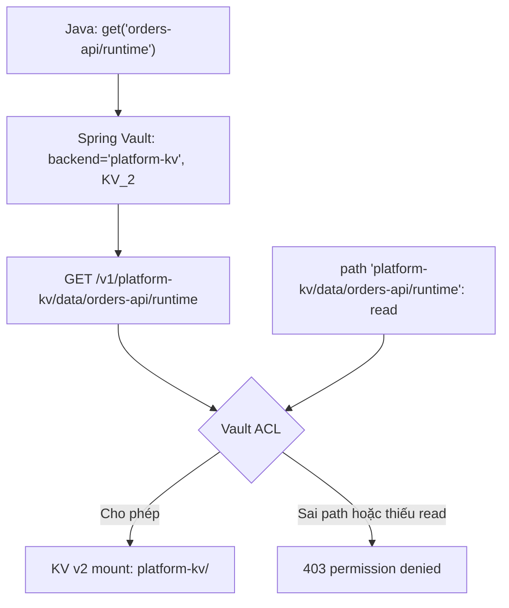

# Khớp đường dẫn policy với mount path thực tế trong Spring Vault

Trong **HashiCorp Vault**, một ACL policy không cấp quyền theo “tên secret” mà lập trình viên nhìn thấy trong giao diện hoặc trong lệnh CLI. Nó cấp quyền theo **đường dẫn API thực tế** được Vault nhận khi ứng dụng gọi tới. Vì vậy, một Java service dùng **Spring Vault** có thể đăng nhập thành công, có capability `read`, nhưng vẫn nhận `403 permission denied` nếu policy trỏ tới sai **mount path**, sai phần đường dẫn của secrets engine hoặc sai namespace.

Bài học này thuộc chương **Phân quyền truy cập**, tập trung vào cách ánh xạ chính xác giữa mount path được cấu hình trên Vault, đường dẫn logic mà ứng dụng sử dụng, endpoint HTTP thực tế và `path` trong policy. Chúng ta sẽ thực hành với `VaultTemplate` và KV v1/KV v2, sau đó mở rộng sang Transit encryption, PKI, dynamic secrets, token và lease. Mục tiêu là tìm được *đúng path cần cấp quyền*, kiểm tra quyền bằng danh tính workload và xử lý lỗi mà không phải mở quyền rộng để “thử cho chạy”.

## 1. Kết quả cần đạt

Sau bài này, bạn có thể:

- Phân biệt rõ **mount path**, **logical key path**, **API path** và **ACL policy path**.
- Tra đúng tên mount và phiên bản KV thay vì mặc định mount nào cũng tên `secret` hoặc là KV v2.
- Suy ra endpoint `data/`, `metadata/`, `delete/`, `undelete/`, `destroy/` của KV v2 từ thao tác cụ thể.
- Ánh xạ tham số `opsForKeyValue(...)` trong Spring Vault sang đường dẫn Vault nhận được.
- Viết policy cho Transit, PKI hoặc database secrets engine được mount bằng tên tùy chỉnh.
- Phát hiện lỗi do sai mount, nhầm namespace, nhầm phiên bản engine, sai wildcard hoặc thiếu capability.
- Thiết kế phép kiểm tra dương tính và âm tính với chính token được cấp cho workload.

## 2. Bốn loại đường dẫn rất dễ bị nhầm

Giả sử đội vận hành mount KV v2 tại `platform-kv/`. Một service `orders-api` cần đọc secret logic `orders-api/runtime`.

| Khái niệm | Giá trị trong ví dụ | Ai sử dụng? |
| --- | --- | --- |
| **Mount path** | `platform-kv/` | Vault dùng để định tuyến request tới secrets engine |
| **Logical key path** | `orders-api/runtime` | CLI và API tiện ích KV trong Spring Vault sử dụng để chỉ secret |
| **HTTP API path** | `/v1/platform-kv/data/orders-api/runtime` | Request mà Vault thực sự nhận khi đọc KV v2 |
| **ACL policy path** | `platform-kv/data/orders-api/runtime` | Khối `path` trong policy, không có tiền tố `/v1/` |

Công thức tư duy với KV v2 là:

```text
HTTP path = /v1/ + <mount path> + /data/ + <logical key path>

Ví dụ:
  Mount:     platform-kv/
  Key:       orders-api/runtime
  API:       GET /v1/platform-kv/data/orders-api/runtime
  Policy:    path "platform-kv/data/orders-api/runtime"
```

Với **KV v1**, đường dẫn không có đoạn `data/`; với **Transit**, **PKI** và các engine khác, phần sau mount có quy tắc API riêng. Vì vậy, công thức trên **chỉ áp dụng cho thao tác đọc/ghi giá trị KV v2**, không phải một quy tắc chung cho mọi Vault endpoint.



Điểm mấu chốt: chuỗi `platform-kv` không có ý nghĩa đặc biệt; đó là tên do người quản trị chọn khi **enable** secrets engine. Nếu môi trường thực tế mount tại `kv-prod/`, policy dùng `platform-kv/...` sẽ không khớp dù ứng dụng vẫn gọi cùng một loại KV v2.

## 3. Mount path được xác định như thế nào?

Khi enable secrets engine, quản trị viên chọn một đường dẫn mount. Hai hệ thống có cùng loại engine nhưng tên mount khác nhau sẽ có những API path khác nhau.

Ví dụ:

| Loại engine | Mount thực tế | API path minh họa | Nhu cầu |
| --- | --- | --- | --- |
| KV v2 | `platform-kv/` | `platform-kv/data/orders-api/runtime` | Đọc cấu hình |
| KV v1 | `legacy-secrets/` | `legacy-secrets/orders-api/runtime` | Đọc secret kiểu KV v1 |
| Transit | `crypto/` | `crypto/encrypt/orders-pii` | Mã hóa dữ liệu |
| PKI | `pki-apps/` | `pki-apps/issue/orders-client` | Xin chứng chỉ |
| Database | `db-prod/` | `db-prod/creds/orders-ro` | Xin thông tin đăng nhập động |

Đừng kết luận rằng:

- Tất cả KV đều ở `secret/`.
- Tất cả Transit đều ở `transit/`.
- Mọi PKI đều ở `pki/` hoặc `pki_int/`.
- Tên key trong CLI đã chứa sẵn mọi thành phần cần viết vào policy.

Tên mount có thể là **đường dẫn nhiều thành phần**, chẳng hạn `teams/finance/kv/`. Khi đó, đối với một KV v2 secret `orders-api/runtime`:

```hcl
path "teams/finance/kv/data/orders-api/runtime" {
  capabilities = ["read"]
}
```

Không được tự cắt mount theo dấu `/` đầu tiên để lấy `teams/`, và cũng không lặp lại một phần mount trong logical key. Sự phân định mount nằm trong **cấu hình Vault**, không nằm trong cách tự đoán tên thư mục.

### Xác minh mount thay vì suy đoán

Người quản trị hoặc tài khoản chẩn đoán có quyền phù hợp có thể xem mount bằng CLI:

```bash
# Chạy bằng danh tính vận hành được phép xem danh sách mount.
vault secrets list -detailed
```

Kết quả có các thông tin như **Path**, **Type**, **Options**. Đối với KV, phần options thường cho biết phiên bản backend (ví dụ `version:2`). Hãy đối chiếu:

1. **Path:** mount thực tế có tên `platform-kv/`, `secret/` hay tên khác?
2. **Type:** đó thực sự là `kv`, `transit`, `pki`, `database` hay engine khác?
3. **Options:** KV là phiên bản 1 hay phiên bản 2?
4. **Namespace:** đang xem danh sách mount trong đúng namespace mà ứng dụng truy cập không?

Workload ứng dụng **không nhất thiết có quyền xem danh sách mount**; điều đó hoàn toàn bình thường. Khi không thể chạy lệnh trên, hãy lấy thông tin mount từ cấu hình triển khai đã được quản trị xác nhận hoặc nhờ nhóm vận hành kiểm tra. Không mở quyền `sys/mounts/*` chỉ để ứng dụng đọc một secret.

## 4. KV v1 và KV v2: cùng key nhưng policy path khác nhau

Đây là sai lệch thường gặp nhất khi triển khai Spring Vault. Giả sử logical key là `orders-api/runtime`.

### KV v1

Nếu mount `legacy-secrets/` là KV v1, đọc secret bằng API:

```text
GET /v1/legacy-secrets/orders-api/runtime
```

Policy tương ứng:

```hcl
path "legacy-secrets/orders-api/runtime" {
  capabilities = ["read"]
}
```

Với API dạng KV v1 này, **không thêm** `data/`. Việc chèn đoạn `data/` vì nhìn thấy ví dụ của KV v2 có thể làm request trỏ tới một key khác hoặc sai API mong đợi.

### KV v2

Nếu mount `platform-kv/` là KV v2, đọc cùng logical key bằng API:

```text
GET /v1/platform-kv/data/orders-api/runtime
```

Policy tương ứng:

```hcl
path "platform-kv/data/orders-api/runtime" {
  capabilities = ["read"]
}
```

**Không đúng** nếu chỉ viết:

```hcl
# PHẢN VÍ DỤ: thiếu đoạn data/ của KV v2.
path "platform-kv/orders-api/runtime" {
  capabilities = ["read"]
}
```

Hoặc:

```hcl
# PHẢN VÍ DỤ: tự thêm /v1/ vào ACL path.
path "/v1/platform-kv/data/orders-api/runtime" {
  capabilities = ["read"]
}
```

Đường dẫn trong khối `path` của ACL được viết **tương đối với API root**, vì vậy không có `/v1/` và thường không có dấu `/` mở đầu.

### Bảng đối chiếu thao tác KV v2

| Thao tác | HTTP API path (bỏ `/v1/`) | Capability thường cần |
| --- | --- | --- |
| Đọc giá trị một version | `platform-kv/data/orders-api/runtime` | `read` |
| Tạo secret mới | `platform-kv/data/orders-api/runtime` | `create` |
| Thay giá trị secret đã có | `platform-kv/data/orders-api/runtime` | `update` |
| Xóa mềm version mới nhất | `platform-kv/data/orders-api/runtime` qua DELETE | `delete` |
| Đọc metadata/version history | `platform-kv/metadata/orders-api/runtime` | `read` |
| Liệt kê tên key dưới prefix | `platform-kv/metadata/orders-api` | `list` |
| Xóa mềm version được chỉ định | `platform-kv/delete/orders-api/runtime` | `update` |
| Khôi phục version đã xóa mềm | `platform-kv/undelete/orders-api/runtime` | `update` |
| Hủy vĩnh viễn version chỉ định | `platform-kv/destroy/orders-api/runtime` | `update` |
| Xóa metadata và tất cả version | `platform-kv/metadata/orders-api/runtime` qua DELETE | `delete` |

Hai điểm cần đặc biệt cẩn thận:

- `list` đối với KV v2 được kiểm tra trên nhánh **`metadata/`**, không phải `data/`. Có `read` trên một secret không có nghĩa là được liệt kê các key trong thư mục.
- Các tác vụ “xóa” dùng **những endpoint khác nhau** và có thể cần các capability khác nhau. Quyền `delete` trên `data/` không bao gồm quyền `update` trên `destroy/`.

### Ba policy độc lập cho ba nhu cầu

Service chỉ đọc cấu hình:

```hcl
# orders-api-read.hcl
path "platform-kv/data/orders-api/runtime" {
  capabilities = ["read"]
}
```

Job xoay vòng giá trị có thể tạo hoặc thay secret này:

```hcl
# orders-config-writer.hcl
path "platform-kv/data/orders-api/runtime" {
  capabilities = ["create", "update"]
}
```

Tool kiểm kê tên secret theo thư mục, **nếu có nhu cầu thật**:

```hcl
# orders-secret-inventory.hcl
path "platform-kv/metadata/orders-api" {
  capabilities = ["list"]
}

# Nếu tool phải liệt kê ở nhiều cấp bên dưới.
path "platform-kv/metadata/orders-api/*" {
  capabilities = ["list"]
}
```

Ba policy không nên gộp vào token runtime của `orders-api` khi service chỉ cần `read`. Những quyền không cần thiết vừa tăng phạm vi sự cố, vừa làm khó việc phân tích vì sao một request được phép.

## 5. Spring Vault ánh xạ mount path như thế nào?

Trong Spring Vault, `VaultTemplate` hỗ trợ thao tác bằng đường dẫn API đầy đủ hoặc thông qua API dành riêng cho KV. Sự khác biệt này quyết định cách viết đường dẫn trong Java.

### Cách khuyến nghị với KV v2: `VaultKeyValueOperations`

```java
import java.util.Map;

import org.springframework.stereotype.Service;
import org.springframework.vault.core.VaultKeyValueOperations;
import org.springframework.vault.core.VaultKeyValueOperationsSupport.KeyValueBackend;
import org.springframework.vault.core.VaultTemplate;
import org.springframework.vault.support.VaultResponse;

@Service
public class OrdersRuntimeSecrets {

    private final VaultKeyValueOperations kv;

    public OrdersRuntimeSecrets(VaultTemplate vaultTemplate) {
        // "platform-kv" là MOUNT, không phải tên key.
        // KV_2 yêu cầu Spring Vault dùng API data/ của KV v2.
        this.kv = vaultTemplate.opsForKeyValue(
                "platform-kv",
                KeyValueBackend.KV_2);
    }

    public Map<String, Object> loadRuntime() {
        // "orders-api/runtime" là KEY bên trong mount.
        VaultResponse response = kv.get("orders-api/runtime");

        if (response == null || response.getData() == null) {
            throw new IllegalStateException("Thiếu cấu hình orders-api/runtime");
        }
        return response.getData();
    }
}
```

Spring Vault gửi request đọc tới đường dẫn tương ứng:

```text
GET /v1/platform-kv/data/orders-api/runtime
```

Do đó, policy phải khớp **`platform-kv/data/orders-api/runtime`**. Bạn chỉ truyền tên mount một lần trong `opsForKeyValue(...)` và truyền key tương đối trong `get(...)`.

### Ba nhầm lẫn thường gặp trong code

```java
// ĐÚNG: backend là mount, key là path tương đối trong KV v2.
vaultTemplate.opsForKeyValue("platform-kv", KeyValueBackend.KV_2)
             .get("orders-api/runtime");

// SAI: lặp lại tên mount trong key.
vaultTemplate.opsForKeyValue("platform-kv", KeyValueBackend.KV_2)
             .get("platform-kv/orders-api/runtime");

// SAI: tự thêm data/ trong key khi đã chọn KV_2.
vaultTemplate.opsForKeyValue("platform-kv", KeyValueBackend.KV_2)
             .get("data/orders-api/runtime");
```

Hai lời gọi sai có thể dẫn tới API path bị **lặp phần mount** hoặc **lặp `data/`**. ACL không được cấp để “hợp thức hóa” những đường dẫn do code ghép sai; hãy sửa ngay cách tạo request.

### Khi gọi `VaultTemplate.read(...)` trực tiếp

```java
// Lời gọi low-level: truyền API path đã bao gồm data/ của KV v2.
VaultResponse raw = vaultTemplate.read(
        "platform-kv/data/orders-api/runtime");
```

Với API low-level, lập trình viên tự chọn đúng endpoint và tự xử lý cấu trúc response do KV v2 trả về (bao gồm cấu trúc dữ liệu/metadata của backend). Đừng nhầm `raw.getData()` của lời gọi low-level với dữ liệu đã được API `VaultKeyValueOperations` hỗ trợ ánh xạ.

Với **KV v1**, API tiện ích phải được khai báo tương ứng:

```java
VaultKeyValueOperations legacyKv = vaultTemplate.opsForKeyValue(
        "legacy-secrets",
        KeyValueBackend.KV_1);

VaultResponse legacy = legacyKv.get("orders-api/runtime");
```

Tương ứng, ACL của KV v1 khớp `legacy-secrets/orders-api/runtime`. Việc dùng `KV_2` với mount KV v1 (hoặc ngược lại) không sửa được chỉ bằng thay policy; cần chọn đúng phiên bản backend.

### Spring Vault và Spring Cloud Vault

Hai thư viện có liên quan nhưng không nên gộp cách cấu hình:

- **Spring Vault** cung cấp `VaultTemplate`/`VaultOperations`; mount KV được đưa vào lời gọi `opsForKeyValue("platform-kv", ...)` hoặc đường dẫn trực tiếp.
- **Spring Cloud Vault** có lớp tích hợp nạp cấu hình từ Vault vào môi trường Spring và có các thuộc tính backend/context riêng. Nếu hệ thống dùng cơ chế nạp cấu hình tự động, phải kiểm tra **backend được cấu hình thực tế** và **context/profile được ghép vào key**, thay vì suy path chỉ từ code gọi `VaultTemplate`.

Ví dụ một ứng dụng đổi backend từ `secret` sang `platform-kv`, nhưng policy triển khai vẫn viết `secret/data/orders-api/runtime`: dù tên key không thay đổi, request sang mount mới sẽ không khớp ACL cũ.

## 6. Mount tùy chỉnh trong Transit, PKI và dynamic secrets

Đường dẫn `data/` không phải tiền tố chung của Vault. Mỗi secrets engine có bộ endpoint riêng **sau mount**.

### Transit được mount ở `crypto/`

Nếu service gọi endpoint mã hóa bằng key `orders-pii`:

```text
POST /v1/crypto/encrypt/orders-pii
```

Policy chỉ cho mã hóa:

```hcl
path "crypto/encrypt/orders-pii" {
  capabilities = ["update"]
}
```

Nếu cùng Transit engine được mount ở `transit/`, policy sẽ là `transit/encrypt/orders-pii`; nếu mount ở `crypto/` thì `transit/encrypt/...` không khớp. Không tự thêm `data/` hoặc cấp `crypto/*` để giải quyết lỗi này. Việc sử dụng thao tác encrypt cũng không yêu cầu quyền quản trị `crypto/keys/orders-pii`.

### PKI được mount ở `pki-apps/`

Job xin chứng chỉ theo role `orders-client` gọi:

```text
POST /v1/pki-apps/issue/orders-client
```

Policy:

```hcl
path "pki-apps/issue/orders-client" {
  capabilities = ["update"]
}
```

ACL giới hạn endpoint có thể gọi, còn **PKI role** tiếp tục giới hạn tên miền, SAN, TTL và thuộc tính chứng chỉ. Policy được cấp đúng path vẫn không bảo đảm Vault phát hành mọi yêu cầu chứng chỉ; yêu cầu cũng phải thỏa mãn quy tắc của role.

### Database dynamic secrets được mount ở `db-prod/`

Ứng dụng lấy credential ngắn hạn thông qua:

```text
GET /v1/db-prod/creds/orders-ro
```

Policy:

```hcl
path "db-prod/creds/orders-ro" {
  capabilities = ["read"]
}
```

Response có thể chứa **lease ID** và thời gian sống của credential. Lease không phải là một phần của tên mount hoặc logical key; nó là kết quả động do backend phát hành. Khi thiết kế việc renew/revoke, hãy kiểm tra endpoint và quyền lease riêng, không suy rằng `read` trên `db-prod/creds/...` cho phép quản trị mọi lease.

### Auth mount cũng có đường dẫn riêng

Phương thức xác thực như Kubernetes thường nằm dưới namespace đường dẫn `auth/`, ví dụ `auth/kubernetes/login`. Một số triển khai đăng ký auth method ở tên tùy chỉnh như `auth/aks-prod/`. Đó là **auth mount**, không phải secrets engine KV; policy cho `platform-kv/data/...` không dùng để quyết định ứng dụng có quyền cấu hình `auth/aks-prod/role/...` hay không.

Khi Spring Vault đã đăng nhập bằng danh tính workload, token được dùng cho các request sau. Đường dẫn của bước **login** và đường dẫn của bước **đọc KV** phải được chẩn đoán riêng.

## 7. Namespace, cluster và môi trường: ba yếu tố ảnh hưởng đến path thực tế

### Vault namespace

Trong những bản triển khai hỗ trợ **Vault namespaces**, request có thể mang namespace trong thông tin cấu hình client/header. Ví dụ workload đang ở namespace `org/payments`, trong đó có mount `platform-kv/`.

Đường dẫn KV v2 **tương đối trong namespace** vẫn là:

```hcl
path "platform-kv/data/orders-api/runtime" {
  capabilities = ["read"]
}
```

Đừng tự viết `org/payments/platform-kv/data/...` vào policy của namespace đó chỉ vì namespace được chỉ định là `org/payments`. Hãy kiểm tra cách client thiết lập namespace, vị trí policy được định nghĩa và mount thực tế trong cùng phạm vi namespace. Namespace không phải một thư mục tùy ý ghép vào đầu secret key.

### Đúng cluster và đúng môi trường

Một tổ chức có thể có các Vault cluster hoặc các môi trường với tên mount khác nhau:

| Nơi chạy | Mount KV v2 | Key logic | Policy path phải dùng |
| --- | --- | --- | --- |
| Dev | `kv-dev/` | `orders-api/runtime` | `kv-dev/data/orders-api/runtime` |
| Staging | `kv-stage/` | `orders-api/runtime` | `kv-stage/data/orders-api/runtime` |
| Production | `platform-kv/` | `orders-api/runtime` | `platform-kv/data/orders-api/runtime` |

Các tên chỉ là ví dụ minh họa; **không có quy ước mặc định** buộc mọi hệ thống đặt tên như vậy. Nếu dùng chung HCL và thay biến mount theo môi trường, hãy review kết quả render cuối cùng trước khi nạp policy. Biến cấu hình Vault client, đường dẫn mount thực và policy của **chính môi trường đó** phải nhất quán.

### Mount path có thể thay đổi khi di chuyển hệ thống

Nếu secrets engine được chuyển/mount lại tại đường dẫn khác, có thể cần cập nhật **cả ba**:

1. Backend/mount được ứng dụng gọi.
2. Các `path` trong ACL policy và quyền được gán cho workload.
3. Kiểm thử và tài liệu vận hành dùng CLI/API path.

Đổi duy nhất cấu hình Spring Vault có thể khiến request chuyển sang mount khác trong khi token vẫn mang policy cho mount cũ. Đừng chữa bằng `path "*"`; hãy đồng bộ tên mount theo thiết kế triển khai.

## 8. Wildcard chỉ có tác dụng sau khi đã viết đúng tiền tố API

Vault ACL hỗ trợ mẫu đường dẫn với `*` (glob hậu tố) và `+` (một thành phần đường dẫn). Các mẫu này **không phải regular expression** và cũng không tự biết KV v2 cần `data/`.

Ví dụ:

```hcl
# Đúng với nhiều key KV v2 dưới orders-api; cân nhắc phạm vi.
path "platform-kv/data/orders-api/*" {
  capabilities = ["read"]
}

# Dấu + biểu diễn một thành phần đường dẫn.
path "platform-kv/data/+/runtime" {
  capabilities = ["read"]
}
```

Mẫu đầu tiên cho phép đọc nhiều key dưới `orders-api/`; mẫu thứ hai có thể khớp `orders-api/runtime` **và** key `other-api/runtime`. Không dùng mẫu thứ hai nếu chỉ một workload cần truy cập secret của chính nó.

Phản ví dụ:

```hcl
# Sai với ý định cấp quyền đọc mọi secret KV v2 dưới orders-api:
# thiếu phần data/ giữa mount và key.
path "platform-kv/orders-api/*" {
  capabilities = ["read"]
}
```

Đặc biệt tránh policy kiểu:

```hcl
# RẤT RỘNG: bao phủ nhiều API của cả mount,
# có thể gồm data, metadata và các endpoint quản lý version.
path "platform-kv/*" {
  capabilities = ["create", "read", "update", "delete", "list"]
}
```

Nó không chỉ cấp quyền trên các key cấu hình mà còn có nguy cơ mở đường cho các endpoint phụ trợ của KV v2. Một policy như vậy khiến việc mở rộng quyền che mất lỗi sai mount/path ban đầu.

### Nếu các mẫu path chồng lấp thì sao?

Vault có quy tắc chọn path có độ ưu tiên cao hơn khi nhiều mẫu wildcard cùng khớp. Khi một số policy góp quyền trên một path hiệu lực, quyền được xét theo các quy tắc kết hợp và `deny` tương ứng. **Không giả định** rằng mọi `path` có tiền tố phù hợp đều luôn cộng quyền ngang nhau, hoặc rằng chỉ cần nhìn một file HCL là biết toàn bộ quyền của token.

Thay vì suy luận bằng mắt với nhiều wildcard, hãy kiểm tra **capability hiệu lực của token** tại từng path cần bảo vệ. Đối với trường hợp nhạy cảm, dùng path chính xác giúp policy dễ audit và ít sai hơn.

## 9. Chẩn đoán lỗi `403` và `404` theo thứ tự

Giả sử code:

```java
vaultTemplate.opsForKeyValue("platform-kv", KeyValueBackend.KV_2)
             .get("orders-api/runtime");
```

nhận `403 permission denied`. Bắt đầu bằng câu hỏi **Vault đang nhận request nào**, thay vì tăng capability trong HCL.

| Triệu chứng | Khả năng thường gặp | Cách kiểm tra có trọng tâm |
| --- | --- | --- |
| `403` dù policy có `read` | Policy nhắm `secret/data/...` nhưng mount thật là `platform-kv/` | So tên mount trong code, cấu hình Vault và khối `path` |
| `403` với KV v2 | Có `read` trên `platform-kv/orders-api/runtime` nhưng request tới `platform-kv/data/...` | Thêm `data/` **trong policy**, không trong logical key gửi cho KV_2 |
| `403` khi `list()` | Có quyền trên `data/`, thiếu `list` trên `metadata/` | Đối chiếu endpoint LIST thực tế |
| `403` chỉ ở production | Mount khác môi trường, token gắn nhầm policy hoặc namespace khác | So client endpoint, namespace, auth role và mount prod |
| `404` hoặc không tìm thấy dữ liệu | Key/phiên bản không tồn tại, sai mount, sai đường dẫn hoặc đã xóa mềm | Xác nhận sự tồn tại bằng danh tính vận hành phù hợp |
| `400`/lỗi backend khi đổi KV_1–KV_2 | Client gọi endpoint không đúng phiên bản KV | Kiểm tra type/options của mount và cấu hình `KeyValueBackend` |
| Transit `403` | Policy có `transit/encrypt/...` nhưng mount thật là `crypto/` | Sửa path theo mount hiện tại |
| PKI cấp chứng chỉ thất bại | Sai `issue/<role>` hoặc request bị PKI role từ chối | Phân biệt lỗi ACL với lỗi validation của PKI role |
| Chạy được bằng root token, lỗi bằng token service | Root token che mất sai policy workload | Kiểm thử bằng token của auth role ứng dụng |

Một kết quả `403` có thể do token hết hạn, bị thu hồi hoặc có vấn đề khác ở tầng authorization. Một `404` cũng **không chứng minh** policy đúng. Cần nhìn đồng thời mount, namespace, đường dẫn, phương thức request, danh tính và trạng thái backend.

Quy trình chẩn đoán đề xuất:

1. **Đọc cấu hình client:** Vault address, namespace (nếu có), auth method/role, tên backend trong Java.
2. **Xác định mount thực:** tên mount và phiên bản backend từ người vận hành hoặc danh sách mount được phép truy cập.
3. **Dựng lại request API:** phương thức HTTP, đường dẫn không có `/v1/`, trường hợp `data/`/`metadata/` của KV v2.
4. **Đối chiếu policy đã gắn:** không chỉ nhìn tên policy trong Git; kiểm tra policy hiệu lực với danh tính workload.
5. **Thử request dương tính và âm tính:** đúng endpoint phải chạy; endpoint khác workload phải bị từ chối.
6. **Phân tích lỗi còn lại:** backend version, secret version, CAS, PKI role, token TTL và trạng thái lease.

Trong log/telemetry, ghi loại thao tác, mã lỗi, correlation ID và đường dẫn đủ để chẩn đoán theo chính sách bảo mật của tổ chức; **không ghi nội dung secret, token hoặc private key**. Tên secret cũng có thể là thông tin nhạy cảm, nên cân nhắc che bớt ở hệ thống log tập trung.

## 10. Kiểm tra capability trên đúng API path

Các lệnh sau dùng môi trường thử nghiệm đã có mount `platform-kv/` KV v2, key `orders-api/runtime` và token của `orders-api`. Để nạp policy, người quản trị dùng danh tính có quyền quản lý policy:

```bash
# Dùng bằng danh tính vận hành có quyền quản lý policy.
vault policy write orders-api-read orders-api-read.hcl
vault policy read orders-api-read
```

Sau khi auth role đã gắn policy, đăng nhập bằng workload hoặc một danh tính kiểm thử tương đương. Không in token thật vào log hoặc commit nó vào repo. Có thể dùng:

```bash
# Yêu cầu CLI đang dùng token của workload thử nghiệm.
# Kỳ vọng: read.
vault token capabilities platform-kv/data/orders-api/runtime

# Kỳ vọng: deny, service không cần liệt kê.
vault token capabilities platform-kv/metadata/orders-api

# Kỳ vọng: deny, không truy cập workload khác.
vault token capabilities platform-kv/data/payroll-api/runtime

# Kỳ vọng: deny, không hủy vĩnh viễn version.
vault token capabilities platform-kv/destroy/orders-api/runtime

# Gọi request đọc thật bằng lệnh CLI dùng đúng mount KV v2.
vault kv get -mount=platform-kv orders-api/runtime
```

Lưu ý: `vault token capabilities` sử dụng một API tự kiểm tra quyền của token; nếu policy mặc định bị tắt và token không có quyền gọi endpoint kiểm tra, lệnh kiểm tra có thể thất bại. Khi đó, phải dùng cách kiểm tra được quản trị viên cho phép. **Không cấp thêm quyền quá rộng cho runtime chỉ để công cụ chẩn đoán hoạt động.**

### Đừng nhầm CLI path với ACL path

Hai lệnh này minh họa hai lớp đường dẫn:

```bash
# CLI làm việc với logical key dưới mount.
vault kv get -mount=platform-kv orders-api/runtime

# ACL kiểm tra API path thực tế.
vault token capabilities platform-kv/data/orders-api/runtime
```

Để kiểm tra khả năng `list`, chỉ khi workload cần chức năng đó:

```bash
# Request LIST được ánh xạ tới metadata/ của KV v2.
vault kv list -mount=platform-kv orders-api
```

Nếu token runtime chỉ có `read` trên một key, lệnh liệt kê này **nên bị từ chối**. Đó là một kiểm thử quyền tối thiểu thành công, không phải lỗi cần “sửa” bằng cách cấp `list`.

## 11. Thiết kế kiểm thử tích hợp cho Java

Để kiểm thử chính xác đường dẫn policy của `VaultTemplate`, một bộ integration test nên khởi tạo Vault test instance riêng (hoặc dùng môi trường Vault tích hợp được chuẩn bị trước) với:

- Mount KV v2 **đúng tên `platform-kv/`**; chuẩn bị một key `orders-api/runtime` có dữ liệu thử.
- Policy `orders-api-read` chỉ cấp `read` trên `platform-kv/data/orders-api/runtime`.
- Auth role/token thử nghiệm mang đúng policy đó, không có quyền KV bổ sung.
- Spring Vault client dùng `opsForKeyValue("platform-kv", KV_2)` và đăng nhập bằng danh tính kiểm thử.
- Các testcase đối chiếu cả **đường dẫn hợp lệ** lẫn **đường dẫn bị cấm**.

| Testcase | Request qua Spring Vault/API | Kỳ vọng |
| --- | --- | --- |
| Đọc đúng key | GET `platform-kv/data/orders-api/runtime` | Thành công, dữ liệu đọc được |
| Đọc key ngoài phạm vi | GET `platform-kv/data/payroll-api/runtime` | Bị ACL từ chối |
| Liệt kê keys | LIST `platform-kv/metadata/orders-api` | Bị ACL từ chối |
| Ghi đè key runtime | POST `platform-kv/data/orders-api/runtime` | Bị ACL từ chối |
| Xóa mềm key | DELETE `platform-kv/data/orders-api/runtime` | Bị ACL từ chối |
| Hủy version | POST `platform-kv/destroy/orders-api/runtime` | Bị ACL từ chối |
| Truy cập bằng config mount sai | GET `secret/data/orders-api/runtime` | Không thành công; xác định sai cấu hình/mount |

Các phép thử ghi/xóa chỉ chạy trên **fixture riêng**, tránh động chạm dữ liệu thật. Nếu key hoặc mount không tồn tại, kết quả `404` không thay thế một test xác nhận ACL từ chối. Đối với trường hợp âm tính, trước hết cần biết resource và endpoint đã được chuẩn bị đúng, rồi kiểm tra mã lỗi bị từ chối từ token hạn chế.

Khi mount đổi tên, bộ test phải thất bại nếu Java còn gọi mount cũ hoặc policy chưa cập nhật. Điều này giúp phát hiện lỗi từ lúc CI thay vì đến khi ứng dụng chạy production.

## 12. Bài tập thực hành: tìm path đúng

### Bài 1 — KV v2 có mount tùy chỉnh

Vault có KV v2 mount `apps-config/`. Service `checkout-api` cần đọc key `checkout-api/payment-gateway` bằng `VaultKeyValueOperations`. Hãy viết lời gọi Java và một khối ACL.

<details>
<summary>Đáp án gợi ý</summary>

```java
VaultKeyValueOperations kv = vaultTemplate.opsForKeyValue(
        "apps-config", KeyValueBackend.KV_2);
VaultResponse response = kv.get("checkout-api/payment-gateway");
```

```hcl
path "apps-config/data/checkout-api/payment-gateway" {
  capabilities = ["read"]
}
```

API thực tế: `GET /v1/apps-config/data/checkout-api/payment-gateway`. Không thêm `apps-config/` hoặc `data/` vào tham số `get(...)`.

</details>

### Bài 2 — Sai phiên bản KV

Hệ thống legacy có KV v1 mount `old-secrets/`. Developer viết `opsForKeyValue("old-secrets", KV_2)` và policy `old-secrets/data/email/config`. Có nên giữ policy đó?

<details>
<summary>Đáp án gợi ý</summary>

Không. Cần kiểm chứng mount là KV v1, chọn `KeyValueBackend.KV_1` và policy `path "old-secrets/email/config"` với `read` cho nhu cầu đọc. Nếu đang thực hiện kế hoạch **migrate sang KV v2**, việc chuyển đổi backend và policy phải có kế hoạch/migration test riêng; không tự giả định engine đã đổi phiên bản.

</details>

### Bài 3 — Transit được mount khác tên mặc định

Ứng dụng cần mã hóa PII bằng key `customer-pii`, nhưng Transit đang mount ở `security-crypto/`. Mẫu nào phù hợp: `transit/encrypt/customer-pii`, `security-crypto/data/customer-pii` hay `security-crypto/encrypt/customer-pii`?

<details>
<summary>Đáp án gợi ý</summary>

`path "security-crypto/encrypt/customer-pii" { capabilities = ["update"] }`. Endpoint là `POST /v1/security-crypto/encrypt/customer-pii`. Transit không thêm `data/` như KV v2, và tên mount không phải mặc định `transit/`.

</details>

### Bài 4 — List ở KV v2

Service có `read` tại `apps-config/data/checkout-api/payment-gateway` nhưng `vault kv list -mount=apps-config checkout-api` bị từ chối. Có phải policy sai?

<details>
<summary>Đáp án gợi ý</summary>

Không nhất thiết. Việc đọc một secret không đòi `list`; lệnh liệt kê sẽ gọi `apps-config/metadata/checkout-api` và cần `list` tại đó. Nếu service không có chức năng duyệt key, hãy giữ quyền từ chối. Nếu có nhu cầu thật, thêm `list` tại prefix `metadata/` phù hợp sau review.

</details>

### Bài 5 — Namespace và mount lồng nhau

Trong namespace `org/sales`, Vault mount KV v2 tại `teams/checkout/kv/`. Key logic là `checkout-api/runtime`. Đường dẫn ACL đúng trong namespace này là gì?

<details>
<summary>Đáp án gợi ý</summary>

`teams/checkout/kv/data/checkout-api/runtime`. Phần `org/sales` được xử lý qua namespace/context truy cập Vault, không tự ghép thêm vào trước path của policy được định nghĩa trong chính namespace đó. Mount nhiều thành phần vẫn phải được giữ nguyên.

</details>

## 13. Checklist khi review mount path và policy

Trước khi triển khai hoặc sửa một lỗi `403`, hãy trả lời:

1. **Đúng nơi:** Vault address/cluster, môi trường và namespace của client đã được xác nhận chưa?
2. **Đúng mount:** tên mount được lấy từ cấu hình thực tế hay chỉ từ thói quen dùng `secret`, `transit`, `pki`?
3. **Đúng engine/version:** KV v1 hay KV v2? Transit, PKI hoặc database có API path nào?
4. **Đúng API path:** có `data/` cho GET/POST KV v2, `metadata/` cho list, `destroy/` cho hủy version khi phù hợp không?
5. **Đúng vị trí ghép:** key truyền cho `opsForKeyValue(..., KV_2)` có thực sự là logical key, không lặp mount hoặc `data/` không?
6. **Đúng policy path:** khối `path` không chứa `/v1/`, dùng đúng mount và không mở wildcard quá rộng?
7. **Đúng capability:** `read`, `list`, `create`, `update`, `delete` hoặc capability đặc biệt có sát endpoint đang gọi không?
8. **Đúng danh tính:** token workload nhận policy nào, có TTL hợp lệ, có thêm policy ngoài dự kiến không?
9. **Đúng phép thử:** đã thử cả request được phép và request phải bị cấm bằng token hạn chế trên dữ liệu thử chưa?
10. **Đúng quan sát vận hành:** audit/monitoring ghi đủ thông tin chẩn đoán nhưng không làm lộ token, secret hoặc private key chưa?

**Ghi nhớ:** trong Spring Vault, `mount path` là điểm bắt đầu của đường dẫn mà Vault định tuyến, còn `ACL policy path` phải khớp **endpoint API cuối cùng**. Khi đối chiếu được bốn lớp — **mount**, **logical key**, **HTTP API** và **policy** — bạn có thể sửa lỗi phân quyền đúng nguyên nhân, quản lý KV secrets, Transit encryption, PKI và vòng đời secret/token đáng tin cậy hơn mà vẫn giữ nguyên tắc quyền tối thiểu.
