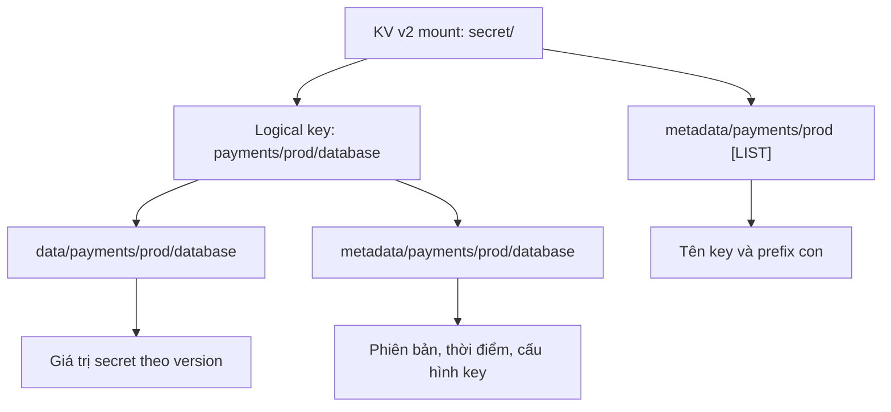
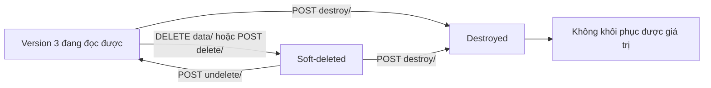

# Đường dẫn `data/` và `metadata/` của KV phiên bản 2 trong Spring Vault

Khi một ứng dụng Java dùng **Spring Vault** để đọc secret từ **HashiCorp Vault KV v2**, một tên key đơn giản như `payments/prod/database` có thể tương ứng với **hai nhóm đường dẫn API khác nhau**: `data/` để thao tác với *giá trị phiên bản hóa* và `metadata/` để thao tác với *thông tin quản lý key, các phiên bản và danh sách tên key*. Đây là điểm quan trọng khi thiết kế **ACL policy** theo nguyên tắc cấp quyền tối thiểu.

Nếu ứng dụng có quyền `read` trên `secret/data/payments/prod/database`, điều đó **không tự động** cho phép gọi `secret/metadata/payments/prod/database` hoặc liệt kê thư mục `secret/metadata/payments/prod`. Ngược lại, quyền xem metadata cũng **không đồng nghĩa** với quyền xem giá trị secret. Hiểu đúng sự khác biệt giúp bạn tránh lỗi `403 permission denied`, cấp quyền đúng nhu cầu cho `VaultTemplate` và giảm rò rỉ thông tin.

Bài học thuộc chương **Phân quyền truy cập** của module **SPRING_VAULT**. Ngoài KV secrets, nội dung cũng liên hệ tới xác thực theo workload, vòng đời token/lease, Transit encryption, PKI, xử lý lỗi, giám sát và kiểm thử tích hợp để bạn xác định ranh giới quyền giữa các thành phần của một hệ thống Java thực tế.

## 1. Mục tiêu học tập

Sau bài này, bạn có thể:

- Giải thích vì sao **KV v2** có các endpoint `data/` và `metadata/`, còn **KV v1** không có cách tách tương tự.
- Ghép chính xác **mount path**, **endpoint KV v2** và **logical key path** thành đường dẫn API và ACL policy.
- Phân biệt quyền `read`/`create`/`update`/`delete` trên `data/` với `read`/`list` và quyền quản lý trên `metadata/`.
- Nhận biết `delete/`, `undelete/` và `destroy/` là các endpoint KV v2 riêng, có khả năng xóa/khôi phục phiên bản khác nhau.
- Dùng `VaultKeyValueOperations` trong Spring Vault để đọc/ghi/liệt kê key, và nhận biết trường hợp phải gọi API metadata trực tiếp.
- Viết và kiểm thử policy riêng cho **service runtime**, **job ghi secret** và **tác vụ kiểm kê phiên bản**.
- Chẩn đoán lỗi do sai mount, sai endpoint, thiếu capability, phiên bản không còn khả dụng hoặc token hết hạn.

## 2. Một logical key có nhiều đường dẫn API

Giả sử nhóm vận hành đã enable **KV version 2** tại mount `secret/`. Key được lưu dưới tên logic:

```text
payments/prod/database
```

Khái niệm đường dẫn:

| Thành phần | Giá trị minh họa | Ý nghĩa |
| --- | --- | --- |
| **Mount path** | `secret/` | Nơi KV v2 được mount trong Vault |
| **Logical key path** | `payments/prod/database` | Định danh secret bên trong mount |
| **Data API path** | `secret/data/payments/prod/database` | Endpoint đọc/ghi giá trị và phiên bản |
| **Metadata API path** | `secret/metadata/payments/prod/database` | Endpoint xem/quản lý metadata của một key |
| **List API path** | `secret/metadata/payments/prod` | Endpoint liệt kê tên key thuộc một prefix |

Một request HTTP đầy đủ có tiền tố `/v1/`. Tuy nhiên, trong ACL policy, `path` **không chứa `/v1/`**:

```text
Đọc giá trị:
  GET  /v1/secret/data/payments/prod/database
  ACL: path "secret/data/payments/prod/database"

Đọc metadata:
  GET  /v1/secret/metadata/payments/prod/database
  ACL: path "secret/metadata/payments/prod/database"

Liệt kê key:
  LIST /v1/secret/metadata/payments/prod
  ACL: path "secret/metadata/payments/prod"
```



**Cần nhớ:** `data` và `metadata` ở đây là **đoạn đường dẫn API do engine KV v2 định nghĩa**. Chúng không phải hai thư mục mà người dùng phải tạo trước trong Vault, cũng không phải thành phần cần chèn vào key khi gọi API KV v2 tiện ích của Spring Vault.

### Nếu mount không tên `secret` thì sao?

Mount path được chọn khi cấu hình Vault, không có tên mặc định bắt buộc:

| Mount thực tế | Key logic | ACL đọc giá trị | ACL đọc metadata |
| --- | --- | --- | --- |
| `secret/` | `payments/prod/database` | `secret/data/payments/prod/database` | `secret/metadata/payments/prod/database` |
| `kv-prod/` | `payments/prod/database` | `kv-prod/data/payments/prod/database` | `kv-prod/metadata/payments/prod/database` |
| `apps/team-a/kv/` | `payments/prod/database` | `apps/team-a/kv/data/payments/prod/database` | `apps/team-a/kv/metadata/payments/prod/database` |

Quy tắc là:

```text
<mount> + "/data/"     + <key>       → thao tác giá trị KV v2
<mount> + "/metadata/" + <key>       → metadata của một key
<mount> + "/metadata/" + <prefix>    → liệt kê các tên key dưới prefix
```

Chỉ áp dụng công thức này khi **mount là KV v2**. Với KV v1, đường dẫn đọc giá trị thông thường là `<mount>/<key>`, không có đoạn `data/` bắt buộc.

## 3. Nhánh `data/`: phiên bản hóa giá trị secret

Đường dẫn `data/<key>` của KV v2 là nơi ứng dụng đọc, tạo, cập nhật hoặc xóa mềm giá trị của key. Mỗi lần ghi thành công tạo một **version** mới, chẳng hạn version 1, 2, 3.

| Request | API path (đã bỏ `/v1/`) | Capability ACL điển hình | Kết quả |
| --- | --- | --- | --- |
| GET | `secret/data/payments/prod/database` | `read` | Đọc phiên bản hiện tại (nếu chưa bị xóa/hủy); không tự lùi về version cũ |
| GET kèm `?version=2` | `secret/data/payments/prod/database` | `read` | Đọc phiên bản 2 nếu còn khả dụng |
| POST (tạo key mới) | `secret/data/payments/prod/database` | `create` | Tạo secret và version đầu tiên |
| POST (thay giá trị key đã tồn tại) | `secret/data/payments/prod/database` | `update` | Tạo version mới |
| DELETE | `secret/data/payments/prod/database` | `delete` | Xóa mềm phiên bản mới nhất |

Lưu ý **create/update phụ thuộc vào ngữ nghĩa thao tác**. Một job cần tạo lần đầu rồi cập nhật về sau thường được cấp cả `create` và `update`, nhưng chỉ cho key cụ thể. Không cấp quyền ghi cho Java service chỉ cần đọc cấu hình.

### Cấu trúc giá trị trả về khác KV v1

Một phản hồi KV v2 qua HTTP có dạng minh họa:

```json
{
  "data": {
    "data": {
      "username": "billing_service",
      "password": "<secret-redacted>"
    },
    "metadata": {
      "created_time": "2026-01-01T10:00:00Z",
      "deletion_time": "",
      "destroyed": false,
      "version": 3
    }
  }
}
```

JSON trên được rút gọn để học cấu trúc; phản hồi thực tế có thể có các trường bổ sung như `request_id` hoặc `custom_metadata`.

- `data.data` chứa **giá trị secret**.
- `data.metadata` chứa metadata liên quan tới **version vừa đọc**, ví dụ version số mấy, đã soft-delete hoặc destroy hay chưa.
- Không nhầm `data.metadata` trong phản hồi đọc giá trị với việc client đã tự gọi endpoint `/metadata/<key>`.

Nếu truy vấn một version đã bị xóa mềm hoặc hủy, kết quả có thể không còn nội dung đọc được; capability `read` không giúp khôi phục hoặc bỏ qua trạng thái của version.

### Một quyền `read` không giới hạn riêng version mới nhất

Khi policy viết:

```hcl
path "secret/data/payments/prod/database" {
  capabilities = ["read"]
}
```

Quyền đó khớp **path đọc của key**; lựa chọn version được gửi ở query parameter `?version=n`. Vì vậy, **không được giả định** rằng ACL trên `data/<key>` chỉ cho phép đọc version mới nhất. Nếu version cũ vẫn còn khả dụng và token có quyền đọc data endpoint, ứng dụng có thể yêu cầu đọc nó.

Để kiểm soát dữ liệu lịch sử, cần có quy trình lưu giữ/xóa version phù hợp, thay vì chỉ dựa vào hai chữ `read` trong HCL.

## 4. Nhánh `metadata/`: thông tin về key và lịch sử phiên bản

Endpoint `metadata/` có **hai loại nghiệp vụ chính**:

1. **Metadata của một key:** đọc hoặc quản lý cài đặt và lịch sử version của key đó.
2. **Liệt kê key trong một prefix:** trả về **tên key**, không trả về giá trị của từng secret.

### 4.1. Đọc metadata của một key

Request:

```text
GET /v1/secret/metadata/payments/prod/database
```

Policy:

```hcl
path "secret/metadata/payments/prod/database" {
  capabilities = ["read"]
}
```

Một phản hồi metadata được rút gọn:

```json
{
  "data": {
    "current_version": 3,
    "oldest_version": 1,
    "max_versions": 0,
    "cas_required": false,
    "delete_version_after": "0s",
    "versions": {
      "1": { "destroyed": false, "deletion_time": "" },
      "2": { "destroyed": false, "deletion_time": "" },
      "3": { "destroyed": false, "deletion_time": "" }
    }
  }
}
```

Tùy phiên bản và cấu hình, phản hồi còn có thể chứa `created_time`, `updated_time` hoặc `custom_metadata`. Các trường quan trọng:

| Trường | Ý nghĩa |
| --- | --- |
| `current_version` | Số version lớn nhất đã được tạo cho key |
| `oldest_version` | Version cũ nhất còn được quản lý trong phạm vi lưu giữ |
| `versions` | Thông tin từng version, như thời điểm tạo/xóa và trạng thái destroyed |
| `max_versions` | Giới hạn số version lưu giữ do metadata/config quy định; `0` thường có ý nghĩa dùng cấu hình mặc định |
| `cas_required` | Có bắt buộc chỉ rõ CAS khi ghi không |
| `delete_version_after` | Cấu hình vòng đời tự soft-delete version theo thời gian |
| `custom_metadata` | Metadata do tổ chức gắn với key, nếu sử dụng |

**Đọc metadata không đọc được password hoặc API key** nằm trong `data.data`. Tuy vậy, metadata vẫn có thể tiết lộ tên môi trường, tuổi của secret, lịch sử xoay vòng hoặc nhãn nghiệp vụ. Vì thế, metadata cũng cần chính sách phân quyền riêng.

### 4.2. Liệt kê tên key

Để biết các key ở ngay dưới prefix `payments/prod`, Vault nhận:

```text
LIST /v1/secret/metadata/payments/prod
```

Một số HTTP client thể hiện thao tác LIST bằng GET có tham số `?list=true`; capability ACL vẫn là `list`. Ví dụ phản hồi tên:

```json
{
  "data": {
    "keys": [
      "database",
      "service-a/",
      "service-b/"
    ]
  }
}
```

Dấu `/` cuối tên thường thể hiện một prefix con, nhưng đây là **danh sách tên**, không phải giá trị secret. Policy phù hợp cho một lượt liệt kê:

```hcl
path "secret/metadata/payments/prod" {
  capabilities = ["list"]
}
```

Nếu công cụ cần đi tiếp vào những prefix con, có thể cân nhắc:

```hcl
# Chỉ bổ sung cho công cụ thực sự phải duyệt nhiều cấp.
path "secret/metadata/payments/prod/*" {
  capabilities = ["list"]
}
```

**Quan trọng:** kết quả LIST **không được lọc theo quyền `read` của từng key con**. Một token có thể nhìn thấy tên nhiều secret nhờ `list`, dù không thể đọc bất kỳ giá trị nào. Không nên cấp quyền list ở prefix cha rất rộng cho workload chỉ cần biết một key cụ thể.

### 4.3. Thao tác quản lý metadata là một quyền khác

Ngoài GET và LIST, KV v2 còn có API tạo/cập nhật metadata hoặc cấu hình trên một key, API PATCH metadata ở phiên bản hỗ trợ, và DELETE metadata. Các thao tác này **không đồng nghĩa với việc chỉ xem metadata**:

| API tại `secret/metadata/<key>` | Capability liên quan | Ảnh hưởng |
| --- | --- | --- |
| GET | `read` | Xem lịch sử và cấu hình key |
| LIST tại `metadata/<prefix>` | `list` | Xem tên các key bên dưới prefix |
| POST | `create` hoặc `update` theo trường hợp | Cấu hình metadata của key, ví dụ CAS hoặc chính sách version |
| PATCH trên API hỗ trợ | `patch` | Cập nhật một phần thông tin metadata |
| DELETE | `delete` | Xóa **metadata và tất cả các version** của key |

Đặc biệt cẩn thận với **DELETE `metadata/<key>`**: đó là tác vụ có khả năng xóa toàn bộ dữ liệu phiên bản của key, mạnh hơn nhiều so với DELETE `data/<key>` chỉ soft-delete version mới nhất. Runtime application thông thường **không cần** capability `delete` trên metadata.

Một policy kiểm kê chỉ xem, không sửa:

```hcl
# Đọc metadata của một key cụ thể.
path "secret/metadata/payments/prod/database" {
  capabilities = ["read"]
}

# Chỉ liệt kê đúng prefix cần kiểm kê.
path "secret/metadata/payments/prod" {
  capabilities = ["list"]
}
```

Policy trên **không cấp** `read` trên `secret/data/payments/prod/database`, nên không cho đọc giá trị secret nếu token không mang thêm policy khác cấp quyền đó.

## 5. `delete/`, `undelete/`, `destroy/`: không trùng với `data/` hay `metadata/`

Ngoài hai nhánh chính, KV v2 có các endpoint chuyên dụng để quản lý vòng đời phiên bản. Các hành động đều liên quan đến “xóa” hoặc “khôi phục”, nhưng ACL path khác nhau:



| Nghiệp vụ | Endpoint KV v2 | HTTP | ACL capability |
| --- | --- | --- | --- |
| Xóa mềm **version mới nhất** | `secret/data/<key>` | DELETE | `delete` |
| Xóa mềm **các version được chỉ định** | `secret/delete/<key>` | POST | `update` |
| Khôi phục version đã soft-delete | `secret/undelete/<key>` | POST | `update` |
| Hủy vĩnh viễn một số version | `secret/destroy/<key>` | POST | `update` |
| Xóa metadata và mọi version | `secret/metadata/<key>` | DELETE | `delete` |

Ví dụ job cleanup chỉ được soft-delete một version nhất định:

```hcl
path "secret/delete/payments/prod/temporary" {
  capabilities = ["update"]
}
```

Điều này **không cấp quyền** hủy version vĩnh viễn tại `secret/destroy/payments/prod/temporary`. Ngược lại, việc có `delete` trên `secret/data/payments/prod/temporary` không tự cấp `update` tại endpoint `delete/`.

Một **KV version** là mốc dữ liệu có lịch sử. Nó khác với **lease** của dynamic secret (như database credentials) và khác **TTL của Vault token**. Khi token hết hạn, phiên bản KV không vì thế bị xóa; khi một version KV bị soft-delete, token có quyền đọc cũng không tự khôi phục được nội dung.

## 6. Thiết kế policy theo ba workload

Giả sử doanh nghiệp có:

- `payments-api` chỉ cần đọc cấu hình mật của mình lúc chạy.
- `payments-rotation-job` ghi secret mới khi xoay vòng thông tin đăng nhập.
- `payments-audit-tool` xem lịch sử phiên bản, và chỉ liệt kê tên key nếu chức năng kiểm kê cần thiết.

Tách policy theo trách nhiệm sẽ hạn chế quyền bị lợi dụng khi một tiến trình bị xâm nhập.

### 6.1. Service runtime: chỉ đọc giá trị

```hcl
# payments-api-runtime.hcl
path "secret/data/payments/prod/database" {
  capabilities = ["read"]
}
```

Token nhận policy này **không tự có** `list`, `read` metadata, `update` data hay `destroy`. Nếu service biết rõ key cần đọc, đó thường là đủ quyền cho KV v2.

### 6.2. Job xoay vòng: chỉ ghi một key

```hcl
# payments-rotation-job.hcl
path "secret/data/payments/prod/database" {
  capabilities = ["create", "update"]
}
```

Một writer phải tạo secret ở lần chạy đầu và cập nhật các lần sau cần cả hai capability. Nó **không tự cần** quyền `read`/`list` hay quyền xóa version.

Khi bật cơ chế **check-and-set (CAS)** của KV v2, job còn phải cung cấp điều kiện version khi ghi. CAS kiểm soát ghi đè đồng thời; **CAS không phải capability ACL**. Nếu job cần biết version hiện tại để tính CAS, hãy xác định cụ thể nguồn version và cân nhắc cấp quyền đọc metadata/giá trị tương ứng theo nghiệp vụ, thay vì mở toàn bộ mount.

Ví dụ payload ghi KV v2 có CAS, các giá trị dưới đây chỉ là dữ liệu minh họa:

```json
{
  "options": { "cas": 3 },
  "data": {
    "username": "billing_service",
    "password": "<test-value>"
  }
}
```

`cas: 3` có nghĩa yêu cầu ghi phải khớp version hiện tại là 3; `cas: 0` được dùng cho tình huống yêu cầu key chưa tồn tại. Nếu CAS không đúng, Vault từ chối ghi dù token có đủ ACL.

### 6.3. Công cụ kiểm kê: đọc metadata, có thể liệt kê

```hcl
# payments-audit-tool.hcl
path "secret/metadata/payments/prod/database" {
  capabilities = ["read"]
}

# Chỉ khi công cụ cần duyệt tên các key trong prefix:
path "secret/metadata/payments/prod" {
  capabilities = ["list"]
}
```

Đối với công cụ chỉ theo dõi **một key đã biết**, bỏ `list`. Nếu phải duyệt prefix con, thêm các path `list` cần thiết ở đúng từng cấp. Nhớ rằng người có `list` thấy tên key, kể cả không có quyền đọc nội dung secret.

### 6.4. Những quyền tuyệt đối phải xét riêng

```hcl
# PHẢN VÍ DỤ: phạm vi quá rộng cho service chỉ đọc một secret.
path "secret/*" {
  capabilities = ["create", "read", "update", "delete", "list"]
}
```

Policy rộng như trên có thể bao trùm `data/`, `metadata/`, `delete/`, `undelete/`, `destroy/` và các endpoint liên quan. Việc “cho đủ quyền để hết 403” làm mất nguyên tắc phân quyền theo nhu cầu và khiến việc điều tra sự cố khó hơn.

## 7. Từ Spring Vault đến endpoint `data/` và `metadata/`

Trong Spring Vault, API tiện ích `VaultKeyValueOperations` hiểu sự khác biệt KV v1/KV v2. Khi chọn `KeyValueBackend.KV_2`, bạn **không tự thêm `data/` hoặc `metadata/`** vào logical key.

### 7.1. Đọc dữ liệu bằng `VaultKeyValueOperations`

```java
import java.util.Map;

import org.springframework.stereotype.Service;
import org.springframework.vault.core.VaultKeyValueOperations;
import org.springframework.vault.core.VaultKeyValueOperationsSupport.KeyValueBackend;
import org.springframework.vault.core.VaultTemplate;
import org.springframework.vault.support.VaultResponse;

@Service
public class PaymentsSecrets {

    private final VaultKeyValueOperations kv;

    public PaymentsSecrets(VaultTemplate vaultTemplate) {
        // "secret" là mount KV v2 thực tế.
        kv = vaultTemplate.opsForKeyValue("secret", KeyValueBackend.KV_2);
    }

    public Map<String, Object> loadDatabaseConfig() {
        // Key được truyền tương đối với mount; Spring Vault ghép data/.
        VaultResponse response = kv.get("payments/prod/database");

        if (response == null || response.getData() == null) {
            throw new IllegalStateException("Không tìm thấy secret database");
        }
        return response.getData();
    }
}
```

Đường dẫn HTTP tương ứng là:

```text
GET /v1/secret/data/payments/prod/database
```

Policy runtime chỉ cần:

```hcl
path "secret/data/payments/prod/database" {
  capabilities = ["read"]
}
```

Nếu code viết `kv.get("data/payments/prod/database")`, khi đã chọn `KV_2`, bạn có nguy cơ khiến Spring Vault ghép thêm `data/` vào key. Đó là lỗi code, không phải lý do để cấp thêm quyền cho đường dẫn sai.

### 7.2. Liệt kê tên bằng `list(...)`

Một công cụ kiểm kê có thể gọi:

```java
VaultKeyValueOperations kv = vaultTemplate.opsForKeyValue(
        "secret", KeyValueBackend.KV_2);

// Chỉ dùng trong công cụ được cấp quyền kiểm kê.
java.util.List<String> names = kv.list("payments/prod");
```

Spring Vault sẽ dùng endpoint `metadata/` cho chức năng liệt kê KV v2, nên cần `list` tại `secret/metadata/payments/prod`. Nó **không** lấy nội dung secret và cũng không tự sử dụng quyền `read` trên `data/`.

### 7.3. Đọc thông tin metadata một key qua API trực tiếp

Nếu công cụ thực sự cần lịch sử phiên bản, có thể sử dụng API Vault cấp thấp:

```java
import org.springframework.vault.core.VaultTemplate;
import org.springframework.vault.support.VaultResponse;

public class PaymentsMetadataReader {

    private final VaultTemplate vaultTemplate;

    public PaymentsMetadataReader(VaultTemplate vaultTemplate) {
        this.vaultTemplate = vaultTemplate;
    }

    public VaultResponse loadVersionMetadata() {
        return vaultTemplate.read(
                "secret/metadata/payments/prod/database");
    }
}
```

Đường dẫn HTTP là:

```text
GET /v1/secret/metadata/payments/prod/database
```

Điều này cần `read` **trên metadata path**, không phải `read` trên data path. Trường hợp dùng API `VaultTemplate.read(...)` trực tiếp, nhà phát triển tự cung cấp **endpoint thực**; không có lớp `KeyValueBackend.KV_2` tự thêm các nhánh.

### 7.4. Khác biệt với thao tác `put(...)` hoặc `delete(...)`

Các thao tác thường gặp:

| Mã sử dụng Spring Vault | KV v2 API path đích | Capability nên xét |
| --- | --- | --- |
| `kv.get("payments/prod/database")` | `secret/data/payments/prod/database` | `read` |
| `kv.put("payments/prod/database", values)` | `secret/data/payments/prod/database` | `create`/`update` theo trạng thái |
| `kv.delete("payments/prod/database")` | `secret/data/payments/prod/database` qua DELETE | `delete` |
| `kv.list("payments/prod")` | `secret/metadata/payments/prod` | `list` |
| `vaultTemplate.read("secret/metadata/payments/prod/database")` | `secret/metadata/payments/prod/database` | `read` |

Cùng một `VaultTemplate` về kỹ thuật có thể gọi nhiều endpoint, nhưng **không nên vì vậy cấp mọi quyền cho một token**. Trong hệ thống thực, service runtime, writer và công cụ kiểm kê nên có các auth role/token riêng.

## 8. Liên hệ với xác thực workload, token và lease

Một token có policy `payments-api-runtime` chỉ có ý nghĩa khi **workload thực sự nhận token đó** từ cơ chế xác thực. Ví dụ:

1. Pod `payments-api` đăng nhập Vault bằng Kubernetes auth role liên kết với ServiceAccount và namespace được phê duyệt.
2. Vault cấp token có policy đọc một key data KV v2.
3. Spring Vault gửi request `GET secret/data/payments/prod/database` với token.
4. Vault đối chiếu ACL và trả dữ liệu khi quyền khớp; secret không được trả nếu policy hoặc token không hợp lệ.

Tương tự, AppRole hoặc auth method khác có thể được dùng cho batch job. **Không nhúng root token vào Java service**, không dùng chung token giữa runtime và job ghi secret chỉ vì hai chương trình cùng đọc một mount.

Phân biệt ba khái niệm:

| Khái niệm | Đặc điểm | Liên quan với `data/`/`metadata/` |
| --- | --- | --- |
| **Token TTL** | Thời gian token được phép xác thực request; có thể renew theo quy tắc | Token hết hạn làm request thất bại dù path/capability đúng |
| **KV v2 version** | Phiên bản nội dung được tạo bởi thao tác ghi | `data/` đọc/ghi version; `metadata/` cho biết lịch sử |
| **Dynamic-secret lease** | Vòng đời credential động của engine như database | Lease không phải phiên bản KV và không tự được gia hạn qua policy đọc KV |

Nếu token hết hạn, hãy kiểm tra session manager, khả năng renew hoặc đăng nhập lại; **không mở ACL `secret/*`** để cố khắc phục. Nếu version bị soft-delete, cần xem luồng khôi phục đúng `undelete/` và quyền được duyệt; renew token không khôi phục version đó.

Transit và PKI có **endpoint riêng**, chẳng hạn `transit/encrypt/<key>` hoặc `pki_int/issue/<role>` nếu mount dùng đúng tên đó. Hai engine này **không sử dụng cấu trúc `data/`/`metadata/` của KV v2**. Một token dùng Transit hoặc PKI phải có policy theo endpoint và mục tiêu nghiệp vụ riêng, không tái sử dụng quy tắc suy path của KV v2.

## 9. Kiểm chứng bằng CLI: đừng nhầm logical key với API path

Với KV v2 mount `secret/`, Vault CLI giúp làm việc theo **logical key**:

```bash
# Đọc dữ liệu; CLI tự ánh xạ tới data/.
vault kv get -mount=secret payments/prod/database

# Xem lịch sử/cấu hình metadata của key; CLI dùng metadata/.
vault kv metadata get -mount=secret payments/prod/database

# Liệt kê tên key dưới prefix; CLI dùng metadata/ với LIST.
vault kv list -mount=secret payments/prod
```

Ngược lại, khi kiểm tra capability, phải cung cấp **đúng API path** sau khi ánh xạ:

```bash
# Chạy bằng token workload thử nghiệm có phạm vi hẹp.
vault token capabilities secret/data/payments/prod/database
vault token capabilities secret/metadata/payments/prod/database
vault token capabilities secret/metadata/payments/prod
vault token capabilities secret/destroy/payments/prod/database
```

Kỳ vọng với token của service runtime chỉ đọc data là:

| Path kiểm tra | Kết quả kỳ vọng |
| --- | --- |
| `secret/data/payments/prod/database` | `read` |
| `secret/metadata/payments/prod/database` | `deny` |
| `secret/metadata/payments/prod` | `deny` |
| `secret/destroy/payments/prod/database` | `deny` |

Nếu token còn những policy khác, kết quả có thể rộng hơn dự kiến. Cần kiểm tra **toàn bộ policy hiệu lực**, thay vì chỉ nhìn một file HCL trong Git.

Lệnh `vault token capabilities` tự gọi API kiểm tra quyền; trong một số cấu hình, token thiếu quyền kiểm tra tự phục vụ có thể khiến lệnh không chạy được. Khi đó, dùng công cụ hoặc danh tính chẩn đoán được quản trị cho phép; **không thêm quyền quản trị không cần thiết vào runtime**.

## 10. Chẩn đoán lỗi `403`, `404` và lỗi phiên bản

Giả sử `kv.get("payments/prod/database")` thất bại. Dùng thứ tự sau:

1. **Xác định mount:** môi trường thực tế có `secret/`, `kv-prod/` hay tên khác? Engine là KV v2 hay KV v1?
2. **Xác định HTTP API path:** `kv.get()` với `KV_2` đọc `<mount>/data/<key>`; `kv.list()` dùng `<mount>/metadata/<prefix>`.
3. **Kiểm tra token:** auth role đang cấp policy nào, token có hết TTL/bị thu hồi không?
4. **Kiểm tra ACL:** capability đúng trên **đường dẫn đầy đủ** hay chỉ mới đúng ở logical key?
5. **Kiểm tra trạng thái dữ liệu:** key tồn tại không, version còn sống không, có CAS constraint không?
6. **Kiểm tra request thực:** phân biệt lỗi authorization với lỗi dữ liệu, payload hoặc secrets engine.

| Triệu chứng | Khả năng đáng kiểm tra | Cách xử lý |
| --- | --- | --- |
| `403` khi GET data | Policy chỉ có `read` trên `secret/payments/...` hoặc `secret/metadata/...` | Chuyển quyền đọc tới chính xác `secret/data/<key>` |
| `403` khi LIST | Chỉ có `read` trên data, không có `list` trên metadata prefix | Chỉ cấp `list` khi thực sự phải duyệt tên |
| `403` khi GET metadata | Có `read` trên data nhưng không trên metadata | Xác minh nhu cầu đọc lịch sử phiên bản rồi cấp đúng `metadata/<key>` |
| `403` khi POST metadata | Token chỉ được đọc metadata, thiếu quyền quản lý | Tách tác vụ quản lý metadata sang danh tính được duyệt |
| `403` khi DELETE metadata | Thiếu `delete` trên metadata | Từ chối mặc định là hợp lý; đây là thao tác xóa toàn bộ dữ liệu key |
| `404` khi GET data | Sai key/mount, secret chưa có hoặc version bị xóa | Xác minh tên mount, key và trạng thái version bằng danh tính phù hợp |
| Ghi dữ liệu có `400` hoặc lỗi CAS | `cas` sai, `cas_required` bật, payload không hợp lệ | Kiểm tra current version và chính sách CAS; không mở thêm quyền ACL |
| Chạy khi dùng root token, lỗi với token service | Root token che mất lỗi policy của workload | Kiểm thử lại bằng auth role/token thực |
| Đọc được lúc đầu, về sau lỗi | Token hết hạn, renew/re-login thất bại | Xem vòng đời token và session management |

Một số endpoint có thể trả mã lỗi khác nhau theo phiên bản Vault, loại request hoặc tầng client. Không dùng **một mã lỗi duy nhất** để kết luận chắc chắn về bản chất sự cố; kết hợp dữ liệu từ log ứng dụng và Vault audit trong phạm vi được phép.

### Giám sát an toàn

- Bật audit device và theo dõi các request bị từ chối theo **workload**, endpoint và loại thao tác.
- Không ghi giá trị `data.data`, token, SecretID, private key hoặc payload chứa mật khẩu ra log.
- Tên key và `custom_metadata` cũng có thể tiết lộ môi trường/nghiệp vụ; hạn chế hiển thị rộng và bảo vệ log.
- Theo dõi lỗi renew/re-login của token, các lần cập nhật version bất thường và số lần cố LIST hoặc DELETE metadata ngoài dự kiến.
- Review mọi thay đổi policy HCL và mount/version backend trước khi đưa vào production.

## 11. Kiểm thử tích hợp tối thiểu cho Spring Vault

Thiết lập một Vault test instance hoặc môi trường tích hợp độc lập:

- Mount KV v2 tại `secret/`.
- Chuẩn bị key `payments/prod/database` với **dữ liệu thử** và nhiều version nếu cần thử lịch sử.
- Tạo auth role/token `runtime` chỉ có `read` trên `secret/data/payments/prod/database`.
- Tạo auth role/token `metadata-reader` chỉ có `read` trên `secret/metadata/payments/prod/database`; cân nhắc token riêng cho `list`.
- Chạy Spring Vault với token từng vai trò, kiểm tra cả thao tác **được phép** và **phải bị từ chối**.

| Trường hợp | Token runtime đọc data | Token metadata-reader |
| --- | --- | --- |
| GET `secret/data/payments/prod/database` | Thành công | Bị từ chối |
| GET `secret/metadata/payments/prod/database` | Bị từ chối | Thành công |
| LIST `secret/metadata/payments/prod` | Bị từ chối | Bị từ chối nếu chỉ có quyền `read` metadata |
| POST `secret/data/payments/prod/database` | Bị từ chối | Bị từ chối |
| DELETE `secret/data/payments/prod/database` | Bị từ chối | Bị từ chối |
| DELETE `secret/metadata/payments/prod/database` | Bị từ chối | Bị từ chối |
| POST `secret/destroy/payments/prod/database` | Bị từ chối | Bị từ chối |

Để test bị từ chối có ý nghĩa, cần chuẩn bị sẵn **mount, key và version hợp lệ**; một kết quả “không tìm thấy key” không đủ để chứng minh ACL đã chặn. Không chạy test ghi/xóa trên secret production. Nếu hệ thống dùng Kubernetes auth, AppRole hoặc cơ chế workload khác, cần kiểm tra policy được gắn cho **danh tính thực sự của từng vai trò**, không chỉ kiểm tra HCL tĩnh.

## 12. Bài tập vận dụng

### Bài 1 — Chỉ đọc giá trị, không đọc lịch sử

Mount KV v2 là `config-kv/`. Service `email-api` chỉ cần đọc `email-api/smtp` và không được xem danh sách key hay lịch sử version. Hãy viết policy.

<details>
<summary>Đáp án gợi ý</summary>

```hcl
path "config-kv/data/email-api/smtp" {
  capabilities = ["read"]
}
```

Không cấp `read`/`list` trên nhánh `config-kv/metadata/...`. Dùng token service để xác minh GET data được phép và GET metadata/LIST bị từ chối.

</details>

### Bài 2 — Chỉ kiểm tra version, không đọc mật khẩu

Một công cụ cần biết `current_version`, `oldest_version` và trạng thái các version của key `apps/runtime` trên mount `kv-prod/`, nhưng không được đọc giá trị. Cấp quyền nào?

<details>
<summary>Đáp án gợi ý</summary>

```hcl
path "kv-prod/metadata/apps/runtime" {
  capabilities = ["read"]
}
```

API GET là `/v1/kv-prod/metadata/apps/runtime`. Không cấp `read` trên `kv-prod/data/apps/runtime`. Công cụ đã biết key nên không cần `list`.

</details>

### Bài 3 — List tên nhưng không đọc được nội dung

Một người có policy `list` tại `secret/metadata/payments/prod` nhìn thấy tên `database`, nhưng `vault kv get -mount=secret payments/prod/database` bị `403`. Đây có phải cấu hình hỏng?

<details>
<summary>Đáp án gợi ý</summary>

Không. `list` ở metadata prefix chỉ cho phép xem **tên**, còn `vault kv get` cần `read` trên `secret/data/payments/prod/database`. Việc từ chối đọc giá trị là đúng nếu người dùng chỉ làm nhiệm vụ kiểm kê tên key.

</details>

### Bài 4 — Xóa mềm và hủy vĩnh viễn

Job có quyền `delete` trên `secret/data/apps/temp`. Job có thể gọi `POST /v1/secret/destroy/apps/temp` hay `DELETE /v1/secret/metadata/apps/temp` không?

<details>
<summary>Đáp án gợi ý</summary>

Không. Hủy vĩnh viễn version đi qua `secret/destroy/apps/temp` và cần `update` tại endpoint đó. Xóa metadata và mọi version đi qua `secret/metadata/apps/temp` và cần `delete` ở **chính metadata path**. Capability trên `data/` không tự lan sang hai nhánh này.

</details>

### Bài 5 — Sai cách ghép logical key trong Spring Vault

Code khai báo `opsForKeyValue("secret", KeyValueBackend.KV_2)` rồi gọi `get("data/payments/prod/database")`. Vì sao không nên “sửa” policy theo request sinh ra?

<details>
<summary>Đáp án gợi ý</summary>

Vì `VaultKeyValueOperations` đã xử lý nhánh `data/` khi chọn KV v2. Tham số `get(...)` cần là `payments/prod/database`. Sửa code để gọi đúng API và giữ policy chỉ cho phép `secret/data/payments/prod/database`; cấp quyền cho path lặp `data/` có thể che giấu lỗi triển khai.

</details>

## 13. Checklist khi duyệt policy KV v2

Trước khi triển khai, hãy xác nhận:

1. **Mount đúng:** `secret`, `kv-prod` hay mount tùy chỉnh được lấy từ cấu hình Vault thực tế, không phải từ ví dụ.
2. **Version đúng:** engine là KV v2; nếu KV v1 thì cách suy `data/`/`metadata/` không áp dụng.
3. **API path đúng:** `data/<key>` để xử lý giá trị; `metadata/<key>` để xem/cấu hình lịch sử; `metadata/<prefix>` để LIST.
4. **Capability đúng:** runtime chỉ `read` data, writer `create`/`update` data, kiểm kê chỉ `read`/`list` metadata khi có nhu cầu.
5. **Xóa được phân biệt:** DELETE `data/`, POST `delete/`, POST `destroy/` và DELETE `metadata/` không phải cùng một quyền.
6. **Quyền đọc version được hiểu đúng:** `read` data có thể cho phép truy cập version cũ còn tồn tại; cần quy định retention và quy trình destroy khi thật sự cần.
7. **CAS độc lập với ACL:** writer phải đáp ứng yêu cầu CAS/phiên bản, kể cả khi đã có quyền ghi.
8. **Spring Vault ghép path đúng:** `opsForKeyValue("<mount>", KV_2)` đi với logical key, không tự lặp `data/` hay mount trong `get(...)`/`list(...)`.
9. **Danh tính workload đúng:** policy được gắn vào token của service/job tương ứng, TTL/renewal và khả năng đăng nhập lại được quản lý.
10. **Kiểm thử có cả ca bị chặn:** thử GET data, GET metadata, LIST, write, delete và destroy trên test fixtures với token hạn chế.

**Ghi nhớ:** Trong KV phiên bản 2, `data/` trả lời câu hỏi *“Ai được làm gì với giá trị secret?”*, còn `metadata/` trả lời câu hỏi *“Ai được xem/quản lý thông tin về key và những version của nó?”*. Chính việc phân biệt hai nhóm endpoint này giúp Spring Vault dùng `VaultTemplate` và xác thực theo workload một cách an toàn, kiểm soát vòng đời secrets rõ ràng và phát hiện lỗi quyền truy cập đúng nguyên nhân.
