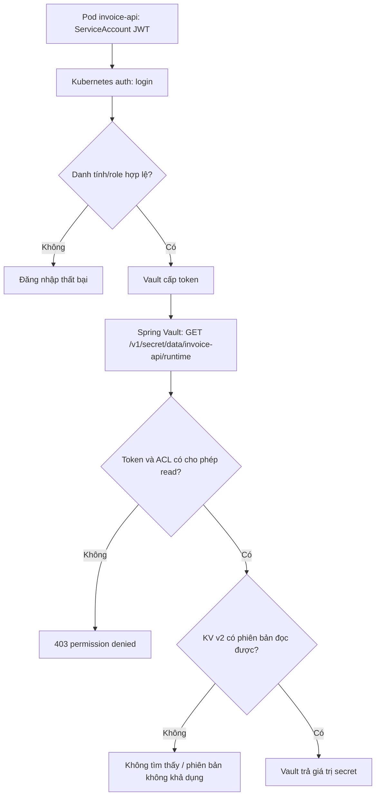

# Phân biệt xác thực thành công với được phép đọc một secret trong Spring Vault

Một ứng dụng Java triển khai với **Spring Vault** đăng nhập thành công vào **HashiCorp Vault** bằng Kubernetes authentication hoặc AppRole. Trong log, việc lấy token có vẻ bình thường. Nhưng ngay khi gọi `VaultTemplate` để đọc cấu hình cơ sở dữ liệu, ứng dụng nhận lỗi **`403 permission denied`**. Đây không nhất thiết là lỗi của bước đăng nhập: **Vault xác thực danh tính và kiểm tra quyền đọc secret ở hai giai đoạn khác nhau**.

Trong chương **Phân quyền truy cập**, bài học này tập trung trả lời ba câu hỏi: *Vault đã chấp nhận danh tính workload chưa? Token của workload có quyền thực hiện request đang gửi không? Secret được yêu cầu có tồn tại và còn khả dụng không?* Phân biệt rõ ba câu hỏi sẽ giúp bạn thiết kế ACL policy theo quyền tối thiểu, vận hành vòng đời token/lease, sử dụng KV secrets an toàn và chẩn đoán lỗi từ ứng dụng Java mà không mở rộng quyền tùy tiện. Các nguyên tắc tương tự áp dụng cho API Transit encryption và PKI, dù những engine đó có endpoint và quy tắc nghiệp vụ riêng.

## 1. Kết quả cần đạt

Sau bài này, bạn có thể:

- Phân biệt **authentication (xác thực)**, **authorization (ủy quyền/phân quyền)** và **khả năng phục vụ request của secrets engine**.
- Giải thích vì sao đăng nhập bằng Kubernetes/AppRole thành công không tự trao quyền `read` trên một KV secret.
- Xác định **token effective policies**, `path` và `capabilities` cần kiểm tra khi `VaultTemplate` nhận `403`.
- Đọc đúng đường dẫn ACL của KV v2, phân biệt `data/` với `metadata/` và `list`.
- Thiết kế phép thử chứng minh rằng đúng workload đọc được đúng secret, nhưng không đọc được secret của workload khác.
- Phân biệt lỗi không được phép truy cập với lỗi secret không tồn tại, phiên bản đã bị xóa hoặc token hết hạn.
- Tổ chức xử lý lỗi, quan sát hệ thống và kiểm thử tích hợp mà không làm lộ token hoặc giá trị secret.

## 2. Một request phải vượt qua ba cửa kiểm tra

Xét một workload `invoice-api` đang chạy trong Kubernetes namespace `production`. Nó cần đọc secret có logical key `invoice-api/runtime` từ KV v2 được mount tại `secret/`.



Các “cửa” có ý nghĩa khác nhau:

| Giai đoạn | Vault kiểm tra điều gì? | Thành công có chứng minh được điều gì? |
| --- | --- | --- |
| **1. Authentication** | Workload xuất trình JWT, RoleID/SecretID hoặc thông tin xác thực phù hợp với auth method và role | Danh tính/credential được chấp nhận; Vault có thể cấp token |
| **2. Authorization** | Token còn hợp lệ và có capability cần thiết trên **đường dẫn API thực tế**, sau khi xét policy hiệu lực | Request được phép tiếp tục tới secrets engine |
| **3. Backend validation** | Key, phiên bản, payload và quy tắc của KV/Transit/PKI có hợp lệ không | Operation thực thi và trả kết quả nếu dữ liệu/điều kiện backend phù hợp |

Một phiên đăng nhập thành công **chỉ xác nhận cửa 1**. Nó không chứng minh cửa 2 hoặc cửa 3 sẽ thành công. Tương tự, một request đi qua ACL có thể vẫn thất bại vì key không tồn tại, một KV version đã bị xóa, dữ liệu ghi không đáp ứng CAS hoặc yêu cầu chứng chỉ vi phạm PKI role.

> **Điểm cần nhớ:** Auth method trả lời *“Bạn là ai?”*. ACL policy trả lời *“Token này được thao tác gì trên API path nào?”*. Secrets engine trả lời *“Tài nguyên và request nghiệp vụ có hợp lệ để xử lý không?”*.

## 3. Xác thực thành công thực sự có nghĩa là gì?

### 3.1. Kubernetes authentication

Trong mô hình phổ biến, Pod mang ServiceAccount token do Kubernetes cấp. Spring Vault hoặc thành phần cấu hình liên quan đưa token này tới endpoint Kubernetes auth của Vault, chẳng hạn `auth/kubernetes/login`. Vault kiểm tra danh tính theo cấu hình auth method và role, ví dụ:

- ServiceAccount phải là `invoice-api`.
- Pod thuộc namespace `production`.
- JWT phải hợp lệ và phù hợp các ràng buộc như audience khi được cấu hình.
- Role Vault được chọn phải tồn tại và được phép dùng với danh tính đó.

Ví dụ lệnh **quản trị**, giả sử Kubernetes auth đã được cấu hình tại `auth/kubernetes/`:

```bash
# Ví dụ trong môi trường kiểm thử; cần quyền cấu hình auth role.
vault write auth/kubernetes/role/invoice-api \
  bound_service_account_names=invoice-api \
  bound_service_account_namespaces=production \
  token_policies=invoice-api-runtime \
  token_ttl=30m
```

Lệnh minh họa cách ánh xạ một workload Kubernetes tới policy `invoice-api-runtime`. Việc tồn tại role với tên đó **không bảo đảm** policy `invoice-api-runtime` có rule `read` phù hợp; policy là cấu hình độc lập cần được tạo, review và kiểm thử.

Một quá trình đăng nhập thành công cho phép workload nhận Vault token. Ứng dụng sau đó dùng **Vault token** để gọi KV/Transit/PKI. ServiceAccount token của Kubernetes dùng làm bằng chứng cho bước login, không tự thay thế ACL token của Vault cho mọi request.

### 3.2. AppRole authentication

Một batch job hoặc dịch vụ chạy ngoài Kubernetes có thể dùng AppRole. Với AppRole, sự kết hợp RoleID và SecretID phù hợp giúp workload đăng nhập. Nếu thành công, Vault cũng cấp token gắn với chính sách của role.

Ví dụ tình huống:

| Auth method | Đầu vào xác thực | Kết quả khi hợp lệ | Điều chưa được bảo đảm |
| --- | --- | --- | --- |
| Kubernetes | ServiceAccount JWT, Vault role | Vault token | Quyền đọc `secret/data/invoice-api/runtime` |
| AppRole | RoleID, SecretID, Vault role | Vault token | Quyền đọc `secret/data/invoice-api/runtime` |
| Userpass/OIDC (nếu có) | Thông tin người dùng theo phương thức tương ứng | Vault token | Quyền thực hiện từng API call nghiệp vụ |

Các auth method có ràng buộc và đặc tính bảo mật riêng, nhưng sau khi đăng nhập thành công, **quy tắc ACL vẫn áp dụng cho request dùng token**. Không nên dùng thông tin xác thực của quản trị viên hoặc root token làm phương án “khắc phục” lỗi đọc secret trong ứng dụng.

### 3.3. Một phản hồi login chỉ nói về danh tính và token

Ví dụ phản hồi được **lược bỏ và che dữ liệu nhạy cảm**:

```json
{
  "auth": {
    "client_token": "<redacted>",
    "accessor": "<redacted>",
    "policies": ["default", "invoice-api-runtime"],
    "lease_duration": 1800,
    "renewable": true
  }
}
```

Đây là cấu trúc **minh họa**, không phải một token có thể sử dụng. Trường `auth.policies` cho biết một phần thông tin về các policy gắn với token, nhưng chưa thể kết luận token được quyền đọc secret. Muốn biết cần kiểm tra **nội dung ACL**, các policy hiệu lực và API path cụ thể. Một số mô hình Vault Identity còn có **identity policies** cần xét cùng token policies; không nên chỉ nhìn một mảng policy trong login response rồi coi đó là toàn bộ bức tranh phân quyền.

Các trường TTL/renewable cũng nói về **vòng đời token**, không phải quyền đọc một key. Một token có thời hạn 30 phút, và có thể được gia hạn, vẫn bị từ chối khi gọi đường dẫn không được cấp quyền.

## 4. Policy mới là nơi cấp quyền đọc

Giả sử yêu cầu nghiệp vụ là: chỉ `invoice-api` được đọc một secret chứa cấu hình cho chính nó. Một policy theo quyền tối thiểu:

```hcl
# invoice-api-runtime.hcl
# KV v2 được mount tại "secret".
path "secret/data/invoice-api/runtime" {
  capabilities = ["read"]
}
```

Người quản trị nạp policy:

```bash
# Chạy với danh tính có quyền quản lý ACL policies.
vault policy write invoice-api-runtime invoice-api-runtime.hcl
vault policy read invoice-api-runtime
```

Sau đó, auth role của workload được gắn policy này. Khi `invoice-api` đăng nhập và nhận token thích hợp, nó có thể gọi:

```text
GET /v1/secret/data/invoice-api/runtime
```

Hai điều phải đồng thời đúng:

1. Token dùng cho request nhận **policy hiệu lực** cho phép `read` tại `secret/data/invoice-api/runtime`.
2. Client thực sự gọi đúng endpoint đó và token chưa hết hạn/bị thu hồi.

Policy ở trên **không cho phép** ghi secret, liệt kê tất cả key, đọc secret `finance/payroll` hay hủy một phiên bản KV. Đây chính là ranh giới cần giữ ở mức workload.

### 4.1. Đường dẫn KV v2 phải là API path thật

Một lỗi thường gặp là policy viết:

```hcl
# PHẢN VÍ DỤ: thiếu "data/" khi KV được mount theo phiên bản 2.
path "secret/invoice-api/runtime" {
  capabilities = ["read"]
}
```

Trong khi Spring Vault gửi request tới `secret/data/invoice-api/runtime`. Policy cấp đúng tên key *theo trực giác của người viết* nhưng **không khớp đường dẫn API thực tế**, nên vẫn bị từ chối.

Nếu KV v2 được mount tại `app-secrets/` thay vì `secret/`, đường dẫn đúng lại là:

```hcl
path "app-secrets/data/invoice-api/runtime" {
  capabilities = ["read"]
}
```

Không có tên mount cố định bắt buộc. Phải xác minh path và loại engine thực tế trên Vault, đồng thời kiểm tra namespace/cluster mà workload đang truy cập.

### 4.2. Có `read` trên `data/` không đồng nghĩa có `list` trên `metadata/`

KV v2 tách đọc **giá trị** và các thao tác liên quan đến **metadata**:

| Nghiệp vụ | API path (không ghi `/v1/`) | Capability |
| --- | --- | --- |
| Đọc giá trị secret | `secret/data/invoice-api/runtime` | `read` |
| Đọc lịch sử/cấu hình phiên bản | `secret/metadata/invoice-api/runtime` | `read` |
| Liệt kê các key dưới `invoice-api` | `secret/metadata/invoice-api` | `list` |
| Ghi giá trị vào KV v2 | `secret/data/invoice-api/runtime` | `create` hoặc `update` theo thao tác |
| Xóa mềm version hiện tại | `secret/data/invoice-api/runtime` qua DELETE | `delete` |
| Hủy vĩnh viễn version chỉ định | `secret/destroy/invoice-api/runtime` | `update` |

Một service cần đọc key cố định **không cần** `list`, dù người phát triển quen dùng lệnh “liệt kê trước rồi đọc”. Quyền `list` có thể tiết lộ tên key, do đó cũng phải được review riêng. Không cấp `read` trên metadata chỉ vì API GET data trả kèm metadata của version.

### 4.3. Nhiều policy không có nghĩa mọi quyền đều hợp lệ

Một token có thể mang nhiều token policies và identity policies. Vault đánh giá quyền hiệu lực theo các quy tắc ACL, bao gồm cách khớp mẫu `path` và xử lý `deny`. Do đó:

- Policy `invoice-api-runtime` có `read` trên một key **không tự mở** các key khác.
- Policy thứ hai có thể cấp thêm quyền tại một đường dẫn nếu các quy tắc kết hợp cho phép.
- Một quy tắc `deny` có hiệu lực có thể làm request bị từ chối, ngay cả khi người vận hành nghĩ đã cấp quyền ở policy khác.
- Wildcard như `secret/data/*` hoặc `secret/*` có phạm vi khác nhau; không tự suy quyền chỉ từ tên policy.

Để chẩn đoán chắc chắn, hãy đánh giá capability **hiệu lực tại path cụ thể** bằng token/identity phù hợp; đồng thời review role, các policy thực tế, mount và namespace.

## 5. Ví dụ Spring Vault: login thành công nhưng `get()` thất bại

Spring Vault thường được cấu hình với `ClientAuthentication` phù hợp và thành phần quản lý session để lấy/giữ token. Khi code gọi `VaultTemplate`, request được gửi với token mà session cung cấp. Nếu không đủ quyền, **SDK không tự xin thêm policy**.

Ví dụ service chỉ đọc một cấu hình:

```java
import java.util.Map;

import org.springframework.stereotype.Service;
import org.springframework.vault.core.VaultKeyValueOperations;
import org.springframework.vault.core.VaultKeyValueOperationsSupport.KeyValueBackend;
import org.springframework.vault.core.VaultTemplate;
import org.springframework.vault.support.VaultResponse;

@Service
public class InvoiceConfigService {

    private final VaultKeyValueOperations kv;

    public InvoiceConfigService(VaultTemplate vaultTemplate) {
        // "secret" là mount KV v2.
        this.kv = vaultTemplate.opsForKeyValue(
                "secret",
                KeyValueBackend.KV_2);
    }

    public Map<String, Object> loadRuntime() {
        // "invoice-api/runtime" là key tương đối với mount.
        VaultResponse response = kv.get("invoice-api/runtime");

        if (response == null || response.getData() == null) {
            throw new IllegalStateException(
                    "Secret invoice-api/runtime không tồn tại hoặc không có dữ liệu");
        }

        return response.getData();
    }
}
```

Lệnh `get(...)` ở trên tương ứng với:

```text
GET /v1/secret/data/invoice-api/runtime
ACL: read tại secret/data/invoice-api/runtime
```

Nếu token không có quyền, Spring Vault thường trả ra một exception cho request thất bại, ví dụ exception Vault liên quan đến phản hồi `403`. Đây **khác** với tình huống `kv.get()` trả `null` hoặc dữ liệu không tồn tại, nên không được viết code coi **mọi lỗi đọc** là “secret không có”.

### 5.1. Không dùng `VaultTemplate` low-level mà quên `data/`

Hai cách gọi có đường dẫn truyền vào khác nhau:

```java
// API KV v2: truyền logical key, thư viện tự ánh xạ "data/".
vaultTemplate.opsForKeyValue("secret", KeyValueBackend.KV_2)
             .get("invoice-api/runtime");

// API thấp hơn: tự chỉ định endpoint đã gồm "data/".
vaultTemplate.read("secret/data/invoice-api/runtime");
```

Phản ví dụ:

```java
// Sai: đã chọn KV_2 mà lại nhúng data/ vào logical key.
vaultTemplate.opsForKeyValue("secret", KeyValueBackend.KV_2)
             .get("data/invoice-api/runtime");
```

Đừng mở thêm policy để phục vụ một API path bị ghép sai trong code. Sửa đường dẫn mà client gửi trước.

### 5.2. Xử lý lỗi phân biệt “không tồn tại” và “không được phép”

Đoạn code sau làm rõ cách giữ nguyên thông tin lỗi Vault ở tầng service. Nó chỉ minh họa ranh giới xử lý; exception chi tiết/mã HTTP cần được ánh xạ theo phiên bản Spring Vault và cách triển khai:

```java
import java.util.Map;

import org.springframework.vault.VaultException;
import org.springframework.vault.core.VaultKeyValueOperations;
import org.springframework.vault.support.VaultResponse;

public class RequiredSecretLoader {

    private final VaultKeyValueOperations kv;

    public RequiredSecretLoader(VaultKeyValueOperations kv) {
        this.kv = kv;
    }

    public Map<String, Object> requireSecret(String logicalKey) {
        try {
            VaultResponse response = kv.get(logicalKey);
            if (response == null || response.getData() == null) {
                throw new IllegalStateException(
                        "Secret bắt buộc không tồn tại hoặc không có dữ liệu");
            }
            return response.getData();
        } catch (VaultException ex) {
            // Không in token, credentials hoặc nội dung response nhạy cảm.
            // Để ngoại lệ Vault không bị biến thành một lỗi dữ liệu giả.
            throw new IllegalStateException(
                    "Không thể đọc secret từ Vault; cần kiểm tra quyền và backend",
                    ex);
        }
    }
}
```

Trong production, thành phần xử lý lỗi nên lấy **mã phản hồi có cấu trúc** từ client phù hợp để phân loại `401/403`, `404`, `400` và lỗi mạng, thay vì phân tích bằng cách tìm chuỗi trong exception message. Khi trả lỗi ra API công khai, không chuyển nguyên token, policy nội bộ hoặc nội dung secret cho người dùng cuối.

### 5.3. Khởi động ứng dụng và thời điểm lấy secret

Nếu Spring Cloud Vault hoặc Spring Boot configuration integration tự tải secret ở **giai đoạn khởi động**, lỗi `403` có thể xuất hiện trước khi controller được tạo. Đường dẫn mà Spring Cloud Vault dựng từ backend/context/profile có thể khác lời gọi thủ công `VaultTemplate`. Cần xác minh cấu hình thực tế của cơ chế đang dùng, chẳng hạn:

- Backend/mount được cấu hình cho môi trường.
- Tên ứng dụng/context và profile được ghép thành logical key.
- Loại KV backend (v1 hay v2).
- Token/session đã được lấy bằng auth method nào.

Việc workload login thành công không bảo đảm mọi **property source** Spring Cloud Vault cần tải đều nằm trong policy của token. Nếu ứng dụng thực sự cần nhiều context, hãy liệt kê **các endpoint nó gọi** và cấp quyền có chủ đích cho từng endpoint.

## 6. Tình huống cụ thể: “Login OK, đọc secret báo `403`”

Giả sử log ứng dụng cho biết Kubernetes login thành công, sau đó GET KV bị từ chối. Đừng dừng lại ở việc “đăng nhập đã chạy nên Vault đang lỗi”. Hãy xét các giả thuyết độc lập:

| Giả thuyết | Bằng chứng cần tìm | Hành động đúng |
| --- | --- | --- |
| Auth role cấp **nhầm policy** | Token/role thực tế không gắn `invoice-api-runtime` | Sửa ánh xạ workload → role/policy sau khi review |
| Policy tồn tại nhưng **không có read** | HCL chỉ có `list`, `create` hoặc `update` | Cấp `read` trên đúng data path nếu nghiệp vụ cần |
| Policy viết sai **KV v2 path** | Có `secret/invoice-api/runtime`, thiếu `data/` | Sửa ACL thành `secret/data/invoice-api/runtime` |
| Sai **mount** | Java gọi `kv-prod/` nhưng HCL viết `secret/` | Đối chiếu mount thật và đồng bộ client/policy |
| Sai **namespace/cluster** | Service trỏ tới Vault namespace/cluster khác bản đã cấu hình policy | Kiểm tra endpoint và namespace của workload |
| Lấy token của **role khác** | Pod chạy bằng ServiceAccount ngoài dự kiến hoặc AppRole của môi trường khác | Xác định chính xác identity/auth mount/role được dùng |
| Có policy bổ sung với **deny hiệu lực** | Quyền tổng hợp khác nội dung một file HCL | Xem ACL hiệu lực và quy tắc path ưu tiên |
| Token không còn hợp lệ khi gọi KV | Token hết TTL/bị thu hồi giữa login và request | Kiểm tra TTL, session renewal, cơ chế đăng nhập lại |
| Sai logic ghép path trong Java | Truyền `data/invoice-api/runtime` vào `get()` với `KV_2` | Sửa logical key, không cấp quyền cho path lỗi |

**Đừng nhầm `403` với `404`.** Sau khi ACL cho phép, một secret chưa được tạo hoặc một version đã bị xóa mềm có thể trả kết quả “không tìm thấy”/không khả dụng. Nhưng mã HTTP thực tế có thể còn phụ thuộc endpoint, Vault version, môi trường và tầng client; khi chẩn đoán cần kết hợp request path, response code, audit record và trạng thái backend.

### Một ví dụ khác: login OK, `get()` được nhưng `list()` thất bại

Policy:

```hcl
path "secret/data/invoice-api/runtime" {
  capabilities = ["read"]
}
```

Kết quả:

| Request | Kỳ vọng |
| --- | --- |
| `GET secret/data/invoice-api/runtime` | Thành công nếu key tồn tại |
| `LIST secret/metadata/invoice-api` | Bị từ chối |
| `GET secret/data/payroll-api/runtime` | Bị từ chối |
| `POST secret/data/invoice-api/runtime` | Bị từ chối |

Việc `list()` bị từ chối **không chứng minh login lỗi**, cũng không nhất thiết là bug. Nó là hệ quả mong đợi của quyền tối thiểu khi service chỉ cần biết một key cố định.

## 7. Kiểm tra policy hiệu lực bằng đúng token workload

Để phân biệt sai login, sai policy và sai dữ liệu, kiểm thử cần dùng **đúng danh tính của workload**. Không dùng root token để kết luận service đã được cấp quyền phù hợp.

### 7.1. Xác nhận đúng đường dẫn kiểm tra

Với KV v2 mount `secret/`, CLI làm việc với *logical key*:

```bash
# CLI tự ánh xạ sang API KV v2 data/.
vault kv get -mount=secret invoice-api/runtime
```

Nhưng phép kiểm tra capability cần chỉ rõ **API path**:

```bash
# Chạy bằng token của workload thử nghiệm.
vault token capabilities secret/data/invoice-api/runtime

# Các đường dẫn dự kiến không được cấp quyền:
vault token capabilities secret/data/payroll-api/runtime
vault token capabilities secret/metadata/invoice-api
vault token capabilities secret/destroy/invoice-api/runtime
```

Với policy chỉ đọc một key, kết quả kỳ vọng là `read` cho dòng đầu, và `deny` cho ba dòng còn lại. Nếu capability rộng hơn, cần xem token có mang thêm policy nào khác. Nếu tool kiểm tra capability bị từ chối do token không có quyền sử dụng endpoint tự kiểm tra (ví dụ khi policy `default` không được cấp), hãy dùng phương thức chẩn đoán được nhóm quản trị phê duyệt.

### 7.2. Đọc thông tin token mà không lộ secret

Nếu token được phép tự tra cứu, có thể kiểm tra TTL/policies qua:

```bash
# Dùng CLI với token thử nghiệm, không in token lên màn hình.
vault token lookup
```

Chỉ xem thông tin cần thiết như policy names, TTL, renewable, entity/role khi được phép. Đây là thông tin chẩn đoán, **không phải bằng chứng đủ** để khẳng định một path cụ thể được đọc. Nếu auth method bổ sung identity policies, cần tính đến chúng khi đánh giá quyền hiệu lực.

Trong môi trường có audit log, đội vận hành có thể liên kết **thời điểm login** với **request GET bị từ chối** qua thông tin audit phù hợp, để biết đó có thực sự là cùng workload/token hay không. Không đưa raw token, SecretID hoặc thông tin bí mật vào log ứng dụng chỉ để đối chiếu.

### 7.3. Kiểm thử request thực

`vault token capabilities` xác minh ACL dự kiến nhưng chưa chứng minh dữ liệu có thể đọc. Cần kiểm tra thêm:

1. KV v2 mount và key đã được chuẩn bị trong môi trường test.
2. Token workload thật sự đọc key được phép.
3. Token bị từ chối với các key/operation không cần thiết.
4. Spring Vault đọc đúng cấu trúc response và xử lý lỗi.
5. Không có đường dẫn bị mở rộng qua policy bổ sung hoặc wildcard ngoài ý muốn.

Một request lỗi vì key không tồn tại không thay thế được bài kiểm thử **ACL phải từ chối**. Với kiểm thử âm tính quan trọng, chuẩn bị tài nguyên hợp lệ trước, sau đó sử dụng token không đủ quyền để xác minh kết quả.

## 8. Thực hành: hai workload đăng nhập đều thành công nhưng quyền đọc khác nhau

Thiết lập **môi trường Vault tích hợp riêng** (hoặc một instance test), với KV v2 mount `secret/` và các key dữ liệu giả:

```text
secret/data/invoice-api/runtime
secret/data/payroll-api/runtime
```

Tạo hai ACL policy. Policy thứ nhất dành cho workload `invoice-api`:

```hcl
# invoice-api-runtime.hcl
path "secret/data/invoice-api/runtime" {
  capabilities = ["read"]
}
```

Policy thứ hai dành cho workload `payroll-api`:

```hcl
# payroll-api-runtime.hcl
path "secret/data/payroll-api/runtime" {
  capabilities = ["read"]
}
```

Đội vận hành cấu hình hai auth role phù hợp; mỗi role ràng buộc danh tính và chỉ gắn policy của workload tương ứng. Ví dụ nếu dùng Kubernetes authentication, role `invoice-api` được ràng buộc với ServiceAccount `invoice-api`, còn role `payroll-api` ràng buộc với ServiceAccount `payroll-api`. Hai workload đều có thể đăng nhập hợp lệ, nhưng quyền đọc của chúng khác nhau:

| Phép thử | Token `invoice-api` | Token `payroll-api` |
| --- | --- | --- |
| Auth method login | Thành công | Thành công |
| GET `secret/data/invoice-api/runtime` | Được phép | Bị từ chối |
| GET `secret/data/payroll-api/runtime` | Bị từ chối | Được phép |
| LIST `secret/metadata/invoice-api` | Bị từ chối | Bị từ chối |
| POST cập nhật `secret/data/invoice-api/runtime` | Bị từ chối | Bị từ chối |
| DELETE `secret/data/invoice-api/runtime` | Bị từ chối | Bị từ chối |

Đây là bằng chứng thực hành cho sự khác biệt: **đăng nhập thành công ở cả hai bên**, nhưng request đọc secret được quyết định **sau đó**, theo policy của từng token.

### Mở rộng kiểm thử Spring Vault

Với integration test Java, khởi tạo hai client/session có danh tính độc lập. Test có thể mô tả bằng các assertion sau (pseudocode):

```java
// Pseudocode: từng client đăng nhập bằng workload riêng trong Vault test.
assertDoesNotThrow(() ->
    invoiceClient.opsForKeyValue("secret", KV_2)
                 .get("invoice-api/runtime"));

assertThrows(VaultException.class, () ->
    invoiceClient.opsForKeyValue("secret", KV_2)
                 .get("payroll-api/runtime"));

assertDoesNotThrow(() ->
    payrollClient.opsForKeyValue("secret", KV_2)
                 .get("payroll-api/runtime"));
```

Các biến `invoiceClient`, `payrollClient` và hằng `KV_2` là ký hiệu giả định để mô tả ý tưởng, không phải một class test hoàn chỉnh. Với test thật, cần kiểm tra **mã HTTP bị từ chối**, chuẩn bị key đích tồn tại và bảo đảm không có policy phụ cấp quyền rộng; chỉ dùng `assertThrows` không đủ vì lỗi có thể đến từ network hoặc missing secret.

Nếu workload dùng Spring Cloud Vault để tải secret lúc startup, hãy bổ sung integration test xác minh tên context/backend/profile đã dựng thành **đúng KV v2 API path**, và application startup thất bại có kiểm soát khi thiếu secret bắt buộc.

## 9. Token TTL, lease và quyền đọc là những trục độc lập

Một số sự cố chỉ xuất hiện sau khi ứng dụng đã chạy ổn định:

- Lúc 09:00, login thành công và token có quyền `read` trên đúng path.
- Lúc 09:10, đọc KV thành công.
- Đến khi token hết hạn hoặc bị thu hồi, request sau có thể thất bại **dù policy HCL không thay đổi**.
- Nếu cơ chế session không renew/re-login đúng cách, ứng dụng có thể tiếp tục gửi một token không còn hợp lệ.

Vì vậy phải tách:

| Nội dung | Kiểm soát điều gì? | Có tự cấp quyền đọc KV không? |
| --- | --- | --- |
| **Auth method + role** | Ai được đăng nhập và nhận token/policy | Không; quyền đọc phải nằm trong policy |
| **Token TTL, max TTL, renewable** | Token còn hiệu lực bao lâu và cách gia hạn | Không |
| **KV v2 ACL policy** | Có `read` trên `data/<key>` hay không | Có, với path/operation phù hợp |
| **KV version state** | Version còn tồn tại, đã soft-delete/destroy hay chưa | Không; quyết định dữ liệu có đọc được sau ACL |
| **Dynamic-secret lease** | Thời hạn credential động, cơ chế renew/revoke | Không; khác với token TTL và KV version |

Capability `update` trên `auth/token/renew-self` (nếu workflow cần và được cấp) chỉ cho phép gọi endpoint gia hạn token của chính mình. Vault vẫn áp dụng các giới hạn renewable, max TTL và auth role. **Gia hạn thành công không bổ sung capability `read`** cho một KV path trước đó bị cấm.

Tương tự, Transit encryption dùng endpoint như `transit/encrypt/invoice-pii`, PKI issuance dùng endpoint như `pki_int/issue/invoice-client` (nếu đúng tên mount), thường với `update` trên đúng endpoint. Login thành công cũng không cấp sẵn các quyền đó. Đặc tính của Transit key/PKI role được kiểm tra riêng sau ACL.

## 10. Chẩn đoán theo tín hiệu quan sát được

Để giảm thời gian xử lý sự cố, nên quan sát **authentication** và **authorization** thành hai nhóm sự kiện, rồi đối chiếu request ID/timestamp theo chính sách bảo mật của tổ chức.

| Tín hiệu | Câu hỏi cần trả lời | Ví dụ thao tác |
| --- | --- | --- |
| Login thất bại | JWT/RoleID/SecretID có hợp lệ? Auth role và mount auth đúng không? | Kiểm tra role binding, token JWT audience, cấu hình auth |
| Login thành công, GET KV `403` | Token mang policy nào? API path có đúng? Capability `read` đã được cấp chưa? | Kiểm tra `secret/data/...`, policy hiệu lực |
| Login thành công, GET KV không có dữ liệu | Key tồn tại? Version bị soft-delete/destroy? KV v1 hay KV v2? | Đối chiếu backend, version state, key |
| Login thành công, GET data được nhưng LIST `403` | Workload có thực sự cần `list` trên `metadata/` không? | Giữ quyền từ chối hoặc cấp hẹp sau review |
| Đọc ban đầu thành công, về sau lỗi | Token hết TTL, bị revoke hoặc session renewal thất bại? | Kiểm tra vòng đời token, renew/re-login |
| Chỉ production thất bại | Mount, namespace, auth role, Vault cluster có khác staging? | So cấu hình triển khai và quyền trên đúng môi trường |

Với logging/monitoring:

- Ghi **loại operation**, kết quả, độ trễ và mã lỗi theo workload; che bớt path nếu tên secret nhạy cảm.
- Kết hợp audit log Vault với telemetry ứng dụng để phân biệt login thành công và GET bị từ chối.
- Không ghi `client_token`, SecretID, JWT, password, ciphertext nhạy cảm, private key hoặc giá trị secret vào log/trace.
- Theo dõi tần suất `403` bất thường, đăng nhập thất bại, lỗi renew/re-login và biến động độ trễ Vault.
- Không tự động retry vô hạn với `403` do thiếu quyền; retry không làm policy thay đổi. Chỉ retry các lỗi tạm thời theo backoff/circuit breaker có giới hạn và phù hợp với loại lỗi.

## 11. Bài tập vận dụng

### Bài 1 — Login thành công nhưng policy thiếu endpoint

Service `checkout-api` đăng nhập qua AppRole thành công. Policy hiện có:

```hcl
path "config/checkout-api/payment" {
  capabilities = ["read"]
}
```

Trong khi mount KV **v2** là `config/`, và code gọi:

```java
vaultTemplate.opsForKeyValue("config", KeyValueBackend.KV_2)
             .get("checkout-api/payment");
```

Vì sao có thể nhận `403` và cần sửa gì?

<details>
<summary>Đáp án gợi ý</summary>

Login chỉ chứng minh AppRole hợp lệ. Spring Vault với `KV_2` gọi `GET /v1/config/data/checkout-api/payment`. Policy đang thiếu `data/`. Sửa ACL thành:

```hcl
path "config/data/checkout-api/payment" {
  capabilities = ["read"]
}
```

Sau đó kiểm tra token của role thực sự nhận policy này và key tồn tại trong môi trường thử.

</details>

### Bài 2 — Hai workload đều đăng nhập thành công

Token A có `read` trên `secret/data/team-a/runtime`; token B có `read` trên `secret/data/team-b/runtime`. Cả hai login thành công. Token A có được đọc `team-b/runtime` không?

<details>
<summary>Đáp án gợi ý</summary>

Không, trừ khi token A còn policy khác cấp quyền phù hợp. Login thành công không mở rộng quyền ngoài ACL hiệu lực. Kiểm thử bằng token A: đọc `team-a/runtime` thành công, đọc `team-b/runtime` bị từ chối.

</details>

### Bài 3 — Có `read` data nhưng `list` bị từ chối

Service được `read` tại `secret/data/worker/runtime` nhưng không thể gọi `vault kv list -mount=secret worker`. Nên thay đổi gì?

<details>
<summary>Đáp án gợi ý</summary>

Nếu service chỉ cần đọc key cố định thì không thay đổi gì: list key là quyền khác, cần `list` trên `secret/metadata/worker`. Chỉ bổ sung khi ứng dụng có use case liệt kê thực sự và đã xét rò rỉ tên key.

</details>

### Bài 4 — GET trả không có dữ liệu

Sau khi bổ sung policy `read` chính xác, một request GET không trả giá trị. Có thể kết luận đây vẫn là lỗi authorization không?

<details>
<summary>Đáp án gợi ý</summary>

Chưa thể. Cần xem HTTP status/exception thực tế, kiểm tra key/mount, trạng thái version của KV v2, namespace và token. Một key chưa tồn tại hoặc version đã bị xóa có thể không đọc được dù ACL đúng. Phải tách quyền được phép gọi endpoint và dữ liệu còn tồn tại.

</details>

### Bài 5 — Quyền đọc sau khi renew token

Một service có token renewable, nhưng ACL không có `read` trên `secret/data/orders/runtime`. Việc renew token có giải quyết được `403` tại đường dẫn đó không?

<details>
<summary>Đáp án gợi ý</summary>

Không. Renew chỉ tác động tới vòng đời token trong giới hạn Vault cho phép. Để đọc secret, token vẫn cần policy cấp `read` trên đường dẫn API tương ứng. Không gộp cơ chế token TTL với cấp quyền KV.

</details>

## 12. Checklist trước khi kết luận “Vault login thành công nên quyền đã đúng”

1. **Xác thực:** Có bằng chứng auth method nhận đúng danh tính workload, đúng role và cấp token hợp lệ chưa?
2. **Token:** Request GET đang dùng đúng token/session vừa được cấp, chưa hết hạn hoặc bị thu hồi chưa?
3. **Policy hiệu lực:** Token có đủ các policy dự kiến không; có policy khác hoặc `deny` làm thay đổi kết quả không?
4. **Mount và namespace:** Service đang gọi đúng Vault cluster/namespace và mount KV v2 thực tế không?
5. **API path:** Với `VaultKeyValueOperations(KV_2)`, đường dẫn HTTP thực là `<mount>/data/<logical-key>`, không phải chỉ tên key?
6. **Capability:** Trên path đó thực sự có `read`, thay vì `list` hoặc `update`, không?
7. **Backend state:** Key/version tồn tại, chưa bị soft-delete/destroy và response có cấu trúc dự kiến không?
8. **Kiểm thử hai chiều:** Workload đọc được key của mình và bị từ chối khi đọc key ngoài phạm vi hay khi thực hiện write/delete/list không cần thiết không?
9. **Vòng đời:** Session có thể renew/re-login khi cần; token TTL và dynamic-secret lease có được quản lý đúng cơ chế không?
10. **Giám sát:** Telemetry/audit đủ giúp phân biệt login error, ACL `403` và backend `404` mà không làm lộ credential không?

**Kết luận của tình huống:** **Đăng nhập Vault thành công là điều kiện cần để token có thể gọi API, nhưng không phải bằng chứng token được phép đọc secret.** Quyền đọc phải được cấp bằng ACL phù hợp với **đúng workload, đúng mount, đúng đường dẫn KV v2 và capability `read`**. Khi kiểm tra riêng authentication, authorization và trạng thái secret, ứng dụng Spring Vault có thể xử lý lỗi chính xác, giữ quyền tối thiểu và vận hành tin cậy hơn.
