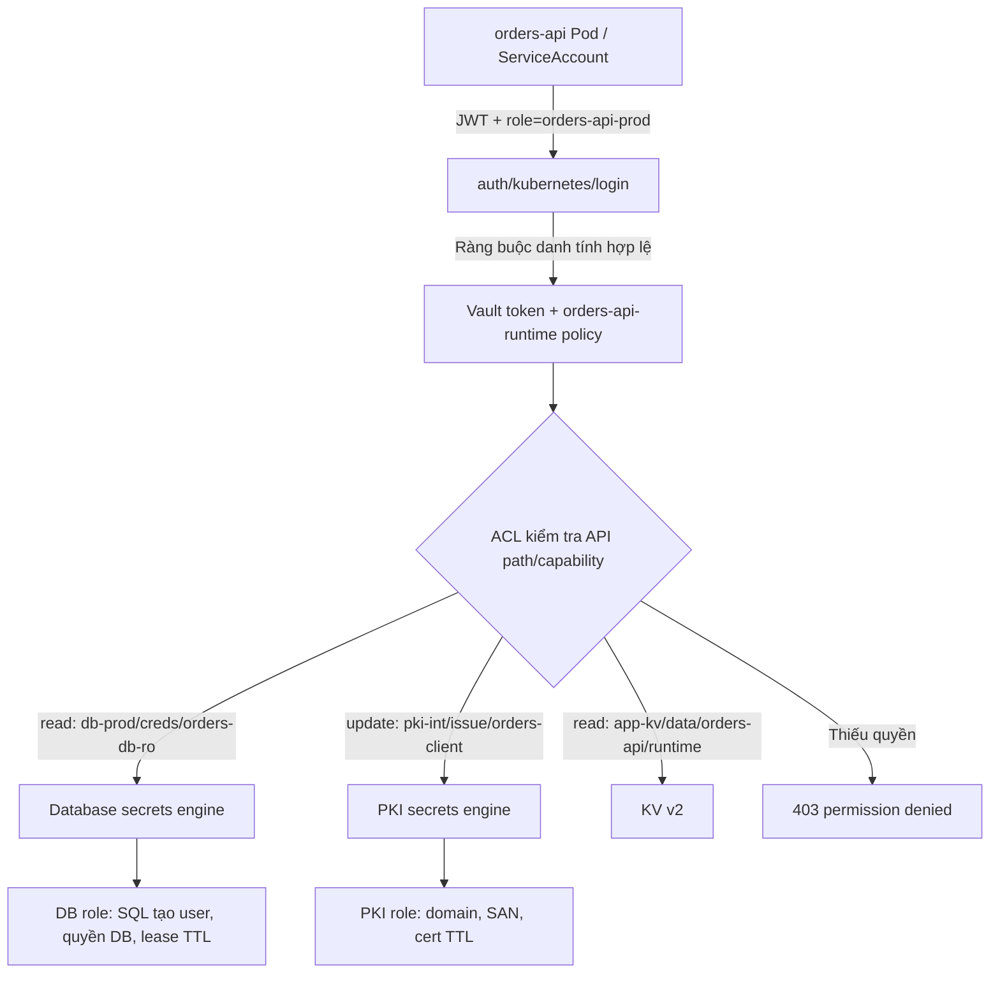

# Role ở auth method và role ở secrets engine trong Spring Vault

Trong HashiCorp Vault, từ **role** xuất hiện ở nhiều nơi. Một **Kubernetes auth role** có thể mang tên `orders-api`, một **database secrets engine role** có thể mang tên `orders-readonly`, còn một **PKI role** có thể mang tên `orders-client`. Chúng đều là “role” nhưng **không thay thế cho nhau**: role của phương thức xác thực xác định *workload nào được đăng nhập và nhận token như thế nào*; role của secrets engine xác định *loại secret, credential hoặc chứng chỉ mà engine được phép phát hành khi một request hợp lệ tới engine*.

Điểm nối giữa hai loại role là **Vault token và ACL policy**. Workload Java dùng **Spring Vault** đăng nhập qua auth method, nhận token gắn policy, rồi dùng token gọi các endpoint KV, database, Transit hoặc PKI. Vault xét quyền trên đường dẫn API trước khi secrets engine áp dụng quy tắc nghiệp vụ. Vì thế, **đăng nhập bằng role thành công không có nghĩa là được dùng mọi role của secrets engine**.

Bài học thuộc chương **Phân quyền truy cập** của module **SPRING_VAULT**. Chúng ta sẽ đối chiếu hai kiểu role với ví dụ Kubernetes/AppRole, database dynamic credentials và PKI certificates; thực hành policy, cách gọi `VaultTemplate`, vòng đời token/lease, xử lý lỗi, giám sát và kiểm thử tích hợp.

## 1. Mục tiêu học tập

Sau bài này, bạn có thể:

- Phân biệt **auth role**, **ACL policy**, **token** và **secrets engine role** theo đúng trách nhiệm.
- Giải thích vì sao cùng tên `orders-api` không khiến hai role ở hai mount tự động liên kết.
- Hiểu cách Kubernetes auth hoặc AppRole ràng buộc workload để cấp token có policy cụ thể.
- Hiểu database role quy định cách tạo credential động và PKI role giới hạn chứng chỉ được phát hành.
- Viết policy đúng các endpoint `db-prod/creds/<role>` và `pki-int/issue/<role>`, thay vì cấp quyền quản trị `roles/`.
- Dùng `VaultTemplate` để gọi đúng secrets engine và phân biệt token TTL, lease của database credential và TTL chứng chỉ.
- Kiểm chứng cả trường hợp được phép và bị từ chối; phân loại lỗi authentication, authorization và lỗi nghiệp vụ engine.

## 2. Hai loại role nằm ở hai giai đoạn khác nhau

Giả sử hệ thống bán hàng triển khai service `orders-api` trong Kubernetes. Đội vận hành cấu hình:

- Kubernetes auth mount: `auth/kubernetes/`.
- Kubernetes auth role: `orders-api-prod`.
- Database secrets engine mount: `db-prod/`, có role `orders-db-ro`.
- PKI secrets engine mount: `pki-int/`, có role `orders-client`.
- KV v2 mount: `app-kv/`, có secret `orders-api/runtime`.



| Thành phần | Định nghĩa | Trả lời câu hỏi |
| --- | --- | --- |
| **Auth method** | Backend xác thực như Kubernetes, AppRole, JWT/OIDC | Workload trình bằng chứng đăng nhập ở đâu? |
| **Auth role** | Cấu hình nằm dưới một auth method, gồm ràng buộc danh tính, policy/TTL token | Workload nào được dùng role để đăng nhập và nhận token gì? |
| **Vault token** | Credential do Vault cấp, gắn policy hiệu lực và vòng đời | Caller hiện tại có danh tính/quyền nào? |
| **ACL policy** | Các rule `path` và `capabilities` | Caller được gọi API endpoint nào, bằng thao tác gì? |
| **Secrets engine role** | Cấu hình nghiệp vụ trong từng engine, ví dụ database hoặc PKI | Khi được gọi, engine được phát hành credential/chứng chỉ theo quy tắc nào? |

Chú ý rằng **secrets engine role không phải policy ACL**. Một database role có thể định nghĩa tài khoản chỉ đọc ở PostgreSQL, nhưng điều đó không tự cấp quyền `read` của Vault cho token Java. Ngược lại, ACL cho phép gọi `db-prod/creds/orders-db-ro` nhưng database engine có thể vẫn thất bại vì database chưa được cấu hình, SQL cấp phát lỗi hoặc kết nối backend bị gián đoạn.

## 3. Auth role: ràng buộc workload và policy của token

Auth role tồn tại trong **phương thức xác thực**, vì thế phải đọc cùng mount của auth method. Nếu Kubernetes auth đặt ở `auth/kubernetes/` thì role có đường dẫn quản trị:

```text
auth/kubernetes/role/orders-api-prod
```

Role đó **không** phải là “cổng đọc secret”. Nó quyết định ai được dùng đường đăng nhập của auth method và những đặc tính token được phát hành.

### 3.1. Kubernetes auth role

Ví dụ minh họa một role ràng buộc ServiceAccount `orders-api` thuộc namespace `production`:

```bash
# Lệnh quản trị trong môi trường thử nghiệm; giả định auth mount đã cấu hình.
vault write auth/kubernetes/role/orders-api-prod \
  bound_service_account_names=orders-api \
  bound_service_account_namespaces=production \
  token_policies=orders-api-runtime \
  token_ttl=30m
```

Các thành phần có ý nghĩa:

| Thuộc tính | Vai trò |
| --- | --- |
| `bound_service_account_names` | Giới hạn ServiceAccount Kubernetes được phép dùng auth role |
| `bound_service_account_namespaces` | Giới hạn namespace Kubernetes tương ứng |
| `token_policies` | Policy được gắn vào token cấp sau khi login thành công |
| `token_ttl` | Thời gian sống ban đầu yêu cầu cho token, chịu giới hạn có hiệu lực của Vault |

Tùy cách triển khai, role và auth method còn có ràng buộc khác như audience, max TTL hoặc các thuộc tính token. Việc kiểm tra JWT, issuer và Kubernetes TokenReview phụ thuộc cấu hình Kubernetes auth thực tế.

Quy trình đăng nhập ở mức khái niệm:

```text
POST /v1/auth/kubernetes/login
{
  "role": "orders-api-prod",
  "jwt": "<ServiceAccount JWT>"
}
        ↓
Vault kiểm tra JWT + ràng buộc role
        ↓
Vault token có policy "orders-api-runtime"
```

**Không nhầm:** Workload chưa có Vault token khi thực hiện request login, nên việc đăng nhập theo cơ chế auth method không đòi hỏi token đã được cấp ACL `read` trên `auth/kubernetes/role/orders-api-prod`. Đường dẫn `auth/kubernetes/role/...` là **endpoint quản trị cấu hình role**, không phải endpoint mà service phải được quyền đọc để đăng nhập.

### 3.2. AppRole cũng có auth role

Nếu workload chạy ngoài Kubernetes, AppRole có thể dùng cặp RoleID và SecretID (theo cấu hình bảo vệ). Một AppRole mang tên `orders-batch` được quản lý tại:

```text
auth/approle/role/orders-batch
```

Đăng nhập thường diễn ra tại:

```text
POST /v1/auth/approle/login
{
  "role_id": "<redacted>",
  "secret_id": "<redacted>"
}
```

RoleID/SecretID là **chứng cứ đăng nhập**, không phải credential do database engine phát hành. AppRole có thể quy định token policies, TTL, giới hạn sử dụng hoặc các ràng buộc SecretID. Vẫn phải dùng ACL policy để cấp quyền cho các secrets engine sau khi login.

Một **auth role không phải là toàn bộ ACL**. Nếu auth role gắn tên policy không đúng hoặc workload đăng nhập nhầm role, token có thể được cấp hợp lệ nhưng không đủ quyền gọi endpoint mong muốn.

## 4. Secrets engine role: định nghĩa đầu ra của một engine

Ở secrets engine, “role” thường là **cấu hình nghiệp vụ để tạo secret**. Ý nghĩa chi tiết phụ thuộc loại engine: role database mô tả thông tin đăng nhập động có thể tạo; role PKI mô tả các thuộc tính chứng chỉ có thể cấp. KV v2 chỉ đọc/ghi key nên **không có khái niệm role cấp secret giống database hoặc PKI**; Transit thường cấp thao tác trên key qua các endpoint mật mã, không dùng một PKI/database role chung.

### 4.1. Database role: tạo credential động theo mẫu quyền

Giả sử database secrets engine được mount tại `db-prod/`. Đội quản trị cấu hình kết nối tới PostgreSQL và tạo database role `orders-db-ro`. Role đó có thể quy định:

- Kết nối database được sử dụng, ví dụ cấu hình tên `orders-postgres`.
- SQL tạo tài khoản động khi caller yêu cầu credential.
- Quyền của user SQL được tạo, chẳng hạn chỉ `SELECT` những bảng đã duyệt.
- Thời gian lease mặc định và tối đa cho credential.
- Cách thu hồi/xóa user hoặc hủy quyền khi lease bị revoke/hết hạn, theo cấu hình backend.

Các endpoint cần phân biệt:

```text
Quản trị cấu hình role:
  db-prod/roles/orders-db-ro

Lấy dynamic credential:
  db-prod/creds/orders-db-ro
```

Khi ứng dụng cần credential, nó gọi:

```text
GET /v1/db-prod/creds/orders-db-ro
```

ACL thích hợp cho ứng dụng:

```hcl
path "db-prod/creds/orders-db-ro" {
  capabilities = ["read"]
}
```

Không cấp `read`/`update` trên `db-prod/roles/orders-db-ro` cho runtime chỉ để nó có thể lấy credential. Đường dẫn `roles/` phục vụ **xem hoặc thay định nghĩa role**, còn `creds/` là endpoint **phát hành credential**.

Ví dụ dữ liệu phản hồi được rút gọn và ẩn mật khẩu:

```json
{
  "lease_id": "db-prod/creds/orders-db-ro/<lease-id>",
  "lease_duration": 3600,
  "renewable": true,
  "data": {
    "username": "v-orders-ro-<generated>",
    "password": "<redacted>"
  }
}
```

Giá trị `renewable` chỉ mang tính minh họa: lease có thể hoặc không thể gia hạn tùy cấu hình của plugin, role và backend. Thời gian sống này thuộc **credential động** và **khác** thời gian sống của Vault token dùng để gọi endpoint.

> **Một database role không phải database user cố định.** Vault thường tạo user mới theo template khi có request đến `creds/<role>`. Quyền SQL cuối cùng được enforcement bởi database; Vault ACL chỉ quyết định ai được yêu cầu Vault phát hành credential đó.

### 4.2. PKI role: giới hạn chứng chỉ có thể yêu cầu

Giả sử PKI secrets engine mount tại `pki-int/`. Đội vận hành cấu hình PKI role `orders-client` để cấp chứng chỉ mTLS cho các dịch vụ trong miền nội bộ đã phê duyệt.

```text
Quản trị cấu hình PKI role:
  pki-int/roles/orders-client

Yêu cầu cấp chứng chỉ:
  pki-int/issue/orders-client
```

PKI role có thể quy định allowed domains, subdomain, loại SAN, thời hạn chứng chỉ tối đa và các thuộc tính chứng chỉ khác. Ví dụ minh họa dành cho quản trị viên (giả định CA/issuer đã được cấu hình phù hợp):

```bash
# Chỉ chạy trong môi trường quản trị hoặc tích hợp được phép.
vault write pki-int/roles/orders-client \
  allowed_domains=svc.internal \
  allow_subdomains=true \
  max_ttl=8h
```

Một workload cần xin certificate theo role này dùng:

```text
POST /v1/pki-int/issue/orders-client
{
  "common_name": "orders-api.svc.internal",
  "ttl": "1h"
}
```

ACL của token:

```hcl
path "pki-int/issue/orders-client" {
  capabilities = ["update"]
}
```

Ở đây, `update` không có nghĩa “sửa PKI role”. Đó là capability Vault thường yêu cầu cho **POST issue certificate**. ACL chỉ cho phép gọi endpoint `issue/` theo role đã định; PKI role tiếp tục kiểm tra subject/SAN/TTL và các điều kiện cấp chứng chỉ.

Không cần quyền đọc/sửa `pki-int/roles/orders-client` để gọi `issue/orders-client`. Workload cũng không mặc nhiên có quyền quản trị CA, sửa role khác hoặc thu hồi chứng chỉ của người khác.

### 4.3. Các engine khác có thể cũng có “role”

Một số secrets engine như AWS, SSH hoặc cloud providers cũng có khái niệm role, nhưng cấu hình và endpoint phát hành của chúng **khác** database/PKI. Không áp đặt quy tắc “mọi secrets engine đều có `creds/<role>`” hoặc “mọi role đều được gọi bằng POST `issue/<role>`”.

Hãy tra đúng tài liệu API của engine và phiên bản Vault đang sử dụng, xác minh **mount thực tế**, endpoint nghiệp vụ, HTTP method và capability cần thiết rồi mới viết policy.

## 5. Một bảng so sánh có thể dùng khi review thiết kế

| Câu hỏi | Role tại auth method | Role tại secrets engine |
| --- | --- | --- |
| Nằm ở đâu? | Dưới `auth/<mount>/role/<name>` hoặc cấu trúc riêng của auth method | Dưới `<engine-mount>/roles/<name>` hoặc endpoint cấu hình tương ứng |
| Ai thiết lập? | Nhóm phụ trách danh tính/xác thực workload | Nhóm quản trị secrets engine/DB/PKI |
| Mục đích chính? | Xác định điều kiện login và đặc tính Vault token | Xác định cách phát hành credential, certificate hoặc secret động |
| Khi nào có tác dụng? | Khi workload thực hiện login hoặc phát hành token theo auth method | Khi request đã được phép gọi endpoint engine và engine xử lý nghiệp vụ |
| Tài nguyên đầu ra? | Vault token kèm policy/TTL | DB username/password có lease, hoặc certificate/key có TTL |
| Có trực tiếp cấp `read` trên KV không? | Không; chỉ qua ACL policy được gắn vào token | Không; role engine cũng không tự cấp ACL KV |
| Tên role có phải duy nhất toàn Vault? | Không; tên phụ thuộc auth mount và namespace | Không; tên phụ thuộc engine mount và namespace |
| Cần quyền quản trị để sửa? | Có, trên endpoint cấu hình của auth method | Có, trên endpoint cấu hình của secrets engine |

**ACL policy là lớp nối, không phải một loại role thứ ba.** Một policy có thể cho phép nhiều đường dẫn, nhưng nguyên tắc quyền tối thiểu yêu cầu chỉ thêm quyền nghiệp vụ mà workload thật sự cần.

## 6. Trường hợp dễ nhầm: cùng tên role nhưng hoàn toàn độc lập

Giả sử hệ thống có:

```text
auth/kubernetes/role/orders-api
db-prod/roles/orders-api
pki-int/roles/orders-api
```

Tên cuối `orders-api` giống nhau, nhưng ba đối tượng này **khác mount, khác mục đích và khác API**:

- `auth/kubernetes/role/orders-api` có thể ràng buộc ServiceAccount để cấp Vault token.
- `db-prod/roles/orders-api` định nghĩa quyền SQL/TTL cho dynamic database credential.
- `pki-int/roles/orders-api` giới hạn các certificate có thể cấp.

Thậm chí một auth role tên `orders-api` có thể phát token **không có** quyền đọc `db-prod/creds/orders-api`. Ngược lại, workload dùng auth role tên `payments-api` có thể được cấp `read` trên database role `orders-api` nếu ACL policy của nó cho phép — đây có thể là sai sót phân quyền. **Tên role không phải cơ chế liên kết hoặc bảo mật**; kiểm soát nằm ở ràng buộc identity, token policy, API path và rules của engine.

Phản ví dụ thường gặp:

```hcl
# SAI MỤC ĐÍCH: đọc cấu hình auth role không cấp quyền lấy DB credential.
path "auth/kubernetes/role/orders-api" {
  capabilities = ["read"]
}

# SAI MỤC ĐÍCH: đọc định nghĩa database role không phát hành user/password.
path "db-prod/roles/orders-db-ro" {
  capabilities = ["read"]
}
```

Nếu service chỉ cần lấy database credentials, policy đúng là:

```hcl
path "db-prod/creds/orders-db-ro" {
  capabilities = ["read"]
}
```

Tương tự, để cấp chứng chỉ, cần `update` trên `pki-int/issue/orders-client` thay vì cấp quyền sửa `pki-int/roles/orders-client`.

## 7. Thiết kế luồng Spring Vault theo quyền tối thiểu

Một thiết kế ví dụ với workload `orders-api` có ba nhu cầu:

1. Đọc cấu hình runtime từ KV v2.
2. Lấy credential động chỉ đọc cho database.
3. Xin chứng chỉ mTLS từ một PKI role đã được quản trị giới hạn.

Các quyền tương ứng:

```hcl
# orders-api-runtime.hcl

# KV v2 mount "app-kv"; service chỉ đọc một secret.
path "app-kv/data/orders-api/runtime" {
  capabilities = ["read"]
}

# Database secrets engine mount "db-prod"; chỉ lấy credential theo role RO.
path "db-prod/creds/orders-db-ro" {
  capabilities = ["read"]
}

# PKI mount "pki-int"; chỉ được xin chứng chỉ qua role riêng.
path "pki-int/issue/orders-client" {
  capabilities = ["update"]
}
```

Policy này không cấp quyền quản trị:

```text
auth/kubernetes/role/*
db-prod/roles/*
db-prod/config/*
pki-int/roles/*
pki-int/config/*
sys/policies/acl/*
```

Nếu PKI issuance chỉ diễn ra trong một job/sidecar riêng, hãy tách quyền `pki-int/issue/orders-client` sang **token của thành phần đó** thay vì giữ nó ở service runtime. Khi workload bị xâm nhập, ranh giới policy thu hẹp loại secret hoặc chứng chỉ có thể bị phát hành.

### 7.1. Code Java dùng `VaultTemplate`

Giả định Spring Vault đã cấu hình `VaultTemplate` và `ClientAuthentication` phù hợp với Kubernetes/AppRole của môi trường. Ví dụ Java:

```java
import java.util.Map;

import org.springframework.vault.core.VaultKeyValueOperations;
import org.springframework.vault.core.VaultKeyValueOperationsSupport.KeyValueBackend;
import org.springframework.vault.core.VaultTemplate;
import org.springframework.vault.support.VaultResponse;

public final class OrdersVaultService {

    private final VaultTemplate vaultTemplate;
    private final VaultKeyValueOperations kv;

    public OrdersVaultService(VaultTemplate vaultTemplate) {
        this.vaultTemplate = vaultTemplate;
        this.kv = vaultTemplate.opsForKeyValue(
                "app-kv", KeyValueBackend.KV_2);
    }

    public Map<String, Object> runtimeConfig() {
        VaultResponse response = kv.get("orders-api/runtime");
        return requireData(response, "orders runtime config");
    }

    public Map<String, Object> newReadOnlyDbCredentials() {
        // GET /v1/db-prod/creds/orders-db-ro
        VaultResponse response = vaultTemplate.read(
                "db-prod/creds/orders-db-ro");
        return requireData(response, "dynamic database credentials");
    }

    public Map<String, Object> issueClientCertificate() {
        // POST /v1/pki-int/issue/orders-client
        VaultResponse response = vaultTemplate.write(
                "pki-int/issue/orders-client",
                Map.of(
                        "common_name", "orders-api.svc.internal",
                        "ttl", "1h"));
        return requireData(response, "PKI client certificate");
    }

    private static Map<String, Object> requireData(
            VaultResponse response, String label) {
        if (response == null || response.getData() == null) {
            throw new IllegalStateException("Vault returned no data for " + label);
        }
        return response.getData();
    }
}
```

**Không** viết code gọi `auth/kubernetes/role/orders-api-prod` rồi mong nhận token; cấu hình auth role chỉ là phần quản trị. Trong mã thực tế, session authentication của Spring Vault xử lý login, còn các phương thức `read(...)`/`write(...)` dùng Vault token được quản lý bởi client.

Ví dụ trên tập trung vào ánh xạ API. Trong production, credential động và private key từ PKI phải được lưu/tiêu thụ trong thành phần bảo mật phù hợp, không log, không trả ra API công khai và phải gắn với cơ chế renew/revoke hoặc cấp lại. Nếu ứng dụng dùng Spring Vault API chuyên dụng cho database/PKI, cấu trúc response và cách quản lý lease có thể được hỗ trợ ở mức trừu tượng cao hơn.

### 7.2. Một lần login không phải một lần phát hành credential

Đăng nhập Vault cho ra một **Vault token**. Mỗi lần gọi `GET db-prod/creds/orders-db-ro` có thể phát hành **bộ DB credential động mới**, cùng lease ID/TTL riêng, tùy cấu hình database engine. Mỗi request `POST pki-int/issue/orders-client` có thể cấp **chứng chỉ mới** với TTL riêng.

Không xây dựng ứng dụng theo suy luận “đã có Vault token thì đã có sẵn một bộ DB username/password và certificate”. Client phải gọi đúng endpoint để lấy dữ liệu thực sự cần, cache/rotate hợp lý và theo dõi vòng đời riêng của mỗi loại.

## 8. Phân biệt token TTL, dynamic-secret lease và certificate TTL

| Đối tượng | Ai phát hành? | Cấu hình liên quan | Vòng đời |
| --- | --- | --- | --- |
| **Vault token** | Auth method/role và Vault token subsystem | Auth role, token policies, TTL, max TTL, renewable | Token hết hạn/revoke thì các request tới Vault không còn xác thực hợp lệ |
| **DB dynamic credential** | Database secrets engine qua database role | SQL tạo/xóa user, default/max lease TTL, database config | Credential có lease ID; có thể renew/revoke theo khả năng backend |
| **PKI certificate** | PKI secrets engine qua PKI role | Domain/SAN, max TTL, issuer/CA và tham số issue | Chứng chỉ hết hạn theo `notAfter`; thường cần **cấp mới** thay vì renew lease giống DB |
| **KV v2 secret version** | KV engine sau khi ghi dữ liệu | `data/`, `metadata/`, retention/CAS | Phiên bản nội dung; không phải credential động có lease |

Một số hiểu nhầm dễ dẫn đến bug:

- **Token còn sống** không bảo đảm DB credential cũ chưa hết lease.
- **Renew token** không tự gia hạn database lease hoặc chứng chỉ PKI.
- **Đổi auth role** có thể làm thay đổi thuộc tính token phát hành sau đó; không có nghĩa tất cả credential/lease đã cấp sẽ lập tức được thu hồi.
- **Đổi database/PKI role** có thể ảnh hưởng những lần phát hành tiếp theo; không nên giả định ngay lập tức thay đổi quyền SQL của user đã phát hành hoặc nội dung chứng chỉ đã ký.
- **Đổi ACL policy** có thể ảnh hưởng quyền API của token đang dùng; cần kiểm thử và giám sát rollout thay vì mặc định phải login mới mới có tác dụng.

Khi thiết kế hệ thống, chỉ yêu cầu quyền renew/revoke lease hoặc token nếu thành phần thực sự làm nhiệm vụ đó; xác định endpoint, capability và giới hạn TTL theo API hiện hành. Không gắn `auth/token/*` hoặc `sys/leases/*` rộng rãi cho mọi service.

## 9. Dấu hiệu lỗi: auth role hay secrets engine role?

Một service nhận lỗi không đồng nghĩa phải sửa cả hai role. Hãy xác định **request nào thất bại**:

| Triệu chứng | Nghi vấn chính | Cách kiểm tra |
| --- | --- | --- |
| Kubernetes login bị từ chối | Sai auth mount, ServiceAccount/namespace, JWT/audience, auth role | Kiểm tra binding của `auth/kubernetes/role/orders-api-prod` và log auth |
| Login thành công nhưng `GET db-prod/creds/orders-db-ro` báo `403` | Token thiếu `read` trên đúng `creds/<role>`, policy sai mount, hoặc token không hợp lệ | Kiểm tra effective policies, API path, TTL |
| Login thành công nhưng đọc `db-prod/roles/orders-db-ro` bị `403` | Caller không được quyền đọc cấu hình role | Thường là **đúng mong đợi** cho runtime, không cần cấp thêm |
| `GET db-prod/creds/...` qua ACL nhưng backend báo lỗi | Database connection, role definition, SQL tạo user hoặc limits của engine có vấn đề | Xem lỗi engine/audit với người vận hành, không mở ACL bừa |
| PKI issue bị `403` | Thiếu `update` trên `pki-int/issue/orders-client` hoặc path sai | Kiểm tra token capability trên endpoint issue |
| PKI issue bị từ chối vì common name/SAN/TTL | PKI role không cho phép thuộc tính yêu cầu | Sửa request hoặc role qua review quản trị |
| Đọc KV v2 bị `403` | Thiếu `read` tại `app-kv/data/orders-api/runtime` | Kiểm tra mount, `data/` và token |
| DB user hết hạn sau khi token còn sống | Database lease TTL khác token TTL | Thiết kế renew/reissue credential |
| Chứng chỉ hết hạn dù DB credential còn dùng được | Certificate TTL độc lập với lease DB | Cấp mới certificate theo quy trình |

Đừng suy luận chỉ từ HTTP code. `403` thường chỉ ra vấn đề xác thực/phân quyền, nhưng một số backend hoặc API cũng áp dụng quyền, trạng thái và quy tắc nội bộ; `404` có thể liên quan đường dẫn/role không tồn tại; lỗi `400` có thể đến từ payload, SQL hoặc điều kiện PKI role. Kết luận cần dựa trên **đường dẫn, loại thao tác, token, audit và kết quả backend**.

## 10. Kiểm tra các role và quyền thực tế bằng CLI

Trước khi kiểm tra, cần xác định tên mount và namespace/cluster thực tế. Các lệnh đọc cấu hình role sau yêu cầu **danh tính vận hành có quyền xem role**; không nên cấp các quyền này cho service runtime:

```bash
# Dùng bởi quản trị viên/tài khoản chẩn đoán được phê duyệt.
vault read auth/kubernetes/role/orders-api-prod
vault read db-prod/roles/orders-db-ro
vault read pki-int/roles/orders-client
```

Sau khi gắn policy cho auth role và đăng nhập bằng **đúng workload**, kiểm tra capability trên **endpoint nghiệp vụ**:

```bash
# Token ở đây là token workload thử nghiệm, không phải root token.
vault token capabilities app-kv/data/orders-api/runtime
vault token capabilities db-prod/creds/orders-db-ro
vault token capabilities pki-int/issue/orders-client

# Các đường dẫn quản trị phải bị từ chối.
vault token capabilities auth/kubernetes/role/orders-api-prod
vault token capabilities db-prod/roles/orders-db-ro
vault token capabilities pki-int/roles/orders-client
```

Kỳ vọng tương ứng của policy `orders-api-runtime.hcl`:

| API path | Capability kỳ vọng |
| --- | --- |
| `app-kv/data/orders-api/runtime` | `read` |
| `db-prod/creds/orders-db-ro` | `read` |
| `pki-int/issue/orders-client` | `update` |
| `auth/kubernetes/role/orders-api-prod` | `deny` |
| `db-prod/roles/orders-db-ro` | `deny` |
| `pki-int/roles/orders-client` | `deny` |
| `db-prod/creds/payroll-admin` | `deny` |

`vault token capabilities` cho biết quyền hiệu lực tại path, nhưng bản thân lệnh kiểm tra có thể yêu cầu token được phép dùng API tra cứu capability tự phục vụ (thường qua policy `default`). Nếu token bị loại policy `default` và thiếu quyền này, dùng cách đánh giá được quản trị viên cho phép, **không mở quyền quản trị cho service để làm lệnh chẩn đoán hoạt động**.

Sau đó mới chạy request **thực** trên dữ liệu/engine kiểm thử, ví dụ:

```bash
# Thực hiện bằng token workload thử nghiệm.
vault kv get -mount=app-kv orders-api/runtime

# Cấp credential mới từ database role đã chuẩn bị trong môi trường tích hợp.
# Lệnh này có thể tạo DB user/lease mới; cần quản lý việc thu hồi.
vault read db-prod/creds/orders-db-ro
```

Không hiển thị credential thật trong log CI hoặc tài liệu. Nếu thử PKI issue, chỉ sử dụng PKI thử nghiệm được phép và lưu private key an toàn; việc issue có thể tạo chứng chỉ có giá trị xác thực thực sự trong phạm vi CA đã cấu hình.

## 11. Ma trận kiểm thử tích hợp Spring Vault

Để chứng minh hệ thống đúng thiết kế, chuẩn bị một Vault test instance hoặc môi trường kiểm thử tách biệt với production:

1. Tạo auth role cho ServiceAccount `orders-api` với token policy `orders-api-runtime`.
2. Chuẩn bị KV v2 mount `app-kv` và key `orders-api/runtime` có dữ liệu giả.
3. Cấu hình database engine + database role `orders-db-ro` nối với database kiểm thử, bảo đảm SQL tạo user và revoke có thể chạy.
4. Cấu hình PKI test CA/issuer + role `orders-client` giới hạn domain `svc.internal`.
5. Dùng Spring Vault client đăng nhập bằng workload hạn chế, không dùng root token.
6. Kiểm tra cả request được phép lẫn request bị từ chối.

| Test | Request | Kỳ vọng | Ý nghĩa |
| --- | --- | --- | --- |
| Auth login hợp lệ | Kubernetes JWT + role `orders-api-prod` | Token được cấp | Auth role ràng buộc danh tính đúng |
| Auth login sai ServiceAccount | JWT của ServiceAccount ngoài binding | Không cấp token | Auth role không cho workload khác mạo danh |
| Đọc cấu hình KV | GET `app-kv/data/orders-api/runtime` | Thành công | ACL `read` đúng mount/path |
| Lấy DB credential RO | GET `db-prod/creds/orders-db-ro` | Thành công; credential có lease khi backend hỗ trợ | ACL và database role phối hợp |
| Lấy DB credential role không cho phép | GET `db-prod/creds/payroll-admin` | Bị từ chối | Không cấp rộng mọi database role |
| Đọc/sửa cấu hình database role | GET/POST `db-prod/roles/orders-db-ro` | Bị ACL từ chối | Runtime không làm quản trị engine |
| Xin chứng chỉ hợp lệ | POST `pki-int/issue/orders-client`, CN hợp lệ | Thành công | ACL issue + PKI role cùng đúng |
| Xin chứng chỉ ngoài domain role | POST `pki-int/issue/orders-client`, CN không hợp lệ | Thất bại vì ràng buộc PKI role | ACL được phép chưa đủ để cấp mọi chứng chỉ |
| Thử thay auth role | POST `auth/kubernetes/role/orders-api-prod` | Bị từ chối | Workload không sửa được cách cấp token |
| Token hết hạn hoặc bị thu hồi | Gọi endpoint bằng token không còn hiệu lực | Bị từ chối; client xử lý auth lại hợp lý | TTL là lớp kiểm tra độc lập |

Phép thử “bị ACL từ chối” phải dùng **endpoint và tài nguyên tồn tại** để tránh nhầm lỗi `404` với lỗi quyền. Phép thử “PKI role từ chối” phải dùng **token có quyền issue** nhưng payload cố ý vượt giới hạn cấu hình, để biết lỗi do quy tắc certificate. Với database role, kiểm tra cả thời gian lease và kết quả revoke trên database test; không chỉ kiểm tra rằng API trả username/password.

### Gợi ý cấu trúc kiểm thử Java

Test setup tạo hai client có danh tính khác nhau: `ordersClient` mang `orders-api-runtime` và `limitedClient` chỉ được đọc KV (giả định). Các assertion nghiệp vụ:

```java
// Pseudocode minh họa; không phải class test có thể chạy độc lập.
assertNotNull(ordersClient.read("db-prod/creds/orders-db-ro"));
assertNotNull(ordersClient.write(
        "pki-int/issue/orders-client",
        Map.of("common_name", "orders-api.svc.internal")));

assertForbidden(() ->
        limitedClient.read("db-prod/creds/orders-db-ro"));
assertForbidden(() ->
        ordersClient.write(
                "db-prod/roles/orders-db-ro", Map.of()));
```

Trong test thật, `assertForbidden` phải xác nhận **mã lỗi authorization** phù hợp thay vì chấp nhận bất kỳ exception nào. Với đường đọc database role tạo credential động, cần theo dõi lease và cleanup fixture cuối test. Khi có thay đổi auth role hoặc policy, chạy lại cả kiểm thử dương tính lẫn âm tính.

## 12. Giám sát và vận hành an toàn

Các thay đổi role có phạm vi ảnh hưởng khác nhau:

- **Auth role:** thay đổi ràng buộc danh tính hoặc policy/TTL của **token được phát hành**. Review bởi đội vận hành identity/security, thử login đúng và sai ServiceAccount/AppRole trước khi rollout.
- **ACL policy:** thay đổi endpoint mà token có thể gọi. Test capability hiệu lực tại các path cho phép và từ chối, đặc biệt các wildcard `db-prod/*` hay `pki-int/*`.
- **Database role:** thay đổi quyền SQL hoặc TTL của **credential động mới**. Review DDL, giới hạn DB user, rotation/revoke behavior và ảnh hưởng tới các lease đang tồn tại.
- **PKI role:** thay đổi tập subject/SAN/TTL được phép cho **chứng chỉ được phát hành**. Review allowed domains và kế hoạch cấp lại chứng chỉ; không giả định chứng chỉ đã ký tự thay đổi.

Trong log ứng dụng và Vault audit:

- Ghi loại request, mount/role ở mức được phép, mã phản hồi, thời gian và correlation ID.
- Theo dõi lỗi login theo auth role, số `403` trên `creds/` và `issue/`, thời gian cấp credential/chứng chỉ, lỗi renew/revoke lease và certificate gần hết hạn.
- Không ghi JWT, RoleID/SecretID, Vault token, DB password, private key, PEM hoặc response chứa secret ra log.
- Xây dựng cảnh báo khi một workload thử các role không thuộc phạm vi, ví dụ `orders-api` đột ngột gọi `db-prod/creds/payroll-admin`.
- Tách tài khoản quản trị role khỏi danh tính ứng dụng; thay đổi config bằng quy trình review, không mở quyền cấu hình engine cho service runtime.

Nếu workload gặp `403` sau khi login thành công, hãy xác định đó là request tới **endpoint nghiệp vụ** hay tới **endpoint cấu hình role**. Không giải quyết bằng cách cấp `sudo`, root token hoặc `path "*"`; chúng làm mất ranh giới cần bảo vệ.

## 13. Bài tập tự kiểm tra

### Bài 1 — Đăng nhập thành công có nghĩa đọc được DB?

Kubernetes auth role `orders-api-prod` cấp token gắn policy chỉ có:

```hcl
path "app-kv/data/orders-api/runtime" {
  capabilities = ["read"]
}
```

Trong database engine đã có role `orders-db-ro`. Ứng dụng có đọc được `db-prod/creds/orders-db-ro` không?

<details>
<summary>Đáp án gợi ý</summary>

Không. Login thành công chỉ tạo Vault token; sự tồn tại của database role không bổ sung ACL. Cần cấp `read` trên đúng `db-prod/creds/orders-db-ro` nếu workload thật sự phải nhận credential động.

</details>

### Bài 2 — Nhầm đường dẫn `roles/` và `creds/`

Một policy cấp `read` trên `db-prod/roles/orders-db-ro`. Service có thể lấy username/password bằng `VaultTemplate.read("db-prod/creds/orders-db-ro")` không?

<details>
<summary>Đáp án gợi ý</summary>

Không, nếu token không có policy khác cho phép. `roles/<name>` là đường dẫn cấu hình database role, còn `creds/<name>` là endpoint phát hành credential. Cấp quyền đọc role definition không cấp quyền đọc credential động.

</details>

### Bài 3 — PKI role giới hạn domain

Token có `update` trên `pki-int/issue/orders-client`. PKI role chỉ cho phép tên dưới `svc.internal`. Có được yêu cầu certificate `admin.example.com` không?

<details>
<summary>Đáp án gợi ý</summary>

Không nếu tên đó nằm ngoài ràng buộc role. ACL chỉ cho phép gọi endpoint; PKI role vẫn kiểm tra tên miền/SAN/TTL và các điều kiện khác. Đăng nhập lại hoặc thêm `sudo` không phải cách sửa request sai domain.

</details>

### Bài 4 — Ba role cùng tên

Vault có `auth/kubernetes/role/reporting`, `db-prod/roles/reporting` và `pki-int/roles/reporting`. Workload sử dụng Kubernetes role `reporting` có mặc nhiên được dùng hai role secrets engine cùng tên không?

<details>
<summary>Đáp án gợi ý</summary>

Không. Tên role độc lập theo mount và loại engine. Phải có ACL cho endpoint nghiệp vụ phù hợp như `db-prod/creds/reporting` hoặc `pki-int/issue/reporting`, rồi secrets engine còn áp dụng giới hạn riêng.

</details>

### Bài 5 — Token TTL và lease

Ứng dụng vừa renew Vault token thành công, nhưng database credential được cấp trước đó đã hết lease. Có thể tiếp tục dùng credential cũ vì token còn hợp lệ không?

<details>
<summary>Đáp án gợi ý</summary>

Không được giả định như vậy. Vault token TTL và database lease có vòng đời riêng. Ứng dụng phải gia hạn lease nếu engine cho phép hoặc lấy credential mới, rồi cập nhật kết nối database theo quy trình an toàn. Renew token không tự gia hạn DB user.

</details>

## 14. Checklist phân biệt đúng hai loại role

Trước khi triển khai một workload Spring Vault, hãy trả lời:

1. **Auth method nào?** Kubernetes, AppRole hay cơ chế khác, ở mount nào và namespace nào?
2. **Auth role nào?** Workload có đúng ServiceAccount/namespace hoặc RoleID/SecretID; các binding đã được kiểm thử chưa?
3. **Token được cấp gì?** Policy nào, TTL/renewable ra sao, có policy phụ cấp quyền dư không?
4. **Secrets engine nào?** KV v2, database, PKI, Transit; mount thực tế là gì?
5. **Engine role nào?** Với database/PKI, role giới hạn được phát hành credential/certificate nào và TTL nào?
6. **API nghiệp vụ ở đâu?** `db-prod/creds/<role>` hoặc `pki-int/issue/<role>` khác đường quản trị `roles/<role>`.
7. **ACL có đúng endpoint/capability?** `read` cho DB creds, `update` cho PKI issue, `read` trên `data/` của KV v2 khi cần đọc secret.
8. **Lỗi xảy ra ở giai đoạn nào?** Login, ACL hay engine validation? Đã đối chiếu mã lỗi và audit chưa?
9. **Vòng đời đã tách bạch?** Token TTL, DB lease và certificate TTL có cơ chế renew/reissue/cleanup riêng không?
10. **Đã kiểm thử cả bị cấm?** Workload có bị chặn khi truy cập role khác hoặc sửa auth/engine role không?

**Ghi nhớ:** **Auth role** xác định *workload nào được đăng nhập để nhận Vault token*, **ACL policy** xác định *token đó được gọi API nào*, còn **secrets engine role** xác định *engine được phép phát hành dữ liệu gì khi request hợp lệ*. Phân biệt ba lớp này là nền tảng để dùng `VaultTemplate` an toàn, cấp quyền theo nhu cầu và xử lý đúng các sự cố về credential, token, lease, Transit và PKI trong ứng dụng Java.
