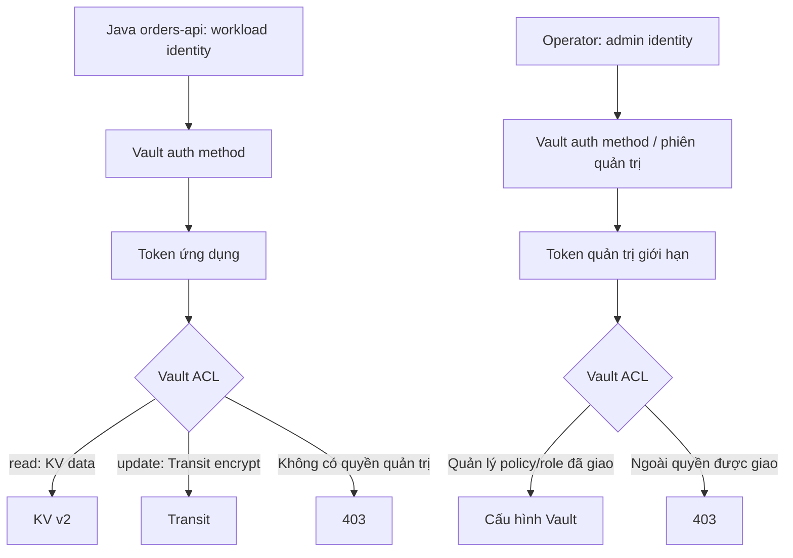
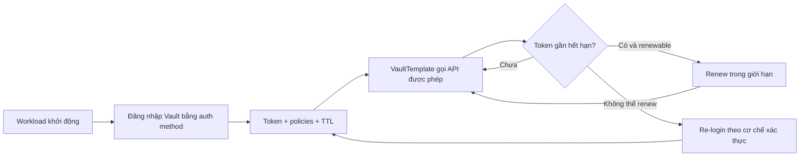

# Token dùng cho ứng dụng và token dùng cho quản trị trong Spring Vault

Một ứng dụng Java dùng **Spring Vault** để kết nối **HashiCorp Vault** thường chỉ cần đọc một số KV secrets, thực hiện phép mã hóa Transit hoặc xin chứng chỉ theo một PKI role đã được phê duyệt. Trong khi đó, người vận hành Vault cần quản lý auth methods, ACL policies, secrets engines và xử lý sự cố. Nếu cả hai dùng chung một Vault token có quyền quản trị, một lỗi trong ứng dụng có thể mở đường cho việc sửa chính sách phân quyền, phát hành token vượt thẩm quyền hoặc thay đổi cấu hình secrets engine.

Chủ đề **“Token dùng cho ứng dụng và token dùng cho quản trị”** thuộc chương **Phân quyền truy cập**. Bài học làm rõ: hai loại token này khác nhau chủ yếu ở **danh tính, nguồn cấp phát, policy, phạm vi và vòng đời**, chứ không phải ở việc Vault có một kiểu token kỹ thuật mang nhãn “application” hay “administrator”. Chúng ta sẽ liên hệ với `VaultTemplate`, xác thực workload, KV v2, vòng đời token và lease, Transit encryption, PKI, giám sát và kiểm thử tích hợp.

## 1. Kết quả cần đạt

Sau bài học, bạn có thể:

- Phân biệt **token ứng dụng**, **token quản trị**, **root token** và các loại token kỹ thuật như *service token* hoặc *batch token*.
- Thiết kế token ứng dụng với ACL chỉ cho phép các endpoint nghiệp vụ thật sự cần, ví dụ `secret/data/orders-api/runtime`.
- Giải thích vì sao chỉ có token đăng nhập hợp lệ hoặc policy tên `admin` chưa đủ để kết luận một request được phép.
- Chọn phương thức xác thực workload như Kubernetes auth hoặc AppRole thay vì nhúng token quản trị cố định vào source code.
- Phân biệt token TTL/renewal, token revocation và lease của dynamic secret; biết khi nào phải đăng nhập lại.
- Kiểm tra quyền thực tế bằng token ứng dụng và token quản trị riêng biệt, bao gồm cả các request **phải bị từ chối**.
- Đọc và xử lý `403`/`404`, lỗi token hết hạn và các tín hiệu giám sát mà không để lộ credential.

## 2. “Token ứng dụng” và “token quản trị” là cách phân loại theo mục đích

Vault token là credential dùng để gửi request tới Vault. Mỗi token có tập policy hiệu lực và các thuộc tính vòng đời. Tên gọi “token ứng dụng” hoặc “token quản trị” mô tả **ai dùng token, dùng để làm gì và token được cấp quyền gì**.

| Tiêu chí | Token ứng dụng | Token quản trị |
| --- | --- | --- |
| Chủ thể | Java service, batch job, sidecar hoặc workload tự động | Người/quy trình vận hành Vault đã được ủy quyền |
| Nguồn cấp | Đăng nhập theo workload identity qua Kubernetes, AppRole, JWT/OIDC hoặc phương thức phù hợp | Đăng nhập theo danh tính quản trị hoặc quy trình cấp token có kiểm soát |
| Policy | Chỉ các API phục vụ nghiệp vụ, ví dụ đọc một KV key hoặc gọi Transit encrypt | Chỉ endpoint quản trị thực sự được giao, ví dụ cấu hình một auth role hoặc policy |
| Thời gian sống | TTL giới hạn, renewal/re-login tự động khi được phép | TTL và thời hạn phiên phù hợp với công việc quản trị; hạn chế phiên đặc quyền kéo dài |
| Lưu giữ | Qua cơ chế session của ứng dụng, không commit vào Git hay ghi vào log | Trong phiên/công cụ quản trị được kiểm soát; không đưa sang cấu hình runtime |
| Khả năng phát sinh tác động | Đọc secret hoặc sử dụng engine trong giới hạn policy | Có thể làm thay đổi quyền hoặc cấu hình của workload khác |
| Kiểm thử | Request nghiệp vụ thành công; request quản trị và truy cập ngoài phạm vi thất bại | Thao tác quản trị được giao thành công; endpoint ngoài phạm vi bị từ chối |

**Token quản trị không nhất thiết là root token.** Đội vận hành có thể dùng những token chỉ được sửa một nhóm cấu hình. Ngược lại, một service token có thể bị cấp policy quá rộng; vì vậy **không thể dựa vào tên hoặc loại token để đánh giá mức đặc quyền**.



Một workload có thể đăng nhập thành công nhưng vẫn bị từ chối khi đọc secret; một quản trị viên có thể đăng nhập thành công nhưng không có quyền thay đổi toàn bộ mounts. **Authentication** xác nhận danh tính, còn **authorization** kiểm tra từng đường dẫn API và capability trên token.

## 3. Đừng nhầm mục đích token với loại token của Vault

Vault phân biệt các loại token kỹ thuật; hai loại thường được nói tới là **service token** và **batch token**. Ngoài ra, token mang **root policy** có đặc quyền rất lớn. Những khái niệm này không tương ứng một-một với “ứng dụng” và “quản trị”.

| Khái niệm | Ý nghĩa | Điều cần nhớ |
| --- | --- | --- |
| **Service token** | Token được Vault quản lý trạng thái, hỗ trợ các khả năng như tra cứu bằng accessor, phân cấp token hoặc gia hạn tùy cấu hình | Có thể dùng cho ứng dụng **hoặc** công việc quản trị; quyền do policy quyết định |
| **Batch token** | Loại token nhẹ, phù hợp một số workload quy mô lớn; có những hạn chế riêng về quản lý, renewal và vòng đời | Không mặc nhiên là “token ứng dụng an toàn nhất”; phải kiểm tra khả năng của auth method và nhu cầu ứng dụng |
| **Token mang policy ứng dụng** | Token có quyền nghiệp vụ hạn chế | Có thể là service token hoặc loại phù hợp khác tùy cấu hình |
| **Token mang policy quản trị** | Token có quyền trên endpoint cấu hình/quản lý | Vẫn nên giới hạn phạm vi, thời gian và danh tính |
| **Root token / token có root policy** | Đặc quyền tối cao, có khả năng vượt qua kiểm soát ACL thông thường | Chỉ dùng cho nhiệm vụ vận hành khẩn cấp/khởi tạo được kiểm soát; **không** đưa vào Java runtime |

Các thuộc tính như **TTL, renewable, policy, token type, parent/child, orphan và accessor** là những chiều độc lập cần kiểm tra theo cách token được tạo. Không tự suy rằng:

- Token dùng bởi ứng dụng thì chắc chắn không thể tạo token khác.
- Service token thì luôn có thể gia hạn.
- Batch token thì luôn phù hợp với mọi session manager.
- Token có tên policy `admin` thì chắc chắn là root.
- Token không hiện nguyên giá trị trong log thì đã an toàn nếu bị chia sẻ bởi nhiều workload.

### Root token có vai trò gì?

Root token được thiết kế cho một số công việc cực kỳ đặc quyền, như khởi tạo hoặc khôi phục quản trị. Đây là mục tiêu có tác động lớn nếu bị lộ. Một quy trình vận hành an toàn thường sử dụng nó trong thời gian cần thiết, rồi **thu hồi hoặc bảo quản theo quy trình đặc quyền của tổ chức**; công việc thường ngày nên dùng danh tính quản trị với policy hẹp hơn.

Đưa root token vào `application.yml` hoặc biến môi trường cố định của nhiều service không phải giải pháp cho lỗi `403`. Nó vô hiệu hóa mục tiêu phân quyền theo workload và khiến mất khả năng giới hạn tác động khi một service bị xâm nhập.

## 4. Token ứng dụng: cấp theo đúng workload và chức năng

Giả sử `orders-api` là một Spring Boot service có ba nhu cầu:

1. Đọc cấu hình `orders-api/runtime` từ KV v2 mount `app-kv/`.
2. Mã hóa dữ liệu bằng Transit key `orders-pii` tại mount `crypto/`.
3. Không có chức năng liệt kê secret, ghi secret hoặc quản trị Vault.

Policy HCL phù hợp:

```hcl
# orders-api-runtime.hcl
path "app-kv/data/orders-api/runtime" {
  capabilities = ["read"]
}

path "crypto/encrypt/orders-pii" {
  capabilities = ["update"]
}
```

Với một token chỉ mang policy này (ngoài các quyền tự phục vụ được cấp riêng, nếu có):

| Request | Kỳ vọng |
| --- | --- |
| GET `app-kv/data/orders-api/runtime` | Cho phép: `read` |
| POST `crypto/encrypt/orders-pii` | Cho phép: `update` |
| GET `app-kv/data/payroll-api/runtime` | Từ chối |
| LIST `app-kv/metadata/orders-api` | Từ chối |
| POST `app-kv/data/orders-api/runtime` | Từ chối |
| POST `crypto/decrypt/orders-pii` | Từ chối nếu nghiệp vụ không cần giải mã |
| PUT/POST `auth/kubernetes/role/orders-api` | Từ chối |
| PUT/POST `sys/policies/acl/orders-api-runtime` | Từ chối |

Hai điểm cần làm rõ:

- **KV v2:** `VaultKeyValueOperations` nhận key logic `orders-api/runtime`, nhưng endpoint đọc thật là `app-kv/data/orders-api/runtime`. Quyền `read` trên `app-kv/orders-api/runtime` không đủ.
- **Transit:** mã hóa thường dùng POST tại `crypto/encrypt/orders-pii` và cần `update`; không cần quyền quản lý `crypto/keys/orders-pii`. Nếu service chỉ mã hóa, đừng tự cấp `decrypt`.

### 4.1. Nguồn cấp token cho ứng dụng

Nên dùng **xác thực gắn với danh tính workload**, chẳng hạn Kubernetes auth:

```text
Pod ServiceAccount JWT
       ↓
POST /v1/auth/kubernetes/login
       ↓
Vault xác minh JWT và ràng buộc Kubernetes auth role
       ↓
Token ngắn hạn có orders-api-runtime policy
       ↓
Spring Vault dùng token gọi KV/Transit
```

Quản trị viên có thể cấu hình Kubernetes auth role, ví dụ:

```bash
# Ví dụ cấu hình quản trị, không chạy bằng token ứng dụng.
# Giả định auth mount và Kubernetes connection đã được cấu hình.
vault write auth/kubernetes/role/orders-api \
  bound_service_account_names=orders-api \
  bound_service_account_namespaces=production \
  token_policies=orders-api-runtime \
  token_ttl=30m
```

Role ràng buộc **ServiceAccount và namespace** và quy định policy cấp cho token. Việc thành công ở `auth/kubernetes/login` không đồng nghĩa được quyền đọc secret nếu ACL thiếu path/capability. Trong môi trường dùng **AppRole**, ý tưởng tương tự: role được cấu hình token policies, còn RoleID/SecretID được cung cấp bằng kênh bảo mật phù hợp để workload đăng nhập.

**Không cần cấp cho token ứng dụng quyền đọc hoặc sửa** `auth/kubernetes/role/orders-api`. Đây là endpoint **quản lý auth role**, không phải endpoint đăng nhập của service.

### 4.2. Spring Vault dùng token ứng dụng ra sao?

Khi đã cấu hình `ClientAuthentication` và session manager phù hợp, `VaultTemplate` sử dụng token do cơ chế xác thực cấp. Service code chỉ mô tả **secret cần đọc**:

```java
import java.util.Map;

import org.springframework.stereotype.Service;
import org.springframework.vault.core.VaultKeyValueOperations;
import org.springframework.vault.core.VaultKeyValueOperationsSupport.KeyValueBackend;
import org.springframework.vault.core.VaultTemplate;
import org.springframework.vault.support.VaultResponse;

@Service
public class OrdersSecrets {

    private final VaultKeyValueOperations kv;

    public OrdersSecrets(VaultTemplate vaultTemplate) {
        // "app-kv" là mount KV v2.
        this.kv = vaultTemplate.opsForKeyValue(
                "app-kv", KeyValueBackend.KV_2);
    }

    public Map<String, Object> loadRuntimeConfig() {
        // Chỉ truyền key logic; Spring Vault tự ánh xạ sang data/.
        VaultResponse response = kv.get("orders-api/runtime");
        if (response == null || response.getData() == null) {
            throw new IllegalStateException(
                    "Không có cấu hình bắt buộc orders-api/runtime");
        }
        return response.getData();
    }
}
```

Request thực của ví dụ:

```text
GET /v1/app-kv/data/orders-api/runtime
ACL: read trên app-kv/data/orders-api/runtime
```

Không có lời gọi `VaultTemplate` nào “tự nâng quyền” cho token. Nếu token bị từ chối, phải kiểm tra danh tính, policy và request path; không thay bằng root token.

Trong hệ thống dùng **Spring Cloud Vault** để nạp cấu hình lúc startup, cần xem thêm backend/context/profile đang tạo ra những API path nào. Một workload chỉ có quyền đọc một key nhưng Spring Cloud Vault được cấu hình tải nhiều context có thể gặp `403` khi khởi động; phải đối chiếu **những key thật sự cần** trước khi mở rộng policy.

## 5. Token quản trị: cũng cần quyền tối thiểu

Người vận hành Vault có nhiều nhiệm vụ khác nhau: quản lý một policy, sửa một auth role, enable/disable secrets engine, quản lý PKI, kiểm soát audit và thu hồi token. Không nên mặc định dùng chung một token toàn quyền cho mọi nhiệm vụ.

Ví dụ tổ chức có các vai trò vận hành:

| Công việc | Phạm vi cần cân nhắc | Không mặc nhiên cần |
| --- | --- | --- |
| Duyệt policy ứng dụng | Xem các policy HCL cụ thể, kiểm tra capability hiệu lực | Root token, sửa mọi auth method |
| Quản lý policy cho một nhóm service | Đọc/tạo/sửa các ACL policy được giao | Toàn quyền trên mọi mount/namespace |
| Quản lý Kubernetes auth role | Cấu hình role/ServiceAccount binding trong auth mount được giao | Đọc secret runtime của ứng dụng |
| Quản trị KV mount | Cấu hình mount hoặc metadata theo trách nhiệm | Truy cập mọi secret plaintext nếu không cần |
| Quản trị PKI role | Cấu hình allowed domains, SAN, TTL, issuer và luồng cấp phát | Root token cho các thao tác thường ngày |
| Xử lý sự cố token | Tra cứu/thu hồi token phù hợp trong phạm vi được ủy quyền | Vô giới hạn việc tạo root token |

Ví dụ một policy dành cho **nhân sự vận hành được giao quản lý đúng một ACL policy**:

```hcl
# Ví dụ minh họa đặc quyền cấu hình; cần review quản trị trước sử dụng.
path "sys/policies/acl/orders-api-runtime" {
  capabilities = ["create", "read", "update"]
}
```

Điểm quan trọng: **quyền sửa ACL policy là quyền nhạy cảm**, ngay cả khi chỉ sửa một file tên `orders-api-runtime`. Người có quyền đó có thể thay nội dung policy và làm thay đổi quyền của những token đang mang policy. Vì vậy, giới hạn endpoint vẫn cần đi kèm quy trình phê duyệt nội dung, kiểm tra thay đổi, quản lý danh tính và audit.

Một ví dụ khác cho phép nhóm được giao quản lý **một Kubernetes auth role**:

```hcl
path "auth/kubernetes/role/orders-api" {
  capabilities = ["read", "create", "update"]
}
```

Thay đổi `token_policies` trong auth role có thể tác động đến **quyền của các token được phát hành từ role**. Điều này cũng là hành vi đặc quyền và cần kiểm soát chặt. Không nhầm đây là quyền để runtime thực hiện `auth/kubernetes/login`.

Các tác vụ khác như enable mount hoặc sửa auth backend sử dụng những API quản trị riêng, một số endpoint được Vault bảo vệ đặc biệt và có thể yêu cầu `sudo` cùng capability phù hợp. **Không áp dụng ví dụ HCL trên cho mọi quyền quản trị** và không cấp `sudo` cho service nghiệp vụ chỉ vì gặp `403`.

### 5.1. Quản trị bằng identity riêng, không dùng token của ứng dụng

Hai chiều phân tách:

- **Token vận hành** có thể được phép sửa cấu hình role/policy nhưng không cần biết mật khẩu thực tế của một secret ứng dụng.
- **Token ứng dụng** có thể được phép đọc mật khẩu của key cần dùng nhưng không được thay quyền, đổi role hoặc mở rộng mount.

Đây là cơ sở của nguyên tắc **separation of duties**. Một account có quyền đọc secret không có nghĩa cũng nên được phép thay chính sách bảo vệ secret đó. Ngược lại, người duyệt HCL policy không nhất thiết phải biết plaintext secret.

## 6. Đừng cấp token ứng dụng quyền tạo token mới một cách tùy tiện

Vault có các API cấp phát và quản lý token dưới `auth/token/`. Một token được phép tạo token khác có thể trở thành đầu mối **ủy quyền hoặc khuếch đại rủi ro**, phụ thuộc API, quyền của caller, các ràng buộc policy/token role và cách hệ thống kiểm soát việc ủy quyền.

Các đường dẫn hay gặp:

| Endpoint | Nghiệp vụ | Điều cần kiểm soát |
| --- | --- | --- |
| `auth/token/lookup-self` | Token tự xem thông tin của mình | Thông tin token nhạy cảm; quyền tự phục vụ nếu cần |
| `auth/token/renew-self` | Token yêu cầu tự gia hạn | Phụ thuộc renewable/TTL/max TTL |
| `auth/token/revoke-self` | Token tự thu hồi | Thao tác kết thúc phiên; cần cơ chế khởi tạo lại |
| `auth/token/create` | Tạo token mới bằng API token store | Quyền tạo token và policy/ràng buộc được cấp |
| `auth/token/create/<role>` | Tạo token theo một token role đã định nghĩa | Chỉ dùng cho bài toán ủy quyền cụ thể, kiểm soát role |
| `auth/token/roles/<role>` | Quản lý token role | Hành vi quản trị, không dành cho runtime thông thường |

Không cấp `auth/token/*` hoặc `auth/token/create` cho toàn bộ Java services chỉ để xử lý TTL. Nếu session manager cần tự xem/gia hạn token mà policy mặc định không có các quyền đó, hãy cấp **đúng endpoint tự phục vụ**, ví dụ:

```hcl
# Chỉ bổ sung nếu ứng dụng thực sự cần và các quyền này chưa được cấp.
path "auth/token/lookup-self" {
  capabilities = ["read"]
}

path "auth/token/renew-self" {
  capabilities = ["update"]
}
```

Quyền `renew-self` **không bảo đảm** mọi token đều có thể renew. Token có thể không renewable, đã tới max TTL, hết hạn hoặc bị thu hồi. Ứng dụng phải có lộ trình **re-login** khi cần.

Một số Vault token mặc định được gắn policy `default` cung cấp các quyền tự phục vụ. Tuy nhiên, auth role hoặc cách tạo token có thể loại bỏ nó. Hãy kiểm tra **effective policies** của token thực tế; không mặc định mọi workload đều nhận cùng bộ quyền phụ trợ.

## 7. Token được tạo, sử dụng và kết thúc như thế nào?

### 7.1. Vòng đời token ứng dụng



Token có thể hết hiệu lực do:

- TTL hết hạn.
- Token bị revoke trực tiếp hoặc bị thu hồi theo quan hệ quản lý token phù hợp.
- Auth method, cấu hình phiên hoặc việc re-login gặp lỗi.
- Môi trường/namespace/client đang dùng token khác dự kiến.

Tạo token ban đầu thành công không chứng minh **mọi request sau này** đều dùng đúng token. Tránh tự viết cơ chế cache token vô hạn; dùng session management phù hợp với phiên bản Spring Vault và auth method đã chọn.

### 7.2. Vòng đời token quản trị

Một phiên quản trị nên có:

1. **Danh tính riêng có thể truy vết**: người/quy trình vận hành đã được ủy quyền.
2. **Scope rõ ràng**: chỉ sửa endpoint phục vụ tác vụ được giao.
3. **TTL phù hợp**: tránh token đặc quyền tồn tại vô hạn nếu không có nhu cầu.
4. **Audit và review thay đổi**: mỗi lần chỉnh policy, role hoặc mount đều có dấu vết.
5. **Thu hồi/kết thúc phiên**: token không còn dùng được sau khi công việc kết thúc theo quy trình.

Nếu phải xử lý break-glass/root, đó là luồng vận hành đặc biệt và cần biện pháp kiểm soát tương xứng. Không biến cơ chế khẩn cấp thành thông tin xác thực mặc định của ứng dụng.

### 7.3. Token accessor và giá trị token khác nhau

**Giá trị token** là credential dùng để xác thực request, phải được bảo vệ như bí mật. **Token accessor** là định danh hỗ trợ một số thao tác quản lý/tra cứu/thu hồi token mà không cần dùng trực tiếp giá trị token gốc; accessor **không thay thế** token để gửi các request KV/Transit thông thường.

Accessor cũng cần bảo vệ và cấp quyền thao tác cẩn thận: các API liên quan tới accessor có thể cho phép quan sát hoặc thu hồi những token trong phạm vi quản trị. Không đưa accessor thành nhãn log công khai mặc định và không nhầm nó với một key hiển thị vô hại.

## 8. TTL token không phải lease của dynamic secrets hay TTL chứng chỉ

Một service dùng Spring Vault có thể đồng thời sử dụng:

- **Vault token** do Kubernetes/AppRole auth cấp.
- **KV v2 secret** có các *version*.
- **Database dynamic credential** có *lease ID* và TTL.
- **PKI certificate** có ngày hết hạn của chứng chỉ.

| Đối tượng | Được kiểm soát bởi | Điều gì xảy ra khi hết hạn? |
| --- | --- | --- |
| Vault token | Auth method, token settings, Vault token subsystem | Request tới Vault cần token hợp lệ mới tiếp tục; có thể renew/re-login tùy cấu hình |
| KV v2 version | KV engine, metadata, CAS, retention và delete/destroy | Phiên bản có thể còn hoặc không còn đọc được; **không tự hết hạn theo TTL token** |
| Database dynamic secret | Database secrets engine role, lease TTL, khả năng renew/revoke | Credential có thể bị thu hồi/hết hiệu lực theo cơ chế engine |
| PKI certificate | PKI role, issuer/CA, TTL chứng chỉ | Certificate hết hạn và thường cần cấp mới; không gia hạn bằng token renew-self |

Ví dụ token ứng dụng sống 30 phút, nhưng một DB credential được cấp có lease 60 phút: **renew token không tự động renew lease DB**. Tương tự, một chứng chỉ PKI hết hạn không được làm mới chỉ vì ứng dụng có token vẫn hợp lệ.

Đối với **Transit encryption**, việc gọi `crypto/encrypt/orders-pii` thường không phát hành dynamic credential có lease theo kiểu database. Quyền thực hiện mật mã và quyền quản lý khóa Transit phải tách riêng, bất kể TTL token.

## 9. Kiểm tra quyền với CLI bằng đúng danh tính

Trước hết, người quản trị xác định tên mount/engine, chuẩn bị policy, gắn vào auth role và nạp test secret trong **môi trường thử nghiệm**. Việc xác định capability của một token ứng dụng phải dùng **token nhận từ đúng auth method**, không dùng root token.

### 9.1. Kiểm tra policy và token

```bash
# Lệnh quản trị: chỉ dùng bằng danh tính được phép quản lý ACL.
vault policy write orders-api-runtime orders-api-runtime.hcl
vault policy read orders-api-runtime
```

Sau khi workload đăng nhập bằng auth method của chính mình, dùng môi trường CLI có token ứng dụng để kiểm tra:

```bash
# Trả thông tin token nếu caller có quyền lookup-self.
# Không đưa output chứa metadata nhạy cảm vào log CI công khai.
vault token lookup

# Kỳ vọng: read
vault token capabilities app-kv/data/orders-api/runtime

# Kỳ vọng: update
vault token capabilities crypto/encrypt/orders-pii

# Kỳ vọng: deny
vault token capabilities app-kv/data/payroll-api/runtime
vault token capabilities app-kv/metadata/orders-api
vault token capabilities sys/policies/acl/orders-api-runtime
vault token capabilities auth/kubernetes/role/orders-api
```

Lệnh `vault token capabilities` sử dụng API tự kiểm tra capability, thường được hỗ trợ qua các quyền tự phục vụ của policy `default`. Nếu token được cấu hình không có các quyền đó, việc chạy lệnh có thể bị từ chối ngay ở endpoint kiểm tra. Khi đó, dùng phương thức đánh giá được nhóm quản trị cho phép; **không cấp thêm quyền quản trị rộng cho runtime để công cụ kiểm tra hoạt động**.

### 9.2. Gọi request thật

```bash
# Token ứng dụng chỉ đọc secret đúng key trong KV v2:
vault kv get -mount=app-kv orders-api/runtime

# Test âm tính: phải bị từ chối nếu không có list.
vault kv list -mount=app-kv orders-api
```

Request GET hợp lệ cần key/version tồn tại. Nếu test âm tính chỉ nhận `404` do mount/key không tồn tại, chưa đủ chứng minh ACL chặn đúng. Với kiểm thử giới hạn quyền, phải chuẩn bị tài nguyên test và xác nhận **đường dẫn API cuối cùng** lẫn mã lỗi.

### 9.3. Thử token quản trị phạm vi hẹp

Tạo một phiên kiểm thử từ danh tính quản trị được phép sửa `sys/policies/acl/orders-api-runtime`. Kỳ vọng nó đọc/sửa được đúng policy được giao, nhưng không tự động đọc `app-kv/data/orders-api/runtime` nếu không có quyền KV tương ứng. Việc này chứng minh **quyền quản trị cấu hình** và **quyền đọc plaintext secret** là hai nhóm tách biệt.

Lưu ý nếu token có quyền sửa chính policy gắn với một workload, nó có thể **gián tiếp làm thay đổi quyền workload**. Kiểm soát thay đổi ACL cần audit/review, không thể chỉ dựa vào việc account quản trị hiện tại chưa có `read` KV.

## 10. Ma trận kiểm thử phân quyền trong Spring Vault

Một môi trường tích hợp nên có:

1. Vault test instance hoặc namespace test, KV v2 mount `app-kv/` và test key `orders-api/runtime`.
2. Transit engine tại `crypto/` có key `orders-pii` dùng cho dữ liệu giả.
3. Auth role `orders-api` gắn policy chỉ đọc key KV và chỉ encrypt bằng Transit.
4. Danh tính vận hành kiểm thử với policy quản lý một cấu hình riêng, không có root policy.
5. Hai Spring Vault client/session sử dụng **hai danh tính độc lập**.

| Test | Token ứng dụng `orders-api` | Token quản trị được giới hạn |
| --- | --- | --- |
| Đăng nhập bằng auth method của mình | Thành công | Thành công theo phương thức quản trị đã cấu hình |
| GET `app-kv/data/orders-api/runtime` | Thành công | Từ chối nếu không cấp read KV |
| GET `app-kv/data/payroll-api/runtime` | Từ chối | Từ chối nếu ngoài phạm vi |
| POST `crypto/encrypt/orders-pii` | Thành công | Từ chối nếu không cấp Transit |
| POST `crypto/decrypt/orders-pii` | Từ chối | Từ chối nếu không cấp decrypt |
| LIST `app-kv/metadata/orders-api` | Từ chối | Từ chối nếu không cấp list |
| POST ghi `app-kv/data/orders-api/runtime` | Từ chối | Từ chối nếu không được giao ghi KV |
| Đọc/sửa `sys/policies/acl/orders-api-runtime` | Từ chối | Thành công nếu được giao capability tương ứng |
| Sửa `auth/kubernetes/role/orders-api` | Từ chối | Từ chối nếu không được giao quản lý auth role |
| Gọi Vault sau khi token hết hạn | Bị từ chối; session xử lý re-login | Bị từ chối; phải tạo phiên quản trị hợp lệ mới |

Một test Java có thể khai báo hai `VaultTemplate` được cấu hình qua hai `ClientAuthentication`/session riêng. Test không chỉ khẳng định “có exception”, mà phải xác minh **endpoint bị từ chối do ACL**, loại lỗi, trạng thái test fixture và policy hiệu lực. Không chạy bài test ghi/xóa trên dữ liệu production.

Đối với một runtime dùng Spring Cloud Vault để tải secret lúc khởi động, còn cần test rằng ứng dụng không yêu cầu thêm context/profile không cần thiết — điều đó có thể làm xuất hiện request bị `403` dù token có quyền đọc key chính.

## 11. Chẩn đoán lỗi token và policy mà không mở quyền quá mức

| Triệu chứng | Nguyên nhân khả dĩ | Hướng kiểm tra |
| --- | --- | --- |
| Kubernetes/AppRole login thất bại | Sai identity, auth mount, role binding, JWT/SecretID | Kiểm tra cấu hình auth method và danh tính workload |
| Login thành công, `VaultTemplate` GET KV bị `403` | Token thiếu `read` đúng `data/` path, sai mount hoặc role gắn nhầm policy | Xem request API thực, effective policies và namespace |
| Đọc KV được, `list()` bị `403` | Runtime không có `list` trên `metadata/` | Chỉ cấp nếu nghiệp vụ thật sự cần liệt kê key |
| Transit encrypt bị `403` | Thiếu `update` trên `crypto/encrypt/orders-pii` | Đối chiếu mount/key và capability cụ thể |
| Token quản trị sửa auth role bị `403` | Không có quyền trên endpoint config, hoặc endpoint root-protected có điều kiện đặc biệt | Xác định API/role được giao, cấp theo quy trình quản trị |
| Root token chạy được nhưng token ứng dụng thất bại | Root che giấu sai policy/path | Test lại bằng đúng identity của workload |
| Đọc được lúc đầu, sau đó `403` hoặc lỗi session | Token hết TTL, bị thu hồi, renew/re-login hỏng | Theo dõi vòng đời token, kiểm tra session manager |
| Request `404` hoặc rỗng | Sai mount/key, version bị xóa, tài nguyên chưa tồn tại | Xác minh trạng thái backend bằng danh tính phù hợp |
| DB credential cũ ngừng hoạt động | Dynamic lease hết hạn hoặc bị revoke | Kiểm tra lease, cấp/renew credential theo khả năng engine |

Trình tự chẩn đoán thực tế:

1. Xác định **request nào** thất bại: login, GET/POST KV, Transit, PKI hay endpoint quản trị.
2. Xác định **danh tính/token nào** thực sự gửi request và các policy hiệu lực.
3. Dựng lại **HTTP method + API path** đúng mount, namespace và backend version.
4. Kiểm tra capability đúng trên path đó, kể cả wildcard hoặc `deny` liên quan.
5. Kiểm tra TTL/revocation và trạng thái của resource/backend.
6. Gọi thử bằng token scope hẹp trong môi trường tích hợp; chỉ thay policy theo kết quả đã xác minh.

**Không kết luận mọi `403` đều do thiếu ACL**: token không hợp lệ, auth role sai hoặc quy tắc backend cũng có thể gây ra lỗi. Đồng thời, `404` không chứng minh request đã được phân quyền đúng. Phải xét mã lỗi, endpoint và tình trạng nguồn dữ liệu trong cùng ngữ cảnh.

## 12. Giám sát và bảo vệ credential

Token ứng dụng và token quản trị có mức tác động khác nhau nhưng đều cần bảo vệ:

- **Không lưu token trong source control:** tránh commit token, SecretID, JWT hay private key vào `application.yml`, Git, ticket hoặc tài liệu. Dùng cơ chế cung cấp credential được kiểm soát theo môi trường.
- **Không log bí mật:** không in Vault token, response secret, password DB, private key, thông tin truy cập nhạy cảm trong HTTP trace hoặc exception công khai.
- **Theo dõi thời gian sống:** cảnh báo token gần hết hạn, renew/re-login thất bại; theo dõi lease DB và certificate TTL riêng.
- **Bật và bảo vệ audit:** xem ai gọi endpoint config, ai tạo/thu hồi token, ai bị từ chối ngoài phạm vi, và theo dõi các thay đổi policy/role. Hạn chế quyền xem audit log.
- **Rà soát quyền dư:** định kỳ kiểm tra token ứng dụng có `sudo`, `auth/token/create`, `sys/policies/*`, `sys/mounts/*`, `secret/*` hoặc các endpoint quản trị không cần thiết không.
- **Quản lý sự cố credential:** có kế hoạch revoke token liên quan, xoay vòng secret bị ảnh hưởng và khởi tạo lại session/workload hợp lệ khi nghi ngờ lộ lọt.
- **Tách môi trường và trách nhiệm:** token production không dùng cho dev/staging; job rotation, API runtime và người quản trị có identity/policy riêng.

Policy ACL có thể thay đổi quyền hiệu lực trên những token đang sử dụng. Khi sửa policy hoặc auth role, cần biết tác động tới các phiên hiện hữu và token mới, thử nghiệm trước, rollout có kiểm soát và theo dõi `403`/lỗi nghiệp vụ tăng bất thường.

## 13. Bài tập vận dụng

### Bài 1 — Có thể dùng root token để giảm lỗi `403` không?

Một service Java đọc `app-kv/data/payment-api/runtime` đang bị `403`. Đồng nghiệp đề nghị nhập root token vào config để tránh cần viết policy. Bạn chọn giải pháp nào?

<details>
<summary>Đáp án gợi ý</summary>

Không dùng root token. Xác minh workload đăng nhập bằng auth method phù hợp, kiểm tra mount KV v2 và policy có `read` trên chính xác `app-kv/data/payment-api/runtime`. Cấp quyền tối thiểu cho token ứng dụng rồi kiểm thử các request ngoài phạm vi bị từ chối.

</details>

### Bài 2 — Service có cần quyền tạo token khác?

`orders-api` chỉ đọc một secret KV v2 và mã hóa bằng Transit. Có nên cấp `auth/token/create` để service luôn tạo token mới khi sắp hết hạn?

<details>
<summary>Đáp án gợi ý</summary>

Không cần mặc định. Dùng session management với renew-self nếu phù hợp, hoặc re-login qua auth method ban đầu. Chỉ xem xét quyền tạo token nếu ứng dụng thật sự là thành phần ủy quyền có thiết kế và các ràng buộc token role/policy rõ ràng.

</details>

### Bài 3 — Operator sửa policy nhưng không đọc được secret

Một tài khoản quản trị được phép sửa `sys/policies/acl/orders-api-runtime` nhưng GET `app-kv/data/orders-api/runtime` bị từ chối. Đây có phải lỗi?

<details>
<summary>Đáp án gợi ý</summary>

Không nhất thiết. Quyền sửa **cấu hình ACL** khác quyền **đọc giá trị secret**. Tuy nhiên, quyền sửa policy là đặc quyền rất nhạy cảm vì người vận hành có thể thay nội dung policy để mở quyền cho token khác; cần review, audit và cơ chế phê duyệt tương ứng.

</details>

### Bài 4 — Root, service token và batch token

Phát biểu nào đúng: “Service token là token chỉ dành cho ứng dụng”, “Batch token luôn có thể renew”, hay “Mức quyền của token phụ thuộc policy hiệu lực”?

<details>
<summary>Đáp án gợi ý</summary>

Phát biểu thứ ba đúng. “Service” và “batch” là loại token kỹ thuật, còn quyền gọi API phụ thuộc policy, danh tính và điều kiện xác thực/ủy quyền. Không đánh đồng token type với ứng dụng hay quản trị.

</details>

### Bài 5 — Token vẫn hợp lệ nhưng DB credential hết hạn

Ứng dụng có Vault token còn TTL nhưng dynamic database credential đã hết lease. Có nên tăng quyền `auth/token/*` để làm database user cũ hoạt động lại?

<details>
<summary>Đáp án gợi ý</summary>

Không. Token TTL khác database lease. Cần renew lease nếu engine cho phép hoặc lấy credential mới từ đúng database role và cập nhật kết nối ứng dụng. Thay ACL token không tự kéo dài hạn DB credential.

</details>

## 14. Checklist trước khi đưa token vào production

1. **Đúng danh tính:** workload ứng dụng và người/quy trình quản trị đăng nhập bằng các danh tính độc lập?
2. **Đúng auth method:** ứng dụng dùng Kubernetes/AppRole/JWT phù hợp, không nhúng token root hoặc admin vào code?
3. **Đúng policy:** mỗi token chỉ có endpoint/capability cần thiết; KV v2 có đúng `data/` hoặc `metadata/`?
4. **Đúng loại token:** service/batch/token type được chọn theo yêu cầu lifecycle và khả năng của auth method, không theo tên gọi “admin/app”?
5. **Không có đặc quyền thừa:** token runtime không mang `sudo`, quyền tạo token, sửa auth role/policy hoặc quản trị mount?
6. **TTL và khả năng renew:** session manager xử lý token hết hạn/không renewable/bị revoke, có lộ trình đăng nhập lại?
7. **Lease độc lập:** dynamic secrets, KV versions và PKI certificates có vòng đời được quản lý riêng?
8. **Quyền quản trị có kiểm soát:** tác vụ sửa policy/role được phê duyệt và audit, không dùng root token trong vận hành thường ngày?
9. **Kiểm thử dương và âm:** ứng dụng gọi được KV/Transit cần thiết nhưng bị chặn ở secret ngoài phạm vi và API quản trị?
10. **Không lộ credential:** token, accessor nhạy cảm, SecretID, mật khẩu hoặc private key không xuất hiện trong Git, CI log hoặc API response?

**Ghi nhớ:** Token ứng dụng được cấp để **thực hiện công việc của ứng dụng**, còn token quản trị được cấp để **thực hiện nhiệm vụ quản trị đã ủy quyền**. Cả hai đều chịu cơ chế xác thực, ACL policy và vòng đời của Vault. Khi thiết kế ranh giới đó rõ ràng trong Spring Vault, đội phát triển có thể dùng `VaultTemplate` để truy cập secrets an toàn, còn đội vận hành quản lý policy, auth roles, Transit, PKI và lease mà không đưa quyền quản trị vào Java runtime.
