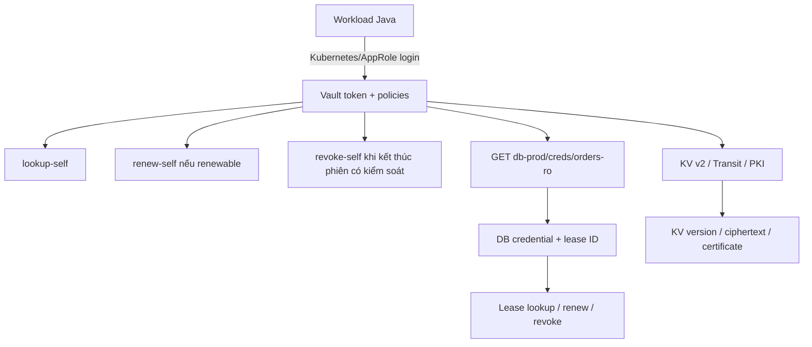

# Quyền lookup, renew và revoke theo vòng đời cần sử dụng trong Spring Vault

Khi một ứng dụng Java dùng **Spring Vault** truy cập **HashiCorp Vault**, đăng nhập và đọc được secret mới chỉ là phần đầu của câu chuyện. Token có thời gian sống, có thể được gia hạn (*renew*) hoặc thu hồi (*revoke*). Một số secrets engine còn phát hành **dynamic secrets có lease** với vòng đời riêng. Nếu nhầm giữa token và lease, hoặc cấp quyền quản trị quá rộng để xử lý gia hạn, ứng dụng dễ gặp lỗi gián đoạn và tạo ra rủi ro phân quyền.

Bài học nằm trong chương **Phân quyền truy cập** của module **SPRING_VAULT**, tập trung vào ba thao tác **lookup – renew – revoke** ở hai lớp: **Vault token** và **dynamic-secret lease**. Nội dung kết nối với `VaultTemplate`, xác thực workload Kubernetes/AppRole, KV v2, Transit encryption, PKI, xử lý lỗi, giám sát và kiểm thử tích hợp. Mục tiêu là cấp **đúng API path và capability cần dùng** cho từng thành phần, tránh mặc định cấp `auth/token/*` hoặc `sys/leases/*`.

## 1. Mục tiêu học tập

Sau bài này, bạn có thể:

- Giải thích tác dụng và giới hạn của `lookup`, `renew`, `revoke` đối với token và lease.
- Phân biệt capability ACL với tên thao tác: Vault không định nghĩa capability `lookup`/`renew`/`revoke`; các endpoint thường cần `read` hoặc `update`.
- Chọn endpoint tự phục vụ `auth/token/lookup-self`, `renew-self`, `revoke-self` thay vì endpoint quản trị token khác.
- Phân biệt TTL/renewable/max TTL của token với TTL của database dynamic credential, KV v2 version và chứng chỉ PKI.
- Ánh xạ nhu cầu quản lý phiên Spring Vault sang `SessionManager` và vòng đời dynamic secrets sang `SecretLeaseContainer` khi phù hợp.
- Viết policy HCL theo quyền tối thiểu; kiểm tra hành vi được phép và bị từ chối bằng token của workload.
- Phân loại lỗi ACL, token hết hạn, lease không gia hạn được, lỗi backend và lỗi mạng.

## 2. Ba thao tác trên những đối tượng khác nhau

| Thao tác | Ý nghĩa | Không được hiểu thành |
| --- | --- | --- |
| **Lookup** | Đọc trạng thái, thuộc tính TTL hoặc thông tin quản lý của token/lease | Đọc được mọi secret hoặc mọi token |
| **Renew** | Yêu cầu tăng thời gian sống trong giới hạn được cho phép | Cấp thêm ACL capability, vượt max TTL hoặc làm sống lại credential đã revoke |
| **Revoke** | Chấm dứt token/lease theo cơ chế Vault và backend | Xóa toàn bộ KV versions hay tự động làm chứng chỉ PKI đã cấp trở nên không hợp lệ |



Sự khác biệt cốt lõi:

| Đối tượng | Cấp phát bởi | Vòng đời |
| --- | --- | --- |
| **Vault token** | Auth method hoặc token subsystem | TTL, renewable, max TTL, re-login và revoke |
| **Database dynamic-secret lease** | Database secrets engine khi cấp credential | Lease ID, lease TTL, khả năng gia hạn/thu hồi theo engine |
| **KV v2 version** | KV engine khi ghi secret | CAS, version retention, soft delete, undelete, destroy; thường không có lease động |
| **PKI certificate** | PKI engine theo PKI role | Thời hạn chứng chỉ, cấp lại và thu hồi theo PKI; không tự gia hạn bởi token renewal |
| **Transit operation** | Transit engine xử lý encrypt/decrypt | Phép toán theo ACL/token; ciphertext không phải lease DB |

Một token vẫn còn hiệu lực **không bảo đảm** database credential đã lấy trước đó chưa hết lease. Ngược lại, renew Vault token không cập nhật một KV version và không kéo dài `notAfter` của certificate.

## 3. Lookup token: tự xem phiên hay tra cứu token khác?

### 3.1. Token tự tra cứu thông tin của mình

Sau khi workload đăng nhập Vault qua Kubernetes/AppRole, nó có token để gọi API. Thành phần quản lý session có thể cần kiểm tra TTL và trạng thái `renewable` của token bằng:

```text
GET /v1/auth/token/lookup-self
```

ACL cho phép:

```hcl
path "auth/token/lookup-self" {
  capabilities = ["read"]
}
```

Lệnh CLI tương ứng:

```bash
# Sử dụng chính token workload trong môi trường test.
vault token lookup
```

Thông tin trả về có thể gồm TTL, ngày tạo, policies, metadata và thuộc tính token tùy loại token/Vault version. **Không log nguyên response**, vì danh tính, policies và các tham chiếu token có thể nhạy cảm.

`lookup-self` thành công chỉ chứng minh token được phép **xem trạng thái của chính mình**. Nó không cấp `read` trên `app-kv/data/orders-api/runtime` hoặc một secret bất kỳ.

### 3.2. Lookup token khác là chức năng nhạy cảm

| Endpoint | HTTP điển hình | Capability | Đối tượng |
| --- | --- | --- | --- |
| `auth/token/lookup-self` | GET | `read` | Token của caller |
| `auth/token/lookup` | POST, gửi token ID | `update` | Token được chỉ định |
| `auth/token/lookup-accessor` | POST, gửi accessor | `update` | Token qua accessor được chỉ định |

`auth/token/lookup` và `lookup-accessor` phục vụ quy trình quản lý/kiểm toán token được ủy quyền. **Token ứng dụng thường không cần** chúng. Token accessor hỗ trợ thao tác quản trị mà không dùng giá trị bearer token gốc; tuy vậy accessor vẫn là thông tin cần bảo vệ vì liên quan đến tra cứu/thu hồi.

Một policy tự tra cứu `lookup-self` không tự mở rộng thành quyền lookup tất cả token. Khi cần xây dựng token broker, phải thiết kế riêng ranh giới identity/namespace, điều kiện kiểm soát và audit.

## 4. Renew token: quyền gọi không bảo đảm được gia hạn

Token renewable có thể yêu cầu gia hạn bằng:

```text
POST /v1/auth/token/renew-self
{
  "increment": "15m"
}
```

Policy:

```hcl
path "auth/token/renew-self" {
  capabilities = ["update"]
}
```

Giá trị `increment` chỉ là **thời gian đề nghị**. Vault quyết định thời hạn thực dựa trên trạng thái token, auth method, loại token, renewable, max TTL và period nếu cấu hình có liên quan.

### Khi nào renew thất bại?

| Điều kiện | Kết quả có thể gặp | Xử lý |
| --- | --- | --- |
| Token còn sống, renewable và chưa chạm giới hạn | Renew được với TTL Vault chấp nhận | Dùng TTL thực tế từ response |
| Token không renewable | Không thể renew dù ACL cho gọi endpoint | Re-login bằng auth method ban đầu |
| Token đã đến max TTL hoặc giới hạn liên quan | Không thể gia hạn thêm như yêu cầu | Re-login nếu workload còn cần dùng Vault |
| Token hết hạn hoặc bị revoke | Không còn credential hợp lệ | Xác thực lại; tránh retry renew vô hạn |
| Vault hoặc mạng tạm thời lỗi | Renew/re-login có thể gián đoạn | Retry/backoff có giới hạn, giám sát |
| Loại token không hỗ trợ renew | Vòng đời không tương thích chiến lược renew | Chọn token type/session strategy phù hợp |

Đặc biệt, **renew không tăng quyền**. Token không có quyền đọc secret trước renew cũng không được cấp thêm `read` sau renew. Lỗi `403` do thiếu ACL phải sửa ở chính sách truy cập, không chữa bằng cách gia hạn token.

Để gia hạn **token được chỉ định** (khác self), Vault có API `auth/token/renew`, thường dùng POST với token ID và capability `update`. Đây là hành vi quản lý token khác, không cần thiết cho Java runtime chỉ gia hạn phiên của chính mình.

## 5. Revoke token: tự kết thúc phiên và quản trị token khác

Nếu workload có quy trình kết thúc phiên có chủ đích, Vault cung cấp:

```text
POST /v1/auth/token/revoke-self
```

Policy:

```hcl
path "auth/token/revoke-self" {
  capabilities = ["update"]
}
```

Khi revoke-self thành công, token đó không còn dùng được. Nếu nhiều thread của `VaultTemplate` dùng chung một session, tự revoke sau mỗi thao tác đọc KV sẽ làm các request kế tiếp lỗi. Vì thế, `revoke-self` là **quyết định vòng đời phiên**, không phải thao tác cleanup mặc định sau mọi API call.

```java
// PHẢN VÍ DỤ: không thu hồi token dùng chung sau mỗi lần đọc.
try {
    readSecret();
} finally {
    revokeSharedToken(); // Các request khác có thể mất phiên.
}
```

Các API thu hồi token cần phân biệt:

| Endpoint | Hành vi | Phạm vi nên dùng |
| --- | --- | --- |
| `auth/token/revoke-self` | Tự thu hồi token đang xác thực | Phiên ứng dụng/test khi đã được thiết kế |
| `auth/token/revoke` | Thu hồi token được chỉ định | Vận hành/điều phối có kiểm soát |
| `auth/token/revoke-accessor` | Thu hồi qua accessor | Quản trị token chuyên biệt |
| `auth/token/revoke-orphan` | Biến thể thu hồi với cách xử lý quan hệ token đặc thù | Tác vụ quản trị cần hiểu cây token |

Với các API quản trị token qua POST, capability thường là `update` tại endpoint được dùng. **Quyền `revoke-self` không tự cấp quyền `revoke` token khác.**

Thu hồi token có thể dẫn tới thu hồi các child tokens và các leases gắn với token theo quan hệ Vault áp dụng, với ngoại lệ về orphan/kiểu token và đặc tính backend. Tuy nhiên, **không được giả định** token revoke sẽ xóa KV data hoặc lập tức làm mọi certificate PKI từng phát hành mất hiệu lực. Với chứng chỉ, cần quản lý riêng cơ chế revoke/CRL/OCSP theo PKI đã triển khai.

## 6. Policy HCL theo nhu cầu thực tế

Giả sử `orders-api` chỉ cần đọc KV v2 và mã hóa PII bằng Transit. Session manager cần tự lookup và renew token. Policy:

```hcl
# orders-api-runtime.hcl
path "app-kv/data/orders-api/runtime" {
  capabilities = ["read"]
}

path "crypto/encrypt/orders-pii" {
  capabilities = ["update"]
}

# Chỉ khai báo khi session thực sự cần,
# và token chưa có quyền tương ứng qua policy hiệu lực.
path "auth/token/lookup-self" {
  capabilities = ["read"]
}

path "auth/token/renew-self" {
  capabilities = ["update"]
}
```

Nếu workload có cơ chế tự chấm dứt session, thêm riêng:

```hcl
path "auth/token/revoke-self" {
  capabilities = ["update"]
}
```

**Không cấp** `auth/token/lookup`, `auth/token/renew`, `auth/token/revoke`, `auth/token/create` hay `auth/token/*` cho service chỉ cần phiên của chính mình. Việc một quản trị viên cần những endpoint đó là một yêu cầu khác và phải có danh tính/policy riêng.

Policy mặc định tên `default` thường cung cấp một số quyền token self-service; nhưng một role/token có thể cấu hình **không nhận default policy**. Hãy kiểm tra effective policies trước khi thêm rule. Đừng mặc định mọi workload đều có đúng bộ quyền giống nhau.

### Quyền quản trị thao tác token khác

Nếu một thành phần vận hành được giao thu hồi token qua accessor, policy minh họa:

```hcl
# Ví dụ đặc quyền quản trị; không gắn vào runtime ứng dụng.
path "auth/token/lookup-accessor" {
  capabilities = ["update"]
}

path "auth/token/revoke-accessor" {
  capabilities = ["update"]
}
```

Các request có thể chứa accessor trong **body**, nên ACL path trên **không tự bảo đảm** chỉ tác động được token của một service cụ thể. Phải xác định giới hạn API, identity, namespace, audit và kiểm soát tổ chức trước khi giao quyền.

## 7. Dynamic-secret lease dùng các endpoint khác

Khi service lấy dynamic credential từ database secrets engine:

```text
GET /v1/db-prod/creds/orders-ro
```

Policy cấp phát credential:

```hcl
path "db-prod/creds/orders-ro" {
  capabilities = ["read"]
}
```

Phản hồi minh họa có lease:

```json
{
  "lease_id": "db-prod/creds/orders-ro/<lease-id>",
  "lease_duration": 3600,
  "renewable": true,
  "data": {
    "username": "v-orders-ro-<generated>",
    "password": "<redacted>"
  }
}
```

Giá trị `renewable` phụ thuộc cấu hình engine/role/lease; không phải credential nào cũng renewable.

### 7.1. Lookup, renew, revoke lease

| API path | HTTP thông thường | Capability điển hình | Nhu cầu |
| --- | --- | --- | --- |
| `sys/leases/lookup` | POST | `update` | Xem thông tin lease được chỉ định |
| `sys/leases/renew` | POST | `update` | Xin gia hạn lease cụ thể |
| `sys/leases/revoke` | POST | `update` | Thu hồi lease cụ thể |
| `sys/leases/revoke-prefix/<prefix>` | POST | Đặc quyền quản trị theo endpoint, có thể cần `sudo` | Thu hồi nhiều lease theo prefix |
| `sys/leases/revoke-force/<prefix>` | POST | Đặc quyền quản trị đặc biệt theo endpoint | Force revoke; cần giới hạn nghiêm ngặt |

Các request tới `lookup`/`renew`/`revoke` thường chứa **lease ID trong body**:

```json
{
  "lease_id": "db-prod/creds/orders-ro/<lease-id>",
  "increment": "15m"
}
```

Chỉ với một thành phần **được giao quản lý dynamic leases**, policy có thể cần:

```hcl
# Ví dụ cho thành phần lease manager đã được review.
path "sys/leases/lookup" {
  capabilities = ["update"]
}
path "sys/leases/renew" {
  capabilities = ["update"]
}
path "sys/leases/revoke" {
  capabilities = ["update"]
}
```

**Lưu ý phạm vi:** ACL trên các endpoint này khớp đường dẫn cố định `sys/leases/renew` hoặc `sys/leases/revoke`. Lease ID nằm trong **payload**, không nằm trong ACL path. Vì vậy, việc cấp quyền trên endpoint **chưa tự giới hạn** request vào mỗi lease dưới `db-prod/creds/orders-ro`. Cần đánh giá cơ chế kiểm tra của Vault, identity/namespace, mức độ có thể thao tác, các ràng buộc bổ sung và quy trình vận hành; tránh cấp mặc định cho mọi workload.

### 7.2. Lease renew khác token renew

| Đặc điểm | Token renew | Lease renew |
| --- | --- | --- |
| Endpoint | `auth/token/renew-self` | `sys/leases/renew` kèm lease ID |
| Đối tượng kéo dài | Vault token dùng xác thực API | Credential động do secrets engine phát hành |
| Điều kiện | Renewable, loại token, TTL/max TTL, auth method | Renewable, TTL/max TTL, engine/role và trạng thái lease |
| Tác động ACL | Không tăng quyền | Không tăng quyền |
| Khi không gia hạn được | Re-login nếu workload còn cần API | Renew không được thì cấp credential mới và cập nhật kết nối |

KV v2 **thường lưu static secret có version**, không phải dynamic credential có lease. `sys/leases/renew` không gia hạn KV version hoặc phục hồi version đã soft-delete. PKI certificate cũng có thời hạn chứng chỉ riêng; thường cần **cấp lại chứng chỉ**, không dùng token renew để đổi `notAfter`.

## 8. Spring Vault: SessionManager và SecretLeaseContainer

Spring Vault hỗ trợ quản lý session/token và vòng đời secret động. Với ứng dụng chạy liên tục, nên cấu hình đúng các thành phần vòng đời thay vì tự chạy vòng lặp renew hoặc revoke theo từng HTTP request.

| Nhu cầu | Cơ chế Spring Vault | Điểm cần kiểm tra |
| --- | --- | --- |
| Xác thực workload | `ClientAuthentication` với Kubernetes/AppRole hoặc cơ chế phù hợp | Đúng identity/auth role, không hard-code root token |
| Quản lý token/session | `SessionManager` với lifecycle strategy phù hợp | TTL/renewable, khả năng re-login, lỗi Vault |
| Đọc KV v2 | `VaultTemplate.opsForKeyValue(..., KV_2)` | `read` trên `<mount>/data/<key>` |
| Xin credential động | `VaultTemplate.read("db-prod/creds/orders-ro")` hoặc API chuyên dụng | Lease ID/TTL và dữ liệu nhạy cảm |
| Theo dõi/gia hạn secret lease | `SecretLeaseContainer` khi phù hợp | Quyền lease API, renewal, rotation và cleanup |

### 8.1. Java ví dụ endpoint lookup/renew/revoke-self

Đoạn sau minh họa API; **không dùng đồng thời với cơ chế session auto-renew trên cùng token** nếu chưa điều phối rõ ràng. `revokeSelfForTest()` chỉ dành cho một **session kiểm thử riêng**, vì nó vô hiệu hóa token của client.

```java
import java.util.Map;

import org.springframework.vault.core.VaultTemplate;
import org.springframework.vault.support.VaultResponse;

public final class TokenLifecycleDemo {

    private final VaultTemplate vaultTemplate;

    public TokenLifecycleDemo(VaultTemplate vaultTemplate) {
        this.vaultTemplate = vaultTemplate;
    }

    public VaultResponse lookupSelf() {
        return vaultTemplate.read("auth/token/lookup-self");
    }

    public VaultResponse renewSelfForTest() {
        return vaultTemplate.write(
                "auth/token/renew-self",
                Map.of("increment", "15m"));
    }

    public VaultResponse revokeSelfForTest() {
        return vaultTemplate.write("auth/token/revoke-self", Map.of());
    }
}
```

Phản hồi của token operations có thể khác cấu trúc `data` của KV. Đừng mặc định `VaultResponse.getData()` luôn chứa TTL mới; đọc phần phản hồi phù hợp với endpoint/phiên bản client. Nếu có token operations API chuyên dụng trong phiên bản Spring Vault đang dùng, có thể sử dụng lớp đó theo cách tài liệu SDK hướng dẫn.

### 8.2. Đọc static KV và dynamic credential là hai nghiệp vụ

```java
import java.util.Map;

import org.springframework.vault.core.VaultKeyValueOperations;
import org.springframework.vault.core.VaultKeyValueOperationsSupport.KeyValueBackend;
import org.springframework.vault.core.VaultTemplate;
import org.springframework.vault.support.VaultResponse;

public final class OrdersSecrets {

    private final VaultTemplate vaultTemplate;
    private final VaultKeyValueOperations kv;

    public OrdersSecrets(VaultTemplate vaultTemplate) {
        this.vaultTemplate = vaultTemplate;
        this.kv = vaultTemplate.opsForKeyValue("app-kv", KeyValueBackend.KV_2);
    }

    public Map<String, Object> staticConfig() {
        VaultResponse response = kv.get("orders-api/runtime");
        if (response == null || response.getData() == null) {
            throw new IllegalStateException("Thiếu orders-api/runtime");
        }
        return response.getData();
    }

    public VaultResponse requestDbCredentials() {
        // Có thể phát hành credential và lease mới mỗi lần gọi.
        return vaultTemplate.read("db-prod/creds/orders-ro");
    }
}
```

`staticConfig()` cần `read` trên `app-kv/data/orders-api/runtime`. `requestDbCredentials()` cần `read` trên `db-prod/creds/orders-ro`; nếu ứng dụng phải giữ credential lâu, cần cơ chế riêng quản lý lease và cập nhật connection pool. **Không gọi lấy credential mới ở mỗi request người dùng cuối**, vì điều đó có thể phát hành quá nhiều DB users/leases và tạo tải không cần thiết.

## 9. Thực hành CLI và kiểm tra quyền

Tất cả các lệnh dưới đây dành cho **Vault test** với auth role, KV mount và database backend được chuẩn bị trước. Dùng token test riêng, không phải root token hoặc token production.

```bash
# Tự tra cứu trạng thái token nếu được cấp quyền.
vault token lookup

# Yêu cầu tự gia hạn token, chỉ khi token renewable.
vault write auth/token/renew-self increment=15m

# CẢNH BÁO: vô hiệu hóa chính token CLI đang sử dụng.
# Chỉ chạy trong phiên test có thể bỏ.
vault write -force auth/token/revoke-self
```

Để kiểm tra quyền trước khi thử hành vi hủy phiên:

```bash
# Kỳ vọng: read (nếu policy self-service cho lookup).
vault token capabilities auth/token/lookup-self

# Kỳ vọng: update (nếu policy cho renew).
vault token capabilities auth/token/renew-self

# Kỳ vọng: deny với token không được phép quản trị token khác.
vault token capabilities auth/token/lookup
vault token capabilities auth/token/renew
vault token capabilities auth/token/revoke
vault token capabilities auth/token/create

# Kiểm tra các endpoint lease theo chính sách của workload.
vault token capabilities sys/leases/renew
vault token capabilities sys/leases/revoke
```

Kết quả thật phụ thuộc **toàn bộ effective policies** của token, bao gồm `default` nếu có. Ví dụ `revoke-self` có thể đã được cấp bởi policy `default` dù policy ứng dụng không khai báo. `vault token capabilities` cũng gọi một API tự tra cứu capability; nếu token không được phép dùng endpoint đó thì công cụ chẩn đoán có thể thất bại. Khi ấy dùng phương pháp được quản trị cho phép, không cấp quyền quản trị quá rộng chỉ để lệnh chạy.

Với dynamic lease:

```bash
# Chỉ ở database test, response có thể chứa password.
vault read db-prod/creds/orders-ro

# Thay <lease-id> bằng lease ID có thật trong môi trường test.
vault lease lookup <lease-id>
vault lease renew <lease-id>
vault lease revoke <lease-id>
```

Các lệnh renew/revoke lease phải dùng **lease thật, còn hợp lệ khi cần**, và người gọi có quyền phù hợp. Không revoke credential production hoặc của workload khác.

## 10. Kiểm thử tích hợp theo vòng đời

Chuẩn bị một Vault test instance hoặc namespace tích hợp, KV v2 `app-kv/`, key `orders-api/runtime`, Transit `crypto/` và database engine test `db-prod/`. Tạo auth role/token runtime theo policy hẹp; dùng token/danh tính vận hành test riêng để chuẩn bị và cleanup fixtures.

| Kịch bản | Kỳ vọng | Ý nghĩa |
| --- | --- | --- |
| Workload login qua đúng Kubernetes/AppRole | Vault cấp token | Auth method/role đúng |
| Lookup-self với token có `read` | Trả trạng thái phiên | Self-service được phép |
| Renew-self với token renewable, chưa tới giới hạn | Gia hạn theo TTL Vault chấp nhận | ACL + token lifecycle đúng |
| Renew-self với token không renewable | Bị từ chối có kiểm soát | Client có lộ trình re-login |
| Runtime lookup/renew/revoke **token khác** | Bị từ chối | Không lạm quyền quản trị token |
| Revoke-self trong session **test riêng** | Token không gọi API tiếp được | Chấm dứt phiên đúng |
| GET `app-kv/data/orders-api/runtime` | Thành công | ACL đọc KV đúng |
| Sau renew, GET secret ngoài phạm vi | Bị từ chối | Renew không nâng quyền |
| GET `db-prod/creds/orders-ro` | Có credential và lease nếu backend hỗ trợ | Lease tách khỏi token |
| Lease renewable được renew | Gia hạn theo giới hạn backend | Lease lifecycle đúng |
| Renew lease đã hết hạn/revoke | Thất bại có kiểm soát | Không giả định lease được hồi sinh |
| Runtime không được thu hồi lease hàng loạt | Bị từ chối | Phạm vi quản trị giữ hẹp |

Không dùng lỗi `404` của lease ID giả hoặc mount không tồn tại làm bằng chứng quyền đã chặn. Với test âm tính, endpoint/resource phải hợp lệ và cần xác minh **mã lỗi authorization**. Tách test token và lease để một bước revoke không ảnh hưởng không mong muốn đến các testcase khác.

### Lỗi thường gặp

| Triệu chứng | Khả năng cần xét | Hướng xử lý |
| --- | --- | --- |
| `lookup-self` bị `403` | Thiếu `read`, token hết hiệu lực hoặc sai session | Đối chiếu ACL và token |
| `renew-self` bị `403` | Thiếu `update` hoặc token không hợp lệ | Kiểm tra endpoint/quyền; re-login nếu cần |
| Renew trả TTL ngắn hơn đề nghị | Giới hạn TTL/max TTL/period | Sử dụng TTL thực Vault trả về |
| Token không renewable | Loại token/auth role không hỗ trợ | Chọn re-login thay vì retry vô hạn |
| Revoke-self xong mọi request thất bại | Chính token đã bị thu hồi | Cấp lại session khi workload còn cần |
| Lookup token khác bị từ chối | Runtime không có quyền quản trị token | Giữ quyền từ chối, tách vận hành |
| Lease renew bị `403` | Thiếu quyền `sys/leases/renew` hoặc hạn chế liên quan | Kiểm tra chính sách, namespace, lease |
| Lease không renew dù đã có ACL | Lease không renewable/hết hạn hoặc engine từ chối | Cấp lại credential và cập nhật kết nối |
| KV đọc sai sau token renew | Sai mount, `data/`, policy hoặc version | Chẩn đoán KV riêng; renew không tăng ACL |

Lỗi authentication/session, ACL authorization, backend/lease và network có cách khắc phục khác nhau. Dùng HTTP status/response có cấu trúc và Vault audit, không chỉ dò chuỗi trong exception. Chỉ retry lỗi tạm thời với giới hạn/backoff; không retry vô hạn một `403` do thiếu policy.

## 11. Vận hành và giám sát

1. **Theo dõi token:** số lần login, renew, re-login, TTL gần hết hạn, renew thất bại và token bị revoke theo workload.
2. **Theo dõi dynamic leases:** renewal/revocation, số credential còn sống và lỗi connection pool khi credential hết hạn.
3. **Bảo vệ credential:** không ghi Vault token, SecretID, JWT, DB password, private key, lease ID nhạy cảm hoặc accessor vào log công khai.
4. **Tách danh tính:** runtime service, rotation job, lease manager và người quản trị có auth role/policy riêng.
5. **Kiểm soát quyền:** hạn chế `auth/token/*`, `sys/leases/*`, sudo, revoke-prefix và các endpoint force revoke.
6. **Quan sát lỗi:** kết hợp Vault audit với telemetry ứng dụng theo request ID, mã lỗi, loại operation và timestamp đã được xử lý an toàn.
7. **Có quy trình kết thúc phiên:** nếu dùng `revoke-self`, phải tránh thu hồi token dùng chung khi còn request đang chạy.
8. **Rà soát sau thay đổi:** thay token type, TTL, auth role, ACL hay cấu hình lease đều cần kiểm thử và theo dõi rollout.

Không cần renew quá dày để “chắc chắn token còn sống”. Dùng TTL thực từ Vault, kế hoạch renew/re-login của session manager và cảnh báo vận hành để tránh tải thừa và vòng lặp lỗi.

## 12. Bài tập vận dụng

### Bài 1 — Policy tự quản lý token

Service `notification-api` chỉ đọc `app-kv/data/notification-api/runtime` và cần tự lookup/renew token. Viết policy tối thiểu nếu những quyền self-service chưa có từ `default`.

<details>
<summary>Đáp án gợi ý</summary>

```hcl
path "app-kv/data/notification-api/runtime" {
  capabilities = ["read"]
}
path "auth/token/lookup-self" {
  capabilities = ["read"]
}
path "auth/token/renew-self" {
  capabilities = ["update"]
}
```

Không cấp `auth/token/lookup`, `renew`, `revoke` hoặc `auth/token/create` vì service chỉ cần phiên của chính mình.

</details>

### Bài 2 — Renew không mở rộng ACL

Token `orders-api` renew thành công nhưng GET `app-kv/data/payroll-api/runtime` vẫn bị `403`. Vì sao?

<details>
<summary>Đáp án gợi ý</summary>

Gia hạn chỉ kéo dài token trong giới hạn Vault, không thêm quyền `read`. Token của `orders-api` không có yêu cầu truy cập `payroll-api` thì phải tiếp tục bị từ chối.

</details>

### Bài 3 — Có `revoke-self` thì revoke token khác được không?

Token có `update` trên `auth/token/revoke-self`, nhưng không có capability khác. Có thể POST tới `auth/token/revoke` để thu hồi token của service khác?

<details>
<summary>Đáp án gợi ý</summary>

Không. Đây là hai API path khác nhau. Quyền tự kết thúc phiên không phải quyền quản trị token khác.

</details>

### Bài 4 — Quyền lease manager có tự giới hạn role DB?

Một worker có `update` trên `sys/leases/revoke`. Có thể kết luận worker chỉ revoke được các lease thuộc `db-prod/creds/orders-ro` không?

<details>
<summary>Đáp án gợi ý</summary>

Không. ACL path là `sys/leases/revoke`, còn lease ID thường nằm trong body. Phải kiểm tra cơ chế scope của endpoint, identity, namespace, backend và bổ sung kiểm soát khi cần. Không dùng ba chữ `sys/leases/revoke` như một bảo đảm ranh giới theo role DB.

</details>

### Bài 5 — Version KV v2 có renew bằng lease API được không?

Secret KV v2 có version 1, 2 và 3. Có nên gọi `sys/leases/renew` để version 3 không bị xóa mềm?

<details>
<summary>Đáp án gợi ý</summary>

Không. Phiên bản KV v2 chịu chính sách metadata/retention và các endpoint quản lý version, không phải dynamic-secret lease. Renew lease không tác động đến KV version.

</details>

### Bài 6 — Token hết hạn, database lease còn sống?

Một Vault token đã hết TTL nhưng database credential từng được cấp có lease chưa hết. Có thể kết luận credential chắc chắn còn dùng được hoặc chắc chắn đã hết hạn?

<details>
<summary>Đáp án gợi ý</summary>

Không nên suy luận theo một chiều. Token và DB lease có vòng đời riêng nhưng có thể liên quan qua cơ chế revoke/parent token. Kiểm tra trạng thái lease và hành vi backend thực tế; ứng dụng cần sẵn sàng lấy credential mới khi cần.

</details>

## 13. Checklist trước khi triển khai

1. Token lấy từ **đúng auth role/workload identity** và không phải token admin/root?
2. `lookup-self` cần `read`; `renew-self`/`revoke-self` cần `update` khi dùng, trong khi các endpoint token khác được kiểm soát riêng?
3. Đã kiểm tra policy `default` và **effective policies** thay vì cấp quyền trùng hoặc mở wildcard?
4. Token type, renewable, TTL/max TTL và period có tương thích session strategy?
5. Khi token không renew được, Spring Vault có thể re-login hay báo lỗi có kiểm soát?
6. Nếu revoke-self, có tránh ảnh hưởng những request khác dùng chung session?
7. Với dynamic secret, có theo dõi **lease ID/TTL** và chỉ cấp quyền renew/revoke cho thành phần được giao?
8. Đã phân biệt KV versions, chứng chỉ PKI và Transit operations với dynamic-secret lease?
9. Đã kiểm thử self versus other-token operations, quyền đúng endpoint và các ca ACL bị từ chối?
10. Audit/monitoring có đủ dữ liệu chẩn đoán mà không làm lộ token, password, private key hoặc metadata nhạy cảm?

**Ghi nhớ:** `lookup` để kiểm tra trạng thái, `renew` để yêu cầu gia hạn khi đủ điều kiện và `revoke` để kết thúc quyền sử dụng token hoặc lease. **Đúng đối tượng, đúng API path, đúng capability và đúng thời điểm vòng đời** là các nguyên tắc giúp Spring Vault vận hành an toàn, tránh đặc quyền dư và xử lý lỗi chính xác.
