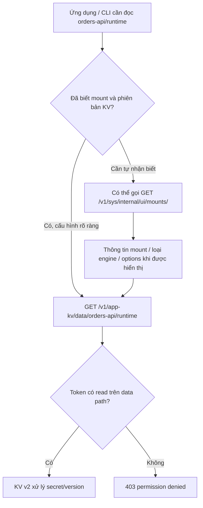

# Quyền khám phá mount và các API nội bộ mà abstraction có thể gọi trong Spring Vault

Một service Java dùng **Spring Vault** chỉ cần đọc KV secret `orders-api/runtime`. Đội phát triển đã viết policy `read` cho secret đó, nhưng khi chạy CLI hoặc một lớp tích hợp tự nhận biết KV backend, request đầu tiên lại hướng tới `sys/internal/ui/mounts/...` thay vì `data/...`. Có môi trường trả thông tin mount bình thường, có môi trường trả `403` hoặc lỗi *preflight capability check*. Nếu không hiểu luồng này, người vận hành dễ cấp `sys/*` hoặc `sudo` cho ứng dụng để “chữa lỗi” — một thay đổi không cần thiết và có thể nguy hiểm.

Bài học thuộc chương **Phân quyền truy cập** trong module **SPRING_VAULT**. Trọng tâm là phân biệt **API nghiệp vụ** với **API khám phá mount**, **API quản trị mount** và **API phụ trợ của abstraction/client**. Chúng ta xem cách `VaultTemplate`, công cụ CLI và một số cơ chế tích hợp Spring Cloud Vault có thể xác định phiên bản KV, gắn quyền ACL theo đường dẫn thật, giới hạn quyền tra cứu token/session và kiểm thử chính xác request mà Java workload phát ra.

## 1. Mục tiêu học tập

Sau bài này, bạn có thể:

- Phân biệt **mount path**, **logical key**, **HTTP API path** và **ACL policy path**.
- Nêu mục đích của `sys/internal/ui/mounts` và khác biệt với API quản trị `sys/mounts`.
- Giải thích vì sao một request khám phá mount có thể xuất hiện **trước** GET secret và vì sao không nên mặc định cấp `read`/`sudo` trên toàn bộ `sys/*`.
- Nhận biết những API phụ trợ mà client/session có thể gọi: `auth/token/lookup-self`, `renew-self`, `sys/capabilities-self` và các endpoint sức khỏe/metadata khi ứng dụng được cấu hình sử dụng.
- Viết ACL cho KV v2, Transit và PKI mà không trao quyền quản trị secrets engine cho workload.
- Dùng cấu hình rõ ràng của Spring Vault để hạn chế việc tự suy đoán backend; hiểu giới hạn khi thay đổi thư viện hoặc sử dụng Spring Cloud Vault.
- Kiểm thử cả luồng **khám phá mount → gọi nghiệp vụ**, xác định chính xác request `403` và quan sát an toàn bằng audit/telemetry.

## 2. Bốn lớp đường dẫn khi đọc một secret KV v2

Giả sử Vault mount **KV version 2** tại `app-kv/` và key logic là `orders-api/runtime`.

| Lớp | Giá trị | Ý nghĩa |
| --- | --- | --- |
| Mount path | `app-kv/` | Điểm Vault định tuyến request đến KV secrets engine |
| Logical key | `orders-api/runtime` | Tên secret bên trong mount, được API tiện ích KV dùng |
| HTTP API path | `GET /v1/app-kv/data/orders-api/runtime` | Request mà KV v2 nhận khi đọc giá trị |
| ACL policy path | `app-kv/data/orders-api/runtime` | Rule cấp `read`, **không có `/v1/`** |

```hcl
# Policy của orders-api khi chỉ cần đọc đúng một key KV v2.
path "app-kv/data/orders-api/runtime" {
  capabilities = ["read"]
}
```

Với KV v2, đọc/ghi giá trị dùng nhánh `data/`, còn tra cứu metadata và liệt kê key dùng nhánh `metadata/`. **Khám phá mount** lại là việc khác: nó trả lời câu hỏi *“Đường dẫn này thuộc engine nào, được mount ở đâu, có thông tin phiên bản nào?”*, chứ không trực tiếp trả password hay cấu hình trong secret.



Sơ đồ chỉ mô tả **một khả năng của công cụ hoặc abstraction**. Không có quy tắc “mọi lời gọi `VaultTemplate` luôn hỏi `sys/internal/ui/mounts` trước”. Đường đi cụ thể phụ thuộc phiên bản Spring Vault/Spring Cloud Vault, cách bạn khai báo backend, luồng khởi tạo và các thư viện tích hợp thực sự chạy.

## 3. Vì sao abstraction cần khám phá mount?

Một client nhận chuỗi `app-kv/orders-api/runtime` có thể phải quyết định:

1. Phần nào là **mount path**? Mount có thể là `app-kv/` hoặc dài hơn như `teams/orders/kv/`.
2. Secrets engine tại đó là **KV v1, KV v2, Transit, PKI** hay loại khác?
3. Nếu là KV v2, endpoint cần gọi có thêm `data/` hoặc `metadata/` không?
4. Trong namespace đang dùng, token có thể nhìn thấy mount hoặc đường dẫn liên quan không?

Một số công cụ cung cấp thao tác tiện ích như `vault kv get` hoặc lớp cấu hình tự động muốn làm bớt công việc đó cho lập trình viên. Chúng có thể thực hiện **preflight mount lookup**, sau đó mới gọi endpoint secret.

Ví dụ:

```text
Input ở lớp tiện ích:
  mount = app-kv
  key   = orders-api/runtime

Khả năng phát sinh:
  GET /v1/sys/internal/ui/mounts/app-kv
  GET /v1/app-kv/data/orders-api/runtime
```

Đây là ví dụ về **mẫu request**, không phải cam kết thứ tự của mọi thư viện/phiên bản. Nếu mount và KV version đã được cung cấp rõ ràng cho API, một client có thể dựng thẳng request `/data/` mà không phải hỏi Vault để suy phiên bản.

### Khám phá mount không phải liệt kê secret

So sánh ba request đều có vẻ “liệt kê/xem thông tin”:

| Request | Mục đích | Có trả giá trị KV secret không? |
| --- | --- | --- |
| `GET sys/internal/ui/mounts/<path>` | Khám phá thông tin mount có thể truy cập | Không |
| `LIST app-kv/metadata/orders-api` | Liệt kê **tên key** dưới một prefix KV v2 | Không |
| `GET app-kv/data/orders-api/runtime` | Đọc **nội dung** secret KV v2 | Có, nếu policy và backend cho phép |

Vì vậy, quyền `list` trên `app-kv/metadata/orders-api` **không phải** quyền khám phá mount. Ngược lại, nhìn thấy mount không có nghĩa token được phép liệt kê tên hoặc đọc tất cả secret trong mount đó.

## 4. `sys/internal/ui/mounts`: API hỗ trợ UI và khám phá mount

HashiCorp Vault có nhóm endpoint dưới `sys/internal/ui/mounts` phục vụ việc hiển thị/khám phá thông tin mount theo ngữ cảnh token. Các request thường gặp:

```text
GET /v1/sys/internal/ui/mounts
GET /v1/sys/internal/ui/mounts/app-kv
GET /v1/sys/internal/ui/mounts/app-kv/data/orders-api/runtime
```

Tùy API và phiên bản Vault, phần đường dẫn cuối có thể là **mount point** hoặc một path nằm trong mount để Vault phân giải mount tương ứng. Công cụ có thể dùng một biến thể khác phù hợp với việc suy mount. Hãy **quan sát request thực tế**, không tự suy rằng chỉ một biến thể luôn được gọi.

Thông tin phản hồi có thể giúp client biết `type` của engine, `path` của mount và `options` (chẳng hạn `version=2` với KV). **Phản hồi được lọc/giới hạn theo khả năng nhìn thấy hoặc quyền liên quan của token**; nó không phải danh mục quản trị đầy đủ để mọi service đọc mọi mount.

### 4.1. Quy tắc truy cập đặc biệt

Điểm dễ gây nhầm là các endpoint `sys/internal/ui/mounts` không đơn giản tương đương một endpoint KV mà cứ thêm rule `path "sys/internal/ui/mounts" { capabilities = ["read"] }` là giải quyết được.

Tùy endpoint và phiên bản Vault, việc nhìn thấy mount ở nhóm API này liên quan tới **khả năng truy cập mount/path đích** và logic hiển thị dành cho UI, không phải chỉ riêng ACL trên tên endpoint nội bộ. Thậm chí một số trường hợp truy cập thông tin mount được xử lý khác với kiểm tra capability thông thường. Vì thế:

- **Đừng** mặc định mở `sys/internal/ui/mounts/*` để “chữa” lỗi preflight.
- **Đừng** suy rằng thiếu entry trong danh sách đồng nghĩa mount không tồn tại: danh sách có thể lọc theo quyền/namespace.
- **Đừng** coi endpoint có chữ `internal` là một giao diện quản trị công khai, ổn định vĩnh viễn cho logic nghiệp vụ tự phát triển.
- **Đừng** dựa vào khả năng xem metadata mount như bằng chứng token đọc được `app-kv/data/orders-api/runtime`.

Khi preflight trả `403`, hãy kiểm tra **path đích mà client đang thử phân giải**, token thực tế, namespace, mount version và ACL nghiệp vụ trước. Nếu cần đặc quyền quản trị mount thật sự, xử lý bằng danh tính vận hành riêng; không chuyển quyền quản trị cho ứng dụng.

### 4.2. Ví dụ policy đọc secret đúng path

```hcl
path "app-kv/data/orders-api/runtime" {
  capabilities = ["read"]
}
```

Nếu client muốn đọc secret này nhưng policy lại là:

```hcl
# PHẢN VÍ DỤ cho KV v2: thiếu data/.
path "app-kv/orders-api/runtime" {
  capabilities = ["read"]
}
```

thì token không có quyền trên **API path KV v2 thực**. Sửa policy thành `app-kv/data/...` và kiểm tra cách client dựng đường dẫn. Đừng sửa bằng `path "sys/*"` hoặc bằng cách cho service xem mọi mounts.

### 4.3. Một mount có thể bị ẩn với UI

Các mount có thể có thiết lập visibility/listing và còn chịu ranh giới namespace. Kết quả của API phục vụ UI có thể phụ thuộc cách mount được cấu hình, khả năng truy cập của token và từng Vault version. Vì vậy, kiểm tra API này hữu ích để **chẩn đoán một client cụ thể**, nhưng không thay thế inventory cấu hình Vault được quản lý bởi đội vận hành.

## 5. `sys/mounts`: API quản trị secrets engines, không phải cách service đọc KV

Nhóm `sys/mounts` phục vụ **quản lý mount**: xem danh sách/cấu hình, enable/disable secrets engine hoặc điều chỉnh tuning theo các endpoint tương ứng. Đây là bề mặt quản trị Vault, có quyền nhạy cảm và ở một số endpoint còn áp dụng bảo vệ đặc biệt như `sudo`.

Ví dụ các đường dẫn quản trị:

```text
GET    /v1/sys/mounts
POST   /v1/sys/mounts/<mount>
DELETE /v1/sys/mounts/<mount>
POST   /v1/sys/mounts/<mount>/tune
```

Không có lý do để một Spring Boot service chỉ đọc secret phải nhận quyền quản trị những endpoint này.

| Nhóm API | Người dùng hợp lý | Vì sao không cấp đại trà? |
| --- | --- | --- |
| `sys/internal/ui/mounts[/<path>]` | Công cụ/UI cần nhận biết mount, theo logic kiểm soát truy cập của Vault | Không phải quyền đọc secret, cũng không phải API quản trị cần dùng như mặc định |
| `sys/mounts[/<mount>]` | Operator/IaC quản lý secrets engine | Có thể làm thay đổi bề mặt secrets và cấu hình Vault |
| `app-kv/data/<key>` | Workload nghiệp vụ được cấp `read`/`create`/`update`/`delete` thích hợp | Chỉ phạm vi key đã duyệt |
| `app-kv/metadata/<prefix>` | Công cụ thật sự cần đọc metadata hoặc liệt kê tên key | Có thể tiết lộ cấu trúc key, không đồng nghĩa được đọc giá trị |

Một quản trị viên được phép xem inventory có thể dùng:

```bash
# Chỉ chạy bằng danh tính vận hành được cấp quyền phù hợp.
vault secrets list -detailed
```

Lệnh này giúp xác minh **mount path, loại engine và options KV version**, nhưng không nên xem là một thao tác ứng dụng runtime phải chạy. Nếu token workload không được đọc danh sách mount quản trị, đó thường là một kết quả **đúng theo nguyên tắc quyền tối thiểu**.

### Vì sao `sudo` không phải cách sửa?

Một số API hệ thống được bảo vệ đặc biệt. Việc cấp `sudo` cho token ứng dụng để “đảm bảo đọc được mount” làm tăng mức đặc quyền nhưng **không giải quyết gốc rễ** của sai đường dẫn KV v2, sai mount hoặc sai namespace. Hãy xác định request thật sự gây `403`, rồi sửa cấu hình hoặc policy ở đúng lớp.

## 6. Spring Vault: cấu hình backend rõ ràng để tránh suy đoán

Với API KV tiện ích, Spring Vault cho phép chỉ rõ mount và phiên bản backend. Ví dụ:

```java
import java.util.Map;

import org.springframework.stereotype.Service;
import org.springframework.vault.core.VaultKeyValueOperations;
import org.springframework.vault.core.VaultKeyValueOperationsSupport.KeyValueBackend;
import org.springframework.vault.core.VaultTemplate;
import org.springframework.vault.support.VaultResponse;

@Service
public class OrdersRuntimeSecrets {

    private final VaultKeyValueOperations kv;

    public OrdersRuntimeSecrets(VaultTemplate vaultTemplate) {
        // Mount và KV version được xác định rõ bởi cấu hình/triển khai.
        this.kv = vaultTemplate.opsForKeyValue(
                "app-kv", KeyValueBackend.KV_2);
    }

    public Map<String, Object> readRuntime() {
        // Key logic: không thêm mount hoặc data/.
        VaultResponse response = kv.get("orders-api/runtime");
        if (response == null || response.getData() == null) {
            throw new IllegalStateException(
                    "Thiếu secret orders-api/runtime");
        }
        return response.getData();
    }
}
```

Lời gọi đọc của ví dụ được ánh xạ thành:

```text
GET /v1/app-kv/data/orders-api/runtime
```

Với `KeyValueBackend.KV_2` được chọn tường minh, API KV trong ví dụ **đã biết** cách ghép nhánh `data/`; không cần tự khám phá phiên bản KV chỉ để quyết định có thêm nhánh đó hay không. Tuy nhiên, **đừng khẳng định toàn bộ ứng dụng chắc chắn không gọi API khám phá mount**: một starter khác, lệnh CLI chẩn đoán, actuator/custom health check hoặc cơ chế cấu hình tự động vẫn có thể thực hiện các request phụ trợ.

### Khi dùng `VaultTemplate.read(...)` trực tiếp

```java
// API low-level: caller truyền đúng API path, đã bao gồm data/ của KV v2.
VaultResponse response = vaultTemplate.read(
        "app-kv/data/orders-api/runtime");
```

Khác với `opsForKeyValue(..., KV_2).get(...)`, lời gọi low-level không nhận một logical key rồi tự quyết định phiên bản KV cho bạn. Lập trình viên chịu trách nhiệm dựng path và xử lý cấu trúc response KV v2 phù hợp.

### Ba sai sót thường gặp

```java
// ĐÚNG: mount = app-kv, key = orders-api/runtime.
vaultTemplate.opsForKeyValue("app-kv", KeyValueBackend.KV_2)
             .get("orders-api/runtime");

// SAI: lặp nhánh data/ trong key logic của KV_2.
vaultTemplate.opsForKeyValue("app-kv", KeyValueBackend.KV_2)
             .get("data/orders-api/runtime");

// SAI: lặp mount trong key logic.
vaultTemplate.opsForKeyValue("app-kv", KeyValueBackend.KV_2)
             .get("app-kv/orders-api/runtime");
```

Không thêm policy để hợp thức hóa đường dẫn sai do Java ghép nhầm.

## 7. Spring Cloud Vault và các tích hợp có thể gọi API trước khi tải secret

**Spring Vault** là thư viện truy cập Vault cho ứng dụng Java. **Spring Cloud Vault** có thêm chức năng lấy cấu hình từ Vault và đưa vào Spring Environment. Trong một hệ thống sử dụng Spring Cloud Vault, quá trình startup có thể phải:

1. Khởi tạo kết nối tới Vault.
2. Xác thực workload để có token.
3. Xác định backend/context/profile cần tải; tùy cấu hình và phiên bản có thể cần kiểm tra metadata hoặc thông tin mount.
4. GET một hoặc nhiều API path KV tương ứng.
5. Gia hạn hoặc đăng nhập lại theo session lifecycle khi cần.

Ví dụ cấu hình minh họa, cần kiểm tra phiên bản Spring Cloud Vault đang triển khai:

```yaml
spring:
  cloud:
    vault:
      kv:
        enabled: true
        backend: app-kv
        backend-version: 2
```

Cấu hình trên thể hiện ý định sử dụng KV v2 mount `app-kv`. Các thuộc tính context/profile, cách import configuration và quy trình phát sinh request phụ trợ có thể khác theo phiên bản Spring Cloud Vault/Spring Boot. Vì vậy, khi startup có lỗi `403`, hãy kiểm tra **toàn bộ những context và endpoint mà integration đã yêu cầu**, không chỉ một lời gọi `VaultTemplate.get()` trong code.

### Ví dụ quyền đọc nhiều context

Giả sử ứng dụng được cấu hình đọc:

```text
app-kv/data/application
app-kv/data/orders-api
app-kv/data/orders-api/production
```

Đây là các **path minh họa**: đường dẫn thực tế phụ thuộc cách hệ thống ghép backend, application name, profile separator và context. Policy phải bám vào các API path **thật sự phát sinh**. Nếu workload chỉ được phép đọc `app-kv/data/orders-api` mà integration lại cố đọc `app-kv/data/application`, lỗi startup có thể bắt nguồn từ **một context bổ sung** chứ không phải endpoint khám phá mount.

Để xử lý, xác nhận context nào cần về mặt nghiệp vụ, tắt context không cần thiết hoặc thêm quyền `read` cho đúng path đã duyệt. **Không mở `app-kv/data/*`** chỉ vì không biết client đang tìm context nào.

### Những API phụ trợ khác có thể xuất hiện

| API path | Lý do client/tool có thể gọi | Capability/kiểm soát thường gặp |
| --- | --- | --- |
| `auth/kubernetes/login` hoặc `auth/approle/login` | Workload đăng nhập Vault | Kiểm tra theo auth method/role; không phải quyền đọc cấu hình auth role |
| `auth/token/lookup-self` | Xem thông tin/TTL token hiện tại | Thường `read`, có thể do policy `default` cấp |
| `auth/token/renew-self` | Session manager xin gia hạn token | Thường `update`, còn phụ thuộc renewable/max TTL |
| `sys/capabilities-self` | Công cụ kiểm tra effective capabilities trên path được yêu cầu | Thường `update`; không tự cấp quyền trên path được kiểm tra |
| `sys/internal/ui/mounts/<path>` | UI/CLI/abstraction khám phá mount khi cần | Logic khám phá/visibility đặc thù; không coi là quyền quản trị mount |
| `sys/health` | Health check nếu ứng dụng/monitor cấu hình gọi | Kiểm soát theo endpoint/deployment; không chứng minh quyền đọc secret |
| `sys/mounts` | Inventory hoặc quản trị secrets engines | Quyền quản trị riêng, không dành cho KV runtime |

**Bảng này là tập các khả năng, không phải danh sách endpoint mà mọi Spring Vault client luôn gọi.** Chỉ cấp những quyền phụ trợ mà stack thực tế cần và được duyệt. Nếu tắt policy `default`, một session manager hoặc công cụ chẩn đoán từng hoạt động có thể đột ngột thiếu `lookup-self`/`renew-self`/`capabilities-self`; cần đọc đúng request trước khi sửa.

## 8. Policy mẫu: quyền nghiệp vụ và quyền phụ trợ được tách bạch

Giả sử `orders-api` cần đọc KV v2 và gọi Transit encrypt, session manager cần tự lookup/renew token.

```hcl
# orders-api-runtime.hcl

# Đọc đúng một secret KV v2.
path "app-kv/data/orders-api/runtime" {
  capabilities = ["read"]
}

# Chỉ mã hóa, không được decrypt/quản lý key.
path "crypto/encrypt/orders-pii" {
  capabilities = ["update"]
}

# Chỉ khi cơ chế session thực sự cần và không đã được cấp qua default.
path "auth/token/lookup-self" {
  capabilities = ["read"]
}

path "auth/token/renew-self" {
  capabilities = ["update"]
}
```

Policy không cấp:

```text
sys/mounts
sys/mounts/*
auth/kubernetes/role/*
sys/policies/acl/*
app-kv/metadata/*
app-kv/data/payroll-api/*
crypto/keys/*
crypto/decrypt/orders-pii
```

Token có policy trên không tự động được quyền gọi các endpoint trong danh sách “không cấp”. Với hệ thống thực tế, phải kiểm tra **toàn bộ effective policies**, tránh một policy thứ hai vô tình mở các path rộng.

### Có nên thêm ACL `sys/internal/ui/mounts/*`?

Không thêm theo phản xạ. Nếu công cụ khám phá mount trả `403`:

1. Xác nhận token có **capability nghiệp vụ** trên chính path đang được suy mount, ví dụ `app-kv/data/orders-api/runtime`.
2. Xác nhận mount và namespace chính xác.
3. Kiểm tra backend có thực sự là KV v2 không, client có đang dựng một path sai không.
4. Xác định phiên bản/tính năng client có thể tránh preflight bằng cấu hình mount/backend-version rõ ràng không.
5. Nếu Vault có chính sách/phiên bản yêu cầu quyền đặc biệt khác cho API liên quan, để nhóm vận hành xác minh tài liệu chính thức và giới hạn scope trước khi thay đổi ACL.

Mục tiêu không phải “làm mọi API nội bộ trả 200”, mà là đảm bảo **request nghiệp vụ cần thiết** hoạt động với đúng danh tính và chính sách quyền tối thiểu.

## 9. Transit, PKI và database: đường dẫn API tùy secrets engine

Một lỗi khác là nghĩ mọi engine đều có `data/`, hoặc khi biết mount thì được phép dùng tất cả endpoint dưới mount.

| Engine/mount | Request nghiệp vụ | ACL capability thường cần | Endpoint quản trị cần tách riêng |
| --- | --- | --- | --- |
| KV v2 `app-kv/` | GET `app-kv/data/orders-api/runtime` | `read` | `sys/mounts/app-kv`, thay metadata/xóa version |
| Transit `crypto/` | POST `crypto/encrypt/orders-pii` | `update` | `crypto/keys/orders-pii` |
| PKI `pki-int/` | POST `pki-int/issue/orders-client` | `update` | `pki-int/roles/orders-client`, CA/issuer management |
| Database `db-prod/` | GET `db-prod/creds/orders-ro` | `read` | `db-prod/roles/orders-ro`, `db-prod/config/...` |

Ví dụ các policy nghiệp vụ riêng, **không gộp nếu không cùng trách nhiệm workload**:

```hcl
path "pki-int/issue/orders-client" {
  capabilities = ["update"]
}

path "db-prod/creds/orders-ro" {
  capabilities = ["read"]
}
```

Một PKI role còn giới hạn tên miền/SAN/TTL sau khi Vault ACL cho phép gọi `issue/`. Một database role còn có logic tạo user và lease. **Khám phá được mount** hoặc **có token hợp lệ** không tự chứng minh mọi request phát hành cert/DB credential sẽ thành công.

## 10. Kiểm tra CLI: cùng mục tiêu, request phụ trợ khác nhau

Giả sử người phát triển chạy:

```bash
# CLI tiện ích cho KV có thể cần xác định mount và KV version.
vault kv get -mount=app-kv orders-api/runtime
```

Ở các phiên bản/cấu hình nhất định, CLI có thể gọi API preflight như `sys/internal/ui/mounts/<path>` để quyết định cách dựng request. Vì vậy, **lỗi CLI không tự động chứng minh lời gọi Java `VaultTemplate` sử dụng đúng cùng chuỗi request**.

Để kiểm tra capability tại path thật:

```bash
# Chạy bằng token của workload test (không phải root).
vault token capabilities app-kv/data/orders-api/runtime
vault token capabilities app-kv/metadata/orders-api
vault token capabilities crypto/encrypt/orders-pii

# Endpoint quản trị mount không phải quyền runtime cần có.
vault token capabilities sys/mounts
```

Kỳ vọng với token ứng dụng ở ví dụ: `read` trên data key, `update` trên Transit encrypt và `deny` ở metadata LIST/sys mounts nếu không có policy khác. `vault token capabilities` bản thân gọi `sys/capabilities-self`; nếu token không có quyền kiểm tra, thao tác chẩn đoán này có thể thất bại mà không chứng minh ACL đọc secret đã sai.

Người vận hành có thể đọc policy và inventory bằng danh tính quản trị:

```bash
# Dành cho operator có quyền tương ứng.
vault policy read orders-api-runtime
vault secrets list -detailed
```

Đừng trao các quyền quản trị này cho token ứng dụng chỉ vì CLI chẩn đoán được chạy ở Pod.

### Khi cần quan sát request thực bằng HTTP

Trong môi trường test, operator có thể đối chiếu lệnh tiện ích với các endpoint:

```text
GET /v1/sys/internal/ui/mounts/app-kv
GET /v1/app-kv/data/orders-api/runtime
```

Cần xác minh request bằng audit/trace ở mức **không lộ token hoặc secret**. Việc gọi trực tiếp API nội bộ chỉ nhằm chẩn đoán và kiểm chứng theo Vault version đang dùng, không nên trở thành phụ thuộc nghiệp vụ lâu dài nếu không có hợp đồng hỗ trợ phù hợp.

## 11. Chẩn đoán `403` và lỗi preflight theo request thực

Một thông báo `permission denied` không đủ để kết luận thiếu capability `read` trên KV. Hãy xác định **request nào** trả lỗi:

| Request lỗi | Nguyên nhân cần xét | Cách xử lý |
| --- | --- | --- |
| `auth/kubernetes/login` | JWT, ServiceAccount, Vault auth role, audience hoặc auth mount sai | Sửa cấu hình identity/auth; chưa bàn ACL đọc secret |
| `sys/internal/ui/mounts/<path>` | Token không thấy path/mount đích, sai namespace, sai mount, backend detection hoặc logic preflight | Đối chiếu API path đích, mounts/options, effective policy; tránh mở `sys/*` |
| `sys/mounts` | Token runtime không có quyền quản trị mount | Thường là đúng kỳ vọng; bỏ thao tác inventory khỏi runtime |
| `app-kv/data/orders-api/runtime` | Thiếu `read` trên data path, sai mount hoặc token không hợp lệ | Xác minh KV v2 path và ACL |
| `app-kv/metadata/orders-api` (LIST) | Có `read` data nhưng thiếu `list` metadata prefix | Chỉ cấp `list` nếu nghiệp vụ thật sự cần |
| `auth/token/lookup-self` | Thiếu quyền self lookup, token hết hạn | Kiểm tra session policy/default và token |
| `auth/token/renew-self` | Thiếu `update` hoặc token không renewable/hết giới hạn | Dùng đúng strategy renew/re-login |
| `sys/capabilities-self` | Công cụ tự kiểm tra thiếu quyền phụ trợ | Sử dụng cách kiểm tra do admin cho phép; không suy KV GET bị lỗi |
| `pki-int/issue/orders-client` | Thiếu `update` hoặc PKI role từ chối payload | Phân biệt ACL với rule domain/SAN/TTL |
| `db-prod/creds/orders-ro` | Thiếu `read` hoặc database role/backend có lỗi | Phân biệt policy với khả năng phát hành credential |

Ngoài `403`, một `404` ở endpoint khám phá có thể do path/mount không tồn tại, đang ở sai namespace hoặc khả năng hiển thị bị giới hạn. `404` khi GET KV cũng có thể do key/version không tồn tại. Đừng sử dụng **một mã lỗi** để kết luận chắc chắn rằng policy đúng hoặc sai; kết hợp API path, mã HTTP, Vault audit, backend state và client configuration.

### Quy trình xử lý có thứ tự

1. **Lấy dấu vết request:** endpoint nào thực sự trả lỗi — discovery, token self API hay KV GET?
2. **Kiểm tra kết nối:** Vault address, cluster, namespace, auth mount và token của đúng workload.
3. **Xác nhận mount:** `app-kv/` có thật và là KV v2 trong namespace/cluster đó không?
4. **Xem cách abstraction dựng đường dẫn:** phiên bản SDK, backend config, context/profile và các request preflight.
5. **Kiểm tra ACL trên path đích:** `app-kv/data/orders-api/runtime`, không phải chỉ `app-kv/orders-api/runtime`.
6. **Kiểm tra quyền phụ trợ khi cần:** self lookup/renew/capabilities và tình trạng policy `default`.
7. **Thử dương tính/âm tính:** token đọc đúng key thành công, không thể đọc key khác hoặc thao tác quản trị.
8. **Chỉ sửa đúng lớp:** sai client path thì sửa code/config, sai ACL thì sửa policy, sai mount thì sửa cấu hình triển khai, sai auth thì sửa identity.

## 12. Kiểm thử tích hợp: xác nhận cả request phụ và quyền tối thiểu

Thiết lập một Vault test instance hoặc namespace tích hợp riêng với:

- KV v2 mount `app-kv/`, có test key `orders-api/runtime`.
- Một auth role Kubernetes/AppRole cấp token có policy `orders-api-runtime` hẹp.
- Transit test mount `crypto/` với key `orders-pii` nếu cần.
- Spring Vault client `VaultTemplate` dùng `KeyValueBackend.KV_2` tường minh.
- Một cấu hình Spring Cloud Vault/CLI test độc lập để quan sát trường hợp có mount preflight.
- Tài khoản vận hành test dùng cho chuẩn bị mounts, policies và fixtures, tách khỏi token runtime.

| Kiểm thử | Kết quả mong muốn | Điều cần quan sát |
| --- | --- | --- |
| Login workload hợp lệ | Thành công | Auth method/role cấp token đúng |
| `VaultTemplate.opsForKeyValue("app-kv", KV_2).get(...)` | Đọc dữ liệu test thành công | API data path và capability `read` |
| Tự kiểm tra/khám phá mount khi client cần | Hoạt động phù hợp với quyền và cấu hình Vault | Preflight path được gọi thực tế, không suy từ giả định |
| Dùng token runtime truy cập `sys/mounts` | Bị ACL từ chối | Không có quyền inventory/quản trị mount |
| Runtime LIST `app-kv/metadata/orders-api` | Bị từ chối | Không cấp `list` khi chỉ đọc key cố định |
| Runtime GET `app-kv/data/payroll-api/runtime` | Bị từ chối | Phân vùng secret giữa workload |
| Runtime POST `crypto/encrypt/orders-pii` | Thành công nếu cần | Chỉ capability Transit cần thiết |
| Runtime POST `crypto/decrypt/orders-pii` | Bị từ chối nếu không có nhu cầu | Không cấp quyền decrypt thừa |
| Tắt quyền hỗ trợ tự kiểm tra trong test | Lệnh capability có thể lỗi nhưng KV GET vẫn cần đánh giá riêng | Không nhầm API phụ trợ với quyền dữ liệu |
| Sai mount hoặc sai `KV_1`/`KV_2` trong test có chủ đích | Không thành công, có chẩn đoán rõ | Detect lỗi cấu hình thay vì mở policy |

Đặc biệt, test âm tính phải sử dụng **mount và key hợp lệ**; một request `404` do tài nguyên không tồn tại không thể thay cho bài test ACL từ chối. Test nên kiểm tra mã lỗi authorization cụ thể và ngữ cảnh operation, không chỉ khẳng định “có exception”.

### Cách kiểm tra request phát sinh từ Java

Với integration test dùng Vault test container/môi trường riêng, có thể ghi nhận đường dẫn HTTP qua HTTP client instrumentation hoặc Vault audit được cấu hình bảo mật. So sánh thực tế:

```text
Expected for explicit KV_2 read:
  GET /v1/app-kv/data/orders-api/runtime

Possible preflight from another component:
  GET /v1/sys/internal/ui/mounts/<path>

Possible session call:
  GET  /v1/auth/token/lookup-self
  POST /v1/auth/token/renew-self
```

Không viết test khẳng định mọi Spring Vault version phải luôn gọi (hoặc luôn không gọi) `sys/internal/ui/mounts`. Hãy kiểm tra **hành vi phiên bản/thành phần đã được chọn** và cập nhật kỳ vọng khi nâng cấp SDK có kiểm soát.

## 13. Giám sát và bảo vệ thông tin trong mount metadata

Dù API khám phá không trả nội dung secret, **tên mount, engine type, đường dẫn và options** vẫn có thể tiết lộ kiến trúc hệ thống. Vì vậy:

1. Chỉ cung cấp quyền khám phá/kiểm kê theo đúng nhu cầu, không bật API quản trị toàn Vault cho runtime.
2. Phân tách danh tính ứng dụng với danh tính vận hành/IaC có quyền sửa mounts, auth methods và ACL policies.
3. Bảo vệ Vault audit logs; các request path, token accessor và thông tin workload có thể nhạy cảm ngay cả khi secret value đã được che.
4. Không log Vault token, SecretID, ServiceAccount JWT, private key, DB password hoặc payload secret khi debug preflight.
5. Theo dõi lỗi `403` riêng theo **loại endpoint**: auth, discovery, KV data, KV metadata, Transit, PKI và token self-service.
6. Kiểm tra đột biến request `sys/mounts` hoặc `sys/internal/ui/mounts` từ workload không được thiết kế dùng khám phá mount.
7. Khi nâng cấp Spring Vault/Spring Cloud Vault hoặc Vault server, chạy lại integration tests để phát hiện thay đổi request phụ, context được đọc và cách xác định KV backend.

Giám sát hữu ích nhất là **biết request nào phát sinh và vì sao**, thay vì chỉ báo “Vault unreachable” cho mọi lỗi. Khi thấy preflight mới xuất hiện sau nâng cấp, có thể xử lý đúng cấu hình mà không tạo một policy mở rộng kéo dài.

## 14. Bài tập vận dụng

### Bài 1 — GET KV v2 có `403` nhưng policy “đúng tên secret”

Vault mount KV v2 tại `config-kv/`. Code gọi:

```java
vaultTemplate.opsForKeyValue("config-kv", KeyValueBackend.KV_2)
             .get("checkout-api/payment");
```

Policy hiện có `path "config-kv/checkout-api/payment" { capabilities = ["read"] }`. Có nên cấp `sys/mounts/*` để xử lý?

<details>
<summary>Đáp án gợi ý</summary>

Không. API KV v2 thực là `GET /v1/config-kv/data/checkout-api/payment`. Cần sửa policy thành:

```hcl
path "config-kv/data/checkout-api/payment" {
  capabilities = ["read"]
}
```

Không cần quyền quản trị mount. Kiểm tra bằng token workload và key có thật.

</details>

### Bài 2 — Lỗi ở `sys/internal/ui/mounts`

CLI hoặc lớp tích hợp trả lỗi preflight khi truy vấn `sys/internal/ui/mounts/config-kv`. Điều đầu tiên nên làm là thêm `read` trên `sys/internal/ui/mounts/*`?

<details>
<summary>Đáp án gợi ý</summary>

Không. Trước hết xác minh mount/namespace, token workload, policy tại **path API nghiệp vụ** và cách client dựng request. API khám phá có cơ chế hiển thị/quyền đặc thù; việc mở wildcard nội bộ không phải giải pháp mặc định. Nếu cần, cấu hình backend/version rõ ràng và đối chiếu request qua audit.

</details>

### Bài 3 — Quyền `list` có giúp nhận biết KV version không?

Token có `list` tại `config-kv/metadata/checkout-api`. Có thể kết luận rằng token được phép xem toàn bộ inventory mounts hoặc đọc giá trị KV dưới prefix?

<details>
<summary>Đáp án gợi ý</summary>

Không. `list` ở KV v2 metadata chỉ liệt kê **tên key** tại prefix; nó không trao quyền `sys/mounts`, không phải quyền đọc `data/<key>` và không đồng nghĩa với API khám phá mount.

</details>

### Bài 4 — Spring Cloud Vault thử tải thêm context

App runtime cần `app-kv/data/orders-api`, nhưng cơ chế nạp cấu hình còn gọi `app-kv/data/application` và bị `403`. Có nhất thiết mở `app-kv/data/*`?

<details>
<summary>Đáp án gợi ý</summary>

Không. Kiểm tra context nào thực sự cần. Tắt hoặc điều chỉnh context thừa, hoặc cấp `read` đúng các path đã được duyệt. Không mở wildcard chỉ vì abstraction tự ghép nhiều context.

</details>

### Bài 5 — Mount inventory và runtime

Operator chạy `vault secrets list -detailed` thành công, nhưng token `orders-api` không gọi được `GET /v1/sys/mounts`. Điều này có phải lỗi ACL của service?

<details>
<summary>Đáp án gợi ý</summary>

Không. Đây là phân tách trách nhiệm mong muốn: inventory và quản lý secrets engines thuộc danh tính vận hành, còn ứng dụng chỉ có quyền gọi endpoint nghiệp vụ như `app-kv/data/orders-api/runtime`. Hai token có policy khác nhau.

</details>

### Bài 6 — CLI capability lỗi nhưng Java GET hoạt động

Token bị từ chối khi chạy `vault token capabilities ...`, trong khi `VaultTemplate` đọc secret đã cấp quyền thành công. Có thể xảy ra không?

<details>
<summary>Đáp án gợi ý</summary>

Có. Công cụ tra cứu capability có thể cần quyền trên `sys/capabilities-self`, vốn là endpoint phụ trợ khác với KV GET. Nếu token đã loại `default` hoặc thiếu quyền này, công cụ có thể lỗi. Không coi việc công cụ lỗi là bằng chứng token thiếu quyền KV; dùng phương pháp kiểm tra được quản trị cho phép.

</details>

## 15. Checklist trước khi mở quyền cho API “nội bộ”

1. **Đã biết request thật chưa?** Phân biệt login, khám phá mount, KV GET, metadata LIST, token self API và API quản trị.
2. **Mount và namespace đúng chưa?** Tên mount có thể tùy chỉnh và nhiều thành phần; không suy từ tên ví dụ `secret/`.
3. **Backend version đúng chưa?** KV v2 dùng `data/`/`metadata/`, KV v1 có cách ánh xạ khác.
4. **Abstraction nào gây request?** `VaultTemplate`, Spring Cloud Vault, CLI, health check hay mã tùy chỉnh?
5. **Có thể cấu hình rõ mount/version/context không?** Tránh discovery không cần thiết nếu hệ thống đã quản lý thông tin đó.
6. **ACL nghiệp vụ đúng chưa?** `read` trên `app-kv/data/<key>`; Transit encrypt `update` trên `crypto/encrypt/<key>`; PKI issue `update` trên `pki-int/issue/<role>`.
7. **Quyền phụ trợ có thật sự cần không?** Chỉ bổ sung token lookup/renew/capability check theo session/tool đã triển khai và policy hiện có.
8. **Có đang nhầm API UI và API quản trị không?** `sys/internal/ui/mounts` không tương đương `sys/mounts`; không cấp `sys/*` hoặc `sudo` cho runtime theo phản xạ.
9. **Đã kiểm thử giới hạn chưa?** Runtime đọc đúng secret nhưng không được quản lý mount, đọc secret khác hay tự mở metadata LIST.
10. **Có audit đủ an toàn không?** Ghi loại request và mã lỗi để chẩn đoán, không ghi token, secret, private key hoặc dữ liệu nhạy cảm.

**Ghi nhớ:** Abstraction có thể gọi **API phụ trợ trước khi gọi secret**, nhưng điều đó không biến mọi API phụ trợ thành quyền phải cấp cho ứng dụng. Trong Spring Vault, hãy đối chiếu **request thực tế – mount và phiên bản engine – token effective policies – capability trên đúng API path**. Cách làm này giúp xử lý lỗi preflight/`403` chính xác, giữ quyền tối thiểu cho workload và tách bạch rõ truy cập secrets với quản trị Vault.
