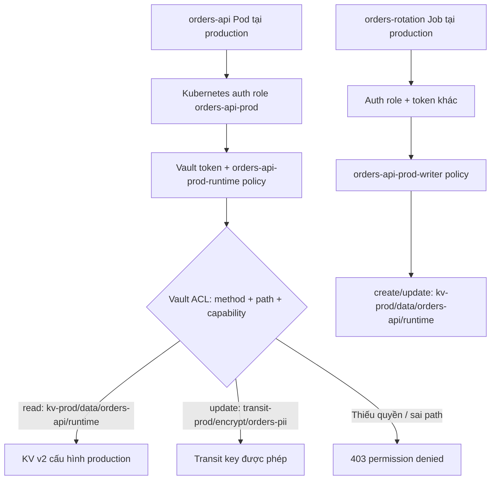

# Thiết kế policy cho từng dịch vụ và từng môi trường trong Spring Vault

Giả sử doanh nghiệp có hai ứng dụng Java: `orders-api` xử lý đơn hàng và `invoices-api` phát hành hóa đơn. Cả hai sử dụng **Spring Vault** để đọc cấu hình bí mật từ **HashiCorp Vault**; `orders-api` còn dùng Transit encryption, trong khi `invoices-api` cần chứng chỉ mTLS từ PKI. Mỗi ứng dụng được triển khai ở **development**, **staging** và **production**. Nếu mọi tiến trình cùng dùng một Vault token hoặc cùng nhận policy `path "secret/*"`, một lỗi hoặc sự cố ở môi trường thử nghiệm có thể tạo quyền truy cập không cần thiết vào secret production.

Giải pháp là thiết kế **ACL policy theo từng dịch vụ, từng môi trường và từng trách nhiệm**. Token của `orders-api` ở development chỉ thực hiện đúng thao tác được phép ở development; token production chỉ truy cập tài nguyên production; job xoay vòng secret có một danh tính và policy riêng với service runtime. Quan trọng hơn, quyền phải được kiểm tra trên **đường dẫn API thực tế** do `VaultTemplate` gọi, không chỉ dựa vào tên policy hay tên secret trong tài liệu.

Bài này thuộc chương **Phân quyền truy cập** của module **SPRING_VAULT**. Nội dung hướng dẫn quy trình thiết kế và triển khai từ ma trận quyền, naming convention, Kubernetes/AppRole auth role, HCL policy, KV v2, Transit, PKI, token/lease cho tới kiểm thử tích hợp, giám sát và xử lý lỗi.

## 1. Mục tiêu học tập

Sau bài này, bạn có thể:

- Thiết kế ma trận quyền **dịch vụ × môi trường × thao tác × API path**, thay vì dùng một policy chung cho mọi workload.
- Phân biệt **phân tách bằng Vault cluster**, **Vault namespace**, **mount path** và **prefix trong KV**, cùng giới hạn bảo vệ của từng cách.
- Viết ACL tối thiểu cho KV v2 `data/`/`metadata/`, Transit encrypt/decrypt, PKI issue và dynamic database credentials.
- Phân tách **runtime reader**, **rotation writer**, **certificate issuer** và **operator** theo danh tính/role riêng.
- Gắn đúng policy vào Kubernetes auth role hoặc AppRole cho từng môi trường; quản lý token TTL/lease độc lập.
- Đưa mount và logical key vào cấu hình Spring Vault mà không đưa token/root credential vào source code.
- Dùng kiểm thử dương tính và âm tính để xác minh không truy cập chéo dịch vụ/môi trường, không ghi/xóa dữ liệu ngoài nhu cầu.
- Tổ chức phát hành policy qua IaC, review thay đổi, giám sát và rollback có kiểm soát.

## 2. Mô hình quyền: danh tính trước, đường dẫn sau

Quyết định của Vault xảy ra qua các lớp độc lập:



Để thiết kế, cần phân biệt:

| Thành phần | Chức năng | Điều không tự bảo đảm |
| --- | --- | --- |
| **Workload identity** | Xác định Pod/ServiceAccount hoặc AppRole đang đăng nhập | Không tự cấp quyền đọc secret |
| **Auth role** | Ràng buộc danh tính, cấp token với policies và TTL | Không đồng nghĩa với role của PKI/database engine |
| **Vault token** | Credential mang tập quyền hiệu lực, có vòng đời | Token hợp lệ không có nghĩa được đọc mọi secret |
| **ACL policy** | Quy định API path và capability được phép | Không bảo đảm key tồn tại, CAS đúng hay PKI role chấp nhận yêu cầu |
| **Secrets engine** | Xử lý KV/Transit/PKI/database sau bước ACL | Không tự thay thế kiểm soát danh tính workload |

Trong mô hình này, **tên policy không tạo ra ranh giới quyền**. Policy tên `orders-api-prod-runtime` nhưng chứa `path "kv-prod/data/*"` vẫn có phạm vi rất rộng. Bảo vệ thực sự nằm ở **các rule HCL** và **danh tính nào được gắn policy đó**.

## 3. Chọn ranh giới môi trường trước khi viết HCL

Không phải mọi hệ thống đều có cùng cấu trúc Vault. Có thể tổ chức theo những cách sau:

| Kiểu tách | Ví dụ | Điểm mạnh | Lưu ý |
| --- | --- | --- | --- |
| **Cluster độc lập** | Vault dev và Vault prod khác nhau | Ranh giới hạ tầng, token và quản trị tách biệt rõ | Cần duy trì cấu hình/IaC riêng; một token dev thông thường không dùng được ở cluster prod |
| **Vault namespace** (khi bản triển khai hỗ trợ) | Namespace `team/dev`, `team/prod` | Phân vùng auth mounts, secrets engines và policies trong hệ thống hỗ trợ | Vault namespace **khác** Kubernetes namespace; kiểm tra header/client namespace |
| **Mount riêng trong cùng cluster** | KV v2 `kv-dev/` và `kv-prod/` | Đường dẫn API khác nhau, dễ gắn policy theo môi trường | Chính sách quyền và tài khoản quản trị vẫn phải được review để tránh truy cập chéo |
| **Prefix khác nhau trong một mount** | `kv/data/dev/orders-api` và `kv/data/prod/orders-api` | Dễ tổ chức khi cần chia sẻ một mount | Ranh giới chỉ dựa vào ACL/path, wildcard rất dễ mở quá rộng |

Không nhất thiết phải dùng tất cả các lớp tách cùng lúc. Với sản phẩm nhiều yêu cầu bảo mật, production thường cần ranh giới quản trị mạnh hơn dev; lựa chọn cụ thể phụ thuộc mô hình triển khai và yêu cầu tổ chức. Bất kể cấu trúc, cần kiểm tra **token ở môi trường A không có quyền nghiệp vụ ở môi trường B**.

Trong các ví dụ bên dưới, ta giả định **một Vault cluster dùng mount riêng**:

| Môi trường | KV v2 mount | Transit mount | PKI mount | Service |
| --- | --- | --- | --- | --- |
| Development | `kv-dev/` | `transit-dev/` | `pki-dev/` | `orders-api`, `invoices-api` |
| Staging | `kv-stage/` | `transit-stage/` | `pki-stage/` | `orders-api`, `invoices-api` |
| Production | `kv-prod/` | `transit-prod/` | `pki-prod/` | `orders-api`, `invoices-api` |

Các tên mount này chỉ là **ví dụ kiến trúc**. Ở hệ thống thực, cần đối chiếu tên mount, loại secrets engine và phiên bản KV từ cấu hình Vault đã được quản trị xác nhận; không tự suy đoán mount luôn tên `secret`.

## 4. Lập ma trận nhu cầu truy cập trước khi cấp quyền

Mỗi dòng là một **workload identity + môi trường + hành động**. Nên bắt đầu từ thao tác thật mà Java gửi, không bắt đầu bằng danh sách capability “cho đủ”.

| Workload | Môi trường | Nghiệp vụ | API path (không gồm `/v1/`) | Capability |
| --- | --- | --- | --- | --- |
| `orders-api` runtime | Dev | Đọc config | `kv-dev/data/orders-api/runtime` | `read` |
| `orders-api` runtime | Dev | Mã hóa PII | `transit-dev/encrypt/orders-pii` | `update` |
| `orders-api` runtime | Prod | Đọc config | `kv-prod/data/orders-api/runtime` | `read` |
| `orders-api` runtime | Prod | Mã hóa PII | `transit-prod/encrypt/orders-pii` | `update` |
| `invoices-api` runtime | Prod | Đọc config | `kv-prod/data/invoices-api/runtime` | `read` |
| `invoices-api` certificate job | Prod | Xin chứng chỉ | `pki-prod/issue/invoices-client` | `update` |
| `orders-rotation` job | Prod | Tạo/cập nhật config | `kv-prod/data/orders-api/runtime` | `create`, `update` |
| `orders-db-client` (nếu có) | Prod | Lấy credential động | `db-prod/creds/orders-ro` | `read` |

Chuyển ma trận thành các **quy tắc phủ định**:

- Runtime `orders-api` không được đọc `kv-prod/data/invoices-api/runtime`.
- Token development không được đọc `kv-prod/data/orders-api/runtime` nếu hai môi trường dùng chung cluster.
- Runtime chỉ đọc config không được POST/DELETE tại `kv-prod/data/orders-api/runtime`.
- Token chỉ mã hóa không được giải mã qua `transit-prod/decrypt/orders-pii` nếu nghiệp vụ không cần.
- Runtime không được sửa `auth/kubernetes/role/*`, `sys/policies/acl/*` hoặc `sys/mounts/*`.
- Job xoay vòng không cần `list` mọi key hay quyền `destroy` phiên bản KV.

Với mỗi quyền, ghi lại **lý do nghiệp vụ, owner và thời điểm review**. Những quyền không có use case rõ ràng nên bị loại bỏ thay vì “giữ phòng trường hợp sau này cần”.

## 5. HCL policy cho service và môi trường

### 5.1. `orders-api` ở development

```hcl
# orders-api-dev-runtime.hcl
# Chỉ dùng khi KV v2 được mount thực tế tại kv-dev/.
path "kv-dev/data/orders-api/runtime" {
  capabilities = ["read"]
}

# Service chỉ mã hóa dữ liệu, không giải mã hay quản trị Transit key.
path "transit-dev/encrypt/orders-pii" {
  capabilities = ["update"]
}
```

Token mang đúng policy này không có quyền đọc dữ liệu production, không có `list` trong KV metadata và không thể sửa secret.

### 5.2. `orders-api` ở production

```hcl
# orders-api-prod-runtime.hcl
path "kv-prod/data/orders-api/runtime" {
  capabilities = ["read"]
}

path "transit-prod/encrypt/orders-pii" {
  capabilities = ["update"]
}
```

Tên hai policy gần giống nhau để dễ quản lý, nhưng nội dung ACL **phải trỏ đến mount môi trường tương ứng**. Không gắn cả `orders-api-dev-runtime` và `orders-api-prod-runtime` cho một auth role chỉ vì đây là cùng một ứng dụng.

### 5.3. `invoices-api` ở production

```hcl
# invoices-api-prod-runtime.hcl
path "kv-prod/data/invoices-api/runtime" {
  capabilities = ["read"]
}
```

Nếu tác vụ xin chứng chỉ được thực hiện bởi một **job riêng**, không cần đưa quyền PKI vào service runtime. Policy cho job:

```hcl
# invoices-cert-prod-issuer.hcl
path "pki-prod/issue/invoices-client" {
  capabilities = ["update"]
}
```

PKI role `invoices-client` còn quyết định subject, allowed domains/SAN và TTL. ACL cho phép gọi `issue/` **không có nghĩa** job được sửa `pki-prod/roles/invoices-client` hoặc có thể xin certificate với tên miền bất kỳ.

### 5.4. Job xoay vòng giá trị KV phải có danh tính riêng

```hcl
# orders-api-prod-writer.hcl
path "kv-prod/data/orders-api/runtime" {
  capabilities = ["create", "update"]
}
```

Với KV v2, `create` và `update` phục vụ các tình huống tạo key mới hoặc thay nội dung đã tồn tại. Chúng khác với `read`. Nếu job chỉ đẩy cấu hình mới từ nguồn đã được phê duyệt, không cần quyền đọc secret cũ. Nếu cần kiểm tra CAS/version hiện tại, hãy xem lại request thực và **chỉ bổ sung** quyền đọc metadata/data thích hợp khi use case yêu cầu.

Không cấp:

```text
kv-prod/metadata/orders-api/*
kv-prod/delete/orders-api/runtime
kv-prod/destroy/orders-api/runtime
kv-prod/data/invoices-api/*
```

Đây là các đường dẫn nêu để **review quyền không cần thiết**, không phải HCL policy. Đặc biệt, xóa mềm phiên bản mới nhất qua DELETE `kv-prod/data/<key>` và hủy vĩnh viễn phiên bản qua POST `kv-prod/destroy/<key>` có capability/path khác nhau; writer không cần cả hai.

## 6. Quyền theo môi trường phải khớp đúng API KV v2

Một policy có tên rất rõ ràng vẫn sai nếu bỏ quên nhánh `data/`. Ví dụ:

```hcl
# PHẢN VÍ DỤ cho KV v2:
path "kv-prod/orders-api/runtime" {
  capabilities = ["read"]
}
```

Trong khi Spring Vault gọi:

```text
GET /v1/kv-prod/data/orders-api/runtime
```

Rule đúng là:

```hcl
path "kv-prod/data/orders-api/runtime" {
  capabilities = ["read"]
}
```

Những đường dẫn KV v2 thường cần:

| Nghiệp vụ | API path tại mount `kv-prod/` | Capability |
| --- | --- | --- |
| Đọc nội dung | `kv-prod/data/orders-api/runtime` | `read` |
| Tạo/cập nhật nội dung | `kv-prod/data/orders-api/runtime` | `create`/`update` theo trường hợp |
| Xóa mềm version mới nhất | `kv-prod/data/orders-api/runtime` (DELETE) | `delete` |
| Xem metadata/version history | `kv-prod/metadata/orders-api/runtime` | `read` |
| Liệt kê tên key dưới prefix | `kv-prod/metadata/orders-api` (LIST) | `list` |
| Xóa mềm các version được chỉ định | `kv-prod/delete/orders-api/runtime` (POST) | `update` |
| Khôi phục version | `kv-prod/undelete/orders-api/runtime` (POST) | `update` |
| Hủy vĩnh viễn version | `kv-prod/destroy/orders-api/runtime` (POST) | `update` |
| Xóa metadata và mọi version | `kv-prod/metadata/orders-api/runtime` (DELETE) | `delete` |

**Không cấp `list` chỉ để service đọc một key cố định.** LIST trên KV v2 diễn ra qua `metadata/`, trả về **tên key** có thể tiết lộ cấu trúc hệ thống. Nếu công cụ kiểm kê thực sự cần list ở production, nên cấp một policy/identity kiểm kê riêng theo prefix đã duyệt.

## 7. Dùng auth role khác nhau để gắn policy khác nhau

Policy HCL chỉ có tác dụng khi được gắn với token của workload thích hợp. Với Kubernetes auth, ví dụ giả định auth mount tại `auth/kubernetes/`, quản trị viên có thể tạo các role độc lập:

```bash
# Lệnh quản trị trong môi trường được ủy quyền.
# Giả định Kubernetes auth backend đã cấu hình và policies đã tồn tại.

vault write auth/kubernetes/role/orders-api-dev \
  bound_service_account_names=orders-api \
  bound_service_account_namespaces=development \
  token_policies=orders-api-dev-runtime \
  token_ttl=30m

vault write auth/kubernetes/role/orders-api-prod \
  bound_service_account_names=orders-api \
  bound_service_account_namespaces=production \
  token_policies=orders-api-prod-runtime \
  token_ttl=30m

vault write auth/kubernetes/role/orders-rotation-prod \
  bound_service_account_names=orders-rotation \
  bound_service_account_namespaces=production \
  token_policies=orders-api-prod-writer \
  token_ttl=15m
```

Trong ví dụ này, cùng tên ServiceAccount `orders-api` xuất hiện ở hai **Kubernetes namespaces** khác nhau, nhưng dùng hai Vault auth roles với policies khác nhau. Tên Kubernetes namespace **không tự tách Vault namespace**; ranh giới cuối cùng còn phụ thuộc binding thực tế của auth role, token policies và cluster/mount.

Tùy cấu hình môi trường, cần kiểm tra thêm audience/JWT issuer, bound service account, TTL và thông số Kubernetes auth backend. Quan trọng nhất là workload không được tự lựa chọn role khác với danh tính đã được Vault ràng buộc.

### Nếu dùng AppRole thay Kubernetes

Batch job hoặc service ngoài Kubernetes có thể dùng AppRole. Cần tạo **AppRole riêng theo dịch vụ/môi trường**, bảo vệ RoleID/SecretID và gắn policy tương ứng. Không tái sử dụng cùng một SecretID production trong dev, và không đưa RoleID/SecretID vào Git hoặc log CI.

Phân biệt rõ:

| Loại role | Ví dụ | Trách nhiệm |
| --- | --- | --- |
| Auth role | `auth/kubernetes/role/orders-api-prod` | Ràng buộc workload và cấp Vault token/policy |
| PKI role | `pki-prod/roles/invoices-client` | Giới hạn thuộc tính chứng chỉ được phép cấp |
| Database role | `db-prod/roles/orders-ro` | Quy định cách tạo dynamic DB credential |

**Cùng tên “role” không tự liên kết các đối tượng.** ACL token phải cho phép endpoint nghiệp vụ như `pki-prod/issue/invoices-client` hoặc `db-prod/creds/orders-ro`.

## 8. Cấu hình Spring Vault theo môi trường mà không nhúng token

Trong Spring Vault, `VaultKeyValueOperations` hỗ trợ KV v2 với **mount** và **logical key**. Khi đã chọn `KV_2`, thư viện xử lý nhánh `data/` cho thao tác đọc/ghi; không tự thêm `data/` vào key.

Ví dụ service dùng mount/key lấy từ cấu hình triển khai:

```java
import java.util.Map;

import org.springframework.beans.factory.annotation.Value;
import org.springframework.stereotype.Service;
import org.springframework.vault.core.VaultKeyValueOperations;
import org.springframework.vault.core.VaultKeyValueOperationsSupport.KeyValueBackend;
import org.springframework.vault.core.VaultTemplate;
import org.springframework.vault.support.VaultResponse;

@Service
public final class OrdersRuntimeSecrets {

    private final VaultKeyValueOperations kv;
    private final String runtimeKey;

    public OrdersRuntimeSecrets(
            VaultTemplate vaultTemplate,
            @Value("${app.vault.kv-mount}") String kvMount,
            @Value("${app.vault.runtime-key}") String runtimeKey) {
        // Các giá trị này do deployment quản lý, không lấy từ request người dùng.
        this.kv = vaultTemplate.opsForKeyValue(kvMount, KeyValueBackend.KV_2);
        this.runtimeKey = runtimeKey;
    }

    public Map<String, Object> load() {
        VaultResponse response = kv.get(runtimeKey);
        if (response == null || response.getData() == null) {
            throw new IllegalStateException("Thiếu cấu hình runtime bắt buộc");
        }
        return response.getData();
    }
}
```

Ví dụ cấu hình **không chứa token**:

```yaml
# application-dev.yml
app:
  vault:
    kv-mount: kv-dev
    runtime-key: orders-api/runtime
```

```yaml
# application-prod.yml
app:
  vault:
    kv-mount: kv-prod
    runtime-key: orders-api/runtime
```

Khi dùng config dev, request tương ứng là `GET /v1/kv-dev/data/orders-api/runtime`. Khi dùng config prod, request là `GET /v1/kv-prod/data/orders-api/runtime`. Token được cấp qua **ClientAuthentication/session management** phù hợp với môi trường; không cho phép client tự ý nhận tên mount từ query parameter do người dùng bên ngoài truyền vào.

**Cấu hình profile của Spring không phải cơ chế phân quyền.** Kể cả nếu code/profiles bị sửa thành `kv-prod`, token dev vẫn phải thiếu quyền đọc `kv-prod/data/...` (nếu cùng cluster). Phân tách thực sự do **Vault auth identity và ACL** quyết định.

### Khi dùng Spring Cloud Vault

Spring Cloud Vault có cơ chế nạp cấu hình bằng backend/context/profile, khác với một lời gọi `VaultTemplate` thủ công. Một ứng dụng có thể tự tải thêm context dùng chung như `application` tùy cấu hình. Vì vậy cần:

1. Kiểm tra backend KV và version được cấu hình.
2. Ghi lại **từng API path** thực sự phát sinh cho application/context/profile.
3. Cấp `read` theo danh sách context cần thiết, không mở rộng `kv-prod/data/*` theo thói quen.
4. Kiểm thử startup với chính token workload và các profile/môi trường được triển khai.

Không giả định rằng chỉ vì `VaultTemplate.opsForKeyValue("kv-prod", KV_2).get("orders-api/runtime")` chạy được thì mọi property source mà Spring Cloud Vault nạp cũng chạy được.

## 9. Transit, PKI và database: mỗi quyền một endpoint, mỗi môi trường một ranh giới

### 9.1. Transit encrypt-only cho `orders-api`

```hcl
# Dev
path "transit-dev/encrypt/orders-pii" {
  capabilities = ["update"]
}

# Production: đặt trong policy production riêng, không gắn chung token dev.
path "transit-prod/encrypt/orders-pii" {
  capabilities = ["update"]
}
```

Hai khối trên được đặt cạnh nhau để so sánh, **không phải khuyến nghị đưa cả hai vào một policy được gắn cho cùng token**. Nếu producer chỉ mã hóa, không cấp `transit-prod/decrypt/orders-pii`. Key Transit và quyền quản lý tại `transit-prod/keys/orders-pii` là phạm vi riêng cho operator.

### 9.2. PKI role theo môi trường

```hcl
path "pki-dev/issue/invoices-client" {
  capabilities = ["update"]
}
```

```hcl
path "pki-prod/issue/invoices-client" {
  capabilities = ["update"]
}
```

Trong thực tế, dùng **hai policy riêng**, cấp tới hai auth roles riêng. Ngoài ACL, PKI role mỗi môi trường phải ràng buộc allowed domains/SAN và TTL phù hợp. Không để certificate dev có thể được phát hành cho tên miền sản xuất chỉ vì cùng dùng role name `invoices-client`.

### 9.3. Dynamic database credentials theo role

Nếu `orders-api` production lấy user SQL chỉ đọc từ database engine:

```hcl
path "db-prod/creds/orders-ro" {
  capabilities = ["read"]
}
```

Quyền này cho phép gọi endpoint phát hành credential theo **database role** đã cấu hình; không cho sửa `db-prod/roles/orders-ro` hoặc `db-prod/config/...`. Credential được phát hành có thể có **lease ID và TTL**, cần quản lý vòng đời độc lập với TTL của token Vault.

Không gom quyền KV, Transit, PKI và database vào mọi service. Chỉ giữ những endpoint thuộc **nhu cầu thật** của workload trong môi trường đó.

## 10. Token TTL, lease và bản cập nhật policy

Một thiết kế phân quyền tốt còn phải xác định **token và dynamic secrets tồn tại bao lâu**:

| Đối tượng | Người/cơ chế cấp | Phần quản trị cần thiết |
| --- | --- | --- |
| Vault token của runtime | Kubernetes/AppRole auth role với policy theo service/env | TTL, renewable/max TTL, re-login, revoke khi cần |
| KV v2 secret | KV engine, có nhiều version | CAS, retention, soft-delete/destroy theo quy trình |
| Dynamic DB credential | Database role qua `creds/<role>` | Lease renewal/revoke hoặc lấy credential mới |
| PKI certificate | PKI role qua `issue/<role>` | Thời hạn chứng chỉ, cấp lại và quản lý keypair |
| Transit ciphertext | Phép toán `encrypt/<key>` | Quản lý key/version Transit theo policy riêng |

Nếu Spring Vault session manager cần tự tra cứu/gia hạn token và policy hiệu lực chưa có quyền tự phục vụ, có thể xem xét:

```hcl
path "auth/token/lookup-self" {
  capabilities = ["read"]
}

path "auth/token/renew-self" {
  capabilities = ["update"]
}
```

Trong nhiều cấu hình, policy `default` đã cấp một số quyền tự phục vụ, nhưng token có thể được tạo mà không nhận `default`. Chỉ bổ sung khi stack thực sự cần. Có `update` tại `renew-self` không bảo đảm token renewable, và **renew không mở rộng ACL**.

Tương tự, không cấp `auth/token/*` hoặc `sys/leases/*` rộng rãi cho service. Lease dynamic secrets có endpoint riêng như `sys/leases/renew` và `sys/leases/revoke`; request chứa lease ID nên phải đánh giá phạm vi/các giới hạn của API và trách nhiệm của thành phần quản lý lease trước khi cấp quyền.

## 11. Dùng policy template/IaC nhưng phải review HCL cuối cùng

Khi có nhiều service và môi trường, việc copy-paste HCL dễ làm lẫn `kv-dev` và `kv-prod`. Có thể dùng một template trong quy trình IaC:

```hcl
# TEMPLATE DÀNH CHO PIPELINE, KHÔNG NẠP TRỰC TIẾP VÀO VAULT.
# IaC renderer thay {{kv_mount}} và {{service}} bằng giá trị đã kiểm soát.
path "{{kv_mount}}/data/{{service}}/runtime" {
  capabilities = ["read"]
}
```

Ví dụ các giá trị đầu vào được phê duyệt:

| Tham số | Dev | Prod |
| --- | --- | --- |
| `kv_mount` | `kv-dev` | `kv-prod` |
| `service` | `orders-api` | `orders-api` |
| Tên policy đầu ra | `orders-api-dev-runtime` | `orders-api-prod-runtime` |

Sau render, phải kiểm tra HCL đầu ra:

```hcl
# Kết quả renderer dành cho production:
path "kv-prod/data/orders-api/runtime" {
  capabilities = ["read"]
}
```

Vault ACL HCL **không tự hiểu** `{{kv_mount}}` hay `{{service}}` như biến runtime. Chúng chỉ là ký hiệu trong template, phải được pipeline/IaC thay thế **trước khi áp dụng policy**. Không cho các biến path nhận dữ liệu không tin cậy; cần allowlist mount và tên service, vì một dấu `*` hoặc `+` đưa vào sai chỗ có thể mở rộng phạm vi.

### Quy trình triển khai khuyến nghị

1. **Xác định yêu cầu:** lập ma trận service × môi trường × operation × path, phân rõ runtime và job.
2. **Review ranh giới:** cluster/namespace/mount và đường đi auth roles theo môi trường.
3. **Render:** từ IaC/source được version-control, xuất HCL cuối cùng cho từng policy.
4. **Review diff:** tên policy, mount thực, wildcard, capability và những path quản trị bất ngờ.
5. **Áp dụng bằng danh tính quản trị:** không dùng token runtime để ghi policy.
6. **Gắn auth role:** đúng ServiceAccount/AppRole và policy phù hợp từng môi trường.
7. **Kiểm thử quyền:** với token nhận từ role đó, chạy cả request cần được phép và request phải bị chặn.
8. **Triển khai ứng dụng:** cập nhật mount/config tương thích với policy; theo dõi `403`, lỗi login, lỗi token renewal và secret-read.
9. **Rollback/thu hồi:** nếu policy cấp rộng hoặc gây lỗi, khôi phục phiên bản đã duyệt và xác minh lại token/policies; đánh giá token/session bị ảnh hưởng.

Ví dụ lệnh quản trị để áp dụng một policy đã review:

```bash
# Operator/IaC dùng danh tính có quyền quản lý policy, không phải token ứng dụng.
vault policy write orders-api-prod-runtime orders-api-prod-runtime.hcl
vault policy read orders-api-prod-runtime
```

Không dùng “nạp được HCL” làm tiêu chí hoàn thành: một policy hợp lệ về cú pháp vẫn có thể cấp `read` cho sai mount hoặc tạo quyền chéo service.

## 12. Wildcard, `deny` và các quyền dễ làm hỏng ranh giới

Hai anti-pattern:

```hcl
# PHẢN VÍ DỤ: token runtime có quyền đọc mọi service production.
path "kv-prod/data/*" {
  capabilities = ["read"]
}

# PHẢN VÍ DỤ: quá rộng, có thể chạm cả metadata và endpoint quản lý version.
path "kv-prod/*" {
  capabilities = ["create", "read", "update", "delete", "list"]
}
```

Không nên dựa vào suy luận “sẽ có một `deny` để chặn phần còn lại” thay vì viết path hẹp. Vault có quy tắc **ưu tiên mẫu khớp** và cách kết hợp capabilities giữa policies; các wildcard `*`/`+` không đơn giản là regular expression. Một policy có `deny` cũng cần được thử tại đúng API path hiệu lực, không chỉ nhìn HCL bằng mắt.

Ví dụ khi `orders-api` chỉ cần đọc một key, **cách an toàn và dễ audit nhất** thường là một `path "kv-prod/data/orders-api/runtime" { capabilities = ["read"] }`, không phải `kv-prod/data/*` rồi bổ sung nhiều ngoại lệ.

Quyền đặc biệt như `sudo` dành cho một số endpoint hệ thống yêu cầu đặc quyền bổ sung, không phải cách sửa lỗi `403` do sai mount hoặc thiếu `data/`. Root token không được dùng cho service.

## 13. Kiểm tra quyền đúng bằng danh tính và môi trường

Kiểm tra theo hai lớp: **effective capability** của token và **request thực tế**. Với KV v2, `vault kv get` nhận mount/logical key; `vault token capabilities` nhận **API path**.

```bash
# Dùng token nhận từ auth role orders-api-prod trong Vault test/prod được ủy quyền.
# Kỳ vọng: read.
vault token capabilities kv-prod/data/orders-api/runtime

# Kỳ vọng: update.
vault token capabilities transit-prod/encrypt/orders-pii

# Kỳ vọng: deny.
vault token capabilities kv-dev/data/orders-api/runtime
vault token capabilities kv-prod/data/invoices-api/runtime
vault token capabilities kv-prod/metadata/orders-api
vault token capabilities kv-prod/destroy/orders-api/runtime
vault token capabilities sys/policies/acl/orders-api-prod-runtime

# Gọi thử secret thật trong môi trường test.
vault kv get -mount=kv-prod orders-api/runtime
```

Lệnh `vault token capabilities` sử dụng API tự kiểm tra capability, có thể cần quyền phụ trợ như `sys/capabilities-self` (thường do `default` cung cấp). Nếu token không có quyền chạy lệnh, sử dụng phương pháp được quản trị viên cho phép; **không cấp quyền quản trị rộng cho runtime** chỉ để công cụ chẩn đoán hoạt động.

Với trường hợp môi trường được đặt trên **hai cluster độc lập**, token dev gửi tới prod có thể thất bại ở bước xác thực (vì không tồn tại ở cluster prod), chứ không nhất thiết trả `403` do ACL. Điều cần chứng minh là **không có đường truy cập chéo được phép**; phải phân biệt nguyên nhân *không xác thực được* với *thiếu quyền trên một path trong cùng cluster*.

### Ma trận kiểm thử tối thiểu

| Testcase | Token `orders-dev` | Token `orders-prod` | Token `orders-rotation-prod` |
| --- | --- | --- | --- |
| GET `kv-dev/data/orders-api/runtime` | Cho phép | Từ chối | Từ chối |
| GET `kv-prod/data/orders-api/runtime` | Từ chối | Cho phép | Từ chối nếu writer chỉ có quyền ghi |
| POST ghi `kv-prod/data/orders-api/runtime` | Từ chối | Từ chối | Cho phép khi create/update phù hợp |
| GET `kv-prod/data/invoices-api/runtime` | Từ chối | Từ chối | Từ chối |
| LIST `kv-prod/metadata/orders-api` | Từ chối | Từ chối | Từ chối |
| POST `transit-prod/encrypt/orders-pii` | Từ chối | Cho phép | Từ chối |
| POST `transit-prod/decrypt/orders-pii` | Từ chối | Từ chối | Từ chối |
| POST `kv-prod/destroy/orders-api/runtime` | Từ chối | Từ chối | Từ chối |
| Sửa `auth/kubernetes/role/orders-api-prod` | Từ chối | Từ chối | Từ chối |

Ma trận này giả định các auth roles ở **cùng Vault cluster**, policy chỉ chứa những quyền đã nêu, và test fixtures đã được tạo. Nếu thực tế dùng clusters độc lập, thay những phép thử chéo cluster bằng kiểm thử thích hợp cho ranh giới xác thực/mạng của từng môi trường.

## 14. Kiểm thử tích hợp với Spring Vault

Thay vì chỉ đọc HCL tĩnh, hãy xây dựng integration test có một Vault instance/namespace riêng hoặc môi trường test được chuẩn bị:

1. Mount KV v2 riêng cho dev/prod giả lập; tạo key `orders-api/runtime` và `invoices-api/runtime` bằng **dữ liệu giả**.
2. Tạo policies từ IaC đầu ra và auth roles với danh tính riêng cho reader/writer.
3. Khởi tạo các `VaultTemplate`/session riêng, đăng nhập bằng từng workload token.
4. Thực hiện GET hợp lệ, GET khác dịch vụ, GET khác môi trường, LIST, POST và DELETE bị cấm.
5. Thử Transit encrypt được phép và decrypt bị cấm nếu use case chỉ cần mã hóa.
6. Nếu kiểm thử PKI/database, dùng PKI test CA và database thử nghiệm; kiểm tra PKI role/lease riêng.
7. Xác nhận mã lỗi **authorization** của các test âm tính; không coi lỗi `404` do key không tồn tại là bằng chứng ACL.
8. Đối chiếu đường dẫn HTTP do Spring Vault thực gửi với ma trận quyền.

Pseudocode mô tả ý tưởng (không phải class JUnit có thể chạy độc lập):

```java
// ordersProdClient và ordersDevClient dùng hai session/workload identity riêng.
assertDoesNotThrow(() ->
    ordersProdClient.opsForKeyValue("kv-prod", KV_2)
                    .get("orders-api/runtime"));

assertForbidden(() ->
    ordersProdClient.opsForKeyValue("kv-prod", KV_2)
                    .get("invoices-api/runtime"));

assertForbidden(() ->
    ordersDevClient.opsForKeyValue("kv-prod", KV_2)
                   .get("orders-api/runtime"));
```

`assertForbidden` phải kiểm tra mã lỗi ACL phù hợp và bảo đảm key đích có thật trong test; chỉ `assertThrows(Exception.class)` là không đủ vì lỗi mạng cũng tạo exception. Với writer test, phải dùng key test riêng và quan sát version/CAS; không ghi đè secret production.

## 15. Chẩn đoán lỗi theo service và môi trường

| Triệu chứng | Nghi vấn chính | Hướng xử lý |
| --- | --- | --- |
| Dev chạy được, prod `403` khi KV GET | Policy prod trỏ nhầm `kv-dev`, auth role prod thiếu policy, namespace sai | Xem mount, token effective policies, KV v2 `data/` path |
| Service A đọc được secret service B | Wildcard rộng hoặc role gắn thêm policy ngoài dự kiến | Thu hẹp ACL, kiểm tra nhiều policies và auth role |
| Writer job không ghi được lần sau | Chỉ có `create`, thiếu `update` | Cấp theo workflow tạo/cập nhật đúng key |
| Runtime `list()` báo `403` nhưng `get()` được | Không có `list` trên `metadata/` | Giữ nguyên nếu không cần duyệt tên key |
| Transit encrypt `403` | Sai mount/key hoặc thiếu `update` trên `encrypt/` | Sửa đúng endpoint; không cấp `transit-prod/*` |
| PKI issue thất bại dù có `update` | PKI role từ chối domain/SAN/TTL hoặc backend lỗi | Phân biệt ACL với validation của PKI engine |
| KV GET `404` | Secret/key chưa có, version đã bị soft-delete, mount sai | Kiểm tra trạng thái backend; không mở ACL theo phỏng đoán |
| Ban đầu chạy, sau đó lỗi | Token TTL/renew/re-login hoặc dynamic lease hết hạn | Chẩn đoán session và lease riêng |
| CLI khám phá mount thất bại | API phụ trợ như `sys/internal/ui/mounts`, sai namespace hoặc quyền path đích | Xem request thật; không cấp `sys/mounts/*` cho runtime |

Khi điều tra, luôn lưu **mã lỗi, API method/path đã chuẩn hóa, workload identity và môi trường**, đồng thời tránh ghi token hoặc plaintext secret. Một số response có thể không chỉ ra trực tiếp thiếu ACL hay trạng thái backend; dùng thêm Vault audit (trong quyền hạn của người vận hành) và thông tin triển khai.

## 16. Vận hành, giám sát và thay đổi policy an toàn

Một thay đổi tưởng nhỏ như chuyển `kv-dev` sang `kv-prod` có thể là thay đổi phạm vi quyền quan trọng. Nên:

- Có **owner** cho mỗi policy và từng auth role; review những quyền không có người chịu trách nhiệm.
- Dùng IaC/version control để theo dõi HCL, gắn kiểm tra tự động cho wildcard, `sudo` và endpoint quản trị.
- Giới hạn quyền ghi policy/role cho pipeline/operator được ủy quyền, không cấp cho token ứng dụng.
- Dùng audit log/telemetry theo môi trường: login thất bại, `403` trên KV/Transit/PKI, token renew thất bại, credential lease gần hết hạn.
- Giám sát truy cập **khác môi trường hoặc khác service**, đặc biệt khi một token thử GET nhiều prefix bất thường.
- Khi xoay vòng secret, có kế hoạch CAS/version retention và credential rotation; không giả định renew token cũng kéo dài lease DB hoặc chứng chỉ PKI.
- Khi rollback policy, kiểm tra lại effective capabilities của token đang dùng và phát hành mới; một thay đổi ACL có thể ảnh hưởng nhiều phiên hơn dự kiến.
- Không đưa client token, SecretID, ServiceAccount JWT, password, private key hoặc nội dung KV vào log, tài liệu hoặc output CI.

## 17. Bài tập thực hành

### Bài 1 — Thiết kế policy chỉ đọc cho staging

`payments-api` ở staging cần đọc key `payments-api/runtime` trên KV v2 mount `kv-stage/`. Không cần duyệt key hoặc ghi. Viết HCL phù hợp.

<details>
<summary>Đáp án gợi ý</summary>

```hcl
path "kv-stage/data/payments-api/runtime" {
  capabilities = ["read"]
}
```

Không cấp `list` trên `kv-stage/metadata/payments-api` và không dùng `kv-stage/data/*`. Role staging chỉ được gắn policy staging, không được gắn production policy.

</details>

### Bài 2 — Service và rotation job có dùng chung token không?

Runtime `orders-api` chỉ đọc config; `orders-rotation` job phải tạo và cập nhật config. Hai thành phần có nên dùng token mang `read/create/update` trên key?

<details>
<summary>Đáp án gợi ý</summary>

Không nên mặc định dùng chung. Tạo hai danh tính/role và policy: runtime chỉ `read`, writer chỉ `create`/`update` nếu không có yêu cầu đọc. Việc dùng chung token sẽ tăng quyền ghi của runtime và mở rộng tác động khi service bị xâm nhập.

</details>

### Bài 3 — Dev token gọi production

Trong cùng cluster, token dev có `read` tại `kv-dev/data/orders-api/runtime` nhưng không có rule cho `kv-prod/`. Developer đổi Spring profile thành production. Có được đọc production secret không?

<details>
<summary>Đáp án gợi ý</summary>

Không, nếu token không có policy khác cấp quyền. Profile có thể đổi URL/path client gửi nhưng không tự cấp quyền Vault. Kiểm tra bằng token dev trên `kv-prod/data/orders-api/runtime` và xác nhận bị ACL từ chối.

</details>

### Bài 4 — Transit và PKI theo môi trường

Producer development chỉ cần encrypt bằng `transit-dev/encrypt/payments-pii`. Certificate issuer production cần `pki-prod/issue/payments-client`. Có nên cấp cả hai endpoint cho hai workload?

<details>
<summary>Đáp án gợi ý</summary>

Không. Producer dev chỉ có `update` tại `transit-dev/encrypt/payments-pii`; cert job production có `update` tại `pki-prod/issue/payments-client`. Với PKI, role còn giới hạn domain/SAN/TTL; không cấp `pki-prod/roles/*` hoặc `transit-prod/keys/*` cho workload.

</details>

### Bài 5 — Template HCL có biến

Pipeline tạo file gồm `path "{{kv_mount}}/data/{{service}}/runtime"` và đưa nguyên file cho `vault policy write`. Tại sao không nên làm như vậy?

<details>
<summary>Đáp án gợi ý</summary>

`{{kv_mount}}` và `{{service}}` là ký hiệu của **template pipeline**, Vault ACL không tự nội suy chúng. Phải render HCL cuối cùng bằng giá trị allowlist theo môi trường, review diff để tránh wildcard/nhầm mount, rồi mới áp dụng policy.

</details>

### Bài 6 — Một policy tên prod có thật sự chỉ đọc prod?

Policy tên `invoices-api-prod-runtime` có rule `path "kv-prod/data/*" { capabilities = ["read"] }`. Vì sao tên policy không đủ bảo vệ các service khác?

<details>
<summary>Đáp án gợi ý</summary>

Quyền hiệu lực theo HCL path, không theo tên policy. Mẫu `kv-prod/data/*` có thể bao phủ secret production của nhiều service. Cần thu hẹp thành `kv-prod/data/invoices-api/runtime` hoặc các path chính xác đã được duyệt.

</details>

## 18. Checklist trước khi cấp policy theo service và environment

1. **Xác định ranh giới:** cluster, Vault namespace (nếu có), mount hoặc KV prefix đã thống nhất chưa?
2. **Chính xác danh tính:** mỗi service/môi trường/job có auth role và token policy riêng?
3. **Path đúng engine:** KV v2 dùng `data/`/`metadata/`, Transit dùng `encrypt/`/`decrypt/`, PKI dùng `issue/<role>`?
4. **Capability tối thiểu:** `read`, `create`, `update`, `list`, `delete` có bám đúng API nghiệp vụ không?
5. **Không vượt phạm vi:** không cấp wildcard rộng, `sudo`, root hoặc quyền quản trị `sys/*` cho runtime?
6. **Vai trò được tách:** reader, writer, cert issuer, lease manager và operator có policy phù hợp?
7. **Cấu hình Spring đúng:** mount/backend version, logical key, context/profile và Vault namespace khớp với ACL?
8. **Token/lease độc lập:** TTL/renewal/re-login, DB lease và certificate expiry có kế hoạch riêng?
9. **IaC và review:** HCL đã render được review, policy và role có owner, thay đổi/rollback được kiểm soát?
10. **Kiểm thử âm tính:** token không đọc được secret khác service/môi trường, không quản trị mount và không thực hiện quyền ghi/xóa thừa?

**Ghi nhớ:** Policy tốt không chỉ là một file HCL có cú pháp hợp lệ. Nó là kết quả của việc xác định **đúng danh tính workload, môi trường, endpoint và capability**, gắn policy vào đúng auth role và kiểm chứng trên token thật. Với Spring Vault, thiết kế theo từng dịch vụ và từng môi trường giúp `VaultTemplate` truy cập KV secrets, Transit, PKI và dynamic credentials an toàn, trong khi giới hạn sự cố và duy trì khả năng vận hành, giám sát, kiểm thử rõ ràng.
