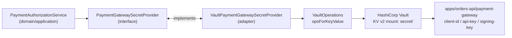

# Tạo lớp cung cấp secret theo hợp đồng nghiệp vụ

> **Spring Vault — Tích hợp ứng dụng.** Trong ứng dụng Java, `VaultTemplate` và `VaultOperations` là công cụ để giao tiếp với HashiCorp Vault, còn lớp nghiệp vụ cần **một hợp đồng rõ ràng về loại dữ liệu bí mật mà nó sử dụng**. Bài này xây dựng một `PaymentGatewaySecretProvider` có đầu ra định kiểu, ẩn chi tiết KV secrets engine và mapping JSON, kiểm soát lỗi, quyền truy cập, vòng đời cấu hình và khả năng kiểm thử. Kỹ thuật này có thể áp dụng cho credential cơ sở dữ liệu, API key đối tác, khóa ký hoặc thông tin kết nối khác.

## 1. Vì sao không nên gọi Vault trực tiếp từ mã nghiệp vụ?

Xem một đoạn code ban đầu ở dịch vụ thanh toán:

```java
@Service
class CheckoutService {
    private final VaultOperations vault;

    CheckoutService(VaultOperations vault) {
        this.vault = vault;
    }

    public void authorizePayment() {
        // Ví dụ minh họa cách kết nối đang bị đặt nhầm tầng.
        VaultResponse response = vault.read(
                "secret/data/apps/orders-api/payment-gateway");
        String apiKey = (String) response.getData().get("api-key");

        // Gọi API đối tác...
    }
}
```

Đoạn code trộn nhiều trách nhiệm:

- **Hợp đồng nghiệp vụ:** cần bộ credential nào để thanh toán và các trường bắt buộc là gì.
- **Hạ tầng lưu trữ:** mount KV v1 hay KV v2, đường dẫn Vault, tên field JSON, chính sách ACL.
- **Điều kiện lỗi:** secret không tồn tại, thiếu `api-key`, Vault trả 403, token hết hạn, timeout hoặc sai mount.
- **Bảo mật:** bí mật có thể bị ghi vào log, controller response, exception message, trace hoặc đối tượng `toString()`.
- **Vận hành:** đổi secret, cache TTL, cấp lại token, thay môi trường và thử nghiệm không có Vault.

Ngoài ra, cách gọi `vault.read("secret/data/...")` tự lắp đường dẫn API KV v2 thủ công. Nếu sau này đổi engine version hoặc mount, toàn bộ lớp nghiệp vụ phải biết và sửa các chi tiết đó.

Cách tổ chức tốt hơn: mã nghiệp vụ hỏi `PaymentGatewaySecretProvider.current()` và chỉ quan tâm tới **`PaymentGatewayCredentials` đúng schema**, còn adapter Spring Vault đọc KV, kiểm tra schema rồi trả về object.



**Ranh giới thiết kế:** domain giữ ngôn ngữ nghiệp vụ; infrastructure giữ Vault path, kiểu secrets engine và chi tiết xác thực. Tầng controller hoặc request từ người dùng **không được chọn một Vault path tùy ý**.

## 2. Xác định hợp đồng nghiệp vụ trước khi chọn API

Giả sử hệ thống `orders-api` gọi payment gateway và cần ba giá trị:

| Trường hợp nghiệp vụ | Field trong secret | Tên Java có ý nghĩa | Bắt buộc? |
|---|---|---|---|
| Định danh merchant | `client-id` | `clientId` | Có |
| Xác thực HTTP request tới gateway | `api-key` | `apiKey` | Có |
| Tạo/check signature theo giao thức gateway | `signing-key` | `signingKey` | Có |

Người gọi không nên nhận raw `Map<String,Object>` bởi `get("api-key")` dễ sai chính tả, lỗi chuyển kiểu thường xuất hiện muộn, và thông tin nội bộ của Vault bị lan sang lớp nghiệp vụ.

Hợp đồng hướng domain:

```java
// PaymentGatewaySecretProvider.java
public interface PaymentGatewaySecretProvider {

    /**
     * Lấy bộ thông tin xác thực hiện có của payment gateway.
     * Không trả null. Nếu thiếu/sai cấu trúc/không truy cập được
     * thì ném lỗi có phân loại để application xử lý.
     */
    PaymentGatewayCredentials current();
}
```

Có ba nguyên tắc nên ghi rõ trong hợp đồng:

1. **Đối tượng không bao giờ null:** caller hoặc nhận đủ credential hợp lệ, hoặc nhận lỗi tường minh.
2. **Không để lộ khóa hạ tầng:** tên method là `current()`, không phải `get("secret/data/...")`.
3. **Không trả secret qua HTTP chỉ để debug:** object tồn tại để phục vụ tác vụ nội bộ được cấp quyền.

Nếu hệ thống có nhiều nhà cung cấp, có thể mở rộng thành `current(GatewayId)` với `GatewayId` thuộc **tập allowlist do application định nghĩa**; không cho người dùng đưa một chuỗi tùy ý để lắp thành Vault path.

### 2.1. Một giá trị immutable có kiểm soát cách hiển thị

Không nên tự dùng `record PaymentGatewayCredentials(...)` cho dữ liệu nhạy cảm khi có nguy cơ log object: `record` mặc định sinh `toString()` chứa toàn bộ giá trị field. Một lớp final dưới đây tránh rủi ro đó:

```java
// PaymentGatewayCredentials.java
import java.util.Objects;

public final class PaymentGatewayCredentials {

    private final String clientId;
    private final String apiKey;
    private final String signingKey;

    public PaymentGatewayCredentials(
            String clientId, String apiKey, String signingKey) {
        this.clientId = Objects.requireNonNull(clientId);
        this.apiKey = Objects.requireNonNull(apiKey);
        this.signingKey = Objects.requireNonNull(signingKey);
    }

    public String clientId() {
        return clientId;
    }

    public String apiKey() {
        return apiKey;
    }

    public String signingKey() {
        return signingKey;
    }

    @Override
    public String toString() {
        return "PaymentGatewayCredentials[REDACTED]";
    }
}
```

Lớp không chứa setter nên không có trạng thái có thể thay đổi sau khi tạo. Tuy nhiên, Java `String` là immutable và **không thể xóa nội dung khỏi heap một cách chắc chắn**; lớp này không giải quyết hoàn toàn bảo vệ bộ nhớ. Khi hệ thống hoặc thư viện hỗ trợ `char[]`/`byte[]`, hãy thiết kế vòng đời hủy dữ liệu phù hợp, đồng thời cẩn trọng với việc clone/truyền buffer.

**Lưu ý:** `toString()` đã che dữ liệu nhưng **getter vẫn trả giá trị thật** cho caller tin cậy. Cần kiểm soát nơi object được serialize: không gắn lớp này trực tiếp vào REST response, log context, metric tag, exception hoặc actuator endpoint.

## 3. Chuẩn bị cấu trúc KV v2 và quyền truy cập

Giả sử Vault có mount KV v2 tên `secret/`. Secret nằm tại đường dẫn **logic**:

```text
secret/
  apps/
    orders-api/
      payment-gateway
         client-id      = <merchant-id>
         api-key        = <sensitive-api-key>
         signing-key    = <sensitive-signing-key>
```

Đối với Vault CLI, provisioner/operator có quyền ghi thực hiện trên **Vault dev/test**:

```bash
# Các chuỗi bên dưới là fixture mẫu, KHÔNG phải credential thật.
vault kv put -mount=secret apps/orders-api/payment-gateway \
  client-id=merchant-test-001 \
  api-key=dummy-api-key-for-test-only \
  signing-key=dummy-signing-key-for-test-only

vault kv get -mount=secret apps/orders-api/payment-gateway
```

Đường dẫn HTTP API của KV v2 khi đọc secret này là:

```text
GET /v1/secret/data/apps/orders-api/payment-gateway
```

Nhưng khi dùng `VaultKeyValueOperations`, cung cấp mount `secret` và path tương đối `apps/orders-api/payment-gateway`. Spring Vault tự thêm `data/` cho KV v2. **Không thêm `secret/data/` vào tham số `get(path)`.**

### 3.1. Policy tối thiểu cho workload `orders-api`

Một ứng dụng chỉ cần **đọc** bộ credential phải được cấp capability `read` trên đúng đường dẫn KV v2:

```hcl
path "secret/data/apps/orders-api/payment-gateway" {
  capabilities = ["read"]
}
```

Không cấp `list`, `create`, `update` hoặc `delete` nếu không có nhu cầu. `list` của KV v2 là operation khác, thường liên quan `secret/metadata/...`; việc đọc một path đã biết không yêu cầu ứng dụng liệt kê toàn bộ secret.

Trong hệ thống thực, workload đăng nhập Vault qua Kubernetes auth, JWT/OIDC, AppRole, cloud IAM hoặc phương án thích hợp. Token ứng dụng gắn policy nêu trên. **Không hard-code root token, token dài hạn hoặc mật khẩu của Vault** vào code hay repository.

### 3.2. Mỗi môi trường có mount, path và identity riêng

Một vài khả năng:

| Môi trường | Mount/keyspace | Workload identity |
|---|---|---|
| Local/dev | `secret/apps/orders-api/payment-gateway` trong Vault lab | Token dev có TTL ngắn |
| Staging | `secret-staging/apps/orders-api/payment-gateway` | Role staging theo namespace |
| Production | `secret-prod/apps/orders-api/payment-gateway` hoặc namespace riêng | Role production, policy đúng path |

Cách tổ chức tùy tenant, namespace và chuẩn vận hành. **Không suy ra tên mount từ tên folder/module trong repository**. Adapter lấy mount và path từ cấu hình đã được deploy an toàn; nếu dùng nhiều environment, cấu hình này không nên chứa giá trị secret gốc.

## 4. Cài đặt adapter Spring Vault KV v2

Spring Vault có API `VaultOperations.opsForKeyValue(mount, KeyValueBackend.KV_2)`, trả về `VaultKeyValueOperations`. API này hỗ trợ `get(path)`, `get(path, type)`, `put`, `delete`, `list` nhưng adapter chỉ cần **đọc**.

Dưới đây là implementation theo Java 17+, dùng `VaultResponse` và tách trường hợp lỗi theo ngữ nghĩa. Giả sử context Spring đã có bean `VaultOperations` hoặc `VaultTemplate` với endpoint, TLS, authentication và session manager cấu hình sẵn.

```java
// VaultPaymentGatewaySecretProvider.java
import java.util.Map;

import org.springframework.stereotype.Component;
import org.springframework.vault.VaultException;
import org.springframework.vault.core.VaultKeyValueOperations;
import org.springframework.vault.core.VaultKeyValueOperationsSupport.KeyValueBackend;
import org.springframework.vault.core.VaultOperations;
import org.springframework.vault.support.VaultResponse;

@Component
public final class VaultPaymentGatewaySecretProvider
        implements PaymentGatewaySecretProvider {

    // Path tương đối trong KV mount. Không thêm "secret/data/".
    private static final String SECRET_PATH =
            "apps/orders-api/payment-gateway";

    private final VaultKeyValueOperations kv;

    public VaultPaymentGatewaySecretProvider(VaultOperations vault) {
        this.kv = vault.opsForKeyValue("secret", KeyValueBackend.KV_2);
    }

    @Override
    public PaymentGatewayCredentials current() {
        VaultResponse response;
        try {
            response = kv.get(SECRET_PATH);
        } catch (VaultException ex) {
            // Không đưa token, API key, raw response hoặc request body
            // vào message. Cause dùng cho hệ thống logging có redaction.
            throw new SecretReadException(
                    "Cannot read payment gateway credentials from Vault", ex);
        }

        // KV path không tồn tại hoặc phiên bản hiện tại đã bị soft-delete.
        if (response == null || response.getData() == null) {
            throw new SecretMissingException(
                    "Payment gateway credentials are not configured");
        }

        Map<String, Object> fields = response.getData();

        // Mapping thành object hướng domain chỉ khi đủ dữ liệu.
        return new PaymentGatewayCredentials(
                requiredString(fields, "client-id"),
                requiredString(fields, "api-key"),
                requiredString(fields, "signing-key"));
    }

    private static String requiredString(
            Map<String, Object> fields, String name) {

        Object raw = fields.get(name);

        if (!(raw instanceof String value) || value.isBlank()) {
            // Tên field không phải secret; không in "raw" ra log.
            throw new SecretContractException(
                    "Payment gateway field missing or invalid: " + name);
        }

        return value;
    }
}
```

Định nghĩa exception riêng để caller phân biệt **Vault không thể đọc**, **secret thiếu** và **dữ liệu sai hợp đồng**:

```java
// SecretReadException.java
public class SecretReadException extends RuntimeException {
    public SecretReadException(String message, Throwable cause) {
        super(message, cause);
    }
}

// SecretMissingException.java
public class SecretMissingException extends RuntimeException {
    public SecretMissingException(String message) {
        super(message);
    }
}

// SecretContractException.java
public class SecretContractException extends RuntimeException {
    public SecretContractException(String message) {
        super(message);
    }
}
```

Mỗi lớp `public` trong ví dụ đặt trong **file Java riêng** theo quy tắc Java; phần ví dụ được trình bày liền nhau để thấy mối liên kết.

### 4.1. Vì sao dùng `VaultKeyValueOperations` thay vì `VaultTemplate.read`?

| Cách đọc | Ai phải biết `data/` của KV v2? | Khuyến nghị |
|---|---|---|
| `vault.read("secret/data/apps/...")` | Caller phải ghép đúng route kỹ thuật | Dùng khi có lý do gọi API thô |
| `vault.opsForKeyValue("secret", KV_2).get("apps/...")` | Thư viện hỗ trợ route KV v2 | Phù hợp nhất cho adapter KV v2 |
| `vault.opsForKeyValue("secret", KV_1).get("apps/...")` | Thư viện hỗ trợ route KV v1 | Chỉ khi mount thực tế là KV v1 |
| `vault.opsForVersionedKeyValue("secret")` | Thư viện hỗ trợ version metadata/CAS | Khi nghiệp vụ cần chọn version hoặc thao tác optimistic locking |

Với KV v2, `get(path)` trả về `VaultResponse` mà `getData()` chứa **map field của secret** khi API KV v2 được dùng. Nếu secret không tồn tại, method có thể trả `null`; các lỗi 403, 5xx, lỗi mạng hoặc auth thường đi qua exception. Không coi 403 là “key không có”.

### 4.2. Map thủ công hay ánh xạ type tự động?

Spring Vault cũng có:

```java
VaultResponseSupport<PaymentGatewayDocument> response =
        kv.get(SECRET_PATH, PaymentGatewayDocument.class);

PaymentGatewayDocument document =
        response == null ? null : response.getData();
```

Mapping type có thể giảm thao tác lấy từng key nhưng đòi hỏi class với constructor/field/annotation phù hợp converter đang dùng. Nếu key trong Vault là `api-key` mà Java field là `apiKey`, cần cấu hình mapping hoặc alias theo khả năng converter. Khi đó test phải chứng minh mapping hoạt động; **không tự giả định mọi field `kebab-case` sẽ tự khớp với Java camelCase**.

Trong ví dụ xuyên suốt, mapping thủ công 3 field có lợi: contract đổi phải sửa **một chỗ** và test phát hiện thiếu khóa.

## 5. Tách cấu hình không nhạy cảm khỏi dữ liệu bí mật

Một hệ thống có nhiều môi trường có thể cấu hình mount/path qua `@ConfigurationProperties` hoặc biến cấu hình của nền tảng triển khai, nhưng **giá trị secret** vẫn được đọc từ Vault. Ví dụ với Spring Boot:

```yaml
# application.yml — chỉ metadata vị trí, không chứa credential
app:
  payment-gateway:
    vault:
      mount: secret
      path: apps/orders-api/payment-gateway
```

Class cấu hình không chứa secret:

```java
import org.springframework.boot.context.properties.ConfigurationProperties;

@ConfigurationProperties(prefix = "app.payment-gateway.vault")
public record GatewayVaultLocation(String mount, String path) {
}
```

Đăng ký `@ConfigurationPropertiesScan` hoặc `@EnableConfigurationProperties(GatewayVaultLocation.class)` trong Spring Boot application. Có thể thay constructor adapter bằng:

```java
public VaultPaymentGatewaySecretProvider(
        VaultOperations vault, GatewayVaultLocation location) {

    // mount và path phải do deployment tin cậy quản lý, không từ HTTP input.
    this.kv = vault.opsForKeyValue(
            location.mount(), KeyValueBackend.KV_2);
    this.path = location.path();
}
```

Để dùng đoạn này, thay `SECRET_PATH` trong adapter bằng instance field `private final String path;` và gọi `kv.get(path)`. **Đây là biến thể cấu hình** của class mục 4, không dán thêm constructor mà vẫn giữ field `SECRET_PATH` không đồng bộ.

Nên validate `mount` và `path` ngay khi ứng dụng khởi động: không null/rỗng, không `../`, không `data/` lồng thừa, nằm trong prefix được phép cho workload. Không để `public GET /?path=...` chọn tùy ý secret path. Dù Vault ACL hạn chế, việc cho chọn path tùy ý vẫn làm tăng rủi ro lộ dữ liệu hoặc dò thông tin.

### 5.1. Spring Vault khác Spring Cloud Vault ở điểm nào?

- **Spring Vault Core**: các class `VaultOperations`, `VaultTemplate`, `VaultKeyValueOperations`, `SessionManager`; ứng dụng chủ động gọi Vault.
- **Spring Cloud Vault Config**: tích hợp Vault vào nguồn cấu hình Spring Environment, dùng property sources và cơ chế bootstrap/config import tùy version.
- **Domain provider**: là abstraction do ứng dụng tự định nghĩa để giữ đúng nghiệp vụ và tránh phụ thuộc vào tên property/đường dẫn Vault.

Nếu chỉ cần điền property vào bean khi **khởi động**, Spring Cloud Vault có thể phù hợp. Nếu nghiệp vụ cần **gọi lấy secret theo thời điểm dùng**, xử lý rotation có kiểm soát và mapping typed, domain provider kết hợp Spring Vault Core thể hiện rõ hơn hợp đồng này. Hai cách không loại trừ nhau; cần chọn có chủ đích theo lifecycle của ứng dụng.

## 6. Lớp nghiệp vụ gọi provider như thế nào?

Application service chỉ cần biết interface:

```java
// Ví dụ pseudocode có kiểu rõ ràng: PaymentGatewayHttpClient
// và PaymentCommand là các lớp nghiệp vụ của chính ứng dụng.
@Service
public final class PaymentAuthorizationService {

    private final PaymentGatewaySecretProvider secretProvider;
    private final PaymentGatewayHttpClient gateway;

    public PaymentAuthorizationService(
            PaymentGatewaySecretProvider secretProvider,
            PaymentGatewayHttpClient gateway) {
        this.secretProvider = secretProvider;
        this.gateway = gateway;
    }

    public PaymentResult authorize(PaymentCommand command) {
        PaymentGatewayCredentials credentials =
                secretProvider.current();

        // Gateway client nội bộ ký/gắn credential khi gọi API đối tác.
        // Không trả credentials trong PaymentResult.
        return gateway.authorize(command, credentials);
    }
}
```

`PaymentGatewayHttpClient`, `PaymentCommand`, `PaymentResult` là kiểu ví dụ giả định của ứng dụng payment, không phải API của Spring Vault. Điều cần kiểm tra là service **không biết** mount KV, secret path, map key hay token Vault.

Cần cân nhắc credential được sử dụng như thế nào: nếu gateway SDK giữ token trong một HTTP client lâu dài, chỉ gọi provider mỗi lần authorize nhưng SDK vẫn dùng credential cũ thì không đạt yêu cầu rotation. Đổi credential phải được **truyền tới đúng đối tượng sử dụng** bằng cơ chế update client hoặc tái tạo client an toàn.

### 6.1. Phân biệt ai có quyền đọc secret

- **Vault identity** (`orders-api` workload): Vault policy cho phép đọc path KV.
- **Người dùng dịch vụ thanh toán**: được application authorize hành động payment, không được tự đọc Vault secret.
- **Gateway client nội bộ**: nhận API key để ký HTTP request đến bên thứ ba; không log header authorization hoặc payload secret.
- **Operator/CI**: có thể quản lý/rotate giá trị, nhưng không cần xuất secret vào source code.

**Vault ACL là hàng rào theo workload, không thay thế business authorization theo người dùng cuối.** Một service có quyền đọc credential vẫn phải kiểm tra người dùng có được phép thực hiện thanh toán hay không.

## 7. Xử lý lỗi theo hợp đồng, không che mất nguyên nhân

Một provider có trách nhiệm chuyển lỗi kỹ thuật thành những trạng thái mà tầng ứng dụng có thể xử lý. Không nên để mọi lỗi biến thành `null` hoặc biến lỗi Vault thành thông báo HTTP 404 cho khách hàng.

| Tình huống | Ở adapter | Hành vi mong muốn tại tầng nghiệp vụ |
|---|---|---|
| Secret path không tồn tại | `SecretMissingException` | Báo lỗi cấu hình/deploy, dừng thao tác phụ thuộc secret |
| Thiếu `api-key` hoặc sai type | `SecretContractException` | Fail closed; điều tra schema, không dùng chuỗi rỗng |
| 403 permission denied | Thường là `VaultException` → `SecretReadException` | Cảnh báo ACL/auth, không retry vô hạn hoặc tăng quyền tự động |
| Token hết hạn/không renew được | Exception ở client/session/auth | Tái xác thực theo cơ chế Spring Vault; không gửi root token để bypass |
| Vault 5xx/timeout | `SecretReadException` | Retry có backoff và giới hạn theo tính chất operation |
| KV v1/v2 không trùng | Exception hoặc response sai | Xác minh mount và lựa chọn `KV_2`; không giả định key thiếu |
| Dữ liệu sai format/đã rotate | Kiểm tra contract hoặc lỗi từ gateway | Giám sát phiên bản và kế hoạch rollout/rollback |

Một mapping lỗi đơn giản ở lớp service có thể là:

```java
try {
    PaymentGatewayCredentials credentials = secretProvider.current();
    // Tiếp tục tác vụ nội bộ với credentials ...
} catch (SecretMissingException | SecretContractException ex) {
    // Hỏng cấu hình: đánh dấu readiness/alert phù hợp, không retry mù.
    throw ex;
} catch (SecretReadException ex) {
    // Hạ tầng Vault không truy cập được: áp dụng circuit breaker/backoff.
    throw ex;
}
```

Đừng gửi `ex.getCause().toString()` thẳng cho client bên ngoài; exception HTTP client có thể chứa path, host, request details hoặc response metadata. Nội bộ có thể log **loại lỗi, mã HTTP, correlation ID và tên nguồn secret theo allowlist** theo chính sách che dữ liệu. Không log token, key, raw JSON, `VaultResponse` hoặc object credential.

### 7.1. Retry và fail closed

- Khi **secret bị thiếu/sai schema**, retry vô hạn không giải quyết lỗi.
- Khi **Vault 5xx/timeout**, có thể thử lại có giới hạn theo khả năng sẵn sàng của Vault và SLA; tránh tạo retry storm.
- Khi **403/401**, kiểm tra token session và policy. `LifecycleAwareSessionManager` có thể quản lý token được phép renew và re-login theo auth method, nhưng không sửa policy sai.
- Khi Vault không sẵn sàng, đừng âm thầm dùng credential cũ không rõ thời hạn. Chỉ dùng cache nếu đã có **chính sách explicit** về TTL, security và trường hợp truy cập bị thu hồi.

## 8. Cache, rotation và vòng đời token: tách ba đồng hồ

Một lỗi phổ biến là lẫn lộn ba vòng đời:

| Vòng đời | Ai điều khiển | Tác động đến provider |
|---|---|---|
| **Vault client token** | Auth method, policy, token TTL/renewal | Có thể mất quyền gọi Vault nếu hết hạn/revoke |
| **KV v2 secret version** | Operator hoặc hệ thống rotate khi ghi secret | Đọc path hiện tại trả giá trị version phù hợp theo KV semantics |
| **Ứng dụng giữ credential trong bộ nhớ/client** | Cache của provider, HTTP SDK, pool | Giá trị có thể bị giữ cũ dù Vault đã cập nhật secret |

KV v2 **không phải dynamic secret lease**: việc rotate một API key bằng ghi version mới **không tự thông báo** cho mọi bean đang giữ credential. Một `LifecycleAwareSessionManager` renew Vault token cũng **không thay API key nghiệp vụ** đã được cache trong client.

### 8.1. Ba lựa chọn đọc secret

**Phương án A — Đọc mỗi lần dùng:** đơn giản về tính mới và ít state, nhưng tăng latency/request tới Vault. Ví dụ code trên chọn cách này để học đúng contract.

**Phương án B — Cache TTL ngắn:** giảm I/O và độ trễ, nhưng có một cửa sổ dùng secret cũ. Cần ghi rõ TTL, chính sách refresh, concurrency, metric và hành vi khi Vault lỗi.

**Phương án C — Refresh chủ động khi rotate:** nhận tín hiệu triển khai/đổi version đã được xác thực, làm mới credential rồi cập nhật HTTP client/pool an toàn. Cần xác định trạng thái chuyển tiếp và rollback.

Với dữ liệu như database credential có **lease** được cấp từ database secrets engine, mô hình khác: secret có TTL, lease ID, khả năng renew/revoke. Spring Vault cung cấp các cơ chế lease như `SecretLeaseContainer`; nhưng nó **không tự bảo đảm pool hoặc client của ứng dụng đã được thay credential**. Hãy thiết kế riêng refresh cho đối tượng sử dụng.

### 8.2. Rotation hai pha khi API đối tác cho phép

1. Gateway/operator phát hành credential mới mà **credential cũ vẫn hoạt động trong cửa sổ chuyển tiếp**.
2. Secret trong Vault được cập nhật; provider/adapter refresh theo cách đã thống nhất.
3. Kiểm tra dịch vụ gọi gateway bằng credential mới.
4. Thu hồi credential cũ khi mọi instance đã chuyển.
5. Giám sát authentication failures và có kế hoạch rollback.

Nếu đối tác chỉ cho một key hoạt động, thời điểm rotate phải có điều phối đặc biệt; đơn giản ghi key mới vào Vault không bảo đảm không có request đang dùng key cũ.

## 9. Vận hành với policy tối thiểu và kiểm soát secret sprawl

Trước khi dùng provider trong sản xuất, cần biết rõ:

1. **Ai sở hữu schema:** định nghĩa ba field bắt buộc, kiểu dữ liệu, quy tắc đổi tên, version schema nếu cần.
2. **Ai có quyền ghi:** CI/operator rotation identity có `create/update` trên đúng path; ứng dụng chỉ có `read`.
3. **Ai có quyền đọc:** workload `orders-api`, giới hạn path/namespace và một hoặc vài môi trường cần thiết.
4. **Xác thực thế nào:** dùng Kubernetes/JWT/AppRole/IAM đúng cluster; ràng buộc audience, service account, TTL và policy.
5. **Truyền secret thế nào:** TLS xác thực Vault server, có audit, không truyền qua application properties/CLI logs.
6. **Dùng secret ở đâu:** giữ trong internal service/gateway client; không serialize ra REST, message bus hoặc dashboard.
7. **Rotate thế nào:** quy trình cập nhật Vault, refresh instance, thu hồi cũ và test rollback.
8. **Khi thất bại:** secret thiếu hoặc sai schema phải có alert/health status, không trả default giả.
9. **Không lộ qua test:** dữ liệu fixture dùng dummy credentials và không in trong CI stdout.
10. **Quy tắc đặt path:** ứng dụng giữ path cố định/allowlist, không chấp nhận request user chọn raw Vault path.

Không nên xây một `GenericSecretService.getSecret(String path)` rồi để mọi nghiệp vụ truyền đường dẫn tự do, dù cách đó giúp giảm code. Nó tạo coupling vô hình, khó chứng minh quyền truy cập, khó kiểm thử contract và dễ sinh data exfiltration khi authorization mắc lỗi.

## 10. Test hợp đồng mà không phụ thuộc Vault trong unit test

Ưu điểm của interface là application service có thể kiểm thử bằng provider giả:

```java
final class StubPaymentGatewaySecretProvider
        implements PaymentGatewaySecretProvider {

    @Override
    public PaymentGatewayCredentials current() {
        return new PaymentGatewayCredentials(
                "merchant-test",
                "dummy-api-key",
                "dummy-signing-key");
    }
}
```

Các test ở lớp nghiệp vụ chỉ cần xác minh:

- Authorization của người dùng được thực hiện **trước** khi gọi gateway.
- Payment client nhận đúng credential và dữ liệu request theo hợp đồng.
- Khi provider báo lỗi, application không gọi gateway với `null` hoặc chuỗi placeholder.
- Không có secret trong REST response, message, log hoặc exception đã public.

Đây là **unit test nghiệp vụ**, chưa chứng minh việc kết nối Vault thật hoặc ACL/KV v2.

### 10.1. Unit test của adapter với Mockito

Adapter là lớp chuyển đổi; có thể thử lỗi thiếu đường dẫn và không cần Vault server:

```java
import static org.junit.jupiter.api.Assertions.*;
import static org.mockito.Mockito.*;

import org.junit.jupiter.api.Test;
import org.springframework.vault.core.VaultKeyValueOperations;
import org.springframework.vault.core.VaultKeyValueOperationsSupport.KeyValueBackend;
import org.springframework.vault.core.VaultOperations;

class VaultPaymentGatewaySecretProviderTest {

    @Test
    void missingSecretCausesExplicitError() {
        VaultOperations operations = mock(VaultOperations.class);
        VaultKeyValueOperations kv = mock(VaultKeyValueOperations.class);

        when(operations.opsForKeyValue("secret", KeyValueBackend.KV_2))
                .thenReturn(kv);
        when(kv.get("apps/orders-api/payment-gateway"))
                .thenReturn(null);

        var provider = new VaultPaymentGatewaySecretProvider(operations);

        assertThrows(SecretMissingException.class, provider::current);
        verify(kv).get("apps/orders-api/payment-gateway");
    }
}
```

Có thể bổ sung test `VaultResponse` có `getData()` chứa đúng ba field để chứng minh mapping; test các tình huống `api-key` rỗng hoặc kiểu number để assert `SecretContractException`; test Vault client ném `VaultException` để assert `SecretReadException`. Dùng mock chỉ để test **hợp đồng adapter**, không tuyên bố đã kiểm thử network/auth.

## 11. Integration test với Vault thật: điều cần xác minh

Kiểm thử tích hợp phải sử dụng **Vault chỉ dành cho test**, có KV v2 mount `secret/` và workload identity hoặc test token bị giới hạn quyền. Không dùng token root khi đang kiểm tra policy.

Chuẩn bị fixture minh họa trên Vault test:

```bash
# Điều kiện tiên quyết: VAULT_ADDR và cách auth của Vault test đã sẵn sàng.
# Dữ liệu dummy; không sử dụng tài khoản payment gateway thật.
vault kv put -mount=secret apps/orders-api/payment-gateway \
  client-id=merchant-test-001 \
  api-key=dummy-rotate-me \
  signing-key=dummy-signing
```

Ví dụ JUnit 5 giả định Spring Boot đã cấu hình `VaultOperations` tới Vault test:

```java
import static org.junit.jupiter.api.Assertions.*;

import org.junit.jupiter.api.Test;
import org.springframework.beans.factory.annotation.Autowired;
import org.springframework.boot.test.context.SpringBootTest;

@SpringBootTest
class PaymentGatewaySecretProviderIT {

    @Autowired PaymentGatewaySecretProvider provider;

    @Test
    void loadsCompleteContractFromKvV2() {
        PaymentGatewayCredentials value = provider.current();

        assertEquals("merchant-test-001", value.clientId());
        assertEquals("dummy-rotate-me", value.apiKey());
        assertEquals("dummy-signing", value.signingKey());

        // toString không chứa các giá trị nhạy cảm.
        assertEquals("PaymentGatewayCredentials[REDACTED]",
                value.toString());
    }
}
```

Test cố ý dùng **fixture tĩnh trong môi trường cô lập**. Nếu cần chạy song song, dùng mount/prefix riêng theo run và triển khai một adapter có path do test provision; không để các pipeline cùng ghi/xóa path của ứng dụng khác.

### 11.1. Ma trận integration tests

| ID | Tình huống | Kết quả kỳ vọng |
|---|---|---|
| I01 | KV v2 secret đầy đủ | Trả object có `clientId`, `apiKey`, `signingKey` chính xác |
| I02 | Secret path không tồn tại | `SecretMissingException`, không trả null |
| I03 | Secret có field `api-key` thiếu/blank | `SecretContractException` |
| I04 | Secret có field kiểu không đúng | Từ chối; không cast tùy tiện |
| I05 | Token workload có `read` đúng path | Đọc được fixture |
| I06 | Token thiếu `read` | Bị `403`/exception; **không dùng token root để vượt qua** |
| I07 | Sai mount hoặc nhầm KV v1/KV v2 | Lỗi rõ, không đoán lại path ngẫu nhiên |
| I08 | Vault timeout hoặc tạm không sẵn sàng | `SecretReadException`, retry/backoff có kiểm soát |
| I09 | Secret rotate từ version 1 sang 2 | Lần đọc mới lấy version hiện hành theo KV v2 |
| I10 | API gateway client đã cache credential | Phải có refresh/replace client, không chỉ provider đọc được version 2 |
| I11 | Client token hết hạn/revoke | Tái xác thực theo auth/session manager hoặc báo lỗi |
| I12 | Controller response/log | Không chứa plaintext secret, `VaultResponse` hoặc wrapping token |

**Kiểm tra quan trọng:** sau khi operator ghi version mới, gọi provider lại và kiểm tra output mới là điều khác với chứng minh **gateway client đang dùng credential mới**. Test phải bao gồm cả hành vi của client/connection pool thực tế khi yêu cầu rotation.

### 11.2. Đối chiếu dữ liệu lưu trữ khi lỗi mapping

Khi một test thất bại do field name hoặc response, operator có thể dùng `vault kv get -mount=secret ...` trên môi trường test. Với KV v2, HTTP raw response có lớp `data.data`, còn `VaultKeyValueOperations.get(...).getData()` được chuẩn hóa theo API Spring Vault. Cần tránh tự lấy `data.data` lần hai trong adapter khi dùng API KV 2 typed.

Không đưa dữ liệu test nhạy cảm thật vào output CI. Nếu cần phân tích, log **tên field và kiểu dữ liệu**, không log giá trị.

## 12. Những lỗi kiến trúc thường gặp và cách sửa

| Thiết kế dễ mắc lỗi | Hệ quả | Cách sửa |
|---|---|---|
| Controller tự gọi `vault.read(...)` | API lộ knowledge về path/mount, dễ ghi secret ra response | Controller gọi service, service gọi provider |
| Trả `Map<String,Object>` cho domain | Sai tên field, cast runtime, coupling mạnh | DTO/POJO typed và validation ngay adapter |
| Return `null` khi Vault lỗi | NPE hoặc dùng fallback credential sai | Exception có phân loại và fail closed |
| Đọc bằng `secret/data/... ` qua KV typed API | Path bị lặp `data/`, khó đổi KV version | Chỉ dùng path tương đối với `opsForKeyValue` |
| Dùng một `GenericSecretProvider.get(path)` public | Caller tự chọn path, mở rộng quyền và phụ thuộc | Contract theo nghiệp vụ + path allowlist |
| Log `record Credentials` trực tiếp | `record.toString()` có thể lộ API key | DTO có `toString` che dữ liệu, redaction logger |
| Cache credential vô hạn | Rotation trong Vault không đến ứng dụng | TTL/refresh và test rotation end-to-end |
| Token root cho ứng dụng | Bỏ qua policy tối thiểu, nguy cơ toàn cluster | Auth theo workload, policy path cụ thể |
| Xem KV v2 có lease như DB dynamic secrets | Rotation/expiration xử lý sai | Tách version KV với lease/token lifecycle |
| Chỉ test mock `VaultOperations` | Không kiểm được ACL, TLS, mount, network | Integration test với Vault thật |
| Retry tất cả lỗi | Retry storm, giấu 403/thiếu schema | Phân loại lỗi và giới hạn retry |
| Thay secret trực tiếp trong ứng dụng | Khó audit và đồng bộ nhiều instance | Quy trình rotation tại Vault/secret owner |

Điểm khác biệt của một provider hữu ích không phải số dòng code mà là **hợp đồng dễ hiểu, bất biến, kiểm thử được và ổn định khi hạ tầng Vault đổi**. Domain có thể thay provider bằng implementation test hoặc secret service khác mà không sửa nghiệp vụ cốt lõi.

## 13. Bài tập thiết kế và gợi ý đáp án

**Bối cảnh:** một hệ thống Spring Boot có ba module: thanh toán, email và truy cập cơ sở dữ liệu. Các credentials nằm ở KV v2; đội vận hành dùng Kubernetes auth cho service và muốn xoay vòng secret mà không phát tán thông tin nhạy cảm.

1. Vì sao cần ba contract như `PaymentGatewaySecretProvider`, `MailCredentialProvider`, `DatabaseCredentialProvider` thay vì một API chung nhận raw Vault path?
2. Vẽ đường phụ thuộc từ `PaymentAuthorizationService` đến adapter Vault. Lớp nào cần biết `secret/data`?
3. Thiết kế DTO có `apiKey` và `signingKey` để giảm nguy cơ lộ secret trong log. Điểm bất lợi nào còn lại khi dùng `String`?
4. Secret KV v2 thiếu `signing-key` nhưng có hai field còn lại. Nên trả null, dùng empty string hay fail? Vì sao?
5. Một Pod bị `403` sau khi deploy. Bạn kiểm tra Vault path/policy/auth và namespace nào trước khi tăng quyền?
6. Operator đã đổi API key trên Vault nhưng gateway SDK vẫn gửi key cũ. Hợp đồng provider đang thiếu phần nào của vòng đời vận hành?
7. `LifecycleAwareSessionManager` đã renew Vault token thành công. Nó có tự refresh secret đang cache trong HTTP client không?
8. Bạn muốn test lỗi “không có field api-key” và “token thiếu quyền” trong hai môi trường test khác nhau. Mỗi loại test cần dùng fixture gì?
9. Nếu chuyển từ KV v2 sang dynamic credential có lease TTL, DTO/provider cần thêm thông tin và vòng đời nào?
10. Đề xuất một tiêu chí đánh giá `readiness` khi hệ thống thanh toán bắt buộc phải có secret và Vault không sẵn sàng.

**Gợi ý:** (1) hợp đồng nghiệp vụ typed, giới hạn quyền và giảm coupling; (2) domain interface ở application, adapter ở infrastructure, `secret/data` chỉ thuộc HTTP KV v2 và được library thêm; (3) class immutable, `toString` redacted; `String` không wipe chắc chắn; (4) fail closed vì credential không đầy đủ; (5) `secret/data/... ` KV v2, đúng service account role/namespace và `read`; (6) TTL/refresh/replace client; (7) không; (8) unit test mapping bằng fake response và integration policy bằng token thật scope hẹp; (9) lease ID, expiresAt, renewal/revoke; (10) kiểm tra khả năng phục vụ nghiệp vụ và trả 503 khi hệ thống không thể an toàn thực hiện giao dịch.

## 14. Tài liệu tham khảo chính thức

- [Spring Vault — Vault Secrets Engines](https://docs.spring.io/spring-vault/reference/vault/vault-secret-engines.html): API KV v1/v2, typed `VaultKeyValueOperations` và versioned operations.
- [Spring Vault Javadoc — `VaultKeyValueOperations`](https://docs.spring.io/spring-vault/reference/api/java/org/springframework/vault/core/VaultKeyValueOperations.html): `get(String)`, `get(String, Class<T>)`, `put`, `patch`.
- [Spring Vault Javadoc — `VaultOperations`](https://docs.spring.io/spring-vault/reference/api/java/org/springframework/vault/core/VaultOperations.html): `opsForKeyValue`, `opsForVersionedKeyValue`, các API đọc/ghi.
- [Spring Vault — Authentication methods](https://docs.spring.io/spring-vault/reference/vault/authentication.html): auth theo workload, `SessionManager`, `LifecycleAwareSessionManager` và token renewal.
- [Spring Vault — Secret Lease Container](https://docs.spring.io/spring-vault/reference/vault/lease-renewal.html): phân biệt static/dynamic secrets và lease management.
- [HashiCorp Vault — KV secrets engine version 2](https://developer.hashicorp.com/vault/docs/secrets/kv/kv-v2): version, soft delete, CAS, retention và quản lý vòng đời secret.
- [HashiCorp Vault — KV v2 HTTP API](https://developer.hashicorp.com/vault/api-docs/secret/kv/kv-v2): các route `data/`, `metadata/`, `read`, version.
- [HashiCorp Vault — Policies](https://developer.hashicorp.com/vault/docs/concepts/policies): khả năng `read`, `update`, nguyên tắc least privilege.
- [Spring Cloud Vault](https://docs.spring.io/spring-cloud-vault/reference/): phương án tích hợp property source/config vào ứng dụng Spring.

> **Ghi nhớ:** lớp cung cấp secret nên trả **đối tượng theo hợp đồng nghiệp vụ** và báo lỗi có phân loại. Chỉ adapter biết Vault mount, KV version, đường dẫn và tên field; application service chỉ sử dụng dữ liệu đã kiểm tra. Đừng nhầm **quản lý token/lease của Vault** với **vòng đời credential đã đưa vào client hoặc cache của ứng dụng**.

