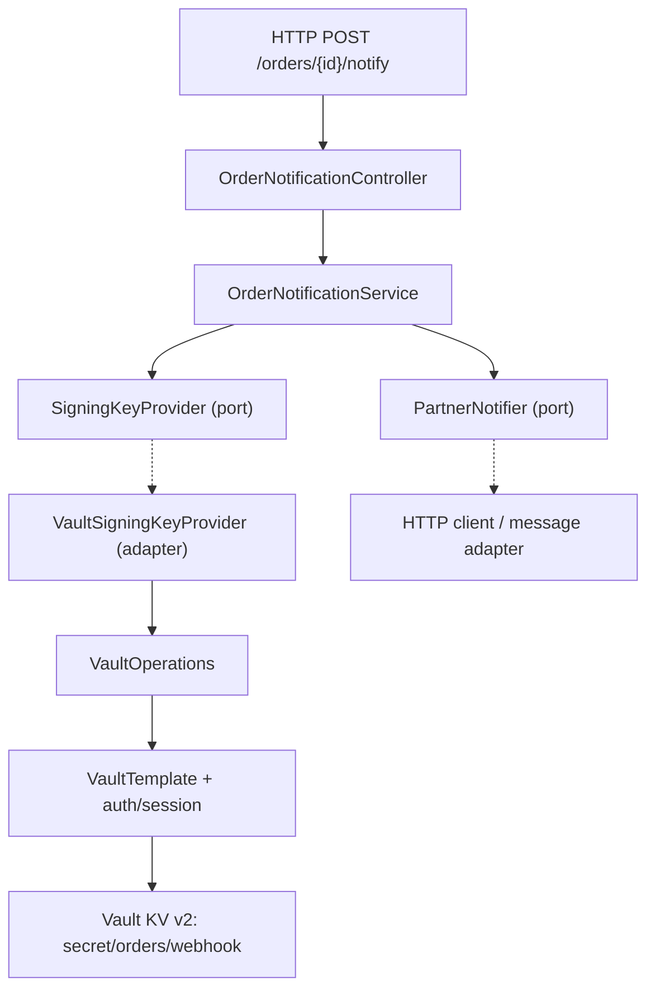
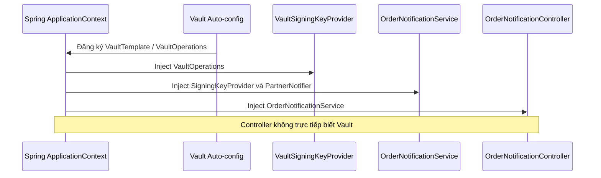

# Cấp VaultOperations qua dependency injection và tách khỏi controller

## 1. Mục tiêu và bối cảnh

Trong module **Spring Vault**, ứng dụng Java truy cập HashiCorp Vault thông qua `VaultTemplate` để đọc KV secrets, làm việc với token/lease, Transit encryption, PKI và các engine khác. Một ứng dụng web thường có thêm controller, service và thành phần tích hợp hệ thống ngoài. Nếu controller tự tạo Vault client, quản lý token và diễn giải dữ liệu bí mật, mã nguồn nhanh chóng phụ thuộc chặt vào Vault, khó kiểm thử và dễ làm lộ thông tin.

Chủ đề **Tích hợp ứng dụng** này tập trung vào **cấp `VaultOperations` qua dependency injection (DI) và tách khỏi controller**. Ví dụ xuyên suốt: dịch vụ `orders-api` cần đọc `signing-key` từ KV v2 mount `secret`, đường dẫn logic `orders/webhook`, rồi dùng khóa đó ký một thông điệp gửi cho đối tác. Controller chỉ nhận yêu cầu gửi thông báo; khóa bí mật không bao giờ được trả qua HTTP.

Sau bài này, bạn sẽ có thể:

- Phân biệt `VaultOperations` (interface) với `VaultTemplate` (implementation) và hiểu tại sao nên inject interface.
- Thiết kế đường đi `Controller → Application Service → Port → Spring Vault Adapter → Vault`.
- Cấp một bean Vault dùng chung qua Spring IoC/Spring Cloud Vault, xác thực theo workload và policy tối thiểu.
- Đọc KV v2 đúng mount/path, xử lý lỗi không tiết lộ secret và kiểm thử service mà không cần Vault chạy thật.
- Nhận biết khi nào cần test tích hợp với Vault thật để xác nhận auth, ACL, KV version và vòng đời token.

## 2. Vì sao controller không nên trực tiếp gọi Vault?

Ví dụ cách viết dễ gặp nhưng thiếu ranh giới:

```java
@RestController
class BadOrderController {

    @GetMapping("/orders/debug-key")
    String debugKey() {
        // Phản ví dụ: tự tạo client và đưa secret lên HTTP.
        var vault = new VaultTemplate(new VaultEndpoint(),
                                     new TokenAuthentication("hard-coded-token"));
        var response = vault.read("secret/data/orders/webhook");
        return response.getData().toString();
    }
}
```

Đây là **phản ví dụ cố ý**, không phải code cần triển khai. Nó tạo nhiều vấn đề cùng lúc:

1. **Lộ dữ liệu:** secret bị trả trong HTTP response; token được đặt trong mã nguồn.
2. **Phụ thuộc kỹ thuật:** controller phải biết endpoint, xác thực, KV path, định dạng response và cách quản lý lỗi Vault.
3. **Khó kiểm thử:** muốn kiểm tra HTTP/controller cũng phải tạo Vault client hoặc giả lập ở tầng thấp.
4. **Vòng đời khó quản lý:** mỗi lần request tự tạo client, không tận dụng cơ chế session/token lifecycle của Spring.
5. **Trách nhiệm lẫn lộn:** luật nghiệp vụ (ký thông báo), vận hành bí mật (Vault) và giao tiếp HTTP nằm trong cùng một lớp.

Mẫu tốt hơn:



Controller biết **use case**, service biết **luật nghiệp vụ**, port mô tả **nhu cầu dữ liệu**, adapter biết **giao thức Vault**, còn Spring quản lý vòng đời client. Khi chuyển sang cách lấy bí mật khác hoặc cần thay đổi vị trí KV mount, chỉ lớp adapter/config liên quan trực tiếp.

### Vai trò của các interface

| Thành phần | Trách nhiệm chính | Nên phụ thuộc vào |
|---|---|---|
| `OrderNotificationController` | Nhận path/DTO, validation HTTP, trả status | `OrderNotificationService` |
| `OrderNotificationService` | Điều phối gửi thông báo, quy tắc lỗi nghiệp vụ | `SigningKeyProvider` và `PartnerNotifier` |
| `SigningKeyProvider` | Hợp đồng lấy khóa dùng để ký | Không biết Vault |
| `VaultSigningKeyProvider` | Đọc và kiểm tra secret ở KV v2 | `VaultOperations` |
| `VaultOperations` | Giao diện Spring Vault cho nhiều engine và thao tác | Được Spring inject |
| `VaultTemplate` | Implementation của `VaultOperations`, dùng cấu hình kết nối và phiên | Spring IoC / Spring Cloud Vault |

## 3. Tại sao inject VaultOperations thay cho new VaultTemplate?

`VaultOperations` là interface trung tâm của Spring Vault; **`VaultTemplate` implements `VaultOperations`**. Tài liệu Spring Vault khuyến nghị tham chiếu `VaultTemplate` thông qua interface này. Sau khi cấu hình, `VaultTemplate` có thể được tái sử dụng an toàn giữa nhiều thành phần đồng thời (thread-safe); ứng dụng không cần tạo một client mới cho mỗi request.

Trong Spring, **constructor injection** làm phụ thuộc trở nên rõ ràng và giúp dùng `final`:

```java
import org.springframework.stereotype.Repository;
import org.springframework.vault.core.VaultOperations;

@Repository
public class ExampleVaultAdapter {
    private final VaultOperations vault;

    public ExampleVaultAdapter(VaultOperations vault) {
        this.vault = vault;
    }
}
```

Khi chỉ có một bean loại `VaultTemplate` được đăng ký, Spring có thể inject nó vào tham số kiểu `VaultOperations` vì class thực thi interface. **Không cần tạo thêm bean wrapper** chỉ để đổi kiểu. Nếu ứng dụng có nhiều bean `VaultOperations` cho các Vault cluster/namespace khác nhau, cần chỉ định bean bằng `@Qualifier` hoặc cấu hình có chủ đích; tránh dùng `@Primary` một cách ngầm định khi policy khác nhau.

DI làm mã dễ kiểm thử nhưng **không tự động bảo đảm bảo mật**. Auth, ACL, TLS verification, cấu hình mount, không ghi log secret và rotation vẫn phải được thực thi.

## 4. Ai tạo và quản lý bean VaultOperations?

Có hai tình huống phổ biến:

**Tình huống A — ứng dụng Spring Boot dùng Spring Cloud Vault.** Dependency `spring-cloud-starter-vault-config` cung cấp cơ chế cấu hình Vault và hạ tầng client tương ứng. Khi sử dụng Config Data API (`spring.config.import=vault://`), Spring Cloud Vault khởi tạo các thành phần để tiếp xúc với Vault trong giai đoạn bootstrap rồi chuyển chúng vào application context. Nếu không dùng Config Data import, auto-configuration tương ứng cũng có thể tạo các bean hạ tầng. Cần chọn cách cấu hình khớp **phiên bản Spring Boot/Spring Cloud** của dự án.

Ví dụ môi trường Kubernetes, Vault server dùng HTTPS và workload có ServiceAccount đã được ràng buộc với Vault Kubernetes Auth role `orders-api`:

```yaml
spring:
  application:
    name: orders-api
  cloud:
    vault:
      uri: https://vault.example.test:8200
      authentication: KUBERNETES
      kubernetes:
        kubernetes-path: kubernetes
        role: orders-api
        service-account-token-file: /var/run/secrets/kubernetes.io/serviceaccount/token
      kv:
        enabled: false
```

Trong ví dụ, `kv.enabled: false` chỉ tắt tự nạp KV làm **Spring Environment/PropertySource**; nó không vô hiệu khả năng ứng dụng gọi KV trực tiếp qua `VaultOperations.opsForKeyValue(...)`. Đây là đường đi phù hợp nếu secret chỉ được đọc khi một use case cần nó. Khi muốn dùng Vault secrets như property ở thời điểm khởi động, cần cấu hình Config Data import riêng theo tài liệu Spring Cloud Vault và đánh giá chính sách khởi động.

Ví dụ dependency Gradle cho tích hợp Spring Cloud Vault, dùng **BOM Spring Cloud tương thích** với Spring Boot thay vì tự đặt phiên bản không khớp:

```groovy
dependencies {
    implementation 'org.springframework.cloud:spring-cloud-starter-vault-config'
    implementation 'org.springframework.boot:spring-boot-starter-web'
}
```

**Tình huống B — ứng dụng chỉ dùng Spring Vault Core.** Có thể cấu hình các bean qua `AbstractVaultConfiguration` (cung cấp `vaultEndpoint()` và `clientAuthentication()`), hoặc tự tạo bean `VaultOperations` sau khi chuẩn bị `VaultEndpoint` và `ClientAuthentication`:

```java
import org.springframework.context.annotation.Bean;
import org.springframework.context.annotation.Configuration;
import org.springframework.vault.authentication.ClientAuthentication;
import org.springframework.vault.client.VaultEndpoint;
import org.springframework.vault.core.VaultOperations;
import org.springframework.vault.core.VaultTemplate;

@Configuration
public class VaultClientConfig {
    @Bean
    VaultOperations vaultOperations(VaultEndpoint endpoint,
                                   ClientAuthentication authentication) {
        return new VaultTemplate(endpoint, authentication);
    }
}
```

Đây là **mảnh cấu hình**: cần cung cấp thêm bean `VaultEndpoint`, `ClientAuthentication` tương ứng workload, chứng chỉ TLS và phương án quản lý phiên/renewal phù hợp môi trường. Không trộn cấu hình thủ công trên với auto-configuration nếu việc đó tạo bean trùng hoặc gây lựa chọn token không chủ đích. Với hệ thống sản xuất, ưu tiên lifecycle/renewal của Spring Vault/Spring Cloud Vault hoặc Vault Agent theo thiết kế xác thực.

### Đừng nhầm @Value với VaultOperations

Hai cách tích hợp phục vụ hai mục tiêu khác nhau:

- **PropertySource/`@Value`/`@ConfigurationProperties`:** đưa giá trị từ Vault vào Spring Environment khi bootstrap. Tiện cho cấu hình database hoặc HTTP client khởi tạo một lần, nhưng cần hiểu hành vi refresh/rotation.
- **`VaultOperations`:** gọi Vault theo yêu cầu từ code ứng dụng để đọc/ghi KV, cấp dynamic secrets, Transit, PKI v.v. Kiểm soát thời điểm truy xuất và lỗi tại use case cụ thể.

Không mặc định coi giá trị `@Value` sẽ tự cập nhật trong mọi bean khi secret ở Vault thay đổi; việc cập nhật cần cơ chế refresh/rotation phù hợp.

## 5. Thiết kế use case với port và adapter

Tình huống: `orders-api` gửi thông báo sang hệ thống đối tác và phải ký bằng một shared secret. Secret được đặt trong KV v2 tại:

| Thành phần | Giá trị ví dụ | Ghi chú |
|---|---|---|
| Vault secrets engine mount | `secret` | Engine **KV v2**, không phải KV v1 |
| Đường dẫn logic trong mount | `orders/webhook` | Dùng khi gọi `opsForKeyValue("secret", KV_2).get(...)` |
| Key trong payload | `signing-key` | Tên field cần đọc từ response |
| Đường dẫn Vault ACL | `secret/data/orders/webhook` | Có `data` vì API KV v2 |
| Danh tính Vault workload | `orders-api` | Được mapping từ Kubernetes Auth/AppRole |
| Quyền yêu cầu | `read` | Không cần `list`, `create`, `update`, `delete` |

Ví dụ khởi tạo dữ liệu *chỉ trên Vault lab* do operator thực hiện:

```bash
# Nếu mount "secret" chưa tồn tại, bật KV v2 một lần bằng tài khoản operator.
vault secrets enable -path=secret -version=2 kv

# Dùng giá trị giả trong môi trường thử nghiệm.
vault kv put -mount=secret orders/webhook signing-key="lab-demo-only"
```

Nếu mount `secret` đã tồn tại thì **không bật lại**. Đối với production, bí mật thực không nên gõ trực tiếp trên command line nơi có thể bị lưu vào shell history hoặc lộ qua process listing; dùng quy trình cấp phát bí mật đã được kiểm soát.

Policy tối thiểu áp vào workload:

```hcl
path "secret/data/orders/webhook" {
  capabilities = ["read"]
}
```

Lệnh CLI để operator thử bằng một token đúng policy:

```bash
vault kv get -mount=secret orders/webhook
```

**Đừng nhầm đường dẫn:** Spring Vault `opsForKeyValue("secret", KV_2).get("orders/webhook")` sẽ tự xây dựng HTTP path KV v2 với phân đoạn `data`. Nếu lập trình viên đưa sẵn `secret/data/orders/webhook` vào `get(...)` ở tầng này thì có thể tạo đường dẫn sai. ACL lại phải ghi đầy đủ `secret/data/orders/webhook` vì Vault bảo vệ đường dẫn HTTP thực.

### Bước 1 — Port mô tả nhu cầu nghiệp vụ, không mô tả Vault

```java
package com.example.orders.application;

public interface SigningKeyProvider {
    String requireSigningKey();
}
```

Hợp đồng không đề cập `VaultOperations`, KV v1/v2 hay HTTP status. Đây là ranh giới cho phép service dùng một nguồn secret khác nếu kiến trúc thay đổi hoặc unit test dùng fake/mock.

### Bước 2 — Adapter hiện thực port bằng VaultOperations

```java
package com.example.orders.infrastructure.vault;

import com.example.orders.application.SigningKeyProvider;
import org.springframework.stereotype.Repository;
import org.springframework.vault.VaultException;
import org.springframework.vault.core.VaultOperations;
import org.springframework.vault.core.VaultKeyValueOperations;
import org.springframework.vault.core.VaultKeyValueOperationsSupport.KeyValueBackend;
import org.springframework.vault.support.VaultResponse;

@Repository
public final class VaultSigningKeyProvider implements SigningKeyProvider {

    private static final String MOUNT = "secret";
    private static final String PATH = "orders/webhook";
    private static final String FIELD = "signing-key";

    private final VaultOperations vault;

    public VaultSigningKeyProvider(VaultOperations vault) {
        this.vault = vault;
    }

    @Override
    public String requireSigningKey() {
        final VaultResponse response;
        try {
            VaultKeyValueOperations kv =
                vault.opsForKeyValue(MOUNT, KeyValueBackend.KV_2);
            response = kv.get(PATH);
        } catch (VaultException ex) {
            // Không log body, token hay nội dung secret.
            throw new SecretUnavailableException("Vault KV read failed", ex);
        }

        if (response == null || response.getData() == null) {
            throw new SecretUnavailableException("Required secret is missing");
        }

        Object raw = response.getData().get(FIELD);
        if (!(raw instanceof String key) || key.isBlank()) {
            throw new SecretUnavailableException("Signing key is missing or invalid");
        }
        return key;
    }
}
```

Ngoại lệ riêng của adapter (cùng package):

```java
package com.example.orders.infrastructure.vault;

public final class SecretUnavailableException extends RuntimeException {
    public SecretUnavailableException(String message) {
        super(message);
    }

    public SecretUnavailableException(String message, Throwable cause) {
        super(message, cause);
    }
}
```

Ở đây, `VaultSigningKeyProvider` **không tạo** `VaultTemplate`, không lấy token từ HTTP request và không quyết định quyền truy cập. Những việc đó thuộc cấu hình auth/session của hạ tầng. Adapter có trách nhiệm gọi đúng engine, đúng path và kiểm tra dữ liệu trả về.

`VaultKeyValueOperations.get(...)` có thể trả `null` khi secret không tồn tại; lỗi auth/policy, mạng hoặc Vault không sẵn sàng thường xuất hiện dưới dạng ngoại lệ. **Không trả chuỗi rỗng làm secret mặc định**, vì ký bằng khóa rỗng có thể khiến hệ thống vận hành sai nhưng không báo lỗi. Ví dụ này cũng giả định secret là một `String`; nếu cần binary key, hãy định nghĩa hợp đồng riêng cho byte và encoding.

### Bước 3 — Application service điều phối nghiệp vụ

```java
package com.example.orders.application;

import org.springframework.stereotype.Service;

@Service
public final class OrderNotificationService {

    private final SigningKeyProvider keys;
    private final PartnerNotifier notifier;

    public OrderNotificationService(SigningKeyProvider keys,
                                    PartnerNotifier notifier) {
        this.keys = keys;
        this.notifier = notifier;
    }

    public void notifyPartner(String orderId) {
        if (orderId == null || !orderId.matches("[A-Za-z0-9-]{1,64}")) {
            throw new IllegalArgumentException("Invalid order id");
        }
        String signingKey = keys.requireSigningKey();
        notifier.sendNotification(orderId, signingKey);
    }
}
```

Port gửi thông báo sang đối tác:

```java
package com.example.orders.application;

public interface PartnerNotifier {
    void sendNotification(String orderId, String signingKey);
}
```

`PartnerNotifier` sẽ được hiện thực bởi HTTP/message adapter của hệ thống thực tế, với giao thức ký, timeout, retry và khóa định danh riêng. Nó được tách ra để bài này tập trung vào **cách DI và cách cấp quyền Vault**; khi ghép ứng dụng, phải đăng ký một implementation `@Component` hoặc `@Bean` cho `PartnerNotifier` thì context mới khởi động thành công.

Service biết rằng cần khóa để ký thông báo nhưng **không biết Vault đang nằm ở đâu**, không nhận `VaultOperations` và không xử lý JSON của KV v2. Nếu sau này thay Vault KV bằng dịch vụ quản lý khóa khác, chỉ cần thay implementation `SigningKeyProvider`.

### Bước 4 — Controller chỉ chuyển yêu cầu HTTP tới use case

```java
package com.example.orders.web;

import com.example.orders.application.OrderNotificationService;
import org.springframework.http.HttpStatus;
import org.springframework.web.bind.annotation.PathVariable;
import org.springframework.web.bind.annotation.PostMapping;
import org.springframework.web.bind.annotation.RequestMapping;
import org.springframework.web.bind.annotation.ResponseStatus;
import org.springframework.web.bind.annotation.RestController;

@RestController
@RequestMapping("/orders")
public final class OrderNotificationController {

    private final OrderNotificationService service;

    public OrderNotificationController(OrderNotificationService service) {
        this.service = service;
    }

    @PostMapping("/{orderId}/notify")
    @ResponseStatus(HttpStatus.NO_CONTENT)
    public void notifyPartner(@PathVariable String orderId) {
        service.notifyPartner(orderId);
    }
}
```

Controller **không có field `VaultOperations`**, không biết path `secret/data/...`, không trả lại `signing-key` và không có token Vault. Thành phần web chỉ xử lý request/response. Phương thức trả HTTP 204 khi use case thành công; lỗi được ánh xạ bởi một `@RestControllerAdvice` riêng.

### Bước 5 — Chuyển lỗi phụ thuộc hạ tầng thành phản hồi an toàn

```java
package com.example.orders.web;

import com.example.orders.infrastructure.vault.SecretUnavailableException;
import org.springframework.http.HttpStatus;
import org.springframework.http.ResponseEntity;
import org.springframework.web.bind.annotation.ExceptionHandler;
import org.springframework.web.bind.annotation.RestControllerAdvice;

@RestControllerAdvice
public class ApiErrorHandler {

    public record ApiError(String code, String message) {}

    @ExceptionHandler(SecretUnavailableException.class)
    public ResponseEntity<ApiError> vaultUnavailable(
            SecretUnavailableException ex) {
        // Lỗi nội bộ có thể ghi metric/correlation id ở tầng vận hành.
        // Không đưa ex.getMessage()/getCause() ra response.
        return ResponseEntity.status(HttpStatus.SERVICE_UNAVAILABLE)
            .body(new ApiError("DEPENDENCY_UNAVAILABLE",
                               "Unable to complete the operation"));
    }

    @ExceptionHandler(IllegalArgumentException.class)
    public ResponseEntity<ApiError> invalidInput(
            IllegalArgumentException ex) {
        return ResponseEntity.badRequest()
            .body(new ApiError("INVALID_INPUT", "Invalid request"));
    }
}
```

HTTP 503 trong ví dụ thể hiện use case không thể hoàn thành do phụ thuộc secret. Ở tầng vận hành vẫn phải **phân biệt lỗi 403 do policy, lỗi 404 thiếu secret và lỗi 5xx/timeout**; lỗi 403 thường là cấu hình cần sửa, không nên retry vô hạn chỉ vì API đã trả 503 bên ngoài. Cũng nên giới hạn quyền gọi endpoint `/orders/.../notify` theo chính sách của ứng dụng; Vault ACL chỉ bảo vệ đường truy cập Vault, không thay thế authentication/authorization của HTTP API.

### Luồng DI khi ứng dụng khởi động



Về runtime, request `POST /orders/123/notify` đi từ controller đến service, service lấy secret qua port rồi gọi notifier. Spring Vault dùng workload token/policy tương ứng khi thực hiện `get`; kết quả nhạy cảm chỉ ở các tầng cần sử dụng.

## 6. Kiểm thử từng tầng mà không cần kéo cả Vault vào controller

Một lợi ích trực tiếp của DI là các test có thể xác minh hành vi ở **đúng tầng chịu trách nhiệm**:

- Unit test service: mock `SigningKeyProvider` và `PartnerNotifier`, tập trung vào điều phối use case.
- Web test controller: mock `OrderNotificationService`, kiểm tra HTTP mapping, status và validation, không cần tạo Vault client.
- Adapter test: mock `VaultOperations`/`VaultKeyValueOperations` để kiểm tra mount/path, missing data và ánh xạ ngoại lệ.
- Integration test: dùng Vault dev/test thật để xác minh KV v2, đường dẫn ACL, workload auth, token lifecycle và hành vi lỗi.

### Unit test application service bằng Mockito

```java
package com.example.orders.application;

import static org.junit.jupiter.api.Assertions.assertThrows;
import static org.mockito.Mockito.*;

import org.junit.jupiter.api.Test;
import org.junit.jupiter.api.extension.ExtendWith;
import org.mockito.InjectMocks;
import org.mockito.Mock;
import org.mockito.junit.jupiter.MockitoExtension;

@ExtendWith(MockitoExtension.class)
class OrderNotificationServiceTest {

    @Mock SigningKeyProvider keys;
    @Mock PartnerNotifier notifier;
    @InjectMocks OrderNotificationService service;

    @Test
    void sendsUsingKeyFromPort() {
        when(keys.requireSigningKey()).thenReturn("dummy-test-key");

        service.notifyPartner("order-123");

        verify(keys).requireSigningKey();
        verify(notifier).sendNotification("order-123", "dummy-test-key");
        verifyNoMoreInteractions(notifier);
    }

    @Test
    void rejectsInvalidIdBeforeReadingSecret() {
        assertThrows(IllegalArgumentException.class,
            () -> service.notifyPartner("../other-path"));

        verifyNoInteractions(keys, notifier);
    }
}
```

Test không có `VaultTemplate` hay URL Vault. Nó chứng minh service chỉ quan tâm **port và use case**, thay vì phải chạy hệ thống bên ngoài để test mã Java. Giá trị `dummy-test-key` là dữ liệu kiểm thử giả.

### Web test không khởi động Vault

```java
import static org.mockito.Mockito.*;
import static org.springframework.test.web.servlet.request.MockMvcRequestBuilders.post;
import static org.springframework.test.web.servlet.result.MockMvcResultMatchers.status;

import com.example.orders.application.OrderNotificationService;
import com.example.orders.web.OrderNotificationController;
import org.junit.jupiter.api.Test;
import org.springframework.test.web.servlet.setup.MockMvcBuilders;

class OrderNotificationControllerTest {

    @Test
    void respondsNoContentWhenServiceSucceeds() throws Exception {
        OrderNotificationService service = mock(OrderNotificationService.class);
        var mvc = MockMvcBuilders.standaloneSetup(
            new OrderNotificationController(service)).build();

        mvc.perform(post("/orders/order-123/notify"))
            .andExpect(status().isNoContent());

        verify(service).notifyPartner("order-123");
    }
}
```

Ở đây `MockMvcBuilders.standaloneSetup` chỉ khởi tạo MVC adapter phục vụ test, không cần load toàn bộ `ApplicationContext` hoặc gọi Vault. Mã ví dụ cần dependency `spring-boot-starter-test` tương thích với Spring Boot đang dùng.

### Kiểm thử adapter có ý nghĩa

Đối với `VaultSigningKeyProvider`, nên xác minh ba hành vi khác nhau:

| Input được giả lập ở tầng Vault | Kết quả adapter phải cho thấy |
|---|---|
| `get("orders/webhook")` trả object có `data.signing-key` là chuỗi hợp lệ | Trả đúng khóa **nội bộ** cho service, không log hoặc biến đổi |
| `get(...)` trả `null` hoặc `data` thiếu `signing-key` | Ném `SecretUnavailableException`, không đưa chuỗi rỗng cho notifier |
| Client `VaultOperations` ném `VaultException` | Bọc lỗi thành ngoại lệ có ý nghĩa của adapter, giữ cause để phân tích kỹ thuật ở kênh an toàn |

Unit test adapter không chứng minh HTTP path KV v2 đúng hoặc policy đủ quyền; chính **integration test với Vault thật** xác nhận những điều đó.

### Ma trận integration test với Vault

Tạo Vault dev/test cô lập (có thể dùng Testcontainers nếu stack hỗ trợ) với KV v2 mount `secret`, tạo dữ liệu thử, và **đăng nhập bằng một token được gắn đúng policy của workload**, thay vì luôn kiểm thử với root token.

| Ca kiểm thử | Điều cần xác nhận |
|---|---|
| Secret tồn tại tại `secret/orders/webhook` | `opsForKeyValue("secret", KV_2).get("orders/webhook")` đọc đúng trường |
| Token có quyền `read secret/data/orders/webhook` | Adapter đọc thành công |
| Token thiếu quyền hoặc chỉ được cấp path KV v1 | Truy cập bị từ chối, cảnh báo sai ACL/KV version |
| Secret không tồn tại, hoặc field bị thiếu/sai kiểu | Adapter phát hiện và báo lỗi có kiểm soát |
| Vault không truy cập được, timeout hoặc trả 5xx | API không để lộ secret; hệ thống ghi nhận dependency failure |
| Token workload hết hạn, session có/không có renewal | Ứng dụng thể hiện đúng lifecycle/auth và có cảnh báo tương ứng |
| Secret được thay đổi ở Vault | Theo thiết kế đọc theo request, request sau nhận giá trị mới; nếu bật cache phải thử chính sách invalidation |
| Gửi HTTP request sai `orderId` | Service từ chối trước khi gọi secret adapter |
| Controller HTTP request thành công | Trả HTTP 204 và không bao giờ trả secret trong body/header |

Nếu dùng `@SpringBootTest` cho integration test, cấu hình Vault endpoint/auth riêng cho test profile để không vô tình kết nối production. Với lớp web và service thuần, unit test nên nhanh và độc lập trước khi chạy integration test có điều kiện.

## 7. Auth, policy, rotation và các giới hạn vận hành

### Để Spring quản lý client và phiên

Hạ tầng Spring Vault có `ClientAuthentication` và `SessionManager` để gắn thông tin xác thực vào request; với các cấu hình phù hợp, session management hỗ trợ renewal/đăng nhập lại của token workload. `VaultTemplate` là đối tượng có thể tái sử dụng, vì vậy nên để Spring quản lý vòng đời bean và tái sử dụng cho nhiều request.

Tuy nhiên, **tiêm `VaultOperations` không tự tạo token có quyền**. Trên Kubernetes, operator phải cấu hình Vault Kubernetes Auth role gắn đúng ServiceAccount và namespace; role đó gắn Vault policy chứa `read` cho path KV v2. Đối với AppRole, phải quản lý `role_id`/`secret_id` và vòng đời chúng theo quy trình của tổ chức. Không hardcode root token vào controller, service, bean config hay repository.

Mỗi môi trường cần cấu hình URI Vault, CA trust bundle, namespace (nếu có), timeout và xác thực phù hợp. Kết nối tới Vault phải dùng TLS được kiểm tra đúng certificate/hostname; không vô hiệu hóa TLS verification để sửa lỗi lab.

### Caching và thay đổi secret

Ví dụ `VaultSigningKeyProvider` đọc Vault ở mỗi request nên có thể thấy khóa mới sau khi operator thay giá trị. Cách này dễ hiểu nhưng tạo lưu lượng Vault và tăng độ trễ/độ phụ thuộc cho HTTP request.

Khi khối lượng tải lớn, cân nhắc cache có thời hạn hoặc cơ chế refresh chủ động:

1. Xác định **thời gian tối đa được phép dùng khóa cũ** theo nghiệp vụ và chính sách rotation.
2. Quyết định TTL cache và hành vi khi Vault không khả dụng; không mặc định giữ secret hết hạn vô thời hạn.
3. Với ký webhook, thiết kế **giai đoạn chuyển khóa** để đối tác có thể xác minh thông điệp từ khóa cũ và mới khi cần.
4. Không lưu cache secret vào Redis hoặc log một cách tùy tiện; bảo vệ bộ nhớ và quyền đọc của tiến trình.

Với dynamic secrets (ví dụ credentials database), **lease TTL và cơ chế revoke/renewal** có thể quan trọng hơn cache TTL thông thường. Code đọc KV v2 trong bài là ví dụ về secret tĩnh; không áp dụng máy móc cách cache này cho dynamic credentials hoặc chứng thư PKI.

### Phân loại lỗi theo tầng

| Lỗi | Ai xử lý? | Hành động phù hợp |
|---|---|---|
| Path KV v2 sai hoặc field thiếu | Vault adapter / operator | Kiểm tra mount, version, tên field và cấu hình dữ liệu |
| Vault HTTP 403 | IAM/Vault + vận hành | Kiểm tra workload auth và ACL; tránh retry vô hạn |
| Token hết hạn | Client/session hạ tầng | Xem cơ chế login/renewal và quyền token mới |
| Timeout, 429, 5xx | Hạ tầng và service | Retry giới hạn, backoff/jitter, circuit breaker theo nhu cầu |
| Secret bị xoay nhưng cache chưa cập nhật | Secret provider / vận hành | TTL/invalidation/rotation có kiểm soát |
| Mã `orderId` không hợp lệ | Service/web | Trả HTTP 400; không gọi Vault |
| Hệ thống đối tác từ chối chữ ký | Partner adapter/use case | Kiểm tra phiên bản khóa, thuật toán ký và đồng bộ rotation |

**Không để controller bắt trực tiếp `VaultException` rồi gửi `ex.getMessage()` ra HTTP**. Nội dung lỗi hạ tầng có thể chứa đường dẫn, thông tin kết nối và các chi tiết không dành cho client. Hãy thống nhất mã lỗi công khai ở `@RestControllerAdvice` và ghi metric/log tối thiểu trong hệ thống observability đã được kiểm soát.

## 8. Các sai lầm thường gặp

| Cách làm | Vấn đề | Hướng sửa |
|---|---|---|
| `new VaultTemplate(...)` bên trong controller | Tạo client theo request, dễ lộ token và khó test | Tạo bean ở tầng cấu hình; inject `VaultOperations` vào adapter |
| Controller trực tiếp gọi `vault.read(...)` | Logic HTTP gắn với KV path và response | Controller chỉ gọi service; adapter gói cách đọc Vault |
| Inject `VaultOperations` vào mọi service nghiệp vụ | Mỗi service tự hiểu secret path/engine, quyền dễ mở rộng | Đặt `SigningKeyProvider` hoặc port cụ thể giữa service và Vault |
| Đọc KV v2 bằng chuỗi path KV v1 hoặc thêm `data` hai lần | Sai endpoint, trả lỗi hoặc dữ liệu không như mong đợi | Dùng `opsForKeyValue(mount, KV_2)` và path logic |
| Trả `VaultResponse` từ REST controller | Có thể phát tán secret/metadata cho caller | Trả DTO nghiệp vụ tối thiểu, không chứa credential |
| Ghi `response.getData()` vào log | Lộ secret và làm tăng phạm vi sự cố | Chỉ log mã lỗi, correlation ID đã chuẩn hóa |
| Dùng token quản trị để “fix” lỗi 403 | Xóa ranh giới least privilege, che lỗi role/policy | Sửa workload auth và ACL đúng path |
| Mock mọi tầng nhưng tuyên bố đã kiểm thử Vault | Không kiểm tra auth, ACL, mount và dữ liệu thật | Tách unit test và integration test có Vault |
| Tự đặt `@Bean VaultOperations` khi auto config đã tạo bean tương đương | Có thể gặp nhiều bean hoặc cấu hình kết nối không nhất quán | Chọn một cơ chế tạo client rõ ràng |

### Tình huống thực hành để tự đánh giá

Giả sử một ứng dụng có controller `GET /config/vault/{path}` lấy chuỗi `path` từ người dùng rồi gọi `vault.read(path)`, trả `data` về JSON. Dù Vault ACL vẫn có tác dụng, thiết kế này biến API thành **cổng đọc secret tùy ý trong toàn bộ phạm vi quyền của token ứng dụng**.

Hãy sửa bằng cách: (1) xóa API trả dữ liệu Vault; (2) tạo use case cụ thể như `notifyPartner`; (3) đặt path KV cố định hoặc allowlist chặt trong adapter; (4) chỉ cấp quyền Vault cần dùng cho use case; (5) kiểm thử rằng API không trả secret, kể cả khi Vault lỗi.

## 9. Checklist triển khai

1. **Cấu hình:** đã chọn Spring Cloud Vault auto config hay Spring Vault Core thủ công; có đúng một bean `VaultOperations` cần inject và lifecycle session hợp lệ.
2. **Workload auth:** dùng Kubernetes Auth/AppRole hoặc giải pháp tương đương; policy chỉ có `read` trên KV v2 data path cụ thể.
3. **Kiến trúc:** controller phụ thuộc service; service phụ thuộc port nghiệp vụ; Vault adapter là nơi duy nhất hiểu `VaultOperations` và Vault path.
4. **An toàn dữ liệu:** secret không nằm trong response, exception public, log, trace hoặc metric; không lưu trong mã nguồn.
5. **Độ tin cậy:** missing secret, 403, timeout, token hết hạn và rotation được xử lý khác nhau; cache có chính sách rõ ràng.
6. **Kiểm thử:** unit test service/controller không cần Vault; integration test thật xác minh KV version, ACL, auth và đổi secret.

Đưa `VaultOperations` vào một adapter qua **constructor injection** giúp giữ controller tập trung vào HTTP, service tập trung vào nghiệp vụ và chính sách Vault nằm đúng tầng hạ tầng. Ranh giới này vẫn dùng được khi module mở rộng sang Transit, PKI hoặc các secret engine khác.

## Tài liệu tham khảo chính thức

1. [Spring Vault — Introduction to VaultTemplate](https://docs.spring.io/spring-vault/reference/vault/imperative-template.html): `VaultTemplate` implements `VaultOperations`, thread-safety và cách đăng ký các bean Spring.
2. [Spring Vault — VaultOperations Javadoc](https://docs.spring.io/spring-vault/reference/api/java/org/springframework/vault/core/VaultOperations.html): các thao tác `read`, `write` và `opsForKeyValue` qua interface.
3. [Spring Vault — KV secrets engine](https://docs.spring.io/spring-vault/reference/vault/vault-secret-engines.html): KV v1/v2 và `VaultKeyValueOperations`.
4. [Spring Cloud Vault — Quick Start](https://docs.spring.io/spring-cloud-vault/reference/quickstart.html): dependency, Config Data API và kết nối Vault.
5. [Spring Cloud Vault — Config Data API](https://docs.spring.io/spring-cloud-vault/reference/config-data.html): infrastructure auto-configuration và property sources.
6. [Spring Cloud Vault — Authentication](https://docs.spring.io/spring-cloud-vault/reference/authentication.html): workload authentication, Kubernetes, AppRole và token.
7. [HashiCorp Vault — KV v2 API](https://developer.hashicorp.com/vault/api-docs/secret/kv/kv-v2): đường dẫn `data` và khả năng `read` cho secret versioned.
