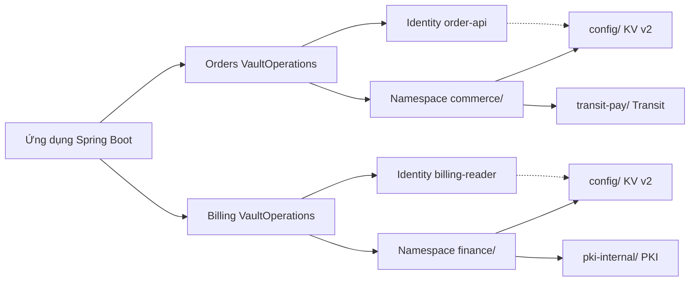

# Quản lý nhiều danh tính, namespace và mount trong cùng ứng dụng

Một ứng dụng Java sử dụng **Spring Vault** đôi khi phải truy cập nhiều miền dữ liệu: đọc cấu hình của dịch vụ đơn hàng, nhận thông tin kết nối của hệ thống thanh toán, gọi Transit để mã hóa dữ liệu và lấy chứng chỉ từ PKI. Những thao tác này có thể nằm trong **nhiều namespace, nhiều secrets engine mount** và được thực hiện dưới **những danh tính Vault khác nhau**. Nếu ứng dụng chỉ dùng một `VaultTemplate` và một token quá rộng quyền, lỗi chọn đường dẫn hoặc nhầm tenant có thể khiến bí mật của một miền bị dùng ở miền khác.

Bài thuộc chương **Tích hợp ứng dụng** của module `SPRING_VAULT`. Nội dung hướng dẫn phân biệt ba chiều **identity – namespace – mount**, thiết kế các client có phạm vi rõ ràng, gọi KV/Transit/PKI qua `VaultTemplate`, quản lý token/lease, kiểm thử phân quyền và vận hành an toàn. Namespace trong ví dụ là tính năng của **Vault Enterprise hoặc HCP Vault Dedicated**; nếu dùng Vault Community, vẫn có thể áp dụng cách phân tách danh tính và mount trong một namespace sẵn có.

## 1. Ba chiều cấu hình không thể thay thế cho nhau

| Thành phần | Câu hỏi nó trả lời | Ví dụ | Rủi ro nếu cấu hình sai |
| --- | --- | --- | --- |
| **Danh tính / token** | Ai đang gọi Vault và được phép làm gì? | Workload `order-api`, role `billing-reader` | Cấp quyền quá rộng, dùng nhầm token hoặc không thu hồi được đúng phiên. |
| **Namespace** | Request được xử lý trong miền Vault nào? | `commerce/`, `finance/` | Đọc sai miền, login sai auth mount, hoặc thất bại dù path đúng. |
| **Mount path** | API thuộc secrets engine hoặc auth method nào? | `config/` (KV v2), `transit-pay/` (Transit), `auth/kubernetes/` | Gọi nhầm backend, nhầm KV v1/v2, áp policy sai path. |
| **Endpoint** | Kết nối tới Vault cluster nào? | `https://vault.example.internal:8200` | Chạy nhầm môi trường, lỗi TLS hoặc mất kết nối. |

**Một request thực tế có ít nhất bốn tọa độ:** endpoint + namespace + token/danh tính + đường dẫn API. Ví dụ:

```text
Endpoint:    https://vault.example.internal:8200
Namespace:   commerce/
Identity:    order-api (Kubernetes auth → Vault token)
API path:    config/data/app/runtime
Method:      GET
```

Một request khác trong cùng tiến trình:

```text
Endpoint:    https://vault.example.internal:8200
Namespace:   finance/
Identity:    billing-reader (AppRole auth → Vault token)
API path:    config/data/app/runtime
Method:      GET
```

Dù `config/data/app/runtime` giống hệt nhau, **namespace và token khác nhau** nên kết quả truy cập và chính sách cũng khác nhau.



Sơ đồ thể hiện **phạm vi logic**, không khẳng định mỗi backend cần một kết nối TCP riêng. Nhiều client có thể cùng gọi một Vault cluster và dùng chung hạ tầng HTTP được cấu hình bảo mật, nhưng **token, namespace và lifecycle session không được lẫn nhau**.

## 2. Khi nào cần nhiều danh tính Vault?

Một ứng dụng có nhiều chức năng chưa chắc cần nhiều token. Có hai hướng thiết kế:

| Thiết kế | Phù hợp khi | Điểm cần cân nhắc |
| --- | --- | --- |
| **Một workload identity, policy tối thiểu** | Cùng một trust boundary, cùng vòng đời, cần quyền trên vài mount | Đơn giản hơn; phạm vi thiệt hại bằng tổng quyền đã cấp cho workload. |
| **Nhiều identity/session riêng** | Cần phân tách quyền giữa chức năng, tài khoản hoặc namespace; login và TTL khác nhau | Phức tạp hơn; mọi identity đều tồn tại trong cùng tiến trình nếu không tách service. |
| **Tách thành nhiều service/process** | Miền dữ liệu có yêu cầu cô lập mạnh hoặc trách nhiệm vận hành khác biệt | Phân ranh tốt hơn; có thêm chi phí giao tiếp và triển khai. |

**Nhiều bean `VaultTemplate` không tự tạo ra ranh giới bảo mật ở cấp tiến trình.** Nếu một process bị chiếm quyền chạy mã, các token đã nạp trong process có thể bị lạm dụng. Khi hai miền có ràng buộc tin cậy nghiêm ngặt, nên tách thành hai workload với service account riêng thay vì chỉ tạo hai bean.

Với nhiều danh tính trong một ứng dụng, cần làm rõ:

1. Identity nào được khởi tạo bằng AppRole/Kubernetes/IAM hoặc phương thức workload tương đương?
2. Token của identity đó gắn với namespace nào, có policy nào và TTL/renewal ra sao?
3. Có cho phép một identity gọi API ở namespace cha/con hoặc cross-namespace theo cơ chế được quản trị cho phép hay không?
4. Ai quyết định sử dụng identity nào cho một thao tác nghiệp vụ? Đây phải là logic server tin cậy, không lấy tùy ý từ tham số người dùng.
5. Nếu một identity bị thu hồi, các chức năng khác có tiếp tục hoạt động theo đúng quy tắc phụ thuộc hay không?

Danh tính cấp cho workload nên có quyền **nhỏ nhất đủ dùng**. Không dùng token `root`, token admin namespace hay token của người quản trị để đơn giản hóa ứng dụng.

## 3. Namespace: phạm vi cô lập của Vault Enterprise

Vault Enterprise namespaces cung cấp không gian logic riêng cho secrets engines, auth methods, ACL policies, identity entities/groups và tokens. Namespace được xác định bằng `X-Vault-Namespace` hoặc bằng đường dẫn API đủ điều kiện; khi dùng Spring Vault, nên chọn một quy tắc nhất quán cho client.

Ví dụ HTTP request đến một mount KV trong namespace `commerce/`:

```http
GET /v1/config/data/app/runtime HTTP/1.1
Host: vault.example.internal:8200
X-Vault-Namespace: commerce
X-Vault-Token: <token-of-order-api>
```

Với namespace `finance/`, đường dẫn API có thể giống hệt:

```http
GET /v1/config/data/app/runtime HTTP/1.1
Host: vault.example.internal:8200
X-Vault-Namespace: finance
X-Vault-Token: <token-of-billing-reader>
```

**Namespace không được suy ra tự động từ tên mount** `config`. Header hoặc full path quyết định nơi Vault định tuyến request. Khi có nested namespace, ví dụ `organization/commerce`, cần cung cấp đường dẫn namespace đầy đủ tương ứng với listener và chính sách triển khai.

Các lưu ý thực tế:

- **Vault Community** không cung cấp Enterprise namespaces; đừng cấu hình header namespace rồi kỳ vọng có cô lập tenant như Enterprise.
- Với **HCP Vault Dedicated**, namespace quản trị trên cùng thường là `admin`, nên đường dẫn thực tế có thể là `admin/commerce`; không mặc định mọi cụm có top-level `root` giống Vault Enterprise tự quản.
- Bên gọi phải có token/danh tính được cho phép trong ngữ cảnh namespace tương ứng. Cấu hình header đúng **không tự cấp quyền**.
- Namespace có thể có auth mount `auth/kubernetes/` hoặc `auth/approle/` riêng; việc login cũng cần diễn ra ở đúng ngữ cảnh, không chỉ các request đọc secret sau khi đã login.
- Một số endpoint `sys/` có giới hạn namespace, đặc biệt endpoint quản trị cấp cụm. Không dùng token ứng dụng để thử các thao tác quản trị đó.

### Dùng CLI để kiểm chứng ngữ cảnh

Giả sử namespace `commerce` và `finance` đã được tạo bởi đội vận hành, hai CLI session sử dụng danh tính thích hợp:

```bash
# Đọc metadata namespace/mount trên môi trường Enterprise test.
VAULT_NAMESPACE=commerce vault secrets list
VAULT_NAMESPACE=finance  vault secrets list

# Hai mount cùng tên config có thể chứa dữ liệu khác nhau.
VAULT_NAMESPACE=commerce vault kv get -mount=config app/runtime
VAULT_NAMESPACE=finance  vault kv get -mount=config app/runtime
```

Các lệnh sẽ thành công **chỉ khi** token CLI có quyền tương ứng với namespace và đường dẫn. Không dùng kết quả của root token để kết luận workload cũng đọc được. Nếu login qua CLI với từng identity, phải kiểm tra token gắn với namespace mà lệnh thực sự gửi đến.

## 4. Mount: auth mount khác secrets engine mount

Trong Vault, mount là đường dẫn đăng ký một backend. Hai nhóm dễ bị nhầm:

| Loại mount | Ví dụ | API điển hình | Dùng để |
| --- | --- | --- | --- |
| **Authentication** | `auth/kubernetes/`, `auth/approle-billing/` | `auth/kubernetes/login` | Xác thực workload, cấp Vault token. |
| **KV v1** | `legacy-config/` | `legacy-config/app/runtime` | Lưu key/value không versioned. |
| **KV v2** | `config/` | `config/data/app/runtime` | Quản lý các phiên bản secret; API đọc/ghi chứa `/data/`. |
| **Transit** | `transit-pay/` | `transit-pay/encrypt/orders` | Mã hóa/giải mã mà Vault giữ vật liệu khóa. |
| **PKI** | `pki-internal/` | `pki-internal/issue/order-service` | Cấp chứng chỉ từ role cấu hình. |
| **Database** | `db-creds/` | `db-creds/creds/report-reader` | Cấp credential động kèm lease. |

Một tổ chức có thể dùng `config/` ở **hai namespace**, và `transit-pay/` trong một namespace. Cũng có thể có `config/` và `config-secondary/` trong cùng namespace; **mỗi mount là một backend logic độc lập**.

Đặc biệt với KV v2:

```text
CLI:       vault kv get -mount=config app/runtime
HTTP GET:  /v1/config/data/app/runtime
Vault ACL: path "config/data/app/runtime" { capabilities = ["read"] }
```

Khi dùng `opsForKeyValue("config", KeyValueBackend.KV_2)`, Spring Vault tự xử lý prefix `/data/` của KV v2. **Không truyền** `"config/data/app/runtime"` vào `get(...)` vì thư viện sẽ ghép path theo mount và API version.

### Policy gắn với namespace và mount

Ví dụ policy dành cho identity `order-api` trong **namespace `commerce`**:

```hcl
# Đọc duy nhất cấu hình của dịch vụ đơn hàng.
path "config/data/app/runtime" {
  capabilities = ["read"]
}

# Mã hóa dữ liệu bằng Transit; không có quyền quản trị khóa.
path "transit-pay/encrypt/orders" {
  capabilities = ["update"]
}
```

Policy của `billing-reader` trong **namespace `finance`**:

```hcl
path "config/data/app/runtime" {
  capabilities = ["read"]
}

path "db-creds/creds/report-reader" {
  capabilities = ["read"]
}
```

Các đoạn HCL có thể chứa **cùng đường dẫn tương đối** nhưng thuộc hai namespace khác nhau. Chính sách thực tế cần được viết và gắn trong namespace đúng (hoặc theo mô hình chính sách cấp cha được quản trị cho phép). Không dùng wildcard kiểu `config/*` hoặc `secret/*` chỉ để giảm công định nghĩa.

## 5. Ánh xạ chức năng ứng dụng sang ngữ cảnh Vault

Trước khi viết code, tạo bảng ánh xạ chỉ gồm giá trị cấu hình đáng tin cậy:

| Chức năng | Vault namespace | Workload identity | Mount | Quyền được dùng |
| --- | --- | --- | --- | --- |
| Đọc cấu hình đơn hàng | `commerce` | `order-api` | `config` (KV v2) | `read config/data/app/runtime` |
| Mã hóa tham chiếu đơn hàng | `commerce` | `order-api` | `transit-pay` | `update transit-pay/encrypt/orders` |
| Đọc cấu hình báo cáo | `finance` | `billing-reader` | `config` (KV v2) | `read config/data/app/runtime` |
| Lấy credential DB báo cáo | `finance` | `billing-reader` | `db-creds` | `read db-creds/creds/report-reader` |

Từ bảng này, một thao tác nghiệp vụ có thể chọn **ngữ cảnh cố định**: `orderService.readConfig()` dùng `ordersVault`, `billingService.readConfig()` dùng `billingVault`. Nếu sau này mở rộng tenant theo cơ chế động, cần registry được cấp phát và kiểm soát thay vì ghép namespace/mount từ request tùy ý.

Việc chọn ngữ cảnh là **quyết định do server kiểm soát**. Người dùng không được gửi `"namespace": "finance"` để buộc ứng dụng dùng token của `billing-reader` nếu họ chỉ được quyền xem đơn hàng.

## 6. Tạo hai `VaultTemplate` độc lập trong Spring Vault 4.1

Ví dụ dưới đây sử dụng **Spring Vault 4.1+** với `VaultClient.builder().defaultNamespace(...)` và `VaultTemplate(VaultClient, ClientAuthentication)`. Để minh họa ngắn gọn, mỗi danh tính dùng **token thử nghiệm được cung cấp từ bên ngoài**. Trong hệ thống thật, hãy thay bằng AppRole/Kubernetes/IAM authentication theo workload và cấu hình session manager phù hợp.

```java
import java.net.URI;

import org.springframework.beans.factory.annotation.Qualifier;
import org.springframework.beans.factory.annotation.Value;
import org.springframework.context.annotation.Bean;
import org.springframework.context.annotation.Configuration;
import org.springframework.vault.authentication.TokenAuthentication;
import org.springframework.vault.client.VaultClient;
import org.springframework.vault.client.VaultEndpoint;
import org.springframework.vault.core.VaultOperations;
import org.springframework.vault.core.VaultTemplate;

@Configuration
public class MultiVaultClientsConfiguration {

    @Bean("ordersVault")
    VaultOperations ordersVault(
            @Value("${app.vault.endpoint}") URI uri,
            @Value("${app.vault.orders.namespace}") String namespace,
            @Value("${app.vault.orders.token}") String token) {
        return scopedTemplate(uri, namespace, token);
    }

    @Bean("billingVault")
    VaultOperations billingVault(
            @Value("${app.vault.endpoint}") URI uri,
            @Value("${app.vault.billing.namespace}") String namespace,
            @Value("${app.vault.billing.token}") String token) {
        return scopedTemplate(uri, namespace, token);
    }

    // Helper chỉ phục vụ ví dụ integration test với token có sẵn.
    private static VaultOperations scopedTemplate(
            URI uri, String namespace, String token) {

        if (namespace.isBlank() || token.isBlank()) {
            throw new IllegalArgumentException("Incomplete Vault context");
        }

        VaultClient client = VaultClient.builder()
                .endpoint(VaultEndpoint.from(uri))
                .defaultNamespace(namespace)
                .build();

        return new VaultTemplate(client, new TokenAuthentication(token));
    }
}
```

Cấu hình mẫu:

```yaml
app:
  vault:
    endpoint: ${VAULT_ADDR}
    orders:
      namespace: ${ORDERS_VAULT_NAMESPACE}
      token: ${ORDERS_VAULT_TOKEN}
    billing:
      namespace: ${BILLING_VAULT_NAMESPACE}
      token: ${BILLING_VAULT_TOKEN}
```

**Chỉ đặt các biến token này trong môi trường thử nghiệm hoặc secret source của môi trường chạy.** Không commit token hoặc đặt token thật trong `application.yml` của repository. Đây là mô hình minh họa để thấy rõ **hai identity và hai namespace**; ở production, việc dùng token tĩnh làm giảm khả năng rotation/renewal và có thể làm lộ credential.

Lợi ích của cấu hình trên:

1. Bean `ordersVault` luôn gửi `X-Vault-Namespace: commerce` với token được cấp cho identity `order-api`.
2. Bean `billingVault` luôn gửi `X-Vault-Namespace: finance` với token được cấp cho identity `billing-reader`.
3. Cả hai cùng endpoint nhưng **không chia sẻ cùng `SessionManager` hoặc token**.
4. `VaultClient` có thể tái sử dụng giữa các thread cho cùng scope; không sửa default namespace trong lúc xử lý request.

Lưu ý: `VaultClient`/builder API trên thuộc **Spring Vault 4.1+**. Nếu dự án đang dùng Spring Vault 3.x, cần dùng cơ chế tạo `RestTemplate`/client với namespace header của phiên bản đó, hoặc cấu hình Spring Cloud Vault cho **một default namespace**. Không sao chép thẳng API 4.1 vào dự án 3.x khi chưa đối chiếu phiên bản thực tế.

### Đọc KV v2 qua bean có tên rõ ràng

```java
import java.util.Map;
import org.springframework.beans.factory.annotation.Qualifier;
import org.springframework.stereotype.Service;
import org.springframework.vault.core.VaultKeyValueOperationsSupport.KeyValueBackend;
import org.springframework.vault.core.VaultOperations;
import org.springframework.vault.support.VaultResponse;

@Service
public class ApplicationSecretReaders {

    private final VaultOperations ordersVault;
    private final VaultOperations billingVault;

    public ApplicationSecretReaders(
            @Qualifier("ordersVault") VaultOperations ordersVault,
            @Qualifier("billingVault") VaultOperations billingVault) {
        this.ordersVault = ordersVault;
        this.billingVault = billingVault;
    }

    public String ordersDatabaseHost() {
        return readString(ordersVault, "config", "app/runtime", "db-host");
    }

    public String billingDatabaseHost() {
        return readString(billingVault, "config", "app/runtime", "db-host");
    }

    private static String readString(
            VaultOperations vault, String mount, String path, String field) {
        VaultResponse response = vault.opsForKeyValue(
                mount, KeyValueBackend.KV_2).get(path);
        if (response == null || response.getData() == null) {
            throw new IllegalStateException("Vault secret missing");
        }
        Object value = response.getData().get(field);
        if (!(value instanceof String) || ((String) value).isBlank()) {
            throw new IllegalStateException("Required secret field missing");
        }
        return (String) value;
    }
}
```

`get("app/runtime")` là **đường dẫn tương đối bên trong mount**. Cùng biểu thức Java nhưng khác `VaultOperations` sẽ đọc hai secret riêng vì namespace và token khác nhau. Khi nhận giá trị từ Vault, validate schema dữ liệu trước khi dùng, không log response hoặc trường chứa mật khẩu/API key.

Nếu cả hai loại dữ liệu nằm **trong cùng một namespace và identity**, có thể tái sử dụng cùng `VaultOperations` nhưng chọn mount khác qua `opsForKeyValue("config-a", KV_2)` và `opsForKeyValue("config-b", KV_2)`. Chỉ cần nhiều client khi phạm vi danh tính/namespace/lifecycle thực sự khác nhau.

## 7. Kết hợp nhiều secrets engine trong cùng namespace

Ví dụ một identity tại namespace `commerce` được dùng để đọc KV và gọi Transit qua hai mount riêng:

```java
import java.nio.charset.StandardCharsets;
import java.util.Base64;
import java.util.Map;

import org.springframework.beans.factory.annotation.Qualifier;
import org.springframework.stereotype.Service;
import org.springframework.vault.core.VaultOperations;
import org.springframework.vault.support.VaultResponse;

@Service
public class OrderReferenceEncryption {

    private final VaultOperations ordersVault;

    public OrderReferenceEncryption(
            @Qualifier("ordersVault") VaultOperations ordersVault) {
        this.ordersVault = ordersVault;
    }

    public String encryptReference(String reference) {
        String base64 = Base64.getEncoder().encodeToString(
                reference.getBytes(StandardCharsets.UTF_8));
        VaultResponse response = ordersVault.write(
                "transit-pay/encrypt/orders",
                Map.of("plaintext", base64));

        if (response == null || response.getData() == null
                || !(response.getData().get("ciphertext") instanceof String)) {
            throw new IllegalStateException("Transit returned no ciphertext");
        }
        return (String) response.getData().get("ciphertext");
    }
}
```

Cần phân biệt rõ **mount path** và **key name**: trong `transit-pay/encrypt/orders`, `transit-pay` là mount, `orders` là tên key. Tương tự, `pki-internal/issue/order-service` gồm mount `pki-internal` và role `order-service`. Không đặt tên key, role hoặc mount tùy ý từ input client chưa qua danh sách cho phép.

Spring Vault có typed API để giảm việc tự nối path (`opsForTransit("transit-pay")`, `opsForPki("pki-internal")`, `opsForKeyValue("config", KV_2)`). Ví dụ `write` trực tiếp ở trên chủ ý làm rõ request HTTP tương ứng. Transit nhận plaintext dạng Base64 và Vault giữ vật liệu khóa; bí mật nghiệp vụ vẫn phải được bảo vệ trong bộ nhớ và trong log.

## 8. Quản lý `ClientAuthentication` và vòng đời token cho từng scope

Ví dụ token tĩnh ở mục 6 chỉ thích hợp làm **test fixture**. Với workload thật, mỗi scope nên có chiến lược xác thực và quản lý token riêng:

- **Kubernetes auth:** ràng buộc role với service account, namespace Kubernetes và audience phù hợp. Kubernetes namespace **không phải** Vault Enterprise namespace.
- **AppRole:** dành cho workload có quy trình cấp RoleID/SecretID; bảo vệ SecretID, có thể dùng response wrapping để bàn giao.
- **Cloud IAM/AWS/GCP/Azure:** tận dụng danh tính được cấp bởi nền tảng, giảm nhu cầu phân phát token Vault có sẵn.
- **Vault Agent:** có thể xử lý authentication/token refresh cho workload, nhưng phải đánh giá mô hình agent khi một process cần hai identity khác nhau.

Spring Vault có `ClientAuthentication` và `SessionManager`. Với token renewable, `LifecycleAwareSessionManager` có thể gia hạn token; khi không thể gia hạn, cần quy trình login lại. **Mỗi identity phải có session lifecycle riêng** để tránh một token được tái sử dụng cho nhiều namespace/role. Không dùng chung một biến toàn cục kiểu `currentVaultToken` rồi thay đổi nó theo request.

Khi một AppRole/k8s auth mount nằm trong namespace khác, **login request cũng phải dùng namespace và auth path đúng**, trước khi VaultTemplate sử dụng token mới cấp cho các request tiếp theo. Với `VaultClient.builder().defaultNamespace(...)`, namespace mặc định áp dụng cho request đi qua client được tạo. Nếu authentication implementation tạo HTTP client riêng, phải cấu hình cùng namespace cho kênh login, không giả định mọi implementation kế thừa header từ `VaultTemplate`.

**Lease động** từ database/PKI cũng cần theo dõi phạm vi: `lease_id`, namespace, danh tính và mount phát hành. Nếu dùng `SecretLeaseContainer` hoặc bộ phận tự quản lý lease, nên sở hữu instance/lifecycle theo scope, tránh renew/revoke nhầm lease của namespace khác. Khóa quản lý cache có thể là tổ hợp `(endpoint, namespace, identity, mount, path)` thay vì chỉ `path`.

## 9. Router ngữ cảnh: khóa chặt quyền chọn identity

Một thiết kế gây rủi ro là controller nhận trực tiếp:

```java
// Không sử dụng cách này:
// clientSuppliedNamespace + clientSuppliedMount + clientSuppliedKey
//   → chọn một token quyền cao rồi gọi Vault.
```

Người dùng có thể sửa `namespace` hoặc `mount` để ứng dụng trở thành *confused deputy*: ứng dụng có quyền đọc nhiều miền, rồi thực hiện một thao tác trái phép thay mặt người gọi ít quyền.

Một cách an toàn hơn là lập bản đồ nghiệp vụ với các giá trị cố định:

Dùng enum hoặc registry chỉ có scope được provision trước; vẫn phải kiểm tra quyền của principal trước khi dùng scope đó.

Với mô hình đa tenant số lượng lớn, một registry có thể ánh xạ **tenant đã xác thực** sang context Vault đã provisioned. Registry cần có danh sách cho phép, vòng đời cập nhật, audit và giới hạn số client/session được tạo. Tránh tạo một `VaultTemplate` mới cho từng request vì sẽ gây bùng nổ session, socket, token và tác vụ renewal.

## 10. Spring Cloud Vault và nhiều namespace: giới hạn của cấu hình mặc định

Nếu sử dụng **Spring Cloud Vault Config** để tải `PropertySource` khi ứng dụng khởi động, tùy chọn:

```yaml
spring:
  cloud:
    vault:
      namespace: commerce
```

sẽ cấu hình header `X-Vault-Namespace` cho các request được Spring Cloud Vault quản lý trong **ngữ cảnh mặc định**. Điều này phù hợp khi một ứng dụng dùng **một** namespace chính.

Để vừa tải cấu hình ở `commerce`, vừa đọc tài nguyên runtime ở `finance`, cần thiết kế **client runtime thứ hai** với namespace/auth riêng như phần 6, hoặc tách dịch vụ nếu chính sách yêu cầu. Đừng giả định chỉ khai báo hai khóa `spring.cloud.vault.namespace` hoặc thay property này trong lúc chạy sẽ tự sinh hai phiên xác thực độc lập.

Spring Cloud Vault hỗ trợ nhiều secret backend/mount cho cấu hình, nhưng đó vẫn là vấn đề khác với nhiều identity. Mỗi backend mount được đọc bằng danh tính mà Spring Cloud Vault sử dụng; thêm backend **không tạo một workload identity mới**.

## 11. Bảng lỗi phổ biến và cách xác minh

| Triệu chứng | Kiểm tra | Cách xử lý |
| --- | --- | --- |
| 403 trên KV/Transit | Token, policy, method và namespace đúng chưa? | Thu hẹp/sửa ACL tại scope phù hợp; không thêm quyền wildcard. |
| 404 dù secret tồn tại | Có nhầm namespace, mount, KV v1/v2 hoặc path? | Đối chiếu API path và metadata mount. |
| Login bị từ chối | Auth mount, role và namespace của **request login**? | Sửa kênh authentication tương ứng, không đổi token scope khác. |
| Token/lease hết hạn | SessionManager riêng còn renew/re-login được không? | Theo dõi lifecycle và thu hồi đúng scope. |
| Một client đọc dữ liệu miền khác | Có token quyền rộng hoặc router cho client chọn scope? | Giới hạn ACL, sửa quyền nghiệp vụ và thử lại bằng workload token. |
| Timeout/5xx | Mạng, Vault cluster hay proxy? | Retry có giới hạn; không nhầm với lỗi quyền. |

Đặt alias scope trong log và trace, không ghi token hoặc nội dung secret. Khi kiểm thử truy cập chéo, phải có positive control cho cả hai identity để tránh coi lỗi mạng/auth là bằng chứng cách ly.

## 12. Kiểm thử tích hợp bằng Vault thật

Với Vault Enterprise/HCP test có namespace `commerce`, `finance`, hai identity và KV mount `config` ở mỗi miền, tạo dữ liệu **giả** khác nhau:

```bash
VAULT_NAMESPACE=commerce vault kv put -mount=config app/runtime \
  db-host=orders-db.test

VAULT_NAMESPACE=finance vault kv put -mount=config app/runtime \
  db-host=billing-db.test
```

Sau đó dùng **token của từng workload**, không dùng token quản trị, chạy ma trận:

| Mã test | Hành động | Kỳ vọng |
| --- | --- | --- |
| M01 | `ordersVault` đọc `config/app/runtime` | Nhận `orders-db.test`. |
| M02 | `billingVault` đọc cùng path | Nhận `billing-db.test`. |
| M03 | `ordersVault` đọc path bị cấm trong `commerce` | Bị từ chối quyền; không nhận secret. |
| M04 | Dùng token orders để gọi namespace `finance` | Bị từ chối theo policy/namespace setup; tuyệt đối không nhận dữ liệu finance. |
| M05 | Gọi KV v2 bằng raw path thiếu `/data/` | Thất bại hoặc khác endpoint mong đợi; không coi là lỗi Vault toàn cục. |
| M06 | Dùng đúng `ordersVault` nhưng sai Transit mount | Thất bại có phân loại rõ. |
| M07 | Thu hồi hoặc hết hạn token billing | Orders vẫn hoạt động; billing báo lỗi đúng scope. |
| M08 | Làm mất kết nối Vault cho một client | Không ghi đè token/namespace của client còn lại. |
| M09 | Khởi động lại ứng dụng | Hai client nhận đúng token/session và namespace trước khi dùng. |
| M10 | Principal thiếu quyền chọn BILLING_CONFIG | Ứng dụng từ chối **trước** khi gọi Vault. |
| M11 | Mount `config` ở hai namespace cùng tên | Không trộn cache, path, dữ liệu hoặc audit. |
| M12 | Lease động được cấp và revoke đúng scope | Không renew/revoke nhầm lease của miền khác. |

Một JUnit 5 integration test đơn giản, giả sử các bean đã được cấu hình như mục 6 và dữ liệu giả đã được chuẩn bị:

```java
import static org.junit.jupiter.api.Assertions.*;

import org.junit.jupiter.api.Test;
import org.springframework.beans.factory.annotation.Autowired;
import org.springframework.boot.test.context.SpringBootTest;

@SpringBootTest
class MultiVaultScopeIntegrationTest {

    @Autowired
    ApplicationSecretReaders readers;

    @Test
    void sameMountAndPathInDifferentNamespacesStayIndependent() {
        assertEquals("orders-db.test", readers.ordersDatabaseHost());
        assertEquals("billing-db.test", readers.billingDatabaseHost());
        assertNotEquals(
                readers.ordersDatabaseHost(),
                readers.billingDatabaseHost());
    }
}
```

Test trên **chưa đủ** để chứng minh ACL từ chối truy cập chéo; cần bổ sung test âm bằng token orders trên namespace finance, đồng thời dùng positive control riêng cho finance. Nếu request âm ném exception vì timeout/403 do auth sai/cluster down, không được báo pass cho đặc tính cô lập namespace.

Với **Vault Community**, thực hiện các bài test **nhiều mount/nhiều danh tính trong cùng namespace** và bỏ các test yêu cầu Enterprise namespaces. Không giả lập namespace bằng cách thêm chuỗi `"finance/"` vào secret path rồi kết luận đã kiểm thử isolation của Vault Enterprise.

## 13. Quan sát, vận hành và chiến lược thay đổi

Theo dõi login/renewal, TTL token và lease, latency, lỗi 403/404 theo `scope_alias` và backend. Dùng nhãn không nhạy cảm; không ghi token, SecretID, plaintext hay ciphertext.

Khi chuyển sang namespace/mount mới, provision auth role và ACL trước, kiểm thử bằng token workload, chuyển dữ liệu theo backend, rồi cập nhật mapping cố định. Thu hồi quyền cũ sau xác minh. **Không fallback âm thầm** về namespace cũ vì sẽ che giấu lỗi migration hoặc phá vỡ phân quyền.

## 14. Ghi nhớ

- **Identity** quyết định quyền; **namespace** định vị miền logic; **mount** định vị backend.
- Dùng `VaultTemplate`/session riêng theo scope; kiểm tra quyền ở ứng dụng và Vault ACL.
- KV v2 có prefix HTTP `/data/`; `opsForKeyValue("config", KV_2)` tự xử lý prefix. Namespace thực sự cần Vault Enterprise/HCP Dedicated.
- Kiểm thử truy cập chéo bằng workload token và quản lý vòng đời token/lease.

## Tài liệu tham khảo

- HashiCorp Vault — [Namespaces](https://developer.hashicorp.com/vault/docs/enterprise/namespaces) và [Best practices for namespaces and mount paths](https://developer.hashicorp.com/vault/docs/enterprise/namespaces/namespace-structure).
- HashiCorp Vault — [HTTP API](https://developer.hashicorp.com/vault/api-docs), [KV v2 API](https://developer.hashicorp.com/vault/api-docs/secret/kv/kv-v2) và [Policies](https://developer.hashicorp.com/vault/docs/concepts/policies).
- Spring Vault — [Vault Client Access](https://docs.spring.io/spring-vault/reference/vault/vault-client.html), [VaultTemplate API](https://docs.spring.io/spring-vault/reference/api/java/org/springframework/vault/core/VaultTemplate.html) và [Authentication Methods](https://docs.spring.io/spring-vault/reference/vault/authentication.html).
- Spring Cloud Vault — [Enterprise namespace configuration](https://docs.spring.io/spring-cloud-vault/docs/current/reference/html/index.html#vault.enterprise-namespace-support).
