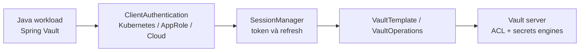
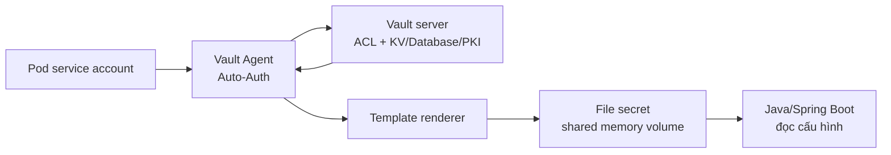
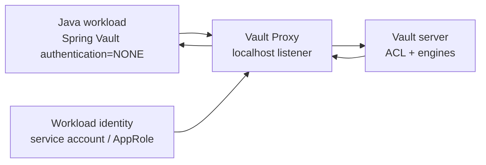
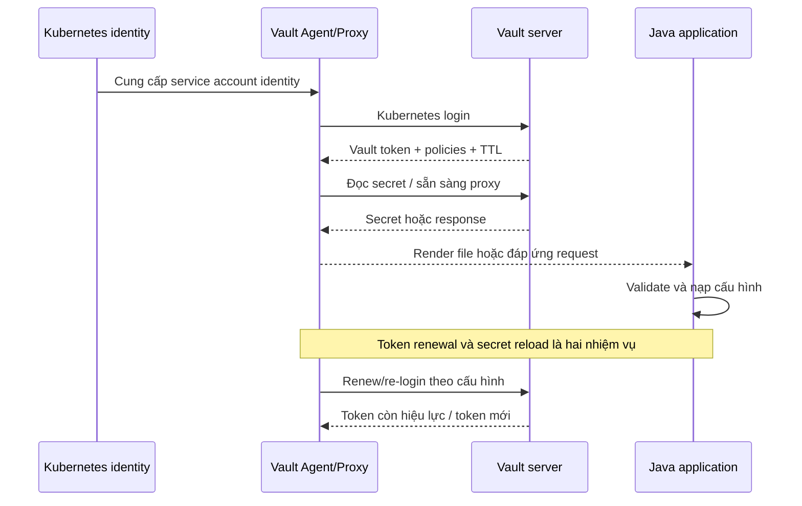

# Vault Agent và việc phân chia trách nhiệm xác thực

**Chương:** Tích hợp ứng dụng  
**Module:** SPRING_VAULT

## 1. Vấn đề tích hợp: ứng dụng hay hạ tầng sẽ đăng nhập Vault?

Khi một ứng dụng Java cần đọc API key từ KV, lấy thông tin đăng nhập database động, mã hóa qua Transit hoặc cấp chứng thư PKI, hệ thống phải trả lời hai câu hỏi khác nhau:

1. **Ai xác thực với HashiCorp Vault, giữ và làm mới Vault token?**
2. **Ai lấy, tiêu thụ và làm mới secret hoặc áp dụng kết quả của một thao tác Vault cho ứng dụng?**

Trong **Spring Vault**, `VaultTemplate` và `VaultOperations` thường truy cập Vault qua phiên đã xác thực bằng `ClientAuthentication` và `SessionManager`. Với **Vault Agent**, một tiến trình đi kèm workload có thể thực hiện **Auto-Auth**, nhận/renew token rồi **render secret thành file**, hoặc cung cấp token cho một client khác. Một mô hình thứ ba dùng **Vault Proxy** (hoặc Agent API proxy trên hệ thống cũ) để ứng dụng gọi Vault HTTP API mà không tự gắn Vault token vào mỗi yêu cầu.

Các cơ chế này giải quyết những phần khác nhau trong hành trình lấy secret. Lựa chọn sai dễ dẫn đến hai nơi cùng quản lý token, token bị rò vào file/log, ứng dụng đọc secret đã hết hạn hoặc nhầm rằng cập nhật file sẽ tự khiến Spring Boot và connection pool nạp giá trị mới.

Bài học thuộc chương **Tích hợp ứng dụng** của SPRING_VAULT: sử dụng Spring Vault cho Java với xác thực theo workload và quyền Vault ACL, kết nối những kiến thức đã học về KV secrets, token/lease, Transit encryption, PKI, xử lý lỗi, giám sát và kiểm thử tích hợp.

**Sau bài học, bạn có thể:** phân biệt ba kiến trúc tích hợp; cấu hình Vault Agent Auto-Auth + template cho Kubernetes; xác định vai trò của Spring Vault khi Agent/Proxy phụ trách xác thực; xử lý token, secret TTL và việc reload an toàn; thiết kế policy và test đúng ranh giới trách nhiệm.

## 2. Vault Agent là gì và làm được những gì?

**Vault Agent** là tiến trình client chạy gần ứng dụng, thường trong cùng VM hoặc Pod, có thể kết nối Vault server bằng phương thức xác thực phù hợp. Agent có những khả năng quan trọng:

| Khả năng | Agent thực hiện | Ứng dụng còn chịu trách nhiệm |
| --- | --- | --- |
| **Auto-Auth** | Đọc bằng chứng danh tính của môi trường (Kubernetes service account JWT, AppRole...), đăng nhập Vault, duy trì token theo giới hạn | Chọn mô hình trust, không để process khác lợi dụng credential |
| **Token sink** | Ghi token mới nhận vào đích đã cấu hình, ví dụ file | Giới hạn quyền đọc, nhận biết token đổi và xử lý vòng đời nếu client trực tiếp dùng token |
| **Templating** | Gọi Vault theo token, điền secret vào template và ghi file; có cơ chế fetch/renew tùy loại secret | Đọc file đúng lúc, reload cấu hình/connection pool, bảo vệ secret sau khi được render |
| **Caching** | Cache các phản hồi/token/lease phù hợp theo cấu hình Agent | Không mặc định mọi secret hay mọi request đều được cache |
| **API proxy** | Khả năng proxy HTTP trong Vault Agent **đã bị deprecated** | Triển khai mới nên xem **Vault Proxy** cho chức năng proxy |
| **Process Supervisor** | Có thể chạy process con với secret được nạp theo cơ chế supervisor | Kiểm soát môi trường process, vòng đời và nguy cơ lộ secret qua environment |

**Vault Agent không phải Vault server**: Agent không sở hữu kho secret, không thay thế policy engine và không trao quyền ngoài những gì Vault cấp cho identity được xác thực. Auto-Auth tạo và quản lý **client token** theo cấu hình; secret động nhận được có **lease riêng**; PKI certificate có **NotAfter** riêng. Chúng là những vòng đời tách biệt.

Theo tài liệu hiện hành, chức năng **Vault Agent API proxy đã deprecated**; **Vault Proxy** là lựa chọn được HashiCorp khuyến nghị khi cần một proxy HTTP của Vault. Vì nhiều hệ thống đang chạy Agent API proxy, bài vẫn diễn giải mô hình này để nhận diện kiến trúc cũ, nhưng ví dụ proxy mới sẽ dùng cấu hình Vault Proxy.

## 3. Ba mô hình xác thực và phân chia trách nhiệm

### Mô hình A — Spring Vault trực tiếp xác thực và gọi Vault



Trong mô hình này, ứng dụng có **Spring Vault client** và tự quản lý chu kỳ login/đổi token qua hạ tầng Spring Vault. Nó cũng nhận dữ liệu PKI, Transit, KV hoặc thông tin lease trả về từ API. Nếu cần quản lý lease secret động, phải cấu hình thêm cơ chế quản lý lease hay logic tái cấp phù hợp, chẳng hạn `SecretLeaseContainer` trong ngữ cảnh Spring Vault/Spring Cloud Vault.

Ưu điểm: API typed, phân quyền rõ theo workload, ít thành phần runtime hơn. Chi phí: ứng dụng cần cấu hình auth/TLS và xử lý phụ thuộc Vault ngay tại startup hoặc runtime.

### Mô hình B — Vault Agent Auto-Auth và render file, Java đọc file



Agent chịu trách nhiệm **xác thực** và **lấy/render** các secret đã cấu hình. Ứng dụng có thể **không cần thư viện Spring Vault** nếu chỉ tiêu thụ file. Điều này hữu ích với ứng dụng legacy, thư viện không hỗ trợ Vault hoặc trường hợp cấu hình kết nối có thể nạp từ file.

Tuy nhiên, nếu Agent ghi phiên bản mới của file sau khi secret thay đổi, **JVM không tự thay đổi bean, HikariCP DataSource, SSLContext hoặc connection pool** chỉ vì file đã đổi. Ứng dụng phải có cơ chế nạp lại hoặc được khởi động/rollout theo kế hoạch.

### Mô hình C — Ứng dụng dùng Spring Vault qua Vault Proxy



Proxy thực hiện **Auto-Auth** và có thể gắn token được quản lý vào các request đi lên Vault. Ứng dụng vẫn gọi `VaultOperations` / `VaultTemplate` để làm việc với KV, Transit, PKI... nhưng không tự login hoặc quản lý `X-Vault-Token`.

Trong Spring Cloud Vault, `spring.cloud.vault.authentication: NONE` dành cho mô hình gọi thông qua Agent/Proxy đã xác thực. Để nó hoạt động, **listener thực sự phải được cấu hình** sử dụng auto-auth token cho request không có `X-Vault-Token`; chỉ đổi cấu hình Spring là chưa đủ. Khi dùng Vault Agent API proxy trên hệ cũ, cần đối chiếu tùy chọn của phiên bản Agent đang chạy và kế hoạch chuyển sang Vault Proxy.

### So sánh nhanh

| Câu hỏi | Spring Vault trực tiếp | Agent render file | Spring Vault qua Vault Proxy |
| --- | --- | --- | --- |
| Ai login và renew client token? | Spring Vault client/SessionManager | Agent Auto-Auth | Proxy Auto-Auth |
| Ứng dụng cần Vault token? | Client Spring Vault có token trong session | Không, nếu chỉ đọc file | Không, khi proxy cấu hình dùng auto-auth token |
| Ứng dụng cần kết nối HTTP đến Vault API? | Có | Không, nếu chỉ dùng file đã render | Có, nhưng qua listener của proxy |
| Ai ánh xạ API KV/Transit/PKI? | Spring Vault | Agent template hoặc hạ tầng cung cấp secret | Spring Vault |
| Ai cập nhật DataSource/SSLContext khi secret đổi? | Ứng dụng/hệ lease integration | Ứng dụng/hệ quản lý reload | Ứng dụng/hệ lease integration |
| Thành phần runtime phụ trợ | Không bắt buộc | Agent | Vault Proxy |
| Trường hợp phù hợp | Java cần API Vault nhiều và trực tiếp | Ứng dụng chỉ cần config/file | Java cần API Vault nhưng muốn giao xác thực cho proxy |

## 4. Phân biệt authentication, authorization, token và secret lifecycle

| Khái niệm | Điều được quản lý | Tác nhân thường chịu trách nhiệm |
| --- | --- | --- |
| **Workload identity** | Service account, AppRole RoleID/SecretID, cloud IAM credentials | Nền tảng chạy ứng dụng + thiết lập bảo mật |
| **Vault authentication** | Đổi identity thành Vault client token | Spring Vault **hoặc** Agent/Proxy tùy kiến trúc |
| **Vault token** | TTL, renew, re-login, revoke theo policy | SessionManager hoặc Auto-Auth; tránh quản lý chồng lấn |
| **Vault ACL** | Quyền trên API path: `read`, `update`, `list`... | Vault server, do operator cấu hình |
| **Secret lease** | TTL/renew/revoke của credential động | Engine/Vault; Agent template/cache hoặc thành phần lease của ứng dụng theo cấu hình |
| **Secret consumption** | Đưa giá trị vào DataSource, client TLS, config | Ứng dụng và framework |
| **Secret reload** | Thay credential đang sử dụng, mở lại kết nối | Ứng dụng/hạ tầng rollout; Agent chỉ cập nhật nguồn secret |
| **Audit/monitoring** | Truy cập, lỗi auth, latency, certificate expiry | Vault audit, Agent/Proxy metrics, application observability |

**Ba sai lầm cần tránh:**

- **Token được renew không có nghĩa password DB được renew.** Database credentials thường có lease riêng; việc thay password trong file cũng không khiến pool cũ tự động đổi phiên đăng nhập.
- **Agent Auto-Auth không làm ACL rộng hơn.** Token nhận từ Vault mang policies của identity/role; workload chỉ được truy cập path đã cấp.
- **Agent template không bảo đảm reload ở JVM.** Nội dung file mới và object cấu hình runtime là hai trạng thái khác nhau.

## 5. Ví dụ Kubernetes: Agent Auto-Auth với service account

Giả sử ứng dụng `orders-api` chạy trong Kubernetes, cần lấy `db.password` từ KV v2 mount `secret`, path logic `apps/orders`. Operator chuẩn bị:

- Kubernetes auth method trên Vault, liên kết role `orders-api` với **service account** `orders-api` trong namespace `payments`.
- Vault policy chỉ cấp quyền `read` cho `secret/data/apps/orders`.
- Vault Agent Injector đã được triển khai và kết nối Vault bằng TLS hợp lệ.
- Pod chỉ được đọc secret của chính workload.

Ví dụ Vault policy tối thiểu:

```hcl
path "secret/data/apps/orders" {
  capabilities = ["read"]
}
```

Cấu hình Kubernetes deployment thu gọn, chỉ nhấn mạnh annotation và pod identity:

```yaml
apiVersion: apps/v1
kind: Deployment
metadata:
  name: orders-api
  namespace: payments
spec:
  replicas: 1
  selector:
    matchLabels:
      app: orders-api
  template:
    metadata:
      labels:
        app: orders-api
      annotations:
        vault.hashicorp.com/agent-inject: "true"
        vault.hashicorp.com/role: "orders-api"
        vault.hashicorp.com/agent-inject-secret-db-password: "secret/data/apps/orders"
        vault.hashicorp.com/agent-inject-template-db-password: |
          {{- with secret "secret/data/apps/orders" -}}
          {{ .Data.data.db_password }}
          {{- end -}}
    spec:
      serviceAccountName: orders-api
      containers:
        - name: orders-api
          image: registry.example.internal/orders-api:1.0.0
          # Các cấu hình port, resources và securityContext được lược bỏ.
```

**Phân tích cấu hình:**

1. `agent-inject: "true"` yêu cầu webhook injector thêm Agent và volume chứa file.
2. `role: "orders-api"` là **Vault Kubernetes auth role** dùng để login; không phải PKI role hay tên service account bắt buộc giống nhau.
3. `agent-inject-secret-db-password` trỏ đến **API path KV v2** `secret/data/apps/orders`, không phải `secret/apps/orders` của KV v1.
4. Template đọc `.Data.data.db_password` vì phản hồi KV v2 có hai lớp `data`.
5. File kết quả mặc định nằm dưới `/vault/secrets/db-password`. Tên file là hậu tố annotation; có thể đổi bằng `agent-inject-file-*`.
6. Init Agent có thể render ban đầu trước khi ứng dụng chạy; sidecar Agent có thể cập nhật file khi ứng dụng tiếp tục hoạt động, tùy cấu hình injector. Không tự coi mọi Pod đều có sidecar, vì có các chế độ chỉ dùng init.
7. File/volume phải có quyền thích hợp để UID/GID của Java container đọc được. Dùng `runAsUser`/`fsGroup`/permissions theo mô hình triển khai; đừng nới rộng quyền để giải quyết nhanh lỗi đọc file.

Injector thường dùng **volume chia sẻ ở bộ nhớ** cho dữ liệu render, giảm nguy cơ ghi xuống đĩa container, nhưng **không loại bỏ** rủi ro process khác trong cùng Pod đọc được volume, debug pod hoặc dump bộ nhớ. TLS đến Vault cũng phải được xác minh CA; không bật `tls-skip-verify` trong production.

### HCL tương đương khi không dùng Injector

Một Vault Agent chạy độc lập cũng có thể tự đăng nhập Kubernetes và render file. Ví dụ sau minh họa cấu trúc cốt lõi (path CA/volume là giả định của môi trường):

```hcl
vault {
  address = "https://vault.internal.example:8200"
  ca_cert = "/etc/vault/ca.pem"
}

auto_auth {
  method "kubernetes" {
    mount_path = "auth/kubernetes"
    config = {
      role = "orders-api"
      token_path = "/var/run/secrets/kubernetes.io/serviceaccount/token"
    }
  }
}

template {
  contents = <<EOT
{{- with secret "secret/data/apps/orders" -}}
{{ .Data.data.db_password }}
{{- end -}}
EOT
  destination = "/run/secrets/db-password"
  perms = "0400"
  error_on_missing_key = true
}
```

Trong **chế độ chỉ render template**, không nhất thiết cần token sink: Agent có thể dùng token Auto-Auth nội bộ để lấy secret và tạo file. Khi thật sự muốn chuyển token cho ứng dụng khác, cấu hình `sink "file"` nhưng token trong file là credential cực kỳ nhạy cảm và việc đọc lại token sau thay đổi phải được thiết kế rõ.

Ví dụ chạy Agent đọc cấu hình `agent.hcl` do operator phân phối:

```bash
vault agent -config=/etc/vault/agent.hcl
```

Chỉ định cùng role và path với Kubernetes auth đã cấu hình; không đưa service account JWT vào HCL hoặc Git. Thiết lập quyền trên `/run/secrets` và xem xét chạy Agent dưới identity process thích hợp để file có owner phù hợp.

## 6. Java đọc file secret: đâu là ranh giới của Agent?

Với template ở trên, Java có thể đọc `/vault/secrets/db-password` mà không gọi Vault HTTP API. Ví dụ Spring component:

```java
import java.io.IOException;
import java.nio.charset.StandardCharsets;
import java.nio.file.Files;
import java.nio.file.Path;

import org.springframework.stereotype.Component;

@Component
public class DatabasePasswordSource {

    private static final Path PASSWORD_FILE =
        Path.of("/vault/secrets/db-password");

    public String currentPassword() {
        try {
            String password =
                Files.readString(PASSWORD_FILE, StandardCharsets.UTF_8);

            if (password.isEmpty()) {
                throw new IllegalStateException(
                    "Rendered database password is empty");
            }

            // Nội dung là secret; không log, không đưa vào exception.
            return password;
        } catch (IOException ex) {
            throw new IllegalStateException(
                "Rendered database password is unavailable");
        }
    }
}
```

Lưu ý mã này **đọc một lần theo mỗi lời gọi** nhưng chỉ thực sự hữu ích nếu thành phần gọi nó có thể cập nhật kết nối. Khi tạo một `DataSource` ở startup, phần lớn connection pool **không tự gọi lại** `currentPassword()` khi file Agent thay đổi. Muốn luân chuyển password khi runtime, cần thêm cơ chế thay credential vào pool và tái tạo/evict connection cũ theo chính sách driver/pool. Nếu chỉ tải cấu hình lúc boot, có thể cần rolling restart workload khi Agent tạo file mới.

Template và dữ liệu file phải quy định rõ **newline/encoding**. Không dùng `trim()` để “sửa” password vì khoảng trắng có thể là thành phần hợp lệ của giá trị bí mật. Đoạn template minh họa dùng cú pháp loại bỏ khoảng trắng ở ranh giới template; khi dùng dữ liệu chứa newline hoặc cấu trúc phức tạp, nên chọn định dạng có escaping rõ ràng và parser tương ứng.

**Spring Boot config import** cũng có thể đọc file ở startup, ví dụ dùng `configtree` nếu file trong thư mục có tên khớp với property cần nạp. Tuy nhiên, việc import cấu hình **không tự bảo đảm cập nhật bean đang chạy** khi Agent ghi lại file. Cần thống nhất một cơ chế reload rõ ràng thay vì tin rằng hai công cụ tự đồng bộ.

### Cần động tác nào khi Agent cập nhật secret?

| Secret | Agent có thể cập nhật gì? | Ứng dụng cần làm gì thêm? |
| --- | --- | --- |
| KV v2 | Render lại giá trị theo lịch kiểm tra secret tĩnh | Reload config hoặc rolling restart nếu giá trị đã được snapshot lúc boot |
| Database dynamic credentials | Renew/fetch theo lease và render username/password mới | Thay credential trong pool, mở kết nối mới và đóng connection cũ |
| PKI cert/private key | Render cert/key/chain theo ngữ nghĩa backend và template | Cập nhật SSLContext, server certificate hoặc restart/reload listener |
| API key | Render giá trị mới từ Vault nếu dữ liệu thay đổi | Làm mới HTTP client/config, thu hồi key cũ theo hệ thống đích |
| Transit key | Thông thường **không cần render private encryption key** | Java gọi Transit API qua Spring Vault/proxy nếu cần cryptographic operation |

Agent không nên được dùng làm công cụ xuất khóa riêng Transit ra file chỉ vì ứng dụng cần mã hóa: mô hình an toàn thông thường là để khóa Transit ở Vault và gọi API mã hóa/giải mã qua quyền phù hợp.

## 7. Tích hợp Spring Cloud Vault với một proxy đã xác thực

Nếu Java vẫn cần `VaultOperations` để gọi KV, PKI, Transit hoặc engine khác, có thể để **Vault Proxy** duy trì Auto-Auth token rồi ứng dụng gửi API requests qua proxy.

### 7.1. Vault Proxy thực hiện Auto-Auth và gắn token

Cấu hình HCL minh họa của **Vault Proxy**, với listener chỉ mở trên loopback và dịch vụ Kubernetes có quyền phù hợp:

```hcl
vault {
  address = "https://vault.internal.example:8200"
  ca_cert = "/etc/vault/ca.pem"
}

auto_auth {
  method "kubernetes" {
    mount_path = "auth/kubernetes"
    config = {
      role = "orders-api"
    }
  }
}

listener "tcp" {
  address = "127.0.0.1:8100"
  tls_disable = true
}

api_proxy {
  use_auto_auth_token = "force"
}
```

**`use_auto_auth_token = "force"`** khiến proxy luôn dùng token Auto-Auth cho request gửi lên Vault, ngay cả khi client cung cấp một `X-Vault-Token` khác. Nếu chỉ cấu hình `true`, proxy sẽ dùng auto-auth token khi client **không** gửi token, còn request đã có token có thể dùng token của request. Với kiến trúc giao hết xác thực cho proxy, chế độ `force` giúp ranh giới trách nhiệm dễ kiểm soát hơn.

`tls_disable = true` chỉ xuất hiện tại **loopback listener** của proxy trong ví dụ, không phải kết nối từ proxy đến Vault. Vault upstream vẫn dùng **HTTPS với CA hợp lệ**. Nếu proxy có thể bị truy cập qua mạng bên ngoài Pod/host, cần bảo vệ thêm hoặc cấm mở listener ra ngoài; bất cứ process nào gọi được listener có thể sử dụng **quyền của identity Proxy** trong phạm vi ACL. Kubernetes containers cùng Pod chia sẻ network namespace nên cần kiểm soát các process cùng Pod.

### 7.2. Ứng dụng Spring Cloud Vault không tự login

Ví dụ `application.yml`:

```yaml
spring:
  cloud:
    vault:
      uri: http://127.0.0.1:8100
      authentication: NONE
      fail-fast: true
      kv:
        enabled: true
        backend: secret
```

Khi `authentication: NONE`, Spring Cloud Vault không tự kích hoạt quá trình `ClientAuthentication`/`SessionManager` để đăng nhập. Request của client được gửi tới proxy; **proxy chịu trách nhiệm token**. `fail-fast` chỉ là lựa chọn ứng dụng để fail sớm khi Vault không khả dụng trong quá trình khởi động; có thể khác trong kịch bản muốn khởi động với trạng thái suy giảm.

Lưu ý chỉ dùng `authentication: NONE` **khi endpoint địa phương đã cung cấp cơ chế xác thực ở lớp proxy**; nếu trỏ thẳng đến Vault server mà không có token, những API cần ACL sẽ thất bại. Với cấu hình Spring Vault thuần không sử dụng Spring Cloud Vault, phải thiết lập một client không tạo token session và hướng nó đến proxy theo API/version tương ứng. Không sao chép nguyên `spring.cloud.vault.*` sang dự án không có Spring Cloud Vault rồi cho rằng nó sẽ có hiệu lực.

**Ví dụ phía Java** vẫn có thể dùng những API quen thuộc sau khi bean `VaultOperations` đã được tạo và cấu hình đúng:

```java
import java.nio.charset.StandardCharsets;

import org.springframework.stereotype.Service;
import org.springframework.vault.core.VaultOperations;
import org.springframework.vault.core.VaultTransitOperations;
import org.springframework.vault.support.VaultTransitContext;

@Service
public class PaymentReferenceEncryption {

    private final VaultTransitOperations transit;

    public PaymentReferenceEncryption(VaultOperations vault) {
        this.transit = vault.opsForTransit("transit");
    }

    public String encryptReference(String reference) {
        return transit.encrypt(
            "payments",
            reference.getBytes(StandardCharsets.UTF_8),
            VaultTransitContext.empty());
    }
}
```

Từ code nhìn vào, Java không cần biết client token của proxy. Tuy nhiên, nó vẫn phải xử lý lỗi Vault, không ghi plaintext/ciphertext nhạy cảm vào log và có timeout/retry theo tính chất operation. Token/lease renew của proxy không đồng nghĩa Vault Transit encryption được lưu trữ thay ứng dụng: **ứng dụng vẫn phải lưu ciphertext của chính nó**.

### 7.3. Agent API proxy trên hệ cũ

Nếu hạ tầng hiện có đang dùng **Vault Agent listener + API proxy**, Spring Cloud Vault có thể hoạt động tương tự với `authentication: NONE`. Tuy nhiên, theo tài liệu Vault hiện hành, **API proxy trong Agent đã deprecated**; lập kế hoạch chuyển sang Vault Proxy cho tính năng proxy, trong khi vẫn dùng Vault Agent cho template rendering nếu cần. Không suy ra rằng mọi tham số `api_proxy` và `cache` đều hoạt động giống nhau giữa các phiên bản; kiểm tra bản Vault/Agent/Proxy thực tế.

## 8. Token sink: khi nào cần đưa token cho ứng dụng?

Token sink giúp Agent ghi token mới tạo vào một vị trí để chương trình khác có thể đọc. Ví dụ:

```hcl
auto_auth {
  method "kubernetes" {
    config = {
      role = "orders-api"
    }
  }

  sink "file" {
    config = {
      path = "/run/vault-auth/token"
    }
  }
}
```

Đây là **một cấu hình minh họa thêm sink**, cần được ghép với các khối `vault` và cấu hình container/mount thích hợp; không dán chồng nhiều khối `auto_auth` tùy ý vào cùng một file.

Điểm cần thận trọng:

- Token là **bearer credential**: process đọc được file có thể dùng token trong phạm vi policy của nó.
- Sink cần quyền file thật chặt, volume phù hợp, owner/UID/GID nhất quán. Không để file token trong image, Git, ConfigMap, stdout hoặc log.
- Agent có thể ghi **token mới** khi reauthenticate. Một client chỉ đọc token **một lần lúc khởi động** có thể giữ token cũ và tiếp tục nhận 403 sau khi token đã thay; phải thiết kế phát hiện và làm mới.
- Spring Vault `authentication: TOKEN` dùng token được cấu hình; **không tự trở thành một file watcher quản lý token sink** chỉ vì có file token. Nếu mục tiêu là tránh phải tự quan sát token, mô hình proxy có thể phù hợp hơn.
- Có thể cấu hình sink với các khả năng wrapping/encryption, nhưng người đọc token phải xử lý đúng định dạng và vòng đời. Nếu wrapping token được tạo bởi sink, `creation_path` thường là `sys/wrapping/wrap`, không phải đường dẫn login gốc.
- Sử dụng token_file auto-auth method để đọc token sẵn có là công cụ học tập thuận tiện, nhưng HashiCorp **không khuyến nghị cho production**; ở production ưu tiên phương thức xác thực thật của workload.

Trong mô hình template-only, cân nhắc **không tạo token sink** nếu Java không cần token; càng ít bản sao credential càng dễ kiểm soát.

## 9. Kết hợp với KV, Transit, PKI và lease

Một kiến trúc lớn có thể kết hợp các cơ chế theo loại dữ liệu:

| Nhu cầu | Cách tích hợp điển hình | Lưu ý |
| --- | --- | --- |
| KV secret chỉ dùng ở startup | Agent render vào volume; Spring Boot đọc khi boot | Thay KV không tự cập nhật mọi bean |
| KV v2 với thao tác ghi/version/CAS | Spring Vault trực tiếp hoặc qua proxy | Client cần API KV v2 typed và ACL read/update phù hợp |
| Database dynamic credentials | Agent template hoặc Spring Vault + lease integration | Thiết kế renew/recreate pool, thời gian hết hạn và revoke |
| Transit encrypt/decrypt | Spring Vault `opsForTransit` trực tiếp hoặc qua proxy | Không xuất khóa Transit thành file; bảo vệ plaintext và ciphertext |
| PKI certificate | Agent template cert/key/chain hoặc Spring Vault `opsForPki` | Theo dõi `NotAfter`, reload TLS và revocation |
| Wrapping token/AppRole bootstrap | Agent Auto-Auth hoặc Spring Vault AppRole auth thích hợp | Phân biệt wrapping token dùng một lần với login token |
| Token rotation | Agent/Proxy hoặc SessionManager theo kiến trúc | Tránh hai bộ điều phối token trên cùng đường gọi |

Việc dùng **Agent rendering** để lấy mật khẩu DB động không biến credential thành “static secret”. Vault có thể revoke hoặc hết TTL; Agent có thể render username/password mới trong khi pool vẫn giữ các connection cũ. Kiểm thử rotation ở tầng kết nối ứng dụng là bắt buộc trước khi kết luận hệ thống đã hỗ trợ credential rotation.

Với **PKI**, Agent ghi certificate/key vào file không có nghĩa server HTTPS đã nạp chứng thư mới. Với **Transit**, Agent có thể giúp xác thực cho proxy, nhưng Spring Vault vẫn là nơi gọi phép mã hóa và ứng dụng là nơi xử lý plaintext/ciphertext.

## 10. Chọn mô hình nào cho ứng dụng Java?

| Tình huống | Lựa chọn có cơ sở |
| --- | --- |
| Ứng dụng Spring Boot mới dùng nhiều API Vault, cần KV v2, Transit, PKI | Spring Vault trực tiếp khi cơ chế workload auth/TLS dễ triển khai |
| Ứng dụng cũ không có Vault client, chỉ cần ít secret dạng file | Vault Agent Auto-Auth + template |
| Tổ chức muốn thống nhất auth/renew ngoài ứng dụng nhưng Java vẫn gọi API Vault | Spring Vault qua **Vault Proxy** |
| Kubernetes muốn inject secret thành file mà không sửa Java | Vault Agent Injector + volume + template |
| Ứng dụng cần theo dõi cập nhật password/cert trong runtime | Chọn mô hình có cơ chế **reload/reconnect** được kiểm thử; riêng Agent không giải quyết bước này |
| Workload không thể chia sẻ identity/process trust với proxy trong cùng Pod | Xem lại ranh giới triển khai, có thể để Spring Vault trực tiếp xác thực với Vault |

Không có lựa chọn nào luôn tốt nhất. Yếu tố phân biệt là **ai sở hữu client token**, **ai dùng API Vault**, **ai chịu trách nhiệm đưa secret mới vào trạng thái đang chạy**, và **đâu là ranh giới tin cậy giữa những process được cùng quyền Vault**.

### Câu hỏi kiến trúc trước khi quyết định

1. Workload được định danh bằng service account, AppRole hay cloud IAM?
2. Có cần gọi trực tiếp các API Transit/PKI/KV version hay chỉ cần vài file secret?
3. Nếu Agent/Proxy ngừng hoạt động, ứng dụng còn sử dụng được secret trong bao lâu?
4. Nếu token bị revoke, thành phần nào tự re-login?
5. Nếu database lease hết hạn, thành phần nào thay credentials trong pool?
6. Nếu template thay đổi, thành phần nào báo Java reload hoặc restart?
7. Những process/container nào có thể đọc token sink, secret volume hoặc listener loopback?
8. Policy đã giới hạn mount/path/capability cho đúng workload chưa?

## 11. Quyền Vault và cấu hình runtime

Tại phía Vault, role xác thực Kubernetes nên ràng buộc với **service account được chỉ định và namespace được phép**, gắn token policy chỉ chứa các endpoint cần thiết. Ví dụ một workload vừa đọc KV v2 vừa encrypt Transit:

```hcl
path "secret/data/apps/orders" {
  capabilities = ["read"]
}

path "transit/encrypt/payments" {
  capabilities = ["update"]
}
```

Không cấp `transit/decrypt/payments` nếu workload chỉ được phép encrypt. Không cấp `sys/mounts/*`, `auth/token/create`, `pki/roles/*` hoặc `database/config/*` chỉ vì Agent hoặc Proxy cần Auto-Auth. Xác thực đi qua Agent không thay đổi các capability mà Vault xét ở mỗi request.

Khi chạy cùng Pod, file được render và listener loopback thường nằm trong **ranh giới tin cậy chung của Pod**. Nếu Pod chứa sidecar khác hoặc nhiều application process, cần xem các process đó có thể đọc volume hoặc gọi listener không. Cố định listener vào loopback, dùng quyền tệp giới hạn, namespace/service account chuyên biệt, container security context và network policy phù hợp. Không đặt một token Agent có quyền rộng trong môi trường có nhiều workload không cùng trust level.

### Quy trình khởi động hợp lý



Đặt readiness/liveness theo nhu cầu thật: ứng dụng không nên đánh dấu **ready** nếu bắt buộc có DB password nhưng chưa có file được render, hoặc nếu đang dùng proxy mà proxy chưa phục vụ request. Tuy nhiên, không lấy việc một request `/sys/health` trả HTTP 200 làm bằng chứng rằng workload có đủ quyền, lấy đúng secret hoặc thực hiện được mọi thao tác nghiệp vụ.

## 12. Xử lý sự cố và quan sát

| Triệu chứng | Điểm kiểm tra đầu tiên | Hướng xử lý |
| --- | --- | --- |
| Agent không login được | Kubernetes service account token, auth mount, Vault role binding, TLS | Sửa role/service account/CA đúng; không hardcode root token |
| Agent login được nhưng không đọc được secret | Vault token policies, KV v2 path, namespace | Kiểm tra `secret/data/...` và capability `read` |
| File không xuất hiện | Injector annotation, mount, template syntax, permission, Agent logs | Kiểm tra Agent init/sidecar và template rendering |
| File xuất hiện nhưng Java không đọc được | Volume mount, UID/GID, file mode | Chỉnh quyền file/volume theo nguyên tắc tối thiểu |
| Agent render file mới nhưng app vẫn dùng giá trị cũ | Bean/DataSource/TLS không reload | Tạo cơ chế reload/rollout và kiểm tra hành vi runtime |
| Proxy nhận request nhưng Vault trả 403 | Proxy chưa dùng đúng auto-auth token, ACL không đủ | Kiểm tra listener, `api_proxy.use_auto_auth_token`, Vault policy |
| Spring Cloud Vault `authentication: NONE` trả 403 khi trỏ thẳng Vault | Không có token trên request | Đặt đúng endpoint proxy hoặc chuyển sang Spring authentication trực tiếp |
| Sau nhiều giờ app bắt đầu lỗi | Token renew/re-login, secret lease/TTL, proxy unavailable | Phân biệt token TTL với secret lease và lịch refresh |
| Kết nối DB bị lỗi sau rotation | Pool giữ credential cũ | Thay credential, evict/recreate connection theo đúng cơ chế |
| Sự cố chỉ xuất hiện ở một Pod | Agent sidecar trạng thái khác, identity khác, cert/trust sai | So sánh service account, Vault role, policy, Agent config và sự kiện Pod |

**Giám sát phù hợp:** trạng thái Auto-Auth và lần re-login gần nhất, số lần lỗi template, tuổi của secret render, thời gian còn lại của cert/lease, tỷ lệ 403/429/5xx, độ trễ Vault, độ trễ từ lúc file đổi đến khi ứng dụng thay cấu hình, và số lỗi khởi tạo/refresh connection pool.

**Không ghi ra log:** Vault token, service account JWT, SecretID, nội dung file secret, private key, password DB, plaintext Transit hoặc trọn vẹn HTTP response chứa secret. Audit của Vault có thể giúp tra cứu path/operation và identity; cần phân biệt truy vấn do Agent render, proxy gửi hộ hoặc ứng dụng Spring Vault trực tiếp thực hiện.

### Một lỗi thiết kế khó thấy: token mới nhưng ứng dụng vẫn dùng token cũ

Agent Auto-Auth có thể re-login và cập nhật token sink, trong khi ứng dụng Java sử dụng Spring Vault `TokenAuthentication` khởi tạo từ token cũ lúc startup. Khi đó Spring Vault **không tự nhận** token mới chỉ vì file sink thay đổi. Để tránh tình trạng này, chọn một trong hai kiến trúc rõ ràng: ứng dụng tự quản lý xác thực/session qua Spring Vault, hoặc ứng dụng gọi qua proxy đang quản lý token. Nếu bắt buộc dùng sink, phải triển khai cơ chế cập nhật token chủ động được kiểm thử.

## 13. Kiểm thử tích hợp: xác minh ranh giới trách nhiệm

Một bài test thực tế cần có Vault dev/test cô lập, Kubernetes service account test hoặc auth method mô phỏng được, engine và policy thử nghiệm. Không dựa vào root token cho test xác thực theo workload vì root token che lấp lỗi quyền.

| Kịch bản | Điều cần xác minh |
| --- | --- |
| Agent Auto-Auth bằng service account `orders-api` | Login tạo token mang policy đúng role và namespace |
| Pod khác service account/namespace | Không nhận được quyền đọc secret của orders-api |
| Agent Injector KV v2 | File đúng nội dung `.Data.data.db_password` và có quyền đọc thích hợp |
| KV secret thay đổi | Agent render lại theo cấu hình; Java reload hoặc rollout đúng |
| Vault token bị revoke/hết TTL | Agent/Proxy reauthenticate nếu method và policy cho phép; app phục hồi có kiểm soát |
| Password database lease hết hạn | Đường cấp mới + kết nối DB thay credentials, không giữ pool lỗi |
| Spring Cloud Vault qua proxy `authentication: NONE` | Client request không có Vault token vẫn đi qua proxy và nhận phản hồi hợp lệ |
| Trỏ `authentication: NONE` trực tiếp vào Vault | Bị từ chối ở endpoint cần token, không được “vô tình” thành công nhờ root token |
| Process khác gọi localhost listener | Phân tích blast radius theo identity proxy; xác nhận ranh giới Pod |
| Proxy/Agent sidecar ngừng | Readiness và chính sách retry/fail của ứng dụng đúng kỳ vọng |
| Transit và PKI qua proxy | ACL cho từng method; không cấp quyền decrypt/issue khi không cần |
| File secret không có hoặc thiếu field | Khởi động fail rõ nguyên nhân, không log secret |

Có thể viết unit test thuần Java cho `DatabasePasswordSource` bằng cách inject `Path` test thay vì dùng một path cứng; xác minh file trống, ký tự Unicode, newline và lỗi quyền đọc. Integration test còn cần kiểm tra **re-render khi secret thay đổi** và **hành vi client thực sự**, ví dụ thử mở connection DB mới sau khi password rotation, vì unit test đọc file không chứng minh connection pool đã reload.

### Bài thực hành nhỏ

Một nhóm triển khai có `orders-api` cần mã hóa đơn hàng bằng Transit và đọc secret từ KV v2. Họ chạy Spring Boot trong Kubernetes, có Vault Agent Injector. Hãy mô tả hai phương án:

1. **Agent render KV password; Spring Vault trực tiếp dùng Kubernetes auth cho Transit.** Có hai client auth/token riêng; cần phân quyền, config và giám sát rõ cho từng identity. Việc Agent render secret không thay đổi SessionManager của Spring Vault.
2. **Vault Proxy dùng Kubernetes Auto-Auth; Spring Cloud Vault `authentication: NONE` gọi KV và Transit qua proxy.** Proxy giữ token; Java vẫn xử lý typed API và lưu ciphertext. Không cần Agent template nếu ứng dụng có thể lấy KV qua API và tự quản lý refresh phù hợp.

Hãy chọn một phương án và giải thích: những process nào có thể nhận quyền `transit/encrypt/payments`, ai giữ token, điều gì xảy ra khi token bị revoke, và cách kiểm thử một lỗi 403 xảy ra sau khi khởi động 30 phút.

## 14. Câu hỏi tự đánh giá

1. Vault Agent Auto-Auth và Spring Vault `SessionManager` cùng giải quyết vấn đề nào?
2. Vì sao Vault Agent template render file mới chưa đủ để cập nhật `DataSource` của Spring Boot?
3. Khi nào chọn Agent template, khi nào chọn Vault Proxy, khi nào chọn Spring Vault trực tiếp?
4. Trong mô hình proxy, vì sao cấu hình `spring.cloud.vault.authentication: NONE` cần đi kèm `use_auto_auth_token`?
5. `use_auto_auth_token: true` khác `"force"` về request đã mang token như thế nào?
6. Vì sao listener `127.0.0.1:8100` trong Pod vẫn phải được xem là quyền truy cập nhạy cảm?
7. Vì sao token sink cần chiến lược cập nhật nếu Agent re-login và ghi token mới?
8. Vì sao token TTL và DB lease TTL không phải một thời hạn?
9. Nếu ứng dụng chỉ encrypt qua Transit, Vault policy nào không cần cấp?
10. Dấu hiệu nào chứng tỏ kiểm thử rotation đã thực sự đi tới connection pool?

**Gợi ý:** (1) login/giữ/renew client token; (2) bean/pool đã nạp giá trị cũ; (3) file-based config / proxy auth / Java typed auth trực tiếp; (4) nếu không có proxy gắn token thì Vault sẽ từ chối; (5) `true` chỉ thay thế khi thiếu token, `force` luôn dùng token proxy; (6) các process trong cùng network namespace có thể gọi; (7) client đọc token một lần có thể giữ token hết hạn; (8) quyền truy cập Vault khác vòng đời credential; (9) `transit/decrypt/*`; (10) connection mới sử dụng credential mới và connection cũ được xử lý.

## Tài liệu tham khảo

- [HashiCorp Vault — Vault Agent](https://developer.hashicorp.com/vault/docs/agent-and-proxy/agent): Auto-Auth, templating, caching, supervisor và trạng thái deprecation của Agent API proxy.
- [HashiCorp Vault — Auto-Auth](https://developer.hashicorp.com/vault/docs/agent-and-proxy/autoauth): auth method, sink, renew và đặc điểm wrapped token.
- [HashiCorp Vault — Kubernetes Auto-Auth Method](https://developer.hashicorp.com/vault/docs/agent-and-proxy/autoauth/methods/kubernetes): token path và role Kubernetes.
- [HashiCorp Vault — Agent Templates](https://developer.hashicorp.com/vault/docs/agent-and-proxy/agent/template): template, render, lease renew và kiểm tra secret tĩnh.
- [HashiCorp Vault — Agent Injector](https://developer.hashicorp.com/vault/docs/deploy/kubernetes/injector): init/sidecar, volume và cấu hình theo Pod.
- [HashiCorp Vault — Agent Injector Annotations](https://developer.hashicorp.com/vault/docs/deploy/kubernetes/injector/annotations): `agent-inject-secret`, `agent-inject-template`, `role` và quyền file.
- [HashiCorp Vault — Vault Proxy API Proxy](https://developer.hashicorp.com/vault/docs/agent-and-proxy/agent/apiproxy): lịch sử API proxy và `use_auto_auth_token`; đối chiếu với Vault Proxy mới.
- [Spring Cloud Vault — Authentication](https://docs.spring.io/spring-cloud-vault/reference/authentication.html): tích hợp Vault Agent/Proxy với `authentication: NONE`.
- [Spring Vault — Authentication Methods](https://docs.spring.io/spring-vault/reference/vault/authentication.html): `ClientAuthentication`, `SessionManager` và token auth.
- [Spring Vault — Vault Client Access](https://docs.spring.io/spring-vault/reference/vault/vault-client.html): các tầng Spring Vault client/API.
