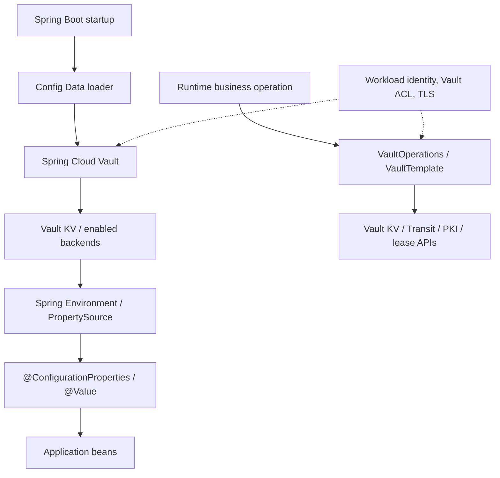
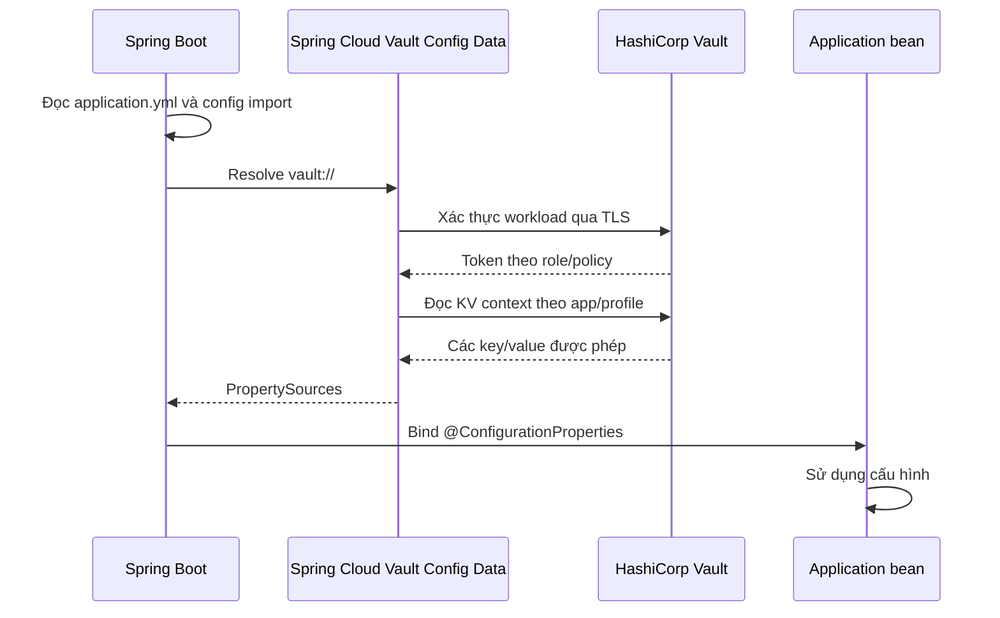

# Kết hợp Spring Cloud Vault khi cần tích hợp Config Data

## 1. Tại sao ứng dụng Spring Boot cần Spring Cloud Vault?

Trong ứng dụng Java, có hai nhu cầu làm việc với HashiCorp Vault khác nhau:

1. **Đọc cấu hình lúc ứng dụng khởi động**: lấy khóa API, URL của đối tác, thông số kết nối hoặc các giá trị cấu hình từ Vault rồi đưa vào Spring `Environment`, để Spring Boot sử dụng qua `@ConfigurationProperties` hoặc `@Value`.
2. **Chủ động gọi Vault khi ứng dụng đang chạy**: đọc/ghi KV, tạo dynamic secret, gia hạn lease, gọi Transit encrypt/decrypt, PKI hoặc các System API theo từng yêu cầu.

**Spring Cloud Vault** giải quyết nhu cầu đầu bằng cách kết nối Vault với **Config Data API** của Spring Boot. **Spring Vault** cung cấp `VaultTemplate`, `VaultOperations` và các API trực tiếp cho nhu cầu thứ hai. Hai cơ chế có thể cùng tồn tại trong một ứng dụng; chúng dùng chung hạ tầng kết nối/xác thực khi được cấu hình phù hợp.

Đây là nội dung của chương **Tích hợp ứng dụng** trong module **SPRING_VAULT**: ứng dụng Java truy cập Vault qua `VaultTemplate`, xác thực theo workload và policy, thực hành KV secrets, vòng đời token/lease, Transit encryption, PKI, xử lý lỗi, giám sát và kiểm thử tích hợp. Bài này tập trung vào thời điểm **nên kết hợp Spring Cloud Vault để nạp cấu hình qua Config Data**, thay vì tự viết những lời gọi Vault chỉ để gán các thuộc tính ban đầu.

Sau bài học, bạn có thể:

- Chọn giữa **Config Data**, `VaultOperations` trực tiếp và cơ chế quản lý lease động.
- Khai báo dependency Spring Cloud Vault, `spring.config.import=vault://`, đường dẫn KV v2 và xác thực workload.
- Hiểu cách xác định context theo tên ứng dụng, profile, default context và đường dẫn import tường minh.
- Ràng buộc các thuộc tính nhận từ Vault vào Java, giới hạn quyền truy cập và tránh lộ secret.
- Giải thích chính xác cách `optional:vault://`, `fail-fast`, khởi động ứng dụng và thay đổi secret sau khởi động tương tác với nhau.
- Thiết kế kiểm thử tích hợp, tình huống lỗi và kế hoạch xoay secret.

## 2. Hai lớp tích hợp và vị trí của Config Data



| Tiêu chí | Spring Cloud Vault Config Data | Spring Vault qua `VaultTemplate` |
| --- | --- | --- |
| Thời điểm | Trong giai đoạn khởi tạo cấu hình Spring Boot, trước khi tạo phần lớn application beans. | Khi mã ứng dụng gọi Vault ở thời điểm cần thiết. |
| API ở ứng dụng | `spring.config.import`, `Environment`, `@ConfigurationProperties`, `@Value`. | `VaultOperations`, `VaultKeyValueOperations`, các thao tác chuyên biệt. |
| Kiểu dữ liệu phù hợp | Thuộc tính khởi động, secret cần thiết để tạo bean và kết nối ban đầu. | KV đọc theo yêu cầu, Transit, PKI, lease, workflow cần thao tác Vault cụ thể. |
| Cập nhật | Giá trị được nạp vào `PropertySource` trong quá trình load; không mặc định tự đẩy giá trị mới vào các bean đang chạy. | Có thể gọi lại Vault để lấy trạng thái hiện hành; ứng dụng tự xử lý vòng đời dữ liệu. |
| Xử lý lỗi | Có thể ảnh hưởng đến việc ứng dụng có khởi động được hay không. | Ảnh hưởng đến thao tác nghiệp vụ đang gọi; do ứng dụng phân loại và xử lý. |
| Bảo mật | Bí mật trở thành thuộc tính của Spring `Environment`; cần quản lý Actuator/log và quyền truy cập thuộc tính. | Bí mật đi qua dữ liệu phản hồi API; cần bảo vệ object, log và thời gian lưu trong bộ nhớ. |

**Quy tắc chọn:** Nếu giá trị được dùng để khởi tạo cấu hình bean và thay đổi tương đối ít, Config Data giúp giảm code. Nếu ứng dụng cần ký, mã hóa, phát hành certificate, lấy secret mới theo từng request hoặc theo dõi lease động, hãy sử dụng API Spring Vault/giải pháp lease lifecycle phù hợp. Một số kiến trúc dùng cả hai: Config Data nạp cấu hình nền, `VaultOperations` thực hiện thao tác động.

Spring Boot có Config Data API từ **2.4**; Spring Cloud Vault **3.0 trở lên** hỗ trợ cách khai báo này. Trong các dự án hiện đại, nên dùng `spring.config.import` thay cho cơ chế `bootstrap.yml` cũ, trừ khi dự án có yêu cầu bootstrap đặc biệt và đã xác minh tương thích phiên bản.

## 3. Những gì xảy ra khi khai báo `spring.config.import=vault://`

`spring.config.import` cho Spring Boot biết phải lấy cấu hình bổ sung từ một vị trí ngoài `application.yml`. Khi import Vault, Spring Cloud Vault thực hiện quy trình:

1. Đọc các thuộc tính cần để kết nối Vault từ cấu hình khởi động hoặc biến môi trường: Vault URI, TLS, phương thức xác thực, tên ứng dụng và secret backend.
2. Xác thực với Vault theo workload, ví dụ Kubernetes Auth hoặc AppRole; nhận/áp dụng Vault token theo cơ chế client.
3. Tính các context cần đọc, ví dụ `secret/application`, `secret/orders-api` và những context theo profile đang hoạt động.
4. Gọi Vault theo KV v1/v2 tương ứng, lấy các key/value được phép đọc.
5. Đưa key/value thành `PropertySource` của Spring `Environment`, nơi binder có thể lấy giá trị khi tạo bean.
6. Nếu ứng dụng tiếp tục cần Vault ở runtime, sử dụng các bean Spring Vault đã được auto-configure hoặc cấu hình sẵn.



**Vấn đề bootstrap:** Không nên đặt **chỉ trong chính Vault** những thông tin bắt buộc để *kết nối tới Vault*, như `spring.cloud.vault.uri`, role xác thực Kubernetes hay cấu hình CA tin cậy. Khi Spring cần các thông tin đó để tải Config Data, nó chưa thể truy cập giá trị từ Vault. Các thuộc tính hạ tầng này cần nằm trong `application.yml` nền, biến môi trường, argument khởi động hoặc nguồn bootstrap đã có sẵn.

## 4. Khai báo dependency cho Spring Cloud Vault

Với dự án Spring Boot/Gradle, thêm starter **`spring-cloud-starter-vault-config`** và quản lý phiên bản Spring Cloud bằng BOM thuộc **release train tương thích với phiên bản Spring Boot của dự án**.

```groovy
// build.gradle (Groovy DSL) - thay tên biến bằng phiên bản đã chọn của dự án.
dependencies {
    implementation platform(
        "org.springframework.cloud:spring-cloud-dependencies:YOUR_COMPATIBLE_CLOUD_VERSION"
    )
    implementation "org.springframework.cloud:spring-cloud-starter-vault-config"
    implementation "org.springframework.boot:spring-boot-starter"
}
```

`YOUR_COMPATIBLE_CLOUD_VERSION` là placeholder, **không phải phiên bản để chạy nguyên xi**. Chọn theo bảng tương thích chính thức của Spring Cloud với Spring Boot hiện sử dụng. Nếu dự án đã quản lý Spring Cloud BOM ở nơi khác, chỉ cần dependency starter, tránh nhập nhiều BOM mâu thuẫn. Với Maven, import `spring-cloud-dependencies` vào `dependencyManagement` rồi khai báo `spring-cloud-starter-vault-config` không có version riêng.

Chỉ dùng `spring-vault-core` là chưa đủ để kích hoạt tự động import Vault Config Data. Ngược lại, sử dụng starter Config Data không có nghĩa mọi secret engine tự động bật: từng loại backend phải được enable và cấu hình, đồng thời workload phải có ACL phù hợp.

## 5. Chuẩn bị Vault KV v2 và phân quyền đọc

Giả sử sử dụng **KV v2** mount tại `secret/`, ứng dụng tên **`orders-api`**, và có một số giá trị ví dụ cho cổng thanh toán nội bộ. Các lệnh setup do **người quản trị hoặc pipeline hạ tầng** chạy ở môi trường kiểm thử:

```bash
# Chỉ bật khi mount secret chưa tồn tại.
vault secrets enable -path=secret kv-v2

# Cấu hình chung cho các ứng dụng (không chứa secret thật).
vault kv put secret/application \
  payment.gateway.timeout=3s

# Cấu hình riêng ứng dụng. Giá trị api-key chỉ là placeholder thử nghiệm.
vault kv put secret/orders-api \
  payment.gateway.base-url=https://sandbox-payments.example.test \
  payment.gateway.api-key=demo-only-replace-me \
  payment.gateway.timeout=2s

# Ví dụ override cho profile dev.
vault kv put secret/application/dev \
  payment.gateway.timeout=5s

vault kv put secret/orders-api/dev \
  payment.gateway.api-key=demo-dev-only

# Kiểm tra bằng danh tính có quyền đọc secret của lab.
vault kv get secret/orders-api
```

**Không dùng key thật trong shell history hoặc terminal được ghi log.** Trong production, nhập secret qua quy trình provisioning đã kiểm soát, tách Vault namespace/mount/role theo môi trường, và tránh chia sẻ secret giữa các ứng dụng không có nhu cầu.

### 5.1. KV v2: phân biệt path thân thiện và HTTP path thật

Khi gọi Vault CLI:

```text
vault kv get secret/orders-api
```

Vault KV v2 sử dụng HTTP API có `data/` trung gian:

```text
GET /v1/secret/data/orders-api
```

Trong Spring Cloud Vault, đặt `backend: secret`, `application-name: orders-api`; **không tự thêm `data/` vào tên backend**. Spring Cloud Vault nhận diện KV có version và xây dựng HTTP path phù hợp.

Một policy Vault dành cho ứng dụng `orders-api` khi chỉ cần đọc các context nói trên:

```hcl
path "secret/data/application" {
  capabilities = ["read"]
}

path "secret/data/orders-api" {
  capabilities = ["read"]
}

path "secret/data/application/dev" {
  capabilities = ["read"]
}

path "secret/data/orders-api/dev" {
  capabilities = ["read"]
}
```

Policy `read` trên `secret/data/...` đủ cho trường hợp đọc secret cụ thể qua KV v2; không nhất thiết phải cấp `list` trên `secret/metadata/...`. Chỉ thêm quyền metadata khi có yêu cầu riêng. **Không dùng `secret/data/*`** cho toàn bộ môi trường nếu ứng dụng chỉ cần các context trên.

Trong production, policy của workload cần đi kèm phương thức xác thực như Kubernetes Auth: role Vault gắn với service account và namespace cụ thể, token TTL được giới hạn, không sử dụng token quản trị để đọc cấu hình.

## 6. `application.yml`: import Vault vào Spring Boot

Ví dụ dưới dùng **Kubernetes Auth**. Giả sử Vault đã được mount/auth và người quản trị đã cấu hình vai trò `orders-api` cho service account được phép tại Kubernetes namespace tương ứng.

```yaml
spring:
  application:
    name: orders-api

  config:
    import: "vault://"

  cloud:
    vault:
      uri: https://vault.example.internal:8200
      authentication: KUBERNETES

      kubernetes:
        kubernetes-path: kubernetes
        role: orders-api
        service-account-token-file: /var/run/secrets/kubernetes.io/serviceaccount/token

      kv:
        enabled: true
        backend: secret
        backend-version: 2
        default-context: application
        application-name: orders-api
        profile-separator: /

      fail-fast: true
```

Giải thích các nhóm thuộc tính:

| Thuộc tính | Ý nghĩa |
| --- | --- |
| `spring.config.import: "vault://"` | Sử dụng **default location**, để Spring Cloud Vault import mọi secret backend đã được enable/configure; KV thường được enable theo cấu hình mặc định. |
| `spring.cloud.vault.uri` | Endpoint Vault; nên dùng HTTPS với chain CA được JVM hoặc Vault client tin cậy. |
| `authentication: KUBERNETES` | Client đọc JWT của service account và đăng nhập theo Vault Kubernetes Auth. |
| `kubernetes.role` | Role của **Vault Kubernetes Auth**, khác role của secrets engine. |
| `kv.backend: secret` | Mount KV. Đường dẫn thực tế đọc từ Vault được tính theo context, profile và KV version. |
| `kv.default-context: application` | Context cấu hình chung dùng cùng ứng dụng. |
| `kv.application-name: orders-api` | Context riêng dành cho ứng dụng. Nếu không khai báo, có thể dùng `spring.application.name`. |
| `kv.profile-separator: /` | Kết hợp context với tên profile; ví dụ `orders-api/dev`. |
| `fail-fast: true` | Yêu cầu ứng dụng dừng sớm khi Spring Cloud Vault không thể lấy cấu hình theo hợp đồng fail-fast; cần cân nhắc context thiếu dữ liệu trong từng profile. |

Ví dụ trên không cần mật khẩu hoặc Vault token gắn cứng vào source code. Vault URI chỉ là địa chỉ minh họa; thay bằng endpoint thực, thiết lập CA trust và chính sách mạng trước khi triển khai. Tập tin JWT service account có thể thay đổi theo Kubernetes distribution/kiến trúc, vì vậy kiểm tra đường dẫn thực tế của pod.

### 6.1. Có cần `bootstrap.yml`?

Với Spring Boot hiện đại và Spring Cloud Vault hỗ trợ Config Data, **`spring.config.import` là cách tích hợp nên ưu tiên**. Bootstrap context cũ chỉ nên bật khi dự án còn sử dụng kiến trúc legacy hoặc yêu cầu đặc biệt đã kiểm thử. Không cấu hình cùng một Vault location ở cả cơ chế Config Data và bootstrap cũ vì dễ tạo nhiều PropertySource trùng lặp và gây khó xác định giá trị ưu tiên.

### 6.2. Chạy ngoài Kubernetes

Với môi trường phát triển cục bộ, có thể chuyển sang một phương thức xác thực thích hợp, chẳng hạn AppRole, một token lab ngắn hạn hoặc auth của nền tảng. Nếu buộc phải dùng `authentication: TOKEN` trong lab, cung cấp token bằng **biến môi trường hoặc secret injection** ngoài repository, ví dụ `SPRING_CLOUD_VAULT_TOKEN`. Tránh tạo `application.yml` chứa token thật, kể cả với bản mẫu được cam kết là chỉ dùng cho dev.

AppRole cần `role_id` và `secret_id`; bản thân việc lấy `secret_id` để đăng nhập Vault là một vấn đề khởi tạo danh tính riêng. Có thể sử dụng **response wrapping** để trao `secret_id` an toàn cho ứng dụng, thay vì đẩy một secret tĩnh vào image container.

## 7. Cách Spring Cloud Vault chọn context và profile

Khi dùng `vault://` mặc định, các context KV được tính theo tên ứng dụng và các profile đang hoạt động. Với cấu hình trên và profile `dev`, các vị trí tương ứng là:

| Loại context | Đường dẫn logic KV | Mục đích |
| --- | --- | --- |
| Chung | `secret/application` | Giá trị dùng chung cho nhiều service. |
| Chung theo profile | `secret/application/dev` | Giá trị chung của môi trường dev. |
| Riêng ứng dụng | `secret/orders-api` | Cấu hình ứng dụng, không phụ thuộc profile. |
| Riêng ứng dụng theo profile | `secret/orders-api/dev` | Override cho riêng `orders-api` trong dev. |

Với KV v2, Spring Cloud Vault tự ánh xạ các context logic thành path API tương ứng trong `secret/data/... `. Nếu không có profile hoạt động, không cần truy cập các context có hậu tố profile.

Khi nhiều PropertySource chứa cùng tên key, **giá trị cuối cùng chịu ảnh hưởng thứ tự ưu tiên của Config Data, location và profile**. Thông thường cấu hình riêng ứng dụng/profile dùng để ghi đè cấu hình chung; tuy nhiên hãy kiểm tra thứ tự thực tế trên phiên bản Spring Boot/Spring Cloud đang chạy, nhất là khi import nhiều location hoặc cấu hình bổ sung từ biến môi trường. Không dựa vào giả định “Vault luôn thắng mọi nguồn cấu hình”.

Ví dụ giá trị `payment.gateway.timeout` được cung cấp ở `application`, `orders-api` và profile `dev`. Khi chạy `dev`, cần kiểm tra đúng cấu hình kỳ vọng qua test binding mà không in API key. Tránh đặt cùng một key nhạy cảm ở nhiều nguồn không được kiểm soát vì có thể lấy nhầm giá trị của môi trường khác.

### 7.1. Chỉ import context được chỉ định

`vault://` mặc định có thể nạp nhiều backend/context đã được enable. Khi muốn kiểm soát cụ thể nguồn dữ liệu, dùng **contextual location**:

```yaml
spring:
  config:
    import: "vault:///secret/orders-api"
```

Dạng `vault:///<context-path>` trỏ tới **một context Vault**. Ví dụ `vault:///secret/orders-api` chọn path logic `secret/orders-api`, còn `vault://` kích hoạt cơ chế context mặc định theo ứng dụng/profile và những backend được enable. Các contextual location có thể được kết hợp với nhau trong danh sách import:

```yaml
spring:
  config:
    import:
      - "vault:///secret/application"
      - "vault:///secret/orders-api"
```

Trong cách này, **context profile cần được thêm tường minh nếu muốn dùng**, thay vì mặc định trông chờ Cloud Vault tự tính mọi location. Để tránh nhầm lẫn, chỉ chọn một chiến lược import nhất quán trong mỗi môi trường.

### 7.2. Tránh xung đột tên thuộc tính

Có thể thêm prefix khi import nhiều context có các key trùng tên:

```yaml
spring:
  config:
    import:
      - "vault:///secret/team-a?prefix=team-a."
      - "vault:///secret/team-b?prefix=team-b."
```

Nếu trong `team-a` có key `api-key`, ứng dụng có thể lấy `team-a.api-key`; tên prefix được nối **nguyên văn** với key, vì vậy dấu chấm cuối trong `prefix=team-a.` là có chủ ý. Trước khi đưa vào production, cần kiểm tra cẩn thận quy tắc ký tự được chấp nhận và thứ tự property source của phiên bản thư viện sử dụng.

## 8. Ràng buộc cấu hình Vault vào Java

Spring Cloud Vault đưa key/value KV vào `Environment` như các property thông thường. Ứng dụng không cần dùng `VaultOperations.read(...)` chỉ để lấy một key đã được import.

Ví dụ Vault đang lưu:

```properties
payment.gateway.base-url=https://sandbox-payments.example.test
payment.gateway.api-key=demo-only-replace-me
payment.gateway.timeout=2s
```

Với Spring Boot 3 và Java 17+, dùng `@ConfigurationProperties` để binding có kiểu:

```java
import java.net.URI;
import java.time.Duration;

import org.springframework.boot.context.properties.ConfigurationProperties;

@ConfigurationProperties(prefix = "payment.gateway")
public record PaymentGatewaySettings(
        URI baseUrl,
        String apiKey,
        Duration timeout) {

    public PaymentGatewaySettings {
        if (baseUrl == null || !baseUrl.isAbsolute()) {
            throw new IllegalArgumentException(
                    "payment.gateway.base-url must be an absolute URI");
        }
        if (apiKey == null || apiKey.isBlank()) {
            throw new IllegalArgumentException(
                    "payment.gateway.api-key is required");
        }
        if (timeout == null || timeout.isNegative() || timeout.isZero()) {
            throw new IllegalArgumentException(
                    "payment.gateway.timeout must be positive");
        }
    }
}
```

Cho Spring Boot quét các lớp `@ConfigurationProperties`:

```java
import org.springframework.boot.SpringApplication;
import org.springframework.boot.autoconfigure.SpringBootApplication;
import org.springframework.boot.context.properties.ConfigurationPropertiesScan;

@SpringBootApplication
@ConfigurationPropertiesScan
public class OrdersApplication {

    public static void main(String[] args) {
        SpringApplication.run(OrdersApplication.class, args);
    }
}
```

Một service dùng cấu hình đã được binding:

```java
import org.springframework.http.HttpHeaders;
import org.springframework.stereotype.Service;

@Service
public class PaymentAuthorizationHeaders {

    private final PaymentGatewaySettings settings;

    public PaymentAuthorizationHeaders(PaymentGatewaySettings settings) {
        this.settings = settings;
    }

    public HttpHeaders forGatewayRequest() {
        HttpHeaders headers = new HttpHeaders();
        headers.setBearerAuth(settings.apiKey());
        return headers;
    }
}
```

Với ví dụ trên, có thể dùng `settings.baseUrl()` và `settings.timeout()` khi cấu hình HTTP client gọi đối tác. Không in `settings`, gọi `toString()` của record chứa secret hoặc bật log toàn bộ HTTP headers, vì Java record tự tạo `toString()` bao gồm các field nếu không được ghi đè. Nếu hệ thống cần log một số thuộc tính an toàn, in whitelist từng trường không nhạy cảm.

**Ưu điểm của binding có kiểu:** Phát hiện sớm URL sai, API key trống và timeout không hợp lệ, thay vì đẩy lỗi tới lần gọi đối tác đầu tiên. Có thể kết hợp `@Validated` và các annotation Bean Validation khi dự án có dependency validation tương ứng.

### 8.1. Khi nào nên dùng `VaultTemplate` trực tiếp dù đã import Config Data?

Ví dụ dịch vụ cần gọi KV v2 ở runtime:

```java
import org.springframework.stereotype.Service;
import org.springframework.vault.core.VaultKeyValueOperations;
import org.springframework.vault.core.VaultKeyValueOperationsSupport.KeyValueBackend;
import org.springframework.vault.core.VaultOperations;
import org.springframework.vault.support.VaultResponse;

@Service
public class RuntimeVaultReader {

    private final VaultKeyValueOperations kv;

    public RuntimeVaultReader(VaultOperations vault) {
        this.kv = vault.opsForKeyValue("secret", KeyValueBackend.KV_2);
    }

    public String currentApiKey() {
        VaultResponse response = kv.get("orders-api");
        if (response == null || response.getData() == null) {
            throw new IllegalStateException("Vault KV secret not available");
        }
        Object raw = response.getData().get("payment.gateway.api-key");
        if (!(raw instanceof String value) || value.isBlank()) {
            throw new IllegalStateException("API key missing in Vault KV");
        }
        return value;
    }
}
```

Đây là **lời gọi trực tiếp** dùng ở runtime, khác với giá trị đã binding trong `PaymentGatewaySettings`. Nếu cùng secret được đọc bằng cả hai cơ chế, thiết kế rõ nguồn giá trị nào là chuẩn và thời điểm cần làm mới. Không tạo hai luồng cạnh tranh nhau mà không có quy trình nhất quán để thay cấu hình của HTTP client.

## 9. `optional:vault://`, `fail-fast` và hành vi khi Vault có sự cố

Một lỗi phổ biến là nghĩ `optional:vault://` nghĩa là “Vault lỗi kiểu gì ứng dụng cũng chạy tiếp”. Tài liệu Spring Cloud Vault mô tả cơ chế chính xác hơn:

- `vault://` là location Vault thông thường và **không được khai báo optional**.
- `optional:vault://` cho phép bỏ qua Vault Config Data **khi đã chủ động vô hiệu hóa Vault bằng `spring.cloud.vault.enabled=false`**; mục đích là chạy những profile/test được thiết kế không phụ thuộc Vault.
- Context Vault không tìm thấy (HTTP 404) có thể được bỏ qua **kể cả khi location không optional**; `spring.cloud.vault.fail-fast` được dùng để yêu cầu fail startup khi không lấy được dữ liệu theo quy tắc client.
- Lỗi network, TLS, 403 hoặc không xác thực được Vault **không nên được coi như điều kiện fallback an toàn**. Hành vi chi tiết phụ thuộc phiên bản và cấu hình fail-fast; production cần kiểm thử cụ thể.

Ví dụ một cấu hình **chủ động cho phép chạy không có Vault** ở môi trường test:

```yaml
spring:
  config:
    import: "optional:vault://"
  cloud:
    vault:
      enabled: false
```

Trong tình huống này, cung cấp các giá trị test giả bằng nguồn riêng, và đảm bảo cấu hình chính không đồng thời import một location Vault bắt buộc. **Không dùng optional để âm thầm thay giá trị bí mật production bằng chuỗi mặc định**. Với secret bắt buộc, yêu cầu binding validation và failure policy rõ ràng.

| Tình huống | Nguyên nhân | Cách kiểm soát |
| --- | --- | --- |
| Spring báo không nhận ra `vault://` | Thiếu `spring-cloud-starter-vault-config`, phiên bản Spring Cloud không tương thích hoặc cấu hình import sai. | Kiểm tra dependency/BOM, `spring.config.import` và startup log đã lọc. |
| 403 khi tải KV | Token workload thiếu `read` trên `secret/data/<context>`, hoặc namespace/role sai. | Kiểm tra policy, auth, mount và path KV v2. |
| 404 ở context | Không có key/path, profile sinh path chưa được tạo, hoặc mount sai. | Đọc lại context theo profile; bật fail-fast nếu muốn ngăn startup khi thiếu. |
| TLS handshake failure | Ứng dụng không tin Vault CA, tên host khác chứng thư, chain chưa đầy đủ. | Cấu hình truststore và đúng Vault URI; không tắt xác minh TLS. |
| Không có token / 401 | Kubernetes JWT sai role/audience, service account chưa được phép, Vault token hết hạn. | Kiểm tra phương thức auth và cơ chế renewal theo workload. |
| Property rỗng dù Vault có key | Sai `application-name`, profile separator, context, key hoặc thứ tự precedence. | Kiểm tra mapping logic, test property binding và nguồn được chọn. |
| Vault mất kết nối giữa lúc chạy | Dữ liệu đã nạp vào bean có thể còn trong bộ nhớ; các lời gọi Vault runtime có thể lỗi. | Phân biệt dữ liệu đã load với runtime calls và chiến lược xoay/re-auth. |
| Secret đã rotate nhưng ứng dụng vẫn dùng giá trị cũ | Config Data không mặc định hot-reload mọi bean. | Thiết kế refresh/restart hoặc cơ chế cập nhật credential phù hợp. |

Đối với hệ thống quan trọng, `fail-fast: true` giúp tránh chạy với cấu hình bắt buộc bị thiếu. Nhưng cần kiểm soát các context tùy chọn, số lần restart, rolling deployment và chiến lược phục hồi khi Vault gián đoạn. Việc một pod không thể khởi động vì Vault tạm mất kết nối có thể ảnh hưởng độ sẵn sàng, vì vậy đặt startup probe, timeout, retry ở tầng điều phối hợp lý.

## 10. Cập nhật cấu hình, xoay secrets và vòng đời token

**Config Data là cơ chế nạp cấu hình**, không phải dịch vụ phát sự kiện tự động để mọi bean tự nhận giá trị mới. Có ba vòng đời cần phân biệt:

| Đối tượng | Vòng đời | Cơ chế phù hợp |
| --- | --- | --- |
| **KV secret** dùng làm cấu hình | Có thể được cập nhật phiên bản KV mới bởi operator/pipeline. | Config Data nạp khi khởi động; refresh/restart rõ ràng để áp dụng thay đổi. |
| **Vault client token** | Có TTL, role/policy và có thể cần re-auth/renew. | SessionManager/authentication được cấu hình cho workload. |
| **Dynamic credentials** | Có lease, TTL, renew hoặc revoke từ secrets engine. | `SecretLeaseContainer`, listeners, rotation và cập nhật datasource/HTTP client. |

Nếu sử dụng **database dynamic credentials**, ứng dụng cần một cơ chế quản lý lease và cập nhật pool kết nối thật sự. Việc chỉ nạp password vào `Environment` lúc khởi động **không bảo đảm** pool tự đổi credential khi lease hết hạn. Spring Vault hỗ trợ `SecretLeaseContainer` để theo dõi secret/lease và phát sự kiện; ứng dụng hoặc tầng tích hợp dữ liệu vẫn phải áp dụng credential mới lên tài nguyên đang dùng.

Nếu dùng **Transit encryption**, `VaultTemplate`/`VaultOperations` hoặc Spring Vault Transit APIs phù hợp vì đây là thao tác mật mã theo request, không phải một property khởi động. Với **PKI**, cần cơ chế cấp lại chứng thư và cài đặt chain/private key an toàn, khác với nạp một key/value tĩnh.

### 10.1. Mở rộng theo secret engine mà không tạo xung đột

Một ứng dụng có thể vừa import KV Config Data vừa gọi dynamic backend lúc chạy:

```text
Spring Cloud Vault: vault://
  → secret/orders-api (service URLs, feature flags, secrets cho bootstrap)

Spring Vault: VaultOperations / specialized operations
  → database/creds/orders-readonly (dynamic username/password + lease)
  → transit/encrypt/orders-key (mã hóa dữ liệu runtime)
  → pki_int/sign/orders-service (ký CSR khi được cấp phép)
```

Đừng tự động mount mọi backend thành property source nếu ứng dụng không cần. Tách các tầng theo mục đích sẽ giúp giảm quyền Vault token, tránh shadowing property và làm rõ trách nhiệm quay vòng secret.

## 11. Bảo mật và vận hành thực tế

### 11.1. Xác thực theo workload và policy

Với Kubernetes Auth, Vault Kubernetes role cần ràng buộc service account và namespace (và các điều kiện cần thiết khác) để một pod khác không thể nhận policy của `orders-api`. Chỉ cấp đường dẫn KV mà ứng dụng cần. Khi dùng AppRole, phát hành `secret_id` bằng kênh được bảo vệ và thời hạn phù hợp; khi dùng cloud auth, ràng buộc danh tính vào IAM/service identity.

Vault endpoint phải sử dụng TLS, kiểm chứng chứng thư và CA trust. Có thể cấu hình truststore riêng của Spring Cloud Vault khi thư viện HTTP và môi trường hỗ trợ; hoặc quản lý truststore ở mức JVM. Không dùng “skip TLS verification” để khắc phục sự cố kết nối.

### 11.2. Bí mật đã vào Spring Environment vẫn cần được bảo vệ

Khi nạp KV vào `Environment`, mọi bean được cấp quyền nội bộ để truy cập property tương ứng có thể sử dụng key. Vì vậy:

- Không ghi toàn bộ `Environment`, `@ConfigurationProperties` chứa secret, request headers hoặc body Vault vào log.
- Bảo vệ và giới hạn Actuator `/env`, `/configprops`, `/heapdump`, thread dump và các endpoint quản trị. Đừng dựa hoàn toàn vào chức năng che giá trị tự động của Actuator.
- Không gửi secret qua `@RestController`, exception message hoặc phản hồi health check.
- Cấp quyền Vault theo workload, không dùng root token hoặc policy đọc cả `secret/data/*`.
- Tách `dev`/`staging`/`production` bằng path, policy, role và, khi có điều kiện, namespace/mount riêng.
- Dùng masking/sanitization theo allowlist khi cần quan sát property sources; log **tên key và trạng thái**, không log giá trị.

### 11.3. Health và quan sát

Nếu ứng dụng bật Spring Boot Actuator, Spring Cloud Vault có thể cung cấp health indicator kiểm tra Vault. Chỉ số health nói Vault có phản hồi **không** chứng minh từng secret/config context đã tồn tại và hợp lệ. Theo dõi thêm:

- Khả năng kết nối/xác thực Vault, số lần đọc config thất bại, HTTP 403/404/5xx và độ trễ khởi động.
- Tình trạng cert TLS và Vault auth token; cảnh báo lỗi re-auth/renew.
- Số lần triển khai dùng cấu hình mới, version KV hoặc phiên bản cấu hình ở mức metadata không nhạy cảm.
- Sự kiện truy cập bất thường trên Vault audit device theo policy tổ chức.
- Tình huống ứng dụng lỗi binding vì thiếu cấu hình bắt buộc sau khi điều chỉnh ACL/path.

Các phép đo nên mang tag tên ứng dụng, profile, mount và loại lỗi; tránh tag có secret value/token. Quan sát ở cả Vault và ứng dụng để phân biệt sự cố kết nối với sai tên context.

## 12. Kiểm thử tích hợp Config Data

Unit test lớp Java binding có thể dùng giá trị test thông thường; nhưng muốn kiểm tra thật cách `vault://` tạo `PropertySource`, cần **khởi động Spring application context** với Vault đang chạy. Có thể dùng một Vault development instance hoặc Testcontainers Vault dành riêng cho CI (không dùng token và dữ liệu production).

Chuẩn bị trước test:

1. Bật KV v2 tại `secret/`, tạo `secret/application` và `secret/orders-api`.
2. Tạo một danh tính test có policy đọc đúng `secret/data/application`, `secret/data/orders-api`; có thể dùng TOKEN auth dành riêng cho CI nếu được bảo vệ.
3. Chỉ tới Vault test qua host/port thật, cung cấp đúng token test bằng biến môi trường.
4. Khởi động Spring Boot với `spring.config.import=vault://` và xác minh `PaymentGatewaySettings` được bind với dữ liệu vừa lưu.
5. Xóa hoặc vô hiệu hóa test Vault sau test; không lưu token hoặc password vào log build.

Bảng ca kiểm thử nên có:

| Ca | Thiết lập | Kỳ vọng |
| --- | --- | --- |
| KV v2 hoạt động | Có `secret/orders-api`, policy `read` hợp lệ. | Bean nhận đúng key và kiểu `Duration`, không cần tự gọi `VaultTemplate`. |
| Profile `dev` | Có các context theo profile, đặt `spring.profiles.active=dev`. | Giá trị profile được bind đúng theo precedence đã kiểm chứng. |
| Sai tên context | Dùng `application-name` khác hoặc mount khác. | Startup/binding báo thiếu cấu hình theo failure policy, không lấy nhầm secret. |
| Thiếu ACL | Identity không có `secret/data/orders-api`. | Vault trả lỗi quyền, startup xử lý theo `fail-fast`; không log API key. |
| Vault tắt | Ngắt Vault trước startup. | Xác minh hành vi dừng/khôi phục theo cấu hình fail-fast/optional. |
| Vault bị vô hiệu hóa chủ động | Test dùng `optional:vault://` + `spring.cloud.vault.enabled=false`. | App khởi động với cấu hình giả đầy đủ, không liên lạc Vault. |
| Config Data không auto refresh | Thay key trong KV v2 sau khi context đã khởi tạo. | Bean hiện có không tự động đổi nếu chưa thực hiện refresh/restart được thiết kế. |
| VaultTemplate trực tiếp | Gọi KV khi runtime và kiểm tra policy. | Có thể đọc giá trị hiện hành riêng với Config Data đã bind. |
| TLS sai | JVM không tin CA hoặc hostname không phù hợp. | Kết nối thất bại rõ ràng, không bỏ qua xác minh chứng thư. |
| Dữ liệu bất hợp lệ | Thiếu `api-key`, `timeout` bằng `0s`, URL không hợp lệ. | Bean validation từ chối cấu hình, không chạy tiếp với giá trị sai. |

**Bài tập:** Thiết kế dịch vụ `orders-api` chạy ở Kubernetes namespace `shop-dev`. Dịch vụ phải lấy `payment.gateway.api-key` từ `secret/orders-api/dev`, còn timeout dùng `secret/application/dev`, với role Kubernetes Auth chỉ cho phép service account `orders-api`. Viết policy KV v2, cấu hình `application.yml`, mô tả cách kiểm chứng chính xác property nguồn nào thắng nếu cùng key xuất hiện hai lần. Sau đó xoay API key trong Vault và chứng minh ứng dụng cần một cơ chế reload/restart được thiết kế trước khi bean dùng giá trị mới.

## 13. Checklist triển khai

- [ ] Xác định dữ liệu nào cần **Config Data lúc startup**, dữ liệu nào cần **VaultOperations runtime**.
- [ ] Chọn Spring Boot/Spring Cloud BOM tương thích, thêm `spring-cloud-starter-vault-config`.
- [ ] Khai báo `spring.config.import: "vault://"` hoặc contextual location theo một chiến lược nhất quán.
- [ ] Cấu hình Vault URI, TLS, auth workload ở nguồn bootstrap truy cập được trước khi tải Vault Config Data.
- [ ] Xác định chính xác mount KV v2, `application-name`, default context, profile separator và context thực được đọc.
- [ ] Cấp quyền `read` tối thiểu tại `secret/data/<context>`; không tự cấp quyền write/admin.
- [ ] Binding secret bằng `@ConfigurationProperties` có kiểm tra kiểu và trường bắt buộc; tuyệt đối không log object chứa API key.
- [ ] Thiết kế hành vi khởi động khi Vault lỗi, dùng `optional:vault://` đúng mục đích và `fail-fast` có chủ đích.
- [ ] Có giải pháp refresh/restart cho KV static secret và cơ chế lease riêng cho dynamic credential.
- [ ] Bảo vệ Actuator, audit/log, health indicator và kiểm thử tích hợp với Vault test thật.

**Ghi nhớ:** **Spring Cloud Vault + Config Data** đưa các key/value được phép từ Vault thành cấu hình Spring Boot ngay trong quá trình khởi động, thông qua `spring.config.import=vault://`. **Spring Vault + `VaultTemplate`** vẫn là công cụ phù hợp khi cần chủ động gọi KV, Transit, PKI hoặc System API ở runtime. Sử dụng đồng thời hai cơ chế hiệu quả khi đã phân định rõ nguồn cấu hình, quyền truy cập, thời điểm làm mới và vòng đời của secret.

### Tài liệu tham khảo

- Spring Cloud Vault — ConfigData API: https://docs.spring.io/spring-cloud-vault/reference/config-data.html
- Spring Cloud Vault — Key-Value Secret Backend: https://docs.spring.io/spring-cloud-vault/reference/secret-backends.html
- Spring Cloud Vault — Quick Start: https://docs.spring.io/spring-cloud-vault/reference/quickstart.html
- Spring Cloud Vault — Common Application Properties: https://docs.spring.io/spring-cloud-vault/reference/appendix.html
- Spring Vault — Reference Documentation: https://docs.spring.io/spring-vault/reference/
