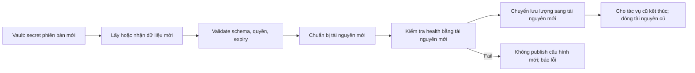
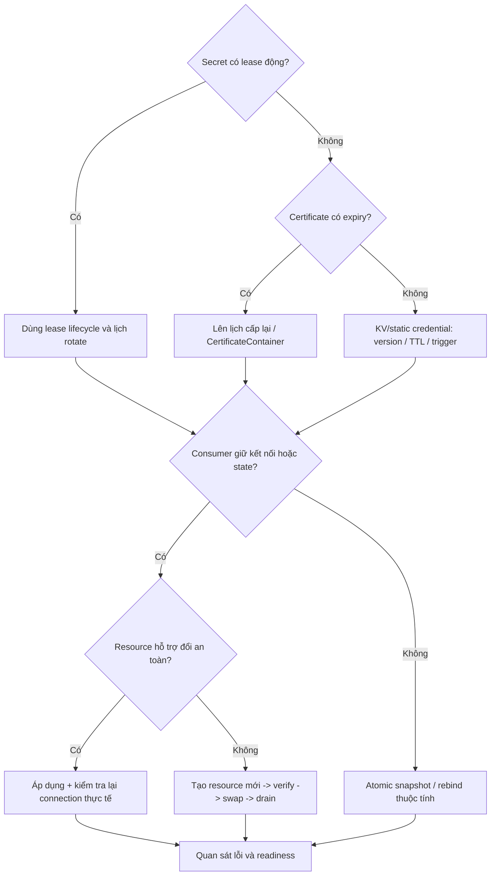

# Chọn cơ chế cập nhật phù hợp cho thành phần giữ trạng thái

> **Chương:** Tích hợp ứng dụng  
> **Phạm vi:** Trong module **SPRING_VAULT**, ứng dụng Java dùng `VaultTemplate`, xác thực theo workload và Vault ACL để đọc KV secrets, nhận database credentials có lease, sử dụng Transit encryption, PKI và các tài nguyên bảo mật khác. Bài này tập trung vào **cách đưa bí mật mới từ Vault tới các thành phần Java đã được khởi tạo và đang giữ trạng thái**: `DataSource`/connection pool, HTTP/TLS client, cache, cấu hình có thể thay đổi và phiên làm việc dài hạn.

## 1. Kết quả học tập

Sau bài học, bạn có thể:

1. Phân biệt bốn bước **phát hiện thay đổi → lấy dữ liệu mới → áp dụng vào thành phần → thu hồi trạng thái cũ**, đồng thời nhận ra bước nào do Vault/Spring Vault cung cấp và bước nào ứng dụng phải tự xử lý.
2. Chọn đúng cơ chế cho KV tĩnh, database credential động có lease, static database credential, chứng chỉ PKI và token xác thực Vault.
3. Giải thích khi nào dùng đọc lại `VaultTemplate`, polling có giới hạn, Spring Cloud `@RefreshScope`, `SecretLeaseContainer`, `CertificateContainer`, cập nhật tại chỗ, hoán đổi tài nguyên hoặc rolling restart.
4. Thiết kế cập nhật `DataSource`/JDBC pool, HTTP client, TLS `SSLContext`, cache và các kết nối dài hạn mà không tạo trạng thái nửa mới nửa cũ.
5. Kiểm thử thành công/thất bại của rotation, token hết hạn, Vault tạm gián đoạn, in-flight requests và cơ chế rollback.
6. Xây dựng chính sách bảo mật, giám sát và kiểm thử tích hợp cho quy trình thay đổi secret trong production.

## 2. Vấn đề: đọc được secret mới chưa có nghĩa ứng dụng đang dùng nó

Giả sử dịch vụ `order-api` đọc password từ Vault lúc khởi động rồi tạo một HikariCP `DataSource`. Một giờ sau, Vault cấp password mới. Dù ứng dụng đã đọc được giá trị mới trong `Environment`, connection pool vẫn có thể tiếp tục dùng credential đã lưu khi được tạo, nên các kết nối mới bị từ chối.

Tương tự:

- `WebClient` hoặc `RestClient` dùng TLS keystore/truststore đã nạp vào SSL context: đổi secret chứa certificate không làm các client đang tồn tại tự dùng certificate mới.
- Một service giữ API key trong field `final` của singleton: thay giá trị KV không sửa field.
- Dynamic database credential: Vault cấp **mỗi lần đọc một username/password mới** và một lease. Nếu poll endpoint như KV, ứng dụng vô tình tạo nhiều DB users.
- Transit encryption qua `VaultTemplate` **thường không giữ key material trong Java**: Vault xoay vòng Transit key ở server; client tiếp tục gọi cùng endpoint, không nhất thiết phải tái tạo đối tượng.
- Spring Vault có thể renew token xác thực; điều này không tự động làm mới một kết nối JDBC hay TLS đã khởi tạo.



**Tư duy quan trọng:** Vault là nguồn sự thật của secret. `VaultTemplate` là client API. Còn **tài nguyên giữ trạng thái** là một đối tượng Java độc lập với vòng đời, cache, socket, pool và thread riêng. Một thao tác làm mới secret chỉ hoàn thành khi đối tượng tiêu thụ thực sự chuyển sang trạng thái sử dụng secret hợp lệ.

## 3. Phân loại secret và các cách cập nhật

Trước khi chọn giải pháp, hãy xác định **secret có lease không**, **ai chủ động thay đổi**, **bên tiêu thụ có giữ kết nối không** và **có khả năng thay tại chỗ an toàn không**.

| Loại dữ liệu từ Vault | Sự kiện/vòng đời nguồn | Tín hiệu hoặc cơ chế cập nhật nên dùng | Ví dụ thành phần dùng | Lưu ý |
| --- | --- | --- | --- | --- |
| **KV v1/v2**: API key, feature flag nhạy cảm | Người vận hành hoặc pipeline ghi giá trị mới | Poll có kiểm soát, trigger triển khai/refresh hoặc khởi động lại; so version KV v2 | Singleton giữ key, cấu hình client | KV thông thường không cấp dynamic lease hoặc push event cho `SecretLeaseContainer` |
| **Database dynamic credentials** (`database/creds/role`) | Lease TTL, renew, hết hạn/rotate | `SecretLeaseContainer` hoặc quản lý lease chuyên dụng | Hikari/JDBC `DataSource` | Mỗi GET có thể tạo user/lease mới; cần cutover trước khi credential cũ mất hiệu lực |
| **Database static credentials** (`database/static-creds/role`) | Vault rotate password của DB user cố định | Theo dõi TTL tới lần rotate, polling/trigger lấy lại password và cập nhật pool | JDBC pool dùng username ổn định | TTL rotation không phải lease của mỗi lần đọc |
| **PKI certificate/key bundle** | Chứng chỉ hết hạn hoặc được tái cấp | `CertificateContainer` (khi phiên bản hỗ trợ) hoặc lịch reissue/refresh | TLS client/server, mTLS channel | Cần tạo SSL context/client mới, không chỉ thay nội dung file |
| **Vault login token** | TTL/renew/revoke/re-authenticate | `SessionManager`, cơ chế auth và token renewal của Spring Vault | Các call `VaultTemplate` | Không đồng nghĩa vòng đời credential database hoặc TLS |
| **Transit key ở Vault** | Rotate version, revoke quyền hoặc đổi policy | Thường tiếp tục gọi Transit endpoint; thay cấu hình client khi endpoint/policy đổi | Client encrypt/decrypt/sign | Không tải private key từ Vault về JVM để tự xoay |
| **Secret ứng dụng ít thay đổi** | Thay lúc deploy có kiểm duyệt | Rolling restart theo pod/instance | Thành phần chỉ cấu hình lúc khởi động | Đơn giản và dễ kiểm soát nếu downtime/rollout được chấp nhận |

Một secret có thể được ứng dụng **lưu bộ nhớ tạm** nhưng vẫn không có lease (KV). Ngược lại, credential có lease còn có thể gắn với **token phát hành**; khi token bị revoke/hết hạn, các lease liên quan có thể mất hiệu lực. Không quy đổi tất cả TTL thành cùng một loại đồng hồ.

## 4. Chọn chiến lược theo tính chất của thành phần Java

| Thành phần | Trạng thái giữ lâu | Chiến lược phù hợp | Rủi ro nếu chỉ cập nhật property |
| --- | --- | --- | --- |
| Giá trị immutable dùng cho request mới, ví dụ API key | Chuỗi key trong bộ nhớ | **Atomic snapshot** hoặc rolling restart | Thread cũ vẫn giữ biến/key cũ |
| HTTP client có connection pooling | Socket, TLS, auth interceptors | Dựng client mới, test, đổi reference/routing, drain và close client cũ | TLS/session/header đã được khởi tạo vẫn dùng giá trị cũ |
| HikariCP `DataSource` | Pool JDBC connections, username/password | Quản lý vòng đời pool; cập nhật cấu hình có kiểm chứng hoặc **blue/green pool swap** | Pool giữ credential cũ; open connection có thể sống qua rotation |
| Redis/Kafka/AMQP connector | Connection, session, subscription, consumer state | Theo API reconnect/re-auth chính thức hoặc tạo connector mới và chuyển dần | Kết nối dài hạn không tự xác thực lại |
| `SSLContext`, keystore, trust manager | Trust anchors, key manager đã load | Dựng TLS context mới và thay client/server connector | File/truststore mới không tự thay instance đang chạy |
| Cache chứa response nhạy cảm | Dữ liệu cache, TTL | Invalidate/version cache sau đổi secret; áp dụng eviction có kiểm soát | Cache tiếp tục trả kết quả cũ dù source đã cập nhật |
| `@ConfigurationProperties` / `@RefreshScope` bean | Config bind từ `Environment` | Refresh property source và bean theo framework; kiểm tra dependency | Rebind không bảo đảm mọi resource con được tạo lại |
| Stateless adapter gọi `VaultTemplate` | Ít hoặc không có secret cache | Dùng token/session manager, lấy từ Vault theo nhu cầu | Tránh tạo thêm một tầng cache nếu không cần |

### 4.1. Cây quyết định thực tế



Cần xác định **cửa sổ chồng lấp** giữa secret cũ và mới (nếu hệ thống nguồn cho phép). Đổi API key và thu hồi key cũ ngay lập tức có thể làm các request đang chạy thất bại; với DB lease có max TTL, phải lấy credential mới đủ sớm để kiểm thử trước khi cái cũ bị thu hồi.

## 5. Phân biệt bốn cấp độ “refresh” trong Spring

**Cấp độ 1 – đọc lại Vault:** `VaultTemplate.read("secret/data/app")` có thể lấy một giá trị mới. Các đối tượng Java đang giữ phiên bản cũ không tự đổi.

**Cấp độ 2 – cập nhật property source:** Spring Cloud Vault có thể đưa secret vào Spring `Environment`. Việc Vault được cập nhật không tự động đồng nghĩa `Environment` đã load lại; phải có thao tác/chu kỳ refresh phù hợp cấu hình và phiên bản.

**Cấp độ 3 – rebind/recreate bean:** Spring Cloud Context `@RefreshScope`, `RefreshScope.refresh(...)` hoặc `/actuator/refresh` có thể đánh dấu bean thuộc scope tái tạo ở lần sử dụng tiếp theo khi property sources đã được cập nhật. Những bean khác giữ reference/value đã copy có thể tiếp tục cũ.

**Cấp độ 4 – refresh resource thực:** connection pool, SSL context, HTTP connector hoặc session phải thật sự nhận credential/certificate mới và đóng trạng thái cũ theo quy trình. Cấp độ 4 có thể yêu cầu code ứng dụng riêng.

### 5.1. `@RefreshScope` hữu ích nhưng không phải giải pháp chung

```java
import org.springframework.cloud.context.config.annotation.RefreshScope;
import org.springframework.context.annotation.Bean;
import org.springframework.context.annotation.Configuration;

@Configuration
class UpstreamClientConfiguration {

    @Bean
    @RefreshScope
    UpstreamApiSettings upstreamApiSettings(
            org.springframework.core.env.Environment env) {
        String key = env.getRequiredProperty("upstream.api-key");
        return new UpstreamApiSettings(key);
    }
}

record UpstreamApiSettings(String apiKey) {}
```

Đây là ví dụ về bean giá trị cấu hình. Khi trigger refresh đúng quy trình, proxy `@RefreshScope` có thể tạo target bean mới với `Environment` đã cập nhật. Nhưng nếu một client khác **sao chép** `apiKey()` vào một field lúc startup, client đó vẫn cần được làm mới riêng.

**Giới hạn quan trọng:** theo Spring Cloud Commons, `HikariDataSource` thuộc danh sách `spring.cloud.refresh.never-refreshable` mặc định. Không gắn `@RefreshScope` lên Hikari rồi kỳ vọng pool đang chạy sẽ tự đổi credential và giữ kết nối an toàn. Spring AOT/native image cũng có giới hạn đối với context refresh; phải kiểm tra đúng phiên bản Spring Cloud đang dùng.

Nếu dùng `/actuator/refresh`, bảo vệ endpoint bằng authentication/authorization, audit và giới hạn network; tránh public expose cơ chế làm mới cấu hình. Refresh hàng loạt làm nhiều bean thay đổi cùng lúc, cần kiểm thử tác dụng phụ.

## 6. KV v2: cập nhật cấu hình giữ trạng thái bằng phiên bản và atomic snapshot

Một API key lưu trong KV v2 không có dynamic lease. Nếu ứng dụng cần dùng key mới mà không restart, có thể **đọc có kiểm soát** (ví dụ 30–60 giây khi latency/chính sách cho phép), kiểm tra KV version và thay **toàn bộ snapshot** dùng cho request mới.

### 6.1. Chuẩn bị path và policy

Giả sử engine KV v2 mount tại `secret/`, dữ liệu lưu ở `app/order-api`:

```bash
# Người vận hành ghi phiên bản secret vào KV v2:
vault kv put -mount=secret app/order-api api-key=sample-key-v1

# Sau đó đổi secret bằng workflow quản trị:
vault kv put -mount=secret app/order-api api-key=sample-key-v2
```

Policy cho Java workload chỉ đọc đúng dữ liệu:

```hcl
path "secret/data/app/order-api" {
  capabilities = ["read"]
}
```

Đây là path API của **KV v2**. Khi dùng CLI `vault kv`, không tự chèn `data/` sau mount theo cú pháp `-mount=secret`; còn `VaultTemplate.read` gọi API thô thì phải dùng `secret/data/...`. Nếu yêu cầu đọc metadata độc lập bằng `secret/metadata/...`, cần cấp thêm quyền riêng; đoạn ví dụ dưới đây lấy `metadata.version` ngay trong response đọc data.

### 6.2. Java: đọc, validate và hoán đổi trạng thái không chia sẻ nửa cấu hình

```java
import java.util.Map;
import java.util.concurrent.atomic.AtomicReference;

import org.springframework.stereotype.Component;
import org.springframework.vault.core.VaultTemplate;
import org.springframework.vault.support.VaultResponse;

@Component
public final class OrderApiKeyProvider {

    public record Snapshot(long version, String apiKey) {}

    private final VaultTemplate vault;
    private final AtomicReference<Snapshot> current =
            new AtomicReference<>();

    public OrderApiKeyProvider(VaultTemplate vault) {
        this.vault = vault;
    }

    // Gọi trong startup trước khi phục vụ request, và từ lịch/trigger refresh.
    public void reload() {
        VaultResponse response = vault.read("secret/data/app/order-api");
        if (response == null || response.getData() == null) {
            throw new IllegalStateException("Vault KV value unavailable");
        }

        Object rawData = response.getData().get("data");
        Object rawMeta = response.getData().get("metadata");
        if (!(rawData instanceof Map<?, ?> data)
                || !(rawMeta instanceof Map<?, ?> metadata)) {
            throw new IllegalStateException("Unexpected KV v2 response");
        }

        Object keyValue = data.get("api-key");
        Object versionValue = metadata.get("version");
        if (!(keyValue instanceof String key) || key.isBlank()
                || !(versionValue instanceof Number number)) {
            throw new IllegalStateException("Invalid KV payload/version");
        }

        Snapshot candidate = new Snapshot(number.longValue(), key);
        // Snapshot thay thế nguyên khối; không bao giờ thấy nửa mới nửa cũ.
        current.updateAndGet(previous ->
                previous == null || candidate.version() > previous.version()
                        ? candidate
                        : previous);
    }

    public Snapshot snapshot() {
        Snapshot value = current.get();
        if (value == null) {
            throw new IllegalStateException("API key not loaded");
        }
        return value;
    }
}
```

Một controller/client cần lấy **một snapshot cho mỗi request** và sử dụng key từ snapshot đó, tránh đọc nhiều field ở các thời điểm khác nhau. `AtomicReference` giúp publish toàn bộ đối tượng nhất quán; nó **không** tự reload, không kiểm tra key có còn hợp lệ bên upstream và không đóng connection pool. Hàm `reload()` phải được gọi ở startup (trước readiness), theo lịch được giám sát hoặc từ pipeline change event đã xác thực.

Nếu dùng thời gian làm tươi định kỳ, triển khai với `@Scheduled(fixedDelayString=...)` hoặc scheduler có exponential backoff, jitter giữa các pod và giới hạn tần suất. Không gọi Vault mỗi HTTP request chỉ để lấy cùng API key. Với hàng trăm pod, giảm đồng loạt polling để hạn chế tải và tránh thundering herd.

Một lưu ý về KV version: version chỉ tăng khi có bản ghi mới tại **cùng path**. Nếu cố tình rollback một phiên bản cũ bằng cách sao chép nội dung thành **version mới**, đoạn code vẫn cập nhật đúng. Nếu cần *pin* hẳn version cụ thể, thiết kế quy trình riêng; không tự hạ version trong JVM vì nguy cơ đổi ngược.

### 6.3. Cửa sổ chuyển giao API key

Nếu upstream hỗ trợ **hai key cùng hoạt động**, áp dụng:

1. Tạo key mới và xác nhận có quyền truy cập.
2. Ghi key mới vào KV (version mới).
3. Ứng dụng phát hiện đổi version, validate và dùng key mới cho request tiếp theo.
4. Kiểm tra tỷ lệ xác thực thành công của từng instance, sau đó mới revoke key cũ.

Nếu upstream chỉ cho **một key hợp lệ**, cần lịch đổi đồng bộ hoặc rolling restart/cutover với chấp nhận một khoảng gián đoạn nhỏ. Atomic swap trong JVM không làm upstream chấp nhận cả hai key.

## 7. Dynamic database credentials: dùng lease events, đừng poll như KV

Với path `database/creds/orders-readonly`, mỗi lần đọc có thể khiến Vault tạo một user database **mới**, một password và một lease. Vì vậy đọc mỗi 30 giây để “kiểm tra thay đổi” là sai.

Cơ chế Spring Vault chuyên dụng là `SecretLeaseContainer`. Nó theo dõi secret đã đăng ký, renew lease khi còn khả năng, phát event tạo/đổi/hết hạn hoặc lỗi. Vault **không đẩy event realtime** đến JVM; Spring Vault chủ động tương tác với Vault theo lịch TTL. Event có thể đến **sau** thời điểm TTL thực tế.

### 7.1. Các loại event cần hiểu

| Event | Ý nghĩa | Phản ứng thành phần giữ trạng thái |
| --- | --- | --- |
| `SecretLeaseCreatedEvent` | Đã nhận credential/lease ban đầu | Chuẩn bị pool/connector mới và xác nhận đăng nhập |
| `AfterSecretLeaseRenewedEvent` | Gia hạn lease hiện có thành công | Cập nhật thời hạn; không nhất thiết đổi username/password |
| `SecretLeaseRotatedEvent` | Nhận credential mới sau rotation, là một dạng created event | Warm-up resource mới, swap, drain resource cũ |
| `SecretLeaseExpiredEvent` | Lease bị phát hiện hết hạn | Kiểm tra generation đang sử dụng; chặn dùng credential đã invalid |
| `SecretLeaseErrorEvent` | Lỗi lấy secret hoặc renew/rotate | Báo readiness/degraded, retry có giới hạn, không log password |
| `AfterSecretLeaseRevocationEvent` | Thu hồi lease đã thành công | Đảm bảo resource cũ không còn được cấp cho request mới |

### 7.2. Java: lắng nghe credential vừa được cấp

Ví dụ dưới minh họa phần kết nối event với lớp cập nhật pool của ứng dụng. Dành cho dự án quản lý container **trực tiếp**, tránh đăng ký một container thứ hai nếu Spring Cloud Vault đã tự cấu hình quản lý cùng secret.

```java
import java.util.Map;

import org.springframework.context.annotation.Bean;
import org.springframework.context.annotation.Configuration;
import org.springframework.scheduling.TaskScheduler;
import org.springframework.vault.core.VaultOperations;
import org.springframework.vault.core.lease.SecretLeaseContainer;
import org.springframework.vault.core.lease.domain.RequestedSecret;
import org.springframework.vault.core.lease.event.LeaseListenerAdapter;
import org.springframework.vault.core.lease.event.SecretLeaseCreatedEvent;
import org.springframework.vault.core.lease.event.SecretLeaseEvent;

@Configuration
public class DatabaseLeaseConfiguration {

    public interface PoolCutover {
        // Enqueue việc tạo + test pool mới rồi swap và drain pool cũ.
        // Không block thread xử lý lease event.
        void propose(String username, String password);
    }

    @Bean
    SecretLeaseContainer databaseLeaseContainer(
            VaultOperations vault,
            TaskScheduler scheduler,
            PoolCutover cutover) {

        SecretLeaseContainer leases =
                new SecretLeaseContainer(vault, scheduler);

        RequestedSecret requested = leases.requestRotatingSecret(
                "database/creds/orders-readonly");

        leases.addLeaseListener(new LeaseListenerAdapter() {
            @Override
            public void onLeaseEvent(SecretLeaseEvent event) {
                if (!requested.equals(event.getSource())) {
                    return;
                }

                // Bao gồm cả SecretLeaseRotatedEvent vì là subclass.
                if (event instanceof SecretLeaseCreatedEvent created) {
                    Map<String, Object> data = created.getSecrets();
                    String username = (String) data.get("username");
                    String password = (String) data.get("password");
                    if (username == null || password == null) {
                        throw new IllegalStateException(
                                "Incomplete database credentials");
                    }
                    cutover.propose(username, password);
                }
            }
        });

        // Spring khởi tạo lifecycle bean và gọi start() sau khi bean
        // được cấu hình; không tạo listener sau thời điểm start.
        return leases;
    }
}
```

`PoolCutover` là **hợp đồng ứng dụng** cần triển khai: event listener chỉ giao một candidate, chưa bảo đảm tài nguyên thực sự đổi an toàn. Xử lý tác vụ cutover trên executor có giới hạn/được giám sát và bảo vệ thứ tự generation, tránh để sự kiện credential cũ đến sau ghi đè resource mới.

Điều kiện quan trọng khi triển khai:

- Listener phải được đăng ký **trước** khi `SecretLeaseContainer` start; nếu không có thể bỏ lỡ sự kiện đầu tiên.
- `requestRotatingSecret` có nghĩa container có thể xin credential mới khi lease cũ hết hạn; không bảo đảm cutover diễn ra trước khoảnh khắc DB từ chối user cũ.
- Có thể dùng `ManagedSecret` ở phiên bản Spring Vault hỗ trợ để đơn giản hóa xử lý sự kiện; vẫn phải kiểm tra cách pool nhận credential và dọn connection cũ.
- Theo dõi cả **Vault session token**: khi token phát hành lease bị hết hạn/revoke, các dynamic leases của session có thể bị revoke. `SessionManager` và token lifecycle phải phối hợp với secret lifecycle.
- Trong Spring Cloud Vault, cấu hình database backend chỉ giúp đưa credential vào property ban đầu và quản lý lease theo khả năng phiên bản; tài liệu lưu ý việc tới `max_ttl` có thể không tự cấp credential mới rồi cấu hình lại `DataSource`. Cần kiểm chứng end-to-end, không dựa vào một annotation.

## 8. `DataSource`/HikariCP: cập nhật credential bằng resource cutover

Ví dụ: `order-api` có credential `v-orders-a` TTL 1 giờ; sau rotation nhận `v-orders-b`. HikariCP giữ các connection vật lý; việc `username/password` mới có thể chỉ ảnh hưởng **connection tạo sau đó**, không làm credential của socket đã mở thay đổi.

### 8.1. Quy trình blue/green pool

```mermaid
sequenceDiagram
    participant Vault as Vault
    participant M as Credential manager
    participant A as Active pool A
    participant B as Candidate pool B
    participant API as API request
    Vault-->>M: Credential B + lease B
    M->>B: Tạo pool với B
    M->>B: Test SELECT 1 + quyền nghiệp vụ
    alt Kiểm thử thành công
        M->>M: Atomically switch active reference A -> B
        API->>B: Requests mới lấy connection B
        M->>A: Dừng cấp thêm request; drain đang chạy
        M->>A: Close pool A theo timeout
    else Kiểm thử thất bại
        M->>B: Close candidate B
        M->>M: Degraded alert; chưa publish credential B
    end
```

Một hiện thực production có thể đặt `RoutingDataSource`/proxy ổn định trước nhiều pool và thay target, hoặc dùng lifecycle manager giữ `AtomicReference<PoolGeneration>`. **Không chỉ swap một `HikariDataSource` field trần** nếu các request còn dùng pool cũ: cần reference counting/transaction boundary hoặc cơ chế drain kết nối để không đóng connection của transaction đang chạy.

**Trình tự gợi ý:**

1. Nhận credential B và thời gian lease còn lại.
2. Tạo pool B theo JDBC URL/TLS/timeouts chuẩn, kiểm tra bằng connection mới và một truy vấn tối thiểu.
3. Đặt generation B làm active để request **mới** dùng pool B.
4. Chờ request/transaction thuộc A kết thúc hoặc hết grace timeout được duyệt.
5. Đóng A và theo dõi số connection thực còn hoạt động.
6. Revoke lease A sau cutover khi ứng dụng sở hữu lease và quy trình cho phép; nếu Vault đã revoke/lease hết hạn trước đó, phải xử lý lỗi có kiểm soát.
7. Nếu B không hoạt động, giữ A chỉ trong phạm vi lease còn hợp lệ và chuyển readiness/alert phù hợp; không tiếp tục vô hạn với credential đã hết hạn.

Các thuộc tính Hikari có thể hỗ trợ quản trị connection như `maxLifetime`, `idleTimeout`, `connectionTimeout`, nhưng chúng **không** thay thế quản lý lease và quyền DB. Khi thay password trên chính một static username, đảm bảo tất cả instance có thể lấy password mới, các transaction đang chạy được xử lý và database audit không nhầm lẫn phiên bản credential.

### 8.2. Khi nào cập nhật tại chỗ?

Một số JDBC pool/connector có API cập nhật credential và chủ động đóng/evict connections; nếu vendor hỗ trợ và kiểm thử thật cho cả **new connection** và **in-flight transaction**, đây có thể là lựa chọn đủ tốt. Với yêu cầu zero-downtime và database role động có thời gian sống ngắn, xây candidate pool và chuyển dần thường dễ kiểm soát hơn.

Tránh `@RefreshScope` trực tiếp trên HikariCP rồi kỳ vọng Spring tự chuyển connection. Nếu ứng dụng không có hạ tầng cutover, chọn **rolling restart** có `maxUnavailable`, readiness gate và overlap credential cho phép; nhưng vẫn phải tính chính xác thời điểm revoke của dynamic lease.

## 9. Static database credential: làm mới theo rotation TTL, không renew lease

`database/static-creds/orders-app` trả username cố định, password hiện hành và thời gian còn lại tới lần rotate theo cấu hình. Mỗi lần đọc **không** tạo một user/lease động riêng như `database/creds/...`.

Lựa chọn cập nhật:

1. Nếu Vault dùng `rotation_period` hoặc `rotation_schedule`, theo dõi `ttl`/`last_vault_rotation` và lịch đã cấu hình. Trigger refresh sớm khi gần thời điểm xoay, có backoff/jitter và xác minh password mới thực sự dùng được.
2. Dùng `VaultTemplate.read("database/static-creds/orders-app")` để lấy password hiện hành bằng workload token có `read`. Không dùng `vault lease renew` với trường `ttl` từ static-creds.
3. Sau khi phát hiện password mới, cập nhật hoặc tái tạo connection pool theo cùng chu trình kiểm chứng rồi swap/drain.
4. Nếu nhiều pod cùng dùng `orders_app`, chuẩn bị một **kế hoạch đồng bộ** với DBA và operator; đừng để mỗi pod dựa vào password được cache từ lúc khởi động.
5. Giám sát lỗi rotate Vault và lỗi xác thực DB. Nếu Vault không rotate thành công, không được giả định giá trị `ttl=0` đồng nghĩa đã có password mới.

Để giảm tác động của rotate trên production có nhiều client, nên tách DB account theo workload nếu ngân sách quyền và giới hạn database cho phép.

## 10. PKI và TLS: thay chứng chỉ phải thay cả ngữ cảnh kết nối

Chứng chỉ được cấp từ PKI thường có `notBefore`/`notAfter`, key pair và trust chain riêng. Việc ghi một bundle mới trong Vault hoặc đổi một file keystore **không có nghĩa** các `SSLContext`, `SSLEngine` và kết nối TLS đang sống sẽ tự nạp lại.

Các bước tối thiểu:

1. Theo dõi ngày hết hạn, lấy/cấp lại certificate **trước** expiry với margin an toàn.
2. Validate private key khớp leaf certificate, chain đúng, CA trust, SAN/hostname, key usage và thời hạn.
3. Tạo `KeyManager`/`TrustManager` và `SSLContext` mới; tạo HTTP/gRPC/TLS client hoặc listener hỗ trợ hot swap.
4. Kiểm tra kết nối TLS thực tế với endpoint lab/staging.
5. Atomically publish client/context mới, drain các connection cũ; định nghĩa thời gian chuyển giao để hai certificate có thể cùng được tin cậy.
6. Dọn private-key bytes và file tạm an toàn, không ghi PEM/key vào log.

Ở phiên bản Spring Vault hỗ trợ, `CertificateContainer` và `ManagedCertificate` hỗ trợ theo dõi chứng chỉ, rotate/reissue và lắng nghe certificate events. Khác với dynamic secret, nhiều chứng chỉ PKI được cấp **không kèm renewable lease** và phải theo dõi **certificate expiry/reissue**. Cần kiểm tra API tương thích phiên bản Spring Vault đang dùng.

Đối với Java HTTP client, một `RestTemplate` hay `WebClient` singleton có thể giữ connection pool và TLS context lâu dài. Thay giá trị trong `Environment` không hủy những socket đã bắt tay TLS; phải có cơ chế dựng client mới hoặc thư viện hỗ trợ certificate hot reload đã kiểm thử.

**Lưu ý:** Khi chuyển CA/trust anchor, nên cho giai đoạn trust **cả CA cũ và mới** trước khi chuyển leaf certificate. Không thay truststore quá sớm khiến những node chưa cập nhật certificate bị từ chối.

## 11. Vault authentication token, lease của secret và giới hạn khi Transit rotate

Có ba “đồng hồ” khác nhau cần theo dõi:

| Đồng hồ | Chủ thể | Cơ chế làm mới | Nếu hết hạn |
| --- | --- | --- | --- |
| **Vault login token TTL** | Token mà `VaultTemplate` sử dụng | Spring Vault authentication/`SessionManager` renew hoặc đăng nhập lại | Không thể gọi API Vault; các lease phát hành bởi token có thể bị thu hồi |
| **Dynamic secret lease TTL** | DB user/cloud credential phát hành bởi Vault | `SecretLeaseContainer` renew/rotate; Vault lease API | Credential có thể bị thu hồi hoặc mất hiệu lực |
| **PKI certificate validity** | Certificate/keypair thực tế | Reissue/rotation theo thời điểm hết hạn | TLS handshake có thể bị từ chối dù Vault token còn hợp lệ |

Thay login token **không tự** thay DB credential, certificate hoặc client. Khi re-authentication nhận token khác, ứng dụng phải bảo đảm `SecretLeaseContainer`/secret lifecycle được đăng ký để tiếp tục theo dõi; kiểm tra cơ chế `SessionLeaseContainer`/authentication listeners của đúng Spring Vault version.

**Transit encryption khác:** Khi Vault rotate key `transit/keys/orders-pii`, mặc định `encrypt` dùng key version mới; Java gửi plaintext Base64 đến cùng `transit/encrypt/orders-pii`. Ứng dụng không cần tự thay một AES key local vì key material vẫn ở Vault. Chỉ cần đổi client nếu endpoint, mount, context/derived key hay policy thực sự thay đổi. Bản mã cũ vẫn lưu version tương ứng; yêu cầu rewrap/chặn version cũ phải có quy trình riêng.

## 12. Vận hành rollout: tính đúng đắn quan trọng hơn “refresh thật nhanh”

### 12.1. Điều kiện commit/rollback

Một secret mới chỉ được coi là đã **áp dụng** khi:

- Payload hợp lệ về schema, có đủ các trường cần cho client, không bị rỗng/truncated.
- Quyền xác thực và policy cho phép truy cập thành phần đích (DB, API, TLS).
- Tài nguyên candidate thực sự kết nối/handshake thành công.
- Chuyển lưu lượng mới và dọn tài nguyên cũ có điểm xác nhận, timeout và giám sát.
- Nếu thất bại, thành phần báo trạng thái rõ ràng; không fallback sang credential hardcode/plaintext.

**Rollback** chỉ an toàn khi credential/certificate cũ **chưa bị revoke/hết hạn**. Nếu nguồn đã thu hồi key cũ, hoán đổi ngược trong JVM không thể phục hồi quyền truy cập; cần cấp credential mới hợp lệ và sửa nguyên nhân.

### 12.2. Tránh nhiều sự kiện làm hỏng thứ tự

Khi có nhiều lần rotate liên tiếp, event/generation B có thể xử lý xong sau C. Nếu không kiểm soát, B ghi đè lại C:

```text
Vault:     Credential A -> B -> C
Worker-1:      test B --------------> publish B (quá muộn)
Worker-2:            test C -> publish C
```

Giải pháp: gán **generation/version** từ nguồn hoặc sequence monotonic do coordinator cấp, verify candidate mới còn hợp lệ và chỉ swap khi generation ứng viên vẫn là mới nhất. Với KV v2 dùng `metadata.version`; với dynamic lease dùng lease identity/cutover sequence do ứng dụng theo dõi, không giả định username có thể so sánh thứ tự.

## 13. Giám sát, xử lý lỗi và kiểm thử tích hợp

### 13.1. Ma trận lỗi và hành động

| Tình huống | Hành vi mong đợi | Không nên làm |
| --- | --- | --- |
| KV polling gặp Vault 5xx/timeout | Giữ snapshot đã xác thực nếu còn hợp lệ; báo degraded nếu quá hạn freshness | Ghi secret null/empty hoặc dùng plaintext dự phòng |
| KV response mới thiếu trường bắt buộc | Từ chối publish, giữ snapshot cũ trong cửa sổ hợp lệ; cảnh báo lỗi schema | Ghi đè một nửa field |
| Dynamic lease renew lỗi đến sát max TTL | Chủ động rotate/chuẩn bị resource mới; cảnh báo readiness nếu hết thời gian | Tiếp tục cấp connection mới bằng user đã bị revoke |
| Nhận credential DB mới nhưng test login thất bại | Không swap candidate, kiểm tra Vault role/DB grant/pool | Đóng pool cũ ngay trước khi kiểm thử |
| Static password rotate giữa nhiều pod | Pod refresh/đổi pool theo quy trình, theo dõi login failures | Giả định username cố định có nghĩa password cố định |
| PKI bundle thiếu intermediate CA | Từ chối bundle mới, xác minh chain và gia hạn lại | Bỏ qua TLS verification |
| Event rotation đến không đúng thứ tự | Coordinator loại bỏ generation cũ | Ghi đè resource mới bằng credential cũ |
| Token Vault bị revoke | Re-auth theo workload, khôi phục secret lifecycle sau login nếu được phép | Dùng root token trong mã nguồn |
| `/actuator/refresh` bị gọi không hợp lệ | Chặn truy cập, audit, xác minh endpoint chỉ admin dùng | Public endpoint làm mới toàn bộ bean |

**Metrics đề xuất:** `secret_refresh_attempt_total{kind,result}`, `secret_refresh_success_timestamp`, `secret_age_seconds` (không chứa giá trị secret), `credential_lease_seconds_remaining`, `certificate_days_to_expiry`, `active_resource_generation`, `jdbc_auth_failures`, `tls_handshake_failures`, `pool_cutover_duration_ms`, `vault_request_errors` theo HTTP class. Không đặt `password`, raw token, lease ID đầy đủ hoặc PEM vào metric labels/logs/traces.

### 13.2. Kịch bản Testcontainers/Vault dev integration test

Dùng Vault dev/test server riêng, database PostgreSQL test và ứng dụng Spring Boot với policy riêng. Mọi credential trong lab là giả; trong production không dùng root token cho workload.

1. **KV:** Ghi `api-key=v1`, gọi `reload()`, xác minh client dùng v1; ghi KV v2 `api-key=v2`, trigger reload, xác minh request mới dùng v2 và request đang giữ snapshot v1 không thấy nửa cập nhật.
2. **KV lỗi:** Viết một payload thiếu `api-key` hoặc làm Vault tạm inaccessible; xác minh lần reload thất bại không publish cấu hình hỏng, metric/alert được ghi.
3. **Dynamic DB:** Cấp credential A, tạo pool A, chạy `SELECT 1`; kích hoạt rotation hợp lệ để có B, kiểm tra pool B trước swap, cho request A chạy hết, kiểm tra pool A đã đóng.
4. **TTL:** Thực hiện test lease ngắn và lỗi renew/revoke; xác minh readiness đi `NOT_READY` khi không còn credential hợp lệ, không tiếp tục mở connection bằng user hết hạn.
5. **Static DB:** Rotate `database/rotate-role/orders-app`, xác minh username không đổi nhưng password mới; pool ứng dụng cập nhật và connection mới đăng nhập được.
6. **PKI/TLS:** Tạo certificate có hạn ngắn trên Vault PKI test, thay bundle, xác minh handshake với client mới thành công; thay chain sai phải bị từ chối.
7. **Token:** Revoke token workload hoặc buộc login lại; xác minh ứng dụng không log credential, chỉ phục hồi thông qua identity được phép.
8. **Concurrency:** Gửi các event B/C ngược thứ tự; xác minh không bao giờ publish B sau C.
9. **Policy:** Token dùng cho KV không thể đọc `database/creds/...`; token database không có quyền quản trị role hoặc Transit key.
10. **Rolling restart:** Với phiên bản không hỗ trợ hot reload an toàn, kiểm thử số pod sẵn sàng và truy cập liên tục trong suốt rollout.

**Tiêu chí hoàn thành:** Sau mỗi thay đổi, request mới dùng đúng secret hợp lệ; request đang chạy kết thúc theo chính sách; không lộ secret ra log; có bằng chứng không rollback sang credential hết hạn; ứng dụng phát hiện/giám sát được lỗi cập nhật và phục hồi bằng đường hợp lệ.

## 14. Checklist trước khi đưa vào production

- [ ] Xác định **loại secret, trigger update, lease/TTL, deadline áp dụng** cho mỗi path Vault.
- [ ] Phân biệt cập nhật `Environment`, bean và tài nguyên giữ kết nối; không giả định đọc được secret là đã áp dụng.
- [ ] KV có trigger/version/polling jitter, giới hạn requests; không dùng dynamic creds endpoint như KV.
- [ ] Dynamic credentials có lease management và kế hoạch pool cutover trước revoke/max TTL.
- [ ] Static credentials có lịch rotate và đồng bộ tất cả client đang dùng chung account.
- [ ] PKI/TLS có reissue/validation, SSL context mới và cơ chế drain connection.
- [ ] HikariCP, HTTP client, Kafka/Redis connector được kiểm thử cụ thể về hot swap; nếu không bảo đảm thì rolling restart.
- [ ] Token lifecycle và secret lease lifecycle được giám sát riêng; workload identity/ACL đúng quyền tối thiểu.
- [ ] Candidate chỉ được publish sau validation; cập nhật nguyên khối, loại bỏ event cũ và có readiness gate.
- [ ] Có overlap/grace period hoặc đã phân tích thời điểm revoke của credential cũ.
- [ ] Refresh failure không ghi secret vào log, không fallback plaintext hoặc credential hardcode.
- [ ] Đã kiểm thử concurrency, 403, 5xx, timeout, Vault sealed, DB login failure, TLS certificate expiry và rollout.

## 15. Tài liệu chính thức

- [Spring Vault — Credentials Rotation: SecretLeaseContainer, ManagedSecret, token lifecycle và certificates](https://docs.spring.io/spring-vault/reference/vault/credential-rotation.html)
- [Spring Vault — SecretLeaseContainer API](https://docs.spring.io/spring-vault/reference/api/java/org/springframework/vault/core/lease/SecretLeaseContainer.html)
- [Spring Vault — SecretLeaseCreatedEvent API](https://docs.spring.io/spring-vault/reference/api/java/org/springframework/vault/core/lease/event/SecretLeaseCreatedEvent.html)
- [Spring Vault — Reference Documentation](https://docs.spring.io/spring-vault/reference/)
- [Spring Cloud Vault — Secret Backends: KV và Database](https://docs.spring.io/spring-cloud-vault/reference/secret-backends.html)
- [Spring Cloud Commons — Application Context Services và Refresh Scope](https://docs.spring.io/spring-cloud-commons/reference/spring-cloud-commons/application-context-services.html)
- [HashiCorp Vault — Key/Value Secrets Engine](https://developer.hashicorp.com/vault/docs/secrets/kv)
- [HashiCorp Vault — Database Secrets Engine](https://developer.hashicorp.com/vault/docs/secrets/databases)
- [HashiCorp Vault — PKI Secrets Engine](https://developer.hashicorp.com/vault/docs/secrets/pki)
- [HashiCorp Vault — Token và Lease Concepts](https://developer.hashicorp.com/vault/docs/concepts/lease)

