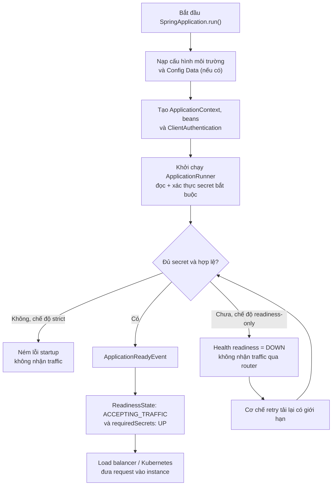
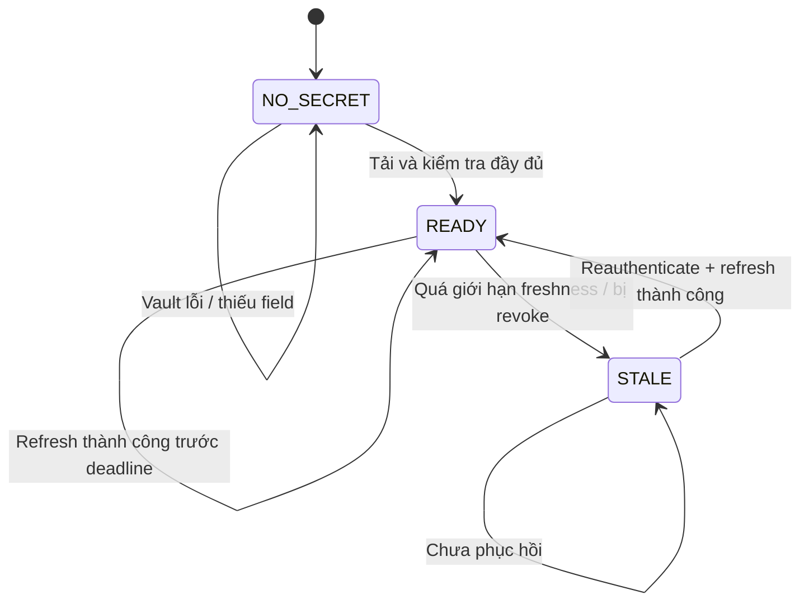

# Đảm bảo secret cần thiết có sẵn trước khi phục vụ yêu cầu

Một ứng dụng Spring Boot có thể khởi động thành công, mở cổng HTTP và nhận request, nhưng đến khi xử lý giao dịch đầu tiên mới phát hiện **thiếu API key**, **không đọc được KV secret**, **Vault token hết hạn** hoặc **dynamic database credential đã bị thu hồi**. Khi đó hệ thống có vẻ khỏe mạnh với load balancer nhưng không thể thực hiện chức năng cốt lõi.

Trong chương **Tích hợp ứng dụng** của module `SPRING_VAULT`, bài này trình bày cách xác lập điều kiện **ready** dựa trên bí mật và khả năng truy cập Vault thật sự cần thiết. Spring Vault cung cấp `VaultTemplate`/`VaultOperations` để đọc KV secrets và các engine khác; Spring Boot cung cấp các mốc lifecycle, `ApplicationRunner` và Actuator readiness để **chỉ nhận lưu lượng sau khi những điều kiện quan trọng đã được xác minh**.

Kết quả mong muốn không phải là "Vault đang trả HTTP 200" mà là:

> **Ứng dụng chỉ được coi là sẵn sàng khi có đủ credential hợp lệ để thực hiện các nghiệp vụ bắt buộc, với chính sách rõ ràng về việc làm gì nếu secret không còn hợp lệ về sau.**

Bài sử dụng ứng dụng **payment-gateway** làm ví dụ. Ứng dụng cần `partner_api_key` từ KV v2 trước khi gọi đối tác, dùng workload identity để xác thực với Vault, và có thể dùng thêm Transit, PKI hoặc dynamic database credentials tùy chức năng.

## 1. "Khởi động được" không đồng nghĩa với "sẵn sàng phục vụ"

Phân biệt bốn trạng thái:

| Tín hiệu | Câu hỏi cần trả lời | Không chứng minh được điều gì? |
|---|---|---|
| Process đang chạy | JVM còn sống không? | Secret đã tải đủ hay chưa |
| Liveness | Ứng dụng có bị kẹt đến mức cần restart không? | Vault còn truy cập được từ mọi request hay không |
| Readiness | Instance có **nên nhận request mới** không? | Mọi request tương lai đều thành công |
| Kiểm tra secret nghiệp vụ | Key/path/version và policy có đáp ứng chức năng cần thiết không? | Không tự thay thế xác thực và phân quyền người dùng cuối |

Ví dụ `GET /sys/health` của Vault báo Vault server đang hoạt động, nhưng token của `payment-gateway` có thể thiếu `read` trên `secret/data/apps/payments`. Vì vậy kiểm tra Vault health **không thay thế** việc truy cập đúng secret bằng **cùng workload identity** mà ứng dụng sẽ dùng.

Một bí mật tồn tại cũng chưa đủ: `partner_api_key` có thể là chuỗi rỗng, sai định dạng hoặc đã bị đối tác vô hiệu hóa. Điều kiện readiness cần kết hợp **có dữ liệu**, **đọc được bằng policy đúng**, **đúng cấu trúc** và, nếu có thể kiểm tra an toàn, **hợp lệ với nghiệp vụ**.

### 1.1. Ba mức phụ thuộc cần quyết định từ đầu

| Loại phụ thuộc | Ví dụ | Hành vi khuyến nghị |
|---|---|---|
| **Bắt buộc để phục vụ tất cả request** | API key chính, secret ký xác thực | Fail-fast ở khởi động hoặc giữ readiness DOWN cho đến khi tải được |
| **Bắt buộc cho một tính năng nhất định** | Credential của chức năng xuất báo cáo | Có thể giữ app ready nếu tính năng được vô hiệu hóa rõ ràng; endpoint liên quan phải fail closed |
| **Phụ thuộc truy cập theo request** | Transit encrypt/decrypt, cấp chứng chỉ PKI động | Kiểm tra cấu hình/quyền trước khi nhận traffic, đồng thời kiểm soát lỗi runtime; probe đầu kỳ không bảo đảm tương lai |

**Không mặc định mọi secret đều phải tải vào heap khi startup.** Nếu secret chỉ được dùng cho một nghiệp vụ hiếm, việc cố tải toàn bộ có thể mở rộng quyền và làm chậm khởi động. Ngược lại, nếu mọi request cần cùng một secret, đợi đến request đầu tiên mới tải có thể tạo lỗi và thundering herd.

## 2. Đặt cổng readiness vào đúng lifecycle Spring Boot

Spring Boot và Spring Vault có nhiều thời điểm xử lý cấu hình:



`ApplicationRunner` chạy **trước** `ApplicationReadyEvent`. Nếu runner ném exception, startup không hoàn tất bình thường; đây là vị trí thích hợp để fail-fast cho secret bắt buộc. Ứng dụng web có thể đã mở listening socket trong giai đoạn startup trước sự kiện ready, nên **không chỉ dựa vào việc có cổng TCP**. Cần readiness probe ở phía điều phối và guard ở các endpoint bắt buộc nếu có client đi trực tiếp tới instance.

Có hai chiến lược hợp lệ:

1. **Strict startup:** không lấy được secret bắt buộc → ném lỗi, process không trở thành ready. Phù hợp dịch vụ không thể hoạt động đúng nếu thiếu credential; restart policy và phụ thuộc Vault phải được thiết kế để không tạo vòng lặp lỗi.
2. **Readiness-gated startup:** process chạy để phục vụ health/diagnostics và thử tải lại, nhưng endpoint readiness là DOWN đến khi có dữ liệu. Phù hợp khi muốn tránh restart storm do Vault gián đoạn ngắn; cần cấu hình probe và retry đúng cách.

Đừng kết hợp hai chiến lược vô thức: một runner luôn ném lỗi sẽ **không còn process** để readiness probe báo DOWN và tự hồi phục, trong khi một runner nuốt mọi exception nhưng không cập nhật readiness sẽ dễ tạo *false ready*.

## 3. Hai cách tích hợp secret với Spring

### 3.1. Spring Cloud Vault Config Data: secret là cấu hình khởi tạo

Nếu dùng **Spring Cloud Vault**, secret có thể được nạp trong giai đoạn **Config Data** vào Spring `Environment`, rồi bind qua `@ConfigurationProperties`. Một cấu hình minh họa:

```yaml
spring:
  application:
    name: payment-gateway
  config:
    import: "vault://"
  cloud:
    vault:
      uri: "https://vault.example.internal:8200"
      authentication: KUBERNETES
      kubernetes:
        role: payment-gateway
```

Các đường dẫn KV mà Spring Cloud Vault đọc được quyết định bởi cấu hình backend, application name và profile tương ứng. **Không suy ra rằng `spring.config.import: vault://` tự động đọc bất kỳ key nào ở `secret/apps/payments`** nếu chưa cấu hình context theo ứng dụng.

Kiểu triển khai này phù hợp khi ứng dụng dùng secret như property (ví dụ `payment.partner.api-key`), nhưng vẫn cần:

- Phân biệt import **bắt buộc** với import `optional:vault://`; optional không phù hợp nếu thiếu Vault phải chặn startup.
- Kiểm tra các property bắt buộc sau khi bind, không chỉ kiểm tra kết nối đến Vault.
- Đảm bảo workload có auth role/policy phù hợp và không để token trong source control.
- Kiểm tra phiên bản Spring Boot/Spring Cloud Vault tương thích trước khi dùng thuộc tính cấu hình cụ thể.

Ví dụ Bean Validation cho property đã được nạp:

```java
import jakarta.validation.constraints.NotBlank;
import org.springframework.boot.context.properties.ConfigurationProperties;
import org.springframework.validation.annotation.Validated;

@Validated
@ConfigurationProperties(prefix = "payment.partner")
public record PartnerProperties(
    @NotBlank String apiKey
) {}
```

Đăng ký `@ConfigurationPropertiesScan` hoặc `@EnableConfigurationProperties(PartnerProperties.class)` và dependency validation phù hợp. `@NotBlank` chặn trường hợp property vắng/rỗng khi bean được bind; nó **không tự chứng minh** API key chưa bị đối tác thu hồi.

### 3.2. Spring Vault core: tải có kiểm soát bằng `VaultOperations`

Nếu dùng trực tiếp **Spring Vault core** thay vì cơ chế Config Data của Spring Cloud Vault, ứng dụng có thể chủ động đọc path KV trong một bước startup:

```text
Vault auth theo workload
    -> VaultOperations / VaultTemplate
    -> KV v2: secret/data/apps/payments
    -> Kiểm tra schema và trạng thái
    -> Cất snapshot vào holder nội bộ
    -> Readiness UP
    -> Business handler chỉ dùng snapshot hợp lệ
```

Ưu điểm là kiểm soát chính xác **khi nào tải**, **điều kiện nào là bắt buộc** và **khi nào từ chối request**. Nhược điểm là bạn phải tự thiết kế cách refresh, secret rotation và xử lý lỗi.

## 4. Ví dụ Spring Boot: kiểm tra KV v2 trước khi ready

Giả định operator đã mount KV v2 ở `secret/` và lưu key `apps/payments`:

```json
{
  "partner_api_key": "<api-key-chi-dung-trong-lab>"
}
```

Token workload có quyền đọc đúng Vault path `secret/data/apps/payments`. Không nhầm `apps/payments` (đường dẫn tương đối trong Spring Vault KV operations) với endpoint HTTP có `data/` của KV v2.

### 4.1. Holder cho dữ liệu đã kiểm tra

```java
import java.time.Duration;
import java.time.Instant;
import java.util.Objects;
import java.util.concurrent.atomic.AtomicReference;

import org.springframework.stereotype.Component;

record PaymentSecrets(String partnerApiKey, Instant loadedAt) {
    // Tránh log vô tình làm lộ API key.
    @Override
    public String toString() {
        return "PaymentSecrets[REDACTED]";
    }
}

@Component
public class PaymentSecretStore {

    private final AtomicReference<PaymentSecrets> current =
            new AtomicReference<>();

    public void install(PaymentSecrets value) {
        current.set(Objects.requireNonNull(value));
    }

    public boolean isFresh(Duration maxAge) {
        PaymentSecrets value = current.get();
        return value != null
                && Instant.now().isBefore(value.loadedAt().plus(maxAge));
    }

    public PaymentSecrets required(Duration maxAge) {
        PaymentSecrets value = current.get();
        if (value == null
                || !Instant.now().isBefore(value.loadedAt().plus(maxAge))) {
            // Tránh đưa raw secret hoặc Vault response vào exception.
            throw new IllegalStateException("Required payment secret unavailable");
        }
        return value;
    }
}
```

`AtomicReference` giúp thay cả snapshot một cách nhất quán trong một JVM. `maxAge` trong ví dụ là **giới hạn freshness nội bộ do ứng dụng chọn**, **không phải Vault KV lease**: KV v2 tĩnh không có lease ID chỉ vì một key đã được đọc. Với secret có TTL/expiry riêng, phải kiểm tra mốc thực thay vì tự coi dữ liệu tĩnh là hợp lệ vô hạn.

### 4.2. Loader thực hiện trước `ApplicationReadyEvent`

```java
import java.time.Instant;
import java.util.Map;
import java.util.Objects;

import org.springframework.boot.ApplicationRunner;
import org.springframework.context.annotation.Bean;
import org.springframework.context.annotation.Configuration;
import org.springframework.vault.core.VaultKeyValueOperations;
import org.springframework.vault.core.VaultOperations;
import org.springframework.vault.core.VaultKeyValueOperationsSupport.KeyValueBackend;
import org.springframework.vault.support.VaultResponseSupport;

@Configuration
public class PaymentSecretBootstrap {

    @Bean
    ApplicationRunner requirePaymentSecretOnStartup(
            VaultOperations vault, PaymentSecretStore store) {

        return args -> {
            VaultKeyValueOperations kv =
                    vault.opsForKeyValue("secret", KeyValueBackend.KV_2);

            VaultResponseSupport<Map> result =
                    Objects.requireNonNull(
                        kv.get("apps/payments", Map.class),
                        "Required payment secret not available"
                    );

            Map<?, ?> data = Objects.requireNonNull(
                    result.getData(),
                    "Required payment secret data not available"
            );

            Object candidate = data.get("partner_api_key");
            if (!(candidate instanceof String key) || key.isBlank()) {
                throw new IllegalStateException(
                    "Required payment secret has invalid schema"
                );
            }

            store.install(new PaymentSecrets(key, Instant.now()));
            // Tuyệt đối không log key hoặc result.getData().
        };
    }
}
```

Nếu Vault trả `403`, `404`, timeout hoặc dữ liệu không hợp lệ, runner không hoàn tất; ở **strict startup** điều đó là chủ đích. Đừng bắt mọi `Exception` rồi chỉ in "Vault failed" và tiếp tục như chưa có vấn đề.

Mẫu này chỉ minh họa yêu cầu cho **một** key bắt buộc. Nếu có nhiều key, hãy tải và kiểm tra **toàn bộ** trước khi công bố một snapshot hoàn chỉnh; không publish từng phần rồi cho instance ready khi mới có một nửa dữ liệu.

### 4.3. Business service không tự ý dùng dữ liệu chưa sẵn sàng

```java
import java.time.Duration;
import org.springframework.stereotype.Service;

@Service
public class PartnerPaymentClient {

    private final PaymentSecretStore secrets;

    public PartnerPaymentClient(PaymentSecretStore secrets) {
        this.secrets = secrets;
    }

    public void sendAuthorizedPaymentRequest() {
        // Kiểm tra lại tại đường request, kể cả khi readiness chưa kịp cập nhật.
        PaymentSecrets value = secrets.required(Duration.ofMinutes(15));
        String apiKey = value.partnerApiKey();

        // Dùng apiKey khi gọi HTTPS đến đối tác qua HTTP client phù hợp.
        // Không đưa apiKey vào URL, log, trace hoặc response cho người dùng.
    }
}
```

Vì freshness là 15 phút trong ví dụ, **phải có cơ chế refresh trước khi mốc đó trôi qua** nếu muốn phục vụ liên tục. Không copy đúng đoạn kiểm tra `Duration.ofMinutes(15)` vào production mà bỏ qua nhu cầu rotation/refresh.

Với REST API, thay vì để `IllegalStateException` biến thành lỗi stack trace, nên dùng exception miền và `@ControllerAdvice` trả HTTP 503 với nội dung **không chứa secret** khi dependency bắt buộc không khả dụng. Authorization người dùng vẫn phải được kiểm tra trước khi thực hiện giao dịch.

## 5. Expose readiness với Spring Boot Actuator

Một `HealthIndicator` nên kiểm tra **snapshot đã được xác minh ở trong bộ nhớ**, không tự gọi Vault một lần cho mỗi probe. Nếu hàng trăm pod cùng gọi Vault mỗi vài giây, cơ chế health-check có thể trở thành nguyên nhân quá tải.

### 5.1. HealthIndicator cho required secret

```java
import java.time.Duration;

import org.springframework.boot.actuate.health.Health;
import org.springframework.boot.actuate.health.HealthIndicator;
import org.springframework.stereotype.Component;

@Component("paymentSecretsHealthIndicator")
public class PaymentSecretsHealthIndicator implements HealthIndicator {

    private final PaymentSecretStore store;

    public PaymentSecretsHealthIndicator(PaymentSecretStore store) {
        this.store = store;
    }

    @Override
    public Health health() {
        return store.isFresh(Duration.ofMinutes(15))
                ? Health.up().build()
                : Health.down().build();
    }
}
```

Spring Boot Actuator lấy contributor ID `paymentSecrets` từ bean `paymentSecretsHealthIndicator`. Cấu hình readiness group bao gồm cả `readinessState` của Boot và `paymentSecrets`:

```yaml
management:
  endpoint:
    health:
      probes:
        enabled: true
      group:
        readiness:
          include:
            - readinessState
            - paymentSecrets
  endpoints:
    web:
      exposure:
        include: health,info
```

Đường dẫn thông thường:

- `GET /actuator/health/liveness` — tình trạng liveness của ứng dụng.
- `GET /actuator/health/readiness` — trạng thái readiness kết hợp với `PaymentSecretsHealthIndicator`.

Khi `paymentSecrets` DOWN, tổng hợp readiness trả trạng thái DOWN, thường ánh xạ sang HTTP 503. Nếu readiness group không include health indicator này, pod có thể **ready dù secret store đang rỗng**. Với actuator bị cấu hình ở cổng quản trị riêng, cần đảm bảo probe thực sự kiểm tra điều kiện phục vụ của ứng dụng và đường mạng phù hợp.

Không nên hiển thị giá trị secret trong health details. Trong môi trường production, kiểm soát truy cập Actuator; chỉ công bố trạng thái tổng quan và category lỗi không nhạy cảm.

### 5.2. Kết nối với Kubernetes probes

```yaml
readinessProbe:
  httpGet:
    path: /actuator/health/readiness
    port: 8080
  periodSeconds: 5
  timeoutSeconds: 2
  failureThreshold: 3

livenessProbe:
  httpGet:
    path: /actuator/health/liveness
    port: 8080
  periodSeconds: 10
  timeoutSeconds: 2
  failureThreshold: 3
```

Đây là **đoạn cấu hình container trong Kubernetes**, không phải `application.yml`. Điều chỉnh port, path, timeout và ngưỡng cho môi trường triển khai.

**Không gắn sự cố Vault ngắn hạn vào liveness** chỉ vì không đọc được secret. Nếu mọi pod bị restart đồng loạt khi Vault chập chờn, hệ thống dễ bị restart storm. Readiness phù hợp hơn để ngừng đưa request mới đến instance trong khi tiến trình có thể hồi phục.

Mặt khác, **readiness không chặn client gọi trực tiếp pod IP hoặc cổng ứng dụng**. Business handler vẫn cần kiểm tra `PaymentSecretStore.required(...)` hoặc một guard tương đương trước khi xử lý tác vụ dùng secret.

## 6. Nếu muốn process sống và chờ Vault hồi phục

Trong **readiness-gated startup**, đừng ném exception trong runner cuối cùng; đặt indicator DOWN, thử tải lại có giới hạn và chỉ publish snapshot khi toàn bộ validation PASS. Một cách tiếp cận:



### 6.1. Làm mới snapshot không phá dữ liệu đang dùng

Để refresh an toàn:

1. Chuẩn bị **snapshot mới** trong biến cục bộ: đọc tất cả secret cần thiết và kiểm tra từng trường.
2. Nếu một phần thất bại, **không publish snapshot chưa đầy đủ**.
3. Khi toàn bộ thành công, thay `AtomicReference` một lần để request mới nhận snapshot đồng nhất.
4. Nếu refresh thất bại, giữ snapshot cũ **chỉ đến khi chính sách freshness/expiry cho phép**; sau deadline thì readiness DOWN và request liên quan bị từ chối.
5. Dùng exponential backoff, jitter, timeout và tối đa số lần thử thích hợp. Không gửi liên tục cùng một request tới Vault trong vòng lặp vô hạn.

Với hai giá trị phải thay đổi đồng bộ (ví dụ username/password), nên lưu chung trong một record bất biến và thay snapshot nguyên khối. Nếu thay username và password ở hai field `volatile` riêng, một request có thể dùng giá trị mới của một field và giá trị cũ của field kia.

Một tác vụ refresh nền có thể dùng `@Scheduled` sau khi bật `@EnableScheduling`, hoặc được orchestration/controller gọi theo sự kiện. Tuy nhiên, ví dụ **strict `ApplicationRunner`** ở mục 4 sẽ dừng startup nếu lần tải đầu tiên thất bại; muốn chế độ chờ hồi phục phải đổi hành vi bootstrap theo chủ đích, không chỉ thêm scheduler vào cùng runner đang fail-fast.

### 6.2. Khi Vault tạm thời không truy cập được

**Không có một chính sách cache-stale đúng cho mọi bí mật**:

| Bí mật / chức năng | Có thể dùng snapshot đã có khi Vault tạm lỗi? | Rủi ro cần kiểm soát |
|---|---|---|
| KV v2 chứa cấu hình tĩnh | Có thể, trong giới hạn tuổi dữ liệu đã định | Secret có thể đã rotate/revoke và cache chưa cập nhật |
| API key của đối tác | Tùy yêu cầu đối tác và giới hạn freshness | Key bị thu hồi ở phía đối tác dù Vault vẫn giữ bản cũ |
| Database dynamic credentials | Chỉ trong **lease còn hiệu lực** và connection pool được quản lý | Lease hết hạn/revoke; kết nối mới thất bại |
| Transit encrypt/decrypt | Không thể thay thế request crypto chỉ bằng ciphertext cache | Vault phải thực hiện phép mã hóa/giải mã; không tự xuất khóa |
| PKI cấp chứng chỉ | Không thể phát hành chứng chỉ mới khi CA/Vault unavailable | Chứng chỉ đã cấp có thời hạn X.509 riêng; bảo vệ private key |
| Token runtime Vault | Có thể sử dụng nếu còn hạn và policy vẫn cho phép | Token hết hạn/revoked, không được fallback sang root token |

Quy tắc chung là **fail closed khi không có chứng cứ đủ mạnh về tính hợp lệ**, không biến plaintext/default credential thành fallback. Nếu quyết định dùng cache cho chức năng cụ thể, hãy xác định rõ `maximum staleness`, cách invalidate, luồng rotation và thời gian service được phép tiếp tục hoạt động.

## 7. Vòng đời token, lease và certificate ảnh hưởng readiness

### 7.1. Token: có secret chưa chắc còn quyền truy cập

`VaultTemplate` gửi request theo token nhận từ `ClientAuthentication`/`SessionManager`. Một snapshot KV đã được đọc có thể vẫn nằm trong heap trong khi Vault token hiện tại đã hết hạn. Quyết định readiness lúc này tùy vào nghiệp vụ:

- Nếu **mọi request phải gọi Vault** (ví dụ Transit decrypt), token không hợp lệ làm dịch vụ mất khả năng phục vụ chức năng đó.
- Nếu request chỉ dùng KV snapshot tĩnh và policy cho phép dùng trong một khoảng freshness, việc Vault tạm lỗi không nhất thiết bắt buộc đánh sập toàn bộ dịch vụ.
- Nếu token cần gia hạn, `LifecycleAwareSessionManager` có thể quản lý token renewal trong giới hạn Vault cho phép. Khi không thể renew hoặc login lại, phải xử lý authentication failure rõ ràng.

Không dựa vào `VaultTemplate` đã được tạo bean thành công làm bằng chứng token có thể truy cập Vault: có luồng khởi tạo client chưa gửi request nào đến server.

### 7.2. Dynamic secret: phải theo dõi lease thật

Đối với `database/creds/<role>`, phản hồi có thể chứa `username`, `password` cùng `lease_id`, `lease_duration` và `renewable`. Đây là dữ liệu **có vòng đời**, khác KV v2 tĩnh.

```text
Vault lease issued
      |
      v
Database credentials --> connection pool
      |
      +-- renew được --> tiếp tục dùng theo lease hợp lệ
      |
      +-- rotate / revoke / expire --> thay credential, tạo pool mới
                                 --> không nhận request mới nếu không còn DB path cần thiết
```

Spring Vault có `SecretLeaseContainer` để theo dõi leased secrets và renewal/rotation qua các cơ chế được hỗ trợ. Khi dùng, phải kiểm tra sự kiện có secret mới, failure/revoke và cách thay kết nối trong pool. **Health indicator báo secret đã từng tải thành công không đủ** nếu lease đã hết hạn và pool không tạo được connection mới.

Đối với database, có thể cần kiểm tra **khả năng thực hiện một truy vấn rất nhẹ** bằng chính connection pool đã cấu hình, nhưng probe đó phải có timeout, tần suất phù hợp và không gây quá tải. Không gọi endpoint cấp credential mới từ Vault trên mỗi readiness probe.

### 7.3. Transit và PKI không giống KV

- **Transit:** khóa nằm trong Vault. Startup có thể kiểm tra cấu hình mount/role và thực hiện một thao tác thử an toàn bằng **quyền đúng của workload**, nhưng đây chỉ là bằng chứng tại thời điểm đó. Nếu service chỉ được `encrypt` thì không nên đòi `decrypt` để kiểm tra rồi cấp thêm quyền không cần thiết.
- **PKI:** khi cần chứng chỉ để mở HTTPS/mTLS, có thể phải xin cấp và nạp keystore trước khi listener phục vụ kết nối. Readiness phụ thuộc chứng chỉ đã được nạp đúng, chuỗi tin cậy phù hợp và `notAfter` còn hiệu lực.
- **KV v2:** kiểm tra version không bị soft delete/destroy và trường bắt buộc có mặt. KV v2 không tự phát lease cho từng key như Database dynamic secrets.

## 8. Vault ACL cho bootstrap secret

Với KV v2 mount `secret/`, ứng dụng chỉ cần đọc key `apps/payments`:

```hcl
# payment-gateway.hcl
path "secret/data/apps/payments" {
  capabilities = ["read"]
}
```

Đường HTTP API có `data/` vì dùng KV v2; `VaultOperations.opsForKeyValue("secret", KV_2).get("apps/payments", ...)` sẽ chọn endpoint tương ứng.

Token workload **không cần** `sudo`, `root`, quyền ghi `secret/data/*` hoặc quyền liệt kê toàn bộ secret chỉ để thực hiện bootstrap. Nên gắn policy trên vào identity workload riêng (ví dụ Kubernetes ServiceAccount + Vault Kubernetes auth role hoặc AppRole/JWT), thay vì phát một static root token cho mọi instance.

Nếu secret xuất hiện ở nhiều namespace hoặc tenant, **không tin tên tenant/path do client gửi** khi xây đường Vault. Tên secret bắt buộc là cấu hình phía server; nếu thực sự dynamic theo tenant, phải kiểm tra authorization và whitelist namespace/path để tránh truy cập chéo tenant.

### Tại sao không dùng quyền `list` thay cho `read`?

`list` trên `secret/metadata/...` (KV v2) cho phép liệt kê tên key trong phạm vi. Nó **không cấp quyền đọc `secret/data/apps/payments`**. Bootstrap cần đọc giá trị phải có `read` đúng endpoint; tránh cấp `list` khi không cần vì tên key cũng có thể tiết lộ thông tin vận hành.

## 9. Failure mode và hành vi mong muốn

| Tình huống | Tác động | Cách xử lý startup/readiness |
|---|---|---|
| Vault unreachable / DNS / TLS error | Không tải được secret mới | Fail-fast hoặc readiness DOWN; retry có hạn, không ghi log credential |
| Token chưa xác thực hoặc hết hạn | Vault từ chối thao tác | Kiểm tra auth workload và session manager; không fallback sang token admin |
| `403 permission denied` | Policy thiếu quyền ở key bắt buộc | Không đánh đồng với secret vắng; điều tra role và effective policy |
| `404` ở KV v2 | Sai mount/path, secret chưa có, version không đọc được | Chặn ready; kiểm tra chính xác đường `secret/data/...` |
| Secret đọc được nhưng thiếu field | Phản hồi không thỏa hợp đồng | Chặn ready; không dùng chuỗi rỗng làm placeholder |
| Secret quay vòng giữa hai request | Bản cũ có thể không còn hợp lệ | Atomic refresh, invalidation/freshness và lỗi nghiệp vụ được kiểm soát |
| Vault phục hồi sau outage | Có thể thử đọc lại | Giữ readiness DOWN đến khi validation thật sự PASS |
| Token vẫn tồn tại nhưng không còn quyền | Secret read hoặc engine operation trả `403` | Xử lý như permission error, không tự cấp quyền mạnh hơn |
| Lease DB hết hạn | Pool không tạo được kết nối hợp lệ | Refresh credentials/pool; nếu DB là phụ thuộc bắt buộc thì readiness DOWN |
| PKI cert sắp hết hạn | TLS có nguy cơ ngừng hoạt động | Rotate sớm, kiểm tra `notAfter`, cảnh báo trước deadline |
| Probe đọc Vault mỗi 1 giây | Tăng tải, dễ gây cascade failure | Probe đọc trạng thái local, worker refresh ở tần suất được kiểm soát |
| Readiness DOWN nhưng endpoint vẫn được gọi trực tiếp | Router không phải hàng rào duy nhất | Guard nghiệp vụ kiểm tra secret/expiry và fail closed |

Không nên ném lỗi có chứa raw `VaultResponse` vào JSON API. Trường hợp thất bại khi phục vụ request nên có HTTP status rõ ràng, correlation ID, thông điệp an toàn và không chứa `apiKey`/`password`/`private_key`.

## 10. Quan sát và cảnh báo mà không lộ secret

Nên thu thập:

- **Secret bootstrap success/failure** theo instance, mount và nhóm chức năng, không gắn secret value vào label.
- **Thời gian tải và số lần retry**, phân loại lỗi `authentication`, `permission`, `not-found`, `schema`, `timeout`.
- **Tuổi snapshot** và deadline freshness; đo thời gian từ lần refresh thành công cuối.
- **Token renewal failure** và giới hạn TTL còn lại theo nhóm (không đưa client token hay accessor vào public metric).
- **Dynamic lease expiry** và số lần rotation/reconnect credential database.
- **Readiness transitions** (UP → DOWN → UP), ảnh hưởng lên lưu lượng và tỷ lệ lỗi nghiệp vụ.

Trong log, chỉ ghi operation, Vault path đã chuẩn hóa (nếu path không tiết lộ tenant/tên khách hàng), HTTP status, Vault request ID và thời gian. **Không log** header `X-Vault-Token`, JSON `data`, chuỗi Base64 của plaintext Transit, private key PKI hoặc toàn bộ bound configuration object.

Phân biệt cảnh báo **"instance chưa ready sau khởi động"** với **"instance đang phục vụ chuyển sang not ready"**; nguyên nhân và mức ưu tiên vận hành có thể khác nhau.

## 11. Kiểm thử tích hợp: chứng minh readiness thật

Để kiểm tra hành vi với Vault, dùng Vault thử nghiệm cô lập (chẳng hạn container/dev Vault trong CI) và các role/policy giới hạn. Mock `VaultOperations` hữu ích cho unit test validation nhưng không chứng minh được ACL, lease hay trạng thái Vault server.

| Kịch bản | Cấu hình đầu vào | Kết quả cần quan sát |
|---|---|---|
| Đủ secret | KV v2 có `partner_api_key` hợp lệ, token có `read` | Runner thành công; readiness UP; handler nhận snapshot |
| Secret chưa được provision | Key `apps/payments` không tồn tại | Strict startup thất bại hoặc readiness DOWN, không phục vụ request |
| Field rỗng/sai schema | `partner_api_key` rỗng, số hoặc thiếu | Validation fail; không báo ready |
| Token thiếu ACL | Role không có `read secret/data/apps/payments` | Nhận `403`, không nhầm thành giá trị rỗng |
| Vault không truy cập được lúc boot | Chặn kết nối hoặc TLS không hợp lệ | Fail-fast/giữ DOWN đúng chiến lược; không dùng default key |
| Nửa số secret đọc được | Có secret A nhưng thiếu B | Không publish snapshot một phần |
| Refresh toàn bộ thành công | Secret mới đủ schema | Snapshot đổi nguyên khối; request mới dùng bản mới |
| Refresh thất bại trong ngưỡng cache | Có snapshot cũ chưa quá `maxAge` | Hành vi theo freshness policy; không tự phát tán lỗi chi tiết |
| Refresh thất bại quá hạn | Snapshot vượt `maxAge` | Readiness DOWN và handler không dùng bản cũ |
| Liveness khi Vault outage | JVM khỏe nhưng required secret không đạt | Liveness UP; readiness DOWN |
| Dynamic credential hết lease | Vault revoke/expire lease của DB credential | Quản lý lease/pool hoặc readiness DOWN trước request mới |
| Transit token bị rút quyền | Token encrypt-only không còn quyền | Request encrypt thất bại an toàn; không lưu plaintext thay thế |
| Secret xuất hiện trong log? | Bật logger ở mức debug của ứng dụng test | Log/traces không chứa raw secret hoặc Vault token |

### Bài lab gợi ý

1. Provision KV v2 `secret/apps/payments` chứa `partner_api_key` giả trong Vault thử nghiệm. Cấp role workload chỉ đọc `secret/data/apps/payments`.
2. Chạy ứng dụng với `PaymentSecretBootstrap` và kiểm tra `GET /actuator/health/readiness` trả UP.
3. Bỏ key hoặc dùng token thiếu ACL rồi chạy lại. Với strict startup, kiểm tra quá trình khởi động kết thúc lỗi; không suy diễn readiness HTTP vẫn tồn tại khi process không start được.
4. Chuyển sang chế độ readiness-gated nếu bài lab yêu cầu process tiếp tục chạy; kiểm tra endpoint readiness DOWN khi chưa có secret.
5. Bổ sung key đúng schema và kích hoạt bước refresh; xác minh readiness UP khi toàn bộ validation PASS.
6. Thay key bằng giá trị không hợp lệ hoặc làm refresh lỗi đến sau freshness deadline; xác minh readiness DOWN và business handler từ chối request.
7. Ngắt Vault sau khi snapshot đã tải thành công; quan sát sự khác nhau giữa **KV cache trong ngưỡng cho phép** và thao tác **Transit phải gọi Vault trực tiếp**.
8. Kiểm tra `liveness` không trở thành DOWN chỉ do Vault ngắn hạn không truy cập được; kiểm tra log không chứa API key.

Với `ApplicationRunner`, có thể viết một `@SpringBootTest` kiểm tra context fail khi key thiếu, nhưng kiểm thử readiness qua cổng HTTP sẽ phù hợp hơn với chế độ process còn sống để báo DOWN. Đừng chỉ assert rằng `HealthIndicator.health()` trả UP sau khi mock trả data; cần ít nhất một bài test dùng **identity Vault thực** để chứng minh policy và endpoint đúng.

## 12. Checklist trước khi triển khai

- [ ] Phân loại **secret bắt buộc**, secret tùy tính năng và secret chỉ cần theo request.
- [ ] Xác định rõ **strict startup** hay **readiness-gated**; nếu dùng cả hai phải có điều kiện nhất quán.
- [ ] Dùng workload identity và policy `read`/`update` đúng endpoint, không dùng Vault root token.
- [ ] Kiểm tra key tồn tại, schema đúng và dữ liệu không rỗng **trước khi công bố ready**.
- [ ] Nếu dùng Spring Cloud Vault, kiểm tra Config Data import bắt buộc và property validation.
- [ ] Nếu dùng Spring Vault core, tải secret trước `ApplicationReadyEvent` và tránh publish snapshot một phần.
- [ ] Readiness probe có bao gồm contributor kiểm tra secret; liveness không phụ thuộc transient Vault outage.
- [ ] Mọi handler có guard trước khi dùng snapshot, kể cả khi probe chưa cập nhật.
- [ ] Có TTL/freshness và kế hoạch renew/refresh/rotation phù hợp **từng loại secret**.
- [ ] Không tiết lộ token hoặc payload secret qua log, Actuator, exception, metrics và trace.
- [ ] Có test 403/404/timeout, thiếu field, quá hạn, reauthenticate, lease và sự cố Vault.

## 13. Câu hỏi tự kiểm tra

1. Vì sao một bean `VaultTemplate` được tạo thành công vẫn không chứng minh ứng dụng có đủ secret để phục vụ giao dịch?
2. `ApplicationRunner` chạy trước hay sau `ApplicationReadyEvent`? Lý do gì nó phù hợp cho một bootstrap validation?
3. Một instance cần chờ Vault phục hồi mà không restart liên tục nên dùng strict fail-fast hay readiness-gated startup?
4. Vì sao nên dùng readiness để phản ánh thiếu secret thay vì buộc liveness DOWN khi Vault gián đoạn tạm thời?
5. Với KV v2 mount `secret/`, ACL cần cấp `read` trên `secret/apps/payments` hay `secret/data/apps/payments`?
6. Nếu `partner_api_key` đã tải từ Vault nhưng bị đối tác revoke sau đó, readiness có thể khẳng định chắc chắn key vẫn hoạt động không?
7. Tại sao thay hai giá trị credential ở hai biến độc lập có thể làm request thấy trạng thái không nhất quán?
8. Khi nào có thể tiếp tục dùng KV snapshot trong cache và khi nào phải tuyệt đối dừng do lease đã hết hạn?
9. Vì sao không gọi Vault ngay từ `HealthIndicator.health()` cho mọi readiness probe?
10. Trong một service gọi Transit encrypt trực tiếp, kiểm tra được mount hoạt động lúc startup có đủ để bảo đảm mọi request sau đó thành công không?

**Ghi nhớ:** Đảm bảo secret sẵn có trước khi nhận request là một **hợp đồng readiness và lifecycle**, không đơn thuần là đặt `@Value` vào bean. Đọc đúng secret bằng workload identity, xác thực cấu trúc, publish trạng thái nguyên khối, kiểm soát freshness/lease, và dùng readiness để điều phối traffic — nhưng luôn có đường xử lý an toàn ở runtime khi Vault hoặc secret đổi trạng thái.

## Tài liệu chính thức

- [Spring Boot — Application availability, liveness và readiness](https://docs.spring.io/spring-boot/reference/features/spring-application.html#features.spring-application.application-availability)
- [Spring Boot Actuator — Kubernetes probes và health groups](https://docs.spring.io/spring-boot/reference/actuator/endpoints.html#actuator.endpoints.kubernetes-probes)
- [Spring Boot — ApplicationRunner và CommandLineRunner](https://docs.spring.io/spring-boot/reference/features/spring-application.html#features.spring-application.command-line-runner)
- [Spring Vault — VaultTemplate và VaultOperations](https://docs.spring.io/spring-vault/reference/vault/core.html)
- [Spring Vault — KV secrets engines](https://docs.spring.io/spring-vault/reference/vault/vault-secret-engines.html)
- [Spring Vault — Authentication và token lifecycle](https://docs.spring.io/spring-vault/reference/vault/authentication.html)
- [Spring Vault — Lease management](https://docs.spring.io/spring-vault/reference/vault/lease.html)
- [Spring Cloud Vault — Config Data integration](https://docs.spring.io/spring-cloud-vault/reference/config-data.html)
- [HashiCorp Vault — KV v2 HTTP API](https://developer.hashicorp.com/vault/api-docs/secret/kv/kv-v2)
- [HashiCorp Vault — Lease concepts](https://developer.hashicorp.com/vault/docs/concepts/lease)
