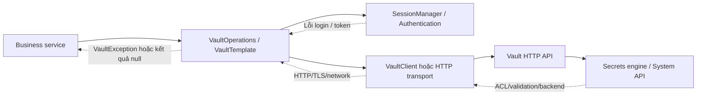
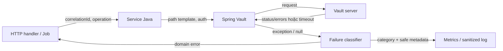

# VaultException và ngữ cảnh của yêu cầu thất bại trong Spring Vault

## 1. Vì sao chỉ bắt `VaultException` là chưa đủ?

Trong module **SPRING_VAULT**, ứng dụng Java dùng `VaultTemplate`/`VaultOperations` để đọc KV secrets, nhận token theo workload, tạo dynamic credentials/lease, gọi Transit encryption và thao tác với PKI. Một lệnh gọi Vault thất bại có thể do nhiều nguyên nhân: đường dẫn không tồn tại, quyền ACL thiếu, token hết hạn, dữ liệu yêu cầu sai, Vault bị sealed, mất kết nối mạng, TLS không hợp lệ hoặc backend cloud/database tạm thời không sẵn sàng.

Ví dụ ứng dụng thanh toán gọi:

```java
VaultResponse response =
        vaultOperations.read("secret/data/payments/gateway");
```

Ba tình huống sau có thể trông giống nhau ở tầng nghiệp vụ nhưng cần xử lý khác nhau:

- **Secret không tồn tại:** `read(...)` có thể trả `null`. Nếu cấu hình cho phép thiếu secret tùy chọn, đây có thể là trạng thái hợp lệ.
- **Token không có quyền:** Vault có thể trả `403 permission denied`; ứng dụng phải báo lỗi xác thực/phân quyền và sửa cấu hình. Retry vô hạn không thể tự tăng quyền.
- **Vault tạm quá tải:** request có thể thất bại bằng `503` hoặc timeout; một lần retry có kiểm soát có thể giúp phục hồi, nhưng chỉ khi thao tác có thể thử lại an toàn.

`VaultException` là lớp exception chung của Spring Vault. **Tên lớp exception không tự cung cấp đủ ngữ cảnh** để quyết định retry, báo lỗi cho người dùng hay điều tra bảo mật. Cần kết hợp loại exception, HTTP status *nếu có*, thao tác đang làm, engine, đường dẫn logic được chuẩn hóa, tính chất idempotent, tình trạng session/token và dấu vết quan sát được.

### Mục tiêu bài học

Sau bài này, bạn có thể:

1. Nhận diện `VaultException`, các nhánh lỗi đăng nhập/session và lỗi HTTP trong Spring Vault.
2. Phân biệt một kết quả đọc không tồn tại với một lỗi quyền, lỗi cấu hình và lỗi hạ tầng.
3. Thiết kế **failure context** đủ để điều tra mà không làm lộ token, mật khẩu, plaintext hoặc private key.
4. Viết lớp xử lý lỗi cho `VaultTemplate` với policy retry phụ thuộc loại thao tác.
5. Kiểm thử tích hợp những trường hợp `400`, `403`, `404`, `412`, `429`, `5xx`, timeout, token/lease và lỗi giải mã.

## 2. Exception trong Spring Vault: tầng nào phát sinh lỗi?

Một lần gọi từ ứng dụng xuống Vault thường có chuỗi:



| Lớp / nhóm lỗi | Vai trò | Ví dụ cần phân biệt |
| --- | --- | --- |
| `org.springframework.vault.VaultException` | Exception runtime cơ sở của Spring Vault, kế thừa `NestedRuntimeException` | Lỗi tương tác Vault đã được chuyển đổi |
| `org.springframework.vault.authentication.VaultLoginException` | Lỗi đăng nhập lấy Vault token từ auth method | AppRole sai SecretID, Kubernetes JWT không được role chấp nhận |
| `VaultSessionManagerException` và các lớp con | Lỗi quản lý, cấp lại hoặc tra cứu trạng thái session/token | Token đã hết hạn, thất bại khi renew hoặc xác thực lại |
| `SecretNotFoundException` | API đọc yêu cầu tồn tại, ví dụ `readRequired(...)` từ Spring Vault 4.x | Đọc path không tồn tại khi nghiệp vụ bắt buộc phải có |
| `VaultClientResponseException` (**Spring Vault 4.1+**) | Lỗi của `VaultClient`/`ReactiveVaultClient`, có API lấy status và response | HTTP `400`, `403`, `503`; lỗi đọc/giải mã phản hồi ở tầng client |
| `HttpStatusCodeException`, `ResourceAccessException` và các lỗi HTTP client khác | Lỗi tầng `RestTemplate`/`RestClient`, có thể là *cause* hoặc xuất hiện khi tự gọi HTTP | Status của server, timeout, lỗi DNS, TLS, kết nối bị từ chối |

**Lưu ý tương thích phiên bản:**

- `VaultException` và `VaultLoginException` đã tồn tại ở các bản Spring Vault trước 4.1.
- `VaultClientResponseException` được giới thiệu ở **Spring Vault 4.1**. Nếu dự án dùng Spring Vault 3.x/4.0, đừng import lớp này; thay vào đó xem exception thực tế và *cause chain* của HTTP client tương ứng.
- `VaultOperations.read(String)` có thể trả `null` khi không tìm thấy path. `VaultOperations.readRequired(String)` có trong dòng 4.x và chuyển trường hợp không tồn tại thành `SecretNotFoundException`. Không nên giả định mọi lỗi `404` đều đi tới cùng một lớp exception với mọi method và phiên bản.
- Các phương thức như `write(...)` có thể trả `null` khi endpoint thành công nhưng không có response body. **`null` không luôn đồng nghĩa thất bại**, tùy hợp đồng API cụ thể.

Cách đáng tin cậy là **đọc hợp đồng của phương thức đang gọi và kiểm tra phiên bản Spring Vault thực tế**. Không dựa hoàn toàn vào tên exception hoặc chuỗi thông báo lỗi để suy ra status.

## 3. Phản hồi HTTP lỗi của HashiCorp Vault

Khi Vault trả HTTP status lỗi, response thông thường có dạng:

```http
HTTP/1.1 403 Forbidden
Content-Type: application/json

{
  "errors": ["permission denied"]
}
```

Mảng `errors` chứa thông điệp phía server. Đây là **dữ liệu để chẩn đoán**, không phải nội dung an toàn để hiển thị trực tiếp trong API công khai hoặc lưu toàn bộ vào log. Với một số lỗi proxy/TLS/timeout, **không hề có HTTP response của Vault**, do đó sẽ không có JSON `errors`.

| Status / trạng thái | Ý nghĩa thường gặp | Hướng điều tra | Có nên retry? |
| --- | --- | --- | --- |
| `400 Bad Request` | Payload sai, tham số bắt buộc thiếu, key/context/định dạng không hợp lệ | Kiểm tra schema và dữ liệu đầu vào | Thường **không**; sửa yêu cầu |
| `403 Forbidden` | Token sai/hết hạn, policy hoặc auth/namespace không phù hợp | Xác thực workload, token session, Vault ACL | Không retry lặp vô hạn; chỉ đăng nhập lại có kiểm soát khi đúng là token hết hạn |
| `404 Not Found` | Mount/path không tồn tại, secret vắng mặt, **đôi khi Vault cố ý che quyền bằng 404** | Kiểm tra path, KV version, ACL và semantics của lệnh đọc | Không mặc định retry; phân biệt optional/missing/config |
| `405 Method Not Allowed` | Nhầm HTTP method cho endpoint | Đối chiếu API contract | Không |
| `412 Precondition Failed` | Một số triển khai Enterprise gặp eventual consistency chưa đáp ứng | Kiểm tra yêu cầu, namespace, topology | Có thể retry ngắn với backoff |
| `429` | Có thể là **standby health status** hoặc giới hạn quota/rate | Kiểm tra endpoint: `sys/health` khác với API cấp secret | Tùy ngữ cảnh: routing sang active node hoặc backoff |
| `472`, `473`, `474` | Trạng thái replication/standby/HA trong kiểm tra sức khỏe Vault | Phân tích `sys/health` và định tuyến load balancer | Không diễn giải trực tiếp là lỗi ACL của secret |
| `500` | Lỗi nội bộ Vault hoặc backend | Audit/metrics Vault, trạng thái storage/backend | Retry hữu hạn nếu thao tác an toàn |
| `501` | Vault chưa khởi tạo | Tình trạng bootstrap/unseal của cluster | Sự cố vận hành, không spam retry |
| `502` | Vault gọi backend bên thứ ba bị lỗi | AWS/Azure/GCP/database/plugin liên quan | Chỉ retry khi nghiệp vụ/side effect cho phép |
| `503` | Vault sealed, bảo trì, quá tải hoặc tạm không sẵn sàng | Health, HA, latency, storage, network | Retry có giới hạn nếu hợp lý |

**Cảnh báo về 404:** `404` không phải bằng chứng chắc chắn rằng người gọi có quyền nhưng secret không tồn tại. Vault có thể dùng `404` để tránh tiết lộ sự tồn tại của tài nguyên. Phải kiểm tra ACL bằng một danh tính quản trị phù hợp khi cần chẩn đoán; không dùng thử quyền bằng cách đọc bí mật của tenant khác.

**Cảnh báo về 429:** endpoint `/sys/health` mặc định trả `429` khi node là standby. Trong nghiệp vụ đọc secrets, `429` còn có thể biểu thị hạn mức yêu cầu. Phải giữ tên endpoint, loại request và nguồn response trong failure context, tránh xử lý mọi `429` bằng cùng một quy tắc.

**Không có status HTTP** trong lỗi DNS, TLS handshake, connect timeout hoặc read timeout trước khi nhận được response. Khi đó chỉ lưu `httpStatus = null` và phân loại lỗi transport thay vì tự gán `500` hoặc `503`.

## 4. Ngữ cảnh của yêu cầu thất bại gồm những gì?

Một lỗi như `VaultException: permission denied` không trả lời được câu hỏi “dịch vụ nào, thao tác nào, đối tượng nào, lúc nào, thử lại bao nhiêu lần, thành công hay thất bại ở tầng nào?”. Nên chuẩn hóa **failure context** trước khi chuyển lỗi qua các tầng ứng dụng.

| Trường cần ghi | Ví dụ an toàn | Vì sao cần? |
| --- | --- | --- |
| `operation` | `KV_READ`, `TRANSIT_ENCRYPT`, `PKI_ISSUE`, `LEASE_RENEW` | Phân biệt thao tác có thể retry với thao tác có side effect |
| `method` | `GET`, `POST` | Xác định hợp đồng HTTP; **không đủ** để quyết định idempotency |
| `pathTemplate` | `secret/data/{service}/{key}` | Đối chiếu route mà không đưa ID/secret tùy ý vào log |
| `mount` / `engine` | `secret` + `KV_V2`, `transit`, `pki` | Nhận biết sai mount hoặc sai phiên bản API |
| `service` và `environment` | `payment-api`, `staging` | Khoanh vùng workload bị ảnh hưởng |
| `namespace` | Alias namespace đã chuẩn hóa | Phân biệt namespace Vault Enterprise/HCP |
| `authMethod` | `kubernetes`, `approle`, `jwt` | Điều tra lỗi lấy token/renew; **không chứa token** |
| `attempt` / `elapsedMs` | `2`, `870` | Đo retry và độ trễ |
| `httpStatus` | `403`, `503` hoặc `null` | Phân loại lỗi HTTP và lỗi transport |
| `failureCategory` | `ACCESS_DENIED`, `MISSING`, `TRANSIENT` | Gắn với cách phản ứng của ứng dụng |
| `correlationId` | ID trace do ứng dụng sinh | Liên kết log của request nghiệp vụ với gateway và audit |
| `vaultRequestId` | ID audit/request nếu thực sự được cung cấp | Đối chiếu log Vault mà không cần lưu payload |

**Không ghi**: `X-Vault-Token`, AppRole `secret_id`, Kubernetes JWT, token accessor nếu không được bảo vệ, giá trị KV, access key/secret, PKI private key, Transit plaintext/ciphertext nguyên văn, JSON request/response body không lọc. **Đường dẫn Vault có thể chứa dữ liệu nhạy cảm**, vì vậy chỉ ghi *route template* hoặc path đã được kiểm soát, không log URL tùy ý từ input.

Vault audit device có trường request ID do Vault tạo. Nếu client/gateway không thực sự nhận ID này qua một cách đã xác minh, **không tự chế `X-Vault-Request-Id` rồi tuyên bố đó là ID của Vault**. Tạo `correlationId` tại ứng dụng và đối chiếu qua audit log theo dữ liệu được phép, thời gian và danh tính workload.

### Sơ đồ luồng giữ context



Ngữ cảnh được tạo **trước** khi gọi Vault rồi bổ sung kết quả sau khi lỗi. Nếu tạo context bằng cách tự parse stack trace hay message khi đã thất bại, thường thiếu thông tin thao tác và dễ lộ dữ liệu trong lỗi nội bộ.

## 5. Phân loại lỗi theo hành vi nghiệp vụ

Có thể xây dựng một taxonomy độc lập với vendor:

| Category | Khi nào phân loại | Hành động mặc định |
| --- | --- | --- |
| `NOT_FOUND` | Endpoint đọc trả trạng thái vắng mặt phù hợp contract (ví dụ `VaultOperations.read` trả `null`) | Trả kết quả thiếu secret hoặc lỗi cấu hình tùy trường hợp |
| `ACCESS_DENIED` | Vault từ chối quyền (`403`) và không có bằng chứng session token hết hạn | Dừng, báo người vận hành kiểm tra ACL |
| `AUTH_FAILURE` | `VaultLoginException`, session manager không lấy được login token | Kiểm tra workload auth/role; có thể auth lại có kiểm soát |
| `INVALID_REQUEST` | `400/405` do path/payload/operation sai | Sửa code, schema hoặc đầu vào |
| `CONFLICT_OR_CONSISTENCY` | `412`, KV v2 CAS conflict, dữ liệu chưa hội tụ | Retry có điều kiện hoặc đọc lại phiên bản |
| `TRANSIENT_DEPENDENCY` | `5xx`, quota/rate `429`, transport timeout | Retry hữu hạn nếu thao tác an toàn và còn deadline |
| `UNAVAILABLE` | Vault sealed/uninitialized/HA routing sai kéo dài | Circuit breaker, cảnh báo vận hành |
| `INVALID_RESPONSE` | Phản hồi thành công nhưng không đủ trường hoặc không parse được | Báo lỗi tích hợp, không tự điền secret giả |
| `UNKNOWN` | Không phân loại được hoặc status không có | Bảo toàn error code nội bộ an toàn, điều tra thêm |

Nhớ rằng **một status không tự xác định toàn bộ category**. `403` khi gọi `auth/kubernetes/login` là lỗi đăng nhập, còn `403` khi đọc KV sau khi login thành công thường là lỗi ACL hoặc session. `404` ở `opsForKeyValue` cần đối chiếu mount KV v1/v2 và phương thức đang gọi. `502` khi cấp cloud credential có thể liên quan backend đã thực hiện một phần thao tác trước khi phát hiện lỗi.

## 6. Mã Java: gom lỗi Vault theo ngữ cảnh an toàn

Ví dụ dưới đây dùng Java 17 và **Spring Vault 4.1+**. Ở phiên bản này `VaultClientResponseException` cung cấp `getStatusCode()`; `VaultLoginException` dành riêng cho lỗi login. Thay route và cách cấu hình session bằng bean hiện có của hệ thống.

### 6.1. Lớp context không chứa bí mật

```java
import java.util.UUID;

public record VaultCallContext(
        String operation,
        String pathTemplate,
        String service,
        String correlationId
) {
    public static VaultCallContext forPaymentsKey() {
        return new VaultCallContext(
                "KV_READ",
                "secret/data/payments/{key}",
                "payment-api",
                UUID.randomUUID().toString()
        );
    }
}
```

`pathTemplate` là **giá trị cấu hình cố định đã kiểm soát**, không nhận raw path từ người dùng. `correlationId` được dùng để đối chiếu log nghiệp vụ; với hệ thống đã có OpenTelemetry/trace ID, sử dụng trace ID hiện tại thay vì tạo ID mới ở mỗi tầng.

### 6.2. Exception nghiệp vụ an toàn để log/API

```java
public final class SafeVaultAccessException extends RuntimeException {

    private final String category;
    private final Integer httpStatus;
    private final String correlationId;

    public SafeVaultAccessException(
            String category, Integer httpStatus, String correlationId) {

        super("Vault dependency failed: " + category
                + ", correlationId=" + correlationId);
        this.category = category;
        this.httpStatus = httpStatus;
        this.correlationId = correlationId;
    }

    public String category() { return category; }
    public Integer httpStatus() { return httpStatus; }
    public String correlationId() { return correlationId; }
}
```

Ví dụ **không gắn nguyên cause từ Vault** vào exception xuất hiện ở response/log chung, vì message, URL hoặc body ở các client khác nhau có thể chứa dữ liệu nhạy cảm. Một hệ thống sản xuất có thể giữ cause ở vùng kiểm toán được kiểm soát bằng chính sách lọc và phân quyền truy cập log riêng; không cần mất thông tin gốc trong mọi bối cảnh.

### 6.3. Đọc KV v2 và chuyển đổi lỗi rõ ràng

```java
import java.util.Map;

import org.springframework.stereotype.Service;
import org.springframework.vault.VaultException;
import org.springframework.vault.authentication.VaultLoginException;
import org.springframework.vault.client.VaultClientResponseException;
import org.springframework.vault.core.VaultOperations;
import org.springframework.vault.support.VaultResponse;

@Service
public class PaymentGatewaySecretService {

    private static final String PATH =
            "secret/data/payments/gateway"; // KV v2 path

    private final VaultOperations vaultOperations;

    public PaymentGatewaySecretService(VaultOperations vaultOperations) {
        this.vaultOperations = vaultOperations;
    }

    public String readApiKey() {
        VaultCallContext context = VaultCallContext.forPaymentsKey();

        try {
            VaultResponse response = vaultOperations.read(PATH);

            // read() có thể trả null khi không thấy path.
            if (response == null) {
                throw new SafeVaultAccessException(
                        "NOT_FOUND", null, context.correlationId());
            }
            if (response.getData() == null) {
                throw new SafeVaultAccessException(
                        "INVALID_RESPONSE", null, context.correlationId());
            }

            // Vault KV v2: response.data.data chứa key/value thực.
            Object nested = response.getData().get("data");
            if (!(nested instanceof Map<?, ?> values)) {
                throw new SafeVaultAccessException(
                        "INVALID_RESPONSE", null, context.correlationId());
            }

            Object value = values.get("apiKey");
            if (!(value instanceof String key) || key.isBlank()) {
                throw new SafeVaultAccessException(
                        "MISSING_FIELD", null, context.correlationId());
            }

            return key;
        }
        catch (VaultLoginException e) {
            throw new SafeVaultAccessException(
                    "AUTH_FAILURE", null, context.correlationId());
        }
        catch (VaultClientResponseException e) {
            int status = e.getStatusCode().value();
            throw new SafeVaultAccessException(
                    classifyHttpStatus(status), status,
                    context.correlationId());
        }
        catch (VaultException e) {
            // Bao phủ lỗi session, decode, Vault client không xác định...
            throw new SafeVaultAccessException(
                    "VAULT_CLIENT_ERROR", null, context.correlationId());
        }
    }

    private static String classifyHttpStatus(int status) {
        return switch (status) {
            case 400, 405 -> "INVALID_REQUEST";
            case 403 -> "ACCESS_DENIED";
            case 404 -> "NOT_FOUND_OR_HIDDEN";
            case 412 -> "CONSISTENCY";
            case 429, 500, 502, 503 -> "TRANSIENT_OR_UNAVAILABLE";
            case 501 -> "NOT_INITIALIZED";
            default -> "HTTP_ERROR";
        };
    }
}
```

**Các giới hạn của ví dụ cần hiểu:**

- Đoạn mã dùng `VaultClientResponseException` thuộc **Spring Vault 4.1+**. Nếu dùng phiên bản cũ, thay nhánh bắt exception này bằng cơ chế phân loại dựa trên exception/cause do client thực tế phát sinh (xem phần tiếp theo). Đừng sao chép import sang phiên bản chưa có lớp.
- `read()` trả `null` không bảo đảm HTTP status thực tế là `404` trong mọi đường triển khai. Ví dụ ghi `httpStatus=null` vì không có status được quan sát trực tiếp, đồng thời dùng category `NOT_FOUND` để mô tả kết quả nghiệp vụ. `response.getData() == null` được phân loại riêng là `INVALID_RESPONSE`.
- Những secret KV v2 có thể bị **soft delete**, bị hủy phiên bản hoặc không có phiên bản đọc được. Xem xét domain semantics thay vì gọi mọi `null` là `404` tại mọi thời điểm.
- Code trên minh họa **phân loại lỗi**, chưa tự retry. Không nên đặt vòng retry ngay trong hàm đọc trước khi có deadline, retry budget và quan sát.
- Nếu `VaultClientResponseException` xuất hiện từ lỗi decode/transport ở phiên bản/cấu hình mà không có status HTTP thực tế, không suy diễn status từ message; điều chỉnh mapper theo transport và các lớp exception cụ thể đã được kiểm chứng.

### 6.4. Spring Vault 3.x / 4.0: xem *cause chain* khi có HTTP exception

Ở các bản cũ hơn, `VaultResponses` có thể bọc exception của Spring HTTP client vào `VaultException`. Ví dụ helper chỉ **trích status khi thực sự có `HttpStatusCodeException`**:

```java
import org.springframework.web.client.HttpStatusCodeException;

public final class VaultHttpStatusSupport {

    private VaultHttpStatusSupport() {}

    public static Integer findHttpStatus(Throwable failure) {
        Throwable current = failure;

        while (current != null) {
            if (current instanceof HttpStatusCodeException http) {
                return http.getStatusCode().value();
            }
            current = current.getCause();
        }
        return null; // Có thể là DNS/TLS/timeout hoặc lỗi không mang status.
    }
}
```

Helper này **không bảo đảm** luôn tìm được status: một số bản/adapter chuyển đổi lỗi thành message mà không giữ nguyên HTTP exception làm cause. Không parse các số `403`/`500` từ `getMessage()` bằng regex rồi coi đó là trạng thái đáng tin cậy.

## 7. Xử lý đúng ba tình huống phổ biến

### 7.1. Missing secret và sai KV path

Với KV v2 được mount ở `secret`, API đọc trực tiếp là `secret/data/{path}`. Đường dẫn logic `secret/payments/gateway` của KV v1 **không tương đương** đường dẫn `secret/data/payments/gateway` của KV v2.

```text
Mount:           secret/
Engine version:  KV v2
Logical key:     payments/gateway
Raw API read:    GET /v1/secret/data/payments/gateway
Payload nested:  response.data.data.apiKey
```

Trong Spring Vault có thể sử dụng `vaultOperations.opsForKeyValue("secret", KV_2)` để thư viện quản lý định dạng path KV v2. Khi đọc bằng `read(String)` raw, lập trình viên tự chịu trách nhiệm route và cấu trúc response.

Nếu secret **có thể tùy chọn**, `null` có thể được diễn giải thành `Optional.empty()`. Nếu secret **bắt buộc khi khởi động**, lỗi thiếu phải làm startup thất bại có thông điệp cấu hình rõ ràng. Đừng tự dùng giá trị mật khẩu giả hoặc cache không còn hiệu lực để tiếp tục chạy một nghiệp vụ bảo mật.

### 7.2. `403`: token hết hạn hay ACL sai?

Hai nguyên nhân có thể cùng trả `403`:

- Workload authentication (AppRole/Kubernetes/JWT) không lấy được token hợp lệ hoặc session token bị thu hồi/hết hạn.
- Token còn hiệu lực nhưng Vault policy không cho phép `read` ở route hoặc sai namespace.

Quy trình chẩn đoán thích hợp là: xác nhận Vault session manager có hoạt động và login/renew thành công; kiểm tra token còn hợp lệ ở môi trường được phép; dùng cơ chế kiểm tra capabilities/ACL tương ứng và đối chiếu mount, namespace, path. **Không log Vault token để tra cứu**, không đăng nhập lại vô hạn nếu role/policy đang sai, và không cấp root token để tránh `403`.

Khi đang dùng Spring Vault session management, cơ chế re-login/renew phải do đúng component quản lý token đảm nhiệm. Business code chỉ nên báo `AUTH_FAILURE` hoặc `ACCESS_DENIED` đã phân loại và từ chối thao tác nếu chưa có xác thực an toàn.

### 7.3. Timeout: không biết Vault đã thực thi xong hay chưa

Timeout là tình huống **kết quả chưa xác định**, không tự động có nghĩa Vault chưa xử lý request. Ví dụ:

```text
App --> Vault: POST pki/issue/payment-client
Vault: tạo chứng thư, ghi lease, gửi response
Network: làm mất response
App: read timeout
```

Ứng dụng không biết chứng thư đã được cấp hay chưa. Retry mù có thể phát hành **thêm một certificate và private key mới**. Tương tự, retry endpoint tạo token, dynamic database credentials hoặc cloud credentials có thể tạo thêm secret/lease. Cần theo dõi yêu cầu theo job, đối chiếu tài nguyên đã được tạo nếu backend cho phép, giới hạn retry và có quy trình cleanup.

Đối với **GET KV**, retry thường an toàn về side effect ở Vault, nhưng vẫn cần giới hạn tần suất, thời gian chờ và khả năng bị rate limit. Với `POST transit/encrypt`, mã hóa có thể tạo ciphertext khác giữa các lần do ngẫu nhiên; phải xem hợp đồng nghiệp vụ trước khi coi hai lần gọi là tương đương.

## 8. Retry, backoff, circuit breaker và idempotency

### 8.1. Ma trận retry theo thao tác

| Thao tác | Có side effect cần xét? | Quy tắc retry khi timeout/`5xx` |
| --- | --- | --- |
| `GET secret/data/...` | Không thay Vault data | Thường an toàn để retry giới hạn |
| `GET sys/health` | Không | Có thể retry hoặc chuyển sang endpoint active theo topology |
| `POST transit/decrypt/{key}` | Thông thường không thay dữ liệu nghiệp vụ phía Vault | Có thể retry giới hạn khi ciphertext/context không đổi và caller đã xác thực |
| `POST transit/encrypt/{key}` | Kết quả có thể khác bytes, có audit/usage | Chỉ retry nếu nghiệp vụ chấp nhận kết quả mới và không ghi trùng |
| `POST auth/token/create` | **Có**, tạo token mới | Không retry mù; có thể tạo token thừa |
| `GET database/creds/{role}` | **Có**, có thể tạo user/password mới dù là GET | Không áp dụng giả định “GET luôn idempotent” |
| `POST pki/issue/{role}` | **Có**, cấp chứng thư mới | Tránh retry mù; theo dõi serial/lease |
| `POST sys/leases/renew` | **Có**, thay TTL | Đọc lại lease và xác định trạng thái trước khi lặp |
| `POST sys/leases/revoke` | **Có**, thay trạng thái | Đối chiếu trạng thái/thông báo lỗi và contract backend trước khi lặp |
| `POST secret/data/... ` với KV v2 CAS | **Có**, tăng version nếu ghi thành công | CAS giúp phát hiện ghi trùng/xung đột; đọc lại metadata trước khi quyết định |

Quy tắc quan trọng: **HTTP method không quyết định idempotency trong Vault**. Một GET đến dynamic secrets engine có thể **tạo một secret mới**. Chỉ gắn retry policy sau khi biết backend và ý nghĩa của endpoint.

### 8.2. Một retry policy có thể vận hành

Đối với operation đọc KV an toàn:

1. Phân loại lỗi: chỉ retry loại transient phù hợp như timeout mạng tạm thời, `412`, `429` do quota, một số `5xx`.
2. Giới hạn số lần thử, ví dụ **tối đa 3 lần gọi tổng cộng**; không nhân chồng retry ở HTTP client, Spring Retry và business service.
3. Dùng **exponential backoff có jitter** (ví dụ cơ sở 100 ms, 200 ms, 400 ms cộng nhiễu) và tôn trọng thông tin `Retry-After` khi thực sự có.
4. Tuân thủ deadline của request nghiệp vụ và timeout kết nối/read của Vault client.
5. Nếu lỗi lặp lại, mở **circuit breaker** ngắn để tránh dồn tải vào Vault, sau đó kiểm tra lại trong trạng thái half-open.
6. Tăng metric và ghi safe failure context cuối cùng; không ghi lại secrets/token.

Mỗi tầng có timeout riêng: connect, TLS handshake, read và tổng deadline. Một job xử lý batch có thể chấp nhận retry lâu hơn một request HTTP đồng bộ, nhưng không được giữ kết nối/transaction database trong khi retry vô hạn.

### 8.3. Circuit breaker không thay thế xác thực

Circuit breaker phù hợp khi Vault **tạm không sẵn sàng**, nhưng **không** nên mở do `403` policy sai hoặc `400` payload sai rồi chờ nó tự hết. Với secret dùng để ký token, mã hóa, giải mã hoặc xác thực, việc “fallback dùng credential cũ” có thể vi phạm giới hạn TTL, rotation hoặc thu hồi. Phải định nghĩa rõ tình huống nào được dùng cache còn hiệu lực và khi nào **fail closed**.

Ví dụ: ứng dụng có thể cache một cấu hình KV không nhạy cảm với TTL và version rõ ràng; không tự dùng lại database password đã hết lease để xử lý thanh toán. Token và lease của Vault có vòng đời riêng; cần giám sát thời điểm hết hạn, renew, revoke và đăng nhập lại theo xác thực workload.

## 9. Log và metric: đủ thông tin nhưng không rò rỉ

### 9.1. Ví dụ bản ghi JSON đã chuẩn hóa

```json
{
  "event": "vault_request_failed",
  "service": "payment-api",
  "environment": "staging",
  "operation": "KV_READ",
  "pathTemplate": "secret/data/payments/{key}",
  "engine": "KV_V2",
  "authMethod": "kubernetes",
  "httpStatus": 403,
  "failureCategory": "ACCESS_DENIED",
  "attempt": 1,
  "elapsedMs": 87,
  "correlationId": "a99b2a4c-9f0e-4b23-9667-b77af77a09b4"
}
```

Bản ghi **không có** `Authorization`, `X-Vault-Token`, `secret_id`, raw URI có chứa tenant ID, payload JSON hoặc body lỗi chưa được lọc. Tất cả giá trị trong ví dụ là dữ liệu minh họa.

Một số hệ thống logging tự động nối toàn bộ exception chain vào message. Hãy kiểm tra cấu hình appender, HTTP wire logging, tracing interceptors và middleware để tránh vô tình log credentials khi lỗi. Có thể giữ stack trace để điều tra trong khu vực log hạn chế, nhưng vẫn phải lọc/chặn nội dung nhạy cảm.

### 9.2. Metric khuyến nghị

- `vault_requests_total{operation,engine,outcome}`: lưu lượng thành công/thất bại.
- `vault_request_duration_seconds{operation,engine}`: độ trễ theo nhóm endpoint.
- `vault_failures_total{category,status_class}`: số lỗi và nhóm status.
- `vault_retry_total{operation,reason}`: áp lực retry, phát hiện retry storm.
- `vault_auth_renew_failure_total{auth_method}`: lỗi vòng đời session.
- `vault_lease_renew_failure_total{engine}`: lỗi gia hạn lease.
- `vault_circuit_breaker_state{dependency}`: trạng thái chặn gọi.
- `vault_available_secret_age_seconds{category}`: tuổi dữ liệu cache khi có chính sách cache rõ.

Hạn chế cardinality của label: **không dùng** `requestId`, `correlationId`, token accessor, dynamic path chứa ID, ciphertext, tên người dùng/tenant tùy ý. Các trường định danh cụ thể chỉ thuộc log/trace theo chính sách bảo vệ dữ liệu; metric nên dùng template hoặc nhóm ít biến thể.

## 10. Kiểm thử tích hợp: lỗi có xảy ra đúng như dự kiến?

Nên phối hợp:

- **Unit test** cho failure classifier, hợp đồng `null`/missing field và quy tắc retry/idempotency.
- **HTTP adapter test** với stub server (ví dụ MockWebServer/WireMock) trả status và JSON `errors`, timeout và response hỏng; cấu hình đúng HTTP client mà `VaultTemplate` đang dùng để đo exception thực tế.
- **Integration test** với Vault dev/test có KV v2, policy hạn chế, role xác thực workload, token hết hạn ngắn, Transit và một engine có lease khi cần xác minh end-to-end.
- **Chaos/HA test** trong môi trường tách biệt, mô phỏng sealed/standby/proxy/timeout và xác nhận retry budget/circuit breaker.

| Tình huống | Kỳ vọng |
| --- | --- |
| `read("secret/data/...")` với key không tồn tại | `null` hoặc domain `NOT_FOUND` tùy API/method; không nhầm với `403` |
| Token đúng nhưng thiếu `read` policy | Vault từ chối; `ACCESS_DENIED`, không retry vô hạn |
| Kubernetes/AppRole login bị từ chối | `VaultLoginException` hoặc lỗi session tương ứng; `AUTH_FAILURE` |
| Gửi Transit context/key version sai | `400`/`INVALID_REQUEST`, không tự retry cùng payload |
| KV v2 dùng sai mount/version path | Lỗi hoặc `null` tương ứng; log path template đủ chẩn đoán |
| Vault HTTP `503` khi đọc KV | Retry hữu hạn với backoff; khi vượt budget trả lỗi phụ thuộc rõ |
| Vault HTTP `412` | Retry có kiểm soát khi eventual consistency thích hợp |
| `429` tại `sys/health` standby | Nhận diện HA status, không báo “quota KV đã đầy” |
| DNS failure/read timeout | `httpStatus=null`; phân loại transport; không tự ghi `500` |
| API có response `204` | Không coi body rỗng là lỗi nếu contract endpoint cho phép |
| Endpoint tạo dynamic secret timeout sau xử lý | Không tạo trùng vô hạn; có cơ chế đối chiếu/cleanup lease |
| Phản hồi KV v2 thiếu `data.data` | `INVALID_RESPONSE`, không trả secret mặc định giả |
| Lỗi có chứa chuỗi nhạy cảm trong response | API/log/metric của ứng dụng không rò rỉ token hoặc secret |
| Lỗi liên tiếp vượt retry budget | Circuit breaker/alert hoạt động, không tạo retry storm |

Một bài test thực tế nên thực hiện hai lần đọc cùng key bằng hai Vault token khác policy: token A được phép đọc, token B không được phép. Kiểm tra ứng dụng ghi nhận kết quả khác nhau ở `httpStatus`, `category`, `authMethod`, `correlationId` mà không ghi token. Tiếp đó chặn kết nối Vault trong thời gian ngắn để so sánh transport error **không có status** với Vault error **có status**.

### Kiểm thử hành vi chống ghi trùng

Với endpoint có side effect (tạo token, cấp PKI, dynamic database credentials), mô phỏng tình huống **server hoàn tất xử lý nhưng client mất response**. Kỳ vọng ứng dụng **không** phát hành thêm vô hạn chỉ vì timeout; phải có giới hạn, kiểm tra kết quả và cleanup có owner. Điều này quan trọng hơn việc unit test chỉ chứng minh một phương thức `retry(...)` chạy đủ ba lần.

## 11. Checklist chẩn đoán sự cố

1. Xác định **operation và path template**, engine/mount, KV v1/v2, namespace, workload/auth method.
2. Kiểm tra có **HTTP response thực** hay lỗi DNS/TLS/timeout; chỉ ghi status đã quan sát.
3. Phân biệt `read() == null`, `204` thành công không body, `404` bị che và `403` ACL/auth.
4. Ghi exception type và **cause đã lọc an toàn**; phân loại `VaultException`, `VaultLoginException`, phiên bản client.
5. Đánh giá thao tác có thể có **side effect**: `GET database/creds` hoặc `POST pki/issue` có thể tạo dữ liệu/lease.
6. Chỉ retry những lỗi tạm thời thích hợp trong budget; dùng backoff, timeout, circuit breaker.
7. Đối chiếu session token và lease nếu failure liên quan renew/revoke; không phát tán token ID.
8. Kiểm tra Vault health/HA, plugin/backend, audit và metric theo correlationId/time window.
9. Đưa mã lỗi domain an toàn cho caller, kèm correlationId; giữ thông tin điều tra trong hệ thống log có kiểm soát.
10. Kiểm thử lại tại môi trường phù hợp, đặc biệt với lỗi quyền, auth và thao tác có side effect.

## 12. Tài liệu tham khảo

- [Spring Vault — VaultException API](https://docs.spring.io/spring-vault/reference/api/java/org/springframework/vault/VaultException.html): lớp exception gốc, cấu trúc nguyên nhân.
- [Spring Vault — VaultClientResponseException (4.1+)](https://docs.spring.io/spring-vault/reference/api/java/org/springframework/vault/client/VaultClientResponseException.html): HTTP status, response headers và body.
- [Spring Vault — VaultLoginException](https://docs.spring.io/spring-vault/reference/api/java/org/springframework/vault/authentication/VaultLoginException.html): lỗi đăng nhập Vault.
- [Spring Vault — VaultOperations](https://docs.spring.io/spring-vault/reference/api/java/org/springframework/vault/core/VaultOperations.html): `read`, `readRequired`, `write`, domain operations.
- [Spring Vault — Vault Client Access](https://docs.spring.io/spring-vault/reference/vault/vault-client.html): `RestClient`, `VaultClient`, `VaultTemplate` và chiến lược xử lý lỗi.
- [HashiCorp Vault — HTTP API](https://developer.hashicorp.com/vault/api-docs): cấu trúc `errors`, mã trạng thái HTTP, `200`/`204`.
- [HashiCorp Vault — System Health API](https://developer.hashicorp.com/vault/api-docs/system/health): status của active, standby, sealed, DR.
- [HashiCorp Vault — Tokens](https://developer.hashicorp.com/vault/docs/concepts/tokens): TTL, quyền của token và quan hệ thu hồi.
- [HashiCorp Vault — Leases](https://developer.hashicorp.com/vault/docs/concepts/lease): renew/revoke và vòng đời dynamic secrets.

**Ghi nhớ:** `VaultException` cho biết thao tác với Vault đã gặp lỗi, nhưng quyết định **retry, fail closed, báo cấu hình hay xử lý kết quả thiếu** phải dựa vào **ngữ cảnh request, HTTP status nếu có, hợp đồng của API và side effect của secrets engine**. Ngữ cảnh ấy phải đủ để điều tra và luôn an toàn trước nguy cơ rò rỉ secret.
