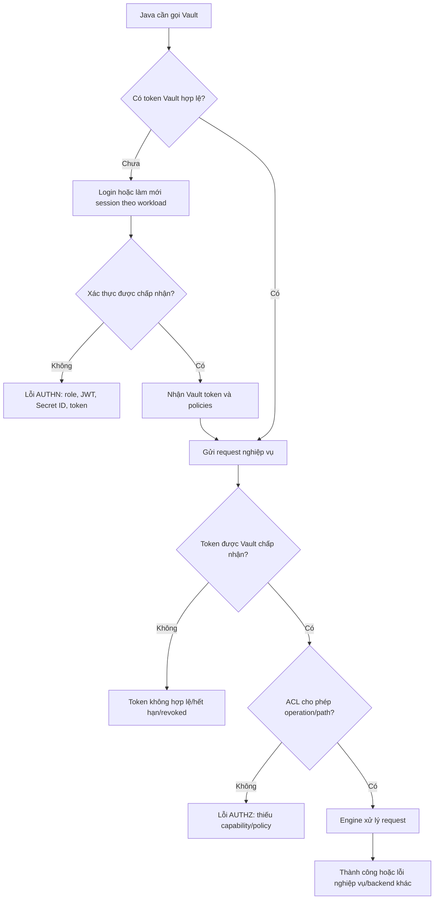
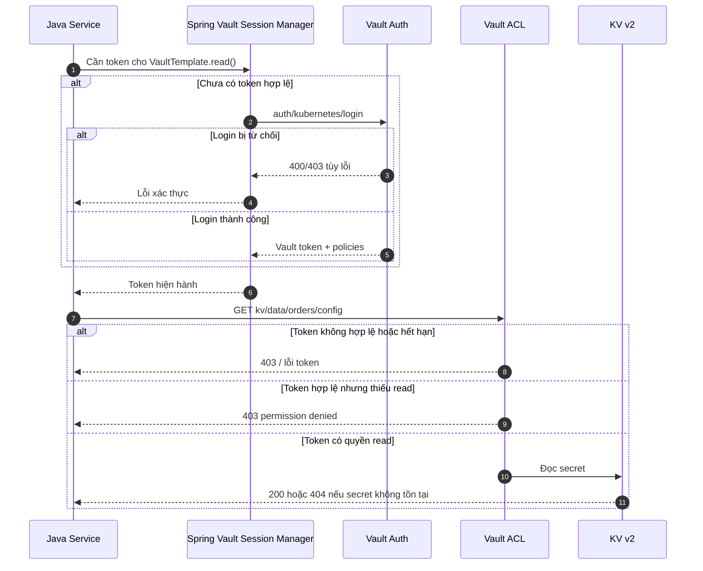

# Phân biệt từ chối xác thực với thiếu quyền theo policy trong Spring Vault

## 1. Bài toán: cùng HTTP 403 nhưng hai nguyên nhân khác nhau

Một dịch vụ Java sử dụng **SPRING_VAULT** kết nối HashiCorp Vault qua `VaultTemplate` để đọc cấu hình KV v2, lấy dynamic secret, gọi Transit hoặc ký chứng thư PKI. Một ngày, lời gọi đọc KV thất bại:

```text
HTTP 403: permission denied
```

Có hai nhóm nguyên nhân cơ bản:

- **Từ chối xác thực (authentication, authn):** Vault chưa chấp nhận danh tính/credential của workload, hoặc token Vault gắn vào request đã hết hạn, bị thu hồi, không hợp lệ. Ví dụ JWT Kubernetes sai service account/namespace, AppRole `secret_id` không hợp lệ.
- **Thiếu quyền (authorization, authz):** Vault chấp nhận token nhưng các **ACL policies** hiệu lực không cho phép operation trên **logical path** đang gọi. Ví dụ ứng dụng có quyền `read` trên `kv/data/orders/*` nhưng gọi `kv/data/payments/config`.

**Không thể dựa riêng vào HTTP 403 để khẳng định lỗi authn hay authz.** Vault có thể sử dụng 403 cho cả token không được chấp nhận và thiếu ACL. Login thất bại cũng có thể trả 400 hoặc lỗi khác tùy auth method/phiên bản. Muốn chẩn đoán phải xét **endpoint gây lỗi**, **giai đoạn trong luồng request**, **trạng thái token**, **đường dẫn thực** và **capability hiệu lực**.

Mục tiêu bài học thuộc chương **Lỗi và khả năng phục hồi**:

1. Hiểu cơ chế kiểm tra identity, token, policy của Vault.
2. Phân biệt lỗi xảy ra khi login/renew token với lỗi ở secrets engine/System API.
3. Kiểm tra bằng Vault CLI và `sys/capabilities-self` mà không làm lộ token/secret.
4. Xử lý lỗi an toàn trong Spring Vault và biết khi nào retry hoặc fail closed.
5. Thiết kế policy và integration test riêng cho hai nhóm lỗi.

## 2. Hai cổng bảo vệ của HashiCorp Vault

### 2.1. Xác thực: Vault có chấp nhận danh tính không?

| Cơ chế | Dữ liệu chứng minh danh tính | Những gì Vault kiểm tra | Thành công khi |
| --- | --- | --- | --- |
| Kubernetes auth | Service account JWT và role | Role, chữ ký/issuer/audience khi áp dụng, service account/namespace được ràng buộc | Cấp token Vault theo role |
| AppRole | `role_id` và thường là `secret_id` | Role hợp lệ, Secret ID còn hạn/còn lượt dùng, CIDR và giới hạn khác nếu cấu hình | Cấp token Vault theo role |
| JWT/OIDC | JWT hoặc luồng OIDC | Issuer, audience, signature, claims/bound claims | Cấp token Vault và identity tương ứng |
| Token auth | Token Vault đã được cấp | Token tồn tại, còn hiệu lực, chưa bị revoke và hợp lệ trong phạm vi request | Token có thể được đánh giá ACL |

Ví dụ request đăng nhập cho một workload Kubernetes:

```http
POST /v1/auth/kubernetes/login
Content-Type: application/json

{
  "role": "orders-service",
  "jwt": "<SERVICE_ACCOUNT_JWT>"
}
```

Đây là request **minh họa**. Auth mount có thể được cấu hình với tên khác `kubernetes/`. Nếu role không chấp nhận service account/namespace của JWT, Vault từ chối login và **không phát hành token mới từ lần đăng nhập đó**. Tăng quyền `read` cho KV không giải quyết được ràng buộc của Kubernetes auth.

Không ghi JWT, AppRole Secret ID, token Vault hoặc nội dung request login đầy đủ vào log.

### 2.2. Phân quyền: danh tính đã được nhận có thể làm gì?

Một request nghiệp vụ có token hợp lệ:

```http
GET /v1/kv/data/orders/config
X-Vault-Token: <VALID_WORKLOAD_TOKEN>
```

Nếu KV v2 mount tại `kv/`, logical path mà Vault ACL kiểm tra là `kv/data/orders/config`. Policy HCL tối thiểu:

```hcl
path "kv/data/orders/*" {
  capabilities = ["read"]
}
```

Policy này cho phép đọc nhánh orders tương ứng; nó **không** tự cho phép đọc payments, LIST metadata KV v2, ghi secrets hay quản trị `sys/*`. Token có thể login thành công nhưng vẫn nhận 403 nếu thiếu capability trên path đang gọi.

Một số endpoint quản trị hệ thống còn yêu cầu `sudo` ngoài capability thao tác. `sudo` là quyền bổ sung cho endpoint root-protected, không đồng nghĩa với root token và không tự cấp mọi quyền.

### 2.3. Luồng kiểm tra tổng quan



Trong Spring Vault, session manager có thể login để lấy token **khi `VaultTemplate.read(...)` được gọi**. Vì vậy lỗi authn có thể lộ ra ngay tại dòng code đọc secret, dù bản thân lỗi nằm ở bước lấy token.

## 3. Các dấu hiệu thực tế và giới hạn của mã HTTP

| Quan sát | Giả thuyết cần kiểm chứng | Kiểm tra tiếp |
| --- | --- | --- |
| `auth/kubernetes/login` bị từ chối | JWT, role, service account, namespace hoặc audience không hợp lệ | Kiểm tra role và ràng buộc auth method |
| `auth/approle/login` bị từ chối | Sai Role ID/Secret ID, TTL/uses/CIDR | Kiểm tra cấp phát và vòng đời Secret ID |
| Đọc `kv/data/orders/config` trả 403 | Token invalid/expired **hoặc** thiếu `read` | Token lookup, capabilities-self trên path thực |
| GET đọc KV thành công nhưng LIST thất bại | Thiếu `list` ở nhánh `metadata/` | Kiểm tra operation LIST và ACL KV v2 |
| Gọi `sys/mounts` trả 403 | Thiếu ACL và có thể thiếu `sudo` | Capability trên endpoint hệ thống |
| Transit/PKI POST trả 403 | Token hết hạn hoặc thiếu `update` | Token và path `transit/encrypt/:key` / `pki/sign/:role` |
| Nhận 404 | Secret/mount/path/version sai hoặc route không tồn tại | Kiểm tra mount, KV v1/v2, endpoint |
| Nhận 400 | Body/schema sai, hoặc thông tin login không được chấp nhận tùy backend | Giai đoạn/endpoint và lỗi đã lọc bí mật |
| Lỗi TLS handshake, DNS, timeout | Không thiết lập kết nối tới Vault thành công | CA trust, hostname, proxy, network |

Đừng suy luận “403 luôn là policy thiếu quyền” hoặc “401 luôn là token sai”. Tài liệu và triển khai của từng auth method có thể khác nhau. Quan trọng nhất là phân biệt **request login** với **request có token tới endpoint được bảo vệ**.

## 4. Nhận diện vị trí lỗi trong Spring Vault

Luồng cơ bản:

1. Ứng dụng cấu hình Vault endpoint, TLS, namespace và phương thức auth (Kubernetes auth, AppRole, JWT/OIDC hoặc token).
2. Spring Vault nhận token thông qua `ClientAuthentication` và cơ chế quản lý phiên đăng nhập/token được cấu hình, nếu cần.
3. `VaultTemplate` thực hiện GET/POST tới logical path của KV/Transit/PKI hoặc System API.
4. Vault kiểm tra tính hợp lệ của token và ACL.
5. Engine xử lý request và Spring Vault nhận response hoặc ném exception.

Lỗi ở bước **2** thường liên quan login/session; lỗi ở bước **3–4** có thể liên quan token hiện tại, quyền trên path hoặc namespace. Exception Java xuất hiện tại lời gọi `VaultTemplate` chưa đủ để xác định giai đoạn gây lỗi; cần xem request nào thực sự bị từ chối.

### 4.1. Ví dụ Java đọc một secret KV v2

Giả sử môi trường đã cấu hình bean `VaultTemplate` và mount `kv/` là KV v2:

```java
import java.util.Map;

import org.springframework.stereotype.Service;
import org.springframework.vault.core.VaultTemplate;
import org.springframework.vault.support.VaultResponse;

@Service
public class OrderConfigReader {

    private static final String PATH = "kv/data/orders/config";
    private final VaultTemplate vaultTemplate;

    public OrderConfigReader(VaultTemplate vaultTemplate) {
        this.vaultTemplate = vaultTemplate;
    }

    public boolean paymentEnabled() {
        VaultResponse response = vaultTemplate.read(PATH);
        if (response == null || response.getData() == null) {
            throw new IllegalStateException("Missing orders configuration");
        }

        // KV v2 chứa giá trị secret ở response.data.data.
        Object raw = response.getData().get("data");
        if (!(raw instanceof Map<?, ?> values)) {
            throw new IllegalStateException("Unexpected KV v2 response");
        }
        if (!(values.get("paymentEnabled") instanceof Boolean enabled)) {
            throw new IllegalStateException("Invalid paymentEnabled value");
        }
        return enabled;
    }
}
```

Đây là ví dụ đọc cấp thấp để minh họa **logical path thực tế**. Khi làm việc với KV v2 bình thường, nên cân nhắc API chuyên biệt `opsForKeyValue("kv", KeyValueBackend.KV_2)` để thư viện quản lý nhánh `data/`, metadata và phiên bản.

Nếu dòng `vaultTemplate.read(PATH)` thất bại, có thể là lỗi login/token ở session manager hoặc ACL ở GET `kv/data/orders/config`. Không vội coi riêng `VaultTemplate` là nguyên nhân, cũng không bỏ qua cơ chế xác thực.

### 4.2. Phân loại lỗi ở ranh giới ứng dụng

| Nhóm lỗi ứng dụng | Dấu hiệu đủ để điều tra | Cách xử lý |
| --- | --- | --- |
| `LOGIN_REJECTED` | Auth/login bị từ chối; không nhận token mới | Kiểm tra role, JWT/Secret ID, mount auth |
| `TOKEN_INVALID_OR_EXPIRED` | Token đang dùng không được Vault chấp nhận | Refresh/relogin đúng cơ chế, có giới hạn |
| `ACL_DENIED` | Token còn hợp lệ, capability trên logical path không cho phép request | Xem policy và role; không retry mù |
| `RESOURCE_NOT_FOUND` | Path/mount hợp lệ nhưng dữ liệu không có | Xử lý vắng mặt theo nghiệp vụ |
| `BAD_REQUEST_OR_CONFIG` | Schema/body/path/version không đúng | Sửa request, không tự nâng quyền |
| `VAULT_UNAVAILABLE` | 429, lỗi 5xx hoặc kết nối/timeout tạm thời | Backoff và circuit breaker khi phù hợp |

Những tên như `LOGIN_REJECTED` là **nhãn nghiệp vụ gợi ý**, không phải tên exception chuẩn bắt buộc của Spring Vault. Cơ chế exception của Spring Vault/Spring Framework tùy phiên bản; hãy lấy status từ exception/response được hỗ trợ và kết hợp *endpoint/giai đoạn*. Không phân loại bằng một đoạn văn bản lỗi có thể thay đổi.

## 5. Bước một: kiểm tra xác thực theo workload

### Kubernetes auth

Xác minh lần lượt: auth mount, tên role, service account của pod, namespace Kubernetes, projected JWT, audience nếu cấu hình, thời gian token, kết nối Vault với Kubernetes API/reviewer token và các bound claims. Ví dụ role dưới đây chỉ mang tính minh họa trong Vault test đã có Kubernetes auth:

```bash
# Người quản trị thao tác trên môi trường test đã cấu hình Kubernetes auth.
vault write auth/kubernetes/role/orders-service \
  bound_service_account_names=orders \
  bound_service_account_namespaces=apps \
  token_policies=orders-read \
  ttl=1h
```

Pod chạy với service account `orders` tại namespace `apps` có thể đáp ứng ràng buộc này. Nhưng để đọc được `kv/data/orders/config`, token sau login còn phải có quyền `read` từ policy `orders-read`. Role đúng không đồng nghĩa policy đủ.

### AppRole auth

Với AppRole, kiểm tra `role_id`, `secret_id`, nguồn cấp phát, TTL/số lần sử dụng của Secret ID, ràng buộc CIDR nếu có và auth mount của AppRole. Nếu Secret ID đã hết hạn hoặc bị thu hồi, thêm quyền cho KV không thể làm thông tin đăng nhập ấy trở nên hợp lệ.

### JWT/OIDC và token auth

Với JWT/OIDC, kiểm tra issuer, audience, thời hạn JWT và claims so với role. Với token auth, đối chiếu nguồn cung cấp token, TTL/renewability, phạm vi namespace và trạng thái revoke. Không in token/JWT đầy đủ ra log, terminal output hay chat để so sánh.

**Nguyên tắc:** chỉ sau khi xác nhận Vault chấp nhận identity hoặc token, mới dùng các bước kiểm tra quyền ACL để giải thích request nghiệp vụ bị từ chối.

## 6. Bước hai: xác minh đúng token hiện hành

Token được kiểm tra phải là **token thực sự gửi trong request gây lỗi**. Token trong máy của administrator có policy cao hơn token của ứng dụng; dùng token admin để chạy thử có thể che mất lỗi thực.

Trong môi trường test, với Vault CLI đã đăng nhập bằng đúng danh tính cần kiểm tra:

```bash
# Kiểm tra TTL và metadata được phép xem của token hiện tại.
vault token lookup -self

# Kiểm tra quyền hiệu lực trên đúng logical path.
vault token capabilities -self kv/data/orders/config
vault token capabilities -self kv/data/payments/config
vault token capabilities -self kv/metadata/orders/
```

Các trường thường có ích:

| Trường | Cách diễn giải |
| --- | --- |
| `ttl` và thời điểm hết hạn | Token còn được Vault chấp nhận không? |
| `renewable`, `period` nếu có | Có cơ chế renew hay phải reauthenticate? |
| `policies`/`token_policies`/`identity_policies` | Những policy đang góp phần tạo quyền |
| `entity_id` hoặc auth metadata khi có | Token có thuộc identity/role mong đợi không? |
| Namespace | Token và endpoint có ở cùng phạm vi không? |

Token lookup/capabilities-self có thể không dùng được nếu token hết hạn hoặc policy bị hạn chế. Khi đó, operator cần sử dụng quy trình chẩn đoán/audit phù hợp; không cấp thêm quyền rộng chỉ để tiện điều tra.

### 6.1. Phân biệt hai kết quả

- **Token hợp lệ + capabilities trả `deny`:** dấu hiệu mạnh cho thấy **ACL không cho phép path**.
- **Token lookup/capabilities-self cũng bị từ chối:** chưa chứng minh ACL của path nghiệp vụ sai. Có thể token không còn hợp lệ, request đến sai namespace hoặc quyền/endpoint kiểm tra bị hạn chế.

Một token đã được phát hành với policy đúng từ trước cũng có thể hết hạn hoặc bị revoke. Khi đó lỗi xuất hiện sau thời gian ứng dụng chạy ổn định, dù code và policy path chưa đổi.

## 7. Bước ba: xem capability trên đúng logical path

Giả sử KV v2 có mount `kv/`. Policy cho dịch vụ orders chỉ đọc giá trị:

```hcl
path "kv/data/orders/*" {
  capabilities = ["read"]
}
```

Muốn **liệt kê tên key** trong KV v2, cần capability ở nhánh metadata:

```hcl
path "kv/metadata/orders/*" {
  capabilities = ["list"]
}
```

| Thao tác | Logical path ví dụ | Capability thường cần |
| --- | --- | --- |
| GET secret KV v2 | `kv/data/orders/config` | `read` |
| LIST tên key KV v2 | `kv/metadata/orders/` | `list` |
| Ghi secret KV v2 | `kv/data/orders/config` | `create` hoặc `update` theo thao tác |
| Mã hóa Transit | `transit/encrypt/orders-key` | `update` |
| Ký CSR qua PKI | `pki/sign/orders-role` | `update` |
| Đọc mount qua System API | `sys/mounts` | Quyền System API tương ứng, có thể cần `sudo` |

Không thêm `/v1/` vào policy HCL. Nếu KV mount thực sự tên `secret/`, policy cũng cần dùng `secret/data/...`. Với KV v1, API không có lớp `data/metadata` theo KV v2. Sai mount/version rất dễ bị nhầm với lỗi policy.

### 7.1. Kiểm tra bằng sys/capabilities-self

```http
POST /v1/sys/capabilities-self
X-Vault-Token: <CURRENT_WORKLOAD_TOKEN>
Content-Type: application/json

{
  "paths": [
    "kv/data/orders/config",
    "kv/metadata/orders/",
    "transit/encrypt/orders-key"
  ]
}
```

Phản hồi **minh họa**:

```json
{
  "data": {
    "kv/data/orders/config": ["read"],
    "kv/metadata/orders/": ["deny"],
    "transit/encrypt/orders-key": ["deny"]
  }
}
```

Đây chỉ là ví dụ về **khả năng trả quyền hiệu lực theo path**; định dạng response phụ thuộc hình thức gọi API/phiên bản Vault. Nếu token hợp lệ, kết quả `deny` trên `kv/metadata/orders/` giải thích việc GET value thành công nhưng LIST key không được phép.

Không gửi token thật vào hệ thống ghi nhận sự cố không được phê duyệt. Dùng quy trình kiểm tra của operator với danh tính thích hợp và audit log của Vault.

## 8. Bước bốn: kiểm tra cấu hình client và endpoint

| Thành phần | Các lỗi hay bị nhầm với ACL |
| --- | --- |
| `VAULT_ADDR`/endpoint | Nhầm Vault dev, staging và production |
| TLS trust | CA/hostname không khớp; handshake fail trước khi xác thực |
| Namespace Enterprise | Token hợp lệ ở namespace khác, hoặc policy không cùng phạm vi |
| Auth mount | `auth/kubernetes` thực tế được mount tên khác |
| Role | Pod/login chọn role không tương ứng workload |
| KV mount | Dùng `kv/` trong code nhưng mount thực tên `secret/` |
| KV version | Dùng path KV v1 cho KV v2 hoặc thiếu `data/metadata` |
| Session manager | Token cache cũ, renew/relogin fail hoặc token tĩnh đã hết hạn |
| Proxy/network | 403 do proxy/WAF khác với phản hồi ACL thật của Vault |

**TLS thất bại không phải lỗi Vault ACL**; các bước kiểm tra token và policy chỉ có ý nghĩa sau khi client kết nối đúng server Vault qua TLS hợp lệ. Nếu response đến từ proxy, phải xác định nguồn phát status trước khi kết luận Vault từ chối.



## 9. Retry, refresh session và fail closed

**Không retry mọi HTTP 403 vô hạn.** Chọn phản ứng theo nguyên nhân:

| Tình huống | Retry có ích? | Hành động |
| --- | --- | --- |
| Role, JWT hoặc AppRole Secret ID sai | Không với cùng credential | Kiểm tra/cập nhật nguồn identity theo quy trình |
| Token Vault hết hạn, auth method vẫn hoạt động | Có thể refresh/relogin giới hạn | Dùng session lifecycle, kiểm tra token mới |
| Token bị revoke | Chỉ khi workflow cấp lại identity hợp lệ | Đừng hồi sinh token bị thu hồi theo đường vòng |
| Token hợp lệ nhưng ACL `deny` | Không nếu policy không thay đổi | Fail closed; sửa policy/path qua quy trình kiểm soát |
| Vault 429, 5xx hoặc timeout | Có thể, tùy endpoint | Exponential backoff, jitter, giới hạn số lần |
| Secret không tồn tại (404) | Tùy nghiệp vụ | Không tự fallback sang secret không kiểm soát |

Khi không đọc được secret vì thiếu quyền, không chuyển sang log/cache plaintext vô thời hạn, secret ở môi trường khác hoặc token root. Với cache hợp lệ, cần chính sách TTL, quyền truy cập, encryption at rest và cơ chế vô hiệu khi credential bị thu hồi.

### 9.1. Retry phụ thuộc tác dụng phụ

Một số endpoint có thể tạo tài nguyên: GET dynamic database credential phát sinh lease, POST ký chứng thư PKI, tạo Transit data key hoặc rotate khóa. Nếu timeout xảy ra sau khi Vault xử lý thành công, gửi lại request mù có thể tạo **thêm tài nguyên mới**.

Với endpoint có tác dụng phụ, đánh giá idempotency, timeout, request tracing và cleanup trước khi bật retry. Phân biệt xử lý **Vault tạm không sẵn sàng** với xử lý **ACL denial**. Circuit breaker và bulkhead có thể giúp hạn chế cascade failure, nhưng không sửa sai chính sách quyền.

## 10. Ghi log và giám sát an toàn

Để chẩn đoán không làm lộ bí mật, log các trường đã được chuẩn hóa:

```json
{
  "event": "vault_access_failure",
  "phase": "secrets_read",
  "auth_method": "kubernetes",
  "operation": "read",
  "path_group": "kv/data/orders",
  "http_status": 403,
  "classification": "permission_denied_unconfirmed",
  "trace_id": "<OPAQUE_TRACE_ID>"
}
```

`permission_denied_unconfirmed` cho biết chỉ mới thấy 403; chưa chứng minh đó là ACL. Sau khi kiểm tra token và capability, mới ghi nhận `ACL_DENIED` có cơ sở. Không log raw JWT, `X-Vault-Token`, Secret ID, KV values, database password, plaintext DEK, private key PKI hoặc toàn bộ response nhạy cảm.

| Metric/cảnh báo | Ý nghĩa |
| --- | --- |
| Login failures theo auth method/role nhóm | Lỗi ràng buộc identity hoặc cấu hình auth |
| 403 ở secrets endpoints | Cần phân loại token/session và ACL |
| Token renewal/relogin failures | Nguy cơ mọi lời gọi Vault bị gián đoạn |
| TTL token còn lại | Token sắp hết hạn, nguy cơ renewal loop |
| 429/5xx/timeout và p95/p99 latency | Sự cố Vault/network cần resilience |
| 403 sau thay đổi policy | Dấu hiệu lệch policy/role/path |
| Audit events của sys/policies và auth roles | Theo dõi thay đổi quyền và cấu hình |

Tránh đưa giá trị path chứa ID nhạy cảm hoặc role tùy ý của người dùng làm metric labels. Dùng endpoint group đã allowlist để tránh rò rỉ và bùng nổ cardinality.

## 11. Bài thực hành so sánh hai danh tính

Giả sử test Vault đã bật KV v2 tại `kv/` và có secret `orders/config`. Operator tạo policy `orders-read`:

```hcl
path "kv/data/orders/*" {
  capabilities = ["read"]
}
```

Role Kubernetes `orders-service` gắn `orders-read`. Hai workload:

- **A**: service account `orders` trong namespace `apps`, khớp ràng buộc auth role.
- **B**: service account khác không được role chấp nhận.

| Phép thử | Kết quả mong đợi | Nhóm lỗi |
| --- | --- | --- |
| A login Kubernetes auth | Nhận Vault token hợp lệ | Xác thực thành công |
| A GET `kv/data/orders/config` | Thành công nếu secret tồn tại | ACL đọc thành công |
| A GET `kv/data/payments/config` | 403 nếu không có quyền | Phân quyền bị từ chối |
| A LIST `kv/metadata/orders/` | Bị từ chối nếu chưa có `list` | Thiếu capability LIST |
| B login role `orders-service` | Bị Vault từ chối | Xác thực bị từ chối |
| A GET bằng token đã bị revoke | Bị Vault từ chối | Token/session không hợp lệ |

Để kiểm tra quyền của **A** trong môi trường test đã đăng nhập bằng đúng token A:

```bash
vault token lookup -self
vault token capabilities -self kv/data/orders/config
vault token capabilities -self kv/data/payments/config
vault token capabilities -self kv/metadata/orders/
```

Không dùng token administrator thay cho token A để kiểm thử; request bằng admin có thể thành công dù policy workload đang sai.

## 12. Kiểm thử tích hợp và tình huống biên

Có thể dùng Vault test cô lập hoặc Testcontainers với auth method và mount riêng cho test. Các trường hợp nên kiểm tra:

1. **Login hợp lệ:** service account/JWT hoặc AppRole đúng; token được cấp và có các policy mong đợi.
2. **Login sai:** role, namespace, JWT, Secret ID không hợp lệ; không cấp token mới và không fallback token vượt quyền.
3. **ACL read:** token hợp lệ đọc được `kv/data/orders/config` theo policy.
4. **ACL deny:** cùng token đọc `kv/data/payments/config` bị từ chối; capability hiệu lực không có `read`.
5. **LIST khác READ:** GET KV v2 được phép nhưng LIST metadata bị từ chối khi thiếu `list`.
6. **Token hết hạn/revoked:** session được làm mới nếu có cơ chế hợp lệ, hoặc báo lỗi an toàn; không retry vô hạn.
7. **Sai mount/version/namespace:** phân biệt lỗi đường dẫn và policy, không tự mở rộng quyền.
8. **System API:** workload KV không thể tune mount; danh tính operator riêng có thể có quyền phù hợp gồm `sudo` khi cần.
9. **Vault network failure:** mô phỏng timeout/429/5xx; retry có giới hạn và không xử lý thành lỗi ACL.
10. **Log redaction:** không có token, JWT, Secret ID hoặc giá trị secret trong log/trace ở các luồng lỗi.

Unit test mock `VaultTemplate` giúp kiểm tra mapping lỗi ở tầng Java. **Integration test với Vault thật** mới xác nhận hành vi auth role, path matching, token expiry và ACL.

### Câu hỏi tự kiểm tra

**Câu 1:** Pod đăng nhập thành công nhưng GET `kv/data/orders/config` trả 403. Có thể khẳng định role Kubernetes sai không?

**Đáp án:** Chưa. Login thành công; cần kiểm tra token tại thời điểm đọc, policy hiệu lực và `read` trên path KV v2.

**Câu 2:** Service account không nằm trong danh sách được role Kubernetes cho phép. Thêm `read` cho policy KV có sửa được login không?

**Đáp án:** Không. Vault chưa chấp nhận danh tính để cấp token. Cần sửa ràng buộc/identity theo quy trình.

**Câu 3:** Workload đọc được secret nhưng không LIST được key trong cùng KV v2 mount. Có phải token đã hết hạn?

**Đáp án:** Không nhất thiết. GET cần `read` trên `data/`; LIST cần `list` trên `metadata/`.

**Câu 4:** Một request đang thành công nhiều giờ bỗng trả 403. Có nên cấp wildcard policy?

**Đáp án:** Không. Kiểm tra token TTL/revocation/renewal, thay đổi role, namespace và policy trước khi điều chỉnh quyền.

## 13. Quy trình xử lý sự cố ngắn gọn

1. **Xác định request bị từ chối:** login, token renewal hay secrets/System API; ghi path nhóm và status đã được lọc.
2. **Kiểm tra kết nối/TLS:** xác nhận request đến đúng Vault trước khi chẩn đoán ACL.
3. **Kiểm tra identity/token:** auth mount, role, JWT/Secret ID, TTL, revocation, namespace và session manager.
4. **Kiểm tra quyền hiệu lực:** dùng `vault token capabilities -self <logical-path>` với đúng danh tính; đối chiếu `read/list/update/sudo`.
5. **Đối chiếu engine/path:** KV v1 hay v2, nhánh `data/metadata`, Transit/PKI role và System API.
6. **Chọn cách khắc phục:** sửa thông tin xác thực khi login bị từ chối; sửa ACL đúng phạm vi nếu thiếu quyền; refresh session khi token hết hạn; retry có giới hạn khi Vault lỗi tạm thời.
7. **Readback và giám sát:** kiểm tra request lại, log/audit đã được lọc và các tình huống từ chối vẫn hoạt động như thiết kế.

**Ghi nhớ:** xác thực trả lời **“Vault có chấp nhận danh tính/token này không?”**; phân quyền trả lời **“token được chấp nhận có được thực hiện operation trên path này không?”**. Một HTTP 403 có thể xuất hiện trong cả hai trường hợp. Chẩn đoán theo đúng giai đoạn, token và ACL giúp ứng dụng Spring Vault phục hồi an toàn mà không phá vỡ nguyên tắc quyền tối thiểu.

### Tài liệu tham khảo

- [HashiCorp Vault — Authentication](https://developer.hashicorp.com/vault/docs/auth)
- [HashiCorp Vault — ACL policies](https://developer.hashicorp.com/vault/docs/concepts/policies)
- [HashiCorp Vault — System API](https://developer.hashicorp.com/vault/api-docs/system)
- [Spring Vault — Authentication](https://docs.spring.io/spring-vault/reference/vault/authentication.html)
- [Spring Vault — VaultTemplate](https://docs.spring.io/spring-vault/reference/vault/imperative-template.html)
