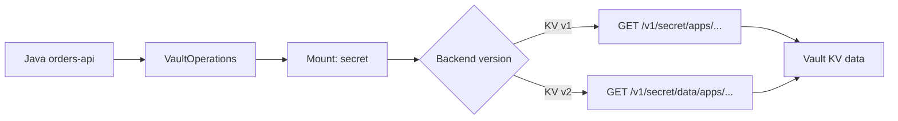
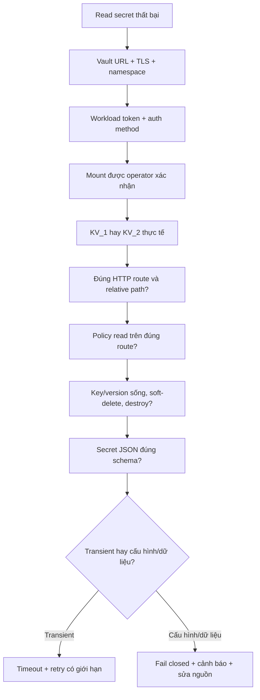

# Secret không tồn tại, sai mount và sai phiên bản KV

> **Spring Vault — Lỗi và khả năng phục hồi.** Ứng dụng Java truy cập HashiCorp Vault qua `VaultTemplate` hoặc `VaultOperations` có thể nhận `null`, lỗi HTTP `404`, `403` hay exception khi lấy secret. Những biểu hiện đó **không đồng nghĩa** với việc key chưa từng tồn tại. Cần phân biệt **secret không có giá trị để đọc**, **mount secrets engine sai**, **ứng dụng chọn sai KV v1/v2**, **policy thiếu quyền**, **KV v2 version đã bị xóa**, và **sự cố Vault tạm thời**. Bài này hướng dẫn chẩn đoán theo chứng cứ, viết adapter Java có lỗi phân loại, retry có kiểm soát và kiểm thử bằng Vault thật.

## 1. Mục tiêu và bối cảnh

Sau bài học, bạn có thể:

1. Giải thích chính xác mount, key path, KV v1/v2 và raw API route là các khái niệm khác nhau.
2. Phân biệt secret không tồn tại với `404` do sai endpoint, sai mount, sai engine version hoặc hạn chế tiết lộ quyền.
3. Kiểm tra phiên bản KV v2 bị soft-delete, destroy hoặc chưa được tạo bằng metadata khi đã được cấp quyền.
4. Sử dụng `VaultOperations.opsForKeyValue(mount, KeyValueBackend.KV_2)` với đường dẫn **tương đối**, thay vì tự ghép `data/` không nhất quán.
5. Đưa lỗi Vault về hợp đồng nghiệp vụ: thiếu secret bắt buộc, schema sai, lỗi truy cập, lỗi hạ tầng.
6. Quyết định trường hợp nào được retry, trường hợp nào phải dừng xử lý (*fail closed*).
7. Viết các test riêng cho missing key, wrong mount, KV version mismatch, deny ACL, và timeout/5xx.

Ví dụ xuyên suốt: `orders-api` cần đọc `api-key` của cổng thanh toán từ Vault. Mount dự kiến là `secret/`, **KV version 2**, key logic `apps/orders-api/payment`. Bộ khóa minh họa dùng giá trị giả, không có credential thật.

## 2. Trước khi sửa mã: hiểu bốn tầng địa chỉ

Một request đọc KV có nhiều tầng. Chỉ cần sai một tầng, lỗi có thể trông giống missing secret.

| Tầng | Giá trị mẫu | Ai chịu trách nhiệm |
|---|---|---|
| Vault server | `https://vault.example.internal` | Cấu hình endpoint, TLS, DNS, HA |
| Vault namespace (nếu sử dụng) | `team-a` | Vault Enterprise/HCP và client configuration |
| Secrets engine mount | `secret/` | Operator bật KV engine, chỉ định version |
| Relative key path | `apps/orders-api/payment` | Chủ hợp đồng secret của `orders-api` |

Cùng một key logic nhưng raw HTTP route khác nhau:

| Engine thực tế ở mount `secret/` | HTTP GET cho secret | Spring Vault typed operation |
|---|---|---|
| KV v1 | `GET /v1/secret/apps/orders-api/payment` | `opsForKeyValue("secret", KV_1).get("apps/orders-api/payment")` |
| KV v2 | `GET /v1/secret/data/apps/orders-api/payment` | `opsForKeyValue("secret", KV_2).get("apps/orders-api/payment")` |

Segment `data/` là một **thành phần kỹ thuật của KV v2 HTTP API**. Khi gọi typed API, Spring Vault tự ghép segment này. Đừng viết:

```java
// Sai: đã truyền mount "secret" và KV_2 nhưng lại ghép route thô.
vaultOperations.opsForKeyValue("secret", KeyValueBackend.KV_2)
        .get("secret/data/apps/orders-api/payment");
```

Đúng là:

```java
VaultKeyValueOperations kv = vaultOperations.opsForKeyValue(
        "secret", KeyValueBackend.KV_2);

VaultResponse response = kv.get("apps/orders-api/payment");
```

Sơ đồ định tuyến:



Một thư mục `secret/` trong ứng dụng không chứng minh Vault có mount tên đó; một mount tên `kv/` không chứng minh đó là KV v1. Chỉ metadata cấu hình engine thực tế mới xác nhận.

## 3. KV v1 và KV v2: khác nhau nhiều hơn chữ `data/`

Hai chế độ KV đều lưu cặp key/value, nhưng khác đường dẫn, response và vòng đời.

| Thuộc tính | KV v1 | KV v2 |
|---|---|---|
| Read route | `<mount>/<key>` | `<mount>/data/<key>` |
| Response raw | `data` chứa field secret | `data.data` chứa field; `data.metadata` chứa thông tin phiên bản |
| History/version | Không lưu các version theo mô hình KV v2 | Có lịch sử và retention có giới hạn |
| CAS | Không có CAS version như KV v2 | Có compare-and-set khi ghi theo version |
| Soft-delete / undelete | Không có phiên bản để khôi phục kiểu KV v2 | Hỗ trợ soft-delete và undelete phiên bản chưa bị destroy |
| Metadata/version | Không có endpoint tương ứng KV v2 | `<mount>/metadata/<key>` |
| Liệt kê key | LIST theo path KV v1 | LIST theo `<mount>/metadata/<prefix>` |
| Policy đọc | `<mount>/<key>` | `<mount>/data/<key>` |

Raw JSON KV v1:

```json
{
  "data": {
    "api-key": "dummy-key-for-testing"
  }
}
```

Raw JSON KV v2 minh họa:

```json
{
  "data": {
    "data": {
      "api-key": "dummy-key-for-testing"
    },
    "metadata": {
      "version": 2,
      "created_time": "2026-11-25T10:00:00Z",
      "deletion_time": "",
      "destroyed": false
    }
  }
}
```

`VaultKeyValueOperations.get(...)` hiểu cấu trúc KV v2 và trả `VaultResponse.getData()` là **map field của secret**. Nếu đã dùng typed API, đừng lấy `data.data` thêm một lần theo raw JSON, vì đó là hai lớp abstraction khác nhau.

## 4. HTTP 404, 403 và `null` nói lên điều gì?

Không một dấu hiệu đơn lẻ nào bảo đảm secret chưa từng được provision.

| Dấu hiệu | Các nguyên nhân có thể | Hành động |
|---|---|---|
| `kv.get(path) == null` | Không có dữ liệu đọc được ở path/version; một số lỗi 404 có thể được client ánh xạ thành `null` | Xác nhận mount, engine version, ACL rồi mới xem là missing |
| HTTP `404` | Key không có, route sai, mount sai, KV version mismatch, version đã delete/destroy; Vault có tình huống che trạng thái bằng 404 | Thu chứng cứ cấu hình và version |
| HTTP `403` | Token/policy không được đọc đường dẫn; endpoint/namespace không đúng quyền | So khớp workload identity và ACL route |
| HTTP `400` / `405` | Body/route/HTTP method không hợp lệ; backend không hỗ trợ operation | Kiểm tra version và đường dẫn kỹ thuật |
| HTTP `401` hoặc token invalid | Lỗi auth, expired/revoked token hay session | Kiểm tra auth method và token lifecycle |
| HTTP `5xx` / timeout | Vault sealed, HA/failover, kết nối, quá tải hoặc downstream | Retry có backoff và giới hạn |
| HTTP `200` nhưng thiếu field | Secret tồn tại, **schema sai hợp đồng nghiệp vụ** | Dừng luồng phụ thuộc và sửa dữ liệu |
| Lỗi TLS/x509 | Java không tin server certificate hoặc hostname sai | Sửa TLS trust, không tắt verification |

HashiCorp mô tả HTTP `404` của Vault là “invalid path” và trong một số tình huống **có thể dùng để tránh lộ trạng thái về resource/quyền**. Vì vậy không viết:

```java
// Sai về logic: không thể suy ra dữ liệu chưa từng tồn tại từ mọi 404.
// catch (HttpClientErrorException.NotFound e) { createDefaultKey(); }
```

Cũng không dùng “thử `secret/` thất bại thì đọc `secret-prod/`” để tự chữa: khi đã xác định workload cần nguồn dữ liệu nào, fallback mount khác có thể đọc nhầm môi trường và vi phạm phân quyền.

## 5. Runbook chẩn đoán theo thứ tự



### Bước 1 — Xác minh Vault address, namespace, identity

Dùng thông tin triển khai đã được phê duyệt để đối chiếu địa chỉ Vault mà Spring Vault thực sự kết nối. Trong Vault Enterprise namespace, cùng tên mount ở hai namespace có thể chỉ hai dữ liệu khác nhau. `vault status` xác nhận server có thể tiếp nhận yêu cầu, nhưng **không chứng minh token runtime có quyền đọc key**.

Không đưa `X-Vault-Token`, SecretID, response body hay plaintext secret vào ticket, metrics hoặc log.

### Bước 2 — Xác định mount và KV version bằng identity operator

Trên Vault lab hoặc môi trường được đội vận hành cấp phép:

```bash
vault status
vault secrets list -detailed
```

Output minh họa:

```text
Path               Type    Options
----               ----    -------
secret/            kv      map[version:2]
legacy-secret/     kv      map[version:1]
```

Kiểm tra **path chính xác** và `options.version`. Workload chỉ đọc một secret thường không cần quyền liệt kê mọi mounts. Metadata cấu hình engine là đầu vào tin cậy của deployment, không phải dữ liệu runtime tự đoán từ exception.

### Bước 3 — Đọc key đúng mount, không tự lắp segment kỹ thuật

CLI sử dụng tham số mount minh bạch:

```bash
# Đọc dữ liệu test tại mount KV v2 đã xác minh.
vault kv get -mount=secret apps/orders-api/payment

# Chỉ dành cho KV v2, đọc một version cụ thể khi được cấp quyền.
vault kv get -mount=secret -version=1 apps/orders-api/payment
```

Nếu Vault CLI đọc được nhưng Java lỗi, hãy kiểm tra liệu operator CLI đang dùng **identity quyền cao hơn**, namespace khác hoặc CLI đã tự chọn đúng KV API trong khi Java vẫn gắn `KV_1`.

Raw HTTP route đối chiếu:

```text
KV v1: GET /v1/secret/apps/orders-api/payment
KV v2: GET /v1/secret/data/apps/orders-api/payment
```

### Bước 4 — Kiểm tra policy cho **đúng** route

Policy KV v1 chỉ đọc key:

```hcl
path "secret/apps/orders-api/payment" {
  capabilities = ["read"]
}
```

Policy KV v2 chỉ đọc data:

```hcl
path "secret/data/apps/orders-api/payment" {
  capabilities = ["read"]
}
```

Nếu operator cần kiểm tra version history, đó là quyền **khác**:

```hcl
path "secret/metadata/apps/orders-api/payment" {
  capabilities = ["read"]
}
```

Không cấp `list`, `update`, `delete`, `sudo` hoặc quyền read toàn mount cho workload chỉ cần một key. Policy phù hợp trên `secret/apps/...` của KV v1 **không tự động trở thành** policy của KV v2 tại `secret/data/apps/...`.

## 6. KV v2: “không đọc được” chưa chắc “chưa từng tồn tại”

KV v2 lưu lịch sử có giới hạn. Một key có thể có metadata và các version nhưng version mặc định không còn dữ liệu để đọc.

| Trạng thái version | Dấu hiệu | Ý nghĩa |
|---|---|---|
| Key chưa được tạo | Không có dữ liệu/metadata của key | Có thể là lỗi provisioner hoặc path |
| Có version hoạt động | `destroyed=false` và `deletion_time` trống | Có thể đọc nếu policy cho phép |
| Soft-deleted | `deletion_time` khác rỗng | Chưa destroy, có thể undelete theo quyền |
| Destroyed | `destroyed=true` | Dữ liệu của version đã bị phá hủy vĩnh viễn |
| Metadata key đã xóa | Key cùng toàn bộ history bị xóa | Không thể dùng version API để phục hồi tại key |
| Version bị retention dọn | Version cũ ngoài giới hạn `max_versions` | Không thể giả định đọc vô hạn version lịch sử |

Raw HTTP cho data và metadata:

```text
GET /v1/secret/data/apps/orders-api/payment
GET /v1/secret/metadata/apps/orders-api/payment
```

API đầu đọc dữ liệu, API sau dành cho metadata, có quyền riêng. Nếu `data` không đọc được, identity vận hành được cấp quyền có thể xem metadata để phân biệt *deleted* và *destroyed*.

**Không để ứng dụng tự undelete chỉ vì một request gặp 404.** Một phiên bản có thể bị delete nhằm cô lập credential bị lộ. Phục hồi hoặc đọc version cũ phải được chủ secret phê duyệt, xác minh version đó còn hợp lệ và không bị thu hồi vì sự cố bảo mật.

## 7. Adapter Spring Vault theo hợp đồng nghiệp vụ

Một provider tốt trả **API key hợp lệ** hoặc **lỗi riêng**. Nó không trả raw `VaultResponse` về controller, và không trộn secret thiếu với network failure.

### 7.1. Hợp đồng provider và exceptions

```java
// GatewaySecretProvider.java
public interface GatewaySecretProvider {

    /**
     * Trả API key hiện tại; không trả null.
     * Thất bại được biểu diễn bằng exception riêng.
     */
    String currentApiKey();
}
```

```java
// Mỗi public class đặt trong file .java riêng.
public class SecretNotFoundException extends RuntimeException {
    public SecretNotFoundException(String message) {
        super(message);
    }
}

public class SecretContractException extends RuntimeException {
    public SecretContractException(String message) {
        super(message);
    }
}

public class SecretReadFailureException extends RuntimeException {
    public SecretReadFailureException(String message, Throwable cause) {
        super(message, cause);
    }
}
```

Lỗi `SecretNotFoundException` chỉ mô tả “**required secret không có dữ liệu có thể dùng**” trong phạm vi adapter đã được cấu hình/kiểm chứng. Không dùng lỗi này làm chứng cứ forensic “key chưa từng tồn tại”.

### 7.2. Đọc KV v2 theo đúng route, kiểm tra schema

```java
import java.util.Map;

import org.springframework.stereotype.Component;
import org.springframework.vault.VaultException;
import org.springframework.vault.core.VaultKeyValueOperations;
import org.springframework.vault.core.VaultKeyValueOperationsSupport.KeyValueBackend;
import org.springframework.vault.core.VaultOperations;
import org.springframework.vault.support.VaultResponse;

@Component
public final class VaultGatewaySecretProvider
        implements GatewaySecretProvider {

    private static final String MOUNT = "secret";
    private static final String KEY = "apps/orders-api/payment";

    private final VaultKeyValueOperations kv;

    public VaultGatewaySecretProvider(VaultOperations vault) {
        // Version/mount là hợp đồng deploy được xác minh trước.
        this.kv = vault.opsForKeyValue(MOUNT, KeyValueBackend.KV_2);
    }

    @Override
    public String currentApiKey() {
        VaultResponse response;

        try {
            response = kv.get(KEY);
        } catch (VaultException ex) {
            // 403, 5xx, mount sai, auth và các lỗi API có thể
            // nằm trong cause. Không biến hết thành missing secret.
            throw new SecretReadFailureException(
                    "Required Vault configuration is not readable", ex);
        }

        if (response == null || response.getData() == null) {
            throw new SecretNotFoundException(
                    "Required payment configuration has no readable value");
        }

        Map<String, Object> fields = response.getData();
        Object raw = fields.get("api-key");

        if (!(raw instanceof String key) || key.isBlank()) {
            throw new SecretContractException(
                    "Payment configuration field api-key is absent/invalid");
        }
        return key;
    }
}
```

Mẫu sử dụng Java 17+ với pattern matching `instanceof`. Nếu dự án dùng Java cũ, viết lại phần kiểm tra kiểu theo cú pháp Java phù hợp. Cũng cần điều chỉnh nhánh transport exceptions nếu bản Spring Vault và HTTP client thực tế có exception ngoài `VaultException`. Không catch `RuntimeException` chung quanh cả business mapping rồi gán mọi lỗi thành network.

**Không giả định `kv.get(KEY) == null` luôn có một nguyên nhân duy nhất.** Đối với service bắt buộc phải có secret, `null` được biến thành trạng thái *không có giá trị dùng được* trong hợp đồng; việc mount/version/ACL đã đúng là điều kiện cấu hình cần được xác minh riêng.

### 7.3. Vì sao cần typed API thay raw `VaultOperations.read`?

Spring Vault cung cấp:

```java
VaultKeyValueOperations v1 = vault.opsForKeyValue(
        "legacy-secret", KeyValueBackend.KV_1);

VaultKeyValueOperations v2 = vault.opsForKeyValue(
        "secret", KeyValueBackend.KV_2);

// Cùng relative key path; thư viện tạo raw API route khác nhau.
VaultResponse old = v1.get("apps/orders-api/payment");
VaultResponse current = v2.get("apps/orders-api/payment");
```

Nếu cần chủ động đọc/ghi version, CAS hoặc metadata của KV v2, cân nhắc `VaultVersionedKeyValueOperations` thay vì buộc nghiệp vụ tự ghép `data/`, `metadata/` và `?version=`.

### 7.4. Không lộ credential qua log hoặc exception

Tránh:

```java
// Sai: trả thẳng secret ra log hoặc response HTTP.
// log.info("Vault data={}", response.getData());
// return ResponseEntity.ok(provider.currentApiKey());
```

Giữ log ở mức cấu trúc:

```java
log.warn("Payment secret is unavailable; errorType={}",
        ex.getClass().getSimpleName());
```

Trong log nội bộ có thể bổ sung mã lỗi, operation và correlation ID đã được lọc. Không truyền raw response, `Vault token`, API key, stack trace chứa nội dung nhạy cảm hoặc chi tiết HTTP client thẳng đến người dùng cuối.

## 8. Phân loại retry: lỗi tạm thời hay lỗi hợp đồng?

Đọc secret là thao tác về nguyên tắc có thể retry, nhưng chỉ sau khi phân loại nguyên nhân. Retry không làm mount sai trở thành đúng.

| Loại sự cố | Retry? | Lý do |
|---|---|---|
| Connection reset/timeout thoáng qua | Có, **giới hạn** | Có thể do hạ tầng tạm lỗi |
| Vault 500/502/503 | Có, backoff và giới hạn tổng thời gian | Server tạm không sẵn sàng |
| 429 / overload | Theo Retry-After/chính sách, hạn chế đồng loạt | Tránh tạo retry storm |
| 412 eventual consistency (nếu áp dụng) | Có giới hạn | Dữ liệu có thể chưa đồng bộ |
| 401/403 | Không retry đọc liên tục | Cần kiểm tra auth/role/policy |
| 404 / sai KV route / wrong mount | Không retry vô hạn | Cần xác minh cấu hình/vòng đời secret |
| 400/405 | Không | Thường là request/operation không hợp lệ |
| Thiếu `api-key`/schema sai | Không | Cần sửa dữ liệu hay contract |
| TLS hostname/certificate mismatch | Không bypass | Sửa truststore/certificate đúng kênh |

Ví dụ cấu hình khung Resilience4j:

```yaml
resilience4j:
  retry:
    instances:
      vaultKvRead:
        maxAttempts: 3
        waitDuration: 200ms
  circuitbreaker:
    instances:
      vaultKvRead:
        slidingWindowSize: 10
        failureRateThreshold: 50
```

Cấu hình này **chưa đủ** để chạy production: bổ sung predicate xác định lỗi transient theo exception/status code, giới hạn deadline, jitter và metric. Nếu đánh dấu mọi `SecretReadFailureException` là retryable, `403` cũng bị retry, làm tăng tải vô ích.

**Session manager** có thể quản lý vòng đời Vault client token theo auth method, nhưng không sửa một policy sai. Nếu token bị revoke hoặc đã hết maximum TTL, ứng dụng cần quy trình tái xác thực đúng workload, không cấp root token để bypass.

### Cache và fallback

KV v2 version mới **không tự cập nhật** client Java đang giữ API key trong RAM. Cache chỉ phù hợp khi có TTL, điều kiện dùng stale, chính sách thu hồi và cập nhật được quy định. Không tự dùng cached credential khi secret bị chủ sở hữu revoke/delete vì sự cố bảo mật. Không đặt API key dự phòng trong `application.yml`.

## 9. Startup, readiness và quan sát vận hành

Một lỗi mount/version có thể phát hiện **trước** khi bật traffic nếu deployment xác minh metadata engine và credential schema. Kiểm tra runtime nên nhẹ nhàng, tránh polling dồn dập.

| Trạng thái | Hành vi gợi ý |
|---|---|
| STARTING | Chưa xác nhận Vault auth và secret bắt buộc; không nhận request phụ thuộc secret |
| READY | Đã đọc secret và kiểm tra schema thành công; client nghiệp vụ có credential hợp lệ |
| DEGRADED | Vault tạm lỗi; chỉ tiếp tục nếu chính sách cache cho phép, có giới hạn thời gian |
| NOT_READY | Mount/version sai, secret thiếu, policy sai hoặc schema không hợp lệ |

Giám sát nên có: số lần đọc thành công/thất bại theo **loại lỗi**, HTTP status, latency p50/p95, số retry, circuit breaker state, số lần token renew/re-login lỗi và số lần secret contract thay đổi. Không đưa path động chứa PII vào metric labels; dùng tên logical secret được cho phép như `payment-gateway`.

Tránh xuất thông tin secrets engine, version metadata, token hoặc raw error message ra public health endpoint. Những thông tin này thuộc chẩn đoán nội bộ đã phân quyền.

## 10. Kiểm thử tích hợp có hai mounts độc lập

Unit test có thể xác minh mapping và exception, nhưng **không chứng minh** route, mount version, Vault ACL, soft delete hay HTTP status trên server thực. Dùng Vault dev/test với dữ liệu giả, tránh tác động mount sản xuất.

### 10.1. Chuẩn bị fixture KV v1 và KV v2

Trong Vault **chỉ dành cho test**, operator chạy:

```bash
vault secrets enable -path=kv1-it -version=1 kv
vault secrets enable -path=kv2-it -version=2 kv

vault kv put -mount=kv1-it integration/payment api-key=dummy-v1
vault kv put -mount=kv2-it integration/payment api-key=dummy-v2

vault secrets list -detailed
```

Hai mounts có cùng relative key `integration/payment` nhưng các raw routes khác nhau.

### 10.2. JUnit 5 xác minh đúng backend

```java
import static org.junit.jupiter.api.Assertions.*;

import org.junit.jupiter.api.Test;
import org.springframework.beans.factory.annotation.Autowired;
import org.springframework.boot.test.context.SpringBootTest;
import org.springframework.vault.core.VaultKeyValueOperations;
import org.springframework.vault.core.VaultKeyValueOperationsSupport.KeyValueBackend;
import org.springframework.vault.core.VaultOperations;
import org.springframework.vault.support.VaultResponse;

@SpringBootTest
class KvBackendVersionIT {

    @Autowired VaultOperations vault;

    @Test
    void readsKvV1WithMatchingBackend() {
        VaultKeyValueOperations kv =
                vault.opsForKeyValue("kv1-it", KeyValueBackend.KV_1);

        VaultResponse response = kv.get("integration/payment");

        assertNotNull(response);
        assertEquals("dummy-v1", response.getData().get("api-key"));
    }

    @Test
    void readsKvV2WithMatchingBackend() {
        VaultKeyValueOperations kv =
                vault.opsForKeyValue("kv2-it", KeyValueBackend.KV_2);

        VaultResponse response = kv.get("integration/payment");

        assertNotNull(response);
        assertEquals("dummy-v2", response.getData().get("api-key"));
    }
}
```

Test này cần Spring context đã cấu hình kết nối/auth tới instance Vault lab. Hai tên `kv1-it` và `kv2-it` do **fixture đã xác minh version**, không phải quy tắc đoán version từ chữ số trong mount.

### 10.3. Ma trận kiểm thử lỗi bắt buộc

| ID | Setup | Kỳ vọng |
|---|---|---|
| K01 | Đúng KV v1/path/read ACL | Trả đúng `dummy-v1` |
| K02 | Đúng KV v2/path/read ACL | Trả đúng `dummy-v2` |
| K03 | KV v2 key chưa được tạo | Provider báo missing khi config/ACL đã xác minh |
| K04 | Mount không tồn tại | Lỗi route/config; không giả định key chưa tồn tại |
| K05 | Gọi `KV_1` trên mount KV v2 | Fail; không fallback sang engine khác |
| K06 | Gọi `KV_2` trên mount KV v1 | Fail; không thêm/bỏ `data/` tại service |
| K07 | Token thiếu `read` cho KV v2 `data/` | Lỗi quyền; không trả credential giả |
| K08 | KV v2 latest version soft-deleted | Không đọc được theo route data; metadata giải thích khi có quyền |
| K09 | KV v2 version destroyed | Không undelete; chỉ phục hồi qua quy trình backup/rotation |
| K10 | Secret có `api-key` = null/number | Lỗi contract, không ép kiểu |
| K11 | Token hết hạn hoặc namespace khác | Không được đánh dấu missing secret |
| K12 | Vault 5xx/timeout | Có retry/backoff tối đa và cảnh báo |
| K13 | Secret rotation nhưng client cache còn giá trị cũ | Phát hiện stale, kiểm tra refresh theo SLA |
| K14 | Hai request cùng retry khi Vault quá tải | Không tạo retry storm |

### 10.4. Unit test cho nhánh `null`

```java
import static org.junit.jupiter.api.Assertions.*;
import static org.mockito.Mockito.*;

import org.junit.jupiter.api.Test;
import org.springframework.vault.core.VaultKeyValueOperations;
import org.springframework.vault.core.VaultKeyValueOperationsSupport.KeyValueBackend;
import org.springframework.vault.core.VaultOperations;

class VaultGatewaySecretProviderTest {

    @Test
    void missingValueIsAnExplicitFailure() {
        VaultOperations vault = mock(VaultOperations.class);
        VaultKeyValueOperations kv = mock(VaultKeyValueOperations.class);

        when(vault.opsForKeyValue("secret", KeyValueBackend.KV_2))
                .thenReturn(kv);
        when(kv.get("apps/orders-api/payment")).thenReturn(null);

        GatewaySecretProvider provider = new VaultGatewaySecretProvider(vault);

        assertThrows(SecretNotFoundException.class, provider::currentApiKey);
    }
}
```

Mockito chỉ chứng minh branch ứng dụng; nó không thể kiểm thử một mount sai thật sự. Cần chạy integration tests riêng trước khi kết luận config/policy hoạt động trên Vault.

## 11. Hai tình huống điều tra thực tế

### Tình huống A — CLI chạy được, Java sau nâng KV thất bại

Operator chạy `vault kv get -mount=secret apps/orders-api/payment` thành công, nhưng Java code cũ:

```java
vaultOperations.read("secret/apps/orders-api/payment");
```

trả lỗi. Nguyên nhân có thể là mount đã nâng từ KV v1 lên KV v2 và Java vẫn gọi raw route cũ. Chuyển sang:

```java
vaultOperations.opsForKeyValue(
        "secret", KeyValueBackend.KV_2)
        .get("apps/orders-api/payment");
```

Rà soát thêm policy: quyền `read` trên `secret/apps/...` trước kia phải được thiết kế lại ở `secret/data/apps/...`. Identity operator đọc thành công **không** đồng nghĩa token ứng dụng đọc được.

### Tình huống B — Sau rotation, secret trông như biến mất

Ứng dụng gặp lỗi sau deploy; operator thấy KV v2 key vẫn có metadata nhưng latest version đã soft-delete do một bước rollback. Phân tích đúng là:

1. Xác minh endpoint, namespace, mount và engine version.
2. Xác minh policy data read và metadata read của **identity phù hợp**.
3. Xem history/version: version nào bị deleted/destroyed, version nào còn dùng được?
4. Xác minh chủ secret có chủ đích thu hồi credential hay chỉ rollback nhầm.
5. Chỉ khi được phép mới restore hoặc phát hành version mới; kiểm tra cache và downstream client cùng nhận thay đổi.

Không tự đọc “version trước đó” để cứu request nếu version mới bị thu hồi vì compromise.

## 12. Những cách sửa nhanh gây nguy hiểm

| Cách sửa sai | Rủi ro | Cách đúng |
|---|---|---|
| 404 thì tự thử cả `KV_1` và `KV_2` | Che cấu hình sai, có thể đọc nhầm route | Version do deployment xác minh |
| 404 thì thử `secret/`, `kv/`, `prod/` | Vượt ranh giới môi trường/dữ liệu | Mount cố định theo workload |
| 403 thì dùng root token | Che policy sai, tạo rủi ro toàn cluster | Sửa ACL/identity tối thiểu |
| Missing thì tự tạo API key mặc định | Có thể gửi giao dịch bằng credential giả | Fail closed, provision chuẩn |
| Network lỗi thì dùng cache vô hạn | Dùng credential đã revoked | Cache TTL và policy rõ |
| Log toàn bộ `VaultResponse` | Lộ secret ở observability | Log mã lỗi/correlation ID an toàn |
| Retry mọi lỗi 10 lần | Tăng tải mà không chữa config sai | Chỉ retry transient có backoff |
| Tắt TLS verification | Lộ token/secret qua MITM | Sửa truststore và hostname |
| Tự undelete KV v2 khi 404 | Khôi phục credential bị chủ động thu hồi | Operator duyệt và audit |
| Trả raw exception cho client HTTP | Tiết lộ nội bộ Vault | Mapping lỗi ứng dụng an toàn |

## 13. Bài tập tự kiểm tra

1. Mount `secret/` đã nâng thành KV v2. Vì sao `vault kv get` có thể thành công trong khi `VaultOperations.read("secret/apps/...")` thất bại?
2. Với `opsForKeyValue("secret", KV_2)`, tại sao `kv.get("secret/data/apps/...")` là sai?
3. Quyền `read` trên `secret/apps/orders-api/payment` có đủ cho KV v2 không? Viết policy đúng.
4. Vì sao HTTP `404` không đủ để khẳng định key chưa từng tồn tại? Kể ít nhất ba nguyên nhân.
5. Một version KV v2 có `deletion_time` khác rỗng và `destroyed=false`. Khác gì version có `destroyed=true`?
6. Nếu secret trả JSON nhưng `api-key` là số thay vì String, provider nên ném loại lỗi nào?
7. Token bị 403 và Vault bị 503: trường hợp nào được retry tự động? Cần giới hạn gì?
8. Vì sao `LifecycleAwareSessionManager` renew token thành công vẫn không cập nhật API key trong HTTP client?
9. Có nên cho ứng dụng tự thử nhiều mount rồi chọn mount đầu tiên thành công khi đọc không?
10. Bạn cần test riêng missing, wrong mount, version mismatch. Vì sao một mock trả `null` không đủ để xác nhận ba trạng thái này?

**Gợi ý:** (1) CLI KV phát hiện engine phù hợp, raw Java route vẫn của KV v1; (2) đã truyền mount và version, thư viện tự thêm `data/`; (3) policy KV v2 ở `secret/data/...`; (4) mount sai, version sai, xóa version, thiếu quyền hoặc namespace; (5) soft-delete có thể undelete, destroyed không thể; (6) `SecretContractException`; (7) 503 có thể backoff giới hạn, 403 cần sửa auth/policy; (8) client cache secret có vòng đời khác token; (9) không; (10) mock không kiểm chứng route/server/ACL.

## 14. Tài liệu chính thức

- [Spring Vault — Secrets Engines](https://docs.spring.io/spring-vault/reference/vault/vault-secret-engines.html): truy cập KV v1 và KV v2 qua typed operations.
- [Spring Vault — VaultKeyValueOperations Javadoc](https://docs.spring.io/spring-vault/reference/api/java/org/springframework/vault/core/VaultKeyValueOperations.html): relative paths, `get`, `put`, version limitations.
- [Spring Vault — KeyValueBackend Javadoc](https://docs.spring.io/spring-vault/reference/api/java/org/springframework/vault/core/VaultKeyValueOperationsSupport.KeyValueBackend.html): `KV_1` và `KV_2`.
- [Spring Vault — Authentication](https://docs.spring.io/spring-vault/reference/vault/authentication.html): workload auth, token lifecycle và session manager.
- [HashiCorp Vault — KV secrets engine](https://developer.hashicorp.com/vault/docs/secrets/kv): semantics của KV v1/v2.
- [HashiCorp Vault — KV v1 HTTP API](https://developer.hashicorp.com/vault/api-docs/secret/kv/kv-v1): raw route unversioned.
- [HashiCorp Vault — KV v2 HTTP API](https://developer.hashicorp.com/vault/api-docs/secret/kv/kv-v2): route `data/`, `metadata/`, soft-delete/destroy, retention.
- [HashiCorp Vault — HTTP API response codes](https://developer.hashicorp.com/vault/api-docs): phân biệt 400/403/404/412/429/5xx.
- [HashiCorp Vault — Policies](https://developer.hashicorp.com/vault/docs/concepts/policies): capability/path cho least privilege.

> **Ghi nhớ:** trước khi giải thích `404`, `null` hoặc lỗi đọc secret, hãy đối chiếu **Vault endpoint + namespace → mount → KV version → route và ACL → key/version lifecycle → schema**. Ở Java, dùng `opsForKeyValue(mount, KV_1/KV_2)` với **relative key path**, phân biệt cấu hình sai và lỗi transient, fail closed khi secret bắt buộc không đọc được và chỉ retry khi có căn cứ.

