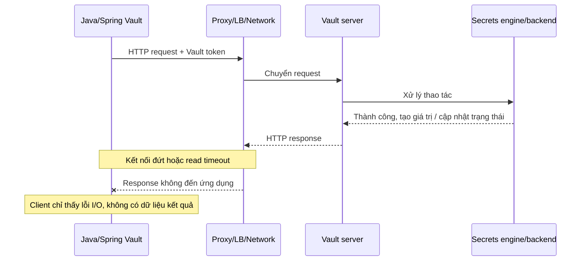
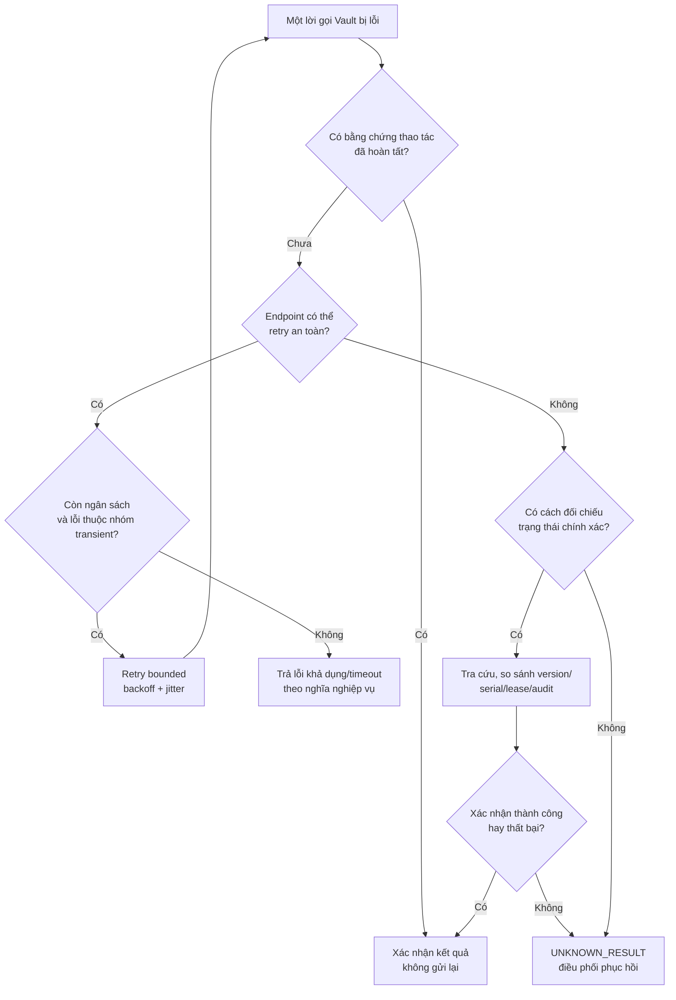
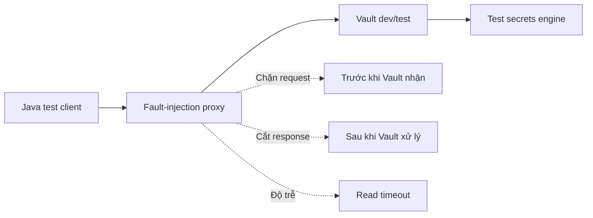

# Lỗi mạng, timeout và phản hồi không xác định kết quả

**Chương:** Lỗi và khả năng phục hồi  
**Module:** SPRING_VAULT

## 1. Một timeout không trả lời được câu hỏi “Vault đã làm xong chưa?”

Một dịch vụ Java sử dụng **Spring Vault** để truy cập **HashiCorp Vault** thường gặp các yêu cầu quan trọng: đọc secret KV, lấy mật khẩu database động, tạo token, mã hóa bằng Transit, cấp chứng thư PKI, renew lease hoặc unwrap một response wrapping token. Khi mạng ổn định, ứng dụng gửi request qua `VaultTemplate` / `VaultOperations`, nhận response, rồi cập nhật trạng thái nghiệp vụ. Nhưng một request không có response **không có nghĩa Vault chưa thực hiện thao tác**.

Ví dụ, dịch vụ dùng `VaultOperations.read("database/creds/reporting-readonly")` để lấy database credential động. Vault đã sinh username/password và cấp lease. Đúng lúc Vault gửi response, proxy ngắt kết nối hoặc Java hết **read timeout**. Ứng dụng chỉ thấy một lỗi I/O. Nếu tự động gửi lại request, Vault có thể **sinh thêm một credential khác**; credential đầu tiên vẫn tồn tại với lease của nó nhưng ứng dụng không biết giá trị.

Tình trạng này gọi là **kết quả không xác định** (*ambiguous/unknown outcome*): phía client không đủ chứng cứ để kết luận request đã được xử lý thành công hay thất bại ở server.

Bài này giải thích cách suy luận từ lỗi mạng và thời điểm timeout, phân loại retry an toàn theo **ngữ nghĩa endpoint Vault**, xử lý lỗi trong Spring Vault, cấu hình timeout, điều tra kết quả, quản lý token/lease và kiểm thử tích hợp. Nó nằm trong phạm vi SPRING_VAULT: ứng dụng Java kết nối Vault theo danh tính workload và ACL, sử dụng KV, Transit encryption, PKI và các engine khác.

**Mục tiêu học tập:**

1. Phân biệt lỗi trước khi gửi request, lỗi trong lúc xử lý và lỗi mất response sau khi server đã thực thi.
2. Giải thích vì sao HTTP `GET` hay `POST` **không đủ** để quyết định có thể retry trong Vault.
3. Lập chính sách retry riêng cho KV v1/v2, database credentials, Transit, PKI, token, lease và response wrapping.
4. Xây dựng cách xử lý `UNKNOWN_RESULT` trong Spring Vault, tránh báo sai “ghi thất bại”.
5. Cấu hình timeout, backoff, deadline, quan sát hệ thống và fault-injection test phù hợp.

## 2. Request đã đi đến đâu trước khi lỗi?

Một lời gọi qua Spring Vault có thể đi qua các thành phần:



Có ba lớp sự cố cần phân biệt:

| Giai đoạn | Ví dụ | Điều client có thể kết luận |
| --- | --- | --- |
| **Trước khi gửi request** | DNS thất bại, không tạo được kết nối TCP, TLS handshake bị từ chối trước khi gửi HTTP | Nếu xác minh chắc chắn **chưa có request nào được gửi**, thao tác cụ thể này chưa đến Vault |
| **Đang gửi hoặc xử lý** | Socket reset khi upload body, proxy đóng connection, network partition, hết deadline | Không biết server đã nhận đủ body và xử lý hay chưa |
| **Sau khi Vault xử lý, trước khi client nhận kết quả** | Vault đã lưu KV version mới/cấp cert, response thất lạc hoặc client read timeout | **Có thể thành công ở Vault nhưng client báo lỗi** |

Một exception dạng `ResourceAccessException`, `SocketTimeoutException` hoặc “connection reset” thường **không kèm chứng cứ đáng tin cậy về điểm request bị ngắt**. Không được suy từ tên exception rằng server chắc chắn chưa xử lý.

Tương tự, có HTTP response nhưng là `5xx` cũng chưa đủ để kết luận thao tác không có side effect: lỗi có thể đến từ Vault, load balancer, proxy hoặc backend sau khi một phần công việc được thực hiện. Cần biết hợp đồng endpoint và vị trí phát sinh lỗi.

### Ba trạng thái nghiệp vụ nên dùng

- **`CONFIRMED_SUCCESS`:** có response hợp lệ hoặc bằng chứng đối chiếu đáng tin cậy chứng minh kết quả đã được chấp nhận.
- **`CONFIRMED_FAILURE`:** có bằng chứng request không được gửi/không thể thực hiện, hoặc server trả lỗi xác định là không có side effect theo contract endpoint.
- **`UNKNOWN_RESULT`:** request có thể đã được thực thi nhưng không có đủ bằng chứng; phải điều tra/đối chiếu trước khi retry hoặc quyết định nghiệp vụ.

Không gộp `UNKNOWN_RESULT` vào `FAILURE` rồi hiển thị “Vault không ghi gì”. Điều đó dễ tạo bản ghi trùng, credential thừa, token không kiểm soát hoặc chứng thư đã cấp nhưng mất private key.

## 3. Các loại timeout không tương đương nhau

| Giới hạn thời gian | Đo phần nào? | Khi bị vượt |
| --- | --- | --- |
| **Connection timeout** | Thiết lập kết nối TCP đến Vault/proxy | Có thể request chưa được gửi, nhưng phải xác định có retry từ tầng dưới không |
| **TLS handshake timeout** | Thương lượng TLS và xác minh chứng thư | Nếu chưa gửi HTTP request thì endpoint chưa xử lý; phân biệt với lỗi cert/trust |
| **Read/response timeout** | Chờ dữ liệu từ kết nối đã thiết lập | Kết quả phía Vault **có thể đã xảy ra** |
| **Pool-acquisition timeout** | Chờ connection sẵn có từ HTTP pool | Nếu chưa nhận được connection để gửi request, không có side effect từ lời gọi đó |
| **Application deadline** | Tổng ngân sách của một nghiệp vụ, gồm mọi retry và đối chiếu | Hết deadline có thể dừng client nhưng không hủy được xử lý đã xảy ra ở Vault |
| **Token TTL / lease TTL** | Thời hạn của credential hoặc lease do Vault cấp | Không phải network timeout; có thể hết hạn dù request ban đầu thành công |

**Read timeout không phải giao dịch rollback.** Khi Java dừng chờ response, Vault có thể đã hoàn tất thao tác. `Future.cancel()`, cắt kết nối HTTP hoặc huỷ một Reactor subscription cũng không tự đảo ngược lệnh tạo token, cấp PKI cert hay revoke lease đã gửi.

Một chuỗi timeout thường gặp:

```text
Connect timeout:        2 giây
Read timeout:           8 giây
Backoff giữa các lần:   0,15-0,5 giây
Tổng deadline nghiệp vụ: 12 giây
```

Các số chỉ minh họa. Nếu đặt **ba lần thử, mỗi lần read timeout 8 giây**, tổng chờ có thể vượt 24 giây cộng thời gian connect và backoff, làm hỏng SLO của API gọi bên ngoài. Chỉ đặt số lần retry sau khi đã tính **tổng ngân sách** ở mọi tầng (Spring Vault client, reverse proxy, service mesh, load balancer, worker).

## 4. Không lấy HTTP method làm quy tắc retry duy nhất

Tài liệu HTTP phân biệt thao tác idempotent, nhưng **ngữ nghĩa Vault endpoint cụ thể** mới quyết định việc gọi lại có tác dụng phụ gì. Một request có thể dùng `GET` mà mỗi lần gọi lại tạo ra **secret mới**.

| Endpoint/nhóm thao tác | Hành vi khi gọi | Retry sau lỗi mạng có thể gây gì? | Chiến lược mặc định |
| --- | --- | --- | --- |
| `GET secret/data/apps/orders` (KV v2) | Đọc version hiện tại | Thường không thay đổi dữ liệu; kết quả có thể đổi nếu writer khác cập nhật | Bounded retry có backoff đối với lỗi transient |
| `POST secret/data/apps/orders` (KV v2) | Tạo version mới | Ghi trùng version hoặc ghi đè trạng thái mới nếu không dùng CAS | Không tự retry mù; dùng CAS và đối chiếu version |
| `GET database/creds/reporting-readonly` | **Sinh credential động mới** | Phát sinh nhiều username/password và lease | `UNKNOWN_RESULT` sau timeout; kiểm soát cấp phát |
| `POST transit/encrypt/payments` | Mã hóa plaintext, trả ciphertext | Có thể tạo ciphertext khác cho cùng plaintext; response đầu thất lạc | Chỉ retry nếu ứng dụng chấp nhận tạo mã hóa mới; không giả định ciphertext ổn định |
| `POST transit/decrypt/payments` | Giải mã ciphertext | Thường không làm thay đổi dữ liệu nghiệp vụ; vẫn phụ thuộc token/context | Có thể bounded retry khi lỗi transient và quyền còn hợp lệ |
| `POST pki/issue/web-server` | Sinh private key, ký cert/serial | Chứng thư đầu đã cấp nhưng private key/serial bị mất; cấp thêm cert | Không retry tự động; đối chiếu issuance/audit |
| `POST pki/sign/web-server` | Ký CSR | Có thể cấp thêm chứng thư cho cùng CSR | Kiểm tra issuance và serial trước khi quyết định lại |
| `POST auth/token/create` | Tạo client token | Có thể có token mới không được client nhận/kiểm soát | Không retry mù; điều tra và revoke nếu truy vết được |
| `POST auth/approle/login` | Đăng nhập/nhận token | Có thể tạo token mới và tiêu thụ SecretID có giới hạn số lần dùng | Theo cơ chế auth/session; tránh tự gửi lại vô hạn |
| `POST sys/wrapping/unwrap` | **Tiêu thụ wrapping token dùng một lần** | Lần đầu có thể thành công, retry báo token không hợp lệ; secret gốc không lấy lại | Không retry mù; yêu cầu quy trình bootstrap lại |
| `POST sys/wrapping/rewrap` | Vô hiệu token cũ, tạo token wrap mới | Token cũ bị hủy còn token mới thất lạc | Coi kết quả mơ hồ; không tự lặp |
| `POST sys/leases/renew` / `revoke` | Gia hạn / thu hồi lease | Trạng thái lease có thể đã thay đổi dù mất response | Đối chiếu lease ID và trạng thái theo quyền được cấp |
| `POST pki/revoke` | Thu hồi cert theo serial | Thao tác có thể đã thực hiện; retry có thể nhận lỗi “đã thu hồi” | Đối chiếu serial/CRL theo contract và operator |

**Quy tắc quyết định:** chỉ cho phép retry tự động nếu hành động được xác minh là **có thể thử lại an toàn ở mức nghiệp vụ**, hoặc đã có **cơ chế điều kiện/idempotency thực sự** ngăn tác động lặp. Thời gian chờ ngắn hoặc phương thức GET **không** tự tạo ra tính an toàn đó.

## 5. Những tình huống Vault cụ thể

### 5.1. Đọc KV v1/v2: có thể retry nhưng vẫn phải kiểm tra dữ liệu

Đọc secret KV thường là một truy vấn có thể lặp với ngân sách giới hạn. Với KV v2, `VaultKeyValueOperations` hoặc `VaultVersionedKeyValueOperations` của Spring Vault xử lý đúng đường dẫn, ví dụ logical path `apps/orders` bên trong mount `secret`.

```java
import java.util.Map;

import org.springframework.vault.core.VaultKeyValueOperations;
import org.springframework.vault.core.VaultKeyValueOperationsSupport.KeyValueBackend;
import org.springframework.vault.core.VaultOperations;
import org.springframework.vault.support.VaultResponse;

public Map<String, Object> readKv2(VaultOperations vault) {
    VaultKeyValueOperations kv =
        vault.opsForKeyValue("secret", KeyValueBackend.KV_2);

    VaultResponse response = kv.get("apps/orders");
    if (response == null) {
        throw new IllegalStateException(
            "Required KV secret is unavailable");
    }

    return response.getRequiredData();
}
```

`kv.get("apps/orders")` tương ứng đường dẫn API kiểu `GET secret/data/apps/orders`. Nếu một lần đọc timeout, lần đọc sau có thể nhận **version mới hơn** do process khác vừa cập nhật. Vì thế, “retry thành công” **không** có nghĩa đã đọc cùng snapshot với lần đầu. Khi ứng dụng cần một version cụ thể, sử dụng `VaultVersionedKeyValueOperations`.

Lỗi `404`/`null` do secret không tồn tại thường phải được xử lý theo logic ứng dụng; không nên retry một cách vô hạn với hy vọng giá trị tự xuất hiện. Lỗi `403` từ policy là vấn đề auth/ACL hoặc session, không nên bị che thành “secret rỗng”.

### 5.2. Ghi KV v2: CAS bảo vệ cạnh tranh và giới hạn side effect

KV v2 cung cấp **Check-And-Set**. Với API HTTP, body có thể mang `options.cas`:

```http
POST /v1/secret/data/apps/orders
Content-Type: application/json
X-Vault-Token: <WORKLOAD_TOKEN>

{
  "options": { "cas": 7 },
  "data": {
    "db_endpoint": "db-2.internal.example"
  }
}
```

`cas=7` yêu cầu version hiện tại đúng bằng 7 trước khi chấp nhận ghi. Nếu bản ghi chưa tồn tại, `cas=0` mang ý nghĩa chỉ tạo khi chưa có key; tùy policy mount có thể bắt buộc CAS cho mọi lần ghi.

Trong Spring Vault, dùng abstraction versioned:

```java
import java.util.Map;

import org.springframework.vault.core.VaultOperations;
import org.springframework.vault.core.VaultVersionedKeyValueOperations;
import org.springframework.vault.support.Versioned;

public Versioned.Metadata updateWithCas(
        VaultOperations vault, Map<String, Object> next) {

    VaultVersionedKeyValueOperations kv =
        vault.opsForVersionedKeyValue("secret");

    Versioned<Map<String, Object>> before = kv.get("apps/orders");
    if (before == null) {
        throw new IllegalStateException(
            "Cannot update: KV key does not exist");
    }

    return kv.put(
        "apps/orders",
        Versioned.create(next, before.getVersion()));
}
```

**Ý nghĩa trong lỗi mạng:** giả sử CAS write lần đầu đã thành công nhưng response mất. Việc gửi lại **cùng version CAS cũ** sẽ bị Vault từ chối vì version đã tăng. Điều này ngăn một lần gửi lại đơn giản tạo **hai version** dưới điều kiện không có thao tác quản trị sửa version. Tuy nhiên, **CAS mismatch không chứng minh lần đầu của chính client đã thành công**: writer khác cũng có thể cập nhật key. Khi cần xác nhận, phải đọc version/data hiện tại rồi **đối chiếu dữ liệu nghiệp vụ hoặc một operation marker an toàn**.

Nếu xử lý sự kiện có `operationId`, cân nhắc lưu marker đó cùng payload theo schema được chấp nhận; nhưng **thêm idempotency key vào JSON không tự khiến Vault deduplicate request**. Cần logic kiểm tra và điều kiện ghi (CAS), đồng thời thiết kế cho race condition giữa các writer.

### 5.3. Database credentials: GET có thể tạo lease mới

`GET /v1/database/creds/reporting-readonly` có thể cấp username/password động mới với `lease_id` và `lease_duration`. Mỗi request mới là **một đợt cấp phát khác**, dù HTTP method là GET.

Giả sử lần đầu được Vault xử lý, nhưng client không nhận `lease_id`. Không có lease ID, ứng dụng thường **không thể xác định chính xác credential nào vừa được tạo** chỉ bằng cách gọi lại endpoint cấp phát; retry có thể tạo thêm credential. Quy trình khôi phục có thể cần operator xem audit log/lease state, quy trình dọn credential không sử dụng hoặc cấp lại có giới hạn và giám sát. Tuyệt đối không dùng các lệnh revoke theo prefix diện rộng để “dọn cho chắc” trong môi trường dùng chung.

Khi ứng dụng thực sự nhận được lease ID, việc renew/revoke cũng phải theo vòng đời; Spring Vault có `SecretLeaseContainer` và các thành phần quản lý lease phù hợp, nhưng **một lần gọi `vault.read(...)` thuần không tự đảm bảo pool DB sẽ đổi mật khẩu khi hết TTL**.

### 5.4. PKI: nguy cơ chứng thư đã cấp nhưng private key bị mất

`VaultPkiOperations.issueCertificate("web-server", request)` có thể khiến Vault sinh private key và cấp chứng thư X.509. Nếu response thất lạc, ứng dụng không có private key trả về để dùng TLS, trong khi chứng thư vẫn có thể đã được phát hành. Retry không điều tra có thể cấp thêm chứng thư/serial.

Với `signCertificateRequest(...)`, private key nằm ở client nên không bị mất khi Vault mất response, nhưng ký lại vẫn có thể sinh **chứng thư mới** cho cùng CSR. Việc kiểm tra issuer/serial/issuance metadata hoặc audit cần tuân theo quyền operator và phiên bản PKI. Một chứng thư được cấp rồi không tự bị hủy chỉ vì Java read timeout. Revoke theo serial nếu có bằng chứng và quyền thích hợp; không đoán serial.

### 5.5. Transit: retry không luôn gây state mutation, nhưng output không ổn định

`VaultTransitOperations.encrypt(...)` có thể trả các ciphertext khác nhau cho cùng một dãy byte vì nonce/IV của thuật toán mã hóa xác thực. Nếu response mất và ta mã hóa lại, có thể thu được ciphertext mới giải mã về cùng plaintext nhưng **không byte-for-byte giống ciphertext đã mất**.

Đây thường là lựa chọn có thể chấp nhận **khi** ứng dụng chưa ghi ciphertext đầu tiên hoặc chưa dùng nó làm ID liên kết. Nếu nghiệp vụ đang gắn ciphertext với event ID, transaction ID, hoặc một hệ downstream, cần giữ idempotency ở tầng nghiệp vụ để không phát hai sự kiện khác nhau. Với `decrypt`, retry thường không tạo secret mới nhưng vẫn phải giới hạn tài nguyên, kiểm tra `context` của derived key và quyền `transit/decrypt/...`.

### 5.6. Wrapping và token lifecycle: tránh tiêu thụ hai lần

Response wrapping dùng token ngắn hạn có thể **unwrap một lần**. Sau khi Vault xử lý `sys/wrapping/unwrap`, wrapping token không còn hiệu lực. Nếu client read timeout ngay sau đó, gọi unwrap lần nữa sẽ không lấy được secret ban đầu. `lookup` chỉ kiểm tra metadata mà không tiêu thụ, nhưng một lookup sau lỗi không thể tái tạo payload đã unwrap.

Tương tự, `rewrap` tạo token mới và làm token cũ mất hiệu lực; response bị mất đồng nghĩa ứng dụng có thể không biết token mới. Với token login, response thất lạc có thể để lại client token đã tạo mà ứng dụng chưa nắm được. Khi xảy ra sự cố, cần khởi tạo lại luồng phân phối secret qua kênh chính thức, kiểm tra audit và revoke/rotate credential bên trong nếu nghi bị lộ.

## 6. Đọc lỗi trong Spring Vault: phân biệt HTTP response và lỗi vận chuyển

`VaultOperations` có các method như `read`, `write`, `delete`, `doWithSession`; `VaultTemplate` là implementation chính của giao diện. Theo API Spring Vault, callback `doWithSession` có thể đưa ra `VaultException` khi nhận HTTP status lỗi và `RestClientException` từ tầng REST. Các exception cụ thể còn phụ thuộc phiên bản Spring Vault, Spring Framework và HTTP client.

| Nhóm lỗi | Ví dụ quan sát | Cách diễn giải |
| --- | --- | --- |
| **Authentication/authorization** | 403, token hết hạn, thiếu ACL | Xác minh identity, policy, `SessionManager`, namespace và mount; không retry bằng token root |
| **Yêu cầu không hợp lệ** | 400, role/TLL/format sai, CAS mismatch | Sửa request hoặc đối chiếu trạng thái; retry y nguyên thường không giúp |
| **Không thấy resource** | 404 hoặc `VaultResponse == null` tùy method | Không được nhầm với timeout; kiểm tra path/version của engine |
| **HTTP lỗi server/proxy** | 429, 5xx, standby/transient upstream | Xem loại endpoint và ý nghĩa của response trước retry |
| **I/O/transport** | `ResourceAccessException`, socket reset, SSL error, read timeout | Có thể không biết thao tác đã thực thi; không tự kết luận thất bại |
| **Response sai schema** | JSON deserialize lỗi, body thiếu `data`, `wrap_info` | Response đã nhận nhưng chưa sử dụng được; thao tác có thể đã có side effect |
| **Local cancellation/deadline** | Thread interrupted, timeout từ caller | Client dừng chờ, không chứng minh Vault đã hủy thao tác |

**Cần kiểm tra chuỗi nguyên nhân exception**, không chỉ tên lớp ngoài cùng. Ví dụ `VaultException` có thể mô tả phản hồi Vault lỗi xác thực; `ResourceAccessException` thường gắn với I/O, nhưng thư viện/HTTP proxy có thể bọc lỗi khác. Không phân loại `VaultException` nào cũng là “retryable”; cũng không xem mọi `RestClientException` là lỗi mạng.

### 6.1. Khi có HTTP status, phải giữ nguyên ngữ nghĩa lỗi

Giả sử credential provider bị Vault trả 403 vì policy chỉ cấp `read` cho KV nhưng lại gọi `database/creds/...`. Retry ba lần không tạo quyền mới; nó làm tăng tải và che lỗi cấu hình. Với 400 do CAS mismatch, ứng dụng cần đọc trạng thái mới và xử lý conflict, không ghi đè bằng request khác bỏ điều kiện CAS.

Với các lỗi tạm thời như 429/503, có thể cân nhắc retry trên **request an toàn**. Với request sinh token hoặc chứng thư, bản thân HTTP status có thể không đủ để chắc chắn không có side effect; cần đối chiếu theo contract và khả năng điều tra.

### 6.2. Không xuất nguyên exception/request ra API công khai

Lỗi bên ngoài chỉ nên mang mã an toàn và trạng thái nghiệp vụ, ví dụ:

```json
{
  "code": "VAULT_RESULT_UNKNOWN",
  "message": "Chưa xác định được kết quả thao tác cấp credential",
  "correlationId": "op-9d5a"
}
```

`correlationId` là ID do ứng dụng phát hành, **không phải Vault token, lease ID, wrapping token hay secret**. Không trả về `X-Vault-Token`, response body, password, `private_key`, Transit plaintext hoặc toàn bộ message của exception nếu chứa URL/path/credential nhạy cảm.

## 7. Chính sách retry an toàn: phân nhóm theo nghiệp vụ

Một retry policy cần khai báo ít nhất:

- **Nhóm endpoint:** `READ_ONLY`, `CONDITIONAL_WRITE`, `ISSUE_CREDENTIAL`, `ONE_TIME_CONSUMPTION`, `ADMIN_MUTATION`...
- **Các loại lỗi cho phép:** lỗi transport đã xác định, HTTP 429/503, lỗi tạm thời của Vault; không retry trên 400/403 mặc định.
- **Số lần thử và ngân sách tổng:** ví dụ tối đa 3 lần, thời hạn trần 5–12 giây tuỳ SLO.
- **Backoff + jitter:** giãn các lần thử, tránh tất cả instance retry đồng thời.
- **Điều kiện đối chiếu:** sau timeout của ghi, phải có đường xác minh (KV version/CAS, lease ID, serial, request metadata).
- **Cách kết thúc:** trả `UNKNOWN_RESULT` nếu chưa xác minh được, ghi sự kiện vận hành và đưa vào luồng xử lý phù hợp.



**Không chỉ dùng Spring Retry/Resilience4j một cách bao trùm** quanh mọi `VaultOperations.write`. Các thư viện retry hữu ích cho giới hạn thời gian, backoff, jitter và metrics, nhưng **chúng không biết endpoint Vault nào có side effect**. Phân loại tại adapter nghiệp vụ trước khi bọc retry.

### 7.1. Ví dụ Java: retry giới hạn cho đọc KV v2

Đoạn sau dùng Java 17 và Spring Vault synchronous API; chỉ retry một loại lỗi I/O ở request **đọc KV**. Đây là ví dụ minh họa, không phải thư viện retry tổng quát.

```java
import java.util.Map;
import java.util.concurrent.ThreadLocalRandom;

import org.springframework.stereotype.Service;
import org.springframework.vault.core.VaultKeyValueOperations;
import org.springframework.vault.core.VaultKeyValueOperationsSupport.KeyValueBackend;
import org.springframework.vault.core.VaultOperations;
import org.springframework.vault.support.VaultResponse;
import org.springframework.web.client.ResourceAccessException;

@Service
public class ResilientKvReader {

    private final VaultKeyValueOperations kv;

    public ResilientKvReader(VaultOperations vault) {
        this.kv = vault.opsForKeyValue("secret", KeyValueBackend.KV_2);
    }

    public Map<String, Object> getOrdersConfig() {
        final int maxAttempts = 3;

        for (int attempt = 1; attempt <= maxAttempts; attempt++) {
            try {
                VaultResponse response = kv.get("apps/orders");

                // Không xem missing secret là lỗi mạng để retry.
                if (response == null) {
                    throw new IllegalStateException(
                        "Required KV config does not exist");
                }

                return response.getRequiredData();
            } catch (ResourceAccessException transportError) {
                if (attempt == maxAttempts) {
                    throw new IllegalStateException(
                        "KV read temporarily unavailable",
                        transportError);
                }

                long pauseMillis = 120L * attempt
                    + ThreadLocalRandom.current().nextLong(80);

                try {
                    Thread.sleep(pauseMillis);
                } catch (InterruptedException interrupted) {
                    Thread.currentThread().interrupt();
                    throw new IllegalStateException(
                        "KV read interrupted", interrupted);
                }
            }
        }

        throw new IllegalStateException("No result from KV reader");
    }
}
```

Điểm quan trọng:

- Code **chỉ** retry đọc KV v2, không áp cho `database/creds`, PKI, token creation, wrapping unwrap.
- `ResourceAccessException` là một dạng lỗi I/O phổ biến. Nếu HTTP client/library khác bọc exception theo cách khác, phải kiểm tra cause chain và bổ sung classifier đã kiểm thử theo phiên bản dự án.
- `response == null` là nhánh “thiếu secret”, không phải cứ retry cho đến khi xuất hiện.
- 120–440 ms là **backoff minh họa**; các hệ thống thật phải dùng deadline chung, quan sát tổng latency và giới hạn concurrency. `Thread.sleep` chỉ phù hợp trong adapter đồng bộ đơn giản; với reactive API, dùng retry không chặn thread.
- Không tự động retry mọi `VaultException` hoặc 403/400 trong block này.

### 7.2. Ví dụ Java: ghi KV với trạng thái kết quả chưa xác định

Một request ghi có thể thành công tại Vault dù Java nhận lỗi mạng. Ví dụ adapter cố ý **không lặp lời gọi write**:

```java
import java.util.Map;

import org.springframework.stereotype.Service;
import org.springframework.vault.core.VaultOperations;
import org.springframework.vault.core.VaultVersionedKeyValueOperations;
import org.springframework.vault.support.Versioned;
import org.springframework.web.client.ResourceAccessException;

@Service
public class GuardedKvWriter {

    private final VaultVersionedKeyValueOperations kv;

    public GuardedKvWriter(VaultOperations vault) {
        this.kv = vault.opsForVersionedKeyValue("secret");
    }

    public Versioned.Metadata updateOnce(
            String logicalPath,
            Map<String, Object> newData,
            Versioned.Version expectedVersion) {

        // logicalPath phải đến từ allowlist/cấu hình đáng tin cậy.
        // Đừng cho HTTP caller chỉ định tùy ý API path của Vault.
        try {
            return kv.put(
                logicalPath,
                Versioned.create(newData, expectedVersion));
        } catch (ResourceAccessException transportError) {
            // Không được suy ra request đã rollback ở Vault.
            throw new VaultResultUnknownException(
                "KV update outcome is unknown; reconcile by version",
                transportError);
        }
    }

    public static class VaultResultUnknownException
            extends RuntimeException {
        public VaultResultUnknownException(
                String message, Throwable cause) {
            super(message, cause);
        }
    }
}
```

Trong hệ thống thật, exception vận chuyển có thể được bọc ở lớp khác, vì vậy error mapping phải dựa trên request/response thực tế. Tránh tự động cho mọi lỗi của `kv.put` thành `UNKNOWN_RESULT`: lỗi CAS đã xác định không giống mất kết nối. Khi mất response sau write, **đọc lại bằng credential chỉ có quyền phù hợp**, xem version hiện tại và kiểm tra dữ liệu/operation marker. CAS giúp bảo vệ write concurrency nhưng không tự kết luận ai là người đã ghi.

Đối với thao tác không có endpoint đọc lại chính xác, cần chọn trạng thái nghiệp vụ “đang đối chiếu”, hàng đợi điều tra hoặc quy trình bù trừ có kiểm soát. Không tự thêm “force delete” hoặc revoke toàn bộ tài nguyên để giải quyết timeout.

## 8. Cấu hình timeout trong Spring Cloud Vault và Spring Vault thuần

Với ứng dụng sử dụng **Spring Cloud Vault**, tài liệu hỗ trợ các thuộc tính `spring.cloud.vault.connection-timeout` và `spring.cloud.vault.read-timeout` (đơn vị **milliseconds**). Ví dụ:

```yaml
spring:
  cloud:
    vault:
      uri: https://vault.internal.example:8200
      connection-timeout: 3000
      read-timeout: 8000
      fail-fast: true
  config:
    import: vault://
```

Đây là **minh họa cấu hình Spring Cloud Vault**, không phải bộ timeout tối ưu cho mọi hệ thống. `fail-fast` hữu ích khi ứng dụng không được khởi động thiếu secret quan trọng; nó không biến timeout thành lỗi chắc chắn không có side effect. `spring.config.import: vault://` liên quan tải cấu hình vào Spring; nếu không dùng Spring Cloud Vault Config Data, không sao chép trường này một cách máy móc.

Với **Spring Vault thuần** (tự khởi tạo `VaultTemplate`/`RestTemplate`), thiết lập timeout ở HTTP client/request factory của `RestOperations` dùng cho Vault, kèm TLS trust, connection pool và session manager. Tên API khởi tạo và cách inject phụ thuộc phiên bản Spring Vault/Spring Framework. Không thay đổi một property của Spring Cloud Vault rồi mặc định nó sẽ cấu hình mọi `VaultTemplate` do ứng dụng tự tạo.

### Thiết kế ngân sách thời gian tổng

Ví dụ API đồng bộ có thời hạn 10 giây:

```text
SLO caller:               10.000 ms
Time budget service:      8.000 ms
HTTP connect timeout:     1.000 ms
HTTP read timeout:        3.000 ms / attempt
Retry:                    tối đa 2 attempts cho KV static read
Backoff + jitter:         tối đa 300 ms
Phần dự phòng:            xử lý, log an toàn, trả phản hồi
```

Chỉ là kịch bản tính toán. Vì thời gian connect, handshake, queue và server/proxy có thể cộng thêm, deadline phải được thực thi tại tầng orchestration, không chỉ dựa vào từng timeout riêng. Tăng read timeout có thể giảm timeout giả, nhưng nếu Vault thực sự chậm hoặc backend treo thì tăng quá nhiều sẽ giữ thread/connection quá lâu.

**Không disable TLS validation để “chữa timeout”**. TLS trust/hostname error là lỗi bảo mật/cấu hình phải sửa root CA, server certificate, DNS và path mạng. Chỉ nhận biết lỗi mạng có thể retry sau khi kiểm tra không phải lỗi chứng thư.

## 9. Khi nào có thể đối chiếu kết quả?

Tùy endpoint, hệ thống có thể tự đối chiếu hoặc cần operator:

| Thao tác bị timeout | Dấu vết có thể đối chiếu | Giới hạn cần nhớ |
| --- | --- | --- |
| KV v2 write | Đọc version hiện tại và value/operation marker | Writer khác có thể đã sửa tiếp; value giống nhau chưa chắc cùng request |
| KV v2 CAS write | Kiểm tra CAS version kỳ vọng, version hiện tại và audit | CAS mismatch không xác nhận người nào ghi |
| Database dynamic creds | Lease ID nếu response từng được lưu; audit log/lease inventory do operator kiểm soát | Nếu không có lease ID và password, không thể “đọc lại credential vừa cấp” bằng GET |
| PKI issue/sign | Serial/issuer/issuance record, audit, chứng thư được lưu nếu có | Private key đã mất trong response issue có thể không phục hồi được |
| AppRole SecretID | Accessor/metadata nếu ứng dụng đã nhận; audit/role state | Không tự liệt kê được SecretID plaintext đã mất |
| Token create/login | Token accessor/audit nếu có, các mốc auth | Mất token value có thể không lấy lại được; phải thu hồi nếu xác định chính xác |
| Wrapping unwrap | Lookup trạng thái wrapping token, audit log | Token hết hạn/đã dùng không giúp khôi phục nội dung đã unwrap |
| Lease renew/revoke | `sys/leases/lookup` với lease ID và quyền phù hợp | Lệnh có thể đã chạy; TTL còn lại có thể thay đổi theo thời gian |
| Transit encrypt | Ciphertext đã lưu ở phía ứng dụng/downstream, correlation event | Vault không lưu ciphertext ứng dụng để “lấy lại mã hóa vừa thất lạc” |

### 9.1. Đối chiếu không được làm lộ secret

Không đưa plaintext, password, private key, Vault token hoặc wrapping token vào log để “khớp” request. Sử dụng request correlation ID **do ứng dụng phát sinh**, identity workload, loại operation, mount/path đã được phép hiển thị, thời điểm, HTTP status/loại lỗi, version/serial/lease ID **chỉ khi chính sách bảo mật cho phép**. Vault audit logs giúp điều tra nhưng không bảo đảm client luôn nhận được request ID khi response mất. Nhiều trường trong audit logs được HMAC hoặc bảo vệ; việc tìm kết quả đúng cần phối hợp operator.

Một correlation ID ở log ứng dụng **không tự là idempotency key ở Vault**. Để thực sự ngăn thao tác trùng cần hợp đồng endpoint hỗ trợ điều kiện (như CAS) hoặc hệ điều phối nghiệp vụ có trạng thái đã áp dụng.

### 9.2. Không lấy “readback giống dữ liệu” làm bằng chứng tuyệt đối

Giả sử hai writer cùng ghi `{"mode":"active"}` vào KV v2. Sau timeout, client đọc thấy `mode=active`. Nó **không chứng minh** request của client là request đã ghi; writer khác cũng có thể tạo cùng nội dung. Nếu nghiệp vụ phải xác nhận chính xác một thao tác, thiết kế marker, version và quyền ghi phù hợp ngay từ đầu, đồng thời tính đến race và cập nhật tiếp sau thời điểm ghi.

## 10. Circuit breaker, fallback và trạng thái suy giảm

Khi Vault không sẵn sàng, hệ thống thường cần quyết định **tiếp tục phục vụ**, **từ chối** hoặc **chuyển trạng thái suy giảm**. Quyết định này phụ thuộc loại secret.

| Dữ liệu/động tác | Có thể fallback? | Điều kiện |
| --- | --- | --- |
| KV secret tĩnh đã cache | Có thể, theo chính sách, khi còn phù hợp và được phép dùng cache | Phải có TTL/cache policy, bảo vệ memory, cơ chế phát hiện revoke/rotate |
| Database credential động | Chỉ khi lease thực sự còn hiệu lực và backend chấp nhận | Sau lease expiry/revoke không được coi credential cũ còn dùng được |
| Transit encrypt/decrypt online | Không tự giả lập khóa hoặc chuyển sang khóa tĩnh cục bộ | Có thể xếp hàng xử lý nếu không ảnh hưởng bảo mật và có kiểm soát plaintext |
| PKI issue | Không thể tự tạo cert “thay Vault” nếu không có CA được ủy quyền | Từ chối/đợi hoặc dự phòng PKI có chính sách rõ |
| Response wrapping unwrap | Không có nguồn thay thế an toàn mặc định | Không bỏ qua wrapping validation hoặc lấy raw secret từ log |
| Token refresh/login | Tùy cơ chế auth/session và TTL token hiện tại | Không gắn root token làm “fallback” |

**Circuit breaker** hữu ích để tránh bão request đến Vault khi đang outage, nhưng nên phân chia theo operation/tenant/workload phù hợp. Một circuit breaker mở không được biến thành “cache credential đã hết hạn vẫn OK”. Với ứng dụng buộc có secret để startup, dùng fail-fast/readiness có điều kiện; với ứng dụng chỉ cần secret cho một tính năng phụ, có thể degrade riêng tính năng đó.

**Bulkhead/concurrency limit** ngăn hàng nghìn thread cùng chờ Vault. Khi mở kết nối lại, dùng jitter để tránh đồng loạt retry. Đặt giới hạn retry cả ở service, proxy, HTTP client và job scheduler; nếu ba tầng đều retry 3 lần, một tác vụ gốc có thể tạo ra nhiều lần gửi ngoài dự kiến.

## 11. Token và lease: lỗi mạng có thể gây hiệu ứng dây chuyền

Giả sử network partition 30 giây:

1. Spring Vault `SessionManager` không renew được login token trước hạn.
2. Dịch vụ vẫn giữ database credential đã cấp nhưng lease có thể hết trong thời gian mất kết nối.
3. `VaultOperations.read` bắt đầu nhận lỗi 403 khi token đã hết hạn, còn DB connection pool có thể tiếp tục dùng credential cũ trong một khoảng thời gian.
4. Nhiều instance đồng thời cố re-login và cấp credential mới khi Vault phục hồi.
5. Nếu mọi instance retry mạnh, Vault và database backend có thể chịu thêm tải, gây outage kéo dài.

Hướng xử lý:

- Phân biệt **lỗi xác thực** (token không hợp lệ) với **lỗi quyền** (ACL thiếu) và **lỗi mạng**. Không dùng cùng một chính sách retry.
- Để `ClientAuthentication`/`SessionManager` hoặc Vault Agent/Proxy quản lý login token theo kiến trúc đã chọn. Không tự tạo thêm một vòng renew độc lập nếu không cần.
- Theo dõi **TTL còn lại** và renew động của secret/lease. Khi lease thực sự hết hạn, xử lý rotate/reconnect hoặc từ chối chức năng tương ứng; không che giấu bằng cache vô hạn.
- Khi Vault phục hồi, phân tán thời gian refresh để tránh “thundering herd”, giữ tổng số request trong ngưỡng Vault/backend.
- Không giả định Vault đã rollback một lệnh renew/revoke chỉ vì client timeout. Với lease ID đáng tin cậy, thực hiện lookup khi có quyền và contract hỗ trợ.

Đối với certificate PKI, hạn `NotAfter` độc lập với Vault token và network timeout. Khi cấp chứng thư mới thất bại không chắc chắn, ứng dụng không nên bất ngờ thay keypair/cert đang phục vụ bằng vật liệu chưa xác minh. Giữ chứng thư cũ **chỉ khi còn hạn và chính sách cho phép**, chủ động alert trước khi hết hạn.

## 12. Quan sát và cảnh báo: đo điều gì để phân tích timeout?

Các chỉ số hữu ích theo endpoint hoặc nhóm operation:

| Metric/sự kiện | Ý nghĩa | Cảnh báo gợi ý |
| --- | --- | --- |
| `vault_requests_total{operation,outcome}` | Số request thành công, lỗi xác định, chưa xác định | Tỷ lệ `UNKNOWN_RESULT` tăng |
| `vault_request_duration_seconds` | Phân bố latency từng nhóm thao tác | P95/P99 tăng sát read timeout |
| `vault_retry_attempts_total` | Số retry thực tế | Tăng đột biến hoặc vượt ngân sách |
| `vault_timeouts_total{phase}` | Lỗi connect/read/caller deadline nếu phân loại được | Tăng có hệ thống trên nhiều instance |
| `vault_auth_refresh_failures_total` | Login/renew token thất bại | Token gần hết hạn và không re-login |
| `vault_lease_seconds_remaining` | Thời gian còn lại của credential động đã nhận | Dưới ngưỡng cần rotate |
| `vault_pki_certificate_seconds_until_expiry` | Thời gian còn lại của cert đang phục vụ | Đã tới ngưỡng renewal |
| `vault_unknown_operations_pending` | Số thao tác cần đối chiếu | Tồn đọng lâu hoặc tăng liên tục |

Các metric trên là **tên đề xuất** để minh họa schema, không phải tên metric mặc định của Vault hoặc Spring Vault.

Khi thu thập trace:

- Ghi **tên thao tác và trạng thái**, correlation ID ngắn, loại exception an toàn, latency, attempts và token/lease expiry bucket.
- Không để `VaultResponse`, request body, token, private key, DB password hay Transit plaintext xuất hiện trong logs hoặc trace attributes.
- Chỉ log mount/path nếu đã qua allowlist và không tiết lộ thông tin nhạy cảm của tenant.
- Ghi trạng thái rõ ràng giữa “Vault trả 403” và “network read timeout” để không nhầm lỗi vận hành với lỗi permission.
- Ghép log ứng dụng, proxy/service mesh, Vault audit và backend metrics theo khoảng thời gian; độ lệch đồng hồ giữa hệ thống ảnh hưởng đối chiếu.

**SLO ví dụ:** tính riêng độ trễ/khả dụng của **KV read** và **PKI issue**. Nếu trộn tất cả operation, việc tạo cert (vốn thường tốn thời gian hơn đọc KV) có thể che mất vấn đề với endpoint ngắn. Ngoài thành công HTTP, phải đo “đã áp dụng thành công tại ứng dụng” (thay config, nạp certificate, kết nối DB).

## 13. Kiểm thử lỗi mạng và kết quả không xác định

Không thể chứng minh chính sách retry an toàn chỉ bằng unit test mock luôn trả 500 trước khi xử lý. Cần **fault injection** vào từng giai đoạn request:



Có thể dùng proxy lỗi mạng trong môi trường test, network emulator hoặc test server điều khiển được response. Với Vault thật, chạy trong cluster/dev instance riêng và các mount/roles/credentials chuyên cho test, không thao tác trên Vault production.

### 13.1. Ma trận kiểm thử gợi ý

| Tình huống | Điều cần xác minh |
| --- | --- |
| DNS/connect không thiết lập được trước khi gửi | Không có side effect ở Vault; policy retry của read có giới hạn |
| GET KV v2 bị mất response lần đầu | Bounded retry thành công hoặc fail theo deadline, không log secret |
| GET KV v2 thay version giữa 2 lần thử | Ứng dụng dùng version phù hợp/không giả định snapshot ban đầu |
| KV v2 CAS write đã commit rồi response mất | Không tạo thêm version mù; đọc lại/đối chiếu thay vì ghi không CAS |
| CAS write bị writer khác vượt version | Xử lý conflict, không báo success chỉ dựa vào version mới |
| GET database/creds đã tạo lease nhưng response mất | Không tự cấp credential liên tục; báo `UNKNOWN_RESULT` và có quy trình dọn |
| PKI issue đã cấp cert nhưng response mất | Không auto-issue; điều tra serial/issuer và private key delivery |
| Transit encrypt hai lần cùng plaintext | Hai ciphertext có thể khác nhau nhưng giải mã ra cùng byte |
| Response wrapping unwrap thành công nhưng response bị cắt | Token không dùng lại được; khởi tạo lại quy trình nhận secret |
| Login token hết TTL giữa retry | Phân biệt auth/session renew với network retry |
| Lỗi TLS trust/hostname | Được phân loại là lỗi cấu hình bảo mật, không tắt xác minh TLS |
| Trễ 2s, 5s, 20s từ Vault/backend | Deadline tổng, backoff, circuit breaker và readiness hoạt động đúng |
| Client mất response với HTTP 5xx từ proxy | Không kết luận server đã rollback |
| 50 instance cùng thử lại sau outage | Jitter/bulkhead giới hạn request và backend không quá tải |

### 13.2. Mẫu unit test cho chính sách không retry write mù

Thay vì kiểm tra implementation gọi mock bao nhiêu lần mà không có ý nghĩa, test phải xác nhận hành vi quan trọng: **một lỗi mạng sau lệnh ghi được chuyển thành outcome chưa biết, không có request ghi thứ hai**.

```java
import static org.junit.jupiter.api.Assertions.*;
import static org.mockito.ArgumentMatchers.*;
import static org.mockito.Mockito.*;

import java.net.SocketTimeoutException;
import java.util.Map;

import org.junit.jupiter.api.Test;
import org.springframework.vault.core.VaultOperations;
import org.springframework.vault.core.VaultVersionedKeyValueOperations;
import org.springframework.vault.support.Versioned;
import org.springframework.web.client.ResourceAccessException;

class GuardedKvWriterTest {

    @Test
    void transportFailureDoesNotBlindlyRepeatWrite() {
        VaultOperations vault = mock(VaultOperations.class);
        VaultVersionedKeyValueOperations kv =
            mock(VaultVersionedKeyValueOperations.class);

        when(vault.opsForVersionedKeyValue("secret")).thenReturn(kv);

        when(kv.put(eq("apps/orders"), any()))
            .thenThrow(new ResourceAccessException(
                "Read timed out", new SocketTimeoutException()));

        GuardedKvWriter writer = new GuardedKvWriter(vault);

        assertThrows(
            GuardedKvWriter.VaultResultUnknownException.class,
            () -> writer.updateOnce(
                "apps/orders",
                Map.of("mode", "active"),
                Versioned.Version.from(7)));

        verify(kv, times(1)).put(eq("apps/orders"), any());
        verifyNoMoreInteractions(kv);
    }
}
```

Đoạn trên cần **JUnit 5** và **Mockito** ở test dependencies. Nó chỉ xác nhận lựa chọn ở adapter, **chưa** chứng minh kết quả trong Vault sau khi response mất. Để kiểm tra thực tế, integration test phải cho request được Vault nhận và xử lý thành công rồi **cắt đường trả response**, sau đó đọc lại KV version hoặc kiểm tra phát sinh lease/serial.

### 13.3. Chuẩn bị dữ liệu test và cleanup

- Dùng Vault dev/test được quản lý, mount riêng cho KV v2, database test, PKI test và AppRole test.
- Không dùng dữ liệu khách hàng thật, private key sản xuất hoặc root token để chứng minh quyền workload; dùng token có ACL giới hạn.
- Khi test tạo dynamic credential, lease hoặc chứng thư, ghi nhận ID/serial nếu nhận được; cleanup có kiểm soát theo identity và tài nguyên **test**.
- Với lỗi mất response mà không lấy được lease ID, dựa vào audit/test fixture chuyên dụng; không chạy `revoke-prefix` diện rộng lên môi trường chia sẻ.
- Khả năng Vault có một số phiên bản HTTP API khác nhau cần được kiểm tra ở đúng version ứng dụng sẽ chạy. Thử fault injection ở cả HTTP client, proxy/service mesh và Vault backend là hữu ích vì điểm timeout có thể khác nhau.

## 14. Quy trình xử lý sự cố ở production

Khi xuất hiện lỗi mạng trên một thao tác nhạy cảm, hệ thống ứng dụng và người vận hành có thể làm theo chuỗi:

1. **Xác định operation và timestamp:** KV read, KV CAS write, database issue, Transit, PKI issue, unwrap hay token create.
2. **Ghi trạng thái lỗi phù hợp:** có HTTP response xác nhận hay chỉ có transport error? Nếu chưa biết kết quả, ghi `UNKNOWN_RESULT`.
3. **Ngừng retry không an toàn:** chặn việc hệ thống tự gửi thêm lệnh tạo credential, issue certificate hoặc unwrap.
4. **Thu thập bằng chứng an toàn:** correlation ID, request path hợp lệ, workload identity, thời gian, retry count, Vault audit và backend signal; không xuất secret.
5. **Đối chiếu nếu có cơ chế:** đọc KV version/CAS, lookup lease, kiểm tra issuer/serial hoặc wrapping state theo quyền và hợp đồng API.
6. **Phục hồi theo loại secret:** phát lại wrapped SecretID mới, issue credential mới có kiểm soát, rotate/revoke token/cert đã xác định, hoặc điều phối kỹ thuật viên xử lý khi chưa thể chứng minh trạng thái.
7. **Khôi phục readiness và theo dõi:** bảo đảm ứng dụng đã nạp giá trị/cert/credential hợp lệ, không chỉ dừng ở việc HTTP trả thành công.
8. **Rút kinh nghiệm:** điều chỉnh timeout, retry policy, quan sát và fault injection đúng kịch bản đã gặp.

Nếu không thể đối chiếu được, **trạng thái chưa xác định là kết quả hợp lệ** của hệ phân tán. Cần cung cấp một luồng điều phối phục hồi và định nghĩa ai chịu trách nhiệm xử lý, thay vì “giả lập” thành công hoặc thất bại để đóng ticket.

## 15. Những hiểu lầm thường gặp

| Nhận định | Cách hiểu đúng |
| --- | --- |
| “Read timeout nghĩa là Vault chưa thực thi.” | Sai; thao tác có thể đã commit, chỉ response bị thất lạc. |
| “GET luôn an toàn khi retry.” | Sai; GET database credentials có thể tạo credential và lease mới. |
| “Chỉ POST mới có side effect.” | Sai; phải đọc contract của secrets engine và endpoint. |
| “HTTP 5xx chứng minh Vault rollback.” | Sai; lỗi có thể ở proxy/backend sau khi một phần thao tác xảy ra. |
| “CAS mismatch nghĩa là write trước của tôi đã thành công.” | Sai; writer khác có thể đã tạo version mới. |
| “Gửi idempotency key trong header tùy ý là đủ.” | Sai; server/API phải thực sự hỗ trợ và xử lý idempotency key đó. |
| “Encrypt lại dữ liệu thì nhận cùng ciphertext.” | Thường sai; Transit mã hóa có thể tạo ciphertext khác nhau cho cùng plaintext. |
| “Response wrapping token có thể unwrap lại nếu mất mạng.” | Sai; unwrap thành công sẽ tiêu thụ token. |
| “Token đã renew thì database password còn dùng mãi.” | Sai; token TTL và dynamic secret lease TTL là hai vòng đời riêng. |
| “Không log secret thì không điều tra được lỗi.” | Sai; có thể dùng correlation ID, thời gian, operation metadata và Vault audit có kiểm soát. |
| “Circuit breaker mở thì cứ dùng credential cache cũ.” | Sai nếu credential đã hết hạn, bị revoke hoặc chính sách cấm stale cache. |
| “Retry trong RestTemplate/Proxy không cần tính vì đã có retry ở service.” | Sai; mọi tầng retry cộng hoặc nhân số lần gửi request. |

## 16. Tự đánh giá kiến thức

1. Client nhận `SocketTimeoutException` sau khi gọi `pki/issue/web-server`. Có thể kết luận chứng thư chưa được cấp không? Vì sao?
2. Tại sao một `GET database/creds/reporting-readonly` có thể khiến retry tạo thêm tài nguyên?
3. Phân biệt connection timeout, read timeout và Vault lease TTL.
4. Trong KV v2, CAS giúp hạn chế điều gì? Vì sao CAS mismatch không đủ để xác nhận request của mình?
5. Tại sao hai lần `transit/encrypt` cùng plaintext có thể tạo ciphertext khác nhau, và lúc nào retry vẫn được chấp nhận?
6. Khi `sys/wrapping/unwrap` bị read timeout, tại sao gọi lại có thể không lấy được secret?
7. Vì sao không nên retry tất cả `VaultException` với backoff?
8. `ResourceAccessException` có chứng minh rằng HTTP request chưa đến Vault không?
9. Vì sao sau khi Vault phục hồi có thể xuất hiện “thundering herd” từ nhiều instance Spring Boot?
10. Cần những bằng chứng và bước nào để xác nhận một lần ghi KV v2 đã commit sau khi response thất lạc?
11. Tại sao `spring.cloud.vault.read-timeout` không phải deadline tổng cho cả một workflow nhiều lần thử?
12. Một ứng dụng phát hiện DB lease đã hết hạn khi Vault đang outage có được dùng credential cũ vô thời hạn không?
13. Hãy đề xuất ma trận retry cho KV read, PKI issue, token create và unwrap, kèm lý do.

**Gợi ý:** (1) Không; response có thể mất sau phát hành; (2) mỗi GET có thể cấp credential/lease mới; (3) pha mạng so với vòng đời secret; (4) chống ghi dựa trên version cũ, nhưng writer khác cũng có thể thắng; (5) nonce/IV và trạng thái nghiệp vụ; (6) token một lần đã tiêu thụ; (7) có lỗi 403/400 và lỗi không có nghĩa là transient; (8) không; (9) nhiều nơi đồng thời retry/re-login; (10) kiểm tra version/data/marker và audit; (11) chỉ là thời gian chờ response của một request; (12) không nếu credential không còn hiệu lực; (13) retry bounded đọc, đối chiếu các thao tác cấp phát và tiêu thụ.

## Tài liệu tham khảo

- [Spring Vault — VaultOperations API](https://docs.spring.io/spring-vault/reference/api/java/org/springframework/vault/core/VaultOperations.html): `read`, `write`, callback, nullable response và các exception ở lớp Spring Vault.
- [Spring Vault — VaultKeyValueOperations API](https://docs.spring.io/spring-vault/reference/api/java/org/springframework/vault/core/VaultKeyValueOperations.html): đọc/ghi KV và phân biệt abstraction v1/v2.
- [Spring Vault — VaultVersionedKeyValueOperations API](https://docs.spring.io/spring-vault/reference/api/java/org/springframework/vault/core/VaultVersionedKeyValueOperations.html): version, put có điều kiện và CAS.
- [Spring Vault — Versioned API](https://docs.spring.io/spring-vault/reference/api/java/org/springframework/vault/support/Versioned.html): `Versioned.create(...)`, `Versioned.Version`.
- [Spring Cloud Vault — Quick Start](https://docs.spring.io/spring-cloud-vault/reference/quickstart.html): `connection-timeout`, `read-timeout` và Config Data integration.
- [HashiCorp Vault — KV v2 HTTP API](https://developer.hashicorp.com/vault/api-docs/secret/kv/kv-v2): cấu trúc dữ liệu và CAS.
- [HashiCorp Vault — Database secrets engine API](https://developer.hashicorp.com/vault/api-docs/secret/databases): cấp credential động và lease.
- [HashiCorp Vault — Lease, Renew, and Revoke](https://developer.hashicorp.com/vault/docs/concepts/lease): TTL và vòng đời secret.
- [HashiCorp Vault — System Leases API](https://developer.hashicorp.com/vault/api-docs/system/leases): lookup, renew và revoke lease khi có ID.
- [HashiCorp Vault — Transit HTTP API](https://developer.hashicorp.com/vault/api-docs/secret/transit): encrypt/decrypt và ciphertext.
- [HashiCorp Vault — PKI HTTP API](https://developer.hashicorp.com/vault/api-docs/secret/pki): issue/sign/revoke certificate và serial.
- [HashiCorp Vault — Response Wrapping](https://developer.hashicorp.com/vault/docs/concepts/response-wrapping): wrapping token, TTL và tính dùng một lần.
