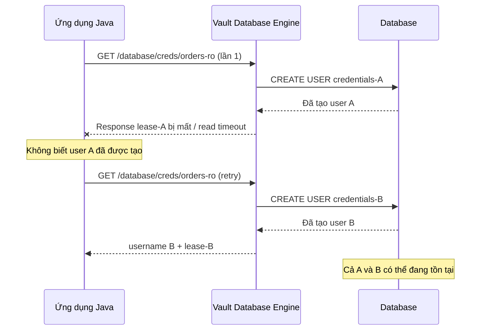
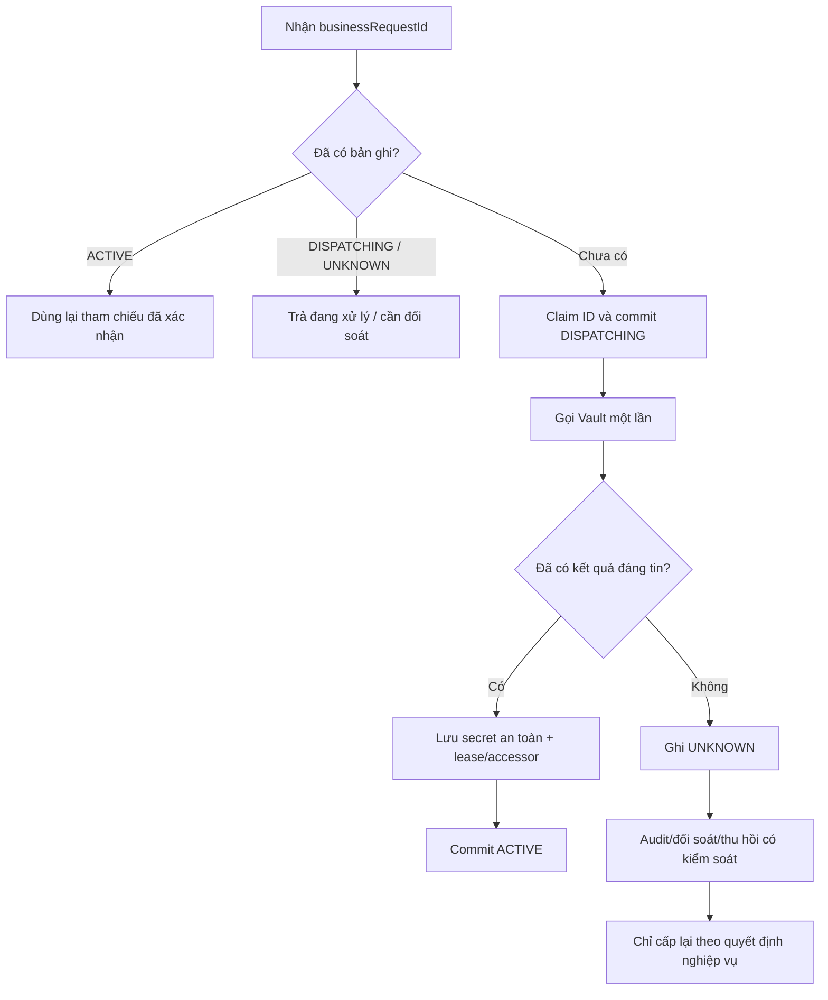

# Nguy cơ cấp thêm token hoặc secret động khi thử lại yêu cầu ghi

## Mục tiêu và bối cảnh

Trong **Spring Vault**, ứng dụng Java có thể gọi HashiCorp Vault bằng `VaultTemplate` hoặc interface `VaultOperations`, xác thực theo workload và chịu giới hạn bởi Vault policy. Bên cạnh việc đọc KV secrets, ứng dụng còn có những thao tác **phát hành tài nguyên mới**: tạo Vault token con, lấy database credentials động, cấp chứng thư PKI hoặc xin credentials từ cloud secrets engine. Một lần gọi có thể tạo đối tượng mới với **TTL, lease, chi phí và quyền truy cập riêng**.

Vấn đề nằm ở hành vi **retry khi kết quả chưa chắc chắn**. Giả sử Vault đã tạo thành công một token hoặc tài khoản database, nhưng phản hồi HTTP bị mất trên đường về. Client chỉ thấy timeout và gửi lại cùng request; Vault có thể phát hành một token hoặc credentials **thứ hai**. Cả hai đều tồn tại cho tới khi hết hạn hoặc được thu hồi theo cơ chế của chúng, trong khi ứng dụng chỉ biết tài nguyên được trả về ở lần sau.

Bài thuộc chương **Lỗi và khả năng phục hồi**, tập trung vào chủ đề **nguy cơ cấp thêm token hoặc secret động khi thử lại yêu cầu ghi**. Sau khi học, bạn sẽ có thể:

1. Phân biệt **at-most-once**, **at-least-once** và yêu cầu **idempotency** trong các lời gọi tạo tài nguyên ở Vault.
2. Nhận biết vì sao `auth/token/create`, `database/creds/<role>` và `pki/issue/<role>` có thể phát sinh tài nguyên khi gọi lại.
3. Phân loại lỗi “đã bị từ chối rõ ràng” với lỗi **không biết phía Vault đã xử lý hay chưa**.
4. Thiết kế ứng dụng Spring Vault có trạng thái nghiệp vụ, kiểm soát retry, theo dõi lease/token và đối soát khi phản hồi bị mất.
5. Viết kiểm thử tích hợp mô phỏng “Vault đã tạo tài nguyên nhưng client chưa nhận response”, giám sát và thu hồi có giới hạn quyền.

## 1. Một request giống nhau chưa chắc có cùng kết quả

**Idempotent** có nghĩa gửi cùng một thao tác nhiều lần gây cùng hiệu ứng trạng thái như gửi một lần. Với Vault, điều này phụ thuộc **endpoint và hành vi secrets engine**, không được suy ra chỉ từ tên phương thức Java `read`/`write` hoặc HTTP method `GET`/`POST`.

| Lời gọi ví dụ | HTTP method thường dùng | Có thể tạo tài nguyên mới mỗi lần? | Hệ quả khi retry |
|---|---|---|---|
| `POST /v1/auth/token/create/<role>` | POST | **Có**, mỗi lần có thể tạo token con khác | Tăng số token có quyền, có thể sinh token không được quản lý |
| `GET /v1/database/creds/<role>` | GET | **Có**, mỗi lần thường tạo cặp username/password và lease mới | Tăng tài khoản database, lease và rủi ro credential còn hiệu lực không được sử dụng |
| `POST /v1/pki/issue/<role>` | POST | **Có**, thường phát hành leaf certificate và private key mới | Sinh thêm chứng thư, serial và audit record; certificate đầu tiên có thể bị bỏ quên |
| `GET /v1/secret/data/<path>` (KV v2) | GET | Không phát hành dynamic secret; đọc phiên bản KV hiện có | Retry đọc thường không tạo credential/token mới, nhưng dữ liệu có thể đổi giữa hai lần đọc |
| `POST /v1/sys/leases/renew` | POST | Thường gia hạn **lease đã biết**, không cấp credential mới | Cần biết đúng lease; vẫn phải xét semantics và lỗi của endpoint |
| `POST /v1/auth/token/renew-self` | POST | Gia hạn token hiện có khi được phép | Không đồng nghĩa tạo token con mới |

**Điểm dễ nhầm:** Dù bài đề cập “yêu cầu ghi”, `GET database/creds/<role>` cũng có **hiệu ứng cấp phát**. Vault CLI dùng `vault read database/creds/orders-ro` để tạo database credentials động; “read” ở đây là lệnh API, **không phải đọc lại một secret tĩnh**. Cần phân loại theo **tác dụng**, không chỉ HTTP method.

### Cơ chế cấp phát và vòng đời

Một số tài nguyên có **lease**, gồm dynamic database credentials và các dynamic secret khác; Vault trả `lease_id`, `lease_duration` và `renewable`. Lease hết hạn thì Vault cố gắng thu hồi tài nguyên tương ứng, ví dụ xóa hoặc vô hiệu hóa tài khoản database tùy plugin/cấu hình. Nếu revoke thất bại, tài nguyên bên ngoài có thể tồn tại lâu hơn mong muốn; vì vậy TTL không thay thế giám sát.

Token loại **service** thường có TTL, có thể có accessor và quan hệ token cha–con. Khi token cha bị revoke, các token con thông thường và lease gắn với chúng cũng bị revoke; **orphan token** không phụ thuộc cha theo cách đó. **Batch token** có đặc tính khác (không có accessor, không được renew/revoke thủ công như service token), nên không áp dụng máy móc một quy trình truy tìm service-token accessor cho mọi loại token. Trong Spring Vault, `SessionManager` quản lý phiên xác thực theo cấu hình; việc một service tự tạo token con cho từng request là hoạt động riêng và cần cân nhắc.

**Chứng thư PKI** là một trường hợp phát hành tài nguyên khác, nhưng không phải chứng thư leaf nào cũng gắn với renewable lease; thời hạn X.509 `NotAfter` vẫn độc lập với TTL token Vault. Không áp dụng hướng xử lý lease database một cách rập khuôn cho certificate.

## 2. Kịch bản nguy hiểm: thành công ở Vault, thất bại ở client

Xét ứng dụng đặt mua hàng cần phát hành một tài khoản database tạm cho job `job-781`:



Trong kịch bản này, phía client chỉ có thông tin của `credentials-B`. `credentials-A` có thể tiếp tục tồn tại đến khi lease hết hạn hoặc bị revoke, vì vậy phát sinh một **tài nguyên không được ứng dụng theo dõi**. Đây là ví dụ hiệu ứng **at-least-once** từ việc gửi lại thao tác phát hành.

Một chuỗi sự kiện tương tự xảy ra với:

- `POST /auth/token/create/orders-worker`: hai lần thành công tạo hai token, có thể là hai child token dưới cùng cha; token đầu tiên có thể không có ai sử dụng nhưng vẫn có quyền.
- `POST /pki/issue/orders-server`: Vault có thể ký hai chứng thư leaf với serial khác nhau; phản hồi lần đầu chứa private key bị mất nên certificate đã cấp có thể trở thành orphan ở góc nhìn ứng dụng.
- `GET /aws/creds/<role>` hoặc engine cấp động khác: phát hành hai bộ credentials ở provider bên ngoài nếu engine thực sự tạo resource mới mỗi yêu cầu.

Không thể khẳng định **mọi timeout đều đã tạo tài nguyên**, cũng không thể khẳng định **không có tài nguyên nào được tạo**. Hành vi đúng là bảo lưu sự không chắc chắn cho tới khi có chứng cứ.

### “Timeout” nằm ở giai đoạn nào?

| Trạng thái quan sát được | Khả năng request đã gây hiệu ứng | Cách xử lý ban đầu |
|---|---|---|
| Validation client thất bại trước khi gửi HTTP | Chưa gửi Vault request | Sửa đầu vào; không có lý do để phát hành lại theo retry mạng |
| Không thể kết nối trước khi gửi byte nào, có bằng chứng rõ ràng | Chưa có request đến Vault từ lần thử đó | Có thể xem xét kết nối lại theo policy |
| Read timeout sau khi request đã gửi | **Không xác định**: Vault có thể đã xử lý | Đánh dấu `UNKNOWN`; không tự phát hành lần hai |
| Kết nối bị reset/response body mất | **Không xác định** | Ghi nhận correlation ID/timestamp; đối soát |
| HTTP 403 do không có quyền trên endpoint | Vault đã từ chối truy cập trước thao tác thông thường | Sửa auth/ACL; không retry liên tục |
| HTTP 400 do dữ liệu không hợp lệ, có body từ chối rõ ràng | Request thường không được thực hiện như yêu cầu | Sửa dữ liệu/cấu hình, không retry y nguyên |
| HTTP 429/5xx hoặc timeout qua proxy, không có xác nhận chi tiết | Có thể đã/đang được xử lý tùy vị trí lỗi | Xử lý bảo thủ như `UNKNOWN` nếu không chứng minh chưa tạo |
| HTTP 2xx với body được xác thực đầy đủ | Có kết quả của lần phát hành tương ứng | Ghi nhận token/lease/serial và sử dụng theo vòng đời |

Không gom hết ngoại lệ `VaultException`, `RestClientException` và `SocketTimeoutException` thành một nhánh “retry ngay”. Kết luận được phép dựa trên **giai đoạn xảy ra lỗi và điều đã biết chắc**, không dựa đơn thuần vào tên exception.

### Ví dụ hai lần gọi giống nhau với token

Operator tạo token role `orders-worker` và chỉ cấp cho service đặc quyền phát hành token quyền `update` đúng đường dẫn. Lời gọi minh họa:

```http
POST /v1/auth/token/create/orders-worker HTTP/1.1
X-Vault-Token: <authorized-issuer-token>
Content-Type: application/json

{"ttl":"20m"}
```

Response của token creation có khu vực `auth`, bao gồm `client_token` và, đối với service token, thường có `accessor`, `lease_duration` cùng `renewable`:

```json
{
  "auth": {
    "client_token": "<REDACTED_TOKEN_A>",
    "accessor": "<REDACTED_ACCESSOR_A>",
    "lease_duration": 1200,
    "renewable": true,
    "token_type": "service"
  }
}
```

Nếu response A bị mất và client gọi lại endpoint, response B có thể mang `client_token` và `accessor` khác. Vault token creation **không tự cung cấp idempotency key nghiệp vụ** để bảo đảm cùng một token được trả lại khi request lặp. Tránh sử dụng tùy chọn đặt token `id` thủ công bằng quyền root để mô phỏng idempotency: đây là khả năng đặc quyền, tăng rủi ro bảo mật và không phải giải pháp chung cho workload.

Với child token cùng namespace, Vault có thể thừa hưởng policy từ token cha nếu không chỉ định chính sách phù hợp; operator nên hạn chế token role/ACL và **không cấp quyền phát hành token cho các service không thật sự cần**.

## 3. Ranh giới giữa retry hợp lý và retry nguy hiểm

Trước khi bật retry trong RestTemplate, HTTP client, service mesh, gateway hoặc job orchestrator, cần phân nhóm thao tác:

| Nhóm | Ví dụ | Chiến lược |
|---|---|---|
| Đọc tĩnh, không cấp phát | `GET secret/data/orders/config` (KV v2) | Có thể retry lỗi tạm thời sau khi xét tính nhất quán phiên bản |
| Đọc nhưng phát hành tài nguyên | `GET database/creds/orders-ro` | **Không retry tự động khi kết quả chưa chắc chắn** |
| POST tạo token/chứng thư | `POST auth/token/create/...`, `POST pki/issue/...` | Áp dụng quy trình phát hành có trạng thái và đối soát |
| Gia hạn tài nguyên đã biết | `POST sys/leases/renew`, `POST auth/token/renew-self` | Xác minh lease/token và TTL thực nhận, phân loại lỗi trước khi xử lý |
| Thu hồi tài nguyên đã biết | `POST sys/leases/revoke`, `POST auth/token/revoke-accessor` | Kiểm tra đúng ID/đối tượng, giới hạn quyền và ghi sự kiện thu hồi |

**Retry có exponential backoff và jitter chỉ giảm tải và xung đột; nó không tạo tính idempotent**. Hai request cách nhau 100 ms hay 30 giây vẫn có thể phát hành hai credentials. Tương tự, circuit breaker giúp tránh gọi dồn dập khi Vault có sự cố nhưng không giải quyết một request bị mất response.

### Những lớp có thể tự retry ngoài ý muốn

1. **Mã Java:** vòng lặp `try/catch`, `@Retryable`, Spring Retry, Resilience4j Retry hoặc wrapper chung `retryOnException`.
2. **HTTP và proxy:** interceptor, client retry, service mesh/ingress, API gateway, load balancer, proxy có policy retry.
3. **Message/Job:** job được scheduler chạy lại, sự kiện từ queue giao lại (at-least-once), request HTTP được người dùng bấm lại hoặc worker được restart.
4. **SDK và infrastructure tự động:** một số thành phần có thể retry khi gặp điều kiện kết nối cụ thể; phải đọc cấu hình và quan sát từng hệ thống.

Vì retry có thể xảy ra ở **nhiều tầng**, chỉ bỏ `@Retryable` ở service chưa đủ. Người vận hành cần xác định lớp nào kiểm soát retry tới các endpoint có hiệu ứng phát hành và tránh để một lời gọi bị nhân đôi theo nhiều lớp.

## 4. Mô hình cấp phát có trạng thái: bảo toàn điều đã biết

Nếu một sự kiện nghiệp vụ `job-781` chỉ được sử dụng **một bộ credentials đang hoạt động**, service cần có **ID nghiệp vụ ổn định** và nơi lưu trạng thái bền vững. Client HTTP hoặc queue có thể gửi lại cùng `requestId`; ứng dụng phải nhận ra đây là **cùng yêu cầu nghiệp vụ**, dù không thể chuyển tùy ý ID đó thành “idempotency key” của Vault.

| Trạng thái | Ý nghĩa | Hành động nếu nhận lại cùng ID |
|---|---|---|
| `NEW` | Chưa đăng ký trong hệ thống | Có thể claim quyền phát hành cho ID này |
| `DISPATCHING` | Đã ghi ý định gửi lời gọi có hiệu ứng; có thể đang gọi Vault | **Không phát hành song song**; xem là có khả năng đã gửi |
| `ACTIVE` | Đã nhận và ghi an toàn credential/token cùng metadata | Trả thông tin tham chiếu hiện có; không cấp lần thứ hai |
| `UNKNOWN` | Đã gửi hoặc có thể đã gửi, nhưng không xác nhận được kết quả | Đối soát/điều tra; **không retry tự động** |
| `FAILED_FINAL` | Có bằng chứng thao tác bị từ chối trước khi tạo tài nguyên | Sửa lỗi hoặc tạo workflow mới theo policy |
| `REVOKED` / `EXPIRED` | Tài nguyên đã thu hồi hoặc hết hạn, có đối soát phù hợp | Chỉ phát hành mới theo quy trình rotation rõ ràng |

### Quy trình khuyến nghị

1. **Định danh:** Sinh hoặc nhận một `businessRequestId` duy nhất, ổn định qua retry HTTP, queue redelivery, process restart và nhiều instance.
2. **Claim có tính nguyên tử:** Lưu bản ghi `DISPATCHING` bằng unique constraint/CAS trong cơ sở dữ liệu dùng chung, **commit trước khi gọi Vault**. Chỉ một worker giành quyền phát hành ID; worker khác trả trạng thái hoặc chờ kết quả.
3. **Gửi tối đa một request** tới endpoint cấp phát cho phiên xử lý đó. Tắt mọi retry HTTP tự động áp lên endpoint này hoặc dùng policy đặc thù không resend khi outcome không chắc chắn.
4. **Nếu có phản hồi xác nhận:** Kiểm tra field bắt buộc; ghi dữ liệu bí mật vào kho bảo vệ và metadata `lease_id`/`accessor`/`serial_number` phù hợp, sau đó đánh dấu `ACTIVE` một cách bền vững trước khi bàn giao cho phía tiêu thụ.
5. **Nếu timeout/mất response/lỗi sau khi gửi:** Ghi `UNKNOWN` và thông tin không nhạy cảm như ID nghiệp vụ, thời điểm, engine/role, loại lỗi. Không chờ vòng retry tổng quát gọi Vault lần hai.
6. **Đối soát và kết thúc:** Kiểm tra tài nguyên đã ghi nhận, bằng chứng audit và hệ thống ngoài, hoặc chờ/thu hồi theo chính sách. Chỉ mở một yêu cầu cấp mới nếu đã chấp nhận được rủi ro tài nguyên cũ và có quy tắc chuyển trạng thái rõ ràng.



**Ranh giới không thể loại bỏ hoàn toàn:** Cơ sở dữ liệu ứng dụng và Vault là hai hệ thống khác nhau. Không có transaction nguyên tử bao trùm việc “Vault tạo token/user” và “ứng dụng lưu metadata”. Nếu Vault đã cấp thành công nhưng ứng dụng crash trước khi ghi `ACTIVE`, bản ghi local vẫn ở `DISPATCHING`/`UNKNOWN`. Một unique key trong database **ngăn ứng dụng phát hành trùng một cách vô ý**, nhưng **không chứng minh được exactly-once trên Vault** sau sự cố mạng/process.

Nếu hệ thống ưu tiên **không phát hành trùng**, có thể chọn at-most-one dispatch với nhánh `UNKNOWN` cần xử lý thủ công hoặc chính sách chờ TTL. Điều đó đánh đổi **availability**, vì một request thực tế chưa tới Vault cũng có thể bị giữ lại để đối soát. Nếu ưu tiên “cứ thử lại cho tới khi thành công”, cần chấp nhận rủi ro tạo nhiều tài nguyên và thiết kế cleanup/giới hạn rõ ràng.

### Vì sao “idempotency key” ở phía client chưa đủ?

Thêm header `X-Idempotency-Key` hoặc field `businessRequestId` vào một request không tự buộc Vault trả lại cùng token/secret. Với các endpoint cấp phát đang xét, **không có hợp đồng idempotency theo business ID được minh họa trong API**. Nếu cần chống lặp, phải xây **dịch vụ điều phối và lưu trạng thái** phía ứng dụng, hoặc sử dụng endpoint đã được nhà cung cấp bảo đảm semantics phù hợp; không suy đoán Vault có cơ chế dedupe ngầm.

Tương tự, đừng dựa vào giá trị plaintext/role giống nhau để suy ra cùng resource: hai lần `database/creds/orders-ro` có thể cho hai username khác nhau; hai lần token create có thể có token/accessor khác; hai lần PKI issue có thể ra serial khác.

## 5. Tích hợp Spring Vault: tách thao tác phát hành khỏi retry

### Adapter chỉ cấp một lần qua VaultOperations

Giả sử nhóm vận hành đã bật **database secrets engine**, cấu hình kết nối database và dynamic role `orders-ro`. Workload chỉ được Vault policy cấp `read` tại `database/creds/orders-ro`. Ví dụ Java 17+ dùng `VaultOperations` được Spring inject:

```java
import java.util.Map;

import org.springframework.stereotype.Repository;
import org.springframework.vault.core.VaultOperations;
import org.springframework.vault.support.VaultResponse;

@Repository
public final class VaultDatabaseCredentialIssuer {

    private static final String PATH = "database/creds/orders-ro";
    private final VaultOperations vault;

    public VaultDatabaseCredentialIssuer(VaultOperations vault) {
        this.vault = vault;
    }

    public IssuedDatabaseCredential issueOnce() {
        // Mỗi lời gọi GET này có thể tạo user + lease MỚI.
        VaultResponse response = vault.read(PATH);

        if (response == null || response.getData() == null) {
            throw new IllegalStateException(
                "Dynamic credential response is missing");
        }

        Map<String, Object> data = response.getData();
        Object rawUser = data.get("username");
        Object rawPassword = data.get("password");
        String leaseId = response.getLeaseId();

        if (!(rawUser instanceof String user) || user.isBlank()
                || !(rawPassword instanceof String password)
                || password.isBlank()
                || leaseId == null || leaseId.isBlank()
                || response.getLeaseDuration() <= 0) {
            // Có thể Vault đã tạo resource nhưng response không đủ thông tin.
            // Người gọi phải lưu UNKNOWN và đối soát; không retry y nguyên.
            throw new IllegalStateException("Dynamic credential metadata is invalid");
        }

        return new IssuedDatabaseCredential(
            user, password, leaseId,
            response.getLeaseDuration(), response.isRenewable());
    }

    public record IssuedDatabaseCredential(
            String username,
            String password,
            String leaseId,
            long leaseDurationSeconds,
            boolean renewable) {

        @Override
        public String toString() {
            return "IssuedDatabaseCredential[REDACTED]";
        }
    }
}
```

Đây là **adapter phát hành một lần**, **không có `@Retryable`**. Giá trị `password` nằm trong `String` theo dạng dữ liệu Java nhận từ Vault; cần hạn chế thời gian lưu/giữ trong bộ nhớ, không serialize record thành JSON hoặc ghi log, và dùng kho bí mật phù hợp khi cần lưu bền vững. Override `toString()` chỉ giảm rủi ro log vô tình, **không thay thế** kiểm soát xuất dữ liệu, heap dump, trace hay serialization. Trong hệ thống thực, nên dùng DTO nội bộ với quyền truy cập hạn chế thay vì truyền credential xuyên các tầng không cần thiết.

`VaultOperations.read(PATH)` trả `VaultResponse` với dữ liệu credentials và metadata `getLeaseId()`, `getLeaseDuration()`, `isRenewable()`. Đây là metadata của **dynamic lease**, không phải trường trong KV v2. Khi request timeout, đoạn mã có thể ném `VaultException`/`RestClientException` hoặc exception khác, nhưng điều đó **không thể chứng minh** Vault chưa tạo credential.

### Application service quản lý businessRequestId

Vì một method `issueOnce()` tự nó không đảm bảo điều phối request lặp, phía application service cần một journal bền vững. **Giả mã Java** (các phương thức `journal.*` và `secureStore.*` là contract của ứng dụng, không phải API có sẵn trong Spring Vault):

```java
public IssuanceStatus issueFor(String businessRequestId) {
    // reserveAndCommit dùng unique key + transaction ngắn.
    if (!journal.reserveAndCommit(businessRequestId, "DISPATCHING")) {
        // ACTIVE: trả tham chiếu đã có. UNKNOWN/DISPATCHING: chờ đối soát.
        return journal.currentStatus(businessRequestId);
    }

    try {
        var issued = databaseCredentialIssuer.issueOnce();

        // Ghi secret vào secure store, metadata lease và cập nhật ACTIVE
        // theo thứ tự nhất quán của hệ thống ứng dụng.
        // Nếu quá trình lưu lỗi, phải giữ UNKNOWN/đối soát.
        secureStore.persistRestricted(businessRequestId, issued);
        journal.confirmActive(
            businessRequestId,
            issued.leaseId(),
            issued.leaseDurationSeconds());

        return IssuanceStatus.ACTIVE;
    } catch (RuntimeException failure) {
        // Có thể Vault đã cấp credentials rồi nhưng response bị mất.
        journal.markUnknownBestEffort(businessRequestId, "ISSUE_OUTCOME_UNKNOWN");
        throw new DependencyUncertainException(
            "Credential issuance outcome requires reconciliation", failure);
    }
}
```

Đây là mô hình **sơ đồ triển khai**, chưa cung cấp transaction storage, encryption, fencing token, exception classes hay logic đối soát; các phần đó phải được hiện thực cụ thể. `reserveAndCommit` cần được ghi bền **trước** gọi mạng. Nếu process chết trước `markUnknownBestEffort`, một worker giám sát phải phát hiện bản ghi `DISPATCHING` quá lâu rồi chuyển sang xử lý không chắc chắn. Với nhiều instance, journal phải dùng cơ chế claim nguyên tử và chống race condition, không phải `HashMap` trong bộ nhớ một JVM.

Tránh bọc **cả request Vault trong một transaction database** rồi rollback trạng thái khi Vault lỗi: rollback local không undo được user/token đã tạo bên ngoài. Nếu `secureStore.persistRestricted` thành công nhưng `confirmActive` thất bại, ứng dụng cần đối soát cả hai nơi, không tự cấp credential mới.

### Policy phù hợp với hành vi phát hành

Ví dụ ACL cho workload chỉ cần dynamic database credential:

```hcl
path "database/creds/orders-ro" {
  capabilities = ["read"]
}
```

Quyền `read` ở endpoint này **cho phép phát hành nhiều credentials**, khác với `read` ở KV secret tĩnh. Chỉ cấp cho workload cần thiết, giới hạn role và lease TTL từ phía database engine, phối hợp quota/rate limit nếu môi trường hỗ trợ. Không cấp `auth/token/create/*` cho workload lấy credentials chỉ để kết nối database.

Nếu một service riêng phải **tạo child token**, tách interface `TokenIssuer`, cấp `update` trên token role đã được operator giới hạn policy/TTL, và áp dụng **cùng mô hình journal**. Không cho API công khai nhận `policies` hoặc `ttl` tùy ý rồi chuyển nguyên vào `auth/token/create`; người dùng không được tự leo quyền qua endpoint ứng dụng.

### SecretLeaseContainer hỗ trợ lifecycle, không tự tạo idempotency

Spring Vault có `SecretLeaseContainer` để đăng ký một đường dẫn dynamic secret, theo dõi lease, **renew** trước hạn và **rotate/request** secret khi cần. Ví dụ khai báo trên container đã được cấu hình:

```java
// container: SecretLeaseContainer đã được Spring cấu hình và quản lý vòng đời.
container.requestRenewableSecret("database/creds/orders-ro");
// Hoặc, nếu cần cấp mới/rotation theo chu kỳ sống:
container.requestRotatingSecret("database/creds/orders-ro");
```

Container giúp tránh code tự gọi `vault.read(...)` trong từng HTTP request và cung cấp event về lease; **renew** của lease đã biết khác với **request một credential mới**. Tuy nhiên, khi container khởi động lần đầu, đăng ký một secret chưa có, hoặc rotation sau expiry, nó vẫn có thể gọi endpoint phát hành. Nếu mất phản hồi tại thời điểm đó, cần kiểm tra cách ứng dụng ghi nhận event, xử lý lỗi và đặc tính của backend. Đừng tuyên bố container bảo đảm exactly-once trên Vault qua mạng.

Đối với phiên xác thực, `SessionManager`/`SessionLeaseContainer` (theo phiên bản và cách cấu hình Spring Vault) giúp theo dõi token, login/renewal và xử lý khi session hết hạn. **Gia hạn token hiện tại** không phải tạo child token mỗi lần request. Nên dùng auth method phù hợp workload và để hạ tầng quản lý phiên, thay vì tự mint token cho mỗi lần gọi API nghiệp vụ.

## 6. Đối soát và thu hồi khi đã tạo tài nguyên dư

Khi hệ thống báo `UNKNOWN`, mục tiêu của đối soát là xác định **tài nguyên nào thực sự tồn tại, ai đang sử dụng và có thể thu hồi an toàn hay không**. Không phải mọi loại resource đều có đường tra cứu đưa lại secret gốc; nhiều credential hoặc private key chỉ xuất hiện trong phản hồi phát hành ban đầu. Nếu response chứa password/token bị mất, không giả định có thể đọc lại nguyên giá trị ấy.

### Trường hợp đã lưu được lease ID hoặc token accessor

| Tài nguyên | Dấu vết phù hợp | Hành động có thể thực hiện khi được ủy quyền |
|---|---|---|
| Dynamic database secret | `lease_id`, role, thời điểm cấp, username | Kiểm tra lease, xác minh không còn consumer và revoke **đúng lease** |
| Service token con | `auth.accessor` hoặc token ID được bảo vệ | Lookup/revoke theo **accessor cụ thể** với quyền phù hợp; phân tích ảnh hưởng tới các lease/con của token |
| PKI leaf certificate | Serial number, issuer, subject/SAN | Thu hồi theo **serial** nếu PKI và chính sách thu hồi hỗ trợ; điều tra trust/revocation distribution |
| Resource ngoài Vault | Định danh provider, username/key ID, thời gian tạo | Operator đối soát cả Vault lẫn provider và xóa/vô hiệu hóa đúng đối tượng |

Ví dụ lệnh **chỉ dành cho vận hành có quyền**, với định danh đã được xác nhận và thay thế placeholder:

```bash
# Dynamic secret: tra cứu và thu hồi đúng lease ID
vault lease lookup "<exact_lease_id>"
vault lease revoke "<exact_lease_id>"

# Service token: tra cứu/revoke đúng token accessor đã lưu
vault token lookup -accessor "<exact_service_token_accessor>"
vault token revoke -accessor "<exact_service_token_accessor>"
```

Các lệnh là thao tác **có hiệu ứng thật** trong môi trường Vault được kết nối; chỉ chạy sau khi xác nhận tài nguyên và phạm vi ảnh hưởng. Token accessor không dùng để xác thực trực tiếp như token value nhưng có thể là đầu mối để revoke, do đó cần hạn chế truy cập. Batch token không có accessor theo cơ chế service token và không dùng quy trình này.

Thu hồi **child service token** có thể làm vô hiệu token đó cùng những tài nguyên con/lease gắn với nó. Thu hồi **parent token** có thể kéo theo cả cây child token và dynamic leases; không dùng việc revoke toàn bộ parent để xử lý một request `UNKNOWN` nếu chưa xác định mọi workload bị ảnh hưởng. Tương tự, tránh `revoke-prefix` trên diện rộng để “dọn nhanh” vì có thể gián đoạn nhiều dịch vụ hợp lệ.

### Trường hợp mất hoàn toàn response: không có lease ID/accessor

Đây là nhánh khó nhất. Có thể triển khai quy trình:

1. **Dùng dấu vết sẵn có:** `businessRequestId`, khoảng thời gian, tên engine/role, identity gọi Vault, node/namespace và trace ID ứng dụng không chứa secret. Nếu nhận được `request_id` từ một phản hồi khác, có thể lưu để phục vụ audit; khi **chưa nhận response**, không được bịa ra Vault `request_id`.
2. **Nhờ operator tra cứu audit logs được phép:** Audit có thể giúp xác định request nào đã tới Vault, kết quả chung và dấu vết endpoint. Nhiều trường nhạy cảm được Vault audit HMAC hoặc làm mờ; audit **không phải kho khôi phục plaintext token/password đã mất**.
3. **Kiểm tra hệ thống ngoài và metadata có thẩm quyền:** Với database, đối soát những user do Vault tạo theo role/khung thời gian; với cloud credentials, kiểm tra tài nguyên phía provider; với PKI, kiểm tra serial/chứng thư đã cấp theo khả năng hệ thống. Không suy rằng trùng timestamp hoặc tên prefix tự nó đủ chứng minh chủ sở hữu.
4. **Chỉ revoke khi nhận diện đúng đối tượng:** Nếu không có bằng chứng xác thực, giữ `UNKNOWN` và báo động thay vì đoán lease ID/username rồi xóa. Khi cần khắc phục sự cố bảo mật cấp cao, quyết định thu hồi diện rộng thuộc quy trình vận hành được phê duyệt.
5. **Quyết định khi nào có thể phát hành lại:** Có thể chờ TTL, nhưng TTL không bảo đảm resource ngoài Vault đã được revoke tức thì nếu engine/backend gặp lỗi. Kiểm tra quy trình làm sạch và giới hạn nghiệp vụ trước khi mở một request mới.

Ngay cả với audit đầy đủ, có những trường hợp **không thể khôi phục chính xác token/password bị mất**. Phương án khả thi khi đó là để credential hết hạn/thu hồi an toàn theo quyền của operator, sau đó cấp mới có kiểm soát. Đây là lý do phải ưu tiên **ghi nhận và bảo vệ kết quả cấp phát ngay khi nhận được**, trước khi đánh dấu bước nghiệp vụ hoàn tất.

### Lease renewal khác với cấp mới

Một dynamic credential đã biết có thể gắn lease có thể gia hạn theo chính sách. Nếu ứng dụng có `lease_id` hợp lệ, nên dùng cơ chế renewal được Spring Vault quản lý hoặc API lease renewal thay vì tự gọi `database/creds/<role>` định kỳ để “làm mới”:

| Hoạt động | Tác động dự kiến |
|---|---|
| Renew lease hiện có | Kéo dài quyền sử dụng **cùng resource** nếu engine và giới hạn TTL cho phép |
| Rotate hoặc issue lại credentials | Có thể tạo resource mới và cần chuyển consumer |
| Revoke lease | Vô hiệu hóa resource được cấp theo lease, tùy khả năng của backend |
| Token renew | Kéo dài phiên/token theo policy, không tự động tạo child token mới |
| Token create | Tạo token mới, cần quản lý quyền và vòng đời riêng |

Nếu lease không renewable, đã chạm max TTL, hoặc token gắn lease bị revoke, không thể trông chờ renewal vô hạn. Ứng dụng cần rotation chủ động, chuyển connection pool sang credential mới và đóng kết nối cũ phù hợp thời điểm revoke, tránh xử lý lại toàn bộ request cấp phát mỗi khi có lỗi mạng thoáng qua.

## 7. Ngăn phát hành thừa ngay từ thiết kế hệ thống

### Giảm số lần gọi phát hành

Không nên lấy `database/creds/<role>` cho **mỗi HTTP request** nếu credential được dùng bởi cả connection pool của service. Thường một instance hoặc một nhóm tác vụ dùng một identity/credential theo vòng đời đã quản lý; chính sách cách ly tùy rủi ro và yêu cầu kiểm toán của hệ thống.

| Kiểu ứng dụng | Thiết kế phù hợp hơn |
|---|---|
| Spring Boot kết nối database thường xuyên | Cấp/renew credential theo vòng đời datasource/pool, rotate có kế hoạch |
| Job ngắn hạn thực sự cần credential riêng | Một `businessRequestId` cho một job, journal trạng thái, TTL ngắn và cleanup |
| Dịch vụ gọi Vault bằng workload auth | Để `SessionManager` quản lý token đăng nhập; tránh tạo child token theo từng request |
| Dịch vụ phát hành token cho hệ thống khác | Cô lập thành Token Issuer có policy/role, journal, audit và quy trình revoke |
| Dịch vụ xin TLS certificate | Cấp theo vòng đời TLS identity, giám sát `NotAfter`, không issue cho mỗi connection |

Với những dịch vụ **thực sự cần** token/credential khác nhau cho mỗi tác vụ, vẫn phải chấp nhận nhiều tài nguyên là thiết kế nghiệp vụ, nhưng mỗi tài nguyên cần có owner, TTL, mục tiêu sử dụng và dữ liệu truy vết rõ ràng.

### Giới hạn từ phía Vault và hạ tầng

- Hạn chế **TTL và max TTL** theo loại token/secret engine, không để một retry vô ý tạo resource tồn tại dài bất thường.
- Cấp quyền **least privilege** cho Vault identity; với token issuance, dùng token role giới hạn policy/TTL, tránh cho workload cấp root hoặc orphan token nếu không có lý do.
- Cấu hình **quota, rate limit, số lượng connection và khả năng thu hồi** theo bản Vault và môi trường vận hành, bảo đảm không làm nghẽn hệ thống phía sau.
- Đặt retry policy theo **endpoint** và semantics; không áp một `retryOn5xx` toàn cục lên tất cả `VaultOperations.write(...)` và `VaultOperations.read(...)`.
- Ghi trạng thái nghiệp vụ trước khi thực hiện request phát hành; dùng unique constraint và điều phối nguyên tử giữa nhiều instance.
- Không đưa secret vào dead-letter queue, audit ứng dụng hoặc alert. Nếu job cần được phát lại, chỉ phát lại **tham chiếu ID và trạng thái**.

### Ví dụ hợp đồng HTTP cho nghiệp vụ cấp phát

Một HTTP API công khai của ứng dụng có thể nhận:

```http
POST /internal/credential-requests HTTP/1.1
Content-Type: application/json
Idempotency-Key: job-781

{"purpose":"orders-readonly"}
```

`Idempotency-Key` **ở đây là hợp đồng của ứng dụng**, dùng làm `businessRequestId` trong journal và cần kiểm tra quyền/người gọi, độ duy nhất, thời hạn lưu và chống reuse cùng ID cho payload khác. Đây **không phải** header được Vault mặc định diễn giải. Service có thể trả `202 Accepted` với trạng thái `DISPATCHING/UNKNOWN`, hoặc trả tham chiếu `ACTIVE` đã xác nhận nếu người gọi gửi lại cùng ID.

Không trả trực tiếp password/token mới chỉ vì caller gọi lại endpoint. Hệ thống phải có quy tắc **ai được phép xem một secret một lần**, lưu secret đã nhận ở đâu, và liệu có thể truy xuất lại qua kho bí mật của ứng dụng hay không. Nếu buộc trả credential một lần duy nhất, cần thiết kế luồng bàn giao an toàn và khả năng hủy/đối soát khi response trả về caller bị mất, vì đó cũng là một cửa sổ lỗi tương tự.

## 8. Giám sát và ứng phó sự cố

Các metric hữu ích:

| Metric gợi ý | Mục tiêu quan sát |
|---|---|
| `vault_issuance_attempts_total{engine,role,outcome}` | Số lần thử phát hành, phân loại thành công/known failure/unknown |
| `vault_issuance_unknown_total{engine,role}` | Số request mất xác nhận, cần đối soát |
| `vault_issuance_unknown_age_seconds` | Tuổi của request `UNKNOWN` lâu nhất hoặc phân bố tuổi |
| `vault_active_lease_count{role}` | Lease hiện được ứng dụng theo dõi theo role |
| `vault_lease_renewal_failures_total{role}` | Lỗi gia hạn và nguy cơ hết hạn resource |
| `vault_issuance_reconcile_total{result}` | Số trường hợp được đối soát/thu hồi hoặc còn chưa rõ |
| `vault_issuance_duration_seconds{engine,role}` | Độ trễ để phân biệt tăng latency và phát hành trùng |

Nên so sánh **số resource đã phát hành** (từ Vault/audit/provider, trong phạm vi quan sát được) với **số resource ứng dụng có metadata**. Chênh lệch tăng sau outage hoặc deployment có thể là dấu hiệu cấp phát dư. Lưu ý một số dữ liệu từ Vault/engine có thể không có công cụ list trực tiếp cho workload, vì vậy nhiệm vụ đối soát thường cần operator.

Không đưa `client_token`, password, private key, toàn bộ `VaultResponse` hoặc tokenization data vào metric label, log hay tracing. `lease_id`/`accessor` có thể được lưu trong hệ thống vận hành hạn chế quyền; không biến chúng thành label metric có cardinality cao hoặc công khai ra HTTP. Có thể log một correlation ID tự tạo cùng engine/role, HTTP status đã chuẩn hóa và phase `before_send/after_send/response_received` khi có thể xác định chính xác.

### Playbook sự cố mất phản hồi khi phát hành

1. **Cô lập retry:** Tắt hoặc giới hạn pipeline gây resend; kiểm tra policy ở cả app, client/proxy, queue và scheduler.
2. **Đánh dấu request có nguy cơ:** Quét `DISPATCHING` quá lâu, đưa sang `UNKNOWN`, ngăn worker khác cấp tiếp.
3. **Đối soát ưu tiên:** Kiểm tra tài nguyên nhận được, journal, audit, lease/token metadata và hệ thống ngoài theo phạm vi quyền.
4. **Thu hồi có mục tiêu:** Revoke bằng lease ID/accessor/serial đã xác minh và bảo đảm không còn consumer hợp lệ phụ thuộc.
5. **Khôi phục luồng nghiệp vụ:** Chỉ phát hành lại khi đã xử lý rủi ro trùng, theo chính sách owner/TTL/quota.
6. **Ngăn tái diễn:** Bổ sung fault-injection test “server đã xử lý nhưng response bị mất” và cảnh báo tỷ lệ `UNKNOWN`.

## 9. Kiểm thử tích hợp và fault injection

Các unit test mock `VaultOperations` có ích để kiểm tra ứng dụng **không tự retry sau exception**, nhưng không xác minh được Vault có tạo user/token trước khi response bị mất. Để kiểm chứng đúng rủi ro của bài, cần thử một lần trên **Vault dev/test cô lập**, đi kèm database test cho dynamic role hoặc token role được quản trị riêng.

| Kịch bản | Thiết lập | Điều phải xác minh |
|---|---|---|
| Tạo hai token với hai request giống hệt | Dùng `auth/token/create/<test-role>` ở Vault lab | Hai response có thể có token ID/accessor khác, tồn tại độc lập theo TTL/quan hệ cha–con |
| Đọc dynamic DB creds hai lần | Gọi `GET database/creds/<test-role>` hai lần | Hai username/`lease_id` thường khác nhau; mỗi lần đọc có thể phát hành tài khoản mới |
| Đọc KV v2 hai lần | `GET secret/data/<test-path>` | Không tạo lease dynamic/token mới chỉ vì đọc lại bản ghi KV |
| Lỗi validation trước khi request gửi | Chặn dữ liệu sai ở adapter | Không có lời gọi Vault và không tạo resource |
| HTTP 403 do policy thiếu quyền | Token workload chỉ có quyền không đúng path | Đánh dấu lỗi cấu hình/phân quyền, không retry vòng lặp |
| Fault “server xử lý xong, client mất response” | Proxy test **cho request đi qua Vault rồi ngắt phản hồi** | Chỉ một lời gọi phát hành ở adapter; trạng thái `UNKNOWN`; không tự gọi lại |
| Cùng businessRequestId tới hai app instances đồng thời | Hai worker dùng chung journal có unique constraint | Chỉ một worker claim được và gửi request; worker còn lại đọc trạng thái |
| Process crash giữa khi gửi request và lưu `ACTIVE` | Dừng worker tại cửa sổ lỗi được kiểm soát | Bản ghi `DISPATCHING` quá hạn được phát hiện, chuyển vào hàng đối soát |
| Mất database kết quả sau khi đã nhận lease | Giả lập lỗi `secureStore`/journal | Không cấp lại tự động; ghi nhận leak risk và triển khai cleanup có kiểm soát |
| Revoke đúng lease đã biết | Dùng `vault lease revoke` trong lab | Tài khoản/credential bị vô hiệu hóa theo khả năng engine, không ảnh hưởng resource khác |
| Token cha bị revoke | Tạo child service token trong lab, thu hồi cha | Kiểm tra ảnh hưởng tới child token và lease để hiểu blast radius |
| Vượt TTL / backend revoke bị lỗi | Cô lập downstream hoặc giả lập thất bại cleanup | Cảnh báo tồn đọng, không tuyên bố TTL bảo đảm tài nguyên đã biến mất tức thì |

### Thử nghiệm bắt buộc: response bị mất sau khi Vault đã tạo resource

Một bài test đúng phải tạo được trình tự sau:

```text
T0  App ghi DISPATCHING(job-781) vào journal, commit.
T1  App gửi GET /database/creds/orders-ro tới Vault.
T2  Vault tạo user-1 và lease-1; HTTP response được tạo.
T3  Test proxy drop response, app nhận read timeout.
T4  App ghi UNKNOWN(job-781); không gửi GET lần hai.
T5  Client/queue phát lại job-781.
T6  App nhận biết ID cũ và trả trạng thái UNKNOWN, không cấp user-2.
T7  Operator đối soát user-1/lease-1 và thu hồi hoặc để hết hạn.
```

Nếu test chỉ **tắt Vault trước khi request đến server**, nó kiểm tra lỗi kết nối, **chưa chứng minh** hệ thống ứng phó với “server đã xử lý nhưng client mất response”. Tại T2, kiểm tra bằng công cụ quan sát được ủy quyền của Vault/database test để xác nhận tài nguyên thật sự đã được tạo. Không dùng database sản xuất hay root token production cho các ca fault injection.

### Bài tập quyết định retry

Giả sử trong vòng một phút có bốn lỗi:

1. API đọc KV v2 nhận timeout trên một GET không có tác dụng cấp phát.
2. API `auth/token/create` nhận timeout sau khi client đã gửi request nhưng chưa thấy response.
3. API `database/creds/orders-ro` nhận lỗi kết nối sau khi proxy đã nhận request đầy đủ.
4. API `auth/token/create` nhận HTTP 403 do policy không cho tạo token.

Đề xuất:

- **Trường hợp 1:** có thể retry theo policy đọc và giới hạn tải; chú ý bản ghi KV có thể đổi giữa lần thử.
- **Trường hợp 2 và 3:** đánh dấu `UNKNOWN` và đối soát; **không** coi timeout là bằng chứng thất bại chắc chắn.
- **Trường hợp 4:** sửa auth/ACL hoặc quy trình cấp quyền; retry lại ngay với cùng policy không giải quyết được lỗi.

Nếu bài toán kinh doanh bắt buộc phải có credential mới dù trường hợp 2 hoặc 3 vẫn chưa rõ kết quả, phải xác định **chấp nhận rủi ro phát hành dư**, cách giới hạn số lần, TTL và kế hoạch rà soát/thu hồi.

## 10. Checklist trước khi đưa vào production

1. **Liệt kê endpoint sinh tài nguyên:** token creation, dynamic credentials, PKI issue và mọi API GET/POST khác có tác dụng cấp phát.
2. **Xác định điểm retry:** HTTP client, Spring Retry/Resilience4j, service mesh, load balancer, queue, job scheduler và khả năng người dùng gửi lại request.
3. **Chặn duplicate nghiệp vụ:** có `businessRequestId` ổn định, unique constraint và claim nguyên tử trên storage chung; không sử dụng map trong bộ nhớ làm nguồn sự thật.
4. **Lưu ý định phát hành trước request:** trạng thái `DISPATCHING` được commit trước network call; crash hoặc timeout không xóa mất lịch sử.
5. **Phân biệt kết quả:** `ACTIVE` chỉ khi thông tin tài nguyên và metadata đã được lưu an toàn; `UNKNOWN` khi kết quả chưa xác nhận; không retry `UNKNOWN` tự động.
6. **Sử dụng vòng đời đúng:** renew khi có lease phù hợp, rotate khi cần; không tạo secret mới mỗi request nếu không có yêu cầu.
7. **Giới hạn blast radius:** role/policy theo workload, TTL phù hợp, revoke theo đúng lease/accessor/serial; không mở quyền thu hồi diện rộng cho service bình thường.
8. **Không lộ bí mật:** token/password/private key và response động không xuất hiện trong log, HTTP response công khai, metric label hay dead-letter queue.
9. **Đối soát được:** có audit/quyền operator, metadata không nhạy cảm, cảnh báo `UNKNOWN` lâu và quy trình quyết định cấp lại.
10. **Kiểm thử lỗi khó nhất:** Vault thực sự tạo resource rồi response bị drop; đảm bảo hệ thống không tự phát hành lần thứ hai.

**Thông điệp then chốt:** Một lỗi timeout chỉ phản ánh **client chưa nhận được câu trả lời**, không nói chắc server chưa thực hiện yêu cầu. Với Vault, điều đó có thể để lại token, database user, cloud credential hoặc certificate mới. Cách phục hồi an toàn là **ghi nhận ý định, hạn chế resend, lưu kết quả/lease một cách bền vững và đối soát các trường hợp không chắc chắn**. Các công cụ retry và lease renewal hỗ trợ độ tin cậy nhưng không tự bảo đảm exactly-once cho thao tác phát hành.

## Tài liệu tham khảo chính thức

1. [HashiCorp Vault — Lease, renew and revoke](https://developer.hashicorp.com/vault/docs/concepts/lease): dynamic secrets, lease ID, TTL, renewal, revoke và giới hạn khi backend không thu hồi thành công.
2. [HashiCorp Vault — Database secrets engine](https://developer.hashicorp.com/vault/docs/secrets/databases): credentials động, role và cơ chế thu hồi database user.
3. [HashiCorp Vault — Database HTTP API](https://developer.hashicorp.com/vault/api-docs/secret/databases): `GET /database/creds/:name` sinh cặp credentials mới.
4. [HashiCorp Vault — Token auth HTTP API](https://developer.hashicorp.com/vault/api-docs/auth/token): `auth/token/create`, token accessor, renew và revoke.
5. [HashiCorp Vault — Tokens](https://developer.hashicorp.com/vault/docs/concepts/tokens): service/batch token, quan hệ cha–con và orphan tokens.
6. [HashiCorp Vault — PKI HTTP API](https://developer.hashicorp.com/vault/api-docs/secret/pki): `issue`, serial và revocation của chứng thư.
7. [Spring Vault — VaultOperations Javadoc](https://docs.spring.io/spring-vault/reference/api/java/org/springframework/vault/core/VaultOperations.html): `read`, `write` và hành vi client API.
8. [Spring Vault — VaultResponse Javadoc](https://docs.spring.io/spring-vault/reference/api/java/org/springframework/vault/support/VaultResponse.html): metadata `lease_id`, `lease_duration`, `renewable`, `request_id`.
9. [Spring Vault — Credentials rotation](https://docs.spring.io/spring-vault/reference/vault/credential-rotation.html): `SecretLeaseContainer`, renewal, rotation và tích hợp lifecycle với session.
10. [Spring Vault — SecretLeaseContainer Javadoc](https://docs.spring.io/spring-vault/reference/api/java/org/springframework/vault/core/lease/SecretLeaseContainer.html): `requestRenewableSecret`, `requestRotatingSecret` và event lease.
