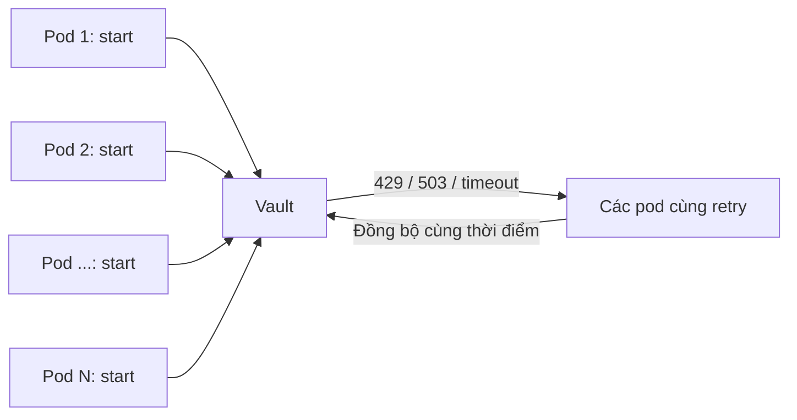
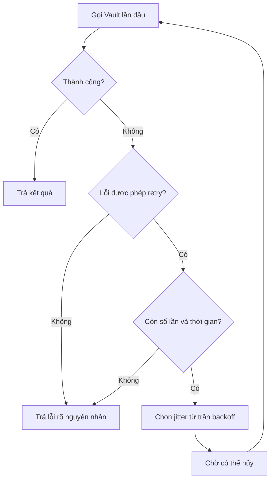
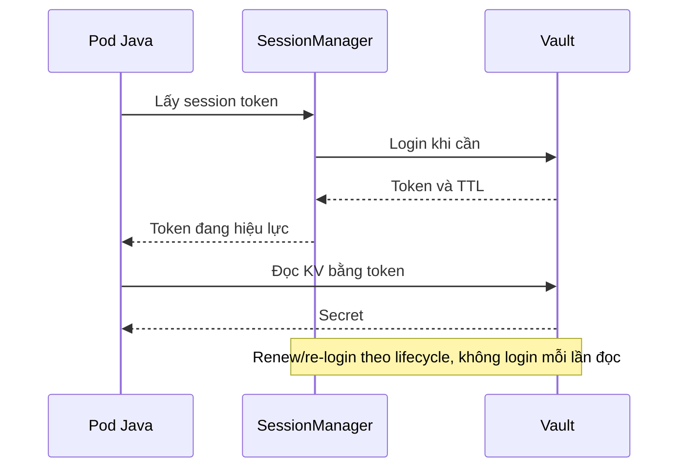

# Backoff, độ trễ ngẫu nhiên và tránh quá tải khi đồng loạt khởi động

Khi nhiều instance Java cùng khởi động, chúng thường phải đăng nhập **HashiCorp Vault**, đọc cấu hình KV, lấy credential động hoặc chuẩn bị Transit/PKI trước khi phục vụ request. Nếu Vault hoặc đường mạng chậm, hàng trăm instance có thể đồng thời gọi lại, tạo một **làn sóng retry** khiến Vault càng khó hồi phục. Trong **Spring Vault**, `VaultTemplate`, cơ chế xác thực workload, token/lease renewal và cách ứng dụng chờ secret đều góp phần quyết định mức tải này.

Bài thuộc chương **Lỗi và khả năng phục hồi** của module `SPRING_VAULT`. Nội dung giải thích **exponential backoff**, **jitter** (độ trễ ngẫu nhiên), cách quyết định *có được retry hay không* theo thao tác và mã lỗi, cách triển khai giới hạn trong Java, cùng chiến lược khởi động, giám sát và kiểm thử tích hợp.

## 1. Vì sao khởi động đồng loạt tạo “retry storm”?

Giả sử một đợt triển khai đưa hàng trăm pod của dịch vụ đơn hàng lên gần như cùng lúc. Mỗi pod cần: (1) đăng nhập Vault bằng Kubernetes auth; (2) đọc hai secret KV v2; (3) tạo kết nối đến cơ sở dữ liệu. Chỉ vài thao tác ban đầu mỗi pod đã biến thành một lượng lớn request tập trung trong vài giây.

Nếu tất cả pod đều thử lại ngay khi thấy HTTP `503`, tải lên Vault tăng đúng lúc cluster đang thiếu tài nguyên. Nếu mọi pod cùng chờ cố định 1 giây rồi thử lại, chúng lại va nhau vào giây kế tiếp. Kể cả **exponential backoff không có jitter**, các pod có cùng số lần thất bại vẫn có lịch thử gần giống nhau.



**Retry là một nguồn tải mới.** Khi Vault quá tải, thêm nhiều lần thử không làm tăng năng lực của Vault; nó có thể giữ cluster trong trạng thái suy giảm, khiến đăng nhập, token renewal và các ứng dụng khác cùng thất bại.

Bài toán gồm hai lớp khác nhau:

- **Phân tán thời điểm gọi ban đầu:** tránh tất cả instance đổ vào Vault cùng giây khi rollout/restart.
- **Phân tán các lần thử lại khi có lỗi tạm thời:** tăng khoảng chờ theo số lần thất bại và thêm jitter, đồng thời giới hạn tổng số request.

Chỉ thêm retry vào `VaultTemplate` mà không quản lý số pod, timeout và thao tác có tác dụng phụ là chưa đủ.

## 2. Backoff cố định, exponential backoff và jitter

**Backoff** là khoảng chờ giữa các lần thử lại. Với `base = 200 ms`, hệ số nhân `2` và `cap = 3.000 ms`, trần chờ theo số lần retry là:

\[
c_n = \min(3000,\;200\times 2^{n-1})\ \text{ms}, \quad n=1,2,\ldots
\]

`n=1` chỉ **lần chờ sau request đầu tiên thất bại**, không phải thời gian trước lần gọi đầu tiên.

| Lần retry | Trần exponential có cap | Nếu không jitter | Full jitter |
| --- | ---: | ---: | --- |
| 1 | 200 ms | Chờ đúng 200 ms | Chọn ngẫu nhiên trong `[0, 200]` ms |
| 2 | 400 ms | Chờ đúng 400 ms | Chọn ngẫu nhiên trong `[0, 400]` ms |
| 3 | 800 ms | Chờ đúng 800 ms | Chọn ngẫu nhiên trong `[0, 800]` ms |
| 4 | 1.600 ms | Chờ đúng 1.600 ms | Chọn ngẫu nhiên trong `[0, 1.600]` ms |
| 5 trở đi | Tăng dần đến cap 3.000 ms | Nhiều client vẫn hẹn giờ giống nhau | Tiếp tục phân tán đến cap |

Các thời gian trong bảng là **ví dụ cấu hình**, không phải giá trị mặc định của Spring Vault hay Vault.

### Những biến thể hay gặp

- **Fixed backoff:** mọi lần chờ đúng một khoảng; dễ triển khai nhưng dễ tạo sóng đồng bộ.
- **Capped exponential:** khoảng chờ tăng dần và có trần; giảm tốc độ thử nhưng chưa phá đồng bộ hoàn toàn.
- **Full jitter:** mỗi lần chọn ngẫu nhiên trong khoảng từ `0` đến trần exponential. Đây là lựa chọn thực dụng để trải request trên thời gian.
- **Equal jitter:** giữ tối thiểu khoảng nửa trần, phần còn lại ngẫu nhiên; tránh chờ sát `0`, nhưng có thể hoàn thành chậm hơn trong một số tải.
- **Decorrelated jitter:** trần chờ tiếp theo phụ thuộc khoảng chờ trước đó; có thể giúp phân tán thời điểm theo cách khác, nhưng cần thêm trạng thái.



**Giới hạn phải đi kèm jitter:** số lần thử tối đa, tổng thời gian tối đa, timeout cho từng request, số request đồng thời và ngân sách tải chung. Jitter không ngăn được lưu lượng vô hạn nếu mỗi pod cứ retry mãi.

## 3. Lỗi nào nên retry trong Vault?

Vault System API có một số mã HTTP mang ý nghĩa riêng; việc retry phải dựa trên **endpoint và loại thao tác**, không chỉ dựa vào mã chung.

| Kết quả | Trường hợp điển hình | Chính sách đề xuất |
| --- | --- | --- |
| `400 Bad Request` | Payload lỗi, Transit context sai, cấu hình request sai | **Không retry nguyên xi**; sửa đầu vào. |
| `403 Forbidden` | Token hết hiệu lực, thiếu Vault ACL hoặc sai auth role | Không retry cùng request mãi; xử lý authentication/policy đúng cấp. |
| `404 Not Found` | Sai mount/path, KV secret không có; đôi khi Vault che trạng thái tài nguyên | Không retry vô điều kiện; kiểm tra path và quyền. |
| `412 Precondition Failed` | Có thể do nhất quán dữ liệu tạm thời ở Vault Enterprise | Có thể retry ngắn, có backoff, khi đúng ngữ cảnh và thao tác an toàn. |
| `429 Too Many Requests` | Bị giới hạn quota/rate limit trên API nghiệp vụ | Retry với backoff + jitter, tôn trọng `Retry-After` nếu được cung cấp và còn trong ngân sách. |
| `500`, `502`, `503`, `504` | Lỗi server/proxy, cluster tạm không sẵn sàng | Retry **chỉ thao tác phù hợp**, có giới hạn; nếu kéo dài thì báo sự cố. |
| Timeout / connection reset | Mạng lỗi, Vault không trả response trong hạn | Với **read** có thể retry; với write kết quả có thể đã thành công nên phải kiểm soát idempotency. |
| `501` từ `/sys/health` | Node Vault chưa initialize | Không xem là sự cố tạm sẽ được giải quyết bằng retry liên tục. |
| `503` từ `/sys/health` | Node sealed hoặc không sẵn sàng | Chẩn đoán và đợi phục hồi; health khác với retry mọi API nghiệp vụ. |

**Một bẫy quan trọng:** `429` trên **`/v1/sys/health`** mặc định là mã cho **HA standby bình thường**, nhưng `429` trên API nghiệp vụ cũng có thể là quota. Không tự hiểu mọi `429` là rate limit hoặc mọi `429` là standby. `503` cũng phải đối chiếu health, response và dấu hiệu overload.

Nếu Vault phát header **`Retry-After`** khi từ chối do rate limit, hãy ưu tiên khoảng chờ server đề xuất; một số quota cần được bật tính năng response headers mới có thông tin này. Nếu `Retry-After` vượt quá deadline nghiệp vụ, trả trạng thái suy giảm/hết ngân sách, **không cố ép chờ ngắn hơn để bắn request sớm**.

## 4. Đọc lại an toàn khác với cấp phát bí mật mới

Trước khi gắn retry, hãy phân loại thao tác theo tác dụng phụ và điều gì xảy ra nếu **server đã xử lý nhưng client chưa nhận phản hồi**.

| Thao tác Spring Vault / Vault | Có thể thử lại khi response chưa rõ? | Lý do |
| --- | --- | --- |
| `opsForKeyValue(...).get(...)`, đọc secret | **Thường có**, khi lỗi tạm thời | Là read, không phát hành credential mới; cần đảm bảo số lần/timeout. |
| `opsForSys().health()` | **Có giới hạn**, tùy mục tiêu probe | Không tự gọi quá nhanh; health code cần diễn giải theo vai trò node. |
| Transit `decrypt` | **Thường có**, nếu cùng ciphertext/key/context | Xử lý đọc mật mã, không phát hành credential; vẫn phải tôn trọng quota. |
| Transit `encrypt` | **Không mặc định** khi chưa rõ kết quả | Mã hóa có thể trả ciphertext khác giữa các lần; tránh lặp nghiệp vụ hoặc ghi dữ liệu không nhất quán. |
| KV v2 `write` | **Cần điều kiện** | Nếu đã ghi thành công nhưng timeout, request lặp có thể tạo version mới; dùng CAS/readback khi phù hợp. |
| `database/creds`, PKI `issue` | **Không tự động** | Mỗi lần có thể tạo lease/credential hoặc certificate mới. |
| Tạo AppRole SecretID, token, response wrapping | **Không tự động** | Có thể sinh thêm secret/token; wrapper có ngữ nghĩa dùng một lần. |
| `sys/wrapping/unwrap` | **Không retry mù** | Token có thể đã bị tiêu thụ dù response không đến client. |
| Renew/revoke lease hoặc token | **Theo contract cụ thể** | Kết quả không rõ có thể làm thay đổi trạng thái credential; kiểm tra lease và session. |

**Idempotent** nghĩa là lặp cùng một thao tác không làm thay đổi kết quả nghiệp vụ vượt quá một lần. HTTP method `GET` thường dễ xử lý hơn `POST`, nhưng **đừng suy idempotency chỉ từ HTTP method**: cần hiểu endpoint và phản hồi của Vault.

Với thao tác sinh credential, timeout là trạng thái **chưa xác định**. Một `POST` cấp chứng chỉ có thể đã tạo certificate dù client không nhận được. Retry vô điều kiện làm xuất hiện nhiều lease/chứng chỉ, tăng tải và khó thu hồi. Cần thiết kế quy trình đối soát, mã định danh nghiệp vụ hoặc cơ chế cấp lại được kiểm soát.

## 5. Hai lớp giảm tải: trước request đầu tiên và sau lỗi

### A. Giãn thời điểm bootstrap

Mỗi pod có thể chọn một khoảng chờ khởi động ngẫu nhiên ngắn trong giới hạn đã duyệt **trước lần truy cập Vault đầu tiên**. Nếu một rollout tạo hàng trăm pod, cách này giảm xác suất tất cả đăng nhập hoặc đọc cấu hình cùng một lúc.

Ví dụ minh họa:

```java
import java.util.concurrent.ThreadLocalRandom;

public final class StartupSpread {
    public static void beforeFirstVaultCall() throws InterruptedException {
        long delayMs = ThreadLocalRandom.current().nextLong(0, 3_001);
        Thread.sleep(delayMs);
    }
}
```

Đây là code **dành cho luồng bootstrap có thể chờ**, không gọi trong event-loop hoặc thread xử lý HTTP mỗi request. Nếu tiến trình bị interrupt, để lỗi lan ra hoặc phục hồi cờ interrupt, không âm thầm bỏ qua. Chọn độ trễ theo SLO khởi động, không hardcode 3 giây cho mọi hệ thống.

### B. Giãn các lần retry khi đã thất bại

Sau mỗi lỗi tạm thời được phép retry, chọn một khoảng jitter mới. Không dùng cùng một giá trị delay ngẫu nhiên đã sinh rồi chia sẻ cho tất cả instance. Mỗi instance nên có lịch chờ độc lập, và cần phân biệt **lần chờ do ứng dụng** với retry tự động ở HTTP client/SDK/proxy để tránh nhân số request không thấy được.

Một retry budget đơn giản:

```text
MAX_ATTEMPTS = 5       # gồm lần đầu + tối đa 4 lần retry
BASE_DELAY = 200 ms
MAX_DELAY = 3 s
TOTAL_BUDGET = 8 s     # không bao gồm thời gian khởi động ban đầu
PER_REQUEST_TIMEOUT = 2 s (ví dụ; cấu hình trên HTTP client)
```

Tổng budget cần gắn với deadline của request/luồng nghiệp vụ. Một helper chỉ kiểm tra thời gian **giữa các lần gọi** không thể thay cho `connect timeout` và `read/response timeout` của HTTP client.

## 6. Mẫu Java: retry có giới hạn cho thao tác **đọc** Vault

Mẫu dưới chỉ dùng cho thao tác read tương đối idempotent như đọc KV. Nó không tự retry `write`, `issue`, `unwrap` hoặc cấp credential. Đây là helper Java 17 dùng được trong Spring Boot với `VaultTemplate`, miễn là project đã có Spring Web để truy cập lớp HTTP exception.

```java
import java.util.concurrent.ThreadLocalRandom;
import java.util.concurrent.TimeUnit;
import java.util.function.Supplier;
import org.springframework.web.client.ResourceAccessException;
import org.springframework.web.client.RestClientResponseException;

public final class VaultReadRetry {

    private static final int MAX_ATTEMPTS = 5;
    private static final long BASE_DELAY_MS = 200L;
    private static final long CAP_DELAY_MS = 3_000L;
    private static final long TOTAL_BUDGET_MS = 8_000L;

    private VaultReadRetry() {}

    public static <T> T call(Supplier<T> readAction) {
        long deadline = System.nanoTime()
                + TimeUnit.MILLISECONDS.toNanos(TOTAL_BUDGET_MS);

        for (int attempt = 1; ; attempt++) {
            try {
                return readAction.get();
            } catch (RuntimeException failure) {
                if (attempt >= MAX_ATTEMPTS || !isTransient(failure)) {
                    throw failure;
                }

                long remaining = TimeUnit.NANOSECONDS.toMillis(
                        deadline - System.nanoTime());
                if (remaining <= 0) {
                    throw failure;
                }

                // attempt=1 là lần chờ đầu tiên sau request thất bại.
                long ceiling = Math.min(
                        CAP_DELAY_MS, BASE_DELAY_MS << (attempt - 1));
                long upper = Math.min(ceiling, remaining);
                long jitterMs = ThreadLocalRandom.current()
                        .nextLong(upper + 1L); // Full jitter: [0, upper].

                try {
                    Thread.sleep(jitterMs);
                } catch (InterruptedException ex) {
                    Thread.currentThread().interrupt();
                    throw new IllegalStateException(
                            "Vault retry interrupted", ex);
                }
            }
        }
    }

    private static boolean isTransient(Throwable failure) {
        // VaultException có thể bọc exception của HTTP client.
        for (Throwable cause = failure; cause != null;
                cause = cause.getCause()) {
            if (cause instanceof RestClientResponseException http) {
                int code = http.getStatusCode().value();
                return code == 412 || code == 429
                        || code == 500 || code == 502
                        || code == 503 || code == 504;
            }
        }

        // Chỉ coi lỗi transport là retryable ở caller đã xác định
        // đây là READ an toàn. Không áp dụng nhánh này cho POST.
        for (Throwable cause = failure; cause != null;
                cause = cause.getCause()) {
            if (cause instanceof ResourceAccessException) {
                return true;
            }
        }
        return false;
    }
}
```

Điều quan trọng khi chuyển thành code production:

1. Helper chỉ tính **số lần thử và thời gian chờ**. Cần cấu hình timeout từng request, cancellation và deadline trong HTTP client Spring Vault. Nếu một request treo quá lâu, tổng thời gian hàm vẫn có thể vượt `TOTAL_BUDGET_MS`.
2. Kiểm tra cả cause vì Spring Vault có thể chuyển đổi exception, nhưng **không phải mọi lỗi HTTP đều còn nguyên cause**. Cần test đúng phiên bản Spring Vault trong ứng dụng; nếu không đọc được status, helper chọn không retry để tránh lặp lỗi cấu hình.
3. Với `429` quota có `Retry-After`, helper minh họa này **chưa** đọc header; trong hệ thống thật phải bổ sung xử lý header và giới hạn ngân sách phù hợp.
4. `Thread.sleep` chỉ phù hợp cho bootstrap/background worker có giới hạn. Với WebFlux hoặc request bất đồng bộ, dùng scheduler/timer không chặn thread.
5. Thêm **bulkhead/semaphore** và metric retry để giới hạn tổng số request khi nhiều request bên trong cùng instance cùng gặp lỗi; giới hạn trên chỉ áp dụng từng lời gọi.
6. Không tự động bọc thao tác không idempotent bằng helper này chỉ vì trả `RuntimeException`.

Đọc KV v2 qua `VaultOperations`:

```java
import org.springframework.vault.core.VaultOperations;
import org.springframework.vault.core.VaultKeyValueOperationsSupport.KeyValueBackend;
import org.springframework.vault.support.VaultResponse;

public final class RuntimeConfigurationReader {
    private final VaultOperations vault;

    public RuntimeConfigurationReader(VaultOperations vault) {
        this.vault = vault;
    }

    public VaultResponse read() {
        VaultResponse response = VaultReadRetry.call(
                () -> vault.opsForKeyValue(
                        "config", KeyValueBackend.KV_2)
                        .get("orders/runtime"));
        if (response == null || response.getData() == null) {
            // Secret thật sự không tồn tại không phải lỗi transient.
            throw new IllegalStateException("Required config is missing");
        }
        return response;
    }
}
```

Khi cấu hình cho production, `config` là **mount KV v2**, còn `orders/runtime` là path tương đối; Spring Vault tự xử lý `/data/` trong API KV v2. Đừng gọi thử ngẫu nhiên mount khác để “cứu” lỗi; đây là quyết định phân quyền, không phải backoff.

## 7. Xác thực workload: tránh đăng nhập lặp cho từng secret

Spring Vault dùng `ClientAuthentication` để đăng nhập Vault rồi quản lý token qua `SessionManager`. `VaultTemplate` nên được tái sử dụng như bean lâu dài. Với setup Spring thông thường, `LifecycleAwareSessionManager` có thể lên lịch gia hạn token renewable và xử lý vòng đời token theo cấu hình; `SimpleSessionManager` không tự gia hạn.

Những lỗi thường gặp làm tải bootstrap lớn hơn dự kiến:

- Tạo `VaultTemplate`/login client mới cho mỗi `get()` dẫn tới nhiều request xác thực và không tái sử dụng session.
- Khi gặp lỗi đọc KV, xóa ngay session rồi **login lại ở mọi lần retry**, dù token vẫn hợp lệ.
- Dùng nhiều auth mechanism (AppRole, Kubernetes) nhưng không tách scope token/namespace; session của một workload bị thay thế nhầm.
- Không xử lý token tối đa TTL, khiến một nhóm pod bị hết hạn cùng lúc, đồng loạt đăng nhập lại.
- Tạo thêm `SecretLeaseContainer` hoặc scheduler cho mỗi request, tăng số lần gia hạn/rotation vượt cần thiết.



**Đừng tự thêm retry vô hạn vào token renewal.** Lease và token có hạn sử dụng thật. Nếu renewal quá hạn, credential có thể bị thu hồi, làm các tác vụ lệ thuộc ngừng hoạt động. Theo dõi TTL, độ trễ renewal, số lỗi và điều kiện cần re-login; tránh làm mới toàn bộ credential của mọi pod cùng thời điểm nếu có thể điều phối lịch.

## 8. Chống đồng loạt khởi động ở Kubernetes và Spring Boot

Không có một giá trị backoff áp dụng cho mọi cụm. Phải phối hợp **chiến lược rollout, readiness, lưu lượng và tài nguyên Vault**.

| Cơ chế | Tác dụng | Điều kiện |
| --- | --- | --- |
| Rolling update có `maxSurge` hợp lý | Giới hạn pod mới khởi động trong mỗi đợt | Không chặn các deployment khác cùng rollout. |
| Jitter trước lần login/read đầu | Trải tải ban đầu | Không quá dài khiến startup vượt SLO. |
| Backoff + full jitter khi lỗi | Giảm đồng bộ các lần thử tiếp | Chỉ cho phép thao tác an toàn retry. |
| Timeout + retry budget | Ngăn một request chờ vô hạn | Kết hợp với deadline của cả quá trình bootstrap. |
| Semaphore/bulkhead theo instance | Giới hạn số request Vault đồng thời trong một pod | Cần giám sát queue và timeout chờ slot. |
| Cache/cấu hình được làm mới có kiểm soát | Giảm các lượt đọc KV lặp lại | TTL và phương án rotate secret cần rõ ràng. |
| Vault Agent khi phù hợp | Tách một phần xác thực/đọc/renewal khỏi ứng dụng | Không tự giả định agent loại bỏ mọi request đến cluster. |
| Rate limit quota phía Vault | Bảo vệ cluster trước client lỗi | Client phải xử lý bị từ chối và tôn trọng quota. |

**Liveness không nên phụ thuộc trực tiếp vào khả năng đọc Vault.** Nếu Vault tạm lỗi mà mọi pod tự restart, mỗi lần restart lại phát sinh login + read, tạo vòng lặp làm tăng tải. Readiness có thể báo `not ready` nếu ứng dụng **bắt buộc** phải có secret hợp lệ trước khi nhận request. Tùy nghiệp vụ, một số ứng dụng có thể tiếp tục phục vụ chức năng không cần Vault bằng credential còn hợp lệ và chế độ suy giảm có kiểm soát.

Ví dụ một probe Spring Boot Actuator (giả định ứng dụng đã bật readiness endpoint):

```yaml
readinessProbe:
  httpGet:
    path: /actuator/health/readiness
    port: 8080
  periodSeconds: 10
  timeoutSeconds: 3
  failureThreshold: 3
```

Đoạn YAML **không tự bật** Actuator readiness; còn cần cấu hình ứng dụng tương ứng. Giữ liveness độc lập với lỗi tạm của hệ thống phụ thuộc. Với lô ứng dụng lớn, còn cần điều phối giữa các namespace/deployment để tránh tổng tải vượt quota Vault.

## 9. Quy tắc riêng cho KV, Transit, PKI và credential động

### KV v2

Đọc KV là ca thích hợp để retry hạn chế. Ghi KV v2 với CAS là câu chuyện khác: nếu lần ghi đầu đã thành công nhưng response mất, gọi lại với CAS cũ có thể bị từ chối. Đây có thể là **tín hiệu lần ghi trước thành công**, nhưng vẫn cần readback/version validation, không tự chuyển sang CAS mới rồi ghi lần nữa.

### Transit

Gọi `decrypt` với cùng ciphertext, key và context thường có thể thử lại khi lỗi mạng. `encrypt` có thể sinh ciphertext mới mỗi lần; dù cùng plaintext và key, không coi kết quả là byte-identical. Ứng dụng cần quyết định có được lặp bước mã hóa theo giao dịch nghiệp vụ hay không, nhất là khi đã ghi một kết quả vào kho dữ liệu.

### Database dynamic secrets và PKI

Endpoint cấp credential động hoặc certificate có thể tạo tài nguyên mới, đồng thời kèm lease hoặc vòng đời chứng chỉ. Retry mù sau timeout có thể tạo **nhiều credential/chứng chỉ**, làm tăng tải và khó dọn dẹp. Phân biệt rõ lỗi *trước request* và lỗi *sau khi gửi nhưng chưa nhận phản hồi*; trường hợp thứ hai phải đối soát theo quy trình cấp phát.

### AppRole SecretID, wrapping và token

Tạo SecretID, token và `response wrapping` cũng có tác dụng phụ. Đặc biệt, wrapping token là **một lần unwrap**: nếu request unwrap đã được Vault xử lý nhưng response bị mất, retry token cũ không thể khôi phục bí mật. Phải điều tra và **cấp wrapper mới theo quy trình tin cậy**, không biến unwrap thành thao tác retry tự động.

## 10. Một tình huống thực tế: đợt deploy 300 pod

Giả sử mỗi pod cần một lần login và hai lần đọc KV lúc khởi động. Nếu 300 pod cùng chạy, Vault có thể nhận **900 request gần đồng thời** ngay ở bước đầu, chưa tính token renewal hoặc các lần retry.

Thiết kế cải tiến có thể gồm:

1. Chia rollout thành từng nhóm nhỏ bằng policy triển khai; không tạo 300 pod mới cùng lúc nếu không cần.
2. Mỗi pod chọn startup jitter trong cửa sổ được xác định theo SLO và tải Vault đã đo.
3. Tái sử dụng `VaultTemplate`/`SessionManager` trong mỗi pod; đọc và cache secret cần thiết theo vòng đời rõ ràng.
4. Đọc KV thất bại vì lỗi tạm thời mới retry, dùng backoff + full jitter, tối đa số lần và deadline.
5. Gặp `403`, `400`, `404` do cấu hình/policy thì **fail nhanh có chẩn đoán**, không tiếp tục quét path hay thử token khác.
6. Credential động, PKI và wrapping được quản lý như các thao tác có tác dụng phụ, có đối soát và cấp lại được kiểm soát.
7. Khi Vault vẫn không sẵn sàng trong budget, giữ pod chưa sẵn sàng theo yêu cầu nghiệp vụ, báo sự cố và chờ cơ chế triển khai/phục hồi quyết định tiếp.

Con số 900 là **số yêu cầu lý thuyết ban đầu theo giả định**, không phải dự báo throughput của Vault. Các giới hạn phải hiệu chỉnh bằng load test của chính cluster, loại auth, latency mạng, quotas và cấu hình storage.

## 11. Kiểm thử tích hợp và mô phỏng tải

Một bộ test đáng tin cậy phải kiểm tra cả **thành công sau lỗi tạm** lẫn việc **không retry sai**. Có thể dùng HTTP mock server để kiểm tra helper Java, rồi Vault test cluster để xác minh authentication, quota, lease và triển khai pod.

| Ca | Kích thích | Kết quả mong đợi |
| --- | --- | --- |
| R01 | KV read: lần đầu `503`, lần sau `200` | Retry có jitter, trả dữ liệu, không vượt budget. |
| R02 | KV read: `403` | Thất bại ngay, đúng một request; không login lại vô hạn. |
| R03 | KV read: `404` | Không retry vô điều kiện, báo thiếu path/secret. |
| R04 | KV read: `429` quota | Retry có giới hạn; tôn trọng `Retry-After` khi header hiện diện. |
| R05 | Vault Enterprise trả `412` tạm | Thử lại có backoff trong budget; quan sát kết quả. |
| R06 | Connection reset khi đọc | Có thể thử lại; phục hồi interrupt/deadline đúng cách. |
| R07 | HTTP client luôn trả `503` | Tối đa số lần đã cấu hình; trả lỗi thay vì lặp vô hạn. |
| R08 | Nhiều pod cùng bắt đầu | Timestamp login/read phân tán; concurrency và quota được tuân thủ. |
| R09 | `pki/issue` thành công phía Vault rồi mất response | Không tự phát hành certificate lần hai. |
| R10 | `sys/wrapping/unwrap` timeout sau khi server xử lý | Không retry token cũ mù quáng. |
| R11 | Token hết hạn và renewal thất bại | Session lifecycle xử lý đúng; không dùng secret đã hết hiệu lực. |
| R12 | Quota `429` và health standby `429` | Phân loại đúng endpoint; không đánh dấu mọi 429 là cùng một lỗi. |

### Test thuật toán ngẫu nhiên như thế nào?

Đừng viết unit test đòi **đúng** một số millisecond ngẫu nhiên. Tách hàm tính *trần chờ*, generator jitter và cơ chế chờ thành các thành phần có thể thay thế; dùng `Clock`, scheduler giả hoặc nguồn ngẫu nhiên có thể cung cấp kết quả xác định để kiểm tra:

- Trần delay tăng theo 200 → 400 → 800 ms và không vượt 3 giây.
- Delay luôn nằm trong `[0, ceiling]` và không vượt thời gian còn lại.
- Số attempt và tổng ngân sách luôn được chặn.
- HTTP 400/403/404 không đi vào nhánh retry.
- Khi thread bị interrupt, hàm dừng và khôi phục cờ interrupt.
- Cùng một giả lập nhiều instance, không phải tất cả có cùng lịch retry cố định.

Với load test, xem **request/s đến Vault theo thời gian**, p95/p99 latency, tỉ lệ login thành công, số 429/5xx, số lần retry và thời gian đạt readiness. Không chỉ so sánh thời gian khởi động của một pod.

## 12. Giám sát và giảm rủi ro vận hành

Các metric hữu ích nên có: `vault_request_total` phân theo operation và status, `vault_retry_total` theo nguyên nhân, số request đang in-flight, tỷ lệ quota rejection, thời gian login, token renewal failure, lease renewal lag, số pod đang chờ Vault và tuổi của secret cache. Phân loại lỗi theo endpoint nhóm (KV read, Transit decrypt, PKI issue...) và scope ứng dụng, không dùng toàn bộ secret path nếu có thông tin nhạy cảm.

Khi cảnh báo tải cao:

- Kiểm tra cluster Vault, HA/active-standby, tình trạng sealed, network, quota và storage; các mã health khác với API nghiệp vụ.
- Giảm tốc rollout hoặc tạm ngừng đợt deploy; giới hạn số client đồng thời.
- Xác minh không có vòng retry tại **nhiều tầng** (Spring Vault, HTTP client, proxy, application loop, Kubernetes restart).
- Dùng log và trace có request/correlation ID không nhạy cảm; không ghi token, SecretID, plaintext, ciphertext, lease credential hoặc HTTP body chứa secret.
- Sau sự cố, kiểm tra số credential/lease/chứng chỉ có thể đã được phát hành trong các request có kết quả chưa rõ.

**Không vô hiệu TLS hoặc mở rộng Vault ACL để làm cho retry “thành công”.** Lỗi bảo mật/cấu hình phải được sửa đúng nguyên nhân; tăng retry ở những lỗi này chỉ che giấu vấn đề và tăng tải.

## 13. Câu hỏi tự kiểm tra

1. Vì sao chờ cố định 1 giây hoặc exponential backoff không jitter vẫn có thể tạo những đỉnh request đồng thời?
2. Với `base=200 ms`, hệ số `2`, `cap=3 s`, trần của lần retry thứ ba là bao nhiêu? Full jitter chọn trong khoảng nào?
3. Tại sao `429` của `/sys/health` khác `429` quota trên endpoint đọc KV?
4. Vì sao thao tác đọc KV thường retry được nhưng `pki/issue` hoặc `unwrap` không nên retry mù khi timeout?
5. Retry budget khác timeout cho từng HTTP request như thế nào?
6. Vì sao tạo mới `VaultTemplate` và login cho mỗi lần đọc làm “thundering herd” nghiêm trọng hơn?
7. Nếu các pod cứ bị restart mỗi lần Vault tạm lỗi, readiness và liveness đã được thiết kế đúng chưa?
8. Cần đo metric nào để chứng minh jitter thực sự giảm đỉnh tải lên Vault?

**Tiêu chí đạt:** người học phân biệt được lỗi đáng retry với lỗi phải sửa cấu hình; chọn exponential backoff có jitter, giới hạn số lần/deadline/concurrency; bảo vệ các thao tác có tác dụng phụ; và có phương pháp chứng minh bằng test/metric rằng khi triển khai đồng loạt, Spring Vault không tạo bão request làm hệ thống quá tải.

## Tài liệu tham khảo

- HashiCorp — [Vault HTTP API](https://developer.hashicorp.com/vault/api-docs): ý nghĩa các HTTP status như `412`, `429` và `503`.
- HashiCorp — [Vault quotas](https://developer.hashicorp.com/vault/docs/enterprise/quotas): giới hạn request và cơ chế bảo vệ cluster.
- HashiCorp — [Vault rate-limit response headers](https://developer.hashicorp.com/vault/api-docs/system/quotas-config): các header tùy chọn, gồm `Retry-After`.
- Spring Vault — [Introduction to VaultTemplate](https://docs.spring.io/spring-vault/reference/vault/imperative-template.html): cách tái sử dụng client và quản lý session.
- Spring Vault — [Credentials Rotation](https://docs.spring.io/spring-vault/reference/vault/credential-rotation.html): vòng đời lease, token và lịch gia hạn.
- AWS Architecture Blog — [Exponential Backoff and Jitter](https://aws.amazon.com/blogs/architecture/exponential-backoff-and-jitter/): giải thích tại sao jitter giảm tranh chấp đồng bộ.
