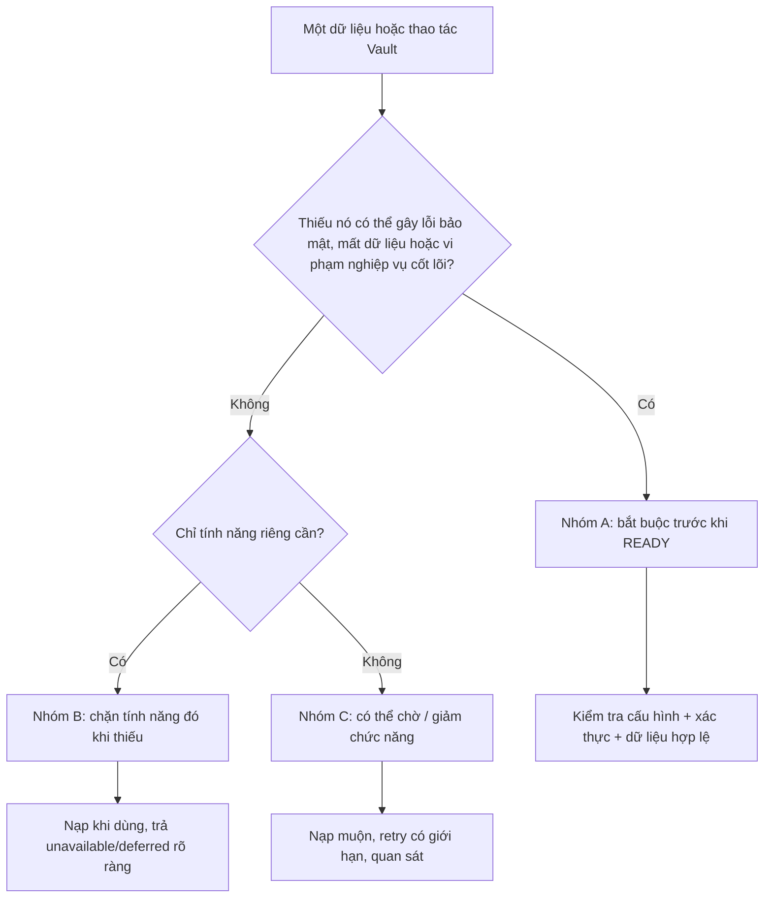
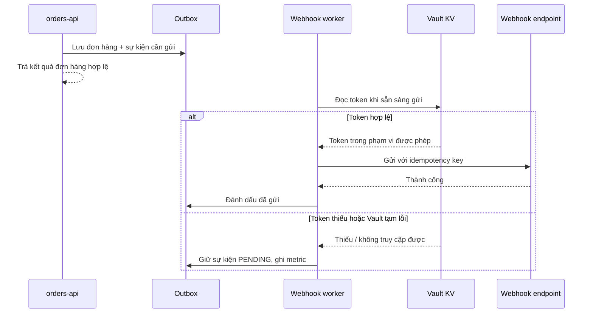
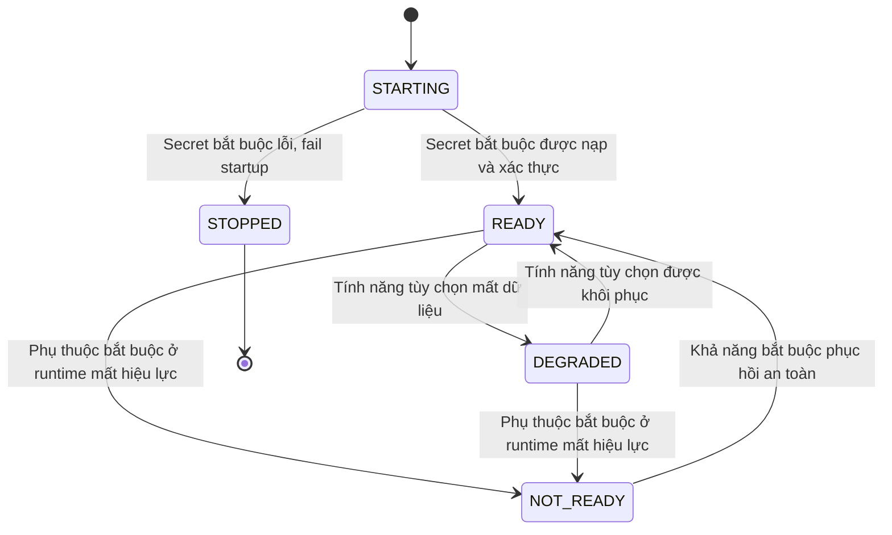

# Phân loại dữ liệu bắt buộc khi khởi động và dữ liệu có thể chờ

## 1. Vì sao phải phân loại trước khi tích hợp Vault?

Một ứng dụng Java dùng **Spring Vault** có thể cần đến nhiều loại dữ liệu từ HashiCorp Vault: khóa hoặc thông tin xác thực dịch vụ, cấu hình KV, thông tin kết nối database, dynamic credentials có lease, kết quả Transit encryption, chứng thư PKI và token dùng để truy cập Vault. Không phải dữ liệu nào cũng cần xuất hiện tại cùng một thời điểm.

Ví dụ, một dịch vụ `orders-api` nhận lệnh có chữ ký HMAC **không được nhận lệnh** nếu chưa có khóa xác minh đúng môi trường. Nhưng việc gửi webhook thông báo phụ có thể tạm ngưng trong vài phút, ghi sự kiện vào outbox và gửi sau khi Vault hoạt động trở lại. Nếu áp cùng một chính sách cho cả hai, hệ thống hoặc khởi động bất chấp rủi ro bảo mật, hoặc ngừng mọi chức năng chỉ vì thành phần phụ đang gián đoạn.

Trong chương **Lỗi và khả năng phục hồi** của module **SPRING_VAULT**, bài này hướng dẫn phân loại dữ liệu và lựa chọn hành vi **fail-fast ở startup**, **nạp khi cần**, **giảm chức năng có kiểm soát**, **retry** và **readiness**. Các nguyên tắc áp dụng đồng thời khi sử dụng `VaultTemplate`/`VaultOperations`, Spring Cloud Vault Config Data, xác thực theo workload, KV secrets, token/lease, Transit, PKI, giám sát và kiểm thử tích hợp.

Sau bài học, bạn có thể:

- Xác định dữ liệu nào **bắt buộc trước khi ứng dụng nhận traffic**, dữ liệu nào **có thể nạp muộn** và dữ liệu nào **chỉ bắt buộc với một tính năng**.
- Biểu diễn quyết định này thành một hợp đồng có owner, chính sách lỗi, TTL và mức sẵn sàng rõ ràng.
- Tổ chức Spring Cloud Vault Config Data chỉ nạp những context cần cho khởi động; đọc dữ liệu còn lại khi cần qua Spring Vault.
- Phân biệt lỗi Vault có thể retry với lỗi cấu hình, ACL hoặc dữ liệu không hợp lệ.
- Quản lý readiness, fallback, cache, token và lease để tránh tiếp tục dùng thông tin đã hết hạn/thu hồi.
- Viết ca kiểm thử chứng minh hành vi startup và degraded mode thực tế.

## 2. Quy tắc phân loại: dữ liệu đó đang bảo vệ điều gì?

Điểm bắt đầu là **hợp đồng nghiệp vụ và an toàn**, sau đó mới chọn thư viện. Không quyết định một secret có thể chờ chỉ dựa trên việc API trả về `404` hay `503`.

| Nhóm | Câu hỏi quyết định | Hành vi đề nghị |
| --- | --- | --- |
| **A — Bắt buộc để khởi động an toàn** | Thiếu hoặc sai dữ liệu, ứng dụng có thể xác thực sai, làm hỏng dữ liệu hoặc thực hiện nghiệp vụ cốt lõi không? | Nạp và kiểm tra trước khi **READY**; lỗi thì fail startup hoặc giữ readiness không chấp nhận traffic. |
| **B — Bắt buộc cho một tính năng cụ thể** | Chỉ một endpoint/job cần dữ liệu, các chức năng khác vẫn hoạt động an toàn? | Cho ứng dụng khởi động; tính năng liên quan báo `UNAVAILABLE`/deferred, không lặng lẽ bỏ bước bảo mật. |
| **C — Tùy chọn hoặc cải thiện chất lượng** | Thiếu dữ liệu có thể tạm tắt tính năng mà không vi phạm yêu cầu chính? | Lazy load hoặc nạp theo lịch; chuyển sang degraded mode được thiết kế, có metric và hướng khôi phục. |

Một dữ liệu có thể chuyển nhóm theo **vai trò triển khai**. Chứng thư mTLS dùng để xác thực máy chủ trên ingress chính là nhóm A nếu server phải phục vụ mTLS ngay khi nhận lưu lượng. Chứng thư để kết nối với hệ thống báo cáo phụ có thể thuộc nhóm B. Tương tự, database credentials là bắt buộc với service chỉ làm CRUD, nhưng một dịch vụ phục vụ API tra cứu cache độc lập có thể tạm hoãn kết nối database nếu đặc tả nghiệp vụ cho phép.

### 2.1. Ví dụ áp dụng cho Spring Vault

| Dữ liệu/khả năng | Phân loại ví dụ | Lý do và cách xử lý |
| --- | --- | --- |
| Vault URI, CA trust, workload identity dùng để tải Config Data bắt buộc | A | Không có thì không thể xác thực hoặc tin cậy Vault để lấy cấu hình quan trọng. |
| Secret dùng xác minh chữ ký yêu cầu ghi đơn hàng | A | Thiếu khóa không được phép chuyển sang “bỏ qua xác minh”. |
| Metadata role/key Transit phục vụ lệnh mã hóa bắt buộc | A hoặc B | Nếu mọi request cần mã hóa trước khi ghi, phải chặn đường ghi cho tới khi khả năng Transit sẵn sàng. |
| Dynamic database credentials cho dịch vụ CRUD chính | A khi mở traffic; sau đó có vòng đời riêng | Khi hết lease cần rotate/renew hoặc từ chối giao dịch; không dùng credential hết hạn. |
| Webhook token để gửi thông báo không làm thay đổi kết quả đặt hàng | C | Có thể giữ sự kiện trong outbox và gửi sau, nếu nghiệp vụ cho phép. |
| KV cấu hình tính năng quảng bá tùy chọn | C | Tắt tính năng/giữ trạng thái mặc định được phê duyệt khi chưa có config. |
| Chứng thư PKI cho kết nối tới hệ thống đối tác phụ | B | Chặn riêng luồng gọi đối tác; endpoint khác không chịu ảnh hưởng. |
| Secret tạo theo từng request, ví dụ Transit encrypt/decrypt | Theo chức năng tại thời điểm request | Đây là **runtime operation**; không thể lấy trước và coi là cấu hình startup. |

**Nguyên tắc bất biến:** dữ liệu bảo vệ **xác thực, phân quyền, tính toàn vẹn hoặc mã hóa bắt buộc** không được tự động hạ cấp sang nhóm C chỉ để ứng dụng khởi động thành công.

## 3. Lập một hợp đồng dữ liệu trước khi viết code

Với mỗi đầu vào từ Vault, nên ghi lại những thuộc tính tối thiểu:

| Thuộc tính | Câu hỏi phải trả lời | Ví dụ |
| --- | --- | --- |
| **Tên/mục đích** | Dùng cho luồng nào? | `orders.auth.hmac-key` để kiểm tra chữ ký nhận đơn. |
| **Nguồn/đường dẫn** | KV context hoặc engine endpoint nào? | `secret/orders-api/bootstrap`. |
| **Nhóm** | A, B hay C? | A cho khóa xác minh; C cho webhook phụ. |
| **Điểm kiểm tra** | Startup, trước READY hay tại lần dùng đầu? | Binding và validation trước khi nhận traffic. |
| **Hành vi thiếu/lỗi** | Stop, refuse traffic, degrade, queue hay retry? | HMAC key thiếu → từ chối khởi động. |
| **Quyền Vault** | Workload được `read`, `update` hay quyền nào? | KV v2: `read` tại `secret/data/orders-api/bootstrap`. |
| **TTL/vòng đời** | Static KV, client token, lease hay cert? | KV cập nhật theo version; token có session TTL riêng. |
| **Owner/giám sát** | Ai xử lý sự cố và đo bằng chỉ số nào? | Đội bảo mật; metric `startup_required_secret_failure`. |

Hợp đồng làm rõ khác biệt giữa **khả năng nạp cấu hình** và **khả năng tiếp tục vận hành**. Ví dụ key KV đã được nạp từ lâu không có nghĩa một dynamic lease còn hiệu lực, hoặc Vault hiện còn khả năng mã hóa trên đường ghi.

### 3.1. Ma trận quyết định nhanh



**Một câu hỏi bổ sung:** nếu chuyển sang fallback, hệ thống có đang dùng khóa cũ đã bị thu hồi, chứng thư hết hạn hay dữ liệu nhạy cảm không còn được phép dùng? Nếu có, fallback đó không an toàn dù dữ liệu ban đầu thuộc nhóm B/C.

## 4. Khởi động với dữ liệu nhóm A: fail closed

Dữ liệu nhóm A phải được lấy, xác thực định dạng và kiểm tra điều kiện sử dụng **trước khi ứng dụng được xem là phục vụ tốt**. Có hai cách thường dùng:

1. **Fail startup**: không thể tạo Spring context nếu dữ liệu bắt buộc không có hoặc không hợp lệ.
2. **Khởi động tiến trình nhưng chưa READY**: dùng khi muốn process còn sống để quan sát/khắc phục, song ingress không gửi traffic cho đến khi điều kiện an toàn đạt. Cần lập cơ chế chuyển trạng thái rõ ràng; đừng mặc định Spring Boot tự biết mọi phụ thuộc bắt buộc.

Không nên chỉ kiểm tra một lần “Vault có phản hồi HTTP 200 hay không”. Cần xác minh **đúng secret, đúng môi trường, đúng format, đúng chính sách**. Ví dụ key HMAC không được rỗng và phải đáp ứng tiêu chuẩn về độ dài/chất lượng khóa của hệ thống; kết nối TLS phải xác minh CA/hostname; role Vault phải cấp quyền cần thiết.

### 4.1. Tách đường dẫn Config Data bắt buộc

Với Spring Boot hiện đại và starter `spring-cloud-starter-vault-config`, có thể dùng Config Data để nạp KV bắt buộc. Ví dụ này chọn **context cụ thể** để tránh tải nhầm dữ liệu tùy chọn khi startup.

```yaml
spring:
  application:
    name: orders-api

  config:
    import: "vault:///secret/orders-api/bootstrap"

  cloud:
    vault:
      uri: https://vault.example.internal:8200
      authentication: KUBERNETES
      kubernetes:
        kubernetes-path: kubernetes
        role: orders-api
        service-account-token-file: /var/run/secrets/kubernetes.io/serviceaccount/token
      kv:
        enabled: true
        backend: secret
        backend-version: 2
      fail-fast: true
```

Ở đây `vault:///secret/orders-api/bootstrap` là **contextual Config Data location**; path cần điều chỉnh theo mount, tên ứng dụng và phiên bản Spring Cloud Vault đang chạy. Khi KV backend là v2, API vật lý sẽ sử dụng segment `data/`, nhưng không tự chèn `data/` vào tên mount hay location logic.

Nếu dự án dùng `spring.config.import: "vault://"` (default location), Spring Cloud Vault có thể nạp các secret backends/context đã được enable theo quy tắc của nó. Để phân biệt bắt buộc và tùy chọn, không nên gộp mọi đường dẫn vào default import rồi giả định một secret thiếu sẽ không ảnh hưởng khởi động. **Kiểm tra thứ tự context, profile và precedence** theo phiên bản thư viện đang dùng.

Cấu hình `fail-fast: true` hỗ trợ phát hiện lỗi kết nối hoặc truy xuất theo cơ chế của Spring Cloud Vault, nhưng **không thay thế validation nội dung**. Có tình huống thiếu context hoặc key trả về kết quả rỗng/không chứa field bắt buộc; ứng dụng phải tự kiểm tra giá trị cần dùng.

### 4.2. Gắn dữ liệu KV bắt buộc vào bean có validation

Giả sử Vault KV v2 tại `secret/orders-api/bootstrap` lưu hai thuộc tính (giá trị bên dưới chỉ là placeholder lab, không phải khóa thật):

```properties
orders.auth.hmac-key=LAB_ONLY_NOT_A_REAL_SECRET
orders.auth.issuer=orders-api
```

Cần có `spring-boot-starter-validation` để sử dụng `@NotBlank`. Ví dụ Spring Boot 3/Java 17+:

```java
import jakarta.validation.constraints.NotBlank;

import org.springframework.boot.context.properties.ConfigurationProperties;
import org.springframework.validation.annotation.Validated;

@Validated
@ConfigurationProperties(prefix = "orders.auth")
public record OrdersAuthProperties(
        @NotBlank String hmacKey,
        @NotBlank String issuer) {

    @Override
    public String toString() {
        return "OrdersAuthProperties[REDACTED]";
    }
}
```

Ứng dụng đăng ký `@ConfigurationPropertiesScan` trên `@SpringBootApplication` hoặc `@EnableConfigurationProperties(OrdersAuthProperties.class)`. Khi binding thiếu key, validation ngăn tạo bean trong lúc khởi động. **`@NotBlank` chỉ kiểm tra hiện diện cơ bản**; ở production cần bổ sung validation thuật toán, độ dài khóa và quy tắc issuer. Không viết test khẳng định placeholder lab đủ mạnh cho HMAC thực tế.

Không log `Environment`, toàn bộ properties hoặc giá trị `hmacKey`. Dù record đã ẩn `toString()`, bí mật vẫn nằm trong bộ nhớ JVM và có thể xuất hiện qua dump, Actuator hoặc lỗi ứng dụng nếu các thành phần đó không được bảo vệ.

### 4.3. KV v2 policy cho các loại dữ liệu

Giả sử Vault đã có KV v2 mount `secret/`, policy workload có thể tách quyền đọc context startup và context tùy chọn như sau:

```hcl
path "secret/data/orders-api/bootstrap" {
  capabilities = ["read"]
}

path "secret/data/orders-api/integrations/webhook" {
  capabilities = ["read"]
}
```

Mỗi path chỉ nên cấp cho đúng service account/workload. Nếu dữ liệu nhóm C do service khác đọc, tách policy/identity riêng. Với KV v2, `secret/data/...` là path ACL cho thao tác đọc secret, còn `secret/metadata/...` có chức năng khác; không tự cấp quyền liệt kê toàn bộ metadata nếu không cần.

Nếu dữ liệu nhóm A cũng phụ thuộc **Transit** hoặc **PKI**, cần kiểm tra khả năng truy cập endpoint quan trọng bằng thao tác phù hợp và không tạo side effect không cần thiết. Ví dụ không nên cấp một chứng thư production hoặc tạo một token mới mỗi lần liveness probe chạy.

## 5. Dữ liệu nhóm B/C: nạp muộn và suy giảm có kiểm soát

Đối với webhook thông báo phụ, ứng dụng có thể nhận đơn hàng và lưu sự kiện để phát sau, trong khi việc lấy `webhook.token` từ Vault sẽ được thực hiện khi worker gửi thông báo. Điều này khác hẳn việc đọc secret trong constructor hoặc `@PostConstruct` của một bean bắt buộc: các lời gọi đó dễ biến dữ liệu tùy chọn thành **điều kiện startup**.

Một mô hình đúng là:

1. Không import context webhook vào Config Data bắt buộc.
2. Khi worker cần webhook, đọc KV thông qua `VaultOperations`/`VaultKeyValueOperations` hoặc nguồn bí mật có cơ chế refresh riêng.
3. Nếu thiếu/không dùng được token, ghi nhận **trạng thái deferred**, giữ sự kiện chưa gửi trong outbox, không giả vờ “đã gửi thành công”.
4. Sau khoảng chờ có giới hạn hoặc khi khả năng Vault được khôi phục, nạp lại dữ liệu rồi tiếp tục từ outbox.
5. Cấp giới hạn retry và chống gửi trùng bằng idempotency key nếu API webhook hỗ trợ.



Không nên làm sai lệch kết quả nghiệp vụ: nếu gửi webhook là yêu cầu **bắt buộc** để giao dịch được coi là hoàn thành, nó thuộc nhóm A/B theo hợp đồng giao dịch, không thể âm thầm chuyển sang nhóm C.

### 5.1. Ví dụ nạp KV v2 qua Spring Vault khi có nhu cầu

Ví dụ Spring service nhận `VaultOperations` đã được cấu hình auth/TLS. `VaultKeyValueOperations` xử lý chi tiết `data/` của KV v2, tránh tự giải mã cấu trúc HTTP lồng nhau:

```java
import java.util.Optional;

import org.springframework.stereotype.Service;
import org.springframework.vault.core.VaultKeyValueOperations;
import org.springframework.vault.core.VaultKeyValueOperationsSupport.KeyValueBackend;
import org.springframework.vault.core.VaultOperations;
import org.springframework.vault.support.VaultResponse;

@Service
public class OptionalWebhookSecretSource {
    private final VaultKeyValueOperations kv;

    public OptionalWebhookSecretSource(VaultOperations vault) {
        this.kv = vault.opsForKeyValue("secret", KeyValueBackend.KV_2);
    }

    // Chỉ gọi từ worker webhook hoặc đường đi riêng của tính năng.
    public Optional<String> readTokenWhenNeeded() {
        VaultResponse response =
                kv.get("orders-api/integrations/webhook");

        if (response == null || response.getData() == null) {
            return Optional.empty();
        }

        Object token = response.getData().get("webhook.token");
        if (token instanceof String text && !text.isBlank()) {
            return Optional.of(text);
        }
        return Optional.empty();
    }
}
```

Service **không bắt lỗi kết nối Vault và trả `Optional.empty()` cho mọi ngoại lệ**, vì như vậy sẽ trộn lẫn trường hợp không có secret, token thiếu ACL, TLS bị lỗi và Vault timeout. Lớp điều phối webhook cần phân loại `VaultException`/lỗi HTTP/TLS/network của phiên bản client đang dùng, ghi cảnh báo phù hợp, áp timeout và trả kết quả `DEFERRED`. Với lỗi `403`/sai auth hoặc role, cần cảnh báo cấu hình/quyền và tránh retry liên tục; với `429`/timeout/`5xx`, có thể retry có giới hạn và backoff.

Secret có thể được giữ trong cache **chỉ khi hợp đồng cho phép**. Cache phải có TTL giới hạn, quy tắc xóa khi lỗi/thu hồi, không ghi ra log/disk tùy tiện và phải xem xét việc Vault KV version thay đổi. Nếu mất Vault, việc sử dụng “last-known-good secret” vô thời hạn có thể vô hiệu hóa ý nghĩa của thao tác thu hồi. Đặc biệt **không tiếp tục dùng token hoặc chứng thư đã hết hạn**.

### 5.2. Kết quả trả về cho từng luồng

Khi Vault chưa sẵn sàng, phân biệt rõ:

| Luồng | Kết quả đúng | Kết quả nguy hiểm |
| --- | --- | --- |
| API nhận đơn bắt buộc xác minh HMAC | Chưa có khóa thì không nhận lưu lượng; nếu mất khả năng xác minh ở runtime thì từ chối request. | Bỏ qua bước xác minh hoặc dùng khóa demo. |
| Webhook thông báo phụ | Outbox giữ sự kiện, worker trạng thái `DEFERRED`, có retry và cảnh báo. | Trả “đã gửi” rồi bỏ mất sự kiện. |
| API đọc báo cáo phụ | Trả lỗi riêng hoặc hiển thị dữ liệu cũ có nhãn thời gian theo chính sách. | Hiển thị dữ liệu cũ như dữ liệu thời gian thực. |
| Lệnh cần Transit encrypt trước khi lưu | Chặn thao tác ghi khi Transit không sẵn sàng. | Lưu plaintext để đợi mã hóa sau mà không có bảo vệ tương đương. |
| Job cấp lại PKI cert | Retry có kiểm soát trước hạn; không thay cert đang dùng bằng dữ liệu rỗng. | Vô hiệu hóa kiểm tra TLS hoặc tiếp tục dùng cert đã hết hạn. |

## 6. Phân biệt các loại lỗi Vault trước khi retry

Một chiến lược phục hồi bắt đầu bằng **phân loại lỗi**. Dùng cùng một retry loop cho mọi lỗi làm startup chậm, gây quá tải Vault và che giấu sai cấu hình.

| Hiện tượng | Nguyên nhân điển hình | Cách xử lý |
| --- | --- | --- |
| `400` / lỗi schema | Tên path, field, định dạng Base64/JSON, cấu hình engine hoặc input không hợp lệ. | Sửa hợp đồng request/config; thường không retry nguyên yêu cầu. |
| `401` / xác thực thất bại | Client token hết hạn, role/JWT AppRole/Kubernetes Auth sai hoặc phiên đăng nhập hỏng. | Kiểm tra auth lifecycle, re-auth qua session manager nếu phù hợp; không lặp vô hạn. |
| `403` / permission denied | ACL không cho phép path, namespace sai hoặc role chưa có quyền. | Chặn chức năng liên quan; báo lỗi cấu hình/quyền, không chuyển sang secret khác thiếu kiểm soát. |
| `404` / context không tồn tại | KV key hoặc backend không có, hoặc đường dẫn/phiên bản sai. | Nhóm A → thiếu cấu hình bắt buộc; nhóm B/C → trạng thái `NOT_CONFIGURED` theo hợp đồng. |
| `429` / quá giới hạn | Vault/gateway yêu cầu giảm tải. | Retry có backoff/jitter, giới hạn tổng thời gian và số lần. |
| `5xx` / Vault unsealed, standby chưa phục vụ, backend lỗi | Hạ tầng/tích hợp tạm không sẵn sàng. | Retry có ngân sách với route retry phù hợp, theo dõi sức khỏe Vault. |
| Timeout / DNS / TLS | Hệ thống mạng, truststore hoặc kết nối lỗi. | Timeout có giới hạn; TLS trust sai thường cần sửa cấu hình, không phải retry. |
| Secret hết lease, chứng thư hết hạn | Dữ liệu đang dùng đã hết hiệu lực. | Rotate/renew/cấp mới đúng quy trình; không cache vô thời hạn. |

**Bảo đảm idempotency:** Retry đọc KV khi gặp timeout thường ít rủi ro hơn retry một thao tác tạo dynamic credential, cấp token, ký CSR hoặc cập nhật secret. Sau timeout của thao tác **có side effect**, server có thể đã thực thi dù client chưa nhận phản hồi. Phải thiết kế retry theo semantics endpoint, định danh yêu cầu và khả năng đối soát; không tự lặp mọi `VaultOperations.write()`.

### 6.1. Ngân sách retry

Ví dụ để chọn chính sách (không phải cấu hình chung bắt buộc):

- Timeout kết nối Vault 1–3 giây và timeout đọc phù hợp SLO endpoint.
- Tối đa một số lần retry nhỏ (ví dụ 2–3 lần) với exponential backoff và jitter.
- Circuit breaker mở khi lỗi liên tục; không khiến mọi request đồng loạt gọi Vault trong lúc sự cố.
- Giới hạn concurrency/bulkhead với tính năng tùy chọn, tránh webhook worker làm cạn thread pool chính.
- Với nhóm A ở startup, thời gian chờ tối đa được xác định; quá hạn thì fail startup hoặc giữ `REFUSING_TRAFFIC`.
- Với nhóm C, đẩy việc chờ vào hàng đợi/lịch nền; không bắt request chính đợi tới khi Vault phục hồi.

Cần cân bằng: fail-fast có thể khiến rollout bị chặn khi Vault ngắn hạn không sẵn sàng, nhưng chạy mà thiếu điều kiện an toàn còn nghiêm trọng hơn. Nên giải quyết tính sẵn sàng của Vault qua HA, readiness gating và quy trình triển khai, thay vì tự ý bỏ kiểm tra bí mật.

## 7. Spring Cloud Vault Config Data: đừng nhầm optional với fallback an toàn

Spring Cloud Vault có hỗ trợ location `vault://` và `optional:vault://` trong `spring.config.import`. Từ “optional” là ngữ nghĩa về **vị trí cấu hình**, không phải lời hứa rằng mọi lỗi `401`, `403`, TLS hoặc Vault không sẵn sàng sẽ được bỏ qua. Cách xử lý cụ thể tùy phiên bản Spring Boot/Spring Cloud Vault, trạng thái `spring.cloud.vault.enabled`, `fail-fast` và loại lỗi; phải kiểm thử theo đúng bộ phiên bản dự án.

Một cấu hình test chủ động không cần Vault có thể dùng:

```yaml
spring:
  config:
    import: "optional:vault://"

  cloud:
    vault:
      enabled: false
```

Đối với **production** có secret bắt buộc, dùng location thực, bật chính sách fail-fast phù hợp và kiểm tra binding. Không dùng `optional:vault://` như cơ chế bỏ qua secret bắt buộc hoặc mặc định gán khóa demo. Khi muốn hỗ trợ ứng dụng chạy không cần Vault ở local/test, đặt profile riêng với **giá trị thử nghiệm** và đảm bảo profile production không thể kích hoạt fallback đó.

**Không import đường dẫn tùy chọn vào luồng khởi động bắt buộc** chỉ vì tên của nó là optional. Lấy những path nhóm B/C qua runtime API khi thực sự cần hoặc qua worker được thiết kế.

## 8. Readiness, liveness và khả năng suy giảm

Mục tiêu không chỉ là process Java còn chạy. Ứng dụng có thể **UP về mặt JVM** nhưng chưa đủ điều kiện nhận lưu lượng. Spring Boot Actuator hỗ trợ availability/readiness/liveness; cần gắn điều kiện Vault đúng mức độ quan trọng của từng chức năng.

| Kiểm tra | Nên phản ánh | Không nên làm |
| --- | --- | --- |
| **Liveness** | Tiến trình còn chạy, không rơi vào trạng thái phải restart vì lỗi nội bộ nghiêm trọng. | Phụ thuộc trực tiếp Vault mỗi lần probe, khiến mọi pod restart khi Vault có sự cố chung. |
| **Readiness** | Ứng dụng có thể phục vụ **chức năng lõi** theo hợp đồng bảo mật và dữ liệu. | Đánh dấu mọi pod `NOT_READY` chỉ vì webhook tùy chọn đang lỗi. |
| **Feature health** | Tình trạng webhook, report, máy chủ đối tác, cache hoặc phụ thuộc không bắt buộc. | Coi feature optional lỗi là lý do hạ toàn bộ dịch vụ mà không có quy tắc rõ ràng. |
| **Vault health** | Vault endpoint/auth khả dụng, độ trễ và mã lỗi theo cách vận hành. | Coi Vault health OK là bằng chứng secret cụ thể tồn tại và hợp lệ. |



Có thể dùng `AvailabilityChangeEvent` để chuyển `ReadinessState` khi điều kiện bắt buộc thay đổi, nhưng logic cần **tránh dao động liên tục** khi phụ thuộc có lỗi thoáng qua. Một số workload có thể lựa chọn trả lỗi ở endpoint cụ thể mà vẫn READY nếu còn đáp ứng hợp đồng chung; quyết định này cần được mô tả và kiểm thử theo SLO nghiệp vụ.

Cần kiểm tra cả tình huống **mất Vault sau khi Config Data đã được nạp**. KV static đã nằm trong `Environment` vẫn có thể giúp những chức năng không cần Vault ở runtime hoạt động, trong khi tính năng Transit/PKI/dynamic lease bắt buộc có thể không hoạt động. Readiness phải phản ánh **khả năng phục vụ hiện tại**, không đơn thuần là khả năng gọi Vault lúc khởi động.

## 9. Token, lease và chứng thư: không dùng dữ liệu đã hết hiệu lực

Phân loại A/B/C không xóa bỏ nghĩa vụ quản lý vòng đời của từng loại credential.

| Đối tượng | Điều kiện quan trọng | Phục hồi đúng |
| --- | --- | --- |
| **Vault client token** | TTL, quyền, auth method, quan hệ token cha/con. | Session manager renew/re-auth theo workload; 403 do policy sai phải được xử lý cấu hình. |
| **Dynamic database secret** | Lease ID, TTL, renewable, revocation. | Dùng lease lifecycle/rotation phù hợp, đổi datasource/connection pool thực sự. |
| **Transit key** | Phân quyền thao tác, key version, sự sẵn sàng của engine. | Ngăn thao tác bảo mật bắt buộc khi Vault không thể thực hiện; không giữ plaintext chưa mã hóa. |
| **PKI certificate** | Not Before/Not After, CA chain, SAN, private key và cơ chế cấp lại. | Cấp mới đúng hạn, xác minh cert trước khi thay, không dùng cert hết hạn. |
| **KV secret** | KV version, chính sách rotate/revoke và quyền đọc. | Refresh/restart/lazy reload có kiểm soát, không dùng bản cũ quá cửa sổ chấp nhận. |

Đối với dynamic credentials, **Spring Vault `SecretLeaseContainer`** có thể theo dõi lease, renew hoặc yêu cầu rotation; ứng dụng vẫn phải nhận sự kiện và cập nhật tài nguyên đang sử dụng. Đối với KV static, **Config Data** không tự động hot-reload mọi bean. Đừng coi cơ chế refresh của Spring Environment là cơ chế gia hạn lease.

Đặc biệt, một cached secret đã **bị thu hồi** không còn là fallback hợp lệ. Nếu hệ thống không thể kiểm tra việc thu hồi theo chính sách, hãy từ chối hoạt động nhạy cảm thay vì cố “giữ service xanh”.

## 10. Thiết kế kiểm thử cho startup và deferred loading

Kiểm thử cần chứng minh cả sự khác biệt **nhóm A so với nhóm C**, thay vì chỉ kiểm tra `VaultTemplate` được gọi đúng phương thức. Có thể dùng Vault dev/Testcontainers cho KV và các API cơ bản; những engine có điều kiện cấp phép phải dùng môi trường test phù hợp, không mặc định Vault Community có mọi chức năng.

| Ca thử | Thiết lập | Kết quả cần kiểm tra |
| --- | --- | --- |
| A1 — Required KV hợp lệ | Vault có `secret/orders-api/bootstrap`, role đọc được, key hợp lệ. | Spring context tạo thành công và ứng dụng có thể READY. |
| A2 — Required KV thiếu | Xóa context hoặc field `orders.auth.hmac-key`. | Startup/binding thất bại hoặc readiness bị chặn; không dùng default secret. |
| A3 — Required KV sai môi trường | Identity prod chỉ đọc được path dev hoặc ngược lại. | ACL/validation ngăn ứng dụng chấp nhận sai cấu hình. |
| A4 — Required KV sai kiểu | Secret trống, issuer thiếu hoặc độ dài khóa dưới quy tắc. | Validator từ chối, lỗi đã lọc không in secret. |
| A5 — Vault mất kết nối lúc startup | Chặn endpoint/tạo timeout trước khi load Config Data. | Theo chính sách fail-fast/timeout đã cấu hình; không treo vô hạn. |
| C1 — Optional webhook secret thiếu | Context webhook không tồn tại. | Ứng dụng READY; webhook báo deferred, outbox giữ sự kiện. |
| C2 — Vault mất kết nối khi webhook chạy | Khởi động trước, sau đó chặn Vault trước khi worker đọc. | API lõi tiếp tục đúng hợp đồng, retry webhook có giới hạn. |
| C3 — Webhook secret phục hồi | Tạo lại context/cấp lại token, khôi phục Vault. | Worker đọc lại, gửi đúng một lần theo idempotency và cập nhật trạng thái. |
| ACL — Thiếu quyền | Token không có read ở path cần thiết. | 403 được ghi nhận là lỗi quyền; không lùi sang token admin hay key demo. |
| Lease — Dynamic credential hết hạn | Lease bị revoke/expiry ngoài luồng. | Connection pool không tiếp tục giả định credential cũ hợp lệ; thực hiện rotate/recovery. |
| Readiness — Optional lỗi | Gây lỗi cho chỉ webhook khi core vẫn hoạt động. | Readiness lõi giữ đúng; metric feature degraded tăng. |
| Security — Không log secret | Gây lỗi có stack trace và HTTP response. | Log/health/metric không chứa token, API key, response body nhạy cảm. |

### 10.1. Kiểm thử một tình huống quan trọng

Giả sử `orders-api` phải kiểm tra HMAC khi nhận đơn, còn thông báo webhook có thể chờ. Kịch bản:

1. Tạo KV `bootstrap` với khóa xác minh test hợp lệ; để trống KV `integrations/webhook`.
2. Khởi động ứng dụng. Kiểm tra `OrdersAuthProperties` được bind và validate; API chính READY.
3. Gửi lệnh test có chữ ký hợp lệ. Xác minh lệnh được xử lý và sự kiện webhook được lưu PENDING.
4. Worker cố đọc webhook token; vì chưa có secret, worker chuyển sang `DEFERRED`, không đánh dấu đã gửi.
5. Bổ sung token test ở Vault. Worker retry theo lịch và gửi thông báo; outbox đánh dấu hoàn tất.
6. Xóa khóa HMAC bắt buộc rồi khởi động lại một instance khác. Instance mới phải không nhận traffic và không tự lấy khóa demo.
7. Trong instance đang chạy, mô phỏng khóa HMAC bị thu hồi/rotate theo cơ chế thực tế. Kiểm tra cách ứng dụng xử lý đổi khóa; việc nạp KV một lần từ startup không tự bảo đảm hỗ trợ rotation.

**Kết quả mong đợi:** ứng dụng không coi mọi lỗi Vault là thảm họa toàn cục, nhưng cũng không âm thầm hạ yêu cầu bảo mật chỉ để giữ trạng thái READY.

## 11. Chỉ số giám sát và runbook khôi phục

Các metric và log hữu ích:

- `vault_config_load_failures_total` theo application, profile, path logic (không ghi giá trị secret).
- `vault_request_failures_total` theo endpoint category, HTTP status và loại lỗi kết nối.
- `required_dependency_ready` hoặc readiness status cho khả năng bắt buộc.
- `optional_feature_degraded` và tuổi sự kiện cũ nhất trong outbox webhook.
- Số lần retry, thời gian backoff, latency và số lần circuit breaker mở.
- Lease expiry/rotation failures, token re-auth failures và tuổi certificate so với `Not After`.

Runbook nên trả lời: **dịch vụ nào đang bị chặn, dữ liệu thuộc nhóm nào, ai sở hữu secret/path, lỗi là 403 hay sự cố hạ tầng, có retry được không, có cần rotate/thu hồi credential không, khi nào READY trở lại**. Nếu dữ liệu bắt buộc bị thiếu, người vận hành cần khôi phục đúng secret/identity/ACL theo quy trình được quản trị, không sửa code để chấp nhận giá trị rỗng.

Với lỗi Vault cấp cluster, kiểm tra health và connectivity mà không mở rộng quyền của application token. Với lỗi 403, kiểm tra workload role, namespace, secret path và Vault ACL. Với dữ liệu hết lease hoặc cert hết hạn, thực hiện rotation/cấp mới; việc Vault trở lại HTTP 200 **không tự làm credential cũ hợp lệ**.

## 12. Checklist thiết kế trước khi triển khai

- [ ] Từng dữ liệu Vault có owner, loại A/B/C, path, mục đích sử dụng và thời điểm cần thiết.
- [ ] Dữ liệu bảo mật bắt buộc không có default/demo secret trong production.
- [ ] Spring Cloud Vault chỉ import context bắt buộc khi startup và có validation của key/format.
- [ ] Thông tin kết nối Vault (URI, CA trust, workload auth) có sẵn trước khi tải Config Data.
- [ ] Dữ liệu tùy chọn nạp qua luồng riêng, không tạo bean startup phụ thuộc một cách vô ý.
- [ ] Retry có timeout, backoff, giới hạn; lỗi ACL/schema không bị che thành “Vault tạm lỗi”.
- [ ] Fallback được định nghĩa rõ: có trạng thái `DEFERRED`/outbox/cache TTL, không bỏ qua kiểm tra bảo mật.
- [ ] Readiness phản ánh khả năng phục vụ lõi; optional feature có health/metric riêng.
- [ ] Token, lease, KV version và cert được quản lý theo đúng vòng đời; không dùng dữ liệu đã thu hồi/hết hạn.
- [ ] Kiểm thử có Vault thực đối với startup, missing data, 403, timeout, delayed secret và recovery.
- [ ] Log, trace, health endpoint và exception không tiết lộ secret/token.

**Ghi nhớ:** **Bắt buộc khi khởi động** là những dữ liệu hoặc khả năng mà thiếu chúng ứng dụng không thể cung cấp chức năng lõi một cách an toàn. **Có thể chờ** nghĩa là hệ thống đã thiết kế rõ khả năng suy giảm, trạng thái tạm hoãn và cơ chế phục hồi mà không làm sai lệch kết quả nghiệp vụ. Spring Cloud Vault Config Data phù hợp để nạp cấu hình startup, còn Spring Vault `VaultOperations` và các cơ chế lease/token lifecycle phù hợp cho dữ liệu cần xử lý trong runtime. Phân loại đúng quyết định một ứng dụng thực sự có khả năng phục hồi hay chỉ che giấu lỗi.

### Tài liệu tham khảo

- Spring Cloud Vault — Config Data API: https://docs.spring.io/spring-cloud-vault/reference/config-data.html
- Spring Vault — Reference Documentation: https://docs.spring.io/spring-vault/reference/
- Spring Boot — Actuator Availability: https://docs.spring.io/spring-boot/reference/actuator/endpoints.html#actuator.endpoints.kubernetes-probes
- HashiCorp Vault — Dynamic Secrets and Leases: https://developer.hashicorp.com/vault/docs/concepts/lease
