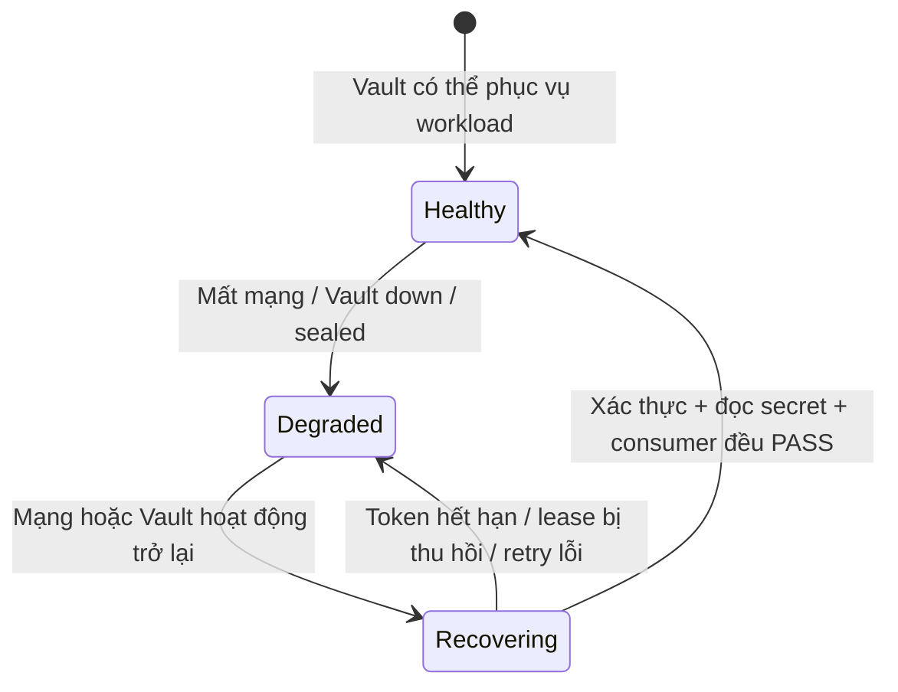
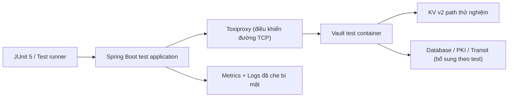
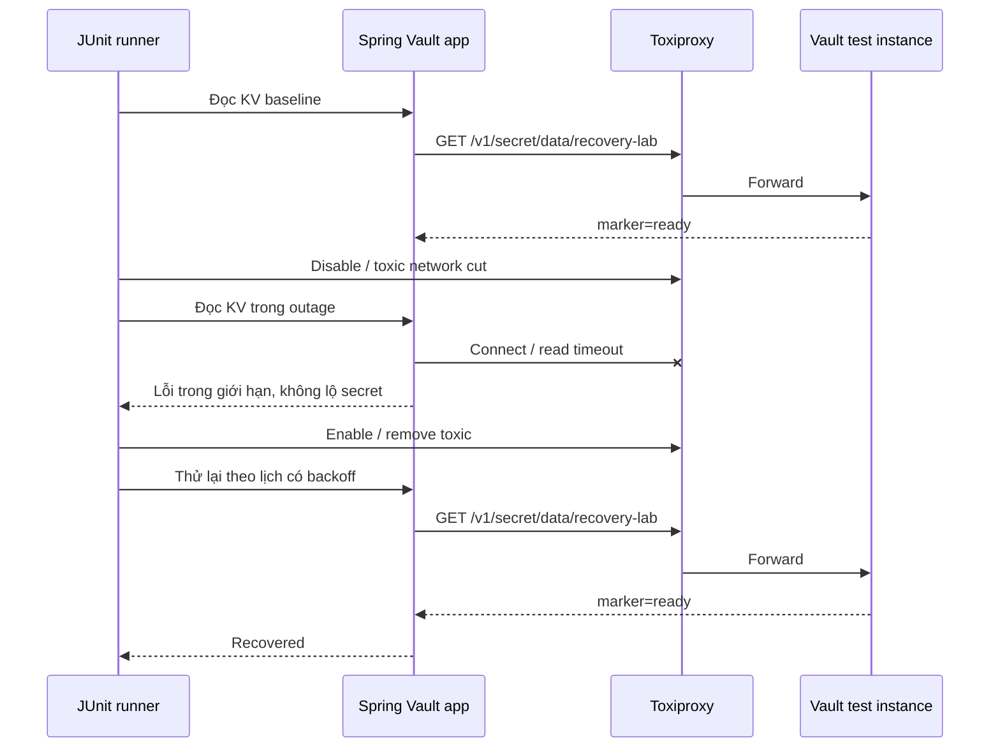
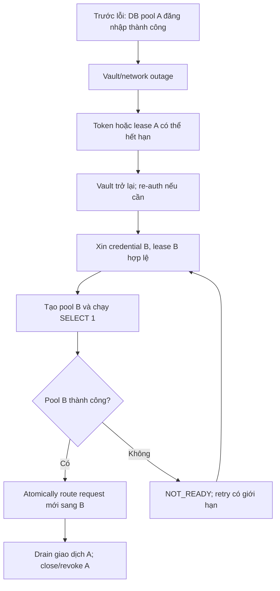

# Kiểm thử phục hồi sau khi Vault hoặc mạng hoạt động trở lại

> **Chương:** Lỗi và khả năng phục hồi  
> **Bài học:** Kiểm thử phục hồi sau khi Vault hoặc mạng hoạt động trở lại  
> **Bối cảnh:** Trong module **SPRING_VAULT**, ứng dụng Java dùng `VaultTemplate`, xác thực theo workload và Vault ACL để truy cập KV secrets, database credentials, Transit encryption, PKI, đồng thời quản lý token và lease. Chủ đề của bài này là **kiểm chứng hành vi trong cả ba giai đoạn trước, trong và sau sự cố**, đặc biệt là khả năng khôi phục khi Vault **hoặc đường mạng tới Vault** hoạt động trở lại.

Không được coi “Vault đã trả HTTP 200” là bằng chứng rằng ứng dụng đã phục hồi hoàn toàn: token có thể đã hết hạn; lease database đã bị thu hồi; JDBC pool vẫn dùng password cũ; TLS client giữ certificate đã hết hạn; hoặc tác vụ retry đã tạo tài nguyên trùng lặp.

## 1. Mục tiêu và phạm vi kiểm thử

Sau bài học, bạn có thể:

1. Tách nguyên nhân **Vault không sẵn sàng**, **mạng lỗi**, **Vault sealed/standby**, **xác thực và phân quyền** khỏi lỗi nghiệp vụ.
2. Thiết kế kiểm thử theo ba chặng **NORMAL → OUTAGE → RECOVERY** và đo được thời gian phát hiện, lỗi phát sinh, thời gian khôi phục, tính nhất quán dữ liệu.
3. Kiểm tra `VaultTemplate` khôi phục kết nối sau network partition hoặc Vault restart mà không cần khởi động lại Java process nếu kiến trúc hỗ trợ.
4. Thử các trường hợp **token TTL hết trong lúc mất kết nối**, **dynamic secret lease bị revoke**, **static database password đã rotate** và **PKI certificate đã hết hạn**.
5. Áp dụng retry có điều kiện, backoff, timeout, circuit breaker, readiness và giới hạn tải trở lại; tránh nhân đôi tác dụng phụ.
6. Viết kịch bản integration test trên môi trường Vault **cô lập**, dùng Testcontainers/Toxiproxy hoặc proxy có thể điều khiển.
7. Xác nhận ứng dụng **không lộ secret** và không hạ mức bảo mật khi gặp lỗi.

**Phạm vi:** Bài kiểm thử sử dụng dữ liệu giả và dịch vụ Vault lab. Các thao tác dừng node, seal/unseal, revoke token hoặc đổi credential **chỉ chạy trong môi trường test** có quyền vận hành thích hợp.

## 2. Mô hình phục hồi: phải có bằng chứng của từng giai đoạn

Một bài test tốt bắt đầu từ trạng thái **thành công đã biết**, cố tình gây ra **một lỗi có kiểm soát**, rồi chứng minh **đường đi nghiệp vụ thành công trở lại**.



| Pha | Hành động trong test | Bằng chứng phải thu |
| --- | --- | --- |
| **Baseline** | Workload token hợp lệ; thực hiện `VaultTemplate.read(...)`; consumer dùng secret thành công | Giá trị kỳ vọng, latency, phiên bản KV/lease, readiness `UP` |
| **Injection** | Chặn đường mạng hoặc làm **Vault lab** không phục vụ request | Lỗi có giới hạn thời gian, không treo thread, không ghi plaintext/token vào log |
| **Outage** | Gửi một số request đã định nghĩa trong khoảng mất kết nối | Phân loại lỗi đúng; retry có hạn; circuit breaker/backpressure; readiness phù hợp |
| **Restore transport/server** | Gỡ lỗi mạng hoặc khởi động/unseal lại Vault lab | Endpoint thực sự reachable và health trạng thái đúng |
| **Re-auth/reconcile** | Kiểm tra lại token, lease, secret phiên bản mới, cấu hình client | Không tự tin dùng token/credential hết hạn; không tạo credential vô hạn |
| **Application recovery** | Chạy lại **thao tác nghiệp vụ thật** qua `VaultTemplate` và consumer | Thao tác thành công, dữ liệu hợp lệ, pool/client được cập nhật |
| **Stabilization** | Duy trì thêm nhiều request qua một khoảng theo dõi | Không còn lỗi lặp, không có tài nguyên rò rỉ, metrics và readiness đã hồi phục |

Các mốc thời gian hữu ích:

```text
t0 = lần đọc/ghi hợp lệ cuối cùng trước lỗi
t1 = thời điểm bắt đầu mất kết nối hoặc Vault down
t2 = lỗi đầu tiên được ứng dụng phát hiện
t3 = thời điểm mạng/Vault lab được khôi phục
t4 = thời điểm đăng nhập/secret lifecycle sẵn sàng
t5 = thao tác nghiệp vụ đầu tiên thành công trở lại

Detection latency = t2 - t1
Application recovery latency = t5 - t3
```

Đặt ngưỡng pass/fail **theo mục tiêu SLO của hệ thống**, không coi con số trong lab là mặc định của Spring Vault. Ví dụ lab có thể yêu cầu kết nối timeout trong 3 giây và một giao dịch đọc hợp lệ thành công lại trong 30 giây sau `t3`. Với sản phẩm thật, phải đo cả p95/p99, số lần retry, lượng request bị từ chối và thời gian đóng tài nguyên cũ.

## 3. Chẩn đoán đúng: Vault, mạng hay quyền?

Không thể dùng một HTTP status code đơn lẻ để kết luận nguyên nhân. Khi mạng bị ngắt, Java có thể gặp connect timeout, read timeout, TLS handshake failure hoặc DNS lỗi mà **không nhận được HTTP response nào**. Khi Vault reachable, `/v1/sys/health` cho biết trạng thái node/cluster theo ngữ nghĩa riêng.

### 3.1. Health API và giới hạn suy luận

Các mã mặc định thường gặp khi gọi `GET /v1/sys/health`:

| HTTP code | Ý nghĩa thông thường |
| --- | --- |
| `200` | Node initialized, unsealed, active |
| `429` | Node standby (trên **health endpoint**, không tự đồng nghĩa rate limiting) |
| `472` | Disaster-recovery secondary |
| `473` | Performance standby |
| `474` | Standby không kết nối được active |
| `501` | Chưa initialized |
| `503` | Sealed |
| `530` | Node bị loại khỏi cluster |

Mã có thể được điều chỉnh bởi tham số health API, cấu hình proxy/load balancer và phiên bản Vault. `standbyok`/`perfstandbyok` thay đổi diễn giải sức khỏe trong một số tình huống; một request **bình thường** trả `429` cũng có thể biểu thị rate/quota. Hãy dùng **endpoint + mã + response + bối cảnh**, không hardcode `429 = Vault lỗi` cho mọi trường hợp.

```bash
# Chạy với Vault lab URL, không cần Vault token để đọc health:
curl --silent --show-error --max-time 3 \
  http://127.0.0.1:8200/v1/sys/health

# Chỉ kiểm tra tình trạng sealed, không kiểm tra capability workload:
curl --silent --show-error --max-time 3 \
  http://127.0.0.1:8200/v1/sys/seal-status
```

Ở production phải dùng HTTPS, xác thực CA, kênh mạng cho phép và cân nhắc expose health endpoint. `/sys/health` trả `200` chỉ là **điều kiện nền**; kiểm thử ứng dụng vẫn cần một transaction **qua đúng Vault token và đúng secret path**.

### 3.2. Ma trận phân loại nguyên nhân

| Triệu chứng trên Java client | Nguyên nhân thường gặp | Chính sách phản ứng |
| --- | --- | --- |
| `ConnectException`, connect timeout | DNS, listener, routing, mạng hoặc Vault chưa khởi động | Retry có giới hạn + backoff/jitter; theo dõi readiness |
| Read timeout / reset connection | Mạng gián đoạn **sau khi gửi request**, server quá tải | Kiểm tra tác dụng phụ trước khi retry thao tác tạo tài nguyên |
| HTTP `503` ở Vault | Sealed, maintenance, quá tải hoặc backend chưa phục vụ | Backoff; kiểm tra health/ops, không cố gọi unseal bằng workload |
| HTTP `500`/`502` | Lỗi nội bộ/plugin/backend bên ngoài | Retry chỉ khi thao tác an toàn; ghi event có che dữ liệu |
| HTTP `403` | Token hết hạn, bị revoke, thiếu policy hoặc auth lỗi | Xác minh auth/role; không retry vô hạn với cùng token |
| HTTP `400` | Payload sai, thiếu field hoặc endpoint/format không phù hợp | Sửa yêu cầu; không xem là lỗi mạng tạm thời |
| HTTP `404` | Path không tồn tại **hoặc** Vault che thông tin do quyền hạn | Kiểm tra mount/policy một cách có kiểm soát; không retry mù |
| HTTP `429` từ **API nghiệp vụ** | Quota/rate limiting tùy cấu hình | Tôn trọng tín hiệu/thời gian chờ, giảm tải, retry có backoff |
| Vault health ổn nhưng `VaultTemplate` vẫn lỗi | Credential/policy/lease/client connection chưa phục hồi | Kiểm thử chính xác từng tầng, không tuyên bố `UP` sớm |

**Điểm cần nhớ:** 403 và 404 không bao giờ được giải quyết bằng cách âm thầm chuyển sang **root token**. Workload chỉ được dùng danh tính đúng quyền, ví dụ Kubernetes Auth/AppRole đã được cấu hình.

## 4. Kiểu dữ liệu quyết định chiến lược phục hồi

| Nguồn/đối tượng | Khi mất kết nối | Sau khi Vault trở lại | Tiêu chí PASS |
| --- | --- | --- | --- |
| **KV v2** chứa cấu hình/secret | Có thể giữ **snapshot đã kiểm tra**, nếu chính sách thời gian còn cho phép; không tải giá trị mới | Đọc lại `secret/data/...`; so `metadata.version`; validate và publish snapshot nguyên khối | Workload dùng phiên bản hợp lệ, không ghi đè bằng null, không dùng cache quá tuổi |
| **Transit encrypt/decrypt** | Thao tác cần Vault thường thất bại; không tự mã hóa plaintext bằng cơ chế yếu | Gửi lại request được phép, bảo toàn format `vault:vN:` | Kết quả crypto xác minh được; plaintext không bị lưu tạm không an toàn |
| **Database dynamic creds** | Không xin được credential/renew lease; kết nối DB đang có có thể còn hoạt động tùy TTL và server | Kiểm tra lại token/lease; nếu cũ không hợp lệ, xin credential mới và thay pool | Connection **mới** đăng nhập thành công; user cũ được đóng/thu hồi đúng |
| **Database static creds** | Client có thể giữ password cũ; Vault có thể đã rotate trong lúc mạng lỗi | Đọc lại `database/static-creds/...`, kiểm tra username/password mới và đổi pool | DB login mới thành công, không coi rotation TTL là lease ID |
| **PKI/certificate** | Không cấp lại certificate; certificate cũ vẫn có ngày hết hạn | Reissue/validate chain, đổi SSL context/client cần thiết | TLS handshake mới thành công với certificate hợp lệ |
| **Vault workload token** | Không renew/login lại được khi mạng mất | Renew hoặc re-auth theo cơ chế auth; xác minh quyền đang hiệu lực | `VaultTemplate` gọi thành công với **token workload**, không dùng credential quản trị |
| **Secret lease** | TTL vẫn trôi; có thể hết hạn hoặc bị revoke khi token hết hạn | Renew/recreate đúng loại lease, xử lý event và khởi tạo consumer mới | Không mở thêm connection với credential đã invalid |

Nếu ứng dụng dùng **cache secret**, cần định nghĩa giới hạn thời gian, mục đích và cách thu hồi. Một secret có khả năng bị revoke ngay lập tức (API key, mTLS certificate bị thu hồi) không phù hợp với chiến lược “cứ dùng cached credential vô thời hạn”. Khi không còn thông tin xác thực hợp lệ, ứng dụng phải **fail closed** và báo lỗi có kiểm soát.

Trong Spring Vault, `SecretLeaseContainer` quản lý vòng đời các secret **có lease**; `SessionManager` và `LifecycleAwareSessionManager` quản lý auth token. `SessionLeaseContainer` hoặc authentication listeners (tùy phiên bản) hỗ trợ phục hồi secret lifecycle sau re-login. Không giả định chỉ vì token mới đã được cấp mà mọi lease cũ đã tự có hiệu lực.

## 5. Chuẩn bị môi trường lab tách biệt

### 5.1. Thành phần cần có



Dùng Vault **dev/test instance riêng**, Java JUnit 5, Testcontainers và Toxiproxy (hoặc proxy có thể bật/tắt traffic). Container Vault dev phù hợp để kiểm chứng **mất mạng rồi nối lại với cùng Vault process**, vì không cần thao tác khởi tạo/unseal thủ công. Nó **không** chứng minh dữ liệu còn nguyên sau một lần restart Vault với storage bền vững: dev mode thường dùng storage tạm và tự khởi tạo, nên restart có thể làm mất secret/token.

Để kiểm thử Vault **restart thật và vẫn giữ state**, dùng cluster/staging lab chạy Integrated Storage (Raft) hoặc storage bền vững, có quy trình init/unseal/auto-unseal **riêng**. Không chạy seal/restart phá trạng thái trên cụm đang phục vụ workload thật.

### 5.2. Fixture dữ liệu giả và quyền tối thiểu

Ví dụ khi Vault lab đã chạy với KV v2 mount `secret/`:

```bash
# Bước provisioning do token admin TEST thực hiện:
vault kv put -mount=secret recovery-lab marker=ready version-note=baseline

# Workload chỉ đọc một path KV v2:
# File recovery-lab.hcl
```

```hcl
path "secret/data/recovery-lab" {
  capabilities = ["read"]
}
```

```bash
# Operator test ghi policy và cấp role/token riêng cho workload.
vault policy write recovery-lab recovery-lab.hcl

# Chỉ trong lab: cấp service token TTL ngắn phục vụ test.
vault token create -type=service -policy=recovery-lab -ttl=30m
```

Thử `vault read secret/data/recovery-lab` bằng **workload token** trước khi ngắt mạng. Với Java `VaultTemplate.read("secret/data/recovery-lab")`, KV v2 trả `data.data.marker` và `data.metadata`; cần phân biệt JSON envelope với giá trị marker.

Root token chỉ phục vụ provisioning/test harness. Không dùng token root cho workload chính cần kiểm thử policy, session renewal hoặc lease; không lưu token/password trong source production, CI log hoặc báo cáo test. Chọn TTL token có chủ đích: **test A** dùng TTL đủ dài để không hết hạn trong sự cố mạng; **test B** dùng TTL rất ngắn để kiểm chứng re-auth.

### 5.3. Baseline phải kiểm tra điều gì?

1. Dùng token của workload, gọi `VaultTemplate.read("secret/data/recovery-lab")`.
2. Đảm bảo response có `data.data.marker=ready`.
3. Ghi mốc `t0`, số version nếu có và thời gian request.
4. Xác minh ứng dụng **thực sự sử dụng secret** (ví dụ kết nối DB hoặc gọi Transit nếu bài test có dependency đó).
5. Lưu evidence **không chứa plaintext/token/lease ID**; có thể lưu enum trạng thái, phiên bản, HTTP class và correlation ID đã xử lý bảo mật.
## 6. Mô phỏng đứt mạng rồi nối lại bằng Toxiproxy

Toxiproxy là proxy TCP có thể điều khiển qua API. Với Testcontainers, test runner đặt Toxiproxy giữa ứng dụng Java và Vault container. Khi chặn proxy, Vault **vẫn hoạt động**; khi mở proxy, ứng dụng phải thực hiện được request mới. Cách này tách rõ **mạng** khỏi **Vault down**.



**Ba loại lỗi mạng cần kiểm thử riêng:**

1. **Connection refused/reset:** cắt kết nối trước khi gửi request hoặc ngắt socket đang mở; thích hợp kiểm tra reconnect/connection pool.
2. **Blackhole/timeout:** TCP chưa trả lời; thích hợp kiểm tra `connectTimeout`, `readTimeout`, deadline tổng và giới hạn thread.
3. **Latency + jitter:** Vault còn reachable nhưng chậm; thích hợp kiểm tra backoff, circuit breaker, tránh toàn bộ pod retry đồng thời.

Testcontainers cho Java hỗ trợ `ToxiproxyContainer` và Toxiproxy Java client; phiên bản dependency, cách đặt import và API nhỏ có thể khác nhau. Các thao tác mẫu:

```java
// Toxiproxy đang được tạo trên cùng Docker network với Vault:
ToxiproxyClient control = new ToxiproxyClient(
        toxiproxy.getHost(), toxiproxy.getControlPort());

Proxy proxy = control.createProxy(
        "vault-proxy",
        "0.0.0.0:8666",   // Cổng bên trong proxy container
        "vault:8200");   // Hostname network alias của Vault

String vaultUrl = "http://" + toxiproxy.getHost()
        + ":" + toxiproxy.getMappedPort(8666);

// Toàn bộ Spring Vault client cần kết nối qua vaultUrl.
proxy.disable();    // Chặn traffic trong test có kiểm soát.
proxy.enable();     // Gỡ lỗi, trả kết nối về trạng thái bình thường.
```

Không để test vô tình gọi trực tiếp `vault.getHttpHostAddress()` khi đang đo khôi phục qua proxy. Nếu ứng dụng chạy trong **container cùng network**, URI cho ứng dụng cần dùng hostname/port nội bộ của proxy, không phải host-mapped port.

### 6.1. Test tự động bằng JUnit 5 + Testcontainers

Ví dụ sau là một **integration test cho tầng kết nối và `VaultTemplate.read`**. Các lệnh tạo token/sinh secret đều nằm trong Vault dev test container. Với thư viện Testcontainers/Spring Vault khác phiên bản, điều chỉnh dependency/import tương ứng trước khi chạy.

```java
import java.net.URI;
import java.time.Duration;
import java.util.Map;

import eu.rekawek.toxiproxy.ToxiproxyClient;
import eu.rekawek.toxiproxy.model.Proxy;
import org.junit.jupiter.api.Test;
import org.springframework.vault.authentication.TokenAuthentication;
import org.springframework.vault.client.VaultEndpoint;
import org.springframework.vault.core.VaultTemplate;
import org.springframework.vault.support.VaultResponse;
import org.testcontainers.containers.Network;
import org.testcontainers.containers.ToxiproxyContainer;
import org.testcontainers.vault.VaultContainer;

import static org.awaitility.Awaitility.await;
import static org.junit.jupiter.api.Assertions.*;

class VaultNetworkRecoveryIT {

    private static final String TEST_TOKEN = "local-lab-token";

    @Test
    void readsKvAgainAfterNetworkRestored() throws Exception {
        try (Network network = Network.newNetwork();
             VaultContainer<?> vault = new VaultContainer<>(
                     "hashicorp/vault:1.13")
                     .withNetwork(network)
                     .withNetworkAliases("vault")
                     .withVaultToken(TEST_TOKEN)
                     .withInitCommand(
                             "kv put secret/recovery-lab marker=ready");
             ToxiproxyContainer toxiproxy =
                     new ToxiproxyContainer(
                             "ghcr.io/shopify/toxiproxy:2.12.0")
                             .withNetwork(network)) {

            vault.start();
            toxiproxy.start();

            ToxiproxyClient control = new ToxiproxyClient(
                    toxiproxy.getHost(), toxiproxy.getControlPort());

            Proxy proxy = control.createProxy(
                    "vault-recovery", "0.0.0.0:8666", "vault:8200");

            String proxiedUrl = "http://" + toxiproxy.getHost()
                    + ":" + toxiproxy.getMappedPort(8666);

            // Dùng URI proxy từ trước khi tạo VaultTemplate.
            VaultTemplate vaultOps = new VaultTemplate(
                    VaultEndpoint.from(URI.create(proxiedUrl)),
                    new TokenAuthentication(TEST_TOKEN));

            // Quan trọng: cấu hình connect/read timeout của HTTP client
            // trong bài test thực tế; mặc định thư viện có thể chờ lâu.
            assertEquals("ready", readMarker(vaultOps));

            proxy.disable();
            try {
                // Mất đường mạng. Exception cụ thể tùy HTTP transport.
                assertThrows(RuntimeException.class,
                        () -> readMarker(vaultOps));
            } finally {
                // Không để lỗi test làm proxy kẹt ở trạng thái disabled.
                proxy.enable();
            }

            // Kiểm tra request thực sự thành công sau khi nối lại.
            await()
                    .atMost(Duration.ofSeconds(30))
                    .pollInterval(Duration.ofMillis(250))
                    .untilAsserted(() ->
                            assertEquals("ready", readMarker(vaultOps)));
        }
    }

    private static String readMarker(VaultTemplate vaultOps) {
        VaultResponse response =
                vaultOps.read("secret/data/recovery-lab");
        assertNotNull(response);
        assertNotNull(response.getData());

        Object inner = response.getData().get("data");
        assertInstanceOf(Map.class, inner);
        Object marker = ((Map<?, ?>) inner).get("marker");
        assertInstanceOf(String.class, marker);
        return (String) marker;
    }
}
```

Trong test này `TEST_TOKEN` đóng vai **root token chỉ tồn tại ở Vault dev container** để tập trung đo tầng mạng. Test quyền xác thực/refresh token phải **tạo riêng một workload token và role thực**, không dùng `TEST_TOKEN` này rồi kết luận chính sách production đã đúng. Để test thất bại nhanh, cần inject HTTP request factory có timeout rõ ràng vào Spring Vault client; chờ mạng vô hạn sẽ khiến test chạy treo.

Không nên trộn vào một test quá nhiều biến số: **mạng cắt nhưng token còn hạn** là một trường hợp; **mạng cắt và token hết hạn** là trường hợp khác, cần fixture xác thực có TTL riêng. Tách chúng giúp biết lỗi đến từ đâu.

### 6.2. Điều kiện pass/fail của network recovery

- **PASS:** baseline đọc đúng marker; request trong outage thất bại trong deadline; sau `proxy.enable()` một request thật qua `VaultTemplate` thành công trước ngưỡng; không có thread/sockets/timers tăng không giới hạn.
- **FAIL:** request kẹt quá timeout, exception bị nuốt mà trả dữ liệu giả, ứng dụng phải restart mới có thể kết nối lại (nếu mục tiêu là hot recovery), hoặc trở lại nhưng dùng token/credential sai.
- **Cần quan sát:** trạng thái circuit breaker đóng lại, số lần retry, p95 latency sau restore, connection pool đang sử dụng và đường dẫn thực tế qua proxy.

## 7. Mô phỏng Vault thực sự không phục vụ rồi trở lại

Ngắt mạng không chứng minh Vault có thể khởi động lại. Trường hợp Vault down/restart cần thử riêng, vì server có thể đổi leader, trạng thái sealed, đổi certificate hoặc thay đổi quyền/lease trong khoảng gián đoạn.

### 7.1. Kịch bản Vault tạm không nhận request

Trong một môi trường Vault test cô lập, ví dụ khi Vault chạy dưới container có state phù hợp:

1. Ghi marker baseline bằng token workload; đo health/transaction.
2. Tạm chặn khả năng phục vụ của Vault **lab**, ví dụ tạm dừng tiến trình container trong test có cleanup, hoặc dùng một Vault instance cố tình sealed.
3. Kiểm tra Java request timeout/fail controlled; readiness đi trạng thái phù hợp.
4. Khôi phục process/node, chờ `initialized=true`, `sealed=false` và HA role hợp lệ.
5. Kiểm tra lại token/lease/certificate. Nếu token hết hạn trong lúc ngắt, **re-authenticate** theo workload identity.
6. Đọc KV và chạy thao tác nghiệp vụ qua client/consumer. Đo thời gian kể từ khi server ready đến khi ứng dụng phục hồi.

**Pause/unpause khác stop/start:** `docker pause` giữ nguyên process trong container và có thể dùng kiểm tra gián đoạn tạm. Stop/start thực sự chỉ kiểm chứng tồn tại dữ liệu nếu storage bền vững và có quy trình unseal phù hợp. Vault **dev mode** có thể mất mọi dữ liệu/token sau lần restart; lúc đó fixture phải tạo lại, không gọi tình huống đó là “storage recovery”.

### 7.2. Vault Shamir/auto-unseal khi restart

- **Shamir:** Vault node khởi động lại thường vẫn sealed cho tới khi có đủ unseal key shares; operator làm unseal trên **lab** theo quy trình riêng. Java workload không có quyền/hành vi tự nhập shares.
- **Auto-unseal:** node phụ thuộc KMS/HSM/seal backend; nếu phụ thuộc đó lỗi, Vault có thể tiếp tục sealed dù process đã chạy. Người vận hành phải xử lý seal backend trước.
- **HA:** một node active mất kết nối có thể khiến cluster bầu leader/chuyển role; khả dụng của toàn cụm có thể khác với sức khỏe của từng node. Cần kiểm tra qua đúng load balancer/service endpoint mà Java sử dụng.
- **Root of trust:** Không bao giờ giải quyết sealed Vault bằng cách `vault operator init` trên storage đã initialized. Điều đó không khôi phục dữ liệu và có thể dẫn đến rủi ro phá trạng thái nếu thao tác sai.

### 7.3. Độ trễ hồi phục không chỉ là HTTP health

```mermaid
sequenceDiagram
    participant Ops as Operator/Test runner
    participant Vault as Vault
    participant Auth as Spring SessionManager
    participant Lease as SecretLeaseContainer
    participant App as DataSource / Service
    Ops->>Vault: Restore node/network
    Vault-->>Ops: sys/health active + unsealed
    Auth->>Vault: Renew token hoặc login lại
    Vault-->>Auth: Token hợp lệ
    Lease->>Vault: Renew/recreate secrets
    Vault-->>Lease: Credential + lease hợp lệ
    Lease->>App: Sự kiện credential mới
    App->>App: Tạo và test resource mới; cutover
    App-->>Ops: Nghiệp vụ thành công
```

Thời điểm `Vault sys/health=200` **có thể đến trước** thời điểm `DataSource` đã dùng credential mới. Vì vậy đặt readiness ở tầng ứng dụng dựa trên **khả năng phục vụ thực sự**, có cửa sổ `RECOVERING`.

## 8. Thiết kế retry, timeout và circuit breaker có trách nhiệm

### 8.1. Chỉ retry khi lỗi và thao tác phù hợp

Không được suy luận “HTTP GET luôn idempotent” trong Vault: `GET database/creds/<role>` **cấp dynamic credential mới mỗi lần đọc**; request trước có thể đã tạo database user nhưng response bị mất trên mạng.

| Thao tác | Khi timeout/không biết kết quả | Chiến lược |
| --- | --- | --- |
| `GET secret/data/app` (KV v2) | Đọc không tạo credential mới | Có thể retry giới hạn; kiểm tra version sau restore |
| `GET sys/health` | Health read | Retry giới hạn, phân loại standby/sealed |
| `GET database/creds/role` | Có thể đã tạo user và lease mới trước khi response mất | Không retry mù nhanh liên tục; đối soát lease/DB users, giới hạn tần suất, TTL cleanup |
| `GET database/static-creds/role` | Đọc password hiện hành, không tạo user mới | Retry giới hạn; rồi xác thực password thực trên DB |
| `POST transit/encrypt/key` | Có thể xử lý thành công nhưng trả ciphertext không tới client | Không giả định kết quả lần sau giống hệt; bảo đảm ứng dụng chỉ commit một ciphertext được nhận hợp lệ |
| `POST pki/issue/role` | Có thể đã phát hành certificate | Theo dõi serial/issuance, không phát hành liên tục khi timeout |
| `POST sys/wrapping/unwrap` | Wrapping token chỉ dùng một lần | Không lặp mù; kiểm tra sự cố và cơ chế cấp lại credential |
| `POST auth/.../login` | Có thể phát hành token trước khi response mất | Đặt rate limit, bảo vệ credential, xử lý phiên thừa theo chính sách |

**Quy tắc:** retry vì lỗi tạm thời phải đi kèm **deadline tổng** và xử lý tác dụng phụ, đặc biệt khi trạng thái thực sự của request **không chắc chắn**. Không retry vô hạn 400/403/404 của cấu hình sai; một số 404 có thể là cơ chế che thông tin quyền truy cập.

### 8.2. Tính ngân sách thời gian

Ví dụ mục tiêu request API của ứng dụng chỉ có **2 giây**, có thể phân bổ:

```text
Vault connect timeout:        200 ms
Vault read timeout:           500 ms
Retries:                       2 lần tổng (1 lần thử + 1 lần retry)
Backoff (jitter):             100–300 ms
Phần còn lại:                 validate/cache/consumer/business logic
```

Đây là **ví dụ thiết kế**, không phải giá trị mặc định. Nếu mỗi attempt có `readTimeout=5s` nhưng request HTTP bên ngoài có timeout 2s, việc retry 3–4 lần sẽ vô nghĩa và tăng tải lúc Vault phục hồi. Sử dụng deadline end-to-end, phân loại lỗi, exponential backoff có jitter và giới hạn concurrency.

### 8.3. Circuit breaker và readiness

- **Circuit breaker OPEN:** hạn chế gọi Vault khi backend liên tục lỗi. Không để mỗi request kích hoạt một retry storm.
- **HALF_OPEN:** cho một lượng rất nhỏ request thử qua **đúng workload identity**. Chỉ close khi thao tác thực cần thiết thành công.
- **CLOSED:** cho phép traffic bình thường; vẫn theo dõi lỗi/latency sau restore.
- **Readiness:** chuyển `NOT_READY` khi không thể đáp ứng chức năng bắt buộc an toàn (ví dụ không lấy được valid DB credential). Nếu chỉ một feature phụ thuộc Vault bị lỗi, có thể trả `DEGRADED` và giới hạn feature đó theo thiết kế.
- **Liveness:** không nên giết JVM liên tục chỉ vì Vault tạm mất mạng; restart loop có thể khiến chính quá trình phục hồi tệ hơn.

Đừng cho circuit breaker OPEN **vĩnh viễn** vì không còn request thăm dò khi Vault đã khôi phục; cần half-open probe hoặc cơ chế reset/lịch thử được kiểm soát.

## 9. Phục hồi token và lease: trường hợp quan trọng nhất trong Spring Vault

Mất Vault trong 30 giây khi token TTL còn 20 phút khác hẳn mất Vault 10 phút khi token TTL chỉ còn 2 phút. Test phải cố tình tạo cả hai trường hợp.

### 9.1. Token vẫn hợp lệ lúc mạng được nối lại

- `LifecycleAwareSessionManager` có thể tiếp tục dùng hoặc renew cùng token tùy auth method và token policy.
- `VaultTemplate` có thể gọi lại KV/Transit ngay khi HTTP connection được khôi phục, nếu token và ACL vẫn hợp lệ.
- Lease của dynamic secret có thể đã gần hết hạn; không suy ra `token còn hiệu lực => mọi credential còn hiệu lực`.
- Kiểm tra không còn request/connection bị kẹt, retry scheduler vẫn hoạt động và secret consumer vẫn dùng đúng dữ liệu.

### 9.2. Token hết hạn hoặc bị revoke khi mất mạng

- Sau khi Vault trở lại, `VaultTemplate` có thể nhận 403 với token cũ.
- Với **auth method dựa trên workload** (Kubernetes Auth/AppRole...), session manager cần đăng nhập lại để có token mới nếu đủ quyền và credential nguồn hợp lệ.
- `SessionLeaseContainer` và các authentication listeners phù hợp có thể hỗ trợ restart quá trình quản lý lease sau re-login; kiểm chứng trên phiên bản Spring Vault thực tế.
- Vault có thể thu hồi các lease gắn với token cũ; phải tạo lại dynamic credential và đổi JDBC pool hoặc resource tương ứng.
- Không chỉ lặp lại request bằng token đã hết hạn; không tự rơi sang root token.

Ví dụ chuỗi cần test:

```text
t0: login -> token A (TTL 45 s); dynamic DB lease A
t1: mạng bị chặn, không renew token A được
t2: token A hết hạn trong lúc mạng lỗi
t3: mở lại mạng, Vault reachable
t4: session manager login -> token B
t5: cấp dynamic DB credential B; tạo/test pool B
t6: service thực hiện SELECT thành công trên pool B
```

Gắn rõ **điểm thành công ở t6**, không dừng bài test tại `token B` hoặc `sys/health=200`. Để tránh flaky test, điều khiển đồng hồ và TTL hợp lý, không đặt TTL 1–2 giây gây nhiễu bởi CPU load CI.

### 9.3. Các sự kiện cần theo dõi

| Tín hiệu/event | Diễn giải | Phản ứng kỳ vọng |
| --- | --- | --- |
| Authentication success sau re-login | Workload token mới đã được cấp | Kiểm tra policy, khởi động lại các secret lifecycle cần thiết |
| Authentication/renewal error | Không lấy/gia hạn được token | Giảm sẵn sàng, retry theo auth policy; không lộ credential |
| `SecretLeaseCreatedEvent` / `SecretLeaseRotatedEvent` | Dynamic credential mới có thể đã sẵn sàng | Tạo, test resource candidate và cutover |
| `AfterSecretLeaseRenewedEvent` | Lease hiện có được renew | Cập nhật deadline, chưa chắc cần đổi username |
| `SecretLeaseExpiredEvent` | Lease cũ hết hạn | Ngừng cấp kết nối mới bằng credential cũ |
| `SecretLeaseErrorEvent` | Renewal/rotation đang có vấn đề | Cảnh báo, kiểm soát readiness, không retry đồng loạt |

Cách đăng ký listener và thứ tự start của `SecretLeaseContainer` cần khớp framework lifecycle. Nếu ứng dụng đã dùng Spring Cloud Vault để quản lý lease, **không tự tạo thêm container thứ hai** theo dõi một path và sinh credential ngoài dự kiến.
## 10. Phục hồi thành phần giữ trạng thái: JDBC, PKI và Transit

### 10.1. Dynamic database credentials và JDBC pool

Giả sử ứng dụng `order-api` đã nhận `database/creds/orders-readonly` và dựng `HikariDataSource` với user A. Trong lúc Vault mất mạng, lease A hết hạn hoặc token cấp lease bị revoke. Vault hoạt động lại **không khiến pool A tự có quyền đăng nhập**.

Kiểm thử phải theo chu trình:



**Điều kiện kiểm thử bắt buộc:** request dùng **connection mới** phải thành công bằng credential B; chỉ một query trên connection đã mở trước outage không chứng minh được pool đã cập nhật. Nếu vẫn còn request đang chạy trên A, đóng pool cũ cần có grace period/transaction boundary, không cắt kết nối đang commit giữa chừng.

Khi recovery, đừng liên tục poll `database/creds/role`: mỗi lần GET có thể sinh thêm DB user/lease. Dùng lease lifecycle/event, thu hồi/đối soát user thừa và xác nhận số connection, số active leases có trở lại ổn định sau test.

### 10.2. Static database credentials bị rotate trong outage

Static role có **username cố định**, password được Vault rotate theo lịch. Tình huống test:

1. `orders_app` dùng password P1, pool A hoạt động.
2. Mạng Java→Vault bị ngắt, còn Vault vẫn chạy và rotate `orders_app` thành P2.
3. Java mở connection mới bằng P1 có thể bị authentication failure.
4. Khôi phục mạng; ứng dụng đọc lại `database/static-creds/orders-app`.
5. Nếu password đã đổi, dựng/refresh pool, xác minh **new connection** dùng P2 đăng nhập thành công.
6. Kiểm tra mọi instance chia sẻ role đã chuyển sang P2, không chỉ instance test đầu tiên.

`ttl` trong `static-creds` là thời gian tới vòng rotate, **không** phải lease ID có thể gọi `vault lease renew`. Nếu có lỗi rotation trên Vault, không coi thời điểm lịch dự kiến là bằng chứng P2 đã tồn tại; phải kiểm tra credential thực và response của Vault.

### 10.3. PKI và TLS certificate hết hạn khi Vault unreachable

Nếu workload mTLS dùng chứng chỉ Vault PKI đã hết hạn trong outage, có thể phải **tái cấp chứng chỉ và tạo SSLContext mới** khi phục hồi. Chỉ đọc lại certificate hoặc thay file PEM mà không thay trust/key manager của client vẫn có thể giữ cấu hình TLS cũ.

Kiểm thử gồm: cố tình dùng chứng chỉ test có thời gian sống ngắn hợp lý; tạo outage kéo qua thời gian refresh; khôi phục Vault; cấp lại và validate certificate/key/chain/SAN; tạo TLS client mới; thử handshake; đóng client cũ. Theo dõi `notAfter`, tỷ lệ lỗi handshake, `certificate_days_to_expiry` và việc certificate còn được phép sử dụng.

Không giảm bảo mật bằng `trustAll`, `tls_disable`, bỏ kiểm tra hostname hoặc kéo dài certificate expired trong môi trường thật.

### 10.4. Transit encryption trở lại sau outage

Transit key material nằm trong Vault. Khi Vault unreachable, thao tác `transit/encrypt`, `transit/decrypt`, `transit/sign` có thể thất bại; **không** chuyển dữ liệu nhạy cảm sang lưu plaintext hoặc AES key hardcode.

Sau khi phục hồi:

- Mã hóa một payload test bằng **workload token đúng quyền**; ciphertext có tiền tố định dạng Transit (`vault:vN:...`).
- Giải mã ciphertext test cũ bằng workload có quyền decrypt và xác minh dữ liệu gốc khớp nếu version còn được cho phép.
- Nếu trong thời gian outage operator rotate key, ứng dụng không cần tự thay key local; nhưng ciphertext mới có thể dùng version mới.
- Nếu chính sách nâng `min_decryption_version`, ciphertext thuộc version quá cũ có thể không giải mã được: đây là thay đổi policy/key lifecycle, **không phải lỗi mạng**.
- Nếu retry một encrypt call sau timeout, không giả định Vault trả chính xác cùng ciphertext; chỉ commit vào storage ciphertext thực sự nhận được và bảo đảm transaction ứng dụng không ghi hai lần.

### 10.5. KV và cache khi mạng vừa hồi phục

Với KV v2, ứng dụng có thể giữ **snapshot đã được xác minh** theo giới hạn freshness trong outage. Khi Vault trở lại, so `data.metadata.version`, schema và các điều kiện chính sách trước khi publish snapshot mới.

Một yêu cầu đang chạy phải sử dụng **một bản snapshot nhất quán**, tránh đọc API key từ v2 nhưng lấy endpoint/tenant policy từ v1. Nếu v2 chưa tải được, không được ghi đè v1 bằng `null`. Nếu v1 bị revoke mà không còn giá trị hợp lệ, trả lỗi có kiểm soát; không coi một cache hợp lệ về mặt cú pháp là quyền sử dụng mãi mãi.

## 11. Khôi phục an toàn khi ứng dụng chạy nhiều instance

Một instance vượt qua test không có nghĩa cả hệ thống đã phục hồi. Với nhiều replica Java, các sự kiện re-login, retry và đổi connection pool có thể đồng loạt dồn tải về Vault.

**Kịch bản multi-pod cần đo:**

| Tình huống | Nguy cơ | Điều kiện cần xác nhận |
| --- | --- | --- |
| 30 pod cùng mất đường tới Vault | Mỗi pod giữ socket/thread lỗi, 30 circuit breaker mở | Số request và thread được giới hạn, không treo toàn cụm |
| Cả 30 pod cùng nối lại | Retry storm gây rate limit/429 | Backoff+jitter, giới hạn concurrent refresh, không login loop |
| Token một số pod hết hạn, số khác còn hạn | Cách phục hồi giữa pod khác nhau | Pod hết hạn re-auth; pod còn token dùng quyền hợp lệ |
| Dynamic DB role cấp credential cho mỗi pod | DB user tăng đột biến khi retry | Mỗi pod quản lý lease, không poll credential liên tục |
| Static DB password thay trong outage | Một số pool vẫn dùng password cũ | Tất cả pod chuyển pool hoặc được đánh dấu NOT_READY |
| PKI certificate rotation | Trust chain của các pod không đồng nhất | Handshake mới thành công ở mọi instance sau cutover |
| Một Vault node standby, node khác active | Health LB sai có thể đưa traffic vào node không phục vụ | Test qua endpoint thực của ứng dụng và load balancer |

Với workload cần tính sẵn sàng cao, ứng dụng có thể chọn phục vụ **một phần** chức năng khi Vault tạm lỗi (ví dụ trả dữ liệu đã cache được phép), nhưng mỗi chức năng phải có ranh giới bảo mật và yêu cầu freshness độc lập. Không cho phép ghi dữ liệu cần mã hóa Transit mà không mã hóa, hoặc phát lệnh DB bằng credential đã được xác định là revoked.

## 12. Readiness, metrics và bằng chứng phục hồi

### 12.1. Đừng dùng health check một tầng

Có ít nhất ba tầng cần quan sát:

- **Vault infrastructure:** process/cluster, storage, seal, HA state qua `/sys/health`, `/sys/seal-status`.
- **Vault workload access:** session token hiện hành có thể truy cập một endpoint đúng quyền không; 403 do policy khác với Vault unreachable.
- **Consumer readiness:** DataSource, PKI/TLS client, API key provider hoặc job processor đã dùng dữ liệu hợp lệ mới chưa.

Một read-only synthetic transaction nên dùng **workload identity test với quyền tối thiểu** trên một path lab an toàn. Không đọc secret production chỉ để làm health check, không dùng `database/creds/role` làm liveness probe vì mỗi lần có thể sinh credential mới.

Ví dụ phân loại sức khỏe ứng dụng:

```text
UP:
  Có thể phục vụ mọi chức năng bắt buộc bằng credential hợp lệ.

DEGRADED:
  Một chức năng không thiết yếu tạm lỗi nhưng chức năng khác có thể an toàn.

NOT_READY:
  Không có credential hợp lệ hoặc không thể thực hiện tác vụ cốt lõi an toàn.

RECOVERING:
  Vault reachable nhưng đang re-login, reissue/renew lease hoặc cutover pool.
```

`NOT_READY` thuộc **readiness**; liveness vẫn nên trả lời khi JVM hoạt động và có khả năng tự hồi phục. Tránh để orchestrator liên tục giết pod chỉ do Vault mất mạng trong thời gian ngắn, vì vòng restart có thể xóa trạng thái cần thiết và làm retry tăng mạnh.

### 12.2. Metrics gợi ý

| Metric/quan sát | Ý nghĩa | Ngưỡng ví dụ cần tùy chỉnh |
| --- | --- | --- |
| `vault_request_errors_total{kind,status_class}` | Phân loại timeout, 403, 5xx, 429 | Cảnh báo khi tăng liên tục sau restore |
| `vault_request_duration_seconds` | Latency p50/p95/p99 | So với baseline |
| `vault_recovery_seconds` | Từ restore đến nghiệp vụ thành công | Đặt SLO cụ thể theo hệ thống |
| `vault_auth_relogin_total` | Số lần re-auth sau sự cố | Phát hiện login storm |
| `secret_lease_remaining_seconds` | Lease dynamic đang dùng còn hiệu lực bao lâu | Cảnh báo trước max TTL |
| `database_pool_cutover_seconds` | Mất bao lâu để thay pool | Theo transaction grace period |
| `database_new_connection_errors_total` | Lỗi DB login mới sau rotate | Phải giảm về baseline |
| `tls_handshake_failures_total` | Chứng chỉ/trust bị lỗi sau restore | Không kéo dài sau reissue |
| `retries_exhausted_total` | Quá ngân sách retry | Theo dõi suy giảm chất lượng |
| `readiness_state` | UP/DEGRADED/NOT_READY/RECOVERING | Cập nhật sau transaction thực |

Không đặt password, raw Vault token, `lease_id` đầy đủ, private key, secret path có dữ liệu cá nhân hoặc plaintext vào log/metric labels/traces. Nếu ghi exception, che nội dung payload, dùng correlation ID không nhạy cảm và code/status đã phân loại.

## 13. Ma trận integration test cần thực thi

Mỗi dòng dưới đây nên chạy độc lập trên fixture lab, có thể tự động hóa bằng Testcontainers, Awaitility và proxy điều khiển. Đánh dấu PASS bằng **assertion**, không chỉ nhìn logs thủ công.

| ID | Fault injection | Hành vi trong lỗi | Sau khôi phục: điều kiện PASS |
| --- | --- | --- | --- |
| **T01** | Chặn kết nối TCP tới Vault 10–15 giây, token còn hạn | Timeout trong deadline, fail closed | KV read đúng marker bằng cùng process, không restart Java |
| **T02** | Tăng latency vượt read timeout | Có timeout/backoff, concurrency ổn định | Sau bỏ toxic, p95 và lỗi giảm, circuit breaker CLOSED |
| **T03** | Vault lab tạm không phục vụ, rồi trở lại | HTTP 503/transport error đúng phạm vi | `sys/health` phù hợp + workload transaction thành công |
| **T04** | Shamir Vault lab restart và sealed | Workload không dùng được Vault | Operator unseal xong, workload tự phục hồi; không init lại |
| **T05** | Token TTL hết trong lúc mất mạng | Auth/lease request thất bại có kiểm soát | Login lại đúng auth role, KV/DB transaction thành công |
| **T06** | Revoke token workload rồi khôi phục kết nối | Token cũ bị 403 | Có auth credential phù hợp, lấy token mới; root không bị dùng |
| **T07** | Dynamic DB lease hết hạn | Connection mới bằng A bị từ chối | Credential B + pool B, query mới thành công, pool A drained |
| **T08** | Static DB password rotate khi mạng bị chặn | Một số client giữ password cũ | Sau restore mọi pool làm mới, DB login mới thành công |
| **T09** | PKI certificate hết hạn trong outage | TLS cũ có thể bị từ chối | Reissue certificate, SSL context mới, handshake thành công |
| **T10** | Vault trả 403 do policy, dù health=200 | Không retry vô hạn | Báo lỗi phân quyền rõ; không gọi bằng root/credential rộng |
| **T11** | KV path trả dữ liệu thiếu field/version | Không publish snapshot lỗi | Sau sửa fixture, nhận snapshot hợp lệ, không nửa dữ liệu |
| **T12** | Timeout sau `GET database/creds/role` | Không biết credential đã cấp chưa | Giới hạn request, đối soát số lease/DB user, không credential leak hàng loạt |
| **T13** | Nhiều pod đồng thời reconnect | Backoff và rate limit hoạt động | Không retry storm, từng pod cuối cùng phục vụ thành công |
| **T14** | Transit key rotate trong outage | Encrypt/decrypt tạm thất bại | Dùng key version mới đúng policy; ciphertext cũ vẫn đọc được nếu được phép |
| **T15** | Vault trở lại nhưng DB backend vẫn down | Vault health tốt, cấp credential có thể lỗi | Readiness vẫn NOT_READY cho chức năng DB đến khi DB hồi phục |

**Test sai lệch mạng một chiều** cũng hữu ích: client có thể gửi request nhưng mất response, nên kết quả thao tác có tác dụng phụ là **không xác định**. Với POST Transit/PKI, token create hoặc GET dynamic credentials, phải có câu trả lời về deduplication/reconciliation trước khi bật retry.

### 13.1. Công thức assertion chuẩn

Với mỗi test:

```text
GIVEN:
  Workload identity, secret fixture và consumer đều PASS lúc baseline.

WHEN:
  Inject đúng một lỗi đã xác định trong một khoảng hữu hạn.

THEN DURING OUTAGE:
  Request kết thúc trong deadline; lỗi đúng loại;
  không lộ bí mật; không mở rộng quyền hoặc ghi plaintext.

WHEN RESTORED:
  Gỡ lỗi; chờ Vault health hợp lệ;
  hoàn tất re-auth/lease refresh/resource cutover nếu cần.

THEN AFTER RECOVERY:
  Thao tác Vault bằng token workload PASS;
  transaction nghiệp vụ thật PASS;
  metrics/readiness trở về kỳ vọng;
  không có credential/connection/thread leak.
```

Dùng `await().atMost(...).untilAsserted(...)` thay cho `Thread.sleep(...)` cố định vì thời gian recovery phụ thuộc CI load. Dù vậy, `await()` chỉ kiểm tra điều kiện; các HTTP call bên trong vẫn phải có **connect/read timeout** và giới hạn retry để tránh treo vô hạn.

## 14. Runbook thực hành có thể lặp lại

**Mục tiêu:** chứng minh dịch vụ Java có thể tự thực hiện lại `VaultTemplate.read("secret/data/recovery-lab")` sau khi mất mạng 15 giây, khi token vẫn còn hạn.

1. Khởi tạo Vault dev/test container, KV v2 fixture, token workload riêng, cấu hình Spring Vault endpoint qua Toxiproxy.
2. Gọi `VaultTemplate.read` baseline, kiểm tra `data.data.marker=ready`, ghi thời điểm và latency.
3. Bật fault: `proxy.disable()` hoặc một toxic timeout. Gửi request mới; kiểm chứng lỗi nằm trong ngân sách.
4. Duy trì lỗi đủ để test circuit breaker/readiness; không kéo dài đến hết TTL trong test này.
5. Gỡ fault trong khối cleanup (`finally`); xác định thời điểm restore.
6. Chạy Awaitility polling qua **cùng client/workload process**, chờ `VaultTemplate.read` hợp lệ.
7. Xác nhận tình trạng sau restore: request mới tiếp tục thành công, retry rate bình thường, metric lỗi ngừng tăng bất thường.
8. Thực hiện biến thể **token hết TTL trong outage**; cần cơ chế auth login lại và xử lý lease riêng.
9. Thực hiện biến thể **Vault process tạm down** và, trong lab có storage bền vững, biến thể **Vault restart/unseal**.
10. Dọn test container, proxy, token/credential test. Chỉ giữ evidence đã xóa thông tin nhạy cảm.

**Kết quả cần ghi trong báo cáo kiểm thử**, ví dụ:

```text
Test ID: T01 network-return
Failure injected: proxy disabled 15s
Vault process during fault: running
Workload token at restore: valid
Baseline transaction: PASS
During outage: transport error within configured timeout
Restore time: t3
First successful business transaction: t5
Recovery latency: t5 - t3 (measured, compare to configured SLO)
Post-recovery 20 transactions: PASS
Leaked secret/token in logs: NO
Resource leaks: NONE OBSERVED (by test metrics)
Result: PASS / FAIL against explicit thresholds
```

Đừng ghi `Recovery latency=0` chỉ vì network đã được bật lại hoặc health trả 200. Phải có phép đo từ **giao dịch nghiệp vụ thành công**.

## 15. Những sai lầm làm test có vẻ PASS nhưng production vẫn lỗi

1. **Chỉ chờ Vault health 200:** Vault active nhưng token/lease/pool của Java có thể vẫn hỏng.
2. **Dùng root token trong mọi integration test:** bỏ qua đúng failure mode của workload auth và policy.
3. **Cho `GET database/creds` vào health probe:** vô tình tạo user/lease mới mỗi lần kiểm tra.
4. **Chỉ kiểm tra connection DB đang mở:** không biết connection mới có đăng nhập được bằng password mới không.
5. **Test stop/start Vault dev rồi mong dữ liệu còn nguyên:** dev mode thường không có persistent storage.
6. **Đồng nhất `429` health standby với `429` rate limit:** hai ngữ cảnh khác nhau.
7. **Retry mọi exception:** 400/403 sai quyền không sửa được bằng retry; unknown outcome có thể nhân đôi tác dụng phụ.
8. **Fail-open khi Vault down:** lưu plaintext, bypass mTLS hoặc dùng password hardcode làm mất đặc tính bảo mật.
9. **Chỉ kiểm thử một pod:** không phát hiện retry storm, login storm, DB user bùng nổ khi nhiều pod phục hồi.
10. **Không cleanup fault trong `finally`:** các test sau bị ô nhiễm, khó phân biệt nguyên nhân.
11. **Không giới hạn HTTP timeout:** request bị treo dù `await().atMost(...)` có deadline.
12. **Coi đã re-login là đủ:** token mới không làm credential database cũ sống lại và không cập nhật JDBC pool.
13. **Không kiểm tra lỗi khi phiên credential thay đổi:** thậm chí pool candidate kết nối thành công vẫn cần xử lý transaction đang dùng pool cũ.

## 16. Checklist nghiệm thu phục hồi

- [ ] Lab Vault, proxy và downstream DB/PKI tách biệt production; dùng dữ liệu giả.
- [ ] Baseline có transaction thành công qua **đúng token workload** và đúng consumer.
- [ ] Thử lỗi TCP connection refused/reset, timeout, latency; không phụ thuộc chỉ một kiểu outage.
- [ ] Thử server Vault down/restart trên lab với storage phù hợp; phân biệt sealed, standby, active.
- [ ] Có connect/read timeout, deadline tổng, backoff+jitter, circuit breaker và retry theo idempotency.
- [ ] Cấu hình session manager thực sự xử lý token renew/re-auth; thử token hết hạn trong outage.
- [ ] Dynamic secret lease có cơ chế renew/rotate, database pool cutover, test connection mới.
- [ ] Static DB password được đọc lại sau rotation; các instance chuyển credential đồng bộ.
- [ ] PKI certificate mới được validate và sử dụng bởi SSL context/client mới.
- [ ] Transit không fallback sang plaintext và không ghi trùng khi kết quả thao tác không xác định.
- [ ] KV chỉ publish snapshot hợp lệ/nhất quán; cache có giới hạn freshness và quy tắc revoke.
- [ ] Readiness chỉ trở về UP khi chức năng nghiệp vụ bắt buộc hoạt động.
- [ ] Đo được recovery latency, tỉ lệ lỗi, retry rate và resource leaks.
- [ ] Nhật ký/metrics/traces không chứa secret, token, password, key hay plaintext.
- [ ] Các fault có cleanup an toàn; integration tests có assertion và không phụ thuộc `sleep` mù.

## 17. Tài liệu tham khảo

- [HashiCorp Vault — HTTP API error codes](https://developer.hashicorp.com/vault/api-docs)
- [HashiCorp Vault — System health API](https://developer.hashicorp.com/vault/api-docs/system/health)
- [HashiCorp Vault — Seal/unseal concepts](https://developer.hashicorp.com/vault/docs/concepts/seal)
- [HashiCorp Vault — Token lifecycle](https://developer.hashicorp.com/vault/docs/concepts/tokens)
- [HashiCorp Vault — Lease lifecycle](https://developer.hashicorp.com/vault/docs/concepts/lease)
- [HashiCorp Vault — Database Secrets Engine](https://developer.hashicorp.com/vault/docs/secrets/databases)
- [HashiCorp Vault — KV secrets engine](https://developer.hashicorp.com/vault/docs/secrets/kv)
- [Spring Vault — Authentication and Token Lifecycle](https://docs.spring.io/spring-vault/reference/vault/authentication.html)
- [Spring Vault — Credentials Rotation and SecretLeaseContainer](https://docs.spring.io/spring-vault/reference/vault/credential-rotation.html)
- [Spring Vault — VaultTemplate](https://docs.spring.io/spring-vault/reference/vault/imperative-template.html)
- [Testcontainers Java — Vault Module](https://java.testcontainers.org/modules/vault/)
- [Testcontainers Java — Toxiproxy Module](https://java.testcontainers.org/modules/toxiproxy/)


