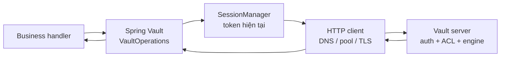
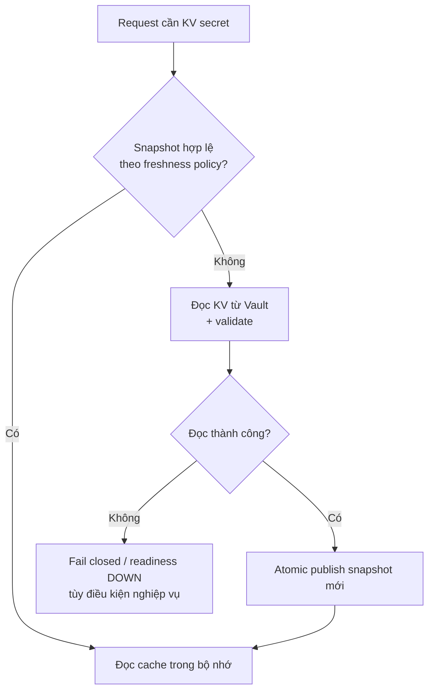

# Đo độ trễ đăng nhập, đọc dữ liệu và thao tác mã hóa

Khi một ứng dụng Java dùng **Spring Vault** để truy cập HashiCorp Vault, một lần gọi secret có thể ảnh hưởng trực tiếp đến thời gian phản hồi API, quá trình khởi động, tốc độ xử lý hàng đợi và độ ổn định khi lượng truy cập tăng. Một hệ thống vẫn có thể trả về kết quả đúng nhưng p95/p99 tăng đột biến do đăng nhập lại quá nhiều, TLS handshake lặp lại, đọc KV trên từng request hoặc gọi Transit encryption nối tiếp không cần thiết.

Trong chương **Quan sát và hiệu năng** của module `SPRING_VAULT`, bài này hướng dẫn **đo, diễn giải và cải thiện độ trễ của ba thao tác cụ thể**:

1. **Đăng nhập (`login`)**: workload dùng Kubernetes/JWT/AppRole hoặc phương thức xác thực phù hợp để nhận Vault token.
2. **Đọc dữ liệu (`read`)**: ứng dụng dùng `VaultTemplate`/`VaultOperations` đọc một secret, ví dụ KV v2.
3. **Mã hóa (`encrypt`)**: ứng dụng gọi Transit secrets engine để mã hóa dữ liệu nhưng không tự sở hữu khóa mã hóa.

Đích đến là bộ đo an toàn bằng **Micrometer**, có đủ số lượt gọi, độ trễ, phân vị, lỗi và ngữ cảnh vận hành, đồng thời **không làm lộ Vault token, plaintext, ciphertext, database password hoặc private key** qua logs/metrics/traces. Ví dụ sử dụng Spring Boot và Spring Vault; các mount, role, key và threshold đều là **giả định trong môi trường thử nghiệm**, không phải số đo hay SLA được công bố của Vault.

## 1. Định nghĩa đúng ba đại lượng cần đo

### 1.1. Đăng nhập: `T_login`

`T_login` là thời gian từ **lúc client bắt đầu thực hiện yêu cầu xác thực với Vault** đến khi nó nhận được một token có thể sử dụng, hoặc nhận kết quả lỗi cuối cùng của lần thử đó.

Ví dụ một workload trên Kubernetes dùng Vault Kubernetes auth: đọc JWT có sẵn của service account, gửi yêu cầu đến `auth/kubernetes/login`, Vault kiểm tra role/identity và trả `auth.client_token`. Luồng AppRole sẽ sử dụng `auth/approle/login` với `role_id`/`secret_id`. Không nhầm:

- **Tạo bean `VaultTemplate`** với **login thành công**: tùy cấu hình/session manager, client có thể chưa truy cập Vault ngay khi bean được khởi tạo.
- **Gia hạn token** với **đăng nhập mới**: renewal thường dùng endpoint khác và có chi phí/khả năng lỗi khác.
- **Một lần login thử nghiệm** với **toàn bộ thời gian startup**: startup còn có nạp cấu hình, tạo context, DNS, đọc KV và kết nối phụ thuộc khác.

Nếu ứng dụng dùng `LifecycleAwareSessionManager`, login có thể diễn ra ở bootstrap hoặc khi session cần xác thực lại, **không phải bắt buộc ở mọi request**. Đo liên tiếp `ClientAuthentication.login()` chỉ để thu thập số liệu có thể tạo token không cần thiết, gây tải cho Vault và làm sai bức tranh hiệu năng. Nên đo **ngay tại lời gọi login thật trong lifecycle**.

### 1.2. Đọc dữ liệu: `T_read`

`T_read` là thời gian của một lần đọc KV/secret mà ứng dụng thực hiện, ví dụ:

```text
VaultVersionedKeyValueOperations.get("apps/payments")
    -> HTTP GET /v1/secret/data/apps/payments
    -> Vault ACL + storage read + network response
    -> deserialize thành Versioned<T>
```

Trước khi đo, cần quyết định **đường nào thực sự thuộc phép đo**:

- **Remote read**: thời gian gọi API Vault, gồm network + HTTP client + xử lý server + parse.
- **Cache hit**: thời gian lấy snapshot đã cache trong JVM, **không phải** thời gian Vault read.
- **Cold start read**: có thể bao gồm khởi tạo connection, DNS hoặc lần authenticate đầu tiên.

Trộn remote read và cache hit vào cùng một histogram mà không phân biệt sẽ làm p95 nhìn có vẻ tốt dù số lần gọi Vault thật tăng hoặc một nhóm request đang bị chậm. Đọc KV v2 phải dùng đúng mount/version và xử lý `data.data`/`Versioned<T>`; không đọc nhầm KV v2 thành KV v1 rồi tính thời gian cho một thao tác không thành công.

### 1.3. Mã hóa: `T_encrypt`

`T_encrypt` là thời gian gửi plaintext đến `transit/encrypt/<key>` và nhận ciphertext hợp lệ, ví dụ với `VaultTransitOperations.encrypt(...)`.

Ở Transit mặc định, payload đi qua TLS đến Vault, Vault dùng khóa đang quản lý để thực hiện thao tác mã hóa, rồi trả ciphertext dạng `vault:vN:...`. Vault Transit **không lưu mỗi bản ghi plaintext/ciphertext cho ứng dụng**; nếu hệ thống cần lưu ciphertext, đó là một thao tác database **khác**, phải đo riêng.

Phân biệt:

- **Encrypt latency**: kết thúc khi ứng dụng nhận ciphertext.
- **Complete write latency**: có thể bao gồm validate input + encrypt + DB INSERT + commit.
- **Decrypt latency**: là thao tác và quyền khác với encrypt; không gộp vào chỉ số encrypt.

Không cần có quyền decrypt để đo encrypt. Một workload encrypt-only vẫn có thể đo thời gian encrypt và kiểm tra ciphertext không rỗng mà không cấp quyền Transit quá rộng.

## 2. Chọn ranh giới đo: client, network và Vault server

Một lời gọi Spring Vault thường trải qua nhiều bước:



**Độ trễ đo quanh `VaultOperations` là độ trễ end-to-end ở phía client**, có thể chứa thời gian lấy token từ session manager, serialization/deserialization, chờ connection pool, network/TLS và xử lý tại Vault. Nó **không** phải metric server-only của Vault.

| Lớp đo | Thời gian bao gồm | Tín hiệu đi kèm hữu ích |
|---|---|---|
| **Business operation** | Validate + Vault + DB/API khác + mapping | Request latency, deadline, mã lỗi nghiệp vụ |
| **Spring Vault call** | Từ trước `read/encrypt` đến khi trả về hoặc ném exception | `operation`, `engine`, `outcome`, duration |
| **Authentication** | Login thực tế để lấy token theo workload | Auth method, số lần login/reauthenticate, renewal failure |
| **HTTP transport** | Request/response đến Vault, có thể gồm connection wait | HTTP method, route template, status, timeout |
| **Vault telemetry** | Hoạt động xử lý bên server | Các metric do Vault cung cấp, health, audit event, resource pressure |
| **Network/TLS** | Kết nối và truyền gói | DNS, reconnect, handshake, proxy, latency theo vùng mạng |

Nếu đo một request handler gồm **đọc KV rồi encrypt rồi ghi DB**, thời gian ở mức handler sẽ chịu ảnh hưởng của cả ba. Khi thao tác tuần tự, tổng thời gian gần bằng tổng chi phí từng bước và phần xử lý khác; khi có concurrency/cache hoặc retry, không thể chỉ cộng ba p95 lại để suy ra p95 request.

Một công thức hữu ích để lập giả thuyết, **không dùng để cộng các percentile**:

```text
T_request_observed
  = T_application_non_Vault
  + T_Vault_calls_on_critical_path
  + T_other_dependencies_on_critical_path
  + T_queue_or_contention
```

Khi nghi ngờ bottleneck, dùng trace để kiểm tra chuỗi phụ thuộc thực sự, sau đó đối chiếu với Vault telemetry và trạng thái connection pool.

## 3. Chọn metric và label có thể vận hành được

Micrometer `Timer` ghi số lần, tổng thời gian và có thể xuất các bucket histogram. Một schema nhỏ nhưng rõ ý nghĩa:

| Metric | Loại | Unit | Labels **được phép** |
|---|---|---|---|
| `vault.client.operation.duration` | Timer | seconds khi xuất sang Prometheus | `operation=login/read/encrypt`, `engine=auth/kv-v2/transit`, `outcome=success/failure` |
| `vault.client.operation.attempts` | Counter (nếu cần phân biệt retry) | count | `operation`, `engine`, `outcome` |
| `vault.session.renewal.failures` | Counter | count | `auth_method`, `reason` dạng enum |
| `vault.client.cache.hit` | Counter | count | `cache_name` cố định, `result=hit/miss` |
| `vault.client.inflight` | Gauge | requests | `operation` với số giá trị giới hạn |

**Không tạo label từ dữ liệu bí mật hoặc giá trị tự do**: token value, token accessor, username, tenant ID, customer ID, request ID, plaintext, ciphertext, tên key/path chứa khách hàng, dynamic lease ID hoặc exception message nguyên bản. Những giá trị đó gây **cardinality explosion**, tốn bộ nhớ trên monitoring backend và có thể tiết lộ dữ liệu.

Ví dụ hai series chấp nhận được:

```text
vault.client.operation.duration{operation="read",engine="kv-v2",outcome="success"}
vault.client.operation.duration{operation="encrypt",engine="transit",outcome="failure"}
```

Không dùng tên method Java hoặc path ngẫu nhiên làm `operation` label; hãy định nghĩa **bộ enum/giá trị tĩnh** ngay ở adapter.

## 4. Cài đặt Timer cho các lệnh Spring Vault

### 4.1. Helper đo duration dùng monotonic clock

Java có `System.nanoTime()` để đo elapsed time; không dùng `System.currentTimeMillis()` để tính latency vì đồng hồ hệ thống có thể thay đổi theo NTP. Micrometer `Timer` lưu elapsed time với đơn vị rõ ràng.

```java
import java.util.Objects;
import java.util.concurrent.TimeUnit;
import java.util.function.Supplier;

import io.micrometer.core.instrument.MeterRegistry;

public final class VaultCallMetrics {

    private final MeterRegistry meters;

    public VaultCallMetrics(MeterRegistry meters) {
        this.meters = Objects.requireNonNull(meters);
    }

    // operation/engine chỉ truyền các giá trị cố định được ứng dụng định nghĩa.
    public <T> T measure(
            String operation, String engine, Supplier<T> action) {

        long started = System.nanoTime();
        boolean success = false;

        try {
            T result = action.get();
            success = true;
            return result;
        } finally {
            String outcome = success ? "success" : "failure";

            meters.timer(
                "vault.client.operation.duration",
                "operation", operation,
                "engine", engine,
                "outcome", outcome
            ).record(
                System.nanoTime() - started,
                TimeUnit.NANOSECONDS
            );
        }
    }
}
```

Helper này đếm cả lời gọi **thất bại** vì `finally` vẫn thực thi khi `action.get()` ném exception. Timer phân biệt outcome, không ghi exception message. Nếu wrapper nhận kết quả `null` mà ứng dụng coi là lỗi (chẳng hạn KV secret bắt buộc không có), phải **validate bên trong lambda** trước khi trả về để outcome không bị tính nhầm thành success.

Đối với tác vụ reactive `Mono`/`Flux`, wrapper đồng bộ như trên **chỉ đo thời gian xây publisher**, không đo request thực. Phải đặt `Observation`/Timer ở điểm subscribe đến terminal signal thích hợp, theo API Reactor/Micrometer tương ứng; tránh dùng `nanoTime` bên ngoài `Mono.defer(...)` và coi đó là duration của I/O.

### 4.2. Đo đọc KV v2 thực sự

Ví dụ ứng dụng đã có `VaultOperations` bean xác thực bằng workload identity. KV v2 được mount tại `secret/`, key `apps/payments`:

```java
import java.util.Map;
import java.util.Objects;

import org.springframework.vault.core.VaultOperations;
import org.springframework.vault.core.VaultVersionedKeyValueOperations;
import org.springframework.vault.support.Versioned;

public final class MeasuredKvReader {

    private final VaultVersionedKeyValueOperations kv;
    private final VaultCallMetrics metrics;

    public MeasuredKvReader(
            VaultOperations vault, VaultCallMetrics metrics) {
        this.kv = vault.opsForVersionedKeyValue("secret");
        this.metrics = metrics;
    }

    public Map<String, Object> readRequiredSettings() {
        return metrics.measure("read", "kv-v2", () -> {
            Versioned<Map<String, Object>> versioned =
                Objects.requireNonNull(
                    kv.get("apps/payments"),
                    "Required KV secret not available"
                );
            return Objects.requireNonNull(
                versioned.getData(), "Required KV data absent"
            );
        });
    }
}
```

Ở đây `kv.get(...)` là **remote read**. Nó có thể dẫn tới `403` nếu Vault policy thiếu `read` tại `secret/data/apps/payments`, hoặc không có dữ liệu nếu key/version không đọc được. Nếu ứng dụng dùng cache, đo riêng lần đọc cache ở tầng khác; không gọi phương thức này chỉ để làm đầy sample histogram.

**Không ghi `versioned.getData()` vào log hoặc metric.** `data` có thể chứa secret. Nếu cần kiểm tra chất lượng response, dùng validation phía ứng dụng và ghi mã lỗi có số lượng nhãn giới hạn như `missing/invalid/permission/timeout`.

### 4.3. Đo thao tác mã hóa Transit

```java
import java.nio.charset.StandardCharsets;
import java.util.Objects;

import org.springframework.vault.core.VaultOperations;
import org.springframework.vault.core.VaultTransitOperations;
import org.springframework.vault.support.Ciphertext;
import org.springframework.vault.support.Plaintext;

public final class MeasuredTransitEncryptor {

    private final VaultTransitOperations transit;
    private final VaultCallMetrics metrics;

    public MeasuredTransitEncryptor(
            VaultOperations vault, VaultCallMetrics metrics) {
        this.transit = vault.opsForTransit("transit");
        this.metrics = metrics;
    }

    public String encrypt(String sensitiveText) {
        Objects.requireNonNull(sensitiveText);

        return metrics.measure("encrypt", "transit", () -> {
            Plaintext plain = Plaintext.of(
                sensitiveText, StandardCharsets.UTF_8
            );
            Ciphertext result = transit.encrypt("customer-pii", plain);
            if (result == null
                    || result.getCiphertext() == null
                    || result.getCiphertext().isBlank()) {
                throw new IllegalStateException("Transit ciphertext absent");
            }
            return result.getCiphertext();
        });
    }
}
```

Đây là duration của **encrypt**, không bao gồm thao tác INSERT ciphertext vào database thực hiện sau đó. Nếu payload đa dạng, có thể kiểm tra kích thước của dữ liệu theo các **nhóm kích thước cố định** (`small/medium/large`) trong môi trường lab. Không gắn raw payload size chi tiết hoặc ciphertext làm label; và không ghi plaintext vào log, HTTP body trace hoặc sample.

### 4.4. Đo đăng nhập đúng luồng xác thực

Với Spring Vault, `ClientAuthentication.login()` trả `VaultToken`. Để quan sát một lần login **thực tế**, có thể bao quanh lời gọi mà `SessionManager`/bootstrap thực sự sử dụng:

```java
import java.util.Objects;

import org.springframework.vault.authentication.ClientAuthentication;
import org.springframework.vault.support.VaultToken;

public final class MeasuredClientAuthentication
        implements ClientAuthentication {

    private final ClientAuthentication delegate;
    private final VaultCallMetrics metrics;

    public MeasuredClientAuthentication(
            ClientAuthentication delegate, VaultCallMetrics metrics) {
        this.delegate = Objects.requireNonNull(delegate);
        this.metrics = metrics;
    }

    @Override
    public VaultToken login() {
        return metrics.measure("login", "auth", delegate::login);
    }
}
```

Ở bước cấu hình authentication, **dùng wrapper thay cho `delegate`** tại điểm session manager lấy client authentication; không tạo một lần `delegate.login()` chỉ để đo rồi bỏ token vừa nhận. Nếu một authentication flow còn dùng interface đặc biệt như `AuthenticationStepsFactory`, phải tích hợp measurement vào **chuỗi đang được runtime dùng**, thay vì wrapper làm mất cơ chế authentication steps của thư viện.

Đo bằng cách bao quanh `login()` cho thấy thời gian mà phương thức này thực hiện, nhưng tùy loại authentication nó **không bao gồm** toàn bộ các công đoạn diễn ra bên ngoài (đọc JWT từ filesystem, khởi tạo TLS, unwrap token trước login hoặc lookup TTL sau login). Ghi rõ boundary trong mô tả metric.

**Không** đưa `VaultToken.getToken()` vào `Timer` label, log hoặc exception. Nếu muốn biết login thành công, đo outcome và thống kê session renewal, không lưu raw credential trong hệ thống quan sát.

### 4.5. Đăng ký và xuất metrics

Với Spring Boot, bổ sung `spring-boot-starter-actuator` cùng Micrometer registry tương ứng (ví dụ `micrometer-registry-prometheus`). Bean `MeterRegistry` được Boot cung cấp, có thể inject vào `VaultCallMetrics`:

```java
import io.micrometer.core.instrument.MeterRegistry;
import org.springframework.context.annotation.Bean;
import org.springframework.context.annotation.Configuration;

@Configuration
class VaultMetricsConfiguration {

    @Bean
    VaultCallMetrics vaultCallMetrics(MeterRegistry registry) {
        return new VaultCallMetrics(registry);
    }
}
```

Ví dụ cấu hình Boot cho Prometheus và histogram:

```yaml
management:
  endpoints:
    web:
      exposure:
        include: health,info,prometheus
  metrics:
    distribution:
      percentiles-histogram:
        vault.client.operation.duration: true
      slo:
        vault.client.operation.duration: 50ms,100ms,250ms,500ms,1s,2s
```

Histogram bucket giúp Prometheus tính phân vị trên nhiều instance. Việc bật histogram cho **tất cả timer** với cardinality cao sẽ làm tăng số series; ở đây chỉ bật cho metric đã kiểm soát label. `slo` trong ví dụ là **bucket ranh giới quan sát**, không tự trở thành SLO cam kết kinh doanh.

`/actuator/prometheus` là endpoint nhạy cảm về vận hành: chỉ cho monitoring system truy cập trong mạng/identity phù hợp. Đừng mở công khai endpoint metrics, health details hoặc Actuator configuration.

## 5. Tính p50, p95, p99 và error rate đúng cách

### 5.1. Phân vị không phải giá trị trung bình

| Chỉ số | Diễn giải | Dùng để |
|---|---|---|
| `count` | Số lời gọi trong khoảng quan sát | Xác định đủ sample hay không |
| `mean` | Tổng thời gian chia số lần gọi | Theo dõi xu hướng tổng quát; dễ bị che mất đuôi chậm |
| `p50` | 50% mẫu có latency không lớn hơn ngưỡng | Trải nghiệm điển hình |
| `p95` | 95% mẫu không lớn hơn ngưỡng | Cảnh báo tail latency |
| `p99` | 99% mẫu không lớn hơn ngưỡng | Nút thắt nghiêm trọng ở đuôi |
| Error rate | Tỷ lệ kết quả thất bại | Phân biệt chậm nhưng đúng với nhanh nhưng lỗi |

**p95 không phải mức latency cao nhất.** Nếu một chu kỳ có rất ít lần login, tính p99 sẽ thiếu ý nghĩa thống kê; nên quan sát tỷ lệ startup/login thất bại, total time to ready và duration từng attempt thay vì dựng dashboard p99 từ vài mẫu.

Một bộ số liệu **giả định để minh họa cách đọc**, không phải benchmark Spring Vault hoặc HashiCorp:

| Operation | Số mẫu | p50 | p95 | p99 | Diễn giải ban đầu |
|---|---:|---:|---:|---:|---|
| `read` remote KV v2 | 10.000 | 18 ms | 55 ms | 120 ms | Tail latency cần đối chiếu transport và server |
| `encrypt` Transit, payload nhỏ | 10.000 | 24 ms | 80 ms | 180 ms | So sánh theo kích thước payload và concurrency |
| `login` ở bootstrap | 10 | 95 ms | — | — | Ít mẫu: không nên kết luận p95/p99 đáng tin |

Không tự đề xuất SLO từ các số giả định. SLO phải được chốt dựa trên nhu cầu API của ứng dụng, dữ liệu đo ở tải thực tế, error budget và khả năng vận hành.

### 5.2. Prometheus histogram query

Khi `vault.client.operation.duration` được xuất sang Prometheus, Timer thường tạo các metric kiểu `_seconds_count`, `_seconds_sum` và `_seconds_bucket`. Tính p95 theo operation, engine từ histogram:

```promql
histogram_quantile(
  0.95,
  sum by (le, operation, engine) (
    rate(
      vault_client_operation_duration_seconds_bucket{
        outcome="success"
      }[5m]
    )
  )
)
```

Đo riêng **failure latency** vì request `403` thường có thể nhanh hơn một request thành công, còn timeout thì chậm hơn đáng kể. Nếu gộp cả hai trong p95 thành công, một sự cố xác thực hàng loạt có thể làm latency trung bình giảm trong khi service đang hỏng.

Để biết mức gọi thành công mỗi giây:

```promql
sum by (operation, engine) (
  rate(
    vault_client_operation_duration_seconds_count{
      outcome="success"
    }[5m]
  )
)
```

Tỷ lệ lỗi trong khoảng thời gian có đủ request:

```text
Error rate = count(outcome="failure")
           / count(outcome="success" hoặc "failure")
```

Ở hệ thống không có request trong khoảng thời gian đó, mẫu số bằng 0; không hiển thị như `0% lỗi` rồi kết luận hệ thống khỏe. Cần hiển thị `no data` và số sample. Ở các cửa sổ 1 phút/5 phút, phân vị có độ nhạy khác nhau; một sự cố ngắn có thể bị làm mờ trong cửa sổ dài.

## 6. Phân biệt login, token renewal và đọc secret

Một cách phổ biến làm tăng độ trễ là **đăng nhập lại trước mọi request**. Ví dụ handler:

```java
// ANTI-PATTERN: mỗi request tự login lại.
public String handleRequest(ClientAuthentication authentication) {
    VaultToken token = authentication.login();
    // Rồi tạo client mới và đọc secret bằng token mỗi lần.
    // Có thể tăng QPS ở auth mount, token store và network/TLS.
    return "not-a-production-example";
}
```

Thay vào đó, cấu hình `ClientAuthentication` phù hợp, giao token/session management cho `VaultTemplate`/`SessionManager` và chỉ thực hiện đăng nhập mới khi thực sự cần. `LifecycleAwareSessionManager` có thể tự gia hạn token khi token renewable và điều kiện Vault cho phép.

Điều cần phân biệt trong dashboard:

- `login` tăng đột biến: có thể do rollout, pod restart, token không renewable, cấu hình auth failure hoặc session bị tạo mới quá nhiều.
- `renew` tăng đột biến: kiểm tra vòng đời token, ngưỡng refresh, TTL bị rút ngắn, xung đột lịch renewal.
- `read` tăng đột biến: ứng dụng đọc KV trên mỗi request, cache miss hàng loạt, retry không kiểm soát hoặc request volume tăng thật.
- `encrypt` tăng đột biến: traffic nghiệp vụ, kích thước payload, batching không phù hợp, client pool hoặc Transit server pressure.

Nếu chỉ có metric `vault.client.operation.duration` ba loại, vẫn cần giám sát **số lần** theo loại để phân biệt một lần thao tác bị chậm với lượng thao tác tăng đột biến.

### Token expires không phải lúc nào cũng làm tăng latency

Một token hết hạn có thể khiến `read/encrypt` trả lỗi `403` nhanh, không nhất thiết tạo p95 tăng. Vì vậy **error rate và trạng thái session** là chỉ số bắt buộc song hành với latency. Đừng tối ưu số ms bằng cách bỏ qua lỗi, cấp thêm quyền cho token hoặc fallback sang root token.

### Cold start cần chỉ số riêng

Nếu mỗi pod khởi động chỉ login một lần, khối lượng mẫu login nhỏ. Nên đo:

1. Thời gian từ lúc process bắt đầu đến khi workload token đầu tiên hợp lệ.
2. Thời gian đọc/validate secret bắt buộc ở startup.
3. Thời gian đến `ApplicationReadyEvent` và readiness UP.
4. Tỷ lệ bootstrap failure và số lần retry theo lý do.

Không trộn "read lần đầu có TLS handshake" với "read ở trạng thái steady state" rồi suy ra cache/transport hoạt động ổn định. Có thể so sánh cold/warm theo **hai dashboard hoặc hai kịch bản benchmark** thay vì đưa request ID/pod UID vào label metrics.

## 7. Caching và performance: đo đúng trade-off

KV v2 chứa bí mật tĩnh thường không cần đọc từ Vault trên mọi HTTP request. Một cache/snapshot đã xác minh có thể giảm `T_read` tổng cộng, nhưng có rủi ro sử dụng secret cũ sau khi operator rotate key.



Khi đo performance có cache:

| Metric | Cần đo ở đâu | Ý nghĩa |
|---|---|---|
| `vault.client.operation.duration{operation=read}` | Chỉ quanh remote KV call | Hiệu năng tương tác Vault thật |
| `vault.client.cache.hit{result=hit}` | Tại lookup cache | Mức giảm request lên Vault |
| `vault.client.cache.hit{result=miss}` | Tại lookup cache | Nguy cơ stampede sau expiry |
| `secret.snapshot.age` | State nội bộ, theo nhóm secret cố định | Phát hiện stale và nguy cơ rotation |
| Business request duration | Handler hoặc HTTP server observation | Hiệu năng thực người dùng cảm nhận |

Nếu dùng `AtomicReference` để thay snapshot, có thể tránh hiện tượng đọc nửa bộ credentials mới, nửa cũ. Nếu nhiều request cùng cache miss, cần single-flight hoặc cơ chế đồng bộ refresh để không cho hàng trăm thread đồng thời gọi Vault. Nhưng không được cache plaintext Transit/decrypt vô thời hạn chỉ để giảm độ trễ: cần đánh giá threat model, chính sách dữ liệu và vòng đời bí mật.

**Transit encryption thường không thay được bằng cache ciphertext** vì Vault mặc định tạo ciphertext khác nhau cho cùng plaintext và nhu cầu nghiệp vụ cần mã hóa từng bản ghi theo khóa/phiên bản hiện hành. Không gộp kết quả encrypt theo plaintext hoặc dùng ciphertext đã cache cho dữ liệu khác nếu chưa có thiết kế bảo mật được phê duyệt.

## 8. Các nguyên nhân thường gặp của tail latency

| Hiện tượng quan sát | Giả thuyết cần kiểm chứng | Phép đo / biện pháp |
|---|---|---|
| p95 `read` cao sau mỗi rollout | DNS, tạo connection mới, TLS handshake, login đầu kỳ | So cold/warm, connection reuse, startup metrics |
| p99 `encrypt` tăng khi concurrent requests cao | Chờ connection pool, Vault CPU, proxy/bandwidth | Thread/HTTP pool metrics, Vault telemetry, load profile |
| Thời gian login tăng cùng số pod | Auth method pressure, external identity validation, burst khi rollout | Login QPS, Vault auth status, rollout staggering |
| Lỗi timeout xuất hiện trước khi p95 tăng | Network jitter hoặc pool exhaustion, timeout quá ngắn | Failure count + duration failure, client pool, transport |
| p95 tốt nhưng throughput rất thấp | Ít mẫu, request bị reject nhanh, circuit breaker open | Count/QPS, error rate, saturation, rejection count |
| `read` nhiều hơn traffic API nhiều lần | Đọc lặp lại tại mỗi service layer, cache miss, retry | Ratio read QPS / business request QPS |
| `encrypt` chậm theo kích thước payload | Serialization/Base64/network nhiều hơn mật mã | Benchmark theo các nhóm kích thước cố định |
| Auth latency tốt nhưng request Vault lỗi | Token được cấp nhưng ACL không cho engine endpoint | Phân tích `403` và effective policies |
| Latency tăng khi Vault failover/leadership change | Redirect/retry/network route, storage backend | Tracing theo thời điểm và Vault server telemetry |

Phương pháp điều tra nên đi từ **metric tổng quan → trace của request chậm → dấu hiệu phía Vault/transport → thử nghiệm một biến tại một thời điểm**. Tránh đổi đồng thời TTL, connection pool, cache và retry rồi không còn biết điều gì làm metric tốt lên.

### HTTP connection và TLS

Trong môi trường production, dùng TLS với xác minh certificate đầy đủ. Kết nối tái sử dụng qua HTTP pool/keep-alive có thể giảm handshake; nhưng cấu hình pool phải phù hợp concurrency, timeout và giới hạn Vault/proxy. Không giải quyết p99 bằng cách tắt TLS, bỏ certificate validation hoặc đưa Vault lên public internet không bảo vệ.

### Timeout, retry và rate limit

- Đặt connect/read timeout tương ứng với ngân sách latency của request và SLO.
- Retry có giới hạn, exponential backoff và jitter cho lỗi tạm thời. Đo **attempt duration** riêng với **logical operation duration** nếu retry xảy ra trong adapter.
- Với `429` hoặc `5xx`, không tự tạo retry storm khi Vault đang quá tải; cần giới hạn concurrency và circuit breaker thích hợp.
- Với `403` do ACL hoặc `400` do dữ liệu sai, retry liên tục không sửa được nguyên nhân.
- Tránh thay đổi semantics khi retry: mã hóa lại có thể tạo ciphertext khác, login lại có thể tạo token khác. Bảo đảm idempotency ở tầng nghiệp vụ nếu kết quả được ghi vào DB.

Không được tăng timeout vô hạn để che vấn đề; nó khiến thread chờ lâu, lấp đầy pool và tăng tail latency của các request còn lại.

## 9. Kết hợp tracing, logging và Vault telemetry

### 9.1. Instrumentation phải tránh double count

Spring Boot Actuator, Micrometer Observation và một số HTTP client có thể đã cung cấp HTTP/client instrumentation. Nếu thêm `VaultCallMetrics` ở tầng Spring Vault **và** instrumentation HTTP transport, đây là **hai lớp đo khác nhau**, không phải hai event trùng bắt buộc phải cộng lại.

Ví dụ:

```text
Trace: POST /payments
  ├─ span business: process-payment
  ├─ span vault logical: encrypt
  │    └─ HTTP client span: POST /v1/transit/encrypt/{key}
  └─ span database: INSERT ciphertext
```

Nếu cả interceptor của HTTP client và method aspect đều tạo span có tên `vault.encrypt` cho **chính một request** với cùng start/end, dashboard có thể gây hiểu nhầm về số lượt gọi. Hãy quy định rõ: method-level metric chỉ tính lời gọi logic, HTTP-level metric tính attempt, trace mô tả quan hệ cha-con.

### 9.2. Trace attributes an toàn

Có thể dùng:

- `vault.engine=transit`, `vault.operation=encrypt` theo danh sách cố định.
- `http.request.method=POST`, `http.response.status_code`, loại lỗi an toàn.
- `server.address`/target environment đã chuẩn hóa nếu không làm lộ hệ thống nhạy cảm.
- Correlation/trace ID trong trace backend có kiểm soát.

**Không ghi** `X-Vault-Token`, AppRole secret ID, JWT, plaintext dạng Base64, ciphertext đầy đủ, DB password, PKI private key hay response body. Ngoài bí mật trực tiếp, path có thể chứa tenant/customer ID; dùng route template (ví dụ `/transit/encrypt/{key}`) hoặc nhóm endpoint cố định thay vì raw URL động.

Nếu gửi request body Transit tới một tracing HTTP library tự động capture payload, cần **tắt body capture/redact ngay tại HTTP instrumentation**, không chỉ xóa field sau khi trace đã rời process.

### 9.3. Phân vai client telemetry và Vault server telemetry

| Phía | Có thể cho biết | Không thể tự chứng minh |
|---|---|---|
| Micrometer phía Java | Thời gian lời gọi từ ứng dụng, outcome, retry, cache hit | Chính xác phần nào của thời gian ở Vault server |
| Tracing của Java | Chuỗi thao tác nghiệp vụ, HTTP calls, thời gian chờ | Mọi chi tiết server/storage nếu Vault không instrument |
| Vault telemetry | Tình trạng request, storage/backend, auth engine, resource và lỗi theo phiên bản | User-facing latency của toàn bộ ứng dụng |
| Vault audit device | Ai gọi endpoint nào và kết quả liên quan theo chính sách audit | Bộ đo latency hoàn chỉnh hoặc thay thế tracing |
| Network/infra metrics | TCP connect, DNS, TLS, proxy, CPU/memory | Cấu trúc secret và quyền Vault đúng hay sai |

Vault audit log có giá trị để điều tra `403` và hành vi bất thường; tuy nhiên cần bảo vệ audit device, không tự ghi raw body hoặc token qua hệ thống log của ứng dụng. Đối chiếu Vault request ID nếu có, cùng timestamp có đồng bộ đồng hồ để xác định các lớp bị chậm.

## 10. Quy trình benchmark lặp lại được

Benchmark đáng tin phải trả lời **đang đo phép gì, ở tải nào, trong điều kiện nào và bao nhiêu mẫu**. Một kết quả "Vault read mất 10 ms" không có ý nghĩa nếu thiếu kích thước payload, network topology, số pod, cache state và cách đo.

### 10.1. Chuẩn bị môi trường thử nghiệm

1. Dùng Vault thử nghiệm cô lập và không chứa production secrets; ghi rõ Vault version, storage backend, TLS, node topology và latency giữa ứng dụng-Vault.
2. Provision policy hẹp cho từng workload: `read` tại `secret/data/apps/payments`, `update` tại `transit/encrypt/customer-pii`, login theo auth role thử nghiệm.
3. Dùng plaintext giả, không dùng token/credential có thật trong fixture.
4. Chốt phiên bản Spring Boot, Spring Vault, HTTP client, cấu hình connection pool, timeout và JVM flags.
5. Chọn tải đồng thời, QPS, kích thước payload và tỷ lệ cache hit trước khi đo.
6. Đảm bảo metric có histogram bucket, error rate, request count và trace sampling không ghi bí mật.

### 10.2. Chạy ba nhóm thí nghiệm riêng

| Thí nghiệm | Cách đo | Bẫy cần tránh |
|---|---|---|
| **Login** | Chạy chu kỳ bootstrap thực tế trên các instance/job thử nghiệm, đếm request auth và thời gian đến token usable | Không tạo login liên tục trong hot loop như benchmark encrypt |
| **Read** | Đo remote KV v2 read với cache tắt, sau đó đo read-through cache riêng | Không gộp cache hit vài microsecond với HTTP read |
| **Encrypt** | Gửi payload giả theo các bucket kích thước cố định (nhỏ, trung bình, lớn) với concurrency kiểm soát | Không dùng ciphertext hay plaintext làm metric labels |

Mỗi thí nghiệm có ít nhất một giai đoạn **warm-up** để ổn định JVM/connection pool, và một giai đoạn đo chính thức. Với các phép đo quá ít sample, không công bố p99; với latency cao bất thường, so sánh cả sample count và lỗi.

Một khung ghi kết quả (điền số thực sau khi chạy):

| Run | Operation | Payload group | Concurrent clients | Count | Error % | p50 | p95 | p99 |
|---|---|---|---:|---:|---:|---:|---:|---:|
| A | login | n/a | Theo số instance khởi động | … | … | … | … | n/a nếu ít mẫu |
| B | read | 1 KB KV data | 1 | … | … | … | … | … |
| C | read | 1 KB KV data | 32 | … | … | … | … | … |
| D | encrypt | 128 B | 1 | … | … | … | … | … |
| E | encrypt | 128 B | 32 | … | … | … | … | … |
| F | encrypt | 16 KB | 32 | … | … | … | … | … |

Không so sánh run B và E rồi khẳng định Transit intrinsically chậm hơn KV: payload, endpoint, quyền, network, backend và concurrency khác nhau. Chỉ thay **một nhóm biến** giữa các run nếu mục tiêu là đánh giá tác động của biến đó.

### 10.3. Load-test kết hợp failure injection

Thử thêm:

- Cho Vault chậm hoặc ngắt kết nối có kiểm soát; xác minh timer ghi failure duration và client timeout đúng deadline.
- Thử token hết TTL; quan sát login/renew failure, `read/encrypt` `403` và recovery.
- Giảm kích thước connection pool; quan sát p99, pending connections và saturation.
- Tạo spike đồng thời của 50 instance khi rollout; xem login burst và time to ready.
- Mô phỏng `429`/`5xx`; xác minh backoff/jitter và giới hạn retry, không tạo thêm QPS ngoài ý muốn.
- Bật cache KV rồi invalidation đồng thời; xác minh single-flight chống stampede.
- Rotate Transit key trong Vault thử nghiệm; xác minh encryption vẫn thành công và label metrics không phát nổ theo key version.

Thử nghiệm mất kết nối/ACL nên làm trên **Vault lab**, không gây gián đoạn cụm dùng chung hoặc production. Nếu dùng synthetic monitoring lâu dài, hãy dùng dữ liệu giả và endpoint/role giới hạn, không gọi decrypt hoặc cấp cert không cần thiết.

## 11. Kiểm thử code đo bằng Micrometer

Một phép kiểm tra đơn vị quan trọng là **thành công và lỗi đều được ghi**, nhưng không phát sinh label từ nội dung bí mật.

```java
import io.micrometer.core.instrument.Timer;
import io.micrometer.core.instrument.simple.SimpleMeterRegistry;
import org.junit.jupiter.api.Test;

import static org.junit.jupiter.api.Assertions.*;

class VaultCallMetricsTest {

    @Test
    void recordsBothSuccessAndFailureWithoutSecrets() {
        SimpleMeterRegistry registry = new SimpleMeterRegistry();
        try {
            VaultCallMetrics metrics = new VaultCallMetrics(registry);

            String ciphertext = metrics.measure(
                "encrypt", "transit", () -> "vault:v1:example"
            );
            assertEquals("vault:v1:example", ciphertext);

            assertThrows(IllegalStateException.class, () ->
                metrics.measure("encrypt", "transit", () -> {
                    throw new IllegalStateException("demo failure");
                })
            );

            Timer success = registry.find("vault.client.operation.duration")
                .tags("operation", "encrypt", "engine", "transit",
                      "outcome", "success")
                .timer();
            Timer failure = registry.find("vault.client.operation.duration")
                .tags("operation", "encrypt", "engine", "transit",
                      "outcome", "failure")
                .timer();

            assertNotNull(success);
            assertNotNull(failure);
            assertEquals(1, success.count());
            assertEquals(1, failure.count());
        } finally {
            registry.close();
        }
    }
}
```

Test đo thời gian có thể dùng `Clock` hoặc fake delay để kiểm tra đo được duration dương, nhưng **không assertion cứng như "mã hóa thật phải dưới 20 ms"** trong CI vì rất dễ flaky theo scheduler/network. Với integration test, dùng Vault thử nghiệm, verify response đúng và xác minh `Timer` tăng đúng số lần; không chỉ assert metric được đăng ký.

### Các kịch bản tích hợp nên có

| Kịch bản | Bằng chứng cần thu | Kết quả đúng |
|---|---|---|
| Login theo workload | Timer login, count auth, token policy hiệu lực | Login thành công, metric một lần cho một lần login thật |
| Login thất bại | Không hợp lệ role/JWT trong lab | outcome failure tăng, không ghi token/JWT |
| KV v2 read thành công | Timer read, version/key đúng | data đúng, latency được ghi |
| KV secret bị xóa | Timer read failure, Vault status | Không coi `null` là success, handler fail closed |
| Token thiếu quyền KV | `403` và timer failure | Không thay thành default secret |
| Transit encrypt | Ciphertext `vault:vN:...`, timer encrypt | Không log plaintext/ciphertext |
| Token encrypt-only gọi decrypt | `403` và audit thử nghiệm | Không cấp thêm quyền chỉ để đo latency |
| Vault timeout | Timeout + timer failure + business error | Không treo vô hạn hoặc retry storm |
| Nhiều request đồng thời | Histogram p95/p99, pool saturation | Nhìn thấy bottleneck mà không tăng tag cardinality |
| Secret rotation/cold start | Thời gian đến readiness, login/read counts | Metric phản ánh thời gian thực, không gộp cache hit |

## 12. Những sai lầm khiến kết quả đo gây hiểu nhầm

| Sai lầm | Hệ quả | Cách sửa |
|---|---|---|
| Dùng `currentTimeMillis` và lấy hiệu trên đồng hồ wall-clock | Time có thể âm/nhảy theo đồng bộ giờ | Dùng `nanoTime`/Micrometer `Timer` |
| Đo `VaultTemplate` bean creation rồi gọi là login latency | Có thể chưa gửi auth request | Instrument lời gọi auth thật và session lifecycle |
| Gọi login liên tục để có nhiều mẫu p99 | Tạo token không cần thiết, ảnh hưởng Vault | Đo bootstrap/reauthentication thật; p99 chỉ dùng khi đủ sample |
| Gộp cache hit và remote KV read | p95 thấp giả | Đo riêng cache và remote read |
| Chỉ báo p95 latency của request thành công | Lỗi permission/timeout bị che | Theo dõi count/error rate + failure duration |
| Thêm `token`/`userId`/`secretPath` vào label | Rò rỉ metadata và cardinality cao | Dùng enum operation/engine/outcome |
| Log body request Transit để điều tra lỗi | Có thể lộ plaintext dạng Base64 | Tắt body capture, ghi category lỗi |
| Đo mỗi HTTP attempt nhưng kết luận một business call | Retry tạo nhiều attempt | Đo cả logical operation và transport attempt |
| Đặt timeout rất lớn để p99 ít bị fail | Thread bị giữ, throughput giảm | Timeout theo deadline, retry/backoff có giới hạn |
| Chỉ tăng cache TTL để giảm read latency | Dùng secret stale sau rotation/revoke | Thiết kế freshness/rotation và quyền hợp lý |
| Thấy `403` rồi cấp `root` để benchmark | Xóa ranh giới least privilege | Sửa policy đúng Vault endpoint |
| Tính p99 trên vài mẫu login | Phân vị không đáng tin | Báo count/time-to-ready; không suy luận tail từ quá ít mẫu |

## 13. Checklist thực hành và câu hỏi tự kiểm tra

### Checklist trước khi đưa metrics lên dashboard

- [ ] Có định nghĩa rõ `login`, remote `read` và `encrypt` bắt đầu/kết thúc ở đâu.
- [ ] Login được instrument đúng lifecycle, không gọi extra login chỉ để đo.
- [ ] Micrometer `Timer` đo thời gian bằng monotonic clock và ghi cả outcome failure.
- [ ] Labels chỉ gồm operation/engine/outcome thuộc danh sách cố định.
- [ ] Đã bật histogram bucket phù hợp khi cần tổng hợp p95/p99 qua nhiều instance.
- [ ] Có QPS/count và error rate đi kèm latency; nhận diện `no data`.
- [ ] Cache hit/miss được đo riêng với Vault remote read.
- [ ] Có auth renewal, token expiry, timeout/retry và transport telemetry để giải thích tail latency.
- [ ] Tracing và HTTP instrumentation không ghi request/response body chứa secret.
- [ ] Dashboard phân biệt cold start với steady-state; login ít sample không báo p99 thiếu ý nghĩa.
- [ ] Benchmark đã ghi tải, payload group, concurrency, Vault version/topology, JVM và timeout.
- [ ] ACL theo workload không bị nới rộng để phục vụ debug hoặc đo đạc.

### Câu hỏi tự kiểm tra

1. Vì sao đo `new VaultTemplate(...)` không nhất thiết là đo login latency?
2. Nếu mỗi request đều gọi `ClientAuthentication.login()`, những metric nào giúp bạn nhận ra lỗi thiết kế này?
3. Một lần `opsForVersionedKeyValue("secret").get("apps/payments")` bao gồm những lớp thời gian nào ở phía client?
4. Vì sao p95 `read` có thể giảm khi cache hit nhiều, dù remote Vault read chưa nhanh hơn?
5. Timer `finally` cần làm gì khi Transit trả exception để tỷ lệ lỗi không bị che?
6. Vì sao `vault:v3:...` không phải một giá trị nhãn metric tốt và cũng không phải dữ liệu nên log?
7. Trong Prometheus, tại sao phải tổng hợp theo `le` trước khi gọi `histogram_quantile(...)`?
8. Tại sao p99 login ở giai đoạn startup chỉ có 10 lần đăng nhập không đủ cơ sở để kết luận?
9. Nếu token bị revoke và request bắt đầu thất bại rất nhanh, chỉ nhìn p95 latency có thể dẫn đến kết luận sai nào?
10. Làm thế nào phân biệt việc Vault server chậm với chờ connection pool hoặc TLS handshake ở HTTP client?
11. Vì sao cần theo dõi logical operation latency và retry attempt latency riêng?
12. Có được tắt TLS hoặc dùng Vault root token để giảm latency trong bài benchmark production không? Vì sao?

**Điểm cần nhớ:** Một hệ thống quan sát Spring Vault tốt đo **thời gian thực tế của đăng nhập, đọc dữ liệu và mã hóa**, nhưng luôn đặt chúng cạnh **lượng request, tỷ lệ lỗi, thời hạn token, cache, network và Vault telemetry**. Số liệu chỉ đáng tin khi boundary rõ ràng, có đủ sample và không đánh đổi bảo mật secret để lấy khả năng debug.

## Tài liệu chính thức

- [Spring Vault — Authentication và session management](https://docs.spring.io/spring-vault/reference/vault/authentication.html)
- [Spring Vault — VaultTemplate/VaultOperations](https://docs.spring.io/spring-vault/reference/vault/core.html)
- [Spring Vault — KV và Transit secrets engines](https://docs.spring.io/spring-vault/reference/vault/vault-secret-engines.html)
- [Spring Boot — Metrics và observability với Actuator](https://docs.spring.io/spring-boot/reference/actuator/metrics.html)
- [Spring Boot — Actuator và Prometheus](https://docs.spring.io/spring-boot/reference/actuator/endpoints.html)
- [Micrometer — Timers](https://docs.micrometer.io/micrometer/reference/concepts/timers.html)
- [Micrometer — Histograms and Percentiles](https://docs.micrometer.io/micrometer/reference/concepts/histogram-quantiles.html)
- [Prometheus — Histograms and summaries](https://prometheus.io/docs/practices/histograms/)
- [HashiCorp Vault — Telemetry](https://developer.hashicorp.com/vault/docs/internals/telemetry)
- [HashiCorp Vault — Audit devices](https://developer.hashicorp.com/vault/docs/audit)
- [HashiCorp Vault — Transit HTTP API](https://developer.hashicorp.com/vault/api-docs/secret/transit)
- [HashiCorp Vault — KV v2 API](https://developer.hashicorp.com/vault/api-docs/secret/kv/kv-v2)
